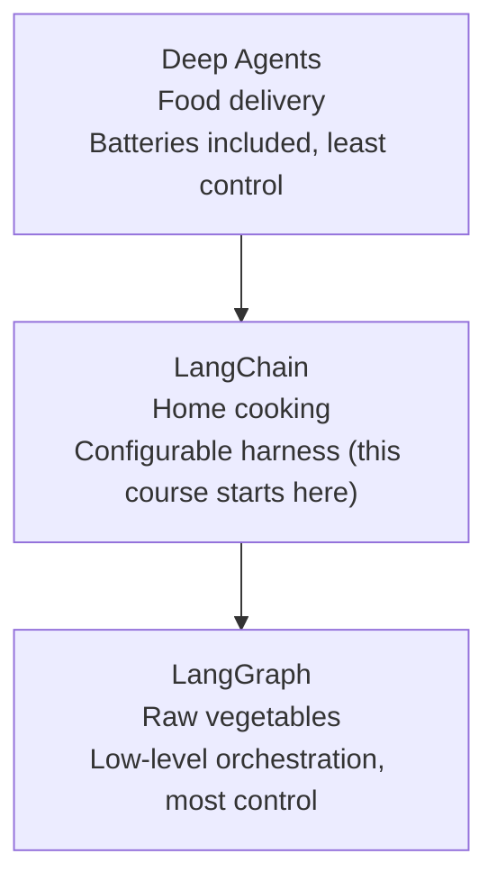
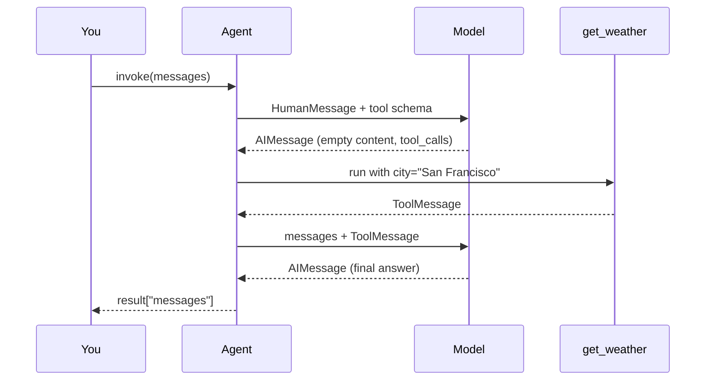

# Introduction to LangChain
> lead: LangChain packages the hand-written agent loop from the primer into one call, `create_agent()`, so you spend your time on tools and behaviour instead of plumbing.
meta: Class 06 | 12 July | 25 min read | Code: Weekend 03

## Why it matters

The raw-Python agent works, but it does not scale. For every project you would rewrite tool schemas, message formats, the loop, memory and provider switching. A framework gives you a tested **harness**: everything around the model that makes it useful.

:::key The one equation to remember
==Agent = Model + Harness==

The **model** is the brain. The **harness** is the system prompt, tools, memory, loop and middleware around it. A smarter harness cannot fix a weak model, and a strong model is not much use without a harness.
:::

:::analogy A car and its engine
The model is a powerful engine. On its own it cannot go anywhere. Add steering, wheels, fuel lines and brakes (the harness) and you have a car you can drive. Claude and ChatGPT's apps are the same idea: a model wrapped in memory, tools and web search.
:::

## Raw Python vs LangChain

You built the first column in the primer. The second column is what `create_agent()` replaces it with.

| Concern | Raw Python (primer) | LangChain |
| --- | --- | --- |
| Tool schema | Hand-written JSON | Inferred from the function signature and docstring |
| The loop | You write `run_agent` | `agent.invoke()` runs it |
| Message format | Dicts you manage | `HumanMessage`, `AIMessage`, `ToolMessage` objects |
| Switch provider | Different SDK per provider | Change the model string |
| Memory | A list you maintain | A checkpointer you plug in |
| Visibility | Total | Less, because LangChain infers a lot |
| Speed | Fastest | Slightly slower (extra IDs and bookkeeping) |

```python
# Raw: ~25 lines of loop plus a hand-written JSON schema per tool.

# LangChain: the same weather agent
from langchain.agents import create_agent

def get_weather(city: str) -> str:
    """Get weather for a given city."""
    return f"It's always sunny in {city}!"

agent = create_agent(
    model="openai:gpt-4o-mini",      # provider:model, use any model you have access to
    tools=[get_weather],             # a plain function is enough
    system_prompt="You are a helpful assistant",
)

result = agent.invoke(
    {"messages": [{"role": "user", "content": "Weather in San Francisco?"}]}
)
print(result["messages"][-1].content)
```

:::tip Say this in an interview
"I built the loop by hand first, so I know what `create_agent` is doing for me. I use the framework for speed and standard behaviour, and I drop lower when I need control." Interviewers like hearing fundamentals before frameworks.
:::

## Three levels of control

LangChain sits in the middle of a family of tools. Pick the level that matches how much control you need.



| Tool | Analogy | What you get | Use it when |
| --- | --- | --- | --- |
| **Deep Agents** | Food delivery | Context compression, a virtual file system and sub-agents out of the box | You want a capable agent fast and can accept less control |
| **LangChain** | Home-cooked meal | `create_agent`, tools, middleware, memory | You are building real software and want control over behaviour |
| **LangGraph** | Raw vegetables | Low-level graph of steps, mixing deterministic and agentic logic | You need to wire every step yourself |
| **LangSmith** | Flight recorder | Tracing and monitoring of what an agent did | You need to observe and debug (it does not build agents) |

:::beyond From Class 07
LangGraph is the **foundation** and LangChain is built **on top of** it, not the other way round. Class 06 only named the tiers; Class 07 explained how they relate. Also, **LangFuse** is not part of the LangChain family. It is an independent observability tool.
:::

:::note Version warning
Everything before LangChain v1 is now called **LangChain Classic**. Most blog posts and videos still teach Classic. This course teaches v1 and later, so old snippets may not match.
:::

## Setting up a project

```bash
uv init langchain_course
cd langchain_course
uv add langchain langchain-openai langchain-anthropic
uv sync
```

Installing three packages pulled in about 45 dependencies. That is normal, because each provider integration brings its own.

Keep secrets out of Git with three files:

| File | Purpose | Commit it? |
| --- | --- | --- |
| `.env` | Your real API keys | **Never** |
| `.gitignore` | Lists `.env` and `.venv` so Git skips them | Yes |
| `.env.example` | Same keys with placeholder values, as a template | Yes |

```python
from dotenv import load_dotenv
load_dotenv()          # reads .env into the environment
```

:::trap A real key pushed to GitHub
It happened live in class and the key had to be deleted. Anyone who sees a key in your history can use it. If it happens: **revoke the key first**, then clean up the repo.
:::

:::beyond From Class 07
LangChain looks for the provider's standard variable name, for example `OPENAI_API_KEY` or `ANTHROPIC_API_KEY`. If you rename it, or switch provider without setting the matching variable, you get an authentication error. The instructor showed this live in the next class.
:::

## How `create_agent()` works

### The inputs you used

| Argument | What it does |
| --- | --- |
| `model` | A `"provider:model"` string, or a model object from `init_chat_model` |
| `tools` | A list of functions or `@tool`-decorated functions |
| `system_prompt` | Instructions that shape behaviour |
| `checkpointer` | Where conversation state is saved (memory) |

Later chapters add more: structured output in Chapter 4, middleware in Chapters 6 and 7.

### What `invoke()` returns

`agent.invoke()` runs the whole loop and returns a dictionary. The part you care about is `result["messages"]`, the full conversation in order. A simplified view of the weather example:

```python
[
  HumanMessage(content="Weather in San Francisco?"),
  AIMessage(content="", tool_calls=[
      {"name": "get_weather", "args": {"city": "San Francisco"}, "id": "call_abc"}]),
  ToolMessage(content="It's always sunny in San Francisco!", tool_call_id="call_abc"),
  AIMessage(content="It's currently sunny in San Francisco."),
]
```



:::key Read the trace like a transcript
Message 2 has **empty content**, because the model is asking for a tool, not answering. Message 3 shares the same `tool_call_id` so the model can match result to request. This ran the model **twice**, exactly like the hand-built loop. Each message also carries prompt, completion and total token counts.
:::

### How a function becomes a tool

You pass a plain function. LangChain reads its **name**, **type hints** and **docstring** and builds a schema, roughly the same JSON you wrote by hand in the primer:

```json
{
  "type": "function",
  "function": {
    "name": "get_weather",
    "description": "Get weather for a given city.",
    "parameters": {
      "type": "object",
      "properties": {"city": {"type": "string"}},
      "required": ["city"]
    }
  }
}
```

:::beyond Illustration, not printed in class
The JSON above is my sketch of roughly what LangChain generates, written to match the schema you hand-wrote in the primer. The class explained that the schema is inferred, but did not print it.
:::

The `@tool` decorator wraps the function so an agent can call it. Either way, the **docstring is the model's only guide** to when to use the tool.

```python
from langchain.tools import tool

@tool
def fetch_text_from_url(url: str) -> str:
    """Fetch the plain text of a web page. Use when the user gives a URL."""
    ...
```

:::trap A vague docstring
A docstring like "Fetch the document" tells the model very little. The agent may skip the tool, or use it for the wrong job. Say **what it does** and **when to use it**.
:::

### The five-step build pattern

LangChain's quickstart, followed in class, builds an agent in five steps.

1. Write a **detailed system prompt** (what the agent is, which tools it has, what not to guess).
2. Create **tools** with `@tool`.
3. Configure the **model** with `init_chat_model`.
4. Add **memory**.
5. Assemble with `create_agent` and run.

```python
from langchain.chat_models import init_chat_model

model = init_chat_model(
    "openai:gpt-4o-mini",
    temperature=0.5,      # randomness
    timeout=300,          # seconds to wait
    max_tokens=25000,     # cap on output length
)

agent = create_agent(
    model=model,
    tools=[fetch_text_from_url],
    system_prompt=SYSTEM_PROMPT,
    checkpointer=checkpointer,
)
```

:::repo Model names in these notes
The repo scripts use `openai:gpt-5.5`. These notes use `gpt-4o-mini` as a placeholder. Use any model you have access to, with its matching API key. The repo script also prints `.content_blocks` (a standard list of content parts), while `.content` is enough for plain text.
:::

:::repo The repo example has a missing piece
The example script passes `checkpointer=checkpointer`, but the file never defines it, so it fails as written. Create one first (next section).
:::

## A real example: the Gatsby research agent

`langchain_basics.py` points the URL-fetching tool at a hard task: count exact lines in a real ~280 KB book from Project Gutenberg. A model cannot do that from memory, so it **must** use the tool. The prompt design is the lesson.

```python
SYSTEM_PROMPT = """You are a literary data assistant.

## Capabilities
- `fetch_text_from_url`: loads document text from a URL into the conversation.
Do not guess line counts or positions. Ground them in tool results."""

# ...and in the user message:
# "If you cannot VERIFY an exact answer with your tools, do not fabricate numbers.
#  Use null for that field and explain the limitation."
```

:::key Grounding beats guessing
Three habits in one example, all of which come back as guardrails in Chapter 8:
1. **Tell the agent what its tool is for** in the system prompt.
2. **Forbid fabrication** and give it an honest way out (`null` plus an explanation).
3. **Ask it to report errors** instead of hiding them.
:::

:::tip Try it yourself
Run it, then count the lines yourself with a text editor or `grep -c Gatsby`. Does the agent's number match, or did it guess? This is the quickest way to feel the difference between a grounded and an ungrounded answer.
:::

:::repo Preview of the third tier
The same file imports `create_deep_agent` from `deepagents` at the top and never uses it. It is a hint of the Deep Agents tier covered in Class 07.
:::

## Memory: why the agent forgets

In class, saying "Hi, I am Mayank" in one run and asking "Who am I?" in a second run got no answer. The history lived in the first process, and ended when the script ended.

:::beyond Added to fix the repo example
Class 06 made the point that memory is lost when the process ends and needs a store. The checkpointer code below is my addition, because the repo example uses a `checkpointer` it never defines. Later chapters cover memory properly.
:::

To keep a conversation, plug in a **checkpointer** and give each conversation a **thread id**:

```python
from langgraph.checkpoint.memory import InMemorySaver

agent = create_agent(
    model="openai:gpt-4o-mini",
    tools=[get_weather],
    system_prompt="You are a helpful assistant",
    checkpointer=InMemorySaver(),
)

cfg = {"configurable": {"thread_id": "user-1"}}
agent.invoke({"messages": [{"role": "user", "content": "Hi, I am Mayank"}]}, cfg)
agent.invoke({"messages": [{"role": "user", "content": "Who am I?"}]}, cfg)   # remembers
```

:::note Still not permanent
`InMemorySaver` keeps state only while the Python process runs. For real persistence you need a database-backed checkpointer. Chapters 6 and 10 cover this properly.
:::

### Should you cache tool results?

Not always. Match the cache time (TTL) to how fast the data changes.

| Data | Cache? | Reason |
| --- | --- | --- |
| Stock price | Never | Changes every second |
| Currency rate | Minutes | Moves slowly within a short window |
| Weather | Hours to a day | Changes gradually |

## Common mistakes

| Mistake | Symptom | Fix |
| --- | --- | --- |
| Thinking LangChain replaces the API key | Authentication error | LangChain is free, but you still need a provider key |
| Wrong env variable name | Auth error after switching provider | Use the standard name for that provider |
| Vague docstring | Wrong tool or no tool call | Say what it does and when to use it |
| Following Classic tutorials | Imports fail, APIs missing | Check the tutorial targets LangChain v1 or later |
| Committing `.env` | Leaked key | Use `.gitignore` and `.env.example` |
| Expecting memory across runs | Agent forgets | Add a checkpointer and reuse the `thread_id` |
| Caching volatile data | Stale answers | Set TTL by how fast the data changes |

## Hands-on lab

Do this once, with your own hands.

1. Create a fresh `uv` project and install the three packages. Add `.env`, `.gitignore` and `.env.example`.
2. Write `get_weather` and build the agent with `create_agent`.
3. Run it and print `result["messages"]`.
4. Map each message back to the primer: which is the user request, the tool request, the tool result, the final answer?
5. Add `InMemorySaver` and a `thread_id`, then prove the agent remembers your name across two `invoke` calls.
6. Rewrite the docstring badly, rerun, and see what changes.

## Interview corner

:::pitch
LangChain is a harness around the model loop. `create_agent` handles tool schemas, message formatting, the call-execute-repeat loop and provider switching, so I can focus on tools, prompts and middleware. I would drop to LangGraph if I needed full control over the workflow, and I understand the raw loop because I built it by hand first.
:::

### Basics

:::qa What is LangChain and why would you use it?
It is an open-source framework (free to use; you only pay your model provider) that supplies the **harness** around an LLM: tool handling, message objects, the agent loop, memory hooks and middleware, behind a provider-independent interface.

**Why:** you stop rewriting plumbing and can swap providers by changing a string.
:::

:::qa What does "Agent = Model + Harness" mean?
The model is the reasoning engine. The harness is everything around it: system prompt, tools, memory, context and middleware. Agent quality depends on **both**. A weak model in a perfect harness is still weak, and the reverse is also true.
:::

:::qa LangChain vs LangGraph vs Deep Agents vs LangSmith?
- **Deep Agents:** highest level, batteries included (context compression, virtual file system, sub-agents), least control.
- **LangChain:** configurable agent harness built on LangGraph.
- **LangGraph:** low-level orchestration for custom stateful workflows, most control.
- **LangSmith:** observability and tracing, not for building agents.

**Trap:** LangFuse is **not** part of this family. It is a separate observability tool.
:::

:::qa What does `agent.invoke()` return?
A dictionary whose `messages` list holds the whole conversation: the human message, the AI message requesting a tool, the tool message with the result, and the final AI message. The last message is normally the answer.
:::

### Intermediate

:::qa Walk me through what happens when a user asks "weather in Tokyo?"
1. `invoke` sends the user message plus the tool schemas to the model.
2. The model replies with an `AIMessage` that has empty content and a `tool_calls` entry.
3. The agent runs `get_weather("Tokyo")`.
4. The result goes back as a `ToolMessage` with the same `tool_call_id`.
5. The model is called again and returns the final text.
6. The loop ends because there are no more tool calls.
:::

:::qa How does LangChain turn a function into a tool?
It reads the function's name, type hints and docstring and generates a JSON schema. The model sees only that schema, never the code. This is why the docstring acts like a prompt.
:::

:::qa How do you add memory, and why does the agent forget between runs?
By default the message history exists only in the running process. Adding a **checkpointer** (such as `InMemorySaver`) and invoking with a **`thread_id`** lets the agent reload that thread's history. `InMemorySaver` still disappears when the process ends, so production needs a database-backed one.
:::

:::qa How would you switch from OpenAI to Anthropic?
Change the model string (for example `"anthropic:..."`) and make sure `ANTHROPIC_API_KEY` is set. The rest of the code stays the same. What can break: a missing or misnamed key, and model-specific features that the new model does not support.
:::

:::qa Is the number of loop turns the same in every framework?
No. It varies. Some frameworks cap the loop at around 100 iterations. The hand-built loop in class used 4 as a sensible starting default. Whatever the framework, you want a cap so a confused model cannot loop forever.
:::

### Tricky

:::qa Isn't LangChain just a wrapper over the OpenAI API?
No. It does wrap provider APIs behind one interface, but it also adds the agent loop, tool schema generation, message types, memory hooks and a middleware system. The honest trade-off: you give up some visibility and some speed in exchange for development speed and standard behaviour.
:::

:::qa Why might a LangChain agent be slower than raw Python?
Extra abstraction: generating IDs, building message objects and internal bookkeeping on every step. For most apps it is negligible, but in latency-sensitive systems it can matter, which is a reason some teams write their own loop.
:::

:::qa When would you not use LangChain?
When the task is a single model call, when I need tight control over latency or every step, or when the workflow is better expressed as an explicit graph (then I would use LangGraph directly). Knowing the raw loop lets me make that call.
:::

:::qa What did the Gatsby example teach about prompting?
That an agent should be told what its tool is for, forbidden from fabricating, and given an honest fallback (`null` plus an explanation) when it cannot verify an answer. It is a guardrail pattern taught before guardrails had a name.
:::

:::qa Should tool results be cached?
Only when it is safe. Cache by how quickly the data changes: never for stock prices, minutes for currency rates, hours for weather. Caching everything because it is easy gives stale answers.
:::

## Quick revision

- [ ] I can state Agent = Model + Harness and explain it with an analogy
- [ ] I can compare Deep Agents, LangChain, LangGraph and LangSmith in one line each
- [ ] I can write a minimal `create_agent` call with one tool
- [ ] I can map the four messages in `result["messages"]` to the raw loop
- [ ] I know why the docstring matters
- [ ] I can add memory with a checkpointer and a thread id
- [ ] I can keep API keys out of Git

## Sources and further reading

Everything above comes from these files in the course repository. Open them to see the real code and the full class write-ups.

- [Class 06 full notes (from the transcript)]({{src:classes_transcription_summary/06 - 12 Jul - Introduction to LangChain.md}})
- [Class 06 short summary]({{src:classes_summary/06 - 12 Jul - Introduction to LangChain.md}})
- [Class 06 code folder]({{tree:Weekend 03 - 11-12 Jul/06 - 12 Jul - Introduction to LangChain}})
- [`langchain_agents.py`: the first `create_agent` call]({{src:Weekend 03 - 11-12 Jul/06 - 12 Jul - Introduction to LangChain/langchain_agents.py}})
- [`langchain_basics.py`: the Gatsby research agent]({{src:Weekend 03 - 11-12 Jul/06 - 12 Jul - Introduction to LangChain/langchain_basics.py}})
- [Opening slide for the class (PDF)]({{src:Weekend 03 - 11-12 Jul/06 - 12 Jul - Introduction to LangChain/Untitled-scene.pdf}})
- [LangChain family and timeline: Class 07 notes]({{src:classes_transcription_summary/07 - 18 Jul - LangChain Family & Harness Engineering.md}})
