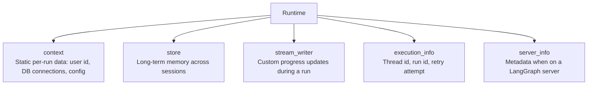
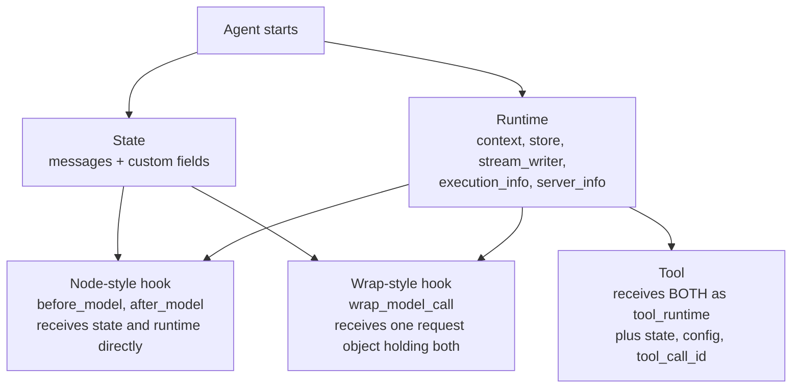
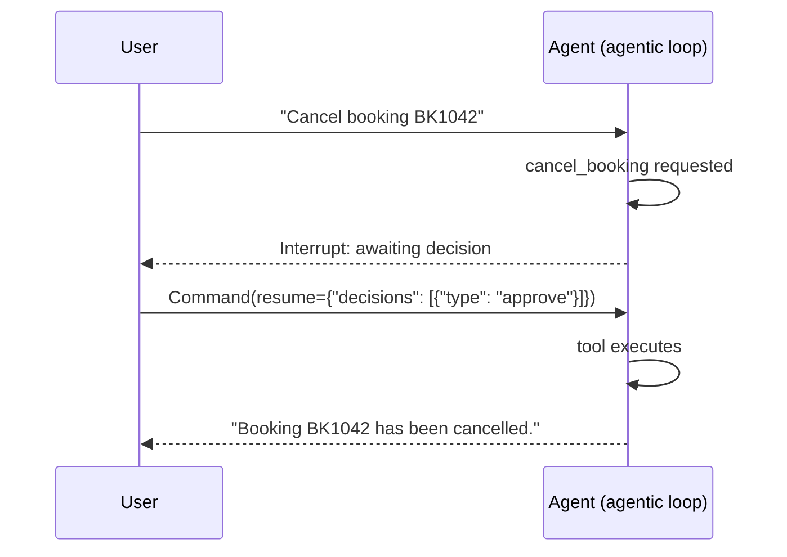

# Runtime and human-in-the-loop
> lead: How an agent carries information that is not part of the conversation (runtime), how state differs from context, and how to pause for a human with approve, edit, reject and respond, including interrupts that fire only on certain data.
meta: Class 15 | 22 August | 45 min read | Code: Weekend 09

## Why it matters

Two interview favourites live here. First, **state vs runtime context**: many learners mix them up, and even the instructor first answered one question the wrong way round before correcting it. Second, **human-in-the-loop**: an unguarded `cancel_booking` agent cancels *anyone's* booking with no questions asked, which is exactly why certain actions need a human.

## Core ideas

### 1. State, recapped

Every agent manages its execution through `AgentState`, a typed dictionary holding the conversation history plus any custom fields tools or middleware need. It ships with `messages` and can be extended by inheriting from `AgentState`. It powers every node-style hook (`before_model`, `after_model`), which receive and can return updates to it.

### 2. The problem runtime solves

CineBot must know things that are **not part of the conversation**: which customer is talking, whether they are a VIP, which cinema location this is. ChatGPT and Claude know your tier and name without you typing them into the chat.

:::analogy The hospital wristband
A patient gets a wristband. The ER doctor, the pharmacist, every nurse can read it and know who the patient is, which room they are in and their history, without the patient explaining each time. That information is not part of any single conversation. It **travels with the patient**. Runtime is that wristband: information outside the conversation that goes into every tool call and every middleware hook.
:::

### 3. The five components of runtime



`create_agent` runs on **LangGraph's runtime**. LangChain exposes what LangGraph already maintains. Every framework has an equivalent under another name (Google's ADK and various agent CLIs), so the idea transfers.

### 4. Defining context: `context_schema`

```python
from dataclasses import dataclass
from langchain.agents import create_agent

@dataclass
class CineBotContext:
    user_name: str

agent_with_context = create_agent(
    model="openai:gpt-5.5",
    tools=[],
    context_schema=CineBotContext,          # the SHAPE of context this agent expects
)

result = agent_with_context.invoke(
    {"messages": [{"role": "user", "content": "What's my name?"}]},
    context=CineBotContext(user_name="Priya"),   # injected at invocation time
)
```

`context_schema` is a skeleton: the shape of per-run information, defined once. Passing `context=` injects it **without it appearing in the conversation**. Passing it does not automatically make the agent use it in replies. You must make that link deliberately (see dynamic prompts below).

### 5. Runtime inside tools: `ToolRuntime`

```python
from langchain.tools import tool, ToolRuntime
from langgraph.store.memory import InMemoryStore

@dataclass
class CustomerContext:
    user_id: str

loyalty_store = InMemoryStore()

@tool
def fetch_customer_preferences(runtime: ToolRuntime[CustomerContext]) -> str:
    "Fetch the customer's saved preferences from long-term memory"
    user_id = runtime.context.user_id
    preferences = "No preferences"
    if runtime.store:
        if memory := runtime.store.get(("users"), user_id):
            preferences = memory.value["preferences"]
    return preferences

pref_agent = create_agent(
    model="openai:gpt-5.5",
    tools=[fetch_customer_preferences],
    context_schema=CustomerContext,
    store=loyalty_store,
)
```

The user id travels in `runtime.context.user_id` and the tool reads long-term preferences from the store, with the user never stating any of it. This is how Claude "remembers" your name across sessions: it lives in a store, reached through runtime, separate from message history.

**Why `ToolRuntime` and not the raw runtime?** LangChain's choice: a tool never gets a shared store object lying around. It gets a `tool_runtime` parameter, deliberately passed, holding the five components plus tool extras (state, config, tool call id). A tool sees only what it is explicitly handed.

### 6. Who gets what



| Where | What it receives |
| --- | --- |
| Tool | `ToolRuntime` bundling runtime and state, plus config and tool call id |
| Node-style hook (`before_model`, `after_model`) | `state` and `runtime` as **two separate parameters** |
| Wrap-style hook (`wrap_model_call`) | One `request` (`ModelRequest`) that contains state and runtime |

None of this is opt-in. A hook defined with zero parameters failed live with "takes 0 positional arguments but 2 were given". Parameter **names** do not matter (`a, b` works like `state, runtime`), only position and count.

:::key State vs context: mutability and persistence
**State** is **mutable** and **persists across multiple invocations** within the same conversation. Use it for anything that changes over time, such as a running call count.

**Context** is **immutable per run**. Use it for static values such as a user id or database credentials.

Only **state** changes carry forward across multiple tool calls within one invocation. Context stays fixed throughout. The instructor first stated this the wrong way round in class, caught it at the break and corrected it. Learn it carefully.
:::

### 7. Dynamic prompts from runtime

```python
from langchain.agents.middleware import dynamic_prompt

@dynamic_prompt
def personalize_the_prompt(request: ModelRequest):
    user_name = request.runtime.context.user_name
    return f"You are CineBot. Always address the user as {user_name}."
```

This is the mechanism behind a chat assistant that greets a returning user by name without it being typed in this conversation. The prompt is **rebuilt on every call** from runtime values.

### 8. An authorisation gate

```python
from langchain.agents.middleware import before_model

@before_model
def auth_gate(state: AgentState, runtime: Runtime) -> dict | None:
    "Block unauthenticated users"
    server = runtime.server_info
    if server is not None:
        raise ValueError("Unauthenticated user")
    print(f"[AUTH] Passed for user {runtime.context.user_name} "
          f"and thread {runtime.execution_info.thread_id}")
```

It combines `execution_info.thread_id` (which run is this) and `server_info` (is this a LangGraph server context) to gate a model call before it is allowed.

:::repo Read this as a demo of runtime fields, not real authentication
As written, the gate raises "Unauthenticated user" whenever `server_info` is **present**, which means on every LangGraph Server deployment, and lets every local run through (where `server_info` is `None`). It shows how to read `execution_info` and `server_info` inside a hook. A real gate would check a trusted identity from `runtime.context` (for example a verified user id or token claim) and refuse when it is missing.
:::

:::note `server_info` is `None` locally
`server_info` is populated only on LangGraph Server. In local development it is `None`, so test any gate that depends on it in the environment where it will run.
:::

## Human-in-the-loop in depth

Agents run in the agentic loop. HITL is the moment a human is deliberately brought **into** that loop.

### 9. The motivating problem

```python
@tool
def cancel_booking(booking_id: str) -> str:
    """Cancel an existing booking. Irreversible."""
    return f"Booking {booking_id} cancelled."

unguarded_agent = create_agent(model="openai:gpt-5.5", tools=[cancel_booking])
unguarded_agent.invoke({"messages": [("user", "Cancel my booking BK1042")]})
```

It cancels immediately. **Anyone** who can talk to this agent can cancel **anyone's** booking. Certain actions are too consequential to let an agent complete without confirmation.

### 10. Guarding the tool

```python
from langchain.agents.middleware import HumanInTheLoopMiddleware
from langgraph.checkpoint.memory import InMemorySaver
from langgraph.types import Command

guarded_agent = create_agent(
    model="openai:gpt-5.5",
    tools=[cancel_booking, send_booking_confirmation],
    middleware=[
        HumanInTheLoopMiddleware(
            interrupt_on={
                "cancel_booking": True,               # all four decisions allowed
                "send_booking_confirmation": False,   # safe: never pauses
            },
            description_prefix="CineBot action pending your approval",
        ),
    ],
    checkpointer=InMemorySaver(),    # REQUIRED: pause now, resume later
)

config = {"configurable": {"thread_id": "hitl-demo-111"}}
result = guarded_agent.invoke(
    {"messages": [("user", "Cancel booking BK1042")]},
    config=config,
    version="v2",     # the current, recommended pattern for reading interrupts
)
```

HITL pauses and resumes, so it needs the checkpointer and `thread_id`. Without them there is nothing to resume into. Checking `result.interrupts` shows an `action_request` with the tool name, arguments, description and allowed decisions (`approve`, `edit`, `reject` or `respond`). The `False` tool never interrupts.

### 11. `Command`: answering an interrupt



```python
resumed = guarded_agent.invoke(
    Command(resume={"decisions": [{"type": "approve"}]}),
    config=config,         # the SAME thread id resumes the paused run
    version="v2",
)
```

### 12. The four decisions

| Decision | What happens | Example |
| --- | --- | --- |
| `approve` | Runs the original call unchanged | Confirm the cancellation |
| `edit` | Changes the arguments, then runs | Cancel a different booking id |
| `reject` | Skips execution, with a reason | "Requires manager sign-off" |
| `respond` | Replies **without calling the tool** | Answer a clarifying question the agent asked |

```python
# edit
Command(resume={"decisions": [{
    "type": "edit",
    "edited_action": {"name": "cancel_booking", "args": {"booking_id": "BK1042"}},
}]})

# reject
Command(resume={"decisions": [{
    "type": "reject",
    "message": "Cancellations require manager sign-off first. Ask the customer to call support.",
}]})
```

**`respond`** is the one new decision. It is for tools that are really *asking the user something*:

```python
@tool
def ask_customer(question: str) -> str:
    """Ask the customer a clarifying question and wait for their reply."""
    return "placeholder: never reached, respond intercepts this"

ask_agent = create_agent(
    model="openai:gpt-5.5",
    tools=[ask_customer],
    middleware=[HumanInTheLoopMiddleware(
        interrupt_on={"ask_customer": {"allowed_decisions": ["respond"]}})],
    checkpointer=InMemorySaver(),
)

Command(resume={"decisions": [{"type": "respond",
        "message": "It's booking BK1042, for the movie Interstellar"}]})
```

The tool result is skipped and the human's message goes back to the agent as if the tool produced it. It is a genuine two-way conversation, like Claude pausing to ask a clarifying question instead of guessing. The human is not approving anything; they are supplying missing information.

### 13. Conditional interrupts

An e-commerce company wants a human only when an order crosses a threshold, not for every cancellation.

```python
from langchain.agents.middleware import ToolCallRequest

def is_large_refund(request: ToolCallRequest) -> bool:
    amount = request.tool_call["args"].get("amount", 0)
    return amount > 100

conditional_agent = create_agent(
    model="openai:gpt-5.5",
    tools=[cancel_booking_priced],
    middleware=[HumanInTheLoopMiddleware(interrupt_on={
        "cancel_booking_priced": {
            "allowed_decisions": ["approve", "edit", "reject"],
            "when": is_large_refund,
        },
    })],
    checkpointer=InMemorySaver(),
)
```

`ToolCallRequest` (the object underneath `wrap_tool_call`) carries `tool_call`, `tool`, `state` and `runtime`, enough to inspect the actual arguments. A $25 refund sailed through with no interrupt. A $500 refund on the **same tool and middleware** paused for approval. The interrupt depends on the data in that specific call.

The session's diagram shows the production version: cancelling booking `BK1011` worth $101 pauses for an **executive** (not the customer) to approve, mirroring a real refund workflow.

### 14. The interactive loop

```python
def run_interactive_hitl(agent, config):
    result = agent.invoke({"messages": [("user", "Cancel booking BK1042")]},
                          config=config, version="v2")
    if not result.interrupts:
        return
    choice = input("1) approve  2) edit  3) reject: ").strip()
    if choice == "1":
        decision = {"type": "approve"}
    elif choice == "2":
        new_id = input("Booking ID to cancel instead: ").strip()
        decision = {"type": "edit",
                    "edited_action": {"name": "cancel_booking", "args": {"booking_id": new_id}}}
    else:
        decision = {"type": "reject", "message": input("Reason: ").strip()}
    resumed = agent.invoke(Command(resume={"decisions": [decision]}), config=config, version="v2")
    print(resumed.value["messages"][-1].content)
```

A real UI replaces `input()` with buttons, as in Claude's interface, but the loop is identical in any framework: **invoke, check for interrupts, collect a decision, resume with a `Command`.** The same four ideas appear under different names elsewhere.

## Questions from class worth knowing

:::qa My agent has a `response_format` and tools. Why does even "hi" come back structured?
Expected. Once structured output is configured the agent always tries to shape its final answer that way. That is separate from a tool's `return_direct`, which controls whether the tool's raw result skips the model.
:::

:::qa Does the order of `ToolErrorMiddleware` and `ToolRetryMiddleware` matter?
Yes. Retry has to be resolved before an error is finally reported, so declare retry ahead of error handling. The other way can cause confusing looping rather than "retry a few times, then report".
:::

:::qa Is MCP the same as defining tools in LangChain?
In a simple sense, yes: MCP is a collection of tools in a standard protocol. The "agent calls a tool" mechanic does not change. MCP changes how tools are packaged, discovered and shared across applications.
:::

:::qa RAG or fine-tuning to keep a model current with changing company policy?
RAG. Fine-tuning is expensive and slow and will not reliably track fast-changing policy. RAG handles frequently updated reference material far better.
:::

:::qa Is RAG always needed for agent memory?
No. If you simply persist and look up structured data, a plain database read through LangChain works as well. RAG fits when you retrieve documents by meaning.
:::

:::qa How do you cut tokens in a long-running conversation?
Use long-term memory (the store via runtime). Retrieve only memories relevant to the current message instead of loading the whole history. Whether to load everything, load selectively or summarise is a design decision LangChain does not make for you.
:::

:::qa Can decorated middleware functions have any name?
Decorator-based: yes, any name, because the decorator registers the hook. Class-based: no, the method name must match the hook it overrides (for example `before_model`).
:::

:::qa What does an interviewer for agentic roles care about?
Software engineering fundamentals and problem solving over memorised syntax. You should explain **why** code does what it does, including basics such as what Pydantic is for. Someone strong in general development can integrate AI anywhere; the reverse leaves a real gap.
:::

<!-- docs-add -->
## From the docs: human-in-the-loop and runtime, in more detail

*Added from the LangChain Human-in-the-loop and Runtime pages (read 30 Oct 2026). Some options need recent versions, noted below.*

**`interrupt_on` value forms.** `True` (interrupt, all four decisions), `False` (auto-approve) or a dict with `allowed_decisions`, `description` (string or callable) and **`when`**, a predicate that receives the tool-call request and returns `True` to interrupt (`langchain>=1.3.3`).

```python
def is_write_query(request) -> bool:
    q = request.tool_call["args"].get("query", "")
    return not q.lstrip().upper().startswith("SELECT")

HumanInTheLoopMiddleware(interrupt_on={
    "execute_sql": {"allowed_decisions": ["approve", "reject"], "when": is_write_query}})
```

:::trap `when` runs again on resume
The predicate is re-evaluated when the run resumes, so it must give the same answer for the same call. In batched mode, a changed answer for only some calls raises a `ValueError`.
:::

**Middleware options.** `description_prefix` (text before the interrupt message; default "Tool execution requires approval."), `interrupt_mode` and `edit_notice` (text added to an edited call's result so the model knows it changed; `None` adds nothing).

**Two interrupt modes**

| Mode | Behaviour |
| --- | --- |
| `"batched"` (default) | One interrupt per model turn listing every gated call; you answer with an **ordered list** of decisions |
| `"per_call"` (`langchain>=1.4.6`) | Each gated call interrupts as it starts; each has a `response_schema`; you answer **by interrupt id**, one at a time if you like. The team plans to make this the default in the next major release |

Per-call rules: place `HumanInTheLoopMiddleware` **before** retry and error middleware so retries do not re-ask the reviewer; middleware listed before it reruns on resume, so it must have no side effects before calling its handler. Send answers one at a time or validate them first, because an invalid answer sent alongside valid ones can run those tools while their interrupts still look pending, and answering again would run them twice.

**The four decisions, precisely.** `approve` runs the original arguments. `edit` runs with `edited_action` (`name`, `args`); keep edits small or the model may re-plan. `reject` skips the tool and gives an optional `message` as feedback. `respond` skips the tool and returns a **required** `message` as a successful tool result: use it when the human is acting as the tool (for example answering an `ask_user` prompt), and use `reject` to deny a side-effecting action.

**Payload.** With `version="v2"` the result is a `GraphOutput` whose `.interrupts` lists pending reviews. Batched payloads hold `action_requests` (`name`, `args`, `description`) and `review_configs` (`action_name`, `allowed_decisions`). Resume with `Command(resume={"decisions": [...]})`, or in per-call mode `Command(resume={interrupt_id: decision})`.

**Lifecycle (batched).** The model replies, an `after_model` hook inspects tool calls, builds the request and calls `interrupt`, waits, then runs approved and edited calls and writes `ToolMessage`s for rejected and `respond` answers.

**Runtime extras.** `runtime.execution_info` gives `thread_id`, `run_id` and the attempt number; `runtime.server_info` gives `assistant_id`, `graph_id` and `user.identity` and is `None` outside LangGraph Server (both need `langgraph>=1.1.5` or `deepagents>=0.5.0`). The docs frame runtime context as **dependency injection**: tools and middleware receive what they need at invoke time, not from globals, which makes them easy to test.

For streaming a paused run see Chapter 10A.
<!-- /docs-add -->

## Common mistakes

| Mistake | Symptom | Fix |
| --- | --- | --- |
| Confusing state and context | Values reset, or cannot be changed | State is mutable and persists; context is immutable per run |
| Expecting passed context to appear in replies | The agent ignores it | Use it deliberately, for example in a dynamic prompt |
| HITL without a checkpointer or thread id | Cannot resume | Add `InMemorySaver` and reuse the thread id |
| Resuming with a different thread id | Starts a new run | Reuse the same id |
| Interrupting every call | Humans overloaded | Add a `when` condition on the arguments |
| Using `respond` to approve an action | Tool skipped | `respond` supplies information; use `approve` to run |
| Hook with no parameters | "takes 0 positional arguments but 2 were given" | Accept `state` and `runtime` |
| Putting secrets in `state` | Saved in checkpoints | Keep static secrets in context or the app |

<!-- runlab -->
## Spot the bug

```python
# BROKEN: no checkpointer, so there is nothing to pause into or resume from
agent = create_agent(
    model, tools=[send_email],
    middleware=[HumanInTheLoopMiddleware(interrupt_on={"send_email": True})],
)
```

```python
# FIXED: add a checkpointer and always pass the same thread_id when resuming
agent = create_agent(
    model, tools=[send_email],
    middleware=[HumanInTheLoopMiddleware(interrupt_on={"send_email": True})],
    checkpointer=InMemorySaver(),
)
config = {"configurable": {"thread_id": "t1"}}
agent.invoke({"messages": [...]}, config)
agent.invoke(Command(resume={"decisions": [{"type": "approve"}]}), config)
```

A different `thread_id` on resume starts a fresh run instead of continuing the paused one.
<!-- /runlab -->

## Hands-on lab

1. Build `CineBotContext`, pass `context=` at invoke time and confirm it is usable without being in the conversation.
2. Build `fetch_customer_preferences` with `ToolRuntime` and `InMemoryStore`. Confirm persistence across separate invokes.
3. Define a zero-parameter hook and watch it fail.
4. Build the `dynamic_prompt` example and confirm the prompt changes with context.
5. Compare `unguarded_agent` and `guarded_agent`.
6. Run all four decisions: `approve`, `edit`, `reject`, `respond`.
7. Build `is_large_refund` and compare a small and a large amount.
8. Test mutability: change a value in context mid-run (it should not stick) and in state (it should persist across tool calls).

## Interview corner

:::pitch
State holds the conversation and mutable custom fields and persists across invocations in a thread. Runtime holds what travels with the agent but is not conversation: immutable context, a long-term store, a stream writer, execution info and server info. For risky tool calls I add human-in-the-loop middleware with a checkpointer: the agent pauses, and I resume the same thread with a `Command` carrying approve, edit, reject or respond. I can make the interrupt conditional on the tool's arguments.
:::

### Basics

:::qa What is runtime, and what are its five components?
Information that is not part of the conversation but travels with the agent into every tool and hook: `context`, `store`, `stream_writer`, `execution_info` and `server_info`. Hospital wristband analogy.
:::

:::qa What are the four HITL decisions?
`approve` (run unchanged), `edit` (change arguments then run), `reject` (skip, with a reason) and `respond` (answer without calling the tool, for clarifying questions).
:::

:::qa Why does HITL need a checkpointer?
The agent pauses mid-run and resumes later. The checkpointer saves state and the `thread_id` finds it again. Without them there is nothing to resume.
:::

:::qa What does `Command(resume=...)` do?
It is the answer to an interrupt. Invoke the same thread with it and the agent continues according to the decision.
:::

### Intermediate

:::qa State vs context?
State is mutable and persists across invocations in a conversation (for example a running count). Context is immutable per run (a user id or credentials). Only state changes carry across tool calls in one invocation.
:::

:::qa How does a tool access runtime?
By declaring a `runtime: ToolRuntime` parameter. It bundles the runtime components with state, config and tool call id. It is hidden from the model's schema. A tool never receives the raw shared store directly.
:::

:::qa What do hooks receive?
Node-style hooks (`before_model`, `after_model`) get `state` and `runtime` as two parameters. Wrap-style hooks (`wrap_model_call`) get one request object containing both. Names do not matter, position and count do.
:::

:::qa How do you personalise the system prompt per user?
A `@dynamic_prompt` function that reads `request.runtime.context` and returns a prompt, rebuilt on every call.
:::

:::qa How do you interrupt only for large refunds?
Add a `when` callable to `interrupt_on` that inspects `request.tool_call["args"]` and returns `True` when the amount exceeds the threshold. Small refunds run; large ones pause.
:::

### Tricky

:::qa What is `respond` for, and how is it different from `approve`?
`respond` is for tools that are really asking the user something. It skips the tool and feeds the human's message back as if the tool returned it. `approve` runs the original tool call.
:::

:::qa Can an agent change a context value mid-run?
No. Context is immutable per run. If a value must change, it belongs in state.
:::

:::qa Why not give tools the raw runtime object?
LangChain deliberately controls what each component receives. Tools get `ToolRuntime`, so they see only what they are explicitly handed.
:::

:::qa Why might an agent ask for approval twice after you edit an amount?
That is the model's own judgment: after a partial transfer it decided a remaining balance needed handling. It is not scripted behaviour of the middleware.
:::

:::qa When do you stop using HITL's `interrupt_on` shortcuts and write custom middleware?
For needs the middleware does not offer, such as two levels of sign-off. Then write custom middleware (Chapter 9).
:::

:::qa What is the difference between an agent's `thread_id` and its `context`?
`thread_id` scopes conversation history: it persists automatically across calls that share it, through the checkpointer. `context` carries per-run data (a user id, session details) that you must pass **fresh on every invocation**; it does not carry over like history. Mixing them up is a common real bug once an app has several users.
:::

## Quick revision

- [ ] I can explain runtime with the wristband analogy and name the five components
- [ ] I can define `context_schema` and inject context at invoke time
- [ ] I can say what tools, node hooks and wrap hooks receive
- [ ] I can state state vs context precisely (mutability, persistence)
- [ ] I can build a dynamic prompt and an auth gate
- [ ] I can guard a tool with HITL and resume with `Command`
- [ ] I can list and demonstrate the four decisions
- [ ] I can write a conditional interrupt

## Sources and further reading

- [Class 15 full notes]({{src:classes_transcription_summary/15 - 22 Aug - LangChain - Runtime & Human-in-loop.md}})
- [Class 15 short summary]({{src:classes_summary/15 - 22 Aug - Runtime & Human-in-the-Loop.md}})
- [Runtime and HITL notebook]({{src:Weekend 09 - 22-23 Aug/22nd Aug - Runtime & HITL/Runtime_and_HITL.ipynb}})
- [Architecture diagram (PDF)]({{src:Weekend 09 - 22-23 Aug/22nd Aug - Runtime & HITL/Runtime-HITL.pdf}})
- [Weekend 09 code folder]({{tree:Weekend 09 - 22-23 Aug/22nd Aug - Runtime & HITL}})
