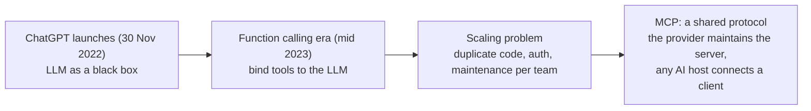
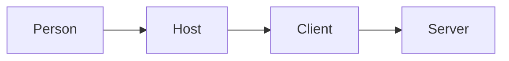
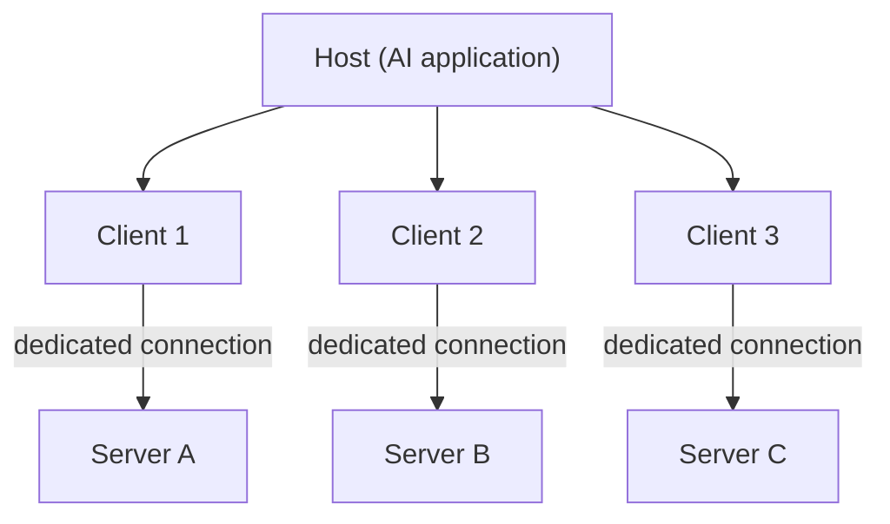
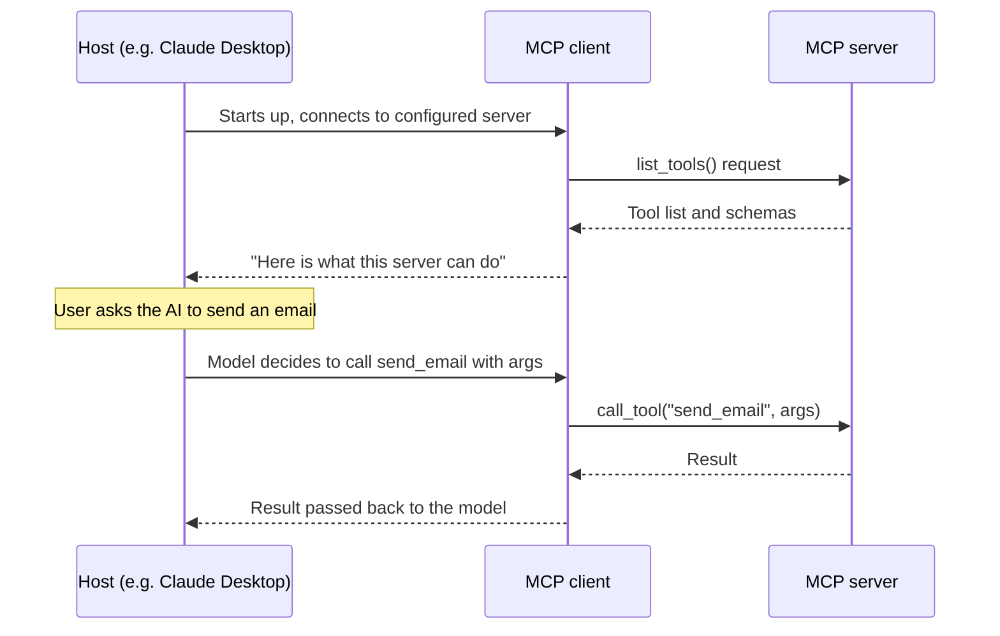
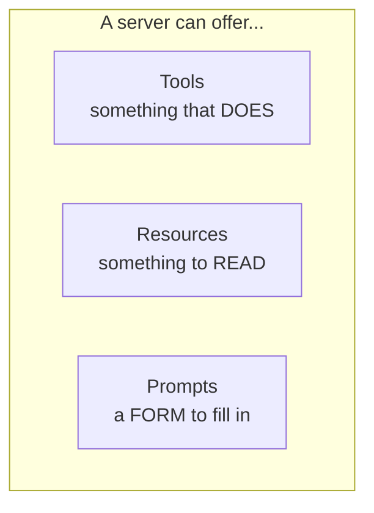

# Why MCP exists
> lead: The story of a brain with no hands, why function calling stopped scaling, and how the Model Context Protocol fixes it with a host, client and server architecture and three primitives: tools, resources and prompts.
meta: Class 16 | 23 August | 40 min read | Code: Weekend 09

## Why it matters

MCP only makes sense in light of the problem before it. Interviews ask "why MCP when I have function calling?" and "what are the three primitives?" Candidates who only know the definition get stuck on the follow-ups. This chapter gives you the story, the architecture and the vocabulary.

:::key The one line to anchor everything
==MCP is not about giving the LLM more intelligence. It is about giving it the ability to see more.==

That is why "context" is in the name: **M**odel, **C**ontext, **P**rotocol. The new piece is the protocol, which makes sharing context standard instead of ad hoc.
:::

## Core ideas

### 1. From black box to hands



- **The brain with no hands.** The first ChatGPT was an LLM, a next-token predictor. It could write a leave email but could not send it. ChatGPT reached about a million users in a week and about 100 million in a few months; before that, machines mostly understood fixed inputs like buttons.
- **Step 1: function calling (mid 2023).** OpenAI let you bind tools to the model. You describe an action ("send email") and the model says *which* function to call with *which* arguments. The model never executes anything. No more copy-pasting between ChatGPT and your inbox.
- **Step 2: the scaling problem.** A company runs three assistants (general chatbot, coding, analytics) each touching about 20 tools across several apps. That is dozens of tools, each with its own auth, data format, error handling and breakage risk when the API changes. Multiply across every company doing this alone. As the instructor put it, we found a shorter way, but now need a complete thing to keep the shortcut running.
- **Step 3: Anthropic's answer.** Not another wrapper but a **protocol**, a shared language like HTTP for the web. An app exposes its tools, resources and prompts once, and any AI host can speak to it the same way.

### 2. What MCP is

An **open-source standard for connecting AI applications to external systems**: data sources, local files, databases, tools, search engines, calculators, workflows and specialised prompts.

The instructor avoided the common "USB-C port" analogy as an oversimplification. His framing: an MCP server is a **collection of tools** (used about 99% of the time), wrapped around APIs that already existed, plus two other pieces: resources and prompts. All three are **MCP primitives**.

### 3. Before vs after MCP

| | Before MCP (raw tools or functions) | After MCP |
| --- | --- | --- |
| Defining an integration | Easy for one API: any LLM can write a quick Gmail wrapper | Easy to **connect**: point your host at the server |
| Maintenance | Every team writes and maintains its own wrapper, violating DRY at scale | Sits with whoever runs the server, usually the provider |
| Change management | If Gmail changes its API, every integrator updates their code | The server absorbs the change; clients touch nothing |
| Security | Every tool needs its own auth handling, owned by you | Still needs auth, but centralised at the server |

:::key The real trade-off
At 500 teams each wrapping the same "send email" API, you have not saved effort, you have relocated it. MCP's value is not a new capability. It is **who is responsible for keeping the integration working.**
:::

### 4. Architecture: host, client, server

The **host** is the application a person uses (Claude Desktop, VS Code, Cursor, any LangChain, LangGraph or AutoGen app). It does not talk to a server directly. It starts an **MCP client** internally, and that client does the talking.



:::analogy Two analogies, hold both
**Phone and network:** the phone is the host, the network is the server, and the SIM card is the client in between. The phone cannot reach the network without one.

**Universal remote:** a remote in a house full of smart gadgets, with an adapter behind each one translating button presses. The person holding the remote is the host. They never rewire a gadget; they press a button and something else handles the rest.
:::

**The host never talks to a server directly.** If every host had to know the wiring of every tool, adding one capability would be an engineering project each time. A host only needs to know how to *ask*.

**One client per server.** The host creates a dedicated client for each server, and each client keeps a private 1:1 connection to exactly one server. A host connected to five servers runs five clients, never one shared line.



Local servers typically serve one client; remote servers typically serve many.

| Why dedicated connections | Meaning |
| --- | --- |
| **Decoupling** | Changing one server never requires touching how the host talks to another |
| **Safety** | A crash stays inside one connection. The notebook proves it: start `server.py`, connect Inspector, press Ctrl+C in the server's terminal. Inspector does not crash; it shows that one connection closed. With five servers, killing one leaves four untouched |
| **Scalability** | A heavily loaded server's growth is local to its client-server pair |
| **Parallelism** | Three live connections can be used at once instead of taking turns on one shared line |

### 5. The transport layer

Client and server speak **JSON-RPC 2.0**, not plain REST. Asked "is MCP just a REST client?", the answer was: at a high level you can think of it that way, but it is a distinct protocol with its own transport rules.

| Transport | Used for |
| --- | --- |
| **STDIO** (standard input and output) | Servers running **locally** on your own machine |
| **Streamable HTTP** | **Remote** or hosted servers. It replaced the older HTTP plus SSE transport, deprecated in the spec released in March 2025 (the practical cutoff varies by server) |



:::trap Tool lists cost tokens
Connecting even two MCP servers to Claude added a large chunk of tokens to a single "hi", because the **entire tool list from every connected server is sent up front**. Claude's context inspector showed tens of thousands of tokens for custom tools with just two servers. Mitigate with good tool descriptions and with **middleware or interceptors** that trim the list to what is relevant (the dynamic loading ideas from Chapters 6 and 8).
:::

### 6. The three primitives



| Primitive | What it is | Analogy | Why it exists |
| --- | --- | --- | --- |
| **Tools** | Executable actions with a real effect | A button that does something | The only primitive that lets the AI *do* something rather than describe it. `add` runs logic and produces a new result |
| **Resources** | **Read-only** reference data, no side effects | The digital display on a thermostat: you glance, you do not ask | Without it every client hard-codes its own copy and the copies drift apart. One resource read fresh means one copy of the truth |
| **Prompts** | Reusable templates that shape how a request is phrased | A form with blank fields | Consistency that survives *who* is asking. The structure lives once on the server |

**Prompts example.** An AI logging a support escalation with no guidance might write "customer unhappy, refund maybe". A server template requiring four fields (issue, what was tried, customer sentiment, recommended next step) gives the same structure every time. The model did not change; the form did.

:::note Code for resources and prompts comes later
This class covered the shape and reasoning of all three, with running code only for tools. Full resources and prompts code arrives in Chapter 12.
:::

## Live demo: a local server end to end

```bash
curl -LsSf https://astral.sh/uv/install.sh | sh                 # macOS and Linux
uv init mcp-warmup && cd mcp-warmup
uv add fastmcp
```

```python
from fastmcp import FastMCP

mcp = FastMCP("Warm-Up Server")

@mcp.tool
def greet(name: str) -> str:
    """Greet someone by name."""
    return f"Hello, {name}! Welcome to MCP."

@mcp.tool
def add(a: int, b: int) -> int:
    """Add two numbers together."""
    return a + b

if __name__ == "__main__":
    mcp.run()
```

No special boilerplate beyond `@mcp.tool`. FastMCP reads each function's **docstring as the tool description**, which is what appeared in Inspector's tool list.

**Run it with the Inspector:**

```bash
uv run fastmcp dev server.py        # opens MCP Inspector at http://127.0.0.1:6274
```

Inspector is a browser tool that connects to any MCP server and lets you call its tools directly, acting as host plus client. Calling `greet` and `add` is two real programs completing a task over the actual protocol.

**Wire it into real hosts:**

- **VS Code:** register the server as STDIO with the launch command `uv run python server.py` and the working directory set to the folder with `server.py`. VS Code records it in `mcp.json` and a new chat can call `greet` and `add`.
- **Claude Desktop:** Manage Connectors, then Add custom connector, pointing at a remote server URL (or the local pattern).

Same server, any host, no changes. That was the point.

:::tip Sharing a local server
A local server can be shared with a small team by port-forwarding or tunnelling it, though that is not the most secure option. Team-wide hosting and publishing to PyPI come in later classes.
:::

## Questions from class worth knowing

:::qa How is MCP different from calling a REST API directly?
The end result can be the same, but with a raw API **you** maintain the wrapper, auth and error handling in every project. With MCP, the server owner maintains it once and every AI host just connects a client.
:::

:::qa Is MCP an orchestrator?
No. It is a connection protocol between a host and external tools. It does not plan or sequence agent behaviour.
:::

:::qa How is MCP different from RAG?
They are unrelated ways to give a model context. RAG retrieves text and injects it into a prompt. MCP lets a model call tools and actions on external systems.
:::

:::qa Can one server extend another, like inheritance?
Not in a code sense, but a server can contain an MCP client internally and forward requests to another server. Possible, not common.
:::

:::qa How is a server deployed?
Like any other server: a plain process, a Docker container or a cloud service such as Cloud Run or AKS. MCP mandates no deployment method.
:::

:::qa Can tool access be limited per user role?
In principle yes. The client requests the tool list, so the server can check the caller's auth token or scope before deciding which tools to return. MCP does not prescribe it; you build the check.
:::

:::qa A company already has 25 to 30 working APIs. Why build an MCP server on top?
AI hosts speak MCP natively. Without a server, every team wanting AI to use those APIs writes and maintains its own wrapper, the duplication MCP exists to remove.
:::

:::qa Do I need MCP for a small project?
Maybe not yet. One app and a handful of tools with nobody else reusing them is fine with plain function calling. MCP starts paying off once more than one app or team needs the same tool.
:::

:::qa Is MCP an Anthropic product I pay for?
No. It is a free, open specification, now governed by a multi-company foundation. OpenAI and Google support it even though Anthropic built it first. "Agreed" is the key word: a protocol is a shared agreement, a library only works if everyone adopts one company's code.
:::

## Common mistakes

| Mistake | Symptom | Fix |
| --- | --- | --- |
| Thinking MCP makes the model smarter | Wrong expectations | It widens what the model can see and do, not its reasoning |
| Believing one shared connection serves all servers | Wrong architecture | One client per server, 1:1 |
| Calling MCP "just REST" | Confusion about transports | It is JSON-RPC 2.0 over STDIO or Streamable HTTP |
| Connecting many servers without limiting tools | Huge token cost, confused agent | Good descriptions and a filter |
| Treating a resource like a tool | Wrong primitive | Resources are read-only; tools have effects |
| Hard-coding shared reference data in each client | Copies drift | Expose it once as a resource |
| Using the old HTTP plus SSE transport | Deprecated since the March 2025 spec | Use Streamable HTTP |
| Skipping the docstring on a tool | Poor description in the tool list | Write one; FastMCP uses it |

<!-- runlab -->
## Run it yourself: the warm-up server

The smallest complete MCP server from the course, copied unchanged from the repo (`mcp-warmup-primitives/server.py`). Save it, run it, and connect Inspector.

**`server.py`**

```python
from fastmcp import FastMCP

mcp = FastMCP("Warm-Up Server")

@mcp.tool
def greet(name: str) -> str:
    """Greet someone by name."""
    return f"Hello, {name}! Welcome to MCP."

@mcp.tool
def query_db(a: int, b: int,c:int) -> int:
    """Query the database with three parameters."""

    return a + b + c

if __name__ == "__main__":
    mcp.run()

# uv run python server.py
# npx -y @modelcontextprotocol/inspector uv run python server.py
```

```bash
pip install fastmcp
npx -y @modelcontextprotocol/inspector python server.py
```

:::tip What to look for in Inspector
Open **Tools**, run `greet` with a name, then `query_db` with three numbers. Watch the **History** pane: you will see `initialize`, `notifications/initialized`, `tools/list` and `tools/call`, which are the lifecycle from Chapter 12 happening for real.
:::
<!-- /runlab -->

## Hands-on lab

1. Install `uv`, create `mcp-warmup`, add `fastmcp` and build the `greet` and `add` server.
2. Run `uv run fastmcp dev server.py` and call both tools from Inspector.
3. With Inspector connected, press Ctrl+C on the server and confirm only that connection closes.
4. Register the same server in VS Code as STDIO and call a tool from chat.
5. Optionally add it as a custom connector in Claude Desktop.
6. Explain in your own words, to a friend, why a company with 500 teams benefits from one server.

## Interview corner

:::pitch
MCP is an open protocol for connecting AI applications to external tools and data. Function calling worked for one app but meant every team rewrote and maintained the same integrations. With MCP, the provider runs one server and any host connects a client, so maintenance moves to the server owner. A host creates one client per server, they talk JSON-RPC 2.0 over STDIO locally or Streamable HTTP remotely, and a server offers three primitives: tools, resources and prompts.
:::

### Basics

:::qa What problem does MCP solve?
Function calling made every company wrap, authenticate and maintain the same tools on its own. At scale that is duplicated work that breaks when APIs change. MCP standardises the connection so the provider maintains one server and every host speaks to it the same way.
:::

:::qa Define host, client and server.
The host is the AI application a person uses. The client is created inside the host and holds a dedicated 1:1 connection to one server. The server exposes tools, resources and prompts.
:::

:::qa What are the three primitives?
Tools (actions that do something), resources (read-only data to read) and prompts (reusable templates that shape a request).
:::

:::qa Which transports does MCP use?
STDIO for local servers and Streamable HTTP for remote ones. Streamable HTTP replaced HTTP plus SSE, deprecated in the March 2025 spec. The messages are JSON-RPC 2.0.
:::

### Intermediate

:::qa Why does each server get its own client?
Decoupling, safety (a crash stays contained), scalability (load is local to the pair) and parallelism (talk to several servers at once).
:::

:::qa Why not just keep using function calling?
For one app and a few tools, you can. Beyond that the maintenance, auth and breakage burden repeats per team. MCP moves it to whoever owns the server.
:::

:::qa Why is MCP not "USB-C for AI"?
The instructor felt it oversimplifies. An MCP server is a collection of tools (mostly) wrapped around existing APIs, plus resources and prompts, behind a shared protocol that decides who maintains what.
:::

:::qa What is MCP Inspector?
A browser tool that connects to any MCP server (acting as host and client) so you can list and call its tools without a full AI app. Start it with `uv run fastmcp dev server.py`.
:::

:::qa Resource vs tool?
A resource is read-only reference data with no side effects, like a thermostat display. A tool runs an action and has an effect. Use a resource when many clients need the same reference data, so there is one source of truth.
:::

### Tricky

:::qa MCP versus RAG?
Different mechanisms. RAG retrieves text and injects it into the prompt. MCP is a protocol for calling tools and actions on external systems. They are not usually compared directly.
:::

:::qa What hidden cost comes with connecting many MCP servers?
The tool list from every server is sent on the first message, so tokens balloon (tens of thousands with two servers in the demo) and the agent can get confused. Reduce it with clear descriptions and by filtering tools with middleware.
:::

:::qa How would you restrict a tool to some users?
Check the caller's auth token or scope in the server before returning the tool list or running the tool. MCP does not prescribe this; you build it.
:::

:::qa Is MCP an orchestrator?
No. It is a communication protocol between host and external tools. It does not decide what happens next.
:::

:::qa Why do OpenAI and Google support a protocol Anthropic created?
Because it is an open specification governed by a multi-company foundation. A protocol only works as an agreement everyone adopts, unlike a single company's library.
:::

### Production level

:::qa How does an agent discover MCP servers and their capabilities?
It does not "find" them. Servers come from configuration or an **allow-listed registry**. The `initialize` handshake has both sides declare capabilities, and `tools/list` returns each tool's name, description and schema, which is exactly what the model sees. **Tool descriptions are prompt input**, so pin and review them like code.
:::

## Quick revision

- [ ] I can tell the story: black box, function calling, scaling problem, MCP
- [ ] I can state the anchor line and say what MCP is not
- [ ] I can draw host, client and server and explain 1:1 clients
- [ ] I can list the four reasons for dedicated connections
- [ ] I can name the two transports and the message format
- [ ] I can explain the three primitives with an analogy each
- [ ] I can explain the token cost of connecting many servers
- [ ] I can run the `greet` and `add` server in Inspector

## Sources and further reading

- [Class 16 full notes]({{src:classes_transcription_summary/16 - 23 Aug - MCP Introduction.md}})
- [Class 16 short summary]({{src:classes_summary/16 - 23 Aug - MCP Introduction.md}})
- [Why MCP Had to Exist (text)]({{src:Weekend 09 - 22-23 Aug/23rd Aug - MCP/Complete MCP/Why MCP Had to Exist.txt}})
- [Complete MCP slides (PDF)]({{src:Weekend 09 - 22-23 Aug/23rd Aug - MCP/Complete MCP/Complete-MCP.pdf}})
- [MCP architecture notebook]({{src:Weekend 09 - 22-23 Aug/23rd Aug - MCP/Complete MCP/p2_MCP_Architecture.ipynb}})
- [Warm-up server project]({{tree:Weekend 09 - 22-23 Aug/23rd Aug - MCP/Complete MCP/mcp-warmup}})
- [Mayank's MCP notes site](https://ai-automation-with-mayank.netlify.app/#home)
- [MCP interview questions (course repo)]({{src:interview-questions/mcp.md}})
