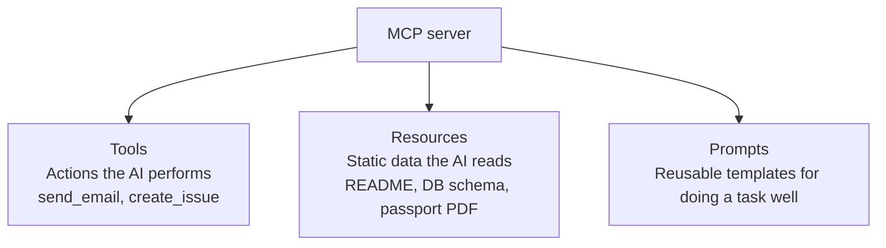
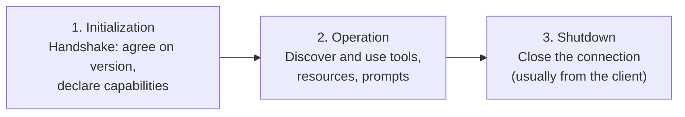
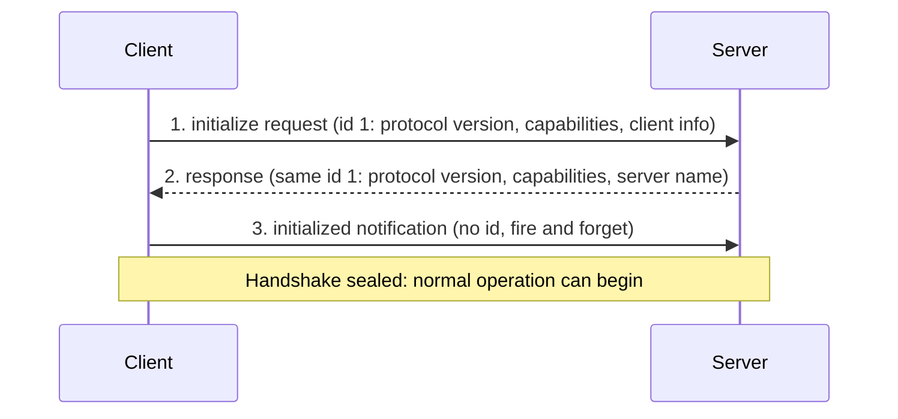

# MCP primitives, lifecycle and JSON-RPC
> lead: The three primitives in working code, the three-phase MCP lifecycle, JSON-RPC 2.0 as the shared language, and the initialization handshake step by step.
meta: Class 17 | 5 September | 45 min read | Code: Weekend 10

## Why it matters

This is the chapter that separates someone who can *use* an MCP connector from someone who can explain how to *build* one that scales. Interview questions here are precise: "why JSON-RPC and not REST?", "what are the three handshake steps?", "what does the `id` field do?" The instructor's stated bar: be able to walk into a Google or Amazon interview and explain it.

## Core ideas

### 1. Quick recap: why, and who talks to whom

People wanted ChatGPT-style AI connected to Google Drive, Slack, GitHub and Gmail. Defining custom tools for each did not scale, and MCP closed the gap. A **host** (Claude Desktop, VS Code, Cursor, Codex) never talks to a server directly, because they do not share a language. It spins up a **client** per server, and the client and server communicate in JSON-RPC.

In the Inspector demo, **Inspector is both host and client** (the interface a person uses, and the thing opening the connection) while `server.py` is the server. The handshake the instant Inspector connects is a client doing its job.

:::key One-to-one: which direction holds?
**Each client connects to exactly one server.** That always holds. The reverse depends on the transport. The official docs say: *each MCP client maintains a dedicated, 1:1 connection with its server; local servers typically serve a single client, whereas remote servers typically serve many clients at once.* A hosted Gmail or Slack MCP server is built for many clients.
:::

Benefits of the 1:1 design (decoupling, safety, scalability, parallelism) were covered in Chapter 11. The safety proof: press Ctrl+C on the server while Inspector is connected and only that connection closes.

### 2. The three primitives



- **Tools** are actions: the one primitive where the **AI itself decides to act**. Everything else is initiated by someone or something else first. Without a tool the AI can describe sending an email perfectly; with one it can send it.
- **Resources** are read-only, near-static data: a repo's README, a database schema file, a team style guide in Google Drive, or (from MCP's own travel-planning example) a passport PDF or visa checklist. Typically the **application**, not the model, decides to read a resource and feed it in as context. A resource never changes anything.
- **Prompts** are predefined templates that help the AI do a task *well*, not just do it. A bare `create_issue` call can produce a thin issue. A prompt guides the AI to gather a title, description and reproduction steps first, consistently. Only the form changed, not the model.

:::trap Resources and prompts are optional
GitHub's official MCP server ships **tools only**, no resources or prompts, and that is a completely valid, common design. Tools are effectively the required primitive.
:::

| Primitive | Functions | What they do |
| --- | --- | --- |
| Tools | `list`, `call` | `list` discovers tools and argument schemas; `call` invokes one |
| Resources | `list`, `read`, `subscribe` | `list` discovers; `read` retrieves one; subscribing tells a client when a resource changes |
| Prompts | `list`, `get` | `list` discovers templates; `get` retrieves one |

The moment a client connects it calls the `list` functions (`tools/list`, `resources/list`, `prompts/list`). That is how a host learns everything a server offers **before using any of it**.

### 3. All three in real code

Starting from the tools-only warm-up server, adding a resource and a prompt takes exactly **two more decorators**:

```python
@mcp.resource("file://server-notes")
def server_notes() -> str:
    """Read-only notes about this server, straight from a local file."""
    with open("server-notes.txt") as f:
        return f.read()

@mcp.prompt
def structured_escalation(issue_summary: str, what_was_tried: str, customer_sentiment: str) -> str:
    """Guides the AI to log a customer escalation with every required field, in order."""
    return f"""Log this customer escalation with the following structure:
Issue Summary: {issue_summary}
What Was Already Tried: {what_was_tried}
Customer Sentiment: {customer_sentiment}
Recommended Next Action: [determine this from the details above]
"""
```

In Inspector: `greet` and `add` under **Tools**, `file://server-notes` under **Resources** (returning the file's real content), and `structured_escalation` under **Prompts**, asking for exactly the three fields. Filled in, it produces:

```
Issue Summary: Order #4521 arrived damaged
What Was Already Tried: Customer emailed support once, no reply in 3 days
Customer Sentiment: Frustrated, considering a refund request
Recommended Next Action: Escalate to logistics team, offer expedited replacement
```

Most tutorials stop at tools because tools are the easiest to demo. Resources and prompts are just as easy; they get skipped more often.

### 4. The lifecycle: three phases, always in this order



Initialization is the handshake and introduction, operation is the conversation, shutdown is saying goodbye. You cannot hold a conversation before anyone has been introduced.

To make it tangible, the instructor opened Claude Desktop's real MCP log (macOS: `~/Library/Logs/Claude/mcp.log`; Windows has an equivalent) showing actual JSON-RPC messages with a local Apple Notes server over STDIO. It also explains why a connector can show a **warning icon before you use it**: at startup Claude initialises every configured server, and if the handshake fails it already knows.

### 5. JSON-RPC 2.0: the shared language

Two systems need a common language, like two people. For client and server it is **JSON-RPC 2.0**. **JSON** is the familiar data format. **RPC** is **Remote Procedure Call**: run a function on another machine as if it were local, hiding the network details. Instead of specifying low-level query parameters, the client says "please query the DB with these arguments."

```json
// Request (client to server)
{ "jsonrpc": "2.0", "id": 1, "method": "tools/list", "params": {} }

// Response (server to client)
{ "jsonrpc": "2.0", "id": 1, "result": { "tools": [ ] } }
```

| Field | Meaning |
| --- | --- |
| `jsonrpc` | Always `"2.0"`: the format version both sides must agree on |
| `id` | Matches a response to its request. Responses can arrive asynchronously and out of order, so without an id you could not tell which answers which |
| `method`, `params` | What is being requested |
| `result` or `error` | A response has one of these, **never both** |

### 6. Why JSON-RPC and not plain REST?

An interview-level question, and the reasoning is deliberate.

| Reason | Meaning |
| --- | --- |
| **Lightweight** | Plain, readable JSON without the headers and overhead of REST or XML |
| **Transport-agnostic** | The same protocol works locally (STDIO) or remotely (HTTP) |
| **Genuinely two-way** | The biggest departure. In HTTP, only the client initiates and the server replies. In JSON-RPC **either side can initiate**, so a server can proactively report progress on a long task instead of the client polling |
| **Notifications built in** | A message with **no `id`** means "fire and expect nothing back", which strict request-response does not naturally support |
| **Standard error codes** | Inherited wholesale, like HTTP's 404 and 500 |

:::key JSON-RPC is not an MCP invention
It is a pre-existing, general-purpose specification used elsewhere in networking. Anthropic adopted it because it already fit MCP's needs.
:::

:::trap Two-way is not the same as asynchronous, and not a WebSocket
**Asynchronous** means the client sends a request and carries on, expecting a reply later, but the server still never initiates. **Two-way** means either side can start a request. And it is not the same as a **WebSocket**: a WebSocket is a persistent always-open connection, heavier than most MCP interactions need. Two-way capability is a property of the JSON-RPC protocol, not of keeping a permanent socket.
:::

### 7. The initialization handshake, step by step



1. **The client speaks first** with its protocol version, capabilities and client info, tagged with an id (for example `1`).
2. **The server responds**, matching the id, with its protocol version, its capabilities (tools? resources? prompts?) and its server name.
3. **The client sends an `initialized` notification**: no id, since no reply is expected. This is JSON-RPC notifications in action.

Two rules keep it orderly: the client should send nothing but a **ping** before the server responds to `initialize`, and the server should send nothing but a ping before it receives `initialized`.

### 8. Version and capability negotiation

The client always sends the **latest** version it supports, never a list of everything it has ever supported. If the server supports that exact version, it replies with the same one. If not, it replies with the latest **it** supports, and the client decides whether that is acceptable. With no overlap, they disconnect.

:::analogy Windows and a game negotiating DirectX
Windows supports DirectX 11. A game supports up to DirectX 8. They settle on the highest version both actually share, never a vague "I support all of them."
:::

Real-world consequence, illustrated with WhatsApp: a message deleted in a newer version may not disappear correctly on an older one, because the versions disagree on behaviour. For a client built for a real company, it is not enough to connect to whatever URL is given. A serious implementation decides which historical protocol versions it supports and handles every behavioural difference. That depth is what a strong interview answer shows.

## Key pointers to remember

- MCP solves an **integration** problem, not an AI capability problem.
- **Host, client, server, always in that order.**
- Client to server is strictly one to one; server to client depends on transport.
- **Two decorators** separate a tools-only server from one with all three primitives.
- **Service providers build servers; host developers build clients.** Gmail's team builds the Gmail server; Anthropic builds the client in Claude.
- Every primitive is discovered via its own `list`.
- Lifecycle: initialization, operation, shutdown.
- Handshake: `initialize` with id, response with the same id, `initialized` notification with no id.
- The business case is **N times M down to N plus M** integrations: any compliant host talks to any compliant server without custom work.

## Questions from class worth knowing

:::qa Can one MCP server call another?
Yes. A server can act as a client to another server internally, chaining them.
:::

:::qa Is FastMCP the only way to build a server?
No. It is the most popular, alongside Anthropic's official MCP SDK. The relationship is like Keras on top of TensorFlow: the official SDK is the base and FastMCP makes building on it easier.
:::

:::qa I already have REST APIs and a chatbot. Why build an MCP server?
The scalability maths. Connecting N applications to M tool sets means roughly N times M custom integrations. MCP standardises to about N plus M. It was candidly acknowledged that MCP can feel like needless abstraction over an API call; the value is making access usable by non-technical end users and cutting integration burden at scale.
:::

:::qa How does a client know which server to connect to?
The address is given when the client is configured (like pasting a URL into "Add custom connector"). It is not discovered dynamically at connection time.
:::

:::qa How does a server know which client a request came from?
That is resolved inside the transport layer: once connected, both sides keep session details internally, like any client-server connection, abstracted from the user.
:::

:::qa How do I make my own email domain MCP compatible?
You cannot make an existing product inherently compatible. You build a normal MCP server for it exposing the tools, resources and prompts that make sense.
:::

## Common mistakes

| Mistake | Symptom | Fix |
| --- | --- | --- |
| Assuming resources and prompts are required | Over-building | Tools are the essential primitive |
| Calling a resource a tool | Wrong primitive | Resources are read-only |
| Sending a list of supported versions | Wrong negotiation | Send only the latest |
| Forgetting `id` on a request | Cannot match the response | Always set it (notifications are the exception) |
| Replying to a notification | Protocol error | Notifications expect no reply |
| Treating two-way as a WebSocket | Wrong design | Two-way is a protocol property |
| Ignoring older protocol versions in a custom client | Behaviour bugs across servers | Decide and handle supported versions |
| Sending anything but pings before the handshake finishes | Out-of-order protocol | Wait for the handshake |

## Hands-on lab

1. Redraw host, client and server from memory, marking where 1:1 applies.
2. Add `@mcp.resource` and `@mcp.prompt` to the warm-up server and confirm all three in Inspector.
3. Kill the server with Ctrl+C while Inspector is connected and watch it fail contained.
4. Open your host's MCP log and find the three handshake messages.
5. Write a JSON-RPC request and response pair by hand for a `send_email` call with a matching `id`.
6. For a service you use daily, list what would be a tool, a resource and a prompt.
7. Explain out loud why JSON-RPC was chosen over REST.

## Interview corner

:::pitch
Client and server speak JSON-RPC 2.0, chosen over REST because it is lightweight, transport-agnostic, genuinely two-way and has notifications built in. A connection goes through initialization, operation and shutdown. Initialization is three steps: the client sends `initialize` with an id, the server responds with the same id and its capabilities, and the client sends an `initialized` notification with no id. A server offers tools, resources and prompts, each discovered with `list`.
:::

### Basics

:::qa What are the three MCP lifecycle phases?
Initialization (handshake and capability exchange), operation (the real work) and shutdown (closing the connection, usually initiated by the client).
:::

:::qa What are the three handshake steps?
The client sends `initialize` with an id, protocol version and capabilities. The server responds with the same id, its version, capabilities and name. The client sends an `initialized` notification with no id, which expects no reply.
:::

:::qa What is the `id` field for?
It matches a response to its request. Responses can arrive asynchronously and out of order, so without an id you cannot tell which answers which.
:::

:::qa Which primitive lets the AI act?
Tools. Resources are read by the application and prompts are chosen by the user or app, so the tool is the one the model decides to use.
:::

### Intermediate

:::qa Why JSON-RPC instead of REST?
Lightweight JSON, transport-agnostic (STDIO or HTTP), two-way so a server can initiate (for example progress on long tasks), notifications with no `id`, and standard error codes.
:::

:::qa JSON-RPC two-way vs asynchronous vs WebSocket?
Async means the client fires and continues but the server never initiates. Two-way means either side can initiate. A WebSocket is a persistent open connection, which is heavier; two-way is a protocol property and does not require it.
:::

:::qa How does version negotiation work?
The client sends the latest version it supports. If the server supports it, it echoes it. Otherwise it replies with its latest and the client decides if that is acceptable. With no overlap, they disconnect. Never send a list.
:::

:::qa Is JSON-RPC an MCP invention?
No. It is an existing general-purpose spec that Anthropic adopted because it fit.
:::

:::qa What does a client do first after connecting?
Calls the `list` functions (`tools/list`, `resources/list`, `prompts/list`) to learn what the server offers before using any of it.
:::

### Tricky

:::qa Can a server serve more than one client?
Yes. A client has exactly one server, but a remote server typically serves many clients. Local STDIO servers typically serve one.
:::

:::qa Why might a connector show a warning icon before you use it?
At startup the host initialises every configured server. If the handshake fails, it already knows and flags it.
:::

:::qa Why must a serious custom client think about older protocol versions?
Versions can behave differently, like WhatsApp message deletion across versions. A production client must decide which versions it supports and handle each behavioural difference, not just connect to any URL.
:::

:::qa What can be sent before the handshake completes?
Only pings: the client before the server responds to `initialize`, and the server before it receives `initialized`.
:::

:::qa What is the business case for MCP in numbers?
N applications by M tool sets means about N times M custom integrations. A standard protocol reduces that to about N plus M, because any compliant host talks to any compliant server.
:::

## Quick revision

- [ ] I can state which direction of the one-to-one holds, and when
- [ ] I can define the three primitives and their `list`, `call`, `read`, `get` functions
- [ ] I can add a resource and a prompt to a server in two decorators
- [ ] I can name the three lifecycle phases and the three handshake steps
- [ ] I can write a JSON-RPC request and response and explain every field
- [ ] I can give five reasons JSON-RPC beats REST for MCP
- [ ] I can explain version negotiation with the DirectX analogy
- [ ] I can distinguish two-way, asynchronous and WebSocket

## Sources and further reading

- [Class 17 full notes]({{src:classes_transcription_summary/17 - 5 Sep - MCP Deep Dive — Primitives, Lifecycle & JSON-RPC.md}})
- [Class 17 short summary]({{src:classes_summary/17 - 6 Sep - MCP Primitives, Architecture & Wiretap.md}})
- [Primitives notebook]({{src:Weekend 10 - 5-6 Sep/06 Sep - MCP Primitives & Architecture/v4a_primitives_notebook.ipynb}})
- [MCP primitives slides (PDF)]({{src:Weekend 10 - 5-6 Sep/06 Sep - MCP Primitives & Architecture/MCP-Primitives.pdf}})
- [MCP lifecycle slides (PDF)]({{src:Weekend 10 - 5-6 Sep/06 Sep - MCP Primitives & Architecture/MCP-Lifecycle.pdf}})
- [Weekend 10 code folder]({{tree:Weekend 10 - 5-6 Sep/06 Sep - MCP Primitives & Architecture}})
- [MCP lifecycle guide](https://mcp-lifecycle.netlify.app/)
- [MCP lifecycle conversation simulator](https://mcp-lifecycle-simulator.netlify.app/)
- [Official MCP docs](https://modelcontextprotocol.io/docs/2026-07-28/getting-started/intro)
