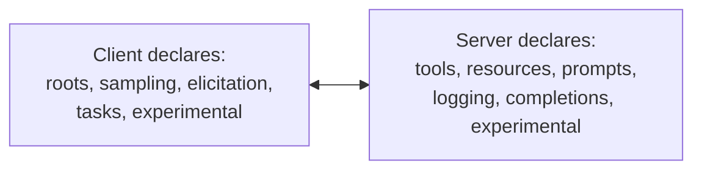
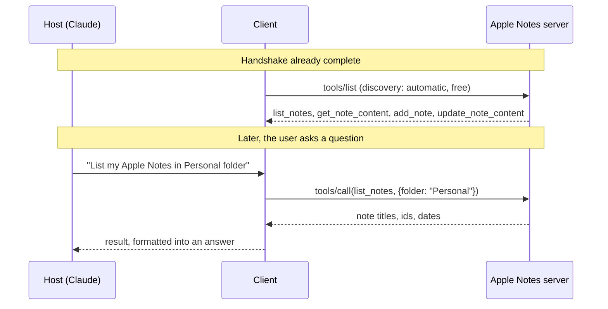
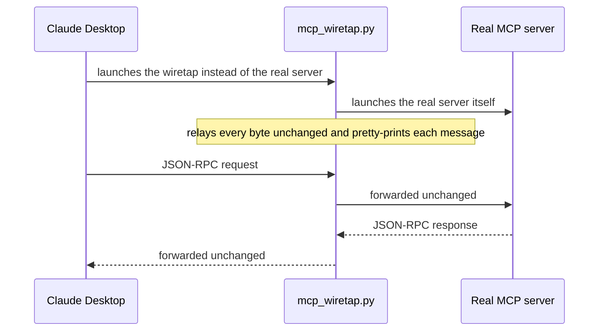

# Capability negotiation and the operation phase
> lead: Both sides hand over an honest menu, the client discovers and calls tools, the server can ask the user for missing information (elicitation), and a wiretap script lets you watch the real JSON-RPC conversation.
meta: Class 18 (transcript) | 6 September | 45 min read | Code: Weekend 10

:::repo Class numbers differ between the two summary sets
The transcript summaries number this session Class 18 and the short summaries call it Class 17. They are the same 6 September class. The code folder is Weekend 10.
:::

## Why it matters

"It just works" is a bad answer in an interview. Things fail at exactly these points in production: capability negotiation, discovery and calls. This chapter shows each step on real systems, plus a tool that makes the hidden JSON-RPC visible. It also covers the question every MCP user eventually asks: are we exposing our data to the LLM?

## Core ideas

### 1. Capability negotiation: an honest menu

:::key Both sides hand over a menu before anyone orders
Client and server each declare what they are **capable of**, not what they are about to do. That way each side knows what it can ask for later. It is not a commitment; nothing is used until needed.
:::



| Side | Capability | Meaning |
| --- | --- | --- |
| Client | **roots** | Ability to expose file-system access |
| Client | **sampling** | Supports an LLM sampling request |
| Client | **elicitation** | Can ask the user on the server's behalf |
| Client | **tasks**, **experimental** | Task support; non-standard features |
| Server | **tools**, **resources**, **prompts** | The three primitives |
| Server | **logging** | Can send log messages |
| Server | **completions** | Argument auto-completion |
| Server | **experimental** | Non-standard features |

### 2. Elicitation: the server asks the client

Here the two-way nature of JSON-RPC becomes concrete. **Elicitation is how a server requests additional information from the user, through the client, mid-interaction.** It does not only reply; it reaches out for something it needs. In LangChain's docs, elicitation surfaces as a **LangGraph interrupt**: a human answers it and the run resumes.

:::trap Elicitation is not Human-in-the-Loop
HITL is an AI-lifecycle safety mechanism layered on tool calls (approve, edit, reject). Elicitation is a **native MCP mechanism** for a server to ask for information it is missing. Different concept, easy to confuse.
:::

**On "deprecated".** An older communication pattern is marked deprecated in the newest spec. Deprecated does not mean unused: most servers in the wild still run the older pattern, and migrating an ecosystem takes close to a year.

### 3. Watching it happen for real

- **VS Code with Context7.** Adding the server showed connect then discover tools, automatically, before any request. Context7 is a useful, authentication-free server that returns the **latest documentation** for a library, solving the problem of a model's training data lagging a fast-moving API. It was named one of the top five most-used MCP servers.
- **Claude Desktop with Apple Notes.** The real tool list appeared: `list_notes`, `get_note_content`, `add_note`, `update_note_content`, with Claude aware of each before any note question.

None of this discovery is written by hand; it is baked into the architecture. You still need to understand every step because **production fails at these exact points**, and someone who only knows "it just works" cannot diagnose why it stopped.

### 4. The operation phase: discovery and calling

Operation is exactly two steps.



| Step | Method | When | Cost |
| --- | --- | --- | --- |
| **Discovery** | `tools/list` | Automatically the instant the handshake completes, before any user question | **Free**: no LLM involved, just the client asking the server what it offers |
| **Calling** | `tools/call` | Only when a request needs a specific tool | Needs a tool **name** and **arguments** |

**A real example.** Asked to "list my Apple Notes", the logs showed the real `list_notes` schema: a `folder` argument (string, optional, "filter notes by folder") and a `limit` (number, default 20). Requesting the "Personal" folder sent `folder: "Personal"` and no `limit`, so the server's default of 20 applied. Every tool on every server (Gmail, Calendar, Notes) has this same shape: a **name, a description and an input schema**. The quality of the description decides whether the AI picks the right tool at all.

:::key Negotiation says a category exists. Discovery says what is in it.
A student asked why the client calls `tools/list` if negotiation already said the server "has tools". Negotiation only confirms tools exist **as a category**. It says nothing about which tools, their names or their arguments. Discovery retrieves that detail.
:::

**Errors.** Malformed requests fail loudly as a proper **JSON-RPC error object** using standard codes (a wrong tool name gives a "method not found" style error). This is the same point where the tool-error and retry middleware from Chapter 8 apply.

### 4b. Three outcomes, not two

Keep these distinct, for the model and for monitoring:

| Outcome | How to return it | Why |
| --- | --- | --- |
| Success with data | A normal result | The model uses it |
| **Success, but empty** | An explicit empty result, for example `{"count": 0, "items": []}` | The model can truthfully say "no transactions" |
| **Failure** | A tool result with `isError: true` and an actionable message, such as "Account not found; call list_accounts first" | The model can recover |

Invalid requests (bad parameters) are **protocol-level JSON-RPC errors**, a separate case.

:::trap Returning `{"error": ...}` as a normal result
The model may treat it as data, and your metrics count it as a success. Tool errors also travel as **HTTP 200**, so status codes will not reveal them. Emit a per-tool metric labelled `ok`, `empty` or `error`. Page a human for infrastructure errors (database down, timeouts); let the model handle user-input errors (unknown account, bad date).
:::

### 5. The privacy trade-off, head on

"So with MCP, we are exposing our data to the LLM?" Yes. Whatever a tool returns, the client hands to the host, which sends it to the model provider to generate a response. This is real information flow.

- It is a legitimate reason to **lock down** which notes, files or folders a connection can see. Apple Notes' lock feature was demoed: a locked note becomes invisible to any MCP call.
- On the developer's side, **middleware** (PII detection, guardrails before a model call) controls what the model sees in a custom client or server. See Chapters 7 and 8.

### 6. Debugging: seeing real JSON-RPC

A third-party "playground" inspector made the lifecycle visible on a two-tool server (`getCurrentTime`, `convertTime`). "Convert the current Indian time to Chicago time" produced: an LLM call to understand, `tools/call` to `getCurrentTime`, a second LLM call to interpret, `tools/call` to `convertTime`, and a final LLM call to answer. The exact request and response bodies were visible, with ids incrementing on every call regardless of primitive.

:::trap Claude Desktop stopped logging full JSON bodies
The repo's wiretap script documents the change. As of **26 June 2026**, Claude Desktop's `mcp.log` and `mcp-server-*.log` stopped writing the full JSON of each message and now log only a terse one-line summary (method, id, whether params or a result are present). Entries before that date have full JSON; entries after do not. This is the **client** changing how much it writes to disk, not an MCP protocol version change. Two separate things.
:::

### 7. The wiretap: sit in the middle of the conversation

Instead of reading logs afterwards, `mcp_wiretap.py` sits **in** the conversation. Claude Desktop launches the wiretap instead of the real server, the wiretap launches the real server, and it relays every byte unchanged while printing a pretty copy of each message. Claude Desktop never knows.



In `claude_desktop_config.json`, change the server entry. Everything after `--` is the real command that used to be there:

```json
"filesystem": {
  "command": "python3",
  "args": [
    "/absolute/path/to/mcp_wiretap.py",
    "--log", "/path/to/wiretap-live.log",
    "--", "npx", "-y", "@modelcontextprotocol/server-filesystem", "/Users/you/Desktop"
  ]
}
```

Fully quit Claude Desktop (Cmd+Q), reopen, and use it normally. The terminal (or log file) shows the handshake, capability discovery, every tool call and shutdown. A `--no-color` variant exists for piping to a file.

:::tip Genericise paths before copying
The repo ships `claude_desktop_config.example.json` with generic paths. Do not copy a real machine's paths into a shared config.
:::

### 8. Legacy vs modern in the real world

In the debugging tool's connection log, connecting to an older unmigrated server first tried a **newer discovery call**, got an error because the server did not recognise it, then **fell back** to the older `initialize`-first handshake and succeeded. That is version negotiation working in real time.

Realistic migration to a newer MCP version takes **8 months to a year** for most servers, with only actively maintained ones (LangChain's, for instance) moving in the first couple of months. A client must support **both** the modern and legacy handshakes, not only the newest. That separates a demo from something built for a company. Chapter 17 compares them in full.

### 9. Why MCP and not just function calling (again)

Function calling is fine for a small single-app project. MCP earns its keep once more than one application or team reuses the same tool: a service builds its connector once and every compliant app uses it. It is a free, open, multi-company-governed specification, not a paid Anthropic product, which is why OpenAI and Google support it. Only a shared agreement gets adopted broadly enough to matter.

### 10. Live project: a no-code AI news updater

Gmail, Google Calendar, Tavily and Apple Notes were connected as live MCP servers through Claude's connector settings. Claude turned a rough flow diagram into a system prompt that researches AI news via Tavily, categorises it, drafts an HTML email, creates a recurring calendar reminder and produces a LinkedIn post and a Substack article.

:::key The brain decides. Tools act.
The model is used every time a decision is needed: which tool, which arguments, how to interpret a result. Data movement happens only through tool calls. A calendar event is created by a tool call once the model picks a time. Search results are woven into a narrative **by the model**, never by the search tool. Same agentic loop as the start of the course, now across four independent services.
:::

:::tip A prompt-writing lesson from the same demo
Without telling the model how many headlines to include per category, it made its own undocumented assumption and quietly dropped real stories. The fix is not a framework feature. Be explicit about how much detail you want and test until it holds.
:::

### 11. An enterprise scenario, worked through

A DevOps architect managing 150+ microservices across AWS, Azure and GCP wanted a vulnerability-remediation agent, but their enterprise Claude account had connector installation **locked down** to stop data leaving the organisation. The guidance: this is exactly the case for a **custom MCP server**. A self-hosted server (possibly its own Docker container, fitting the multi-cloud container pipeline) keeps sensitive data inside the organisation, since nothing passes through a third-party connector.

## Key pointers to remember

- Negotiation is an honest menu, not a commitment.
- Elicitation is a server asking for missing information, native to MCP and different from HITL.
- Discovery is automatic and free; calling needs a name and arguments.
- Data returned by a tool really goes to the model provider.
- A deprecated version still runs most servers; support both handshakes.
- MCP is a free multi-company specification.
- The brain decides; tools act.

## Questions from class worth knowing

:::qa How do we restrict specific tools for specific users in an MCP setup?
That is not an MCP-architecture concern. It is ordinary software engineering, solved with middleware (the guardrail and dynamic tool loading patterns from earlier chapters), not a built-in MCP feature.
:::

:::qa Can I create my own MCP server inside Claude?
No. You can **connect** your own server to Claude, but Claude is not where you build and host one.
:::

:::qa Does calling an MCP tool cost LLM tokens?
No. A tool call is a plain client-server transaction. Tokens are spent only when the model is invoked to reason or generate.
:::

:::qa Does MCP have built-in caching?
Not by default as far as could be confirmed live. If you want caching, build it separately.
:::

:::qa Are Claude's "connectors" the same as MCP servers?
Yes. Claude uses friendlier words ("connectors", "tools") for a general audience to avoid confusing non-technical users.
:::

:::qa Should I claim a "production-grade" AI project on my resume if it was not deployed at scale?
Describe it honestly and frame it around the real problem it solved, not the technology. Interviewers care about problem-solving depth, and shallow claims are exposed quickly under questioning.
:::

## Common mistakes

| Mistake | Symptom | Fix |
| --- | --- | --- |
| Skipping `tools/list` because negotiation said "tools" | Not knowing the tool names or arguments | Always run discovery |
| Thinking discovery uses the LLM | Wrong cost estimates | It is free; no model involved |
| Confusing elicitation with HITL | Wrong mechanism chosen | Elicitation is a server asking for info; HITL approves tool calls |
| Assuming returned data stays local | Privacy surprise | It goes to the model provider; restrict and filter |
| Reading Claude Desktop logs for message bodies | Only one-line summaries | Use the wiretap |
| Supporting only the newest handshake | Fails against most servers | Support legacy and modern |
| Vague tool description | Wrong tool chosen | Write a precise description |
| Not specifying detail level in prompts | Silently dropped content | State exactly what you want |

## Hands-on lab

1. Add Context7 to VS Code and watch discovery happen on connect.
2. Trigger a `tools/list` and a `tools/call` yourself and read both bodies.
3. Compare an older and a newer entry in your own `mcp.log`.
4. Run `mcp_wiretap.py` in front of a server you already use and read the traffic.
5. Try the playground inspector on a two-tool server and trace one multi-step request.
6. Build a no-code mini-project with at least three real connectors and note where the model's own assumptions shape the output.

## Interview corner

:::pitch
Capability negotiation is each side declaring what it can do, an honest menu, not a commitment. Then the operation phase has two steps: discovery with `tools/list`, which is automatic and costs no tokens, and calling with `tools/call`, which needs a name and arguments. Servers can also elicit information from the user through the client. Everything a tool returns is shared with the model provider, so I restrict and filter data deliberately.
:::

### Basics

:::qa What is capability negotiation?
Both sides declare what they are capable of so each knows what it may ask for later. Client capabilities include roots, sampling, elicitation, tasks and experimental. Server capabilities include tools, resources, prompts, logging, completions and experimental.
:::

:::qa What is elicitation?
A server requesting additional information from the user, through the client, mid-interaction. In LangChain it appears as a LangGraph interrupt that a human answers before the run resumes.
:::

:::qa What are the two steps of the operation phase?
Discovery (`tools/list`, automatic and free) and calling (`tools/call`, needing a tool name and arguments).
:::

:::qa Does discovery cost tokens?
No. No LLM is involved. It is just the client asking the server what it offers.
:::

### Intermediate

:::qa Why call `tools/list` if negotiation already says there are tools?
Negotiation confirms tools exist as a category. Discovery retrieves which tools, their descriptions and argument schemas.
:::

:::qa Elicitation vs HITL?
HITL is an approval layer over tool calls (approve, edit, reject, respond). Elicitation is a native MCP mechanism for the server to request missing information from the client and user.
:::

:::qa Are we exposing data to the LLM with MCP?
Yes. Tool results flow client to host to model provider. That is why you restrict what a connection can see (for example locked notes), and use PII middleware and guardrails on custom clients.
:::

:::qa What does a good tool definition contain?
A name, a description and an input schema. The description quality decides whether the model picks the right tool.
:::

:::qa How should a client handle old and new servers?
Try the newer handshake, fall back to the older one on an error, and explicitly support both. Most servers take 8 months to a year to migrate.
:::

### Tricky

:::qa Claude Desktop's logs used to show full JSON and now do not. Did the protocol change?
No. The client changed how much it writes to disk (from 26 June 2026 it logs only a terse summary). It is unrelated to the MCP version. The wiretap script recovers the full conversation.
:::

:::qa How does the wiretap work?
It sits between Claude Desktop and the real server. Claude Desktop launches the wiretap, which launches the real server and relays every byte unchanged while printing each message. You put the real command after `--` in the config.
:::

:::qa How would you build a vulnerability agent when connectors are locked down?
A custom self-hosted MCP server, possibly containerised, so sensitive data never leaves the organisation through a third-party connector.
:::

:::qa A multi-service no-code workflow dropped some stories. Why?
The model made its own undocumented assumption about how many items to include. Be explicit about the detail wanted in the prompt, and test.
:::

:::qa Is "brain decides, tools act" still true across many services?
Yes. The model decides which tool, arguments and how to interpret results. Data movement only happens through tool calls.
:::

### Production level

:::qa How do you tell tool failures apart from empty results?
Three outcomes: success with data, success but explicitly empty (`{"count": 0, "items": []}`), and failure as a result with `isError: true` and an actionable message. Bad parameters are protocol-level JSON-RPC errors. Never return `{"error": ...}` as a success. Monitor with a per-tool `ok`, `empty`, `error` metric, because tool errors still arrive as HTTP 200.
:::

## Quick revision

- [ ] I can state the honest-menu idea and list client and server capabilities
- [ ] I can explain elicitation and how it differs from HITL
- [ ] I can separate negotiation from discovery and discovery from calling
- [ ] I know discovery is free and calling needs a name and arguments
- [ ] I can explain the privacy trade-off and two ways to control it
- [ ] I can explain the logging change and how the wiretap works
- [ ] I can describe the legacy fallback and migration timeline
- [ ] I can explain when a custom self-hosted server is the right answer

## Sources and further reading

- [Class 18 full notes (transcript set)]({{src:classes_transcription_summary/18 - 6 Sep - MCP Capability Negotiation.md}})
- [Short summary of the same session]({{src:classes_summary/17 - 6 Sep - MCP Primitives, Architecture & Wiretap.md}})
- [`mcp_wiretap.py`]({{src:Weekend 10 - 5-6 Sep/06 Sep - MCP Primitives & Architecture/mcp_wiretap.py}})
- [Example Claude Desktop config]({{src:Weekend 10 - 5-6 Sep/06 Sep - MCP Primitives & Architecture/claude_desktop_config.example.json}})
- [AI updater project (PDF)]({{src:Weekend 10 - 5-6 Sep/06 Sep - MCP Primitives & Architecture/AI-Updater-Project.pdf}})
- [Reference Gmail MCP server]({{src:Weekend 10 - 5-6 Sep/06 Sep - MCP Primitives & Architecture/Link.txt}})
- [Weekend 10 code folder]({{tree:Weekend 10 - 5-6 Sep/06 Sep - MCP Primitives & Architecture}})
- [MCP interview questions (course repo)]({{src:interview-questions/mcp.md}})
