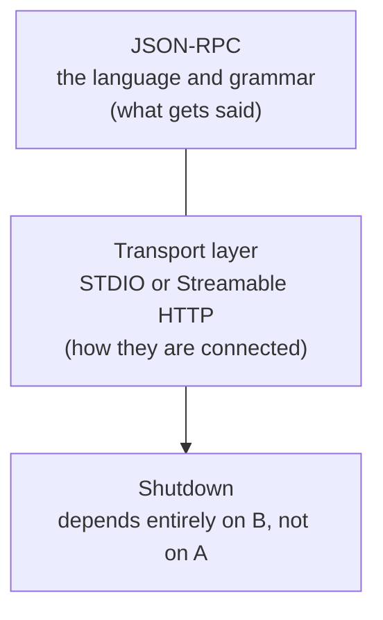
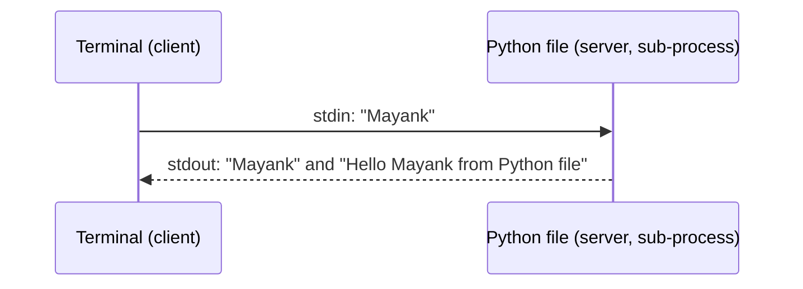
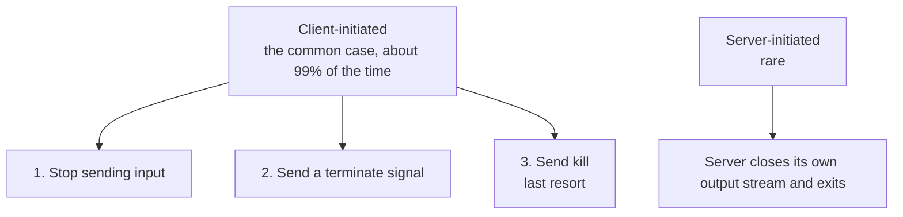

# Shutdown, transports and your first real server
> lead: Why shutdown depends on the transport layer, how STDIO and Streamable HTTP differ, and how to build a real MCP server the painful legacy way and the easy FastMCP way, then install it into Claude Desktop.
meta: Class 19 | 12 September | 45 min read | Code: Weekend 11

## Why it matters

Shutdown looks like a footnote, but it is the cleanest way to test whether you understand the **transport layer**. The key fact (no JSON-RPC messages are exchanged during shutdown) catches people out. The second half of this chapter is the first time you build a real server, and the legacy vs FastMCP history is a favourite way for interviewers to separate people who used MCP from people who understand it.

:::key Language vs connection
**JSON-RPC** is the language and grammar of what gets said. The **transport layer** is how the two parties are physically connected in order to say it. Shutdown is about the connection, so it depends entirely on the transport, not on JSON-RPC.
:::

:::analogy WhatsApp vs a phone call
Closing a chat with a friend depends on how you are talking. On WhatsApp, closing the connection means closing your internet. On a phone call, closing your internet does nothing, you have to hang up. Same conversation, different way of ending it.
:::



## Core ideas

### 1. Transport #1: STDIO

**STDIO** is Standard Input and Output. You have used it for years: any C or C++ program that begins with `#include <stdio.h>`.

A tiny live demo made the mechanism visible:

```python
name = input("Please tell me your name: ")
print(name)
print("Hello Mayank from Python file")
```

Run from a terminal, the **terminal is the client**, the **Python file is started as a sub-process and acts as the server**, and they are connected by STDIO the instant it runs. What the terminal sends becomes the file's input; what the file prints is what the terminal shows. That three-step pattern (launch a sub-process, share input through `stdin`, share output through `stdout`) is exactly what every STDIO MCP connection does, with JSON-RPC messages instead of a name and a greeting.



| Benefit | Why |
| --- | --- |
| **Fast** | Both sides run on the same machine, so no network round trip |
| **Secure** | Nothing is exposed outside the machine, so almost no attack surface |
| **Simple** | No server address or network setup; just the command |

**The trade-off:** it only works when both sides can run on the same machine. It does not scale to "anyone on the internet." By default it fundamentally needs a parent and sub-process relationship on one machine (unless proxied through something else).

**Shutdown in STDIO:**



:::key No JSON-RPC messages are exchanged during shutdown
The whole responsibility shifts to the transport. Closing Claude Desktop sends a plain termination signal to its connected servers: nothing in JSON-RPC, just the process being told to stop.
:::

### 2. Transport #2: Streamable HTTP

Built on the HTTP everyone knows from the web. Because HTTP already works across the internet, this is what lets a client reach a server running **anywhere**.

- The client sends a **POST** request to a single endpoint, almost always **`/mcp`**, carrying the JSON-RPC message in the body, with normal HTTP headers and auth (OAuth or an API key).
- It **replaces the older HTTP plus SSE** (server-sent events) pattern, now deprecated, though most existing servers still run the older one because migrating an ecosystem takes the better part of a year.

**Seeing it for real.** A live connection to an HTTP-based Excalidraw MCP server showed an `initialize` sent as an actual POST (full headers on screen), then an `initialized` notification, then `tools/list` returning 5 tools, then `resources/list`. The class's own LangChain MCP server URL ended in `/mcp` too, as every real HTTP MCP server does.

**Shutdown in Streamable HTTP:** just close the HTTP connection, like closing a browser tab or turning off Wi-Fi. If a server closes **unexpectedly** mid-connection, something went wrong server-side, and a well-built client should try to **reconnect gracefully** rather than fail silently.

| | STDIO | Streamable HTTP |
| --- | --- | --- |
| Where | Same machine, parent and sub-process | Anywhere over the internet |
| How it connects | `stdin` and `stdout` | POST to `/mcp` |
| Shutdown | Client: stop input, terminate, kill | Close the HTTP connection |
| Speed and risk | Fast, tiny attack surface | Network latency, needs real auth |
| Serves | Typically one client | Typically many clients |

With this, all three lifecycle phases (initialization, operation, shutdown) are done.

### 3. JSON-RPC, one more time

Now that each reason has been seen in practice: **lightweight** (plain JSON), **transport-agnostic** (identical over STDIO or HTTP), **two-way by design** and **notifications built in** (no id, no reply; exactly what `initialized` is).

## Building a server

### 4. The legacy way, and why it hurt

The painful original approach was shown deliberately: not to memorise, but to feel its difficulty, and because **this style of code still shows up in real companies.** With Anthropic's own low-level `mcp` Python SDK, a simple three-tool server (`list_recipes`, `get_recipe`, `search_recipes`) needed a hand-written `list_tools` function enumerating every tool plus a large nested `if/elif` block matching names to implementations. Real, working, verbose and easy to get wrong.

```python
import mcp.types as types
from mcp.server import Server

server = Server("RecipeBox")

@server.list_tools()                      # step 1: describe every tool by hand, as JSON Schema
async def list_tools() -> list[types.Tool]:
    return [
        types.Tool(name="get_recipe",
                   description="Get the full detail for one recipe by id.",
                   inputSchema={"type": "object",
                                "properties": {"recipe_id": {"type": "integer"}},
                                "required": ["recipe_id"]}),
        # ...one types.Tool per tool
    ]

@server.call_tool()                       # step 2: dispatch by name, by hand
async def call_tool(name: str, arguments: dict) -> list[types.ContentBlock]:
    if name == "get_recipe":
        result = RECIPES[arguments["recipe_id"]]
    elif name == "search_recipes":
        ...
    else:
        raise ValueError(f"Unknown tool: {name}")
    return [types.TextContent(type="text", text=str(result))]
```

The description and the dispatch live in two places that must be kept in step by hand. FastMCP generates both from one plain function.

### 5. The FastMCP way

:::analogy TensorFlow and Keras, all over again
Anthropic released the MCP spec and an official Python SDK that was correct but hard to write. **Jeremiah Lowin**, a co-founder of Prefect HQ, built standalone **FastMCP** to make it dramatically easier. It became popular enough that Anthropic folded a version into the official SDK (renaming an internal class to avoid confusion), as Google absorbed Keras's best ideas into TensorFlow. Standalone FastMCP is still what most real servers use.
:::

:::trap FastMCP and FastAPI are unrelated
They are **not** from the same team or company. They just share a naming style. They are highly compatible in practice, because an MCP tool is conceptually so close to an API endpoint. Do not conflate them in an interview.
:::

```python
from fastmcp import FastMCP

mcp = FastMCP("Recipe Box")

recipes = {
    "123": {"title": "Weeknight Pasta", "minutes": 20, "tags": ["quick", "weeknight"]},
    "124": {"title": "5-Minute Salsa", "minutes": 5, "tags": ["quick", "no-cook"]},
}

@mcp.tool
def list_recipes() -> list[dict]:
    """List all recipe IDs and titles."""
    return [{"id": k, "title": v["title"]} for k, v in recipes.items()]

@mcp.tool
def get_recipe(recipe_id: str) -> dict:
    """Get full details for one recipe by its ID."""
    return recipes[recipe_id]

@mcp.tool
def search_recipes(tag: str) -> list[dict]:
    """Search recipes by tag, e.g. 'quick'."""
    return [{"id": k, "title": v["title"]} for k, v in recipes.items() if tag in v["tags"]]

if __name__ == "__main__":
    mcp.run()
```

What took a hand-written `list_tools` plus nested `if/elif` takes **one decorator per function**. `@mcp.tool` reads the signature and docstring and handles `tools/list` and `tools/call` automatically.

**Add a resource and a prompt**, no restart needed:

```python
@mcp.resource("recipe://tags")
def valid_tags() -> list[str]:
    """The full list of valid recipe tags, so an LLM knows what it can search for."""
    return ["quick", "weeknight", "no-cook", "vegan", "dessert"]

@mcp.prompt
def plan_weekly_meals() -> str:
    """A template for planning a full week of meals from the recipe box."""
    return "Using the available recipes, plan a balanced set of meals for the next 7 days..."
```

FastMCP did **not** need a restart to pick up the resource (reconnect in Inspector, like FastAPI hot reload). The prompt needed a fresh connect and disconnect.

:::key Why the resource matters, concretely
A recipe's `tags` only exist **inside** a tool's returned data. A model cannot know which tag values are valid unless it has already called `list_recipes` or `search_recipes`. The `recipe://tags` resource lets it learn the valid tags upfront, so "something for the holidays" can be translated into a tag the server actually understands, rather than the model guessing at something that does not exist.
:::

### 6. A real debugging moment: port conflicts

`npx @modelcontextprotocol/inspector python3 recipebox_fastmcp.py` failed because port `6274` was already in use: MCP Jam happened to be running there. The fix is ordinary debugging: find what occupies the port, then close it or redirect the new one (`--client-port 9999` worked). Two things cannot share a port any more than two websites can both be `google.com`. It is not a sign MCP is broken.

### 7. Install it into Claude Desktop

```bash
uv run fastmcp install claude-desktop recipebox_fastmcp.py
```

This registers the server in Claude Desktop's own config. After a restart it appears alongside every other connector, usable in a real conversation. The entry it creates:

```json
"RecipeBox_Updated": {
  "command": "/opt/homebrew/bin/uv",
  "args": ["run", "--with", "fastmcp", "fastmcp", "run",
           "/Users/mayank/Complete MCP/first-mcp-server/recipebox_fastmcp.py"],
  "transport": "stdio"
}
```

Two details: it declares `"transport": "stdio"` (STDIO is the natural choice for a local server), and the command is `uv run --with fastmcp fastmcp run <file>`, so Claude Desktop launches the server exactly as you would from a terminal, automated.

### 8. Preview: making a local server reachable

A server on `localhost` cannot be reached by anyone else. The answer given was **tunnelling**, specifically **ngrok**: it exposes a local port as a real shareable internet URL without deploying to a cloud server. This is what matters once a LangChain agent or another person must reach it. Chapter 16 covers real deployment.

## Key pointers to remember

- **Shutdown depends on the transport, not on JSON-RPC.** No JSON-RPC messages are exchanged.
- STDIO is parent and sub-process on one machine: fast, secure, simple, local only. Shutdown: stop input, terminate, kill.
- Streamable HTTP is POST to `/mcp` over the internet. Shutdown is closing the connection.
- `@mcp.tool` does the work of `tools/list` and `tools/call`. The same holds for `@mcp.resource` and `@mcp.prompt`.
- FastMCP and FastAPI are unrelated.
- A resource can teach a model which values are valid to search for.
- `uv run fastmcp install claude-desktop <file>` registers a custom server.
- Tunnelling (ngrok) bridges "runs on my machine" to "anyone can connect."

## Questions from class worth knowing

:::qa If an agent talks to a database-backed MCP server, is one tool needed per read operation?
Yes. One tool per meaningful operation (get profile, get transactions), with the model choosing at runtime which best matches the request.
:::

:::qa Why does an LLM call `list_recipes` first instead of `get_recipe`?
It only learns that `get_recipe` exists through discovery (`tools/list`), and it does not know valid ids until it lists them. At real scale there could be thousands of records, not three.
:::

:::qa How does an LLM know what kind of file a resource holds?
Through the resource's declared **MIME type**, the same web concept: plain text, PDF, audio, video and so on.
:::

:::qa Should I name frameworks like FastMCP in an interview?
Concepts first. Knowing why MCP is structured as it is, and the legacy vs modern history, separates real understanding from the many who can define an MCP server but cannot explain what happens underneath.
:::

:::qa Does the language (Python or Node) matter for a good MCP server?
No. The protocol does not care. The choice comes from your team's stack.
:::

:::tip Interview feedback from this class
Two learners forwarded for interviews were strong on concepts but weaker on coding. A direct signal: practise writing code, not only explaining it.
:::

<!-- sites-add -->
## From the instructor's lifecycle guide: transports and shutdown

*Added from the MCP Lifecycle guide (read 30 Oct 2026).*

**stdio is just a subprocess and two pipes.** The client launches the server, the server reads stdin and writes stdout, messages are newline-delimited, and stderr is free for logging. There is no separate auth layer: credentials come from the environment. The guide proves it with a few lines of plain Python: start `server.py` with `subprocess.Popen` (stdin and stdout piped), write one `initialize` request as a JSON line, flush, and read one line back.

**Streamable HTTP** uses one endpoint (commonly `/mcp`) with POST and GET, plain JSON or an upgrade to SSE for long calls, and an optional `Mcp-Session-Id` header. It replaces the older, deprecated HTTP+SSE transport.

**Shutdown has no JSON-RPC message at all.** The transport closing is the goodbye.

| Transport | Client-initiated (common) | Server-initiated (rare) |
| --- | --- | --- |
| stdio | Close stdin and wait; send `SIGTERM` if it does not exit; `SIGKILL` as the last resort | The server closes its output stream and exits |
| Streamable HTTP | Close the HTTP connection | The server closes unexpectedly, so the client should reconnect gracefully |

`SIGTERM` is a polite knock ("please finish up and leave"); `SIGKILL` forces the door with no chance to clean up.
<!-- /sites-add -->

## Common mistakes

| Mistake | Symptom | Fix |
| --- | --- | --- |
| Looking for JSON-RPC messages in shutdown | Cannot find them | There are none; the transport handles it |
| Expecting STDIO to serve remote users | Cannot connect | Use Streamable HTTP |
| Hand-writing `list_tools` and `if/elif` for new servers | Verbose, error-prone | Use FastMCP |
| Confusing FastMCP with FastAPI | Wrong in interviews | Different projects and teams |
| Only returning tags inside tool results | Model guesses valid values | Expose them as a resource |
| Running two tools on one port | Port in use error | Free the port or use `--client-port` |
| Ignoring an unexpected HTTP close | Silent failure | Reconnect gracefully |
| Using HTTP plus SSE for new servers | Deprecated | Use Streamable HTTP |

## Hands-on lab

1. Recreate the `input()` and `print()` demo and narrate which part is the client and which is the server.
2. Trace a real Streamable HTTP connection in Inspector or MCP Jam and find `/mcp` in the URL.
3. Build RecipeBox exactly as shown, then add the `recipe://tags` resource and `plan_weekly_meals` prompt.
4. Trigger a port conflict on purpose and fix it with `--client-port`.
5. Run `uv run fastmcp install claude-desktop <file>` and confirm it appears as a connector.
6. Read about ngrok and explain how it exposes a local port.

## Interview corner

:::pitch
Shutdown depends on the transport layer, not JSON-RPC, so no JSON-RPC messages are exchanged. With STDIO the client stops input, then sends a terminate signal, then kill as a last resort. With Streamable HTTP you simply close the connection, and a client should reconnect gracefully if the server drops. For building, I use FastMCP: one decorator per tool, resource or prompt, instead of the legacy SDK's hand-written `list_tools` and `if/elif` dispatch.
:::

### Basics

:::qa How does MCP shutdown work?
Through the transport layer, with **no JSON-RPC messages**. STDIO: the client stops sending input, sends a terminate signal and, as a last resort, kill. Streamable HTTP: close the HTTP connection.
:::

:::qa STDIO vs Streamable HTTP?
STDIO runs a server as a sub-process on the same machine over stdin and stdout: fast, secure, simple, local only. Streamable HTTP is POST requests to `/mcp` over the internet: reachable anywhere, serves many clients, needs real auth.
:::

:::qa What endpoint does Streamable HTTP use?
A single endpoint, almost always `/mcp`, with the JSON-RPC message in the POST body.
:::

:::qa What does `@mcp.tool` do?
Registers the function as a tool and handles `tools/list` and `tools/call` from its signature and docstring. `@mcp.resource` and `@mcp.prompt` do the same for the other primitives.
:::

### Intermediate

:::qa Why does shutdown depend on the transport and not JSON-RPC?
JSON-RPC defines what is said. Closing the connection is about how the parties are connected. On a phone call you hang up; on WhatsApp you close the internet. Same language, different ending.
:::

:::qa FastMCP vs the official SDK?
The official `mcp` SDK is correct but verbose (hand-written `list_tools`, nested `if/elif`). Jeremiah Lowin (Prefect) built FastMCP to make it easy, and a version was folded into the official SDK. Like Keras and TensorFlow.
:::

:::qa Is FastMCP from the FastAPI team?
No. Unrelated projects with similar naming. They work well together.
:::

:::qa Why add a resource listing valid tags?
A model cannot know valid values that only appear inside tool results. The resource lets it learn them upfront so a vague request maps to a real tag.
:::

:::qa What if the HTTP server closes unexpectedly?
It signals something went wrong server-side. A good client attempts to reconnect gracefully rather than failing silently.
:::

### Tricky

:::qa Why is shutdown "almost always" client-initiated in STDIO?
The client launched the server as a sub-process and owns its lifecycle. The server can close its own output stream and exit, but that is rare.
:::

:::qa Can STDIO ever work across machines?
Not by default: it needs a parent and sub-process on one machine. Only if proxied through something else.
:::

:::qa How do you get a local server in front of a remote agent?
Tunnel it (for example ngrok) to a real internet URL for testing, or deploy it properly to a cloud host (Chapter 16).
:::

:::qa How do you register a custom server in Claude Desktop?
`uv run fastmcp install claude-desktop server.py`, which writes a config entry with `"transport": "stdio"` and a `uv run --with fastmcp fastmcp run <file>` command.
:::

:::qa Why show the legacy approach at all?
So its pain is felt, and because that code still appears in real companies.
:::

## Quick revision

- [ ] I can explain why shutdown depends on the transport
- [ ] I can state the STDIO shutdown sequence and the HTTP one
- [ ] I can explain STDIO with the `input()` and `print()` demo
- [ ] I know STDIO's benefits and its limit
- [ ] I can state how Streamable HTTP works and what it replaced
- [ ] I can build a FastMCP server with a tool, resource and prompt
- [ ] I can explain FastMCP's history and that it is not FastAPI
- [ ] I can install a server into Claude Desktop
- [ ] I can say what ngrok is for

<!-- res -->
## Opening a server in Inspector

The class opened a local server with this command:

```bash
CLIENT_PORT=9999 npx @modelcontextprotocol/inspector python3 recipebox_fastmcp.py
```
<!-- /res -->

## Sources and further reading

- [Class 19 full notes]({{src:classes_transcription_summary/19 - 12 Sep - MCP - Shutdown, Transport Layer.md}})
- [Class 18 short summary]({{src:classes_summary/18 - 12-13 Sep - Building & Deploying MCP Servers.md}})
- [`recipebox_fastmcp.py`]({{src:Weekend 11 - 12-13 Sep/12-13 Sep - Building & Deploying MCP Servers/first-mcp-server/recipebox_fastmcp.py}})
- [`recipebox_lowlevel.py` (the legacy way)]({{src:Weekend 11 - 12-13 Sep/12-13 Sep - Building & Deploying MCP Servers/first-mcp-server/recipebox_lowlevel.py}})
- [Warm-up primitives server]({{tree:Weekend 11 - 12-13 Sep/12-13 Sep - Building & Deploying MCP Servers/mcp-warmup-primitives}})
- [Weekend 11 code folder]({{tree:Weekend 11 - 12-13 Sep/12-13 Sep - Building & Deploying MCP Servers}})
- [MCP Jam](https://www.mcpjam.com/)
