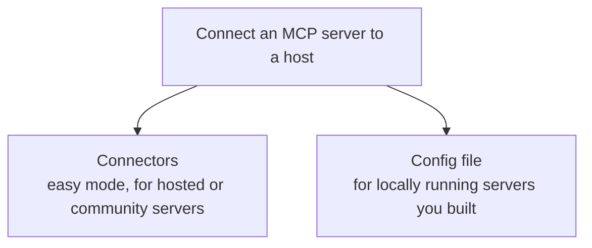
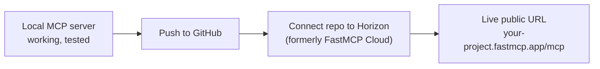

# The Time Tracker project
> lead: Wrap a real API in MCP two ways (manual tools and automatic conversion), connect hosts through connectors and config files, and prepare the server for public hosting.
meta: Class 20 | 13 September | 40 min read | Code: Complete MCP, TimeTrackProject

## Why it matters

Real products already have APIs before anyone thinks about MCP. Nothing about Gmail's or Slack's API was designed "for AI". MCP is added afterwards, on top of trusted infrastructure. This chapter is that story end to end, and it answers a real interview question: **should you auto-convert an existing API or build tools by hand?**

:::tip AI-assisted coding is expected in this course
The instructor repeated it: the goal is understanding architecture and decisions deeply, not memorising syntax by hand. Pasting code into ChatGPT to understand or debug it is a normal professional habit. What matters is that you can explain and defend the result.
:::

## Core ideas

### 1. Two ways to connect a server to a host



- **Connectors** are the discoverable way most people add a server: click "Add", paste a name and a hosted URL. A public, already-hosted server (Firecrawl was the live example) is designed for this.
- **The config file** (`claude_desktop_config.json` on Mac, an equivalent on Windows) powers **both** methods under the hood. Even a connector added through the UI ends up here. A developer edits it directly to run a locally built server, since a local server has no public URL to paste.

```json
"RecipeBox_Updated": {
  "command": "/opt/homebrew/bin/uv",
  "args": ["run", "--with", "fastmcp", "fastmcp", "run", ".../recipebox_fastmcp.py"],
  "transport": "stdio"
},
"demo-filesystem-wiretapped": {
  "command": "python3",
  "args": ["mcp_wiretap.py", "--log", "wiretap-live.log", "--", "npx", "-y",
           "@modelcontextprotocol/server-filesystem", "..."]
}
```

:::trap A bare `uv` often silently fails in the config
Claude Desktop does not necessarily know where `uv` is installed. Run `which uv` in a terminal (for example `/opt/homebrew/bin/uv`) and put the **full path** in the config's `command` field. Same for `python`. This is one of the most common real setup bugs.
:::

The `demo-filesystem-wiretapped` entry is the wiretap from Chapter 13: a relay that forwards every message while logging the full JSON-RPC.

**VS Code is identical in logic:** `Cmd/Ctrl+Shift+P`, "MCP: Add Server", choose STDIO, give the command. It writes VS Code's own `mcp.json`. Every host (Claude, VS Code, Cursor, ChatGPT) runs the same architecture with a different settings screen.

:::key The server never decides which tool to call
A server sits and waits. The **client** sends a `tools/call` naming the tool and arguments. All the deciding happens on the model side before the request is sent.
:::

### 2. The project: Time Tracker

A time-tracking app, the same category as Toggl or Clockify: employees logging real hours against real projects.

**Database layer.** SQLite with a `time_entries` table (auto id, employee name, project, entry date, hours, description), seeded on first run so it never starts empty. A `row_to_dict` helper converts SQLite rows to plain dictionaries.

**API layer: FastAPI, deliberately with no MCP yet.** This is the REST layer any real product already has:

```python
from fastapi import FastAPI
import database as db

app = FastAPI(title="Time Track")
db.init_db()          # creates the table and seeds sample data if empty

@app.get("/api/entries")
def list_all_entries():
    return db.list_all_entries()

@app.get("/api/projects/{project}/summary")
def get_project_summary(project: str):
    return db.get_project_summary(project)

class NewEntry(BaseModel):
    employee_name: str
    project: str
    entry_date: str
    hours: float
    description: str

@app.post("/api/entries")
def log_time(entry: NewEntry):
    return db.log_time(entry.employee_name, entry.project, entry.entry_date,
                       entry.hours, entry.description)
```

`uv run fastapi dev main.py` gave a working Swagger page at `/docs` and a plain HTML, CSS and `app.js` front end that logs time and shows project summaries. The browser's network tab showed exactly which REST calls fire when an entry is logged.

### 3. Two ways to turn an API into an MCP server

**Option 1: manual tools, full control.**

```python
from fastmcp import FastMCP
import database as db

mcp = FastMCP("Time Tracker")

@mcp.tool
def log_time(employee_name: str, project: str, entry_date: str, hours: float, description: str) -> dict:
    """Log a new time entry for an employee against a project."""
    return db.log_time(employee_name, project, entry_date, hours, description)

@mcp.tool
def get_timesheet(employee_name: str, week_start: str) -> list[dict]:
    """Get all time entries for one employee for a given week."""
    return db.get_timesheet(employee_name, week_start)

@mcp.tool
def get_project_summary(project: str) -> dict:
    """Get total hours and a per-employee breakdown for one project."""
    return db.get_project_summary(project)

@mcp.tool
def list_projects() -> list[str]:
    """List every known project name."""
    return db.list_projects()

@mcp.prompt
def generate_weekly_report(employee_name: str, week_start: str) -> str:
    """A template guiding the AI to pull an employee's week and write a clean summary report."""
    return f"Generate a weekly report for {employee_name} starting {week_start}, using their timesheet and project summaries..."
```

Inspector showed the same lifecycle as every earlier class: `initialize`, discovery, a real `tools/call`. The `generate_weekly_report` prompt **cannot be replicated by a plain API**: it guides the AI to combine multiple tool calls into one well-structured output.

**Option 2: automatic conversion, speed.**

```python
mcp = FastMCP.from_fastapi(app)     # app is the FastAPI instance already defined
```

Four lines turn every FastAPI endpoint into an MCP tool, confirmed in Inspector: tools mapped straight from the REST routes, **no prompts and no resources**, since those do not exist in plain REST.

| | Auto-convert | Build by hand |
| --- | --- | --- |
| Effort | Four lines | More |
| Tool descriptions | Whatever the API had | AI-friendly, richer |
| Combine API calls into one tool | No | Yes |
| Prompts and resources | None | Yes |
| Touches trusted production code | No | No (a separate layer) |

:::key When to choose which
**Auto-convert** to make already-working, trusted APIs available to AI quickly, with no interest in reshaping them. **Build manually** when you need combined calls, richer AI-oriented descriptions than the API ever needed for human developers, or prompts. A practical reason teams go manual: they are reluctant to modify an already-deployed API just to make descriptions AI-friendly, so a separate hand-built MCP layer avoids touching trusted code.
:::

:::repo The repo version differs slightly from the class
The repo's `main.py` has `get_timesheet(employee_name, start_date="", end_date="")` rather than `week_start`, and adds a resource `timesheet://projects` (the current set of known project names). It serves the website and the MCP endpoint from **one** app, so both see the same data.
:::

### 4. One app, two front doors (from the repo)

The repo's finished `main.py` mounts the MCP server inside the FastAPI app: the website for people at `/`, and the MCP endpoint at `/mcp` for AI assistants, both using the same `database.py`.

```python
mcp_app = mcp.http_app(path="/")                     # path="/" here, NOT "/mcp"
app = FastAPI(title="TimeTrack", lifespan=mcp_app.lifespan)   # lifespan AT CONSTRUCTION
...
app.mount("/static", StaticFiles(directory="static"), name="static")
app.mount("/mcp", mcp_app)
```

:::trap Two rules that matter (from the repo README)
1. Use `mcp.http_app(path="/")`, **not** `"/mcp"`. `app.mount("/mcp", ...)` already adds the prefix, so both would double it into `/mcp/mcp`.
2. Pass `lifespan=mcp_app.lifespan` **when constructing** `FastAPI(...)`, not afterwards. Otherwise the MCP session manager silently never initialises.
:::

| Primitive | Name | What it does |
| --- | --- | --- |
| Tool | `log_time` | Logs an entry; appears on the website immediately |
| Tool | `get_timesheet` | One employee's entries, optionally filtered by date |
| Tool | `get_project_summary` | Total hours per project, by employee (a real SQL `GROUP BY`) |
| Tool | `list_projects` | Every project with at least one entry |
| Resource | `timesheet://projects` | Current known project names |
| Prompt | `generate_weekly_report` | Structures a weekly report request |

To connect Claude Desktop to the running server, the repo shows a config with just a URL: `{"mcpServers": {"timetrack": {"url": "http://127.0.0.1:8000/mcp"}}}`.

### 5. Seeing the raw protocol with curl

The repo includes the handshake as plain `curl`, which shows that MCP over HTTP really is just POSTs:

```bash
curl -i -X POST http://127.0.0.1:8000/mcp/ \
  -H "Content-Type: application/json" \
  -H "Accept: application/json, text/event-stream" \
  -d '{"jsonrpc":"2.0","id":1,"method":"initialize",
       "params":{"protocolVersion":"2025-06-18","capabilities":{},
                 "clientInfo":{"name":"test-client","version":"1.0.0"}}}'

# next call reuses the session id returned in the response headers
curl -i -X POST http://127.0.0.1:8000/mcp/ \
  -H "Content-Type: application/json" \
  -H "Accept: application/json, text/event-stream" \
  -H "Mcp-Session-Id: <the id from the first response>" \
  -d '{"jsonrpc":"2.0","id":2,"method":"tools/list"}'
```

Note the `Mcp-Session-Id` header: the server hands the client a session id on `initialize`, and the client sends it back on later calls. That is how the server tells connections apart over HTTP.

### 6. Going public: Prefect Horizon



**Horizon** (by Prefect, the company behind FastMCP) is the hosting platform FastMCP's docs recommend. Free tier as noted in class: **one developer, up to 200 MCP servers, one-hour log retention**, deployed from GitHub so each change redeploys.

The repo's steps:

1. Create a **clean, separate repository** with just the server: `main.py`, `database.py`, `pyproject.toml` and `uv.lock`. Horizon builds from exactly what is in the repo, so notes, scratch files and course material do not belong.
2. Push to GitHub and sign in at Horizon with that account.
3. Select the repository and set a server name (for example `timetrack`) and the **entrypoint `main.py:mcp`**.
4. Optionally verify first with `fastmcp inspect main.py:mcp`.

The resulting URL can be pasted into any host's connector settings (Claude Desktop, Claude Web, ChatGPT, Cursor), like the Firecrawl connector earlier.

:::note Open question from the repo README
Whether the website's static routes ship with a Horizon deployment is unconfirmed. Horizon is built for the MCP piece. If the website must be live too, deploy the whole app to a general host (Railway is named as the fallback).
:::

## Key pointers to remember

- A connector and a config-file entry are the same thing; connectors are the UI for it.
- The server never decides which tool to call.
- A bare `uv` path is a top setup bug: use `which uv`.
- Real products have APIs before MCP; MCP comes afterward.
- `FastMCP.from_fastapi(app)` converts an API in four lines but yields no prompts, no resources and no custom descriptions.
- Hand-build tools for control; auto-convert for speed and safety.
- Horizon turns a GitHub repo into a public URL.

## Questions from class worth knowing

:::qa For deployed production APIs, auto-convert or build manually?
Auto-conversion is the faster, safer start because it does not touch trusted production code. Go manual once you need finer control: better descriptions, combined calls or prompts.
:::

:::qa If I have 5 connectors, do they all go in one config file?
Yes. Each connector is its own server entry and the host starts each independently, like multiple servers running side by side.
:::

:::qa Is GitHub to Horizon like a Java developer deploying to Kubernetes?
Conceptually yes: take working local code and make it a reachable running service, but through a platform built for MCP servers rather than a general container orchestrator.
:::

:::qa Will authorisation be added?
Yes, as a next step once hosted. A publicly reachable time-tracking server for a real company needs real access control.
:::

:::qa Is writing code without AI help expected in interviews?
Not in this course. AI-assisted coding is treated as a normal professional skill. What matters is understanding the architecture and decisions well enough to explain and defend them.
:::

## Common mistakes

| Mistake | Symptom | Fix |
| --- | --- | --- |
| Bare `uv` or `python` in the config | Server does not appear after restart | Use the full path from `which` |
| `http_app(path="/mcp")` plus `mount("/mcp")` | Endpoint becomes `/mcp/mcp` | Use `path="/"` |
| Setting FastAPI lifespan afterwards | MCP sessions silently never start | Pass `lifespan=` at construction |
| Auto-converting and expecting prompts | None exist | Add prompts by hand |
| Vague REST descriptions as tool descriptions | Model picks the wrong tool | Write AI-friendly descriptions manually |
| Pushing your whole course folder to Horizon | Slow build, leaked files | A clean repo with only the server files |
| Forgetting the `Mcp-Session-Id` header | Server rejects later calls | Send the id from the `initialize` response |
| Using a local SQLite file on a serverless host | Data lost when it goes cold | Use a real hosted database |

## Hands-on lab

1. Open your host's config file and identify the command and path for one server.
2. Break a config with a bare `uv`, then fix it with `which uv`.
3. Build a small FastAPI backend with two endpoints over SQLite.
4. Wrap it both ways: manual `@mcp.tool` and `FastMCP.from_fastapi(app)`. Compare the tool lists in Inspector.
5. Add one `@mcp.prompt` that combines two tools.
6. Reproduce the handshake with `curl` and reuse the `Mcp-Session-Id`.
7. Read about Horizon's flow from GitHub to a live URL.

## Interview corner

:::pitch
Real products already have APIs, so MCP is a layer added afterwards. I can auto-convert a FastAPI app with `FastMCP.from_fastapi` for speed and safety, or hand-write tools when I need AI-friendly descriptions, combined calls or prompts, and a separate layer means I never touch trusted production code. Hosts connect through connectors or a config file, which are the same mechanism, and Horizon turns a GitHub repo into a public MCP URL.
:::

### Basics

:::qa Connectors vs config file?
Connectors are the friendly UI. The config file is what actually holds the entries for both. Developers edit it to run a local server that has no public URL.
:::

:::qa Who decides which tool to call?
The model, through the client. The server only executes the `tools/call` it receives.
:::

:::qa How do you auto-convert an API to MCP?
`FastMCP.from_fastapi(app)` with the existing FastAPI app. Every endpoint becomes a tool.
:::

### Intermediate

:::qa Auto-convert or manual: how do you choose?
Auto-convert when the goal is quick access to trusted APIs. Manual when you need combined calls, richer AI-oriented descriptions or prompts. Teams often prefer manual so they do not edit deployed APIs.
:::

:::qa What does auto-conversion not give you?
Prompts, resources, custom descriptions and tools that combine several calls.
:::

:::qa How do you mount an MCP server inside FastAPI?
`mcp_app = mcp.http_app(path="/")`, create `FastAPI(lifespan=mcp_app.lifespan)`, then `app.mount("/mcp", mcp_app)`.
:::

:::qa How do you deploy to Horizon?
Put only the server files (`main.py`, `database.py`, `pyproject.toml`, `uv.lock`) in a clean GitHub repo, sign in with GitHub, select it, set the entrypoint `main.py:mcp`, and deploy. The URL looks like `your-project.fastmcp.app/mcp`.
:::

### Tricky

:::qa Why might Claude Desktop not show your local server?
Commonly a bare `uv` or `python` in the config. Claude does not know where it is installed, so use the full path from `which uv`.
:::

:::qa Why `path="/"` and not `"/mcp"`?
`app.mount("/mcp", ...)` already adds the prefix, so using `/mcp` in both would double it into `/mcp/mcp`.
:::

:::qa What does the `Mcp-Session-Id` header do?
The server returns it on `initialize`, and the client sends it on later requests so the server can tell sessions apart over HTTP.
:::

:::qa Why is a hand-built MCP layer sometimes safer in a company?
It leaves already-deployed, trusted API code untouched, while still letting you write richer AI-facing descriptions and prompts.
:::

:::qa What breaks if you host with a local SQLite file on a serverless platform?
Data can disappear when the function goes cold. A real hosted database is needed for durability.
:::

## Quick revision

- [ ] I can explain connectors vs config files and fix a bare `uv` path
- [ ] I can state that the server never decides which tool to call
- [ ] I can build and test a FastAPI plus SQLite backend
- [ ] I can wrap it manually and with `from_fastapi`, and say when to use each
- [ ] I can explain the two `main.py` rules (path and lifespan)
- [ ] I can reproduce the handshake with `curl`
- [ ] I can describe the Horizon deployment steps

## Sources and further reading

- [Class 20 full notes]({{src:classes_transcription_summary/20 - 13 Sep - MCP - The Time Tracker Project.md}})
- [Time Tracker project folder]({{tree:Complete MCP/TimeTrackProject}})
- [Server README (setup and Horizon)]({{src:Complete MCP/TimeTrackProject/timetrack mcp server/README.md}})
- [`main.py` (website plus MCP in one app)]({{src:Complete MCP/TimeTrackProject/timetrack mcp server/main.py}})
- [`database.py`]({{src:Complete MCP/TimeTrackProject/timetrack mcp server/database.py}})
- [Steps to remote MCP]({{src:Complete MCP/TimeTrackProject/timetrack mcp server/steps_to_remote_mcp.txt}})
- [Raw `curl` handshake]({{src:Complete MCP/TimeTrackProject/timetrack mcp server/mcp_htttp_connection.txt}})
- [Time Tracker notebook]({{src:Complete MCP/TimeTrackProject/timetrack_notebook.ipynb}})
- [FastMCP Cloud docs](https://gofastmcp.com/v2/deployment/fastmcp-cloud)
