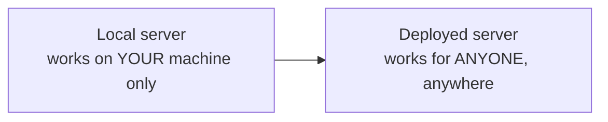
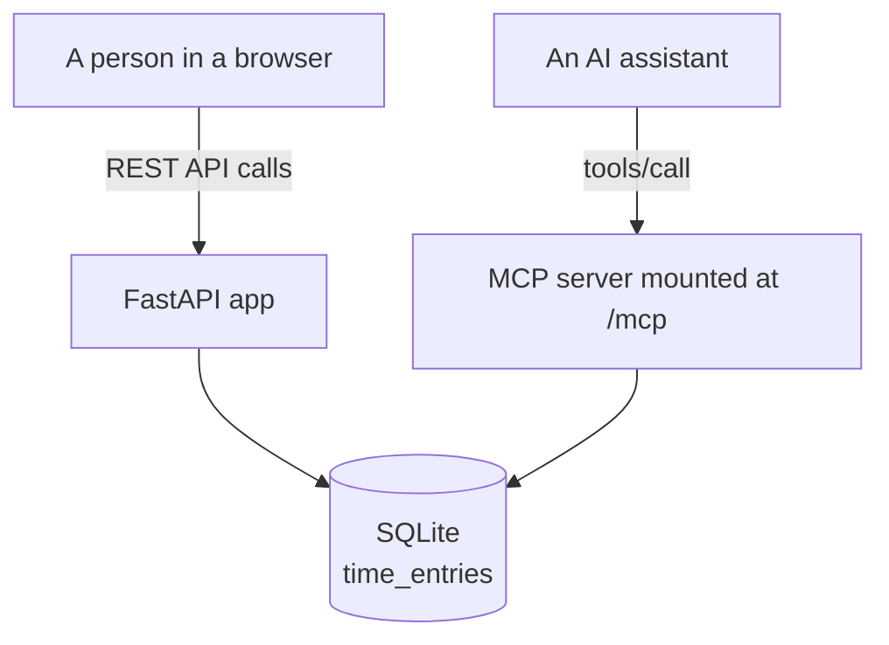
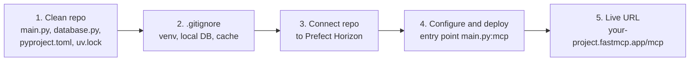
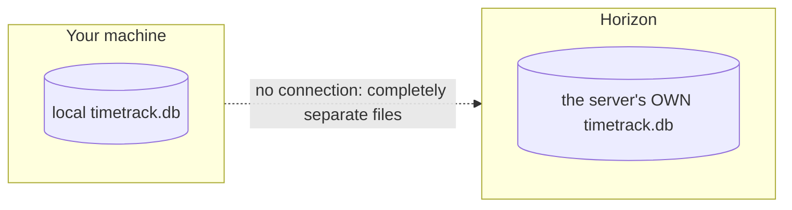
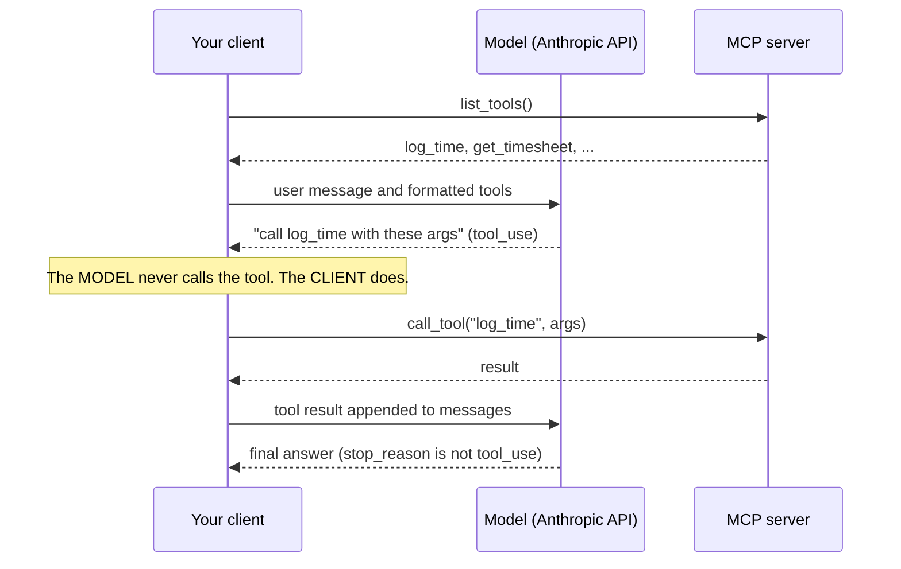
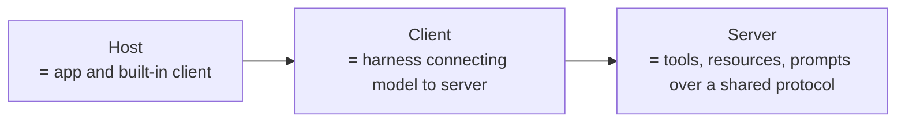

# Deploying MCP servers and building your own client
> lead: Move a server from "works on my machine" to a public URL, understand why the client is a harness, and build the client loop yourself.
meta: Class 21 | 19 September | 45 min read | Code: Complete MCP, TimeTrackProject

## Why it matters

A local server helps only the machine it runs on. Deployment questions are classic interview material: STDIO or HTTP, what does the host platform need, why do local and server databases not sync? And building a client yourself is where "MCP is the same agentic loop" finally clicks. Chapter 15 covered the project and the two `main.py` rules; this chapter covers what it takes to put it live and to write the other side.



## Core ideas

### 1. STDIO vs HTTP at deployment time

| | Local STDIO | Remote HTTP |
| --- | --- | --- |
| Where it runs | Your machine, as a sub-process | Somewhere else, reachable over the internet |
| Speed | Fast, no network hop | A real network round trip on every call |
| Who can use it | Only whatever launched it | Many clients, from anywhere, at once |
| Where the power lives | Split across whoever runs it locally | Centralised: one genuinely powerful server for everyone |
| Typical use | A personal tool: one person, one machine | Team or company-wide shared tools |

This is why most serious shared MCP servers run over HTTP. A locally started server, however well built, is not reachable by anyone else.

### 2. The same file, two transports

```bash
uv run fastmcp run main.py
# Starting MCP server 'TimeTrack' with transport 'stdio'

uv run uvicorn main:app --reload
# reachable at http://127.0.0.1:8000, with the MCP endpoint at /mcp
```

:::key `fastmcp run` vs `uvicorn`
`uv run fastmcp run main.py` starts **just the MCP server object** over STDIO. `uv run uvicorn main:app` starts the **whole application** (website, REST API and MCP server mounted together), because `app` is the FastAPI instance with everything wired in.
:::

### 3. One app, two front doors



The deployed `main.py` (Chapter 15 shows the full file) builds the MCP server first, then the FastAPI app with `lifespan=mcp_app.lifespan` at construction, and `app.mount("/mcp", mcp_app)`. Two rules to remember: `http_app(path="/")` not `"/mcp"`, and the lifespan passed at construction.

### 4. A small, honest persistence layer

```python
import os
import sqlite3
from pathlib import Path

DB_PATH = Path(os.environ.get("TIMETRACK_DB_PATH", "/tmp/timetrack.db"))

def get_connection():
    conn = sqlite3.connect(DB_PATH)
    conn.row_factory = sqlite3.Row
    return conn

def log_time(employee_name, project, entry_date, hours, description=""):
    if hours <= 0:
        raise ValueError("hours must be a positive number")
    ...

def get_project_summary(project: str) -> dict:
    rows = conn.execute(
        "SELECT employee_name, SUM(hours) as total_hours FROM time_entries "
        "WHERE project = ? GROUP BY employee_name ORDER BY employee_name", (project,)
    ).fetchall()
    if not rows:
        raise ValueError(f"No time logged against project '{project}'")
    ...
```

- `log_time` **validates** that hours are positive. Small guardrails like this matter the moment a real tool faces an AI that might send bad input.
- `get_project_summary` does a real SQL `GROUP BY`. The database does the work, not Python after the fact.
- **The database path comes from an environment variable.** Class 22 opened with the bug that taught this: a hardcoded path silently failed once deployed to Vercel.

### 5. Deploying to Prefect Horizon



1. **A clean, separate repo with just the server.** The platform builds from exactly what is in the repo. `pyproject.toml` lists the dependencies and `uv.lock` pins exact versions, so the platform reproduces the environment exactly.
2. **`.gitignore` what the server does not need:** the virtual environment, local database files, cache and editor folders.
3. **Connect the repo to Prefect Horizon.** It is the current name of what was FastMCP Cloud: same team (Prefect, behind FastMCP), same idea. Sign in with GitHub; it detects dependencies from `pyproject.toml`.
4. **Configure and deploy.** Name the server, set the entry point to `main.py`, pointing at the **`mcp` object** specifically, not the whole `app`. Horizon installs libraries and starts the server, with build logs visible.
5. **Get the live URL**, predictable in shape, pasteable into any AI host's connector settings.

:::trap Your local database and the server's database are different files
A `.gitignore`d local database has no relationship to the one created on the hosting platform. They are separate files and separate data. Updating one never touches the other. A local SQLite file on a serverless host can also lose its data when the function goes cold, which is why a real hosted database matters.
:::



:::note Horizon is built for the MCP piece
For a project with more than an MCP server, check whether the website's static routes deploy with it. If not, a general host like Vercel or Railway is the fallback for the full application.
:::

**Connect Claude Desktop to the deployed server:**

```json
{ "mcpServers": { "timetrack": { "url": "https://your-project-name.fastmcp.app/mcp" } } }
```

In a real conversation: ask for projects (two found), log 10 hours for "Mayank" on "MCP Mastery", ask again, and the new project now appears. Anyone with the URL can connect and write to the same shared database through their own AI assistant.

### 6. A second example: no API at all

```python
from fastmcp import FastMCP

mcp = FastMCP("Calculator")

@mcp.tool
def add(a: float, b: float) -> float:
    """Add two numbers."""
    return a + b
```

No API, no database, just a Python function. Deployed the same way, "what is 5 plus 3?" triggers a `tools/call` to `add`. MCP has **no dependency on a REST API underneath**. An MCP server is just a server; what it does inside is up to you.

### 7. Why you need to build your own client

Claude Desktop and VS Code quietly **are** MCP clients, so earlier classes took the client for granted. Now picture two separate things: a raw model, reached through a provider's API key, and an MCP server that is capable but cannot decide anything. Neither does anything for the other.

:::key Harness engineering
**Something has to sit in the middle**, connecting the model's intelligence to the server's capabilities. Building that connective layer yourself is *harness engineering*. Every chat application is a harness around a raw model. Claude Desktop and ChatGPT just build and hide it for you.
:::



```python
from fastmcp import Client
from anthropic import Anthropic

anthropic_client = Anthropic()

async def run_agent(user_message: str):
    async with Client("main.py") as mcp_client:          # connects to the LOCAL server file
        mcp_tools = await mcp_client.list_tools()          # discover
        anthropic_tools = [
            {"name": t.name, "description": t.description, "input_schema": t.inputSchema}
            for t in mcp_tools
        ]
        messages = [{"role": "user", "content": user_message}]

        while True:
            response = anthropic_client.messages.create(
                model="claude-sonnet-4-6", messages=messages, tools=anthropic_tools)

            if response.stop_reason != "tool_use":
                return response.content                    # final answer: exit the loop

            for block in response.content:                 # the CLIENT executes the tool
                if block.type == "tool_use":
                    result = await mcp_client.call_tool(block.name, block.input)
                    messages.append({"role": "assistant", "content": response.content})
                    messages.append({"role": "user", "content": [
                        {"type": "tool_result", "tool_use_id": block.id, "content": str(result)}]})
```

:::key An MCP client is the same agentic loop
Discover the tools, format them for the model provider, send the message, check whether the model asked for a tool, run it, append the result, loop. **The model never calls a tool; it only says which one it wants called. The client does.** MCP does not change that mechanic. It only standardises how the tool list and the tool call travel between client and server. A framework's "MCP adapter" (LangChain's, for instance) wraps this exact pattern in a few lines, as `create_agent` wraps the raw loop.
:::

### 8. The client files in the repo

The repo has nine numbered, self-contained client files (run from the `client/` folder):

| File | What it shows |
| --- | --- |
| `01_raw_client.py` | The verbose, three-layer way with the official SDK |
| `02_fastmcp_client_explained.py` | Builds up step by step to `async with` |
| `03_fastmcp_client_http.py` | Connects to the **real deployed** server on Vercel (needs internet) |
| `04_agent_loop.py` | A real agent with no framework (needs `ANTHROPIC_API_KEY`) |
| `05` to `09` | Sampling, elicitation, ping and errors, timeouts and cancellation, progress notifications (Chapter 17) |

:::repo Two honest notes from the repo README
**File 01** uses the official SDK's low-level `stdio_client()`, which **hangs forever on macOS** (documented SDK issue #1452). If it hangs, that is the known issue: move on to file 02.

**File 03** was verified live: the public server's `list_projects()` returned `["Client Onboarding", "Internal Tools", "Website Redesign"]` and `get_project_summary("Website Redesign")` returned 19.0 total hours (13.5 and 5.5), the same seed data as the local server.
:::

### 9. Where this leaves you



Two honest gaps remain in this project, treated as homework rather than flaws: the database is still a **local SQLite file** rather than a production-grade one, and every database call is **synchronous**, so two requests cannot truly run at once. The homework was to make calls async and move to a hosted database (filess.io was demoed: a free 10 MB hosted SQL database with ready-made connection code). The repo also includes a `concurrency_showcase.py` dev script that measures both problems against a live server: speedup from concurrent calls, and whether every write survives a burst.

### 10. Running MCP servers in production

These come from the course's MCP interview questions and go beyond what the class demoed.

**Scaling to several replicas.** On the 2025-11-25 spec, a Streamable HTTP server is stateful by default: `initialize` returns an `Mcp-Session-Id` and the session lives in that replica's memory. If the next request lands on another replica, it is rejected.

| Option | How | Trade-off |
| --- | --- | --- |
| **Run stateless** (preferred for request-response tool servers) | `FastMCP(..., stateless_http=True)` | You lose server-initiated messages, which most tool servers never use |
| **Sticky routing** | Route on the `Mcp-Session-Id` header at the ingress or service mesh | Avoid Kubernetes `sessionAffinity: ClientIP`: all requests from one agent pod pin to one replica, so load is not balanced |
| **Shared session store** | For example Redis | Works, but adds a dependency for little gain |

Verify by scaling to two or more replicas and running a multi-turn conversation.

**Idempotent sensitive tools.** The risk: the database commits, the agent dies before the response arrives, and a retry moves the money twice. MCP has no built-in idempotency, so pass an **idempotency key** as a tool argument, store it **in the same transaction** as the transfer (a repeat returns the stored result), and re-check balances **at execution time**, not at approval time.

**Auth.** The server acts as an **OAuth 2.1 resource server**. A 401 with resource metadata sends the client through authorisation code with PKCE. Tokens are short-lived and **audience-bound** to that one server, never passed through to downstream APIs (use a token exchange). Scope per capability: `payments:read` is not `payments:transfer`. Check the scope on every `tools/call`, filter `tools/list` by scope, and return 403 `insufficient_scope`, followed by step-up auth and human approval. Amount, environment and tenant limits live in gateway policy, with an audit log per user and per agent.

**Changing a tool contract.** Treat the schema and description as an API contract. Make only **additive** changes in place (new tools, new optional parameters). Ship a breaking change as a **new tool name** next to the old one and remove the old one when no agent uses it. Agents usually load tools once at startup, so either restart them after a server change or handle `notifications/tools/list_changed`. Descriptions change routing, so run server changes through the agent eval suite, and **snapshot and diff `tools/list` in CI**.

## FAQ from class

:::qa Is a third-party Postgres MCP server on my laptop really "local"?
Yes. "Local" describes where the **MCP server process** runs, not where the data lives. A Postgres MCP server started with `npx` on a laptop is local even though it calls a remote database, like a browser being local while websites are not.
:::

:::qa Where do the tools inside a Postgres MCP server come from?
From whoever built it. A vendor or community writes `execute` and `list_tables` once, packages them as an MCP server, and everyone who runs it gets them without understanding the driver.
:::

:::qa Always MCP, or sometimes a plain tool?
A plain tool is often right for a narrow, fixed action such as sending an email through one channel. MCP earns its place for breadth: supporting a large surface without hand-building dozens of tools.
:::

:::qa One setup for several databases (Postgres, Oracle, a mainframe)?
Two options: one custom MCP server with all of them wired in, or an **MCP gateway** that aggregates several existing servers behind a single entry point so the client connects to one place.
:::

:::qa How do I stop an AI from modifying production data?
A common pattern is an environment variable read at startup (for example `READ_ONLY=true`) that controls which tools the server even registers. Write tools are never exposed, rather than blocked afterwards.
:::

:::qa `uv` vs `uvx`?
`uv` works inside your project. `uvx` runs a tool in an isolated temporary environment without touching the project, like `npx`. Use `uvx` for one-off tools.
:::

:::qa Does the host platform care whether my server calls an AI model?
No. A call to an LLM provider is just another API call. A generic platform does not distinguish.
:::

:::qa How do I keep state per call, per thread and per application?
Application-wide state lives as long as the process. Session state ties to a client-provided session id. Thread-level state is the hardest and has no free built-in mechanism, so you must design how a thread or request owns its context.
:::

## Common mistakes

| Mistake | Symptom | Fix |
| --- | --- | --- |
| Pushing the whole course folder to the host | Slow build, leaked files | A clean repo with only the server files |
| Pointing Horizon at `app` | Wrong object deployed | Entry point `main.py:mcp` |
| Hardcoding the database path | Silent failure after deploy | Read it from an environment variable |
| Expecting local and server databases to sync | Missing data | They are separate files |
| SQLite file on a serverless host | Data lost when cold | Use a hosted database |
| Synchronous database calls | Requests cannot overlap | Use async |
| Running file 01 on macOS and waiting | Hangs forever | Known SDK issue: use file 02 |
| Thinking the model calls the tool | Wrong client design | The client runs the tool |

<!-- runlab -->
## Run it yourself: the full TimeTrack project

These are the **complete, unmodified files** from `Complete MCP/TimeTrackProject/mcp-client-and-advanced/`. Put `database.py` and `main.py` in one folder and the client files in a `client/` subfolder, because the clients start the server with the path `"../main.py"`.

```bash
pip install fastmcp anthropic
cd client
python 02_fastmcp_client_explained.py
```

:::note Verified
I ran `02`, `06`, `07`, `08` and `09` against this server with fastmcp 4.1.4 and each behaved as described. `03` needs internet and `04` needs an `ANTHROPIC_API_KEY`, so those two I checked for syntax only.
:::

**The persistence layer**

**`database.py`**

```python
"""
TimeTrack's persistence layer -- SQLite, shared by every tool in this
project. Same tested file from the Persistence video, unchanged.
"""
import sqlite3
from pathlib import Path

DB_PATH = Path(__file__).parent / "timetrack.db"


def get_connection():
    conn = sqlite3.connect(DB_PATH)
    conn.row_factory = sqlite3.Row
    return conn


def init_db():
    conn = get_connection()
    conn.execute("""
        CREATE TABLE IF NOT EXISTS time_entries (
            id INTEGER PRIMARY KEY AUTOINCREMENT,
            employee_name TEXT NOT NULL,
            project TEXT NOT NULL,
            entry_date TEXT NOT NULL,
            hours REAL NOT NULL,
            description TEXT NOT NULL DEFAULT ''
        )
    """)
    count = conn.execute("SELECT COUNT(*) FROM time_entries").fetchone()[0]
    if count == 0:
        seed = [
            ("Asha Patel", "Website Redesign", "2026-09-08", 6.5, "Homepage layout"),
            ("Asha Patel", "Website Redesign", "2026-09-09", 7.0, "Mobile responsive fixes"),
            ("Asha Patel", "Client Onboarding", "2026-09-10", 3.0, "Kickoff call + notes"),
            ("Rahul Mehta", "Website Redesign", "2026-09-08", 5.5, "API integration"),
            ("Rahul Mehta", "Internal Tools", "2026-09-09", 8.0, "Dashboard bug fixes"),
        ]
        conn.executemany(
            "INSERT INTO time_entries (employee_name, project, entry_date, hours, description) "
            "VALUES (?, ?, ?, ?, ?)",
            seed,
        )
        conn.commit()
    conn.close()


def _row_to_dict(row) -> dict:
    return {
        "id": row["id"],
        "employee_name": row["employee_name"],
        "project": row["project"],
        "entry_date": row["entry_date"],
        "hours": row["hours"],
        "description": row["description"],
    }


def list_all_entries() -> list[dict]:
    conn = get_connection()
    rows = conn.execute("SELECT * FROM time_entries ORDER BY entry_date DESC, id DESC").fetchall()
    conn.close()
    return [_row_to_dict(r) for r in rows]


def log_time(employee_name: str, project: str, entry_date: str, hours: float, description: str = "") -> dict:
    if hours <= 0:
        raise ValueError("hours must be a positive number")
    conn = get_connection()
    cursor = conn.execute(
        "INSERT INTO time_entries (employee_name, project, entry_date, hours, description) "
        "VALUES (?, ?, ?, ?, ?)",
        (employee_name, project, entry_date, hours, description),
    )
    conn.commit()
    new_id = cursor.lastrowid
    row = conn.execute("SELECT * FROM time_entries WHERE id = ?", (new_id,)).fetchone()
    conn.close()
    return _row_to_dict(row)


def get_timesheet(employee_name: str, start_date: str | None = None, end_date: str | None = None) -> list[dict]:
    conn = get_connection()
    query = "SELECT * FROM time_entries WHERE employee_name = ?"
    params: list = [employee_name]
    if start_date:
        query += " AND entry_date >= ?"
        params.append(start_date)
    if end_date:
        query += " AND entry_date <= ?"
        params.append(end_date)
    query += " ORDER BY entry_date"
    rows = conn.execute(query, params).fetchall()
    conn.close()
    return [_row_to_dict(r) for r in rows]


def list_projects() -> list[str]:
    conn = get_connection()
    rows = conn.execute("SELECT DISTINCT project FROM time_entries ORDER BY project").fetchall()
    conn.close()
    return [r["project"] for r in rows]


def get_project_summary(project: str) -> dict:
    conn = get_connection()
    rows = conn.execute(
        "SELECT employee_name, SUM(hours) as total_hours FROM time_entries "
        "WHERE project = ? GROUP BY employee_name ORDER BY employee_name",
        (project,),
    ).fetchall()
    conn.close()
    if not rows:
        raise ValueError(f"No time logged against project '{project}'")
    by_employee = {r["employee_name"]: r["total_hours"] for r in rows}
    return {
        "project": project,
        "total_hours": sum(by_employee.values()),
        "by_employee": by_employee,
    }
```

**The server** (note `slow_tool`, `log_time_with_confirmation` and `summarize_week`, which Chapter 17 uses)

**`main.py`**

```python
"""
main.py -- the COMPLETE TimeTrack server used by every file in client/.

This is one file with everything already in it: the four original tools,
the resource, the prompt, and the two "advanced" tools (summarize_week and
log_time_with_confirmation) plus one deliberately slow tool for the
timeout/progress demos. You do not need to copy anything into this file --
it already has it all.

Run it on its own to sanity-check it starts:
    python3 main.py
(it will just sit there waiting for a client -- that's correct. Ctrl+C to stop.)
"""
import os
from fastmcp import FastMCP, Context
from anthropic import Anthropic
import database as db

# Make sure the database file and its table exist before anything else runs
db.init_db()

mcp = FastMCP("TimeTrack")
anthropic_client = Anthropic(api_key=os.environ.get("ANTHROPIC_API_KEY", ""))


# ============================================================
# THE ORIGINAL FOUR TOOLS -- unchanged from the Persistence video
# ============================================================

@mcp.tool
def log_time(employee_name: str, project: str, entry_date: str, hours: float, description: str = "") -> dict:
    """Log a time entry. entry_date must be YYYY-MM-DD."""
    return db.log_time(employee_name, project, entry_date, hours, description)


@mcp.tool
def get_timesheet(employee_name: str, start_date: str = "", end_date: str = "") -> list[dict]:
    """Get one employee's logged entries, optionally filtered to a date range (YYYY-MM-DD)."""
    return db.get_timesheet(employee_name, start_date or None, end_date or None)


@mcp.tool
def get_project_summary(project: str) -> dict:
    """Get total hours logged against a project, broken down by employee."""
    return db.get_project_summary(project)


@mcp.tool
def list_projects() -> list[str]:
    """List every project that has at least one logged time entry."""
    return db.list_projects()


@mcp.resource("timesheet://projects")
def known_projects() -> list[str]:
    """The current set of projects with logged time."""
    return db.list_projects()


@mcp.prompt
def generate_weekly_report(employee_name: str, week_start: str) -> str:
    """Guides the AI to build a structured weekly hours report."""
    return f"""Build a weekly report for {employee_name}, starting {week_start}.

1. Call get_timesheet with employee_name='{employee_name}', start_date='{week_start}'
2. Group the results by project
3. Present it as a clean report with a total

If no entries are found for that week, say so plainly instead of inventing data.
"""


# ============================================================
# NEW: a tool that generates a natural-language summary by
# calling an LLM provider directly. (MCP client-side "sampling"
# -- where the server borrows the CONNECTED CLIENT's LLM via
# ctx.sample() -- was deprecated in the MCP spec (SEP-2577) and
# FastMCP 4.x removed Context.sample() entirely. Tools now talk
# to a provider themselves instead of routing through the client.)
# ============================================================

@mcp.tool
async def summarize_week(employee_name: str, week_start: str) -> str:
    """Summarize one employee's week in plain language, using an LLM."""
    # Step 1: get the real data, same as any other tool would
    entries = db.get_timesheet(employee_name, start_date=week_start)
    if not entries:
        return f"No entries found for {employee_name} starting {week_start}."

    # Step 2: turn the raw rows into readable lines for the prompt
    entries_text = "\n".join(
        f"- {e['project']}: {e['hours']}h ({e['description']})" for e in entries
    )

    # Step 3: call the LLM provider directly to generate the text.
    response = anthropic_client.messages.create(
        model="claude-sonnet-4-5",
        max_tokens=256,
        messages=[{
            "role": "user",
            "content": f"Summarize this week's work for {employee_name} in two friendly sentences:\n\n{entries_text}",
        }],
    )
    text = "".join(block.text for block in response.content if block.type == "text")
    return text or "Could not generate a summary."


# ============================================================
# NEW: a tool that uses ELICITATION -- the server pauses and
# asks the human, through the client, before doing something
# that looks unusual.
# ============================================================

@mcp.tool
async def log_time_with_confirmation(
    employee_name: str, project: str, entry_date: str, hours: float, description: str, ctx: Context
) -> dict:
    """Log time, but pause to confirm first if the hours look unusually high."""
    # Only ask when something actually looks worth double-checking --
    # this is a deliberate choice, not every tool call should interrupt
    if hours > 10:
        # This PAUSES the tool and waits for a real answer from whoever
        # is on the other end of the connection.
        result = await ctx.elicit(
            f"{hours} hours in one day is unusually high -- log it anyway?",
            response_type=bool,
        )
        if result.action != "accept" or not result.data:
            # The user said no (or didn't answer) -- stop here, log nothing
            return {"status": "cancelled", "reason": "not confirmed by user"}
    return db.log_time(employee_name, project, entry_date, hours, description)


# ============================================================
# NEW: one deliberately slow tool, used ONLY to demonstrate
# timeouts, cancellation, and progress notifications for real.
# ============================================================

@mcp.tool
async def slow_tool(ctx: Context) -> str:
    """Takes about 5 seconds on purpose, reporting progress the whole way -- for demoing timeouts and progress."""
    import asyncio
    total_steps = 5
    for step in range(1, total_steps + 1):
        await asyncio.sleep(1)
        await ctx.report_progress(progress=step, total=total_steps, message=f"Step {step} of {total_steps}")
    return "Finished all 5 steps."


if __name__ == "__main__":
    mcp.run()
```

**Client 02: the same five steps, built up gradually**

**`client/02_fastmcp_client_explained.py`**

```python
"""
02 -- THE EASY CLIENT, EXPLAINED STEP BY STEP
================================================
Before jumping into the one-line pattern you'll see everywhere in this
course -- "async with Client(...) as client:" -- let's break down
exactly what a client needs to do, in plain English, one step at a time.

WHAT A CLIENT ACTUALLY NEEDS TO DO (five steps, nothing more):
  1. START the server (or connect to one already running)
  2. SAY HELLO -- the handshake from the Lifecycle video
  3. ASK what tools exist
  4. USE one of them
  5. SAY GOODBYE -- close the connection cleanly, even if something broke

That's the whole job. Everything below is just two different ways of
writing those same five steps.

WHY DOES THE CODE LOOK LIKE "async with Client(...) as client:"?
--------------------------------------------------------------------
You could write this the "manual" way, spelling out every step:

    client = Client("../main.py")
    await client.__aenter__()          # steps 1 + 2: start + handshake
    try:
        ... use the client here ...     # steps 3 + 4
    finally:
        await client.__aexit__(None, None, None)   # step 5 -- ALWAYS runs

That works. But it's easy to get wrong -- forget that "finally" block,
and a script that crashes halfway through leaves the server subprocess
running in the background forever, with nobody around to close it.

Python's "async with" does exactly that manual version FOR you,
automatically, and it GUARANTEES step 5 happens no matter what:

    async with Client("../main.py") as client:
        ... use the client here ...
    # step 5 already happened here automatically, even if something above failed

So "async with" isn't a new concept to learn -- it's just "always clean
up properly," written in one line instead of five. Both versions below
do the identical five steps. Run this file and watch them do the same
thing, two different ways.
"""
import asyncio
from fastmcp import Client


async def the_manual_way():
    """Not how you'll normally write this -- shown once, so 'async with' stops looking like magic."""
    print("--- THE MANUAL WAY (for understanding only) ---")
    client = Client("../main.py")

    await client.__aenter__()  # steps 1 + 2: start the server, do the handshake
    try:
        tools = await client.list_tools()  # step 3: ask what's available
        print("Tools:", [t.name for t in tools])

        result = await client.call_tool("list_projects", {})  # step 4: use one
        print("Result:", result)
    finally:
        await client.__aexit__(None, None, None)  # step 5: ALWAYS runs, even on error
        print("Cleaned up properly -- even without 'async with'.")


async def the_real_way():
    """This is what you'll actually write, every time, from here on in this course."""
    print("\n--- THE REAL WAY (what every later file actually uses) ---")
    async with Client("../main.py") as client:  # steps 1, 2, AND 5 (cleanup), handled for you
        tools = await client.list_tools()  # step 3
        print("Tools:", [t.name for t in tools])

        result = await client.call_tool("list_projects", {})  # step 4
        print("Result:", result)
    # step 5 (cleanup) already happened here, automatically, the instant the block ended


async def main():
    await the_manual_way()
    await the_real_way()


if __name__ == "__main__":
    asyncio.run(main())
```

**Client 03: the same client pointed at a deployed server**

**`client/03_fastmcp_client_http.py`**

```python
"""
03 -- CONNECTING TO A REAL, DEPLOYED SERVER OVER HTTP
========================================================
Every file so far launched main.py as a LOCAL subprocess over stdio.
This file connects to the EXACT SAME TimeTrack server -- except this one
is already running, permanently, on the actual internet. It was deployed
earlier in this course and is live right now at the URL below.

THE ONLY THING THAT CHANGES: you pass a URL instead of a file path.
FastMCP detects the difference automatically and switches from stdio to
Streamable HTTP -- same tools, same behavior, completely different road,
exactly like the Transport Layer video explained.

No local server to start. No subprocess. Just a URL, reachable from
anywhere, by anyone -- not just you.

SETUP:
    pip install fastmcp

RUN:
    python3 03_fastmcp_client_http.py
"""
import asyncio
from fastmcp import Client

# This exact URL is live -- verified directly before this file was
# written by calling it for real:
#   list_projects()        -> ["Client Onboarding", "Internal Tools", "Website Redesign"]
#   get_project_summary("Website Redesign")
#                           -> total_hours: 19.0, Asha Patel: 13.5, Rahul Mehta: 5.5
SERVER_URL = "https://time-track-mcp-server.vercel.app/mcp"


async def main():
    # Same five steps as every previous file -- start, handshake, ask,
    # use, clean up. The ONLY difference from 02's "the_real_way()" is
    # what's inside Client(...): a URL instead of "../main.py".
    async with Client(SERVER_URL) as client:
        print(f"Connected to {SERVER_URL}")
        print("(over the real internet -- no subprocess was started)")

        tools = await client.list_tools()
        print("\nTools this remote server offers:", [t.name for t in tools])

        projects = await client.call_tool("list_projects", {})
        print("\nProjects, straight from the live deployment:", projects)

        summary = await client.call_tool("get_project_summary", {"project": "Website Redesign"})
        print("Live project summary:", summary)


if __name__ == "__main__":
    asyncio.run(main())
```

**Client 04: a real agent loop with no framework**

Read this one slowly. It is the whole agent idea in about 60 lines: ask the model, check `stop_reason`, run the tool **yourself** through MCP, append the result, repeat. The model never runs anything.

**`client/04_agent_loop.py`**

```python
"""
04 -- A REAL AGENT LOOP, NO FRAMEWORK
=======================================
This is what "an AI agent using MCP" actually is, underneath every
framework that promises to do it for you. No LangChain, nothing hidden --
just: ask the LLM, check if it wants a tool, call it for real through
MCP, hand the result back, repeat.

SETUP:
    pip install fastmcp anthropic
    export ANTHROPIC_API_KEY=your-key-here

RUN:
    python3 04_agent_loop.py
"""
import asyncio
import os
from fastmcp import Client
from anthropic import Anthropic


def mcp_tools_to_anthropic_format(mcp_tools) -> list[dict]:
    """
    MCP describes a tool one way. Anthropic's API wants it described a
    slightly different way. This is the ONLY translation a framework-free
    agent loop actually needs to do by hand.
    """
    return [
        {
            "name": tool.name,
            "description": tool.description or "",
            "input_schema": tool.inputSchema,
        }
        for tool in mcp_tools
    ]


async def run_one_tool_call(mcp_client: Client, block) -> dict:
    """Actually calls one tool through MCP, and packages the result the
    way Anthropic's API expects it to come back."""
    print(f"  -> calling {block.name} with {block.input}")
    result = await mcp_client.call_tool(block.name, block.input)
    return {
        "type": "tool_result",
        "tool_use_id": block.id,
        "content": str(result),
    }


async def run_agent_loop(user_message: str):
    anthropic_client = Anthropic(api_key=os.environ["ANTHROPIC_API_KEY"])

    async with Client("../main.py") as mcp_client:
        mcp_tools = await mcp_client.list_tools()
        anthropic_tools = mcp_tools_to_anthropic_format(mcp_tools)

        # This list is the entire "memory" of the conversation. Every
        # question, every tool result, gets appended here and sent back
        # on the NEXT request -- the LLM itself remembers nothing between
        # calls; this list is doing all the remembering.
        messages = [{"role": "user", "content": user_message}]

        while True:
            response = anthropic_client.messages.create(
                model="claude-sonnet-4-5",
                max_tokens=1024,
                tools=anthropic_tools,
                messages=messages,
            )

            if response.stop_reason != "tool_use":
                final_text = "".join(
                    block.text for block in response.content if block.type == "text"
                )
                print("\nFinal answer:", final_text)
                return

            messages.append({"role": "assistant", "content": response.content})

            tool_results = [
                await run_one_tool_call(mcp_client, block)
                for block in response.content
                if block.type == "tool_use"
            ]

            messages.append({"role": "user", "content": tool_results})


if __name__ == "__main__":
    asyncio.run(run_agent_loop(
        "Hi."
    ))
```

## Run it yourself: scopes and roles (auth)

The warm-up folder also has `server_with_auth.py`, which uses a development-only `StaticTokenVerifier` with three fixed tokens (`user-token`, `analyst-token`, `admin-token`) and per-tool `require_scopes(...)`. Here is the complete file.

**`server_with_auth.py`**

```python
from fastmcp import FastMCP
from fastmcp.server.auth import require_scopes
from fastmcp.server.auth.providers.jwt import StaticTokenVerifier
from fastmcp.server.dependencies import get_access_token


# ---------------------------------------------------------
# AUTHENTICATION
# ---------------------------------------------------------

# DEVELOPMENT ONLY
#
# Each token represents a different user/role.
#
# user-token    -> user role
# analyst-token -> analyst role
# admin-token   -> admin role

auth = StaticTokenVerifier(
    tokens={
        "user-token": {
            "client_id": "normal-user",
            "scopes": ["user"],
        },

        "analyst-token": {
            "client_id": "data-analyst",
            "scopes": ["user", "analyst"],
        },

        "admin-token": {
            "client_id": "administrator",
            "scopes": ["user", "analyst", "admin"],
        },
    }
)


mcp = FastMCP(
    "Warm-Up Server",
    auth=auth
)


# =========================================================
# USER TOOLS
# =========================================================

@mcp.tool(auth=require_scopes("user"))
def greet(name: str) -> str:
    """
    Greet someone by name.

    Role:
        user
        analyst
        admin
    """

    return f"Hello, {name}! Welcome to MCP."


@mcp.tool(auth=require_scopes("user"))
def add_numbers(a: int, b: int) -> int:
    """
    Add two numbers.

    Role:
        user
        analyst
        admin
    """

    return a + b


# =========================================================
# ANALYST TOOLS
# =========================================================

@mcp.tool(auth=require_scopes("analyst"))
def query_db(a: int, b: int, c: int) -> int:
    """
    Query database example.

    Role:
        analyst
        admin
    """

    return a + b + c


@mcp.tool(auth=require_scopes("analyst"))
def calculate_average(numbers: list[float]) -> float:
    """
    Calculate average of numbers.

    Role:
        analyst
        admin
    """

    if not numbers:
        return 0

    return sum(numbers) / len(numbers)


@mcp.tool(auth=require_scopes("analyst"))
def sales_report(month: str) -> dict:
    """
    Return a mock sales report.

    Role:
        analyst
        admin
    """

    return {
        "month": month,
        "revenue": 125000,
        "orders": 430,
        "customers": 310,
    }


# =========================================================
# ADMIN TOOLS
# =========================================================

@mcp.tool(auth=require_scopes("admin"))
def list_users() -> list[dict]:
    """
    List users.

    Role:
        admin only
    """

    return [
        {
            "id": 1,
            "name": "Mayank",
            "role": "admin",
        },
        {
            "id": 2,
            "name": "Alice",
            "role": "analyst",
        },
        {
            "id": 3,
            "name": "Bob",
            "role": "user",
        },
    ]


@mcp.tool(auth=require_scopes("admin"))
def delete_user(user_id: int) -> str:
    """
    Delete a user.

    Role:
        admin only
    """

    return f"User {user_id} deleted successfully."


# =========================================================
# OPTIONAL TOOL - SEE CURRENT AUTH USER
# =========================================================

@mcp.tool(auth=require_scopes("user"))
def who_am_i() -> dict:
    """
    Show information about the authenticated client.
    """

    token = get_access_token()

    return {
        "client_id": token.client_id,
        "scopes": token.scopes,
    }


# ---------------------------------------------------------
# RUN SERVER
# ---------------------------------------------------------

if __name__ == "__main__":

    
    mcp.run(
        transport="http",
        host="127.0.0.1",
        port=8000,
    )
```

Start it with `python server_with_auth.py`, then run this checker. It is **my own example**, and I ran it against the server above.

**`check_auth.py`**

```python
"""Start server_with_auth.py first:  python server_with_auth.py
Then run this file. Each token carries different scopes."""
import asyncio
from fastmcp import Client

URL = "http://127.0.0.1:8000/mcp"


async def try_role(token: str):
    async with Client(URL, auth=token) as client:
        names = [t.name for t in await client.list_tools()]
        print(f"{token:14} sees:", names)
        print(f"{'':14} who_am_i:", (await client.call_tool("who_am_i", {})).data)
        try:
            await client.call_tool("delete_user", {"user_id": 3})
            print(f"{'':14} delete_user: ALLOWED")
        except Exception as e:
            print(f"{'':14} delete_user: refused ({type(e).__name__})")


async def main():
    for token in ("user-token", "analyst-token", "admin-token"):
        await try_role(token)


asyncio.run(main())
```

What it shows (verified): the `user-token` sees only `greet`, `add_numbers` and `who_am_i`; the analyst adds the three analyst tools; the admin also sees `list_users` and `delete_user`. A scope does not only block a call, it **hides the tool from `tools/list`**, so the model never even learns that a forbidden tool exists. `delete_user` was refused for user and analyst and allowed for admin.

:::trap Static tokens are for demos only
Fixed strings in source code are not authentication you can ship. In production you verify real signed tokens (JWT or OAuth) from an identity provider, and you keep scopes narrow, as in the production section above.
:::

## Spot the bug: deployment mistakes

Each pair is a mistake from this chapter and the fix. Cover the right side and try to find the problem first.

**1. Doubled path**

```python
# BROKEN: the URL becomes /mcp/mcp and clients get 404
mcp_app = mcp.http_app(path="/mcp")
app = FastAPI(lifespan=mcp_app.lifespan)
app.mount("/mcp", mcp_app)
```

```python
# FIXED: the mount supplies /mcp, so the inner app lives at "/"
mcp_app = mcp.http_app(path="/")
app = FastAPI(lifespan=mcp_app.lifespan)
app.mount("/mcp", mcp_app)
```

**2. Lifespan attached too late**

```python
# BROKEN: the MCP app's startup never runs, so sessions fail on the first request
app = FastAPI()
app.router.lifespan_context = mcp_app.lifespan   # set after construction
```

```python
# FIXED: pass it when you construct the app
app = FastAPI(lifespan=mcp_app.lifespan)
```

**3. Treating the model as the one that runs tools**

```python
# BROKEN: the response is only a REQUEST to call a tool; nothing has run
response = client.messages.create(model=..., tools=tools, messages=messages)
print(response.content)          # tool_use block, no result
```

```python
# FIXED: run it through MCP, send the result back, loop until stop_reason != "tool_use"
if response.stop_reason == "tool_use":
    result = await mcp_client.call_tool(block.name, block.input)
    messages.append({"role": "user",
                     "content": [{"type": "tool_result",
                                  "tool_use_id": block.id,
                                  "content": str(result)}]})
```
<!-- /runlab -->

## Hands-on lab

1. Run the same `main.py` with `fastmcp run` and then `uvicorn` and note what each starts.
2. Make the database path an environment variable and confirm writes work.
3. Deploy to Horizon with a clean repo and entry point `main.py:mcp`.
4. Connect Claude Desktop to your URL and log an entry through chat.
5. Build the client loop (list tools, send with tools, check `stop_reason`, call the tool, append the result).
6. Run `03_fastmcp_client_http.py` against the public server.
7. Do the homework: async calls and a hosted database.

## Interview corner

:::pitch
To go live I put only the server files in a clean repo, deploy to a platform like Horizon with entry point `main.py:mcp`, and read the database path from an environment variable, because the server's database is a separate file from my local one. A client is just the agentic loop: it lists the server's tools, gives them to the model, runs whichever tool the model asks for, appends the result and loops. The model never calls the tool.
:::

### Basics

:::qa Why do shared MCP servers run over HTTP?
A STDIO server is only usable by whatever launched it. HTTP is reachable by many clients from anywhere, at the cost of a network round trip.
:::

:::qa `fastmcp run` vs `uvicorn main:app`?
`fastmcp run` starts only the MCP server over STDIO. `uvicorn main:app` starts the whole app (website, API and mounted MCP endpoint).
:::

:::qa What does a hosting platform need from your repo?
`main.py`, `database.py`, `pyproject.toml` and `uv.lock`: the code plus the dependency list and exact pinned versions.
:::

:::qa Does MCP need an API underneath?
No. A calculator with a plain `add` function is a valid MCP server.
:::

### Intermediate

:::qa Why is your local database unaffected by the deployed one?
They are separate files and separate data. A `.gitignore`d local database never ships, and the server creates its own.
:::

:::qa Why must the client, not the model, call the tool?
The model only emits which tool and arguments. The client holds the connection to the server, so it executes `call_tool` and feeds the result back. MCP standardises how that travels; it does not change who does it.
:::

:::qa What is harness engineering?
Building the layer that connects a raw model to tools: the loop, tool formatting, execution and message handling. Every chat application is one.
:::

:::qa How do you let several databases sit behind one MCP entry point?
Either one custom server wiring them all, or an MCP gateway that aggregates existing servers behind one endpoint.
:::

### Tricky

:::qa How do you stop an agent from writing to a production database?
Register only read tools at startup when a flag such as `READ_ONLY=true` is set, so write tools are never offered.
:::

:::qa Is a Postgres MCP server running on my laptop local or remote?
Local: the server process runs on your machine. The data it queries may be remote.
:::

:::qa Why might a deployed server lose data?
SQLite on a serverless host can lose its file when the function goes cold, and it is a local file rather than a shared database. Use a hosted database.
:::

:::qa What are the two honest gaps in this project?
A local SQLite file instead of a hosted production database, and synchronous database calls so two requests cannot run at the same time.
:::

:::qa Plain tool or MCP?
A plain tool for a narrow fixed action. MCP for breadth where you would otherwise hand-build and maintain many tools.
:::

### Production level

:::qa How do you run an MCP server with several replicas when sessions are stateful?
Prefer running stateless (`stateless_http=True`) so any replica serves any request. Otherwise use sticky routing on `Mcp-Session-Id` at the ingress (not `sessionAffinity: ClientIP`), or a shared session store such as Redis. Test with two or more replicas and a multi-turn conversation.
:::

:::qa How do you make a money-moving tool safe across retries and crashes?
An idempotency key as a tool argument, stored in the same database transaction as the transfer so a repeat returns the stored result, and balances re-checked at execution time rather than at approval.
:::

:::qa How do you scope OAuth for sensitive tools?
One tool, one scope (`payments:read` differs from `payments:transfer`). Check the scope on every call, filter `tools/list` by scope, return 403 `insufficient_scope` and trigger step-up plus human approval. Tokens are short-lived and audience-bound to one server; downstream APIs get a token exchange, never passthrough.
:::

:::qa A server changes a tool's parameters. How do you avoid breaking agents?
Only additive changes in place; breaking changes ship as a new tool name alongside the old. Restart agents or handle `tools/list_changed`, run the eval suite because descriptions change routing, and diff `tools/list` snapshots in CI.
:::

## Quick revision

- [ ] I can compare STDIO and HTTP for deployment
- [ ] I can say what `fastmcp run` and `uvicorn main:app` each start
- [ ] I can list the five Horizon deployment steps and the entry point
- [ ] I can explain why local and server databases differ
- [ ] I can explain harness engineering
- [ ] I can write the client loop and say who runs the tool
- [ ] I can explain a gateway and a read-only flag
- [ ] I can name the two honest gaps and the homework

## Sources and further reading

- [Class 21 full notes]({{src:classes_transcription_summary/21 - 19 Sep - MCP Deployment.md}})
- [Client project README]({{src:Complete MCP/TimeTrackProject/mcp-client-and-advanced/README.md}})
- [Client files 01 to 09]({{tree:Complete MCP/TimeTrackProject/mcp-client-and-advanced/client}})
- [`04_agent_loop.py`]({{src:Complete MCP/TimeTrackProject/mcp-client-and-advanced/client/04_agent_loop.py}})
- [`concurrency_showcase.py`]({{src:Complete MCP/TimeTrackProject/timetrack mcp server/scripts/concurrency_showcase.py}})
- [Time Tracker project folder]({{tree:Complete MCP/TimeTrackProject}})
- [Prefect Horizon](https://horizon.prefect.io/)
- [Live deployed server](https://time-track-mcp-server.vercel.app/)
- [MCP interview questions (course repo)]({{src:interview-questions/mcp.md}})
