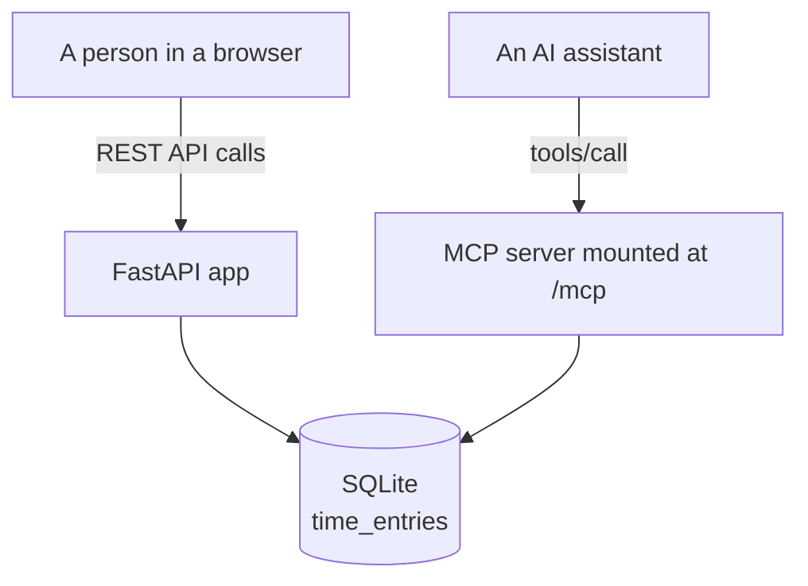
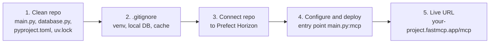
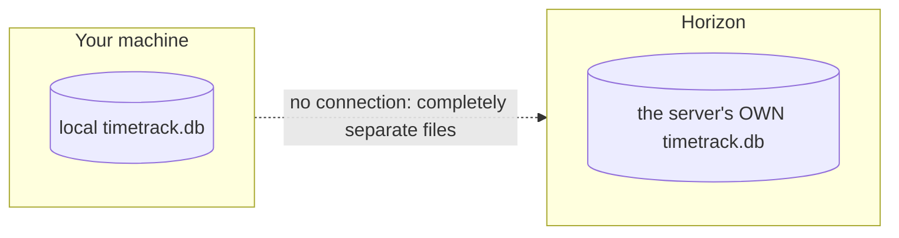
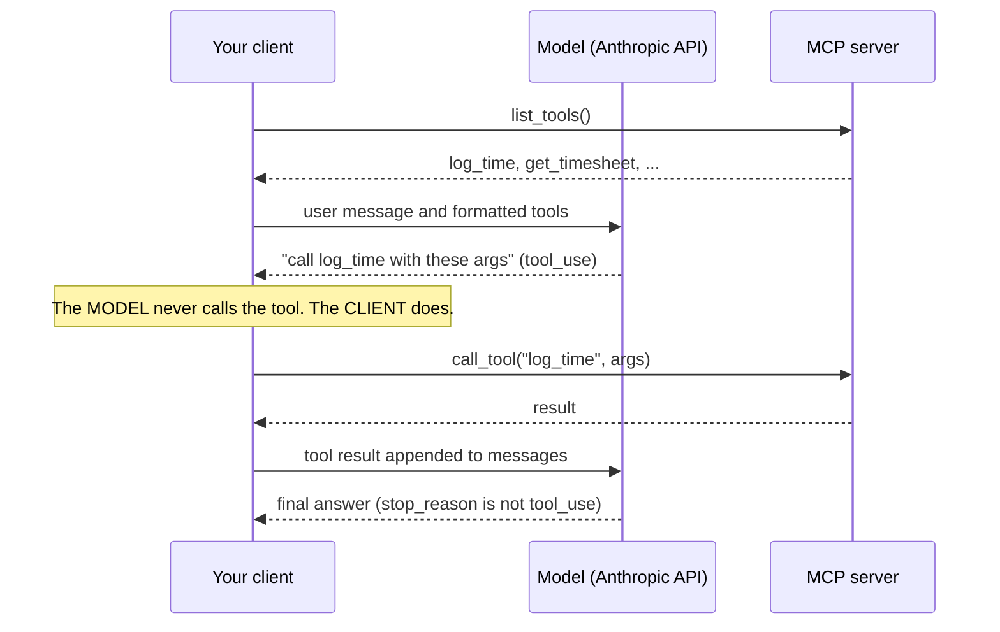
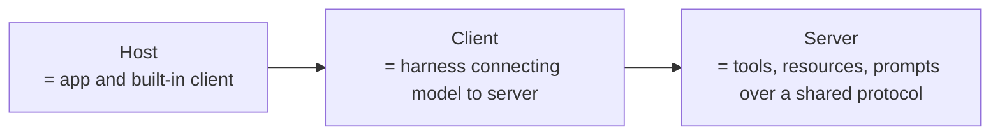

# Deploying MCP servers and building your own client
> lead: Move a server from "works on my machine" to a public URL, understand why the client is a harness, and build the client loop yourself.
meta: Class 21 | 19 September | 45 min read | Code: Complete MCP, TimeTrackProject

## Why it matters

A local server helps only the machine it runs on. Deployment questions are classic interview material: STDIO or HTTP, what does the host platform need, why do local and server databases not sync? And building a client yourself is where "MCP is the same agentic loop" finally clicks. Chapter 15 covered the project and the two `main.py` rules; this chapter covers what it takes to put it live and to write the other side.


## Core ideas

### 1. STDIO vs HTTP at deployment time

| | Local STDIO | Remote HTTP |
| --- | --- | --- |
| Where it runs | Your machine, as a sub-process | Somewhere else, reachable over the internet |
| Speed | Fast, no network hop | A real network round trip on every call |
| Who can use it | Only whatever launched it | Many clients, from anywhere, at once |
| Where the power lives | Split across whoever runs it locally | Centralised: one genuinely powerful server for everyone |
| Typical use | A personal tool: one person, one machine | Team or company-wide shared tools |

This is why most serious shared MCP servers run over HTTP. A locally started server, however well built, is not reachable by anyone else.

### 2. The same file, two transports

```bash
uv run fastmcp run main.py
# Starting MCP server 'TimeTrack' with transport 'stdio'

uv run uvicorn main:app --reload
# reachable at http://127.0.0.1:8000, with the MCP endpoint at /mcp
```

:::key `fastmcp run` vs `uvicorn`
`uv run fastmcp run main.py` starts **just the MCP server object** over STDIO. `uv run uvicorn main:app` starts the **whole application** (website, REST API and MCP server mounted together), because `app` is the FastAPI instance with everything wired in.
:::

### 3. One app, two front doors



The deployed `main.py` (Chapter 15 shows the full file) builds the MCP server first, then the FastAPI app with `lifespan=mcp_app.lifespan` at construction, and `app.mount("/mcp", mcp_app)`. Two rules to remember: `http_app(path="/")` not `"/mcp"`, and the lifespan passed at construction.

### 4. A small, honest persistence layer

```python
import os
import sqlite3
from pathlib import Path

DB_PATH = Path(os.environ.get("TIMETRACK_DB_PATH", "/tmp/timetrack.db"))

def get_connection():
    conn = sqlite3.connect(DB_PATH)
    conn.row_factory = sqlite3.Row
    return conn

def log_time(employee_name, project, entry_date, hours, description=""):
    if hours <= 0:
        raise ValueError("hours must be a positive number")
    ...

def get_project_summary(project: str) -> dict:
    rows = conn.execute(
        "SELECT employee_name, SUM(hours) as total_hours FROM time_entries "
        "WHERE project = ? GROUP BY employee_name ORDER BY employee_name", (project,)
    ).fetchall()
    if not rows:
        raise ValueError(f"No time logged against project '{project}'")
    ...
```

- `log_time` **validates** that hours are positive. Small guardrails like this matter the moment a real tool faces an AI that might send bad input.
- `get_project_summary` does a real SQL `GROUP BY`. The database does the work, not Python after the fact.
- **The database path comes from an environment variable.** Class 22 opened with the bug that taught this: a hardcoded path silently failed once deployed to Vercel.

### 5. Deploying to Prefect Horizon



1. **A clean, separate repo with just the server.** The platform builds from exactly what is in the repo. `pyproject.toml` lists the dependencies and `uv.lock` pins exact versions, so the platform reproduces the environment exactly.
2. **`.gitignore` what the server does not need:** the virtual environment, local database files, cache and editor folders.
3. **Connect the repo to Prefect Horizon.** It is the current name of what was FastMCP Cloud: same team (Prefect, behind FastMCP), same idea. Sign in with GitHub; it detects dependencies from `pyproject.toml`.
4. **Configure and deploy.** Name the server, set the entry point to `main.py`, pointing at the **`mcp` object** specifically, not the whole `app`. Horizon installs libraries and starts the server, with build logs visible.
5. **Get the live URL**, predictable in shape, pasteable into any AI host's connector settings.

:::trap Your local database and the server's database are different files
A `.gitignore`d local database has no relationship to the one created on the hosting platform. They are separate files and separate data. Updating one never touches the other. A local SQLite file on a serverless host can also lose its data when the function goes cold, which is why a real hosted database matters.
:::



:::note Horizon is built for the MCP piece
For a project with more than an MCP server, check whether the website's static routes deploy with it. If not, a general host like Vercel or Railway is the fallback for the full application.
:::

**Connect Claude Desktop to the deployed server:**

```json
{ "mcpServers": { "timetrack": { "url": "https://your-project-name.fastmcp.app/mcp" } } }
```

In a real conversation: ask for projects (two found), log 10 hours for "Mayank" on "MCP Mastery", ask again, and the new project now appears. Anyone with the URL can connect and write to the same shared database through their own AI assistant.

### 6. A second example: no API at all

```python
from fastmcp import FastMCP

mcp = FastMCP("Calculator")

@mcp.tool
def add(a: float, b: float) -> float:
    """Add two numbers."""
    return a + b
```

No API, no database, just a Python function. Deployed the same way, "what is 5 plus 3?" triggers a `tools/call` to `add`. MCP has **no dependency on a REST API underneath**. An MCP server is just a server; what it does inside is up to you.

### 7. Why you need to build your own client

Claude Desktop and VS Code quietly **are** MCP clients, so earlier classes took the client for granted. Now picture two separate things: a raw model, reached through a provider's API key, and an MCP server that is capable but cannot decide anything. Neither does anything for the other.

:::key Harness engineering
**Something has to sit in the middle**, connecting the model's intelligence to the server's capabilities. Building that connective layer yourself is *harness engineering*. Every chat application is a harness around a raw model. Claude Desktop and ChatGPT just build and hide it for you.
:::



```python
from fastmcp import Client
from anthropic import Anthropic

anthropic_client = Anthropic()

async def run_agent(user_message: str):
    async with Client("main.py") as mcp_client:          # connects to the LOCAL server file
        mcp_tools = await mcp_client.list_tools()          # discover
        anthropic_tools = [
            {"name": t.name, "description": t.description, "input_schema": t.inputSchema}
            for t in mcp_tools
        ]
        messages = [{"role": "user", "content": user_message}]

        while True:
            response = anthropic_client.messages.create(
                model="claude-sonnet-4-6", messages=messages, tools=anthropic_tools)

            if response.stop_reason != "tool_use":
                return response.content                    # final answer: exit the loop

            for block in response.content:                 # the CLIENT executes the tool
                if block.type == "tool_use":
                    result = await mcp_client.call_tool(block.name, block.input)
                    messages.append({"role": "assistant", "content": response.content})
                    messages.append({"role": "user", "content": [
                        {"type": "tool_result", "tool_use_id": block.id, "content": str(result)}]})
```

:::key An MCP client is the same agentic loop
Discover the tools, format them for the model provider, send the message, check whether the model asked for a tool, run it, append the result, loop. **The model never calls a tool; it only says which one it wants called. The client does.** MCP does not change that mechanic. It only standardises how the tool list and the tool call travel between client and server. A framework's "MCP adapter" (LangChain's, for instance) wraps this exact pattern in a few lines, as `create_agent` wraps the raw loop.
:::

### 8. The client files in the repo

The repo has nine numbered, self-contained client files (run from the `client/` folder):

| File | What it shows |
| --- | --- |
| `01_raw_client.py` | The verbose, three-layer way with the official SDK |
| `02_fastmcp_client_explained.py` | Builds up step by step to `async with` |
| `03_fastmcp_client_http.py` | Connects to the **real deployed** server on Vercel (needs internet) |
| `04_agent_loop.py` | A real agent with no framework (needs `ANTHROPIC_API_KEY`) |
| `05` to `09` | Sampling, elicitation, ping and errors, timeouts and cancellation, progress notifications (Chapter 17) |

:::repo Two honest notes from the repo README
**File 01** uses the official SDK's low-level `stdio_client()`, which **hangs forever on macOS** (documented SDK issue #1452). If it hangs, that is the known issue: move on to file 02.

**File 03** was verified live: the public server's `list_projects()` returned `["Client Onboarding", "Internal Tools", "Website Redesign"]` and `get_project_summary("Website Redesign")` returned 19.0 total hours (13.5 and 5.5), the same seed data as the local server.
:::

### 9. Where this leaves you



Two honest gaps remain in this project, treated as homework rather than flaws: the database is still a **local SQLite file** rather than a production-grade one, and every database call is **synchronous**, so two requests cannot truly run at once. The homework was to make calls async and move to a hosted database (filess.io was demoed: a free 10 MB hosted SQL database with ready-made connection code). The repo also includes a `concurrency_showcase.py` dev script that measures both problems against a live server: speedup from concurrent calls, and whether every write survives a burst.

## FAQ from class

:::qa Is a third-party Postgres MCP server on my laptop really "local"?
Yes. "Local" describes where the **MCP server process** runs, not where the data lives. A Postgres MCP server started with `npx` on a laptop is local even though it calls a remote database, like a browser being local while websites are not.
:::

:::qa Where do the tools inside a Postgres MCP server come from?
From whoever built it. A vendor or community writes `execute` and `list_tables` once, packages them as an MCP server, and everyone who runs it gets them without understanding the driver.
:::

:::qa Always MCP, or sometimes a plain tool?
A plain tool is often right for a narrow, fixed action such as sending an email through one channel. MCP earns its place for breadth: supporting a large surface without hand-building dozens of tools.
:::

:::qa One setup for several databases (Postgres, Oracle, a mainframe)?
Two options: one custom MCP server with all of them wired in, or an **MCP gateway** that aggregates several existing servers behind a single entry point so the client connects to one place.
:::

:::qa How do I stop an AI from modifying production data?
A common pattern is an environment variable read at startup (for example `READ_ONLY=true`) that controls which tools the server even registers. Write tools are never exposed, rather than blocked afterwards.
:::

:::qa `uv` vs `uvx`?
`uv` works inside your project. `uvx` runs a tool in an isolated temporary environment without touching the project, like `npx`. Use `uvx` for one-off tools.
:::

:::qa Does the host platform care whether my server calls an AI model?
No. A call to an LLM provider is just another API call. A generic platform does not distinguish.
:::

:::qa How do I keep state per call, per thread and per application?
Application-wide state lives as long as the process. Session state ties to a client-provided session id. Thread-level state is the hardest and has no free built-in mechanism, so you must design how a thread or request owns its context.
:::

## Common mistakes

| Mistake | Symptom | Fix |
| --- | --- | --- |
| Pushing the whole course folder to the host | Slow build, leaked files | A clean repo with only the server files |
| Pointing Horizon at `app` | Wrong object deployed | Entry point `main.py:mcp` |
| Hardcoding the database path | Silent failure after deploy | Read it from an environment variable |
| Expecting local and server databases to sync | Missing data | They are separate files |
| SQLite file on a serverless host | Data lost when cold | Use a hosted database |
| Synchronous database calls | Requests cannot overlap | Use async |
| Running file 01 on macOS and waiting | Hangs forever | Known SDK issue: use file 02 |
| Thinking the model calls the tool | Wrong client design | The client runs the tool |

## Hands-on lab

1. Run the same `main.py` with `fastmcp run` and then `uvicorn` and note what each starts.
2. Make the database path an environment variable and confirm writes work.
3. Deploy to Horizon with a clean repo and entry point `main.py:mcp`.
4. Connect Claude Desktop to your URL and log an entry through chat.
5. Build the client loop (list tools, send with tools, check `stop_reason`, call the tool, append the result).
6. Run `03_fastmcp_client_http.py` against the public server.
7. Do the homework: async calls and a hosted database.

## Interview corner

:::pitch
To go live I put only the server files in a clean repo, deploy to a platform like Horizon with entry point `main.py:mcp`, and read the database path from an environment variable, because the server's database is a separate file from my local one. A client is just the agentic loop: it lists the server's tools, gives them to the model, runs whichever tool the model asks for, appends the result and loops. The model never calls the tool.
:::

### Basics

:::qa Why do shared MCP servers run over HTTP?
A STDIO server is only usable by whatever launched it. HTTP is reachable by many clients from anywhere, at the cost of a network round trip.
:::

:::qa `fastmcp run` vs `uvicorn main:app`?
`fastmcp run` starts only the MCP server over STDIO. `uvicorn main:app` starts the whole app (website, API and mounted MCP endpoint).
:::

:::qa What does a hosting platform need from your repo?
`main.py`, `database.py`, `pyproject.toml` and `uv.lock`: the code plus the dependency list and exact pinned versions.
:::

:::qa Does MCP need an API underneath?
No. A calculator with a plain `add` function is a valid MCP server.
:::

### Intermediate

:::qa Why is your local database unaffected by the deployed one?
They are separate files and separate data. A `.gitignore`d local database never ships, and the server creates its own.
:::

:::qa Why must the client, not the model, call the tool?
The model only emits which tool and arguments. The client holds the connection to the server, so it executes `call_tool` and feeds the result back. MCP standardises how that travels; it does not change who does it.
:::

:::qa What is harness engineering?
Building the layer that connects a raw model to tools: the loop, tool formatting, execution and message handling. Every chat application is one.
:::

:::qa How do you let several databases sit behind one MCP entry point?
Either one custom server wiring them all, or an MCP gateway that aggregates existing servers behind one endpoint.
:::

### Tricky

:::qa How do you stop an agent from writing to a production database?
Register only read tools at startup when a flag such as `READ_ONLY=true` is set, so write tools are never offered.
:::

:::qa Is a Postgres MCP server running on my laptop local or remote?
Local: the server process runs on your machine. The data it queries may be remote.
:::

:::qa Why might a deployed server lose data?
SQLite on a serverless host can lose its file when the function goes cold, and it is a local file rather than a shared database. Use a hosted database.
:::

:::qa What are the two honest gaps in this project?
A local SQLite file instead of a hosted production database, and synchronous database calls so two requests cannot run at the same time.
:::

:::qa Plain tool or MCP?
A plain tool for a narrow fixed action. MCP for breadth where you would otherwise hand-build and maintain many tools.
:::

## Quick revision

- [ ] I can compare STDIO and HTTP for deployment
- [ ] I can say what `fastmcp run` and `uvicorn main:app` each start
- [ ] I can list the five Horizon deployment steps and the entry point
- [ ] I can explain why local and server databases differ
- [ ] I can explain harness engineering
- [ ] I can write the client loop and say who runs the tool
- [ ] I can explain a gateway and a read-only flag
- [ ] I can name the two honest gaps and the homework

## Sources and further reading

- [Class 21 full notes]({{src:classes_transcription_summary/21 - 19 Sep - MCP Deployment.md}})
- [Client project README]({{src:Complete MCP/TimeTrackProject/mcp-client-and-advanced/README.md}})
- [Client files 01 to 09]({{tree:Complete MCP/TimeTrackProject/mcp-client-and-advanced/client}})
- [`04_agent_loop.py`]({{src:Complete MCP/TimeTrackProject/mcp-client-and-advanced/client/04_agent_loop.py}})
- [`concurrency_showcase.py`]({{src:Complete MCP/TimeTrackProject/timetrack mcp server/scripts/concurrency_showcase.py}})
- [Time Tracker project folder]({{tree:Complete MCP/TimeTrackProject}})
- [Prefect Horizon](https://horizon.prefect.io/)
- [Live deployed server](https://time-track-mcp-server.vercel.app/)
