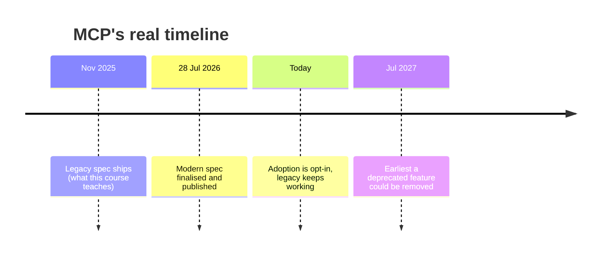
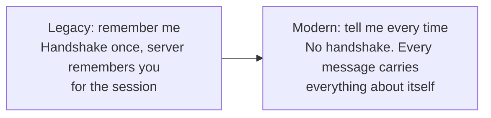
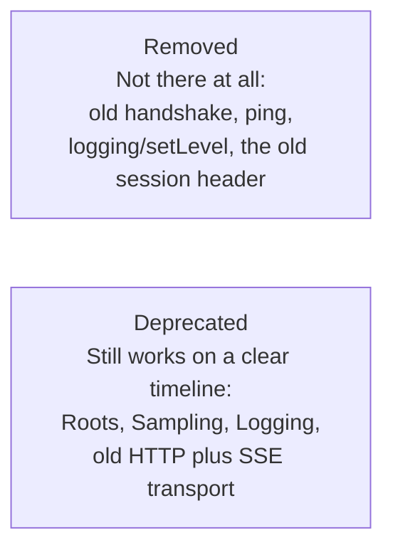
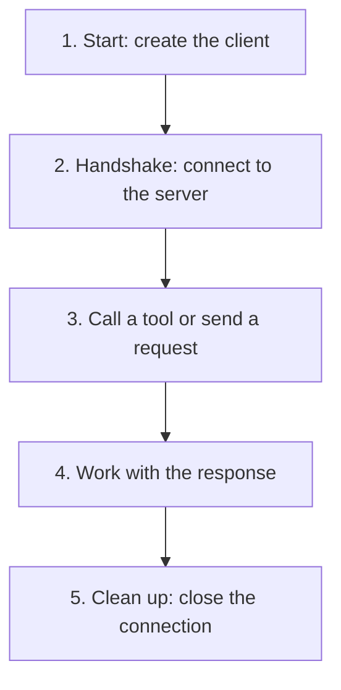
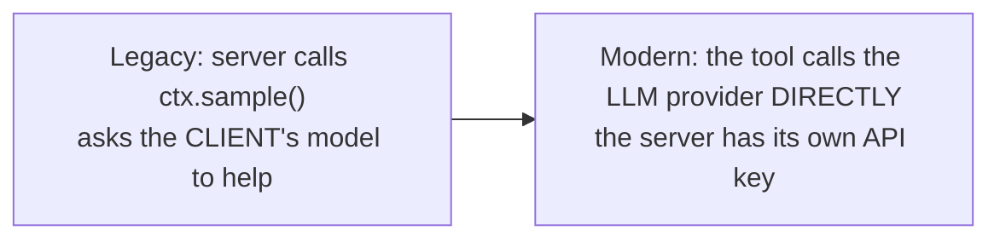
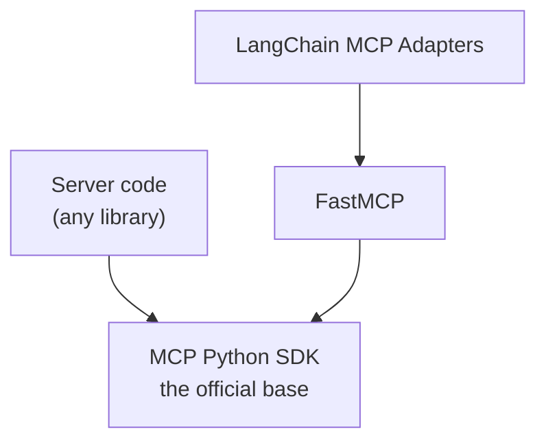

# Legacy vs modern MCP
> lead: What changed between the legacy session-based MCP this course taught and the stateless spec finalised on 28 July 2026, why, and how real client features (sampling, elicitation, ping, timeouts) behave now.
meta: Class 22 | 20 September | 45 min read | Code: Complete MCP, mcp-client-and-advanced

## Why it matters

The first thing to know: **everything built in this course still runs, unchanged, today.** Nothing was wasted. But "legacy vs modern MCP" is the question that separates people who learned a tutorial from people who can reason about the protocol. It also explains real errors you will hit on a fresh install.

:::key The one idea behind every change
**Legacy remembers you. Modern makes every message carry everything about itself.** Everything that follows is a consequence of that single idea, not a list of arbitrary new rules.
:::

## Core ideas

### 1. The real timeline



Adoption of the modern spec is **opt-in**. Nothing forced existing servers to change on that date. There is no blanket migration deadline, only a handful of named features carrying their own twelve-month clock. Real ecosystems move slowly (rewriting a working system is real engineering), so most servers, local or hosted, still run the legacy architecture and will for a while.

### 2. "Remember me" vs "tell me every time"



:::analogy Two co-working buildings
In one building the same receptionist greets you each morning and waves you through because she recognises your face. That is the legacy `Mcp-Session-Id`. In the other, everyone taps an ID badge at **every door** (entrance, lift, meeting room), because nobody is keeping track of who is who. Slightly more tapping, but **any door** can let you through, on any day, whoever is working it.
:::

A live demo made the legacy side concrete: start a server with `uv run uvicorn main:app`, send a raw `curl` `initialize` from a second terminal, and the response returns the `Mcp-Session-Id` the server uses to remember that client. (The `curl` commands are in Chapter 15.)

**Why give that up?** A system that must remember a specific person can only be handled by whoever met them first. A system that reads a badge each time can be handled by **any server**, so a busy application can open more servers behind the scenes without any of them having "met" the client. Stateless, self-contained requests make horizontal scaling easy.

:::analogy Support call vs support ticket
A call connects you to one agent who remembers the conversation, but if the call drops, you start over with someone who knows nothing. A **ticket** has everything written in it, so any agent can pick it up. Modern MCP has no session id. The full context travels with every request. Slightly more data per call, but freedom to scale without anyone remembering a client.
:::

### 3. How a server asks a question mid-task now

If nothing is remembered, how does a server ever ask a clarifying question?

:::analogy The restaurant kitchen rule
A kitchen can send a waiter back to ask "how spicy?" **while your order is already being cooked**. It cannot walk up to an empty table and start asking cooking questions before anyone has ordered.
:::

| Rule | In plain words |
| --- | --- |
| **Already cooking** | A server can only ask a question while actively handling something the client already requested |
| **Real question** | The reply must contain an actual question, never a vague "something is needed" |

Example: a TimeTrack tool asked to log 14 hours in a day comes back with "that seems unusually high, log it anyway?" It pauses mid-task and does not appear unprompted.

**Confirming and continuing: the OTP pattern.** At checkout the app asks for a code sent to your phone. You are not stuck waiting. You fetch the code, return, and submit it **with your order reference**. The order can complete on a **different backend server**, because the ticket carries everything needed. The assistant that asked is free to do something else meanwhile, and whoever is free when the answer arrives can pick it up.

### 4. The small stuff that helps

| Change | What it does | Analogy |
| --- | --- | --- |
| **Faster routing** | Every request carries `Mcp-Method` and `Mcp-Name` labels in its HTTP headers, so a load balancer can route by glancing at two labels | A coloured tag on a boarding pass |
| **Smarter caching** | A server can set `ttlMs` (how long an answer stays fresh, in milliseconds) and `cacheScope` (safe to share across users, or private to one) | A weather app caching a forecast for an hour |
| **Finding what broke** | Built on the W3C tracing standard, a request carries a tracking context across every hop, so a failure three services deep is traceable | One tracking number following a package across carriers |

### 5. Gone vs going away



MCP's own policy gives anything deprecated a **minimum of twelve months** from its announcement (started July 2026) before removal is even eligible. That is a floor, not a countdown to breakage.

:::trap The twelve months is the spec's promise, not every library's
A specific SDK's maintainers can drop a deprecated feature's code sooner. That is what happened with sampling in a recent FastMCP release. Spec timeline and library behaviour are two different things.
:::

## Building a client against the current library

### 6. The five steps every client performs



Two ways to write it in Python: a manual `try/finally`, or `async with client as client`. They are the **same five steps**. `async with` does the manual version automatically and **guarantees step 5 happens no matter what**. It is not a new concept; it writes "always clean up properly" in one line instead of five.

### 7. Why the demos broke: the root cause

The repo's `MCP_PROTOCOL_CHANGES_SUMMARY.txt` explains it. The installed `fastmcp 4.0.5` negotiates protocol revision **2026-07-28** by default. The older demos were written for the session-based protocol, where one persistent connection let **both sides send requests at any time**. That back-channel let a server tool pause and ask the client to call an LLM, ask the human a question or answer a ping. The new revision is **stateless**: every request is a single self-contained exchange with no persistent back-channel. Every "server asks, client answers, mid-tool-call" feature breaks:

| Feature | On the modern connection |
| --- | --- |
| `ctx.sample()` | `AttributeError`: the method was deleted |
| `ctx.elicit()` | "unavailable on 2026-07-28 connections" |
| `client.ping()` | "Method not found" |

Two kinds of fix were needed because the features are in different states.

**Class A: fully deleted, no flag brings it back.** Sampling. FastMCP 4.x removed `Context.sample()` entirely. (The repo confirmed it by installing `fastmcp 2.14.7` in a scratch environment, where it still exists.)

**Class B: exists, but needs the classic handshake.** Elicitation and ping. Pass `mode="legacy"` when constructing the `Client` to force the classic `initialize` handshake and restore the back-channel.

### 8. Sampling: genuinely removed

Sampling lets a server borrow the **client's** connected model instead of holding its own API key.



The fix in `summarize_week`: stop taking a `ctx`, call the provider directly with the server's own key.

```python
# before: asked the connected client's model
# text = await ctx.sample(prompt_text)

# after: the server talks to the provider itself
anthropic_client = Anthropic(api_key=os.environ.get("ANTHROPIC_API_KEY", ""))
response = anthropic_client.messages.create(model="claude-sonnet-4-5", ...)
```

This is also the migration path the spec recommends ("servers call a provider directly"), not a downgrade. Practical effect: `ANTHROPIC_API_KEY` must now be available to the **server** process. The stdio subprocess needs it passed explicitly, so the demo builds a `PythonStdioTransport("../main.py", env={...})` rather than the string-inferred `Client("../main.py")`, because of stdio subprocess environment isolation.

### 9. Elicitation: still there, behind `mode="legacy"`

```python
client = Client(
    "main.py",
    elicitation_handler=elicitation_handler,
    mode="legacy",        # restores the classic handshake the course taught
)

async def elicitation_handler(message, response_type, params, context):
    print(f"Server is asking: {message}")
    confirm = input("Type Y to confirm, anything else to cancel: ")
    return confirm.strip().lower() == "y"
```

Run twice: logging 4 hours triggered **no question** (under the tool's 10-hour threshold). Logging 14 hours triggered "14 hours in one day is unusually high, log it anyway?" and branched on the typed reply: `Y` completed the log, anything else returned "cancelled, not confirmed by user."

:::note The modern replacement exists
The repo notes elicitation has a modern native replacement: a tool returns an `InputRequiredResult` and is **re-invoked later** with the human's answer (a guard-and-return pattern for stateless connections). The class chose `mode="legacy"` because the native pattern needs the tool restructured as a re-entrant, resumable function, a much bigger rewrite.
:::

### 10. Ping, timeout, cancellation and progress

- **Ping** is the simplest check: "are you still there?" It is removed in the strictest modern sense (nothing persistent to ping), but `client.ping()` works in legacy mode and returned `True`.
- **Timeout and cancellation.** A deliberately slow tool (sleeping 5 seconds) with a client timeout of 1 second was cancelled with a clear "tool call timeout" error instead of hanging. Raising the timeout above the tool's delay let it succeed.
- **Rule:** every request should have a timeout. A **cancellation notification** stops waiting, and a **progress notification** can reset that clock if the server is genuinely still working.

### 11. How this connects to LangChain

When LangChain is the host, its **agent is the host**, and LangChain creates the MCP client itself using the **LangChain MCP Adapters** package, which is built on FastMCP underneath. `MultiServerMCPClient` with a config dictionary still goes through the same initialisation and tool discovery.



Any MCP server, whichever library wrote it, rests on the same official protocol. FastMCP and the adapters are abstractions that make the code easier; everything executes down to the same base. For an agent framework, MCP is just **a connection to a set of tools**, nothing more exotic than tools covered many classes ago, sourced from a standard protocol. LangChain's MCP support is for **consuming** existing servers as tool sources, not building new ones. That is FastMCP's job. Chapter 18 shows it in code.

### 12. What the 2026-07-28 spec changes in practice

From the course's MCP interview questions:

- **No `initialize` handshake.** The protocol version and capabilities travel in `_meta` on **every** request.
- **No sessions.** `Mcp-Session-Id` is gone, so any replica serves any request and you need no sticky routing.
- **State moves into tools.** Cross-call state becomes a **handle** the tool returns (for example a `basket_id`) that the client passes back.
- Most production servers still run **2025-11-25**, where sessions are optional but stateful by default.

| Deprecated | What replaces it |
| --- | --- |
| Roots | Pass paths as tool parameters |
| Sampling | Call the LLM provider's API directly |
| Logging | OpenTelemetry or stderr |
| HTTP plus SSE transport | Streamable HTTP |
| Dynamic Client Registration | Client ID Metadata Documents |

**Client-side settings live on the client.** In the repo's demos, `timeout` and `progress_handler` are set when you **create** the client, not per call:

```python
async with Client("../main.py", timeout=1.0) as client:          # times out a ~5-second tool
    ...

async def on_progress(progress: float, total: float | None, message: str | None):
    print(f"{progress}/{total}: {message}")

async with Client("../main.py", progress_handler=on_progress) as client:
    await client.call_tool("slow_tool", {})
```

On the server, a tool reports progress with `await ctx.report_progress(progress=step, total=total_steps, message=...)`.

## Key pointers to remember

- Nothing you built breaks. Modern MCP is opt-in.
- Legacy remembers you via a session; modern makes every message self-contained.
- A server can only ask a question while handling a request you sent.
- Sampling is gone in current FastMCP. Call a provider directly.
- Elicitation and ping need `mode="legacy"`, or the new `InputRequiredResult` pattern for elicitation.
- Every request should have a timeout.
- Deprecated means twelve months minimum before removal is eligible. Libraries may drop code sooner.
- LangChain's adapters build the client on FastMCP.

## Questions from class worth knowing

:::qa Should I worry about mastering every previous MCP version?
No. Modern adoption will take time, and understanding legacy deeply is what makes the modern one make sense.
:::

:::qa Is sampling controlled by my code or called automatically?
By the tool's own code. If its logic needs a completion, it calls the provider (now directly). The framework does not trigger it automatically.
:::

:::qa Are sampling and elicitation MCP concepts or framework features?
Both are part of the MCP specification. A framework like FastMCP provides the implementation.
:::

:::qa Does LangChain's MCP support let me create servers?
No. It only consumes existing servers as a tool source for an agent. Creating servers is for libraries like FastMCP.
:::

:::qa Does LangChain-as-host still do the handshake?
Yes. The adapter builds the harness and client for you, but the same handshake and discovery happen underneath.
:::

:::qa Will an OpenRouter key work for the client exercises?
Yes, with a small change to point at the right endpoint and model string. The pattern does not change.
:::

<!-- sites-add -->
## Try it: remember me, or tell me every time

*From the instructor's "What is actually changing" site (read 30 Oct 2026). Its timeline and the removed-versus-deprecated points are already in the sections above; this adds the toggle and the OTP walk-through.*

:::widget legacy-modern
Interactive demo (needs JavaScript): switch between the legacy and modern models and play the confirm-and-continue sequence.
:::

The site adds one more way to tell the two fixes apart. If Python says the method does not exist at all (an `AttributeError`), it is **Class A, genuinely gone** (sampling): rewrite the tool. If the method exists but complains about the connection type when called, it is **Class B, still there but asleep** (elicitation and ping): ask for the old connection with `mode="legacy"`. Its one-line mental model: the modern protocol has **no back-channel**, so a server can no longer interrupt a client mid-task, and everything that depended on that was either removed or sits behind the legacy counter.
<!-- /sites-add -->

## Common mistakes

| Mistake | Symptom | Fix |
| --- | --- | --- |
| Using `ctx.sample()` on fastmcp 4.x | `AttributeError` | Call the LLM provider directly in the tool |
| Using `ctx.elicit()` on a modern connection | "unavailable on 2026-07-28 connections" | `mode="legacy"`, or the `InputRequiredResult` pattern |
| `client.ping()` on a modern connection | "Method not found" | `mode="legacy"` |
| Provider key only in the client | Server cannot call the LLM | Provide it to the **server** process (and the stdio env) |
| No client timeout | Calls hang | Set a timeout on every request |
| Treating deprecated as removed today | Rushed rewrites | Twelve-month floor; check your library |
| Assuming the spec timeline equals the SDK timeline | Surprise breakage | Read the library's changelog |
| Writing manual cleanup everywhere | Leaked connections on errors | `async with client as client` |

<!-- runlab -->
## Run it yourself: the four advanced clients

Complete, unmodified files from the repo. Run them from the `client/` folder next to `../main.py` (the server and `database.py` are printed in Chapter 16). I ran all four against fastmcp 4.1.4.

**06: elicitation** (`mode="legacy"` and a handler). With 4 hours no question is asked; with 14 hours the server asks "log it anyway?" and the handler answers.

**`client/06_elicitation_demo.py`**

```python
"""
06 -- ELICITATION: THE SERVER ASKS A REAL QUESTION
=====================================================
main.py's "log_time_with_confirmation" tool calls ctx.elicit(...)
whenever hours look unusually high. That call PAUSES the tool, mid-way
through, and waits for a real answer from the client. This file
provides that answer.

A NOTE WORTH KNOWING: the newest MCP protocol revision (2026-07-28) is
stateless -- it has no back-channel at all for server-initiated requests,
so ctx.elicit() raises an error on a connection negotiated at that
version. Elicitation itself isn't gone (there's a modern "return an
InputRequiredResult and get re-invoked" pattern for it), but the simple
imperative ctx.elicit() this demo relies on only works on the classic,
session-based handshake. So we pin the client to mode="legacy" below to
force that older handshake and keep this demo working as written.

SETUP:
    pip install fastmcp

RUN:
    python3 06_elicitation_demo.py
"""
import asyncio
from fastmcp import Client


async def elicitation_handler(message: str, response_type, params, context):
    """
    Called BY the server, through the client, whenever a tool calls
    ctx.elicit(). In a real app with a UI, this is where you'd show a
    real dialog box. For this demo, we print the question and auto-confirm.
    """
    print(f"\n[The server is asking]: {message}")
    print("[Auto-confirming for this demo -- swap this for real input() or a UI in your own client]")
    return True


async def main():
    async with Client(
        "../main.py", elicitation_handler=elicitation_handler, mode="legacy"
    ) as client:
        print("--- Logging 4 hours (normal -- watch: NO question gets asked) ---")
        normal_result = await client.call_tool(
            "log_time_with_confirmation",
            {"employee_name": "Asha Patel", "project": "Website Redesign",
             "entry_date": "2026-09-12", "hours": 4.0, "description": "A normal day"},
        )
        print("Result:", normal_result)

        print("\n--- Logging 14 hours (unusual -- watch: a real question appears) ---")
        high_result = await client.call_tool(
            "log_time_with_confirmation",
            {"employee_name": "Asha Patel", "project": "Website Redesign",
             "entry_date": "2026-09-12", "hours": 14.0, "description": "Crunch day"},
        )
        print("Result:", high_result)


if __name__ == "__main__":
    asyncio.run(main())
```

Verified output shape: the 4-hour call returns a new row straight away; the 14-hour call prints `[The server is asking]: 14.0 hours in one day is unusually high -- log it anyway?`, auto-confirms, and then logs the row.

**07: ping and a real error**

**`client/07_ping_and_errors.py`**

```python
"""
07 -- PING AND A REAL ERROR
=============================
Two of the "special cases" from the Lifecycle video, now actually
happening instead of being a JSON example on a slide.

A NOTE WORTH KNOWING: `ping` is removed as of the newest MCP protocol
revision (2026-07-28) -- it only works under the classic, session-based
handshake. So, same as the elicitation demo, we pin mode="legacy" here
to keep client.ping() working as written.

RUN:
    python3 07_ping_and_errors.py
"""
import asyncio
from fastmcp import Client


async def demo_ping():
    print("--- PING: just checking the connection is alive ---")
    async with Client("../main.py", mode="legacy") as client:
        result = await client.ping()
        print("Server responded:", result)


async def demo_real_error():
    print("\n--- A REAL ERROR, TRIGGERED ON PURPOSE ---")
    async with Client("../main.py", mode="legacy") as client:
        try:
            # "Nonexistent Project" was never logged against -- this makes
            # get_project_summary's own ValueError fire for real, surfacing
            # back to us as a genuine protocol error.
            await client.call_tool("get_project_summary", {"project": "Nonexistent Project"})
        except Exception as e:
            print("Caught a real error response:", e)


async def main():
    await demo_ping()
    await demo_real_error()


if __name__ == "__main__":
    asyncio.run(main())
```

Verified: ping succeeds, and the missing project comes back as an error that the client catches (`No time logged against project 'Nonexistent Project'`). Remember the server also prints a long traceback to its own stderr; that noise is the server's log, not your client failing.

**08: timeout and cancellation**

**`client/08_timeout_and_cancellation.py`**

```python
"""
08 -- TIMEOUT, WHICH TRIGGERS A REAL CANCELLATION
====================================================
main.py's "slow_tool" deliberately takes about 5 seconds. Here, we
connect with a much shorter timeout on purpose, so it actually times
out -- and watch what that triggers.

NOTE: "timeout" is set when you CREATE the Client, not as an argument
to call_tool() itself -- verified against FastMCP's own current
documentation.

RUN:
    python3 08_timeout_and_cancellation.py
"""
import asyncio
from fastmcp import Client


async def main():
    print("--- Connecting with a 1-second timeout, calling a ~5-second tool ---")
    async with Client("../main.py", timeout=1.0) as client:
        try:
            await client.call_tool("slow_tool", {})
        except Exception as e:
            print("Timed out and was cancelled, exactly as expected:", e)


if __name__ == "__main__":
    asyncio.run(main())
```

Verified: the 5-second `slow_tool` is cut off by the 1-second client timeout and the client reports `Request 'tools/call' timed out`.

**09: progress notifications**

**`client/09_progress_notifications.py`**

```python
"""
09 -- PROGRESS NOTIFICATIONS, WATCHED LIVE
=============================================
main.py's "slow_tool" reports its progress as it works. Here we give the
client a progress_handler, so every update prints the moment it arrives
-- instead of the client just sitting there for 5 seconds wondering if
anything is happening.

NOTE: "progress_handler" is also set when you CREATE the Client, not
per-call -- same rule as timeout in the previous file.

RUN:
    python3 09_progress_notifications.py
"""
import asyncio
from fastmcp import Client


async def on_progress(progress: float, total: float | None, message: str | None):
    print(f"  progress update: {progress}/{total} -- {message}")


async def main():
    print("--- Calling the 5-second tool, watching progress arrive live ---")
    async with Client("../main.py", progress_handler=on_progress) as client:
        result = await client.call_tool("slow_tool", {})
        print("Final result:", result)


if __name__ == "__main__":
    asyncio.run(main())
```

Verified: five updates arrive as `1.0/5.0 -- Step 1 of 5` up to `5.0/5.0`, then the final result.

## Spot the bug: client mistakes

**1. Elicitation with no handler or legacy mode**

```python
# BROKEN: no handler, so the client has no way to answer the server's question
async with Client("../main.py") as client:
    await client.call_tool("log_time_with_confirmation", {...})
```

```python
# FIXED: give the client a handler and the legacy mode the demo needs
async with Client("../main.py", elicitation_handler=handler, mode="legacy") as client:
    ...
```

**2. Expecting sampling to still work**

```python
# BROKEN on current fastmcp: ctx.sample() was removed
summary = await ctx.sample("Summarise this week")
```

```python
# FIXED: call your model provider directly from the tool
msg = anthropic_client.messages.create(model="claude-sonnet-4-5", max_tokens=500, messages=[...])
```

**3. Progress handler with the wrong signature**

```python
# BROKEN: the client passes progress, total and message, so a one-argument handler does not match
async def on_progress(progress):
    print(progress)
```

```python
# FIXED: match the signature the repo uses
async def on_progress(progress: float, total: float | None, message: str | None):
    print(f"{progress}/{total} -- {message}")
```
<!-- /runlab -->

## Hands-on lab

1. Recreate the `curl` `initialize` against your local server and find the `Mcp-Session-Id`.
2. Rewrite a tool that used sampling so it calls a provider directly.
3. Build the elicitation demo with `mode="legacy"` and test both branches (under and over the threshold), confirming and cancelling separately.
4. Set a client timeout shorter than a slow tool and trigger cancellation.
5. Make your TimeTrack database path dynamic with an environment variable and confirm writes after deployment.
6. Read the repo's `MCP_PROTOCOL_CHANGES_SUMMARY.txt` and match each error to its cause.

## Interview corner

:::pitch
Legacy MCP is session-based: you handshake once and the server remembers you through a session id. The modern spec, finalised 28 July 2026, is stateless: every request is self-contained, so any server can handle any request and you can scale horizontally. The cost is a little more data per call, and server-to-client features like sampling and elicitation lose their back-channel. Adoption is opt-in and deprecated features get at least twelve months, so existing servers keep working.
:::

### Basics

:::qa What is the central difference between legacy and modern MCP?
Legacy remembers the client with a session handshake and `Mcp-Session-Id`. Modern has no session: every message carries its own context, so any server can handle it.
:::

:::qa Will my existing servers break?
No. Modern adoption is opt-in and legacy keeps working. Deprecated features have a twelve-month minimum before removal is even eligible.
:::

:::qa What do `Mcp-Method` and `Mcp-Name` do?
They are HTTP headers on each request that let load balancers route by glancing at the method and name, instead of reading the body.
:::

### Intermediate

:::qa Why did elicitation, ping and sampling break?
They relied on the persistent two-way session. The modern revision is stateless with no back-channel, so a server cannot send an unsolicited request to the client.
:::

:::qa How do you fix each?
Sampling was deleted: have the tool call the LLM provider directly. Elicitation and ping: create the client with `mode="legacy"`, or for elicitation use the modern `InputRequiredResult` re-invocation pattern.
:::

:::qa When can a server ask the user a question in modern MCP?
Only while handling a request the client already sent, and the reply must contain a real question. Think of the kitchen sending a waiter back, not asking an empty table.
:::

:::qa How does a question get answered if a different server picks up the reply?
Like an OTP at checkout: the answer is submitted with a reference that carries everything needed, so any backend can complete the order.
:::

:::qa What do `ttlMs` and `cacheScope` do?
`ttlMs` sets how long a server's answer stays fresh in milliseconds. `cacheScope` says whether it is safe to share across users or private to one.
:::

### Tricky

:::qa Why is stateless better for scale?
A stateful system can only be handled by whoever met the client first. Stateless requests can go to any server, so you can add servers behind a load balancer without anyone needing to remember a client.
:::

:::qa Deprecated vs removed?
Removed means gone (old handshake, ping, `logging/setLevel`, the old session header). Deprecated still works on a timeline (Roots, Sampling, Logging, HTTP plus SSE) with a minimum twelve months.
:::

:::qa The spec says twelve months but my SDK dropped a feature. Contradiction?
No. Twelve months is the **spec's** promise. A specific library's maintainers can remove the code sooner, as FastMCP did with sampling.
:::

:::qa What does `async with client as client` guarantee?
That the connection is closed (step 5) no matter what, including on an error. It is the same five steps as a manual `try/finally`, in one line.
:::

:::qa Where does `ANTHROPIC_API_KEY` need to live after the sampling change?
In the **server** process, because the tool now calls the provider itself. For a stdio subprocess, pass it explicitly in the transport's `env`, because the subprocess environment is isolated.
:::

:::qa How does LangChain relate to FastMCP and the SDK?
LangChain MCP Adapters build the client on FastMCP, which sits on the official MCP Python SDK. LangChain only consumes servers; it does not build them.
:::

### Production level

:::qa What changed in the latest MCP spec, and how does it affect running servers?
The 2026-07-28 spec is stateless: no `initialize` handshake (version and capabilities travel in `_meta` on every request), no `Mcp-Session-Id`, so any replica serves any request, and cross-call state becomes a handle returned by tools. Roots, sampling, logging, HTTP plus SSE and dynamic client registration are deprecated, replaced by tool parameters, direct provider calls, OpenTelemetry or stderr, Streamable HTTP and Client ID Metadata Documents. Most production servers still run 2025-11-25.
:::

## Quick revision

- [ ] I can state the timeline and that legacy keeps working
- [ ] I can explain remember-me vs tell-me-every-time with the co-working analogy
- [ ] I can explain the kitchen rule and the OTP pattern
- [ ] I can name the header, caching and tracing changes
- [ ] I can separate removed from deprecated and the spec from the SDK
- [ ] I can explain why sampling, elicitation and ping broke and how to fix each
- [ ] I can use `mode="legacy"` and set timeouts
- [ ] I can explain how LangChain's adapters relate to FastMCP

<!-- res -->
:::key Sampling is being deprecated
The Craft card for the lifecycle simulator notes that **roots, sampling and logging are being deprecated** in the newest spec revision (SEP-2577). That matches this chapter: `ctx.sample()` is removed from the current FastMCP, and the TimeTrack server calls the model provider directly instead.
:::
<!-- /res -->

## Sources and further reading

- [Class 22 full notes]({{src:classes_transcription_summary/22 - 20 Sep - Legacy vs Modern MCP.md}})
- [Protocol changes summary (root causes and fixes)]({{src:Complete MCP/TimeTrackProject/mcp-client-and-advanced/MCP_PROTOCOL_CHANGES_SUMMARY.txt}})
- [Client project README]({{src:Complete MCP/TimeTrackProject/mcp-client-and-advanced/README.md}})
- [`05_sampling_demo.py`]({{src:Complete MCP/TimeTrackProject/mcp-client-and-advanced/client/05_sampling_demo.py}})
- [`06_elicitation_demo.py`]({{src:Complete MCP/TimeTrackProject/mcp-client-and-advanced/client/06_elicitation_demo.py}})
- [`08_timeout_and_cancellation.py`]({{src:Complete MCP/TimeTrackProject/mcp-client-and-advanced/client/08_timeout_and_cancellation.py}})
- [`09_progress_notifications.py`]({{src:Complete MCP/TimeTrackProject/mcp-client-and-advanced/client/09_progress_notifications.py}})
- [Legacy vs modern reference site](https://mcp-legacy-vs-modern.netlify.app/)
- [FastMCP what's new](https://gofastmcp.com/getting-started/whats-new)
- [MCP interview questions (course repo)]({{src:interview-questions/mcp.md}})
