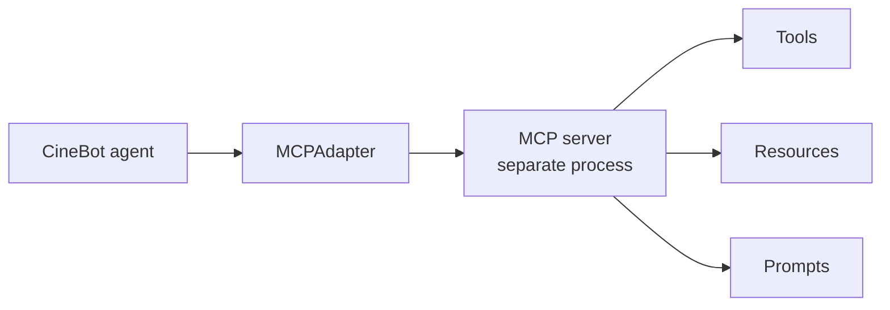
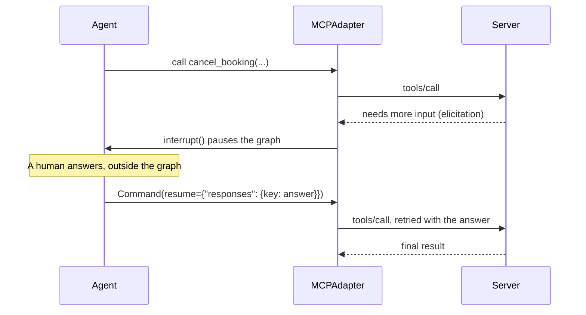
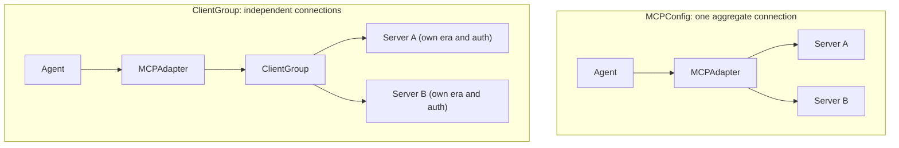

# MCP inside LangChain
> lead: Use MCP servers as a tool source for a LangChain agent: load tools, call them directly, handle errors, require approval for destructive tools, answer elicitations, connect several servers and authenticate.
meta: Weekends 13 and 14 | Notebook-based, no class summary | 45 min read | Code: Weekend 14

:::repo This chapter comes from notebooks, not a class write-up
There is no written summary for these sessions. The content is built from the repo's notebooks (`MCP_in_Langchain.ipynb`, `MCP_MultiServer_Live_Demo.ipynb`, `Langchain MCP.ipynb`). The Weekend 13 folder has an empty `README.md` and a short `langchain.py`. The notebooks target a **beta** built-in module, so API names may change. Check them against your installed version.
:::

## Why it matters

Chapters 11 to 17 treated MCP on its own. In practice you will use MCP servers as a **tool source for an agent**. This chapter shows how LangChain consumes them, and the honest trade-offs between the new built-in module and the older adapter package. It is also where MCP meets the middleware you learned earlier: human approval, error handling and elicitation all reappear.

:::key For an agent framework, MCP is just a source of tools
Nothing about the agentic loop changes. An MCP server is "a connection to a set of tools". LangChain builds the client for you (the agent is the host) and hands the tools to `create_agent` like any other tools. LangChain's MCP support **consumes** servers. Building servers is still FastMCP's job (Chapter 17).
:::



## Core ideas

### 1. Install and the first connection

```bash
pip install "langchain[mcp]>=1.4.0"        # the built-in module, no separate package
```

```python
from pathlib import Path
from langchain.mcp import MCPAdapter
from fastmcp.client.transports import PythonStdioTransport

cinebot_transport = PythonStdioTransport(
    script_path=Path("cinebot_mcp_server.py"),
    log_file=Path("cinebot_mcp_server.log"),
)

async with MCPAdapter(cinebot_transport) as adapter:
    tools = await adapter.list_tools()
    print([t.name for t in tools])
```

`MCPAdapter` is an async context manager (so cleanup is guaranteed, as with `async with client`). It accepts a transport, a bare URL, a `fastmcp` `Client`, a config dictionary or a client group. `list_tools()` returns ordinary LangChain tools. Once you have them, they are used like any other tool.

:::repo Notebook paths are machine-specific
One cell hard-codes an absolute path on the author's Mac (`/Users/mayank/...`). Replace it with a relative `Path("cinebot_mcp_server.py")`.
:::

### 2. Call a tool with no AI at all

```python
async with MCPAdapter(cinebot_transport) as adapter:
    tools = await adapter.list_tools()
    showtime_tool = next(t for t in tools if t.name == "check_showtimes")
    direct = await showtime_tool.ainvoke({"movie_title": "interstellar"})   # no model involved

    agent = create_agent(model="openai:gpt-5-mini", tools=tools)           # or give them to an agent
    result = await agent.ainvoke({"messages": [("user", "What are the showtimes for Interstellar?")]})
```

Calling the tool directly proves the server works before you add a model. Then the same `tools` list goes into `create_agent`.

### 3. Tool output: content blocks and structured data

An MCP tool result is not limited to text. The adapter converts what the server sends into standard LangChain **content blocks**, so the model sees one shape regardless of the server.

| MCP content type | Becomes |
| --- | --- |
| `TextContent` | text content block |
| `ImageContent` | image block (base64 plus mime type) |
| `ResourceLink` (image mime type) | image block (by URL) |
| `ResourceLink` (other) | file block |
| `EmbeddedResource` (text) | text block |
| `EmbeddedResource` (blob) | image or file block, by mime type |
| `AudioContent` | **not yet supported**: raises `NotImplementedError` |

**Two audiences for one result.** The `ToolMessage` carries `.content` (what the model reads) and `.artifact` (data your code can use). For structured content the adapter puts it in `artifact["structured_content"]`:

```python
message = await seat_map_tool.ainvoke({"name": "get_seat_map", "args": {"movie_title": "Interstellar"},
                                        "id": "unique_call_id_12345", "type": "tool_call"})
print(message.content)                                         # text the model reads
print(message.artifact["structured_content"]["available_rows"])  # structured data for your code
```

This is the same `content` and `artifact` split from Chapter 3, now applied to MCP results.

### 4. Error handling: two very different failures

| Failure | What happened | What the agent sees |
| --- | --- | --- |
| Tool **ran and reported failure** (`isError=True`) | The tool executed, then explicitly failed (bad input, business rule) | A `ToolMessage` with **`status="error"`**. The agent can read it and **self-correct**, like any tool error |
| **Transport or session failure** | The connection dropped, the server crashed, the process could not start | **Raises an exception.** There is no error message for the model, because nothing came back to convert |

```python
@mcp.tool()
def risky_lookup(booking_id: str) -> str:
    """Look up a booking. Fails if the ID format is wrong."""
    if not booking_id.startswith("BK"):
        raise ValueError(f"Invalid booking ID format: {booking_id!r}. Expected it to start with 'BK'.")
    return f"Booking {booking_id}: confirmed."
```

Calling it with `12345` returns a `ToolMessage` with an error status the model can read. Use Chapter 8's tool error and retry middleware for the layer around it.

### 5. Destructive tools get human approval, automatically

Servers can mark tools with **annotations** such as `destructive_hint`. The adapter surfaces them under `tool.metadata["mcp"]["tool"]["annotations"]`. Build the human-in-the-loop config from that, so the server decides what is dangerous:

```python
def is_destructive_tool_call(tool):
    meta = (tool.metadata or {}).get("mcp", {}).get("tool", {}).get("annotations", {})
    return bool(meta.get("destructive_hint"))

async with MCPAdapter(cinebot_transport) as adapter:
    tools = await adapter.list_tools()
    interrupt_on = {
        t.name: {"allowed_decisions": ["approve", "edit", "reject"]}
        for t in tools if is_destructive_tool_call(t)
    }
    hitl_middleware = HumanInTheLoopMiddleware(interrupt_on=interrupt_on)
    cinebot_guarded = create_agent(model="openai:gpt-5-mini", tools=tools, middleware=[hitl_middleware])
```

One HITL configuration, built dynamically from whatever the server marked destructive. On the server the tool is declared with `@mcp.tool(annotations=ToolAnnotations(destructive_hint=True))`, as for `cancel_booking`.

:::trap Verify the filter against your own server
The notebook's saved output for `cancel_booking` shows `destructive_hint: True` inside the raw metadata, yet the line printed by the helper in that same cell says `Destructive: False`. The notebook does not explain the mismatch (it may be stale output from an earlier version of the helper). Do not assume the filter works: print `tool.metadata` and the helper's result for **your** server and confirm the dangerous tool is actually selected. A guard that silently matches nothing is worse than none.
:::

### 6. Elicitation becomes an interrupt, automatically

Some tools need clarification mid-call ("confirm you want to proceed?"). `langchain.mcp` answers with a **LangGraph `interrupt()`**. Every client the adapter builds is armed for it by default, with no extra code.



```python
@mcp.tool()
async def cancel_booking_confirm(booking_id: str, ctx: Context) -> str:
    """Cancel a booking, but ask the caller to confirm first."""
    result = await ctx.elicit(f"Confirm cancellation of booking {booking_id}?", response_type=bool)
    if result.action != "accept":
        return f"Cancellation of {booking_id} aborted ({result.action})."
    if not result.data:
        return f"Cancellation of {booking_id} aborted (user said no)."
    return f"Booking {booking_id}: cancelled."
```

Called outside a graph, the tool returns a status you can inspect. Inside an agent, the interrupt pauses the graph and a human answers with `Command(resume={"responses": {key: answer}})`. It connects Chapter 13 (elicitation), Chapter 10 (interrupts and `Command`) and Chapter 17 (the modern protocol changes how this works on the wire).

### 7. Connecting several servers

Real deployments rarely use one server. Two patterns, with a real trade-off:

| Pattern | What it does | Tool naming | Protocol negotiation |
| --- | --- | --- | --- |
| **`MCPConfig` dict** | One aggregate connection across several servers | Prefixed by the config key you choose | **Shared**: the whole fleet negotiates down to the oldest protocol era any member needs |
| **`ClientGroup`** | Independent connections, one per server | Namespaced `{server}_{tool}` automatically | **Independent**: each member keeps its own protocol era and auth |



```python
from fastmcp.client import Client
from fastmcp.client.group import ClientGroup

group = ClientGroup({
    "cinebot": Client(Path("cinebot_mcp_server.py")),
    "errors": Client(Path("cinebot_error_server.py"), mode="legacy"),    # an older-era server
    "time_track_server": Client("https://time-track-mcp-server.vercel.app/mcp/"),
})
async with MCPAdapter(group) as adapter:
    group_tools = await adapter.list_tools()
```

Because `MCPConfig` forces the fleet to the **oldest** protocol era any member needs, a mixed legacy and modern fleet is the case for `ClientGroup`. This is Chapter 17's legacy and modern split showing up in practice.

**The live multi-server demo** connects each server in its **own `try/except`** and merges whichever tool lists succeed (a local CineBot over STDIO, the free public Context7 server over HTTPS, and your own deployed Time Tracker). For a live audience, one server being down does not take out the demo: you show "what we got from the reachable servers" instead of a crashed cell, with a status line per server.

### 8. Authentication

Auth is configured on the **FastMCP client**, not on `MCPAdapter`, which just wraps whatever client you hand it.

| Need | Pattern |
| --- | --- |
| Bearer token | `Client(url, auth=token)` |
| OAuth 2.1 (discovery, browser redirect, token exchange) | `Client(url, auth="oauth")` |
| OAuth persisted across runs | `Client(url, auth=OAuth(mcp_url=url, token_storage=...))` |
| Different auth per server | `ClientGroup` with a different `auth=` on each member client |
| Per-user auth in a deployment | A custom auth handler resolves the caller server-side; the graph factory mints or exchanges a token per user |

```python
async def load_tools_with_bearer(url: str, token: str):
    async with MCPAdapter(Client(url, auth=token)) as adapter:
        return await adapter.list_tools()
```

The demo server checks a static bearer token with a `StaticTokenVerifier`. A bearer check only applies at a network boundary, so that server then serves over HTTP (port 8000), not STDIO.

:::trap Never put a real key in a notebook
A bearer token like the demo's is fine as a labelled example. But one notebook in the course repo has what looks like a **real third-party API key** passed as a variable *name* to `os.environ.get(...)`, which means the key sits in the code. Do not copy it anywhere. Anyone who owns such a repo should rotate that key. Read secrets from environment variables, as in Chapter 1.
:::

### 9. `langchain.mcp` vs `langchain-mcp-adapters`

If an integration already uses the older, separate package, here is the honest comparison, including what the new API does **not** do yet.

| | `langchain-mcp-adapters` (older, separate) | `langchain.mcp` (built-in, beta) |
| --- | --- | --- |
| Install | `pip install langchain-mcp-adapters` | `pip install "langchain[mcp]>=1.4.0"` |
| Entry point | `MultiServerMCPClient({...}).get_tools()` | `async with MCPAdapter(target) as adapter: await adapter.list_tools()` |
| Resources | Supported | **Not exposed.** Drop to the underlying `fastmcp.Client` |
| Prompts | Supported | **Not exposed.** Same workaround |
| Tool call interceptors | Supported (logging, retry, `Command` updates) | **No interceptor hook in this beta.** Wrap tools yourself after `list_tools()` |
| Progress callbacks | Supported | Not part of the public surface reviewed |
| Structured content | Via `ToolMessage` content | `ToolMessage.artifact["structured_content"]` |
| Error handling | `handle_tool_errors` flag | `isError=True` becomes `status="error"` automatically; transport errors raise |
| Tool metadata | Ungrouped | One `tool.metadata["mcp"]` namespace |
| Elicitation | Not built in | Automatic, via LangGraph `interrupt()` |
| Status | Mature, stable | **Beta**, "the API may change" |

:::key The honest takeaway for a client project
If you need **resources, prompts or interceptor-style middleware** around MCP calls today, `langchain-mcp-adapters` still does things `langchain.mcp` does not. If you are starting fresh and only need tools, the built-in path is where LangChain is clearly heading. This is not "old bad, new good". It is **different surface area, and the new one is not a full superset yet.**
:::

:::repo Class 22 describes the older package
The Class 22 write-up (Chapter 17) explains LangChain's MCP support in terms of `MultiServerMCPClient` and the adapters package. The newer notebooks use `MCPAdapter` from `langchain.mcp`. Both rest on FastMCP and the official SDK. They are two generations of the same idea.
:::

### 10. The Weekend 13 starter

`Weekend 13/langchain.py` is the smallest version of all of this:

```python
from langchain.agents import create_agent
from langchain.mcp import MCPAdapter

async def run_agent(server) -> dict:
    # Discover the server's tools, then hand them to the agent like any other tools.
    async with MCPAdapter(server) as adapter:
        tools = await adapter.list_tools()
        agent = create_agent("claude-sonnet-5", tools)
        return await agent.ainvoke(
            {"messages": [{"role": "user", "content": "What is the forecast for Oslo?"}]})
```

The agent stays usable for the life of the adapter context, because the tools hold the client. **Use the agent inside the `async with` block.** Using the tools after the block exits is a common bug.

<!-- docs-add -->
## From the docs: what the LangChain MCP page adds

*Added from the LangChain "MCP tools" page (read 30 Oct 2026). `langchain.mcp` is beta and needs `langchain[mcp]>=1.4.0`.*

- **Lifetime**: `MCPAdapter` is used as an async context manager and the tools hold the client, so the agent works **only while the adapter context is open**.
- **Content**: model-visible MCP content becomes standard content blocks (text, image, file).
- **Structured results** are stored on the `ToolMessage` as an **artifact**, an `MCPToolArtifact` whose `structured_content` holds the data (or `None`), not in the text the model reads.
- **Errors**: a server result with `isError=True` becomes a `ToolMessage` with `status="error"` so the model can recover; transport or session failures raise exceptions.
- **Metadata** sits under `metadata["mcp"]`: `tool` (`annotations` such as `read_only_hint` and `destructive_hint`, plus `_meta`) and `server` (`name`, `version`). Everything is optional, so read it defensively with `.get()`.
- **Gating by hint**: read `destructive_hint` once when you discover tools and build the `interrupt_on` map from it, using an `InterruptOnConfig` with `allowed_decisions` and a `when` predicate that can inspect `request.tool_call["args"]`. This replaces hardcoded tool names.
- **Elicitation** is on by default: when a server needs input mid-call, the adapter raises a LangGraph `interrupt`. Use a checkpointer and the same `thread_id`, and answer with `Command(resume={"responses": {key: answer}})` where each answer is `accept` (with form `content`), `decline` or `cancel`.

:::trap Resuming re-runs the tool from the start
After an elicitation answer the tool restarts, so work done before the question can repeat. Make that work **idempotent**.
:::

:::trap Sampling and roots raise errors
The sessionless protocol has no back-channel for sampling or roots requests, so they raise errors. Servers that push elicitation over a legacy handshake session cannot be answered this way. This matches the legacy versus modern split in Chapter 17.
:::
<!-- /docs-add -->

<!-- colab-add -->
## From the Craft "LangChain MCP" Colab notebook

*I opened the Colab linked on the Craft page's MCP section in the desktop browser (read 30 Oct 2026; its cell outputs were visible). It is a short notebook, and its most useful content is a real install trap.*

**The CineBot server in the notebook** is a three-tool FastMCP server: `check_showtimes` (a lookup in a small dict), `cancel_booking` marked with `ToolAnnotations(destructiveHint=True)` ("Irreversible"), and `get_seat_map`, which returns **structured data** (a dict with available and sold-out rows) instead of text. The destructive hint is exactly what the MCP-tools page uses to decide which tools need human approval (see the docs section above).

**The adapter in one line.** The notebook's own comment: "one adapter, a universal translator: it figures out on its own whether it is talking to a local MCP or an HTTP MCP". Its last cell opens `MCPAdapter("https://docs.langchain.com/mcp")` and calls `list_tools()`, which connects to **LangChain's own documentation MCP server** over a URL.

:::trap `pip install langchain.mcp` installs the wrong package
The notebook runs `pip install "langchain[mcp]"` first, and pip warns **`langchain 1.3.18 does not provide the extra 'mcp'`** (the extra arrives with `langchain>=1.4.0`, matching the docs). It then runs `pip install langchain.mcp`, which resolves to an **older, unrelated package, `langchain-mcp` 0.2.1**. That package pins `langchain-core~=0.3` and `mcp~=1.0`, so pip **downgrades** `langchain-core` to 0.3.86 and `mcp` to 1.30, and prints conflicts against `langgraph`, `langchain` and `langgraph-sdk`, which all need `langchain-core` 1.4 or newer. Running `pip install fastmcp langchain` afterwards restores `langchain-core` 1.6.5 and `mcp` 2.2.0 but leaves `langchain-mcp` complaining. Lesson: the namespace `langchain.mcp` is imported from the **`langchain`** package (via its `mcp` extra); it is **not** a separate PyPI package called `langchain.mcp`. Upgrade `langchain` to 1.4 or newer, or use the older `langchain-mcp-adapters` package, and check `pip list` after any install that prints a resolver error.
:::
<!-- /colab-add -->

<!-- craftcolab-mcp -->
## The MCP adapter Colab and an install trap (read in full)

:::note Source
The Craft entry "MCP Starts" links a Colab (an untitled notebook), read in full on 31 Oct 2026.
:::

The notebook writes a small CineBot MCP server with FastMCP (`check_showtimes`, a `cancel_booking` marked with `destructiveHint=True`, and `get_seat_map` returning structured data), then tries the adapter.

:::trap `pip install langchain.mcp` installs the wrong package
In the notebook, `pip install "langchain[mcp]"` printed that the installed LangChain (1.3.18) "does not provide the extra 'mcp'". Then `pip install langchain.mcp` installed an unrelated package (`langchain-mcp` 0.2.1), which downgraded `langchain-core` to 0.3.86 and produced dependency-conflict errors; reinstalling `fastmcp langchain` swung `langchain-core` back to 1.6.5 and left the conflicts. The MCP adapter in the docs needs `langchain[mcp]` at version 1.4.0 or later (a beta feature), so check the version before installing.
:::
<!-- /craftcolab-mcp -->

<!-- docs-migrate-mcp -->
## Migrating from `langchain-mcp-adapters`, and MCP authentication (from the docs)

:::note Source
LangChain docs, [Migrate from langchain-mcp-adapters](https://docs.langchain.com/oss/python/migrate/langchain-mcp-adapters), read on 31 Oct 2026 from the docs source on GitHub (text and tables of every section; long code samples skimmed).
:::
:::note Source
LangChain docs, [MCP authentication](https://docs.langchain.com/oss/python/langchain/mcp/auth), read on 31 Oct 2026 from the docs source on GitHub (text and tables of every section; long code samples skimmed).
:::

MCP support now lives inside LangChain as `langchain.mcp`, built on FastMCP, and replaces the standalone `langchain-mcp-adapters` package. It needs `langchain[mcp]>=1.4.0` and is in beta. `MultiServerMCPClient` collapses into one **`MCPAdapter`** class: an async context manager that infers the transport from its target.

| Before (`langchain-mcp-adapters`) | After (`langchain.mcp`) |
| --- | --- |
| `MultiServerMCPClient(connections)` | `MCPAdapter(target)`; the target is a URL, a `Path`, an in-process server, an `MCPConfig` dict (`mcpServers`), a prebuilt `fastmcp.Client` or a `ClientGroup` |
| `get_tools()`, `load_mcp_tools` | `MCPAdapter(...).list_tools()` |
| `tool_name_prefix` | automatic (`{server}_{tool}`) for several servers |
| `handle_tool_errors` flag | removed: `isError=True` becomes a `ToolMessage(status="error")`, transport failures raise |
| `Callbacks(on_elicitation=...)` | automatic, as a LangGraph interrupt; answer by resuming with `Command(resume={"responses": {key: answer}})` |
| `on_progress`, `on_logging_message` | `progress_handler=` and `log_handler=` on a `fastmcp.Client` |
| `tool_interceptors` | LangChain `@wrap_tool_call` middleware |
| `convert_mcp_tool_to_langchain_tool` | `as_langchain_tool` (now a coroutine) |
| prompts, resources, `to_fastmcp` | **not supported yet** |
| sampling, roots | **not answered**: a tool call that needs either raises `NotImplementedError`, because the modern sessionless protocol has no back-channel |
| HTTP+SSE | deprecated in the protocol but still works through FastMCP's `SSETransport`; WebSocket has no transport |

**Four authentication patterns.** *Bearer token*: pass the token string as `auth`. *OAuth*: pass the literal `"oauth"` and FastMCP runs the OAuth 2.1 flow (discovery, dynamic client registration, browser redirect, token exchange). *Per-server*: give each server its own client in a `ClientGroup` with its own `auth`. *Per-user*: authenticate the caller at the LangGraph server with a custom auth handler, then mint or exchange that user's credential inside the graph factory so each run reaches the server as its own user. `auth` also accepts any `httpx.Auth`.
<!-- /docs-migrate-mcp -->

<!-- class23-mcp -->
## What class 23 adds on the MCP adapter (read in full)

:::note Source
`classes_transcription_summary/23 - 27 Sep - MCP In LangChain.md`, read in full on 31 Oct 2026. The repo gained this file after my first snapshot of it.
:::

- **Where the course is.** The MCP detour was deliberately long so MCP would be understood in depth; the class returns to LangChain with two topics, MCP in LangChain and multi-agent systems, and the next weekend is a LangChain project on GCP (learners were asked to open a Google Cloud free-trial account, about $300 of credit). The live adapter demo hit a version problem, because LangChain's MCP package was in beta and needed a newer LangChain than the notebook had; the concepts were taught, the notebook was promised later.
- **An agent only needs tools.** MCP changes where tools come from, not how the agent loop works. The agent reads each tool's name and description and decides.
- **The adapter is a universal translator** between a LangChain agent (messages, tools, tool messages) and any MCP server, local or remote. It sits on the **FastMCP client**, which handles four jobs: inferring the transport (STDIO or HTTP), negotiating the protocol version (legacy or modern), managing the connection and authentication.
- **`adapter.list_tools()`, not `client.list_tools()`**, when tools must be LangChain-compatible: the plain client returns tools but not necessarily in a form LangChain can use. The class described the adapter as a decorator wrapped around the MCP client.
- **What gets translated.** A tool result becomes LangChain content (text, image or audio); structured content becomes an **artifact** on the tool message; an error becomes a tool-message **status** that tells a server-reported error from a transport failure; an elicitation request becomes a **LangGraph interrupt**.
- **Three ways to connect.** One server (a URL, a script path, or an in-memory FastMCP server object), several servers behind one config dictionary, or a **client group** for servers that each need their own connection, credentials or protocol mode. The group routes each call to the client that advertises the tool and namespaces tools so identical names do not collide; a legacy and a modern server can run side by side.
- **Per-user credentials, the trap.** One shared token for a deployed app means everyone reaches the first person's account (the example: authorize Gmail once and every visitor can reach it). Authorize per user: authenticate the caller at the LangGraph server, then mint or exchange a credential for that user inside the graph factory. Claude itself authorizes per user and per server.
- **Why elicitation must be a LangGraph interrupt.** A LangChain agent stops only for its own kind of interrupt; a generic one might be caught but the agent would keep working (the class used a language analogy: telling someone "stop" in a language they do not speak).
- **Q&A worth keeping.** FastMCP and the official SDK are now very similar, so you do not need FastMCP's internals in depth. Interviews ask for depth, not definitions ("what is an agent" is unlikely; middleware is less known, so explain it properly).
<!-- /class23-mcp -->

## Common mistakes

| Mistake | Symptom | Fix |
| --- | --- | --- |
| Using the agent after leaving `async with MCPAdapter` | Tools fail, the client is closed | Run the agent inside the block |
| Expecting resources or prompts from `MCPAdapter` | Not available | Use the underlying `fastmcp.Client`, or the older package |
| Assuming a transport failure gives the model an error message | An exception is raised | Wrap the call, and use retry middleware |
| Trusting a destructive-hint filter without testing it | Dangerous tools run unprompted | Print `tool.metadata` and the filter's result, and confirm the tool is selected |
| One `MCPConfig` for legacy and modern servers | Everything drops to the oldest era | Use `ClientGroup` |
| Putting auth on `MCPAdapter` | Ignored | Configure `auth=` on the `Client` |
| Expecting audio results | `NotImplementedError` | Not supported yet |
| Hard-coding absolute paths or keys in a notebook | Breaks on another machine, leaks secrets | Relative paths and environment variables |

## Hands-on lab

1. Write `cinebot_mcp_server.py` with `check_showtimes`, `cancel_booking` (destructive) and `get_seat_map`.
2. Connect with `MCPAdapter`, list tools, and call `check_showtimes` directly with `ainvoke`.
3. Give the same tools to `create_agent` and ask about showtimes.
4. Print `ToolMessage.content` and `.artifact["structured_content"]` for `get_seat_map`.
5. Call a failing tool and read the `status="error"` message. Then kill the server mid-call and watch the exception.
6. Build the dynamic `interrupt_on` from destructive annotations. Print `tool.metadata` first.
7. Add the elicitation server and answer it with `Command(resume=...)`.
8. Connect two servers with `ClientGroup`, one with `mode="legacy"`.
9. Add a bearer-token server and connect with `Client(url, auth=token)`.

## Interview corner

:::pitch
LangChain treats MCP as a source of tools. I open an `MCPAdapter` over a transport, URL, config or client group, list the tools, and give them to `create_agent`. Tool errors the server reports reach the model as error messages it can correct, while transport failures raise. Destructive tools can be gated by human approval built from the server's annotations, and elicitation surfaces as an interrupt. For mixed-era fleets I use a client group, and auth is set on the underlying client.
:::

### Basics

:::qa How does a LangChain agent use an MCP server?
Through an adapter. It connects, discovers the server's tools and returns them as ordinary LangChain tools that you pass to `create_agent`. The agent is the host and LangChain builds the client.
:::

:::qa Can LangChain build MCP servers?
No. Its MCP support consumes existing servers as tool sources. Building servers is for libraries such as FastMCP.
:::

:::qa How do you test an MCP tool without a model?
Call it directly with `await tool.ainvoke({...})` on a tool from `list_tools()`. That proves the server works before adding an agent.
:::

### Intermediate

:::qa What is the difference between a tool error and a transport error?
A tool that ran and failed (`isError=True`) becomes a `ToolMessage` with `status="error"`, which the agent can read and correct. A transport or session failure raises an exception because nothing came back to convert.
:::

:::qa How do you require approval for dangerous MCP tools?
Read the server's annotations (such as `destructive_hint`) from `tool.metadata`, build the `interrupt_on` dictionary for `HumanInTheLoopMiddleware` from those tools, and pass the middleware to `create_agent`. The server decides what is dangerous.
:::

:::qa How does elicitation work with LangChain?
The adapter converts a server's request for more input into a LangGraph `interrupt()`. A human answers outside the graph, and you resume with `Command(resume=...)`. The tool call is retried with the answer.
:::

:::qa `MCPConfig` or `ClientGroup`?
`MCPConfig` makes one aggregate connection with prefixed tool names and a shared protocol era, so the fleet negotiates down to the oldest. `ClientGroup` keeps independent connections with `{server}_{tool}` names, each with its own era and auth. Use a group for mixed fleets.
:::

:::qa Where do you configure authentication?
On the FastMCP `Client` (bearer token string, `"oauth"` or an OAuth object with storage), not on `MCPAdapter`. Use a client group to give each server its own auth.
:::

### Tricky

:::qa What does the built-in module not support that the older package does?
Resources, prompts and tool-call interceptors (and progress callbacks are not in the reviewed public surface). The new module adds automatic elicitation and metadata namespacing, and is still beta.
:::

:::qa How would you advise a client choosing between them?
If they need resources, prompts or interceptors today, use `langchain-mcp-adapters`. If they only need tools and are starting fresh, use `langchain.mcp`, accepting beta churn. Do not frame it as old versus new, because the new one is not a superset yet.
:::

:::qa Why must the agent run inside the `async with` block?
The tools hold the client. When the context exits, the connection closes and the tools stop working.
:::

:::qa What happens with an audio result?
`AudioContent` is not yet supported and raises `NotImplementedError`.
:::

:::qa A destructive filter selects nothing, so dangerous tools run without approval. How do you debug it?
Print `tool.metadata` for each tool and the helper's result, and compare. The notebook itself shows `destructive_hint: True` in the raw metadata next to a helper result of `False`, so never assume the filter works. Fix the lookup until the dangerous tool is selected, and add a test for it.
:::

## Quick revision

- [ ] I can open an `MCPAdapter`, list tools and give them to `create_agent`
- [ ] I can call an MCP tool directly with `ainvoke`
- [ ] I can explain content blocks and the `content` plus `artifact` split
- [ ] I can separate a tool error from a transport error
- [ ] I can build HITL from destructive annotations and test that the filter really selects them
- [ ] I can explain elicitation as an interrupt and resume it
- [ ] I can choose between `MCPConfig` and `ClientGroup`
- [ ] I can say where auth is configured
- [ ] I can compare `langchain.mcp` and `langchain-mcp-adapters` honestly

<!-- news -->
## Practice project: the AI newsletter (MCP connectors)

The page has an **AI newsletter project** with two parts: a request, then the long prompt that came out of it.

**The request** (a prompt given to a Claude chat): build an AI newsletter and updater that searches **recursively** using Tavily, goes **in depth** on each story, and splits news by industry (tech, business and so on). Then create an **HTML draft in Gmail**, an **8 AM Google Calendar event** to read it, and two **Apple Notes** (a LinkedIn post and a Markdown article for Substack), using apps already connected through connectors and MCP.

**The workflow the prompt defines** (the visible part of the page; the rest of the prompt is clipped on the page):

| Step | Action |
| --- | --- |
| 0 | Check Google Calendar for a recurring "Read Today's Update" event (8:00 to 8:15 AM, daily). Create it only if it does not exist, so no duplicates |
| 1 | **Broad search** with Tavily, one search per category (AI, Tech, Business, Finance and markets) for the last 24 hours, shortlisting 2 to 4 significant stories each |
| 2 | **Recursive deep dive**: a follow-up Tavily search on each shortlisted story for context, numbers, reactions and why it matters, done independently per story (the branching search) |
| 3 | **Synthesise** into four sections, 2 to 4 sentences per story (what happened, why it matters, source), dropping thin or unverified items |
| 4 | **Create a Gmail draft** (do not send): subject "Daily Update - date", clean HTML with one section per category and source links, no sign-off or contact details |
| 5 | **Create two Apple Notes**: a LinkedIn post about the single most interesting story, and a Markdown article |

:::trap Why this prompt is built this way
Two good habits are visible. It checks before creating (the calendar event), so a daily run never makes duplicates, and it drafts instead of sending (the Gmail step), so a human reviews it first. Both are the same safety ideas as human-in-the-loop in Chapter 10.
:::
<!-- /news -->

<!-- proj7 -->
## Practice project: MCP-powered agent

**Goal:** an agent that uses two MCP servers: one yours, one public.

- `MCPAdapter` with a client group. Call a tool directly first, then hand the tools to `create_agent`.
- Gate destructive tools with HITL built from annotations, and **test that the filter really selects them**.
- **Stretch:** add bearer-token auth to your server.
- **Interview story:** transport failure versus tool failure, and what the client group solved.
<!-- /proj7 -->

<!-- docs31f -->
## From the docs: MCPAdapter, connections and authentication

*From three LangChain docs pages read in full on 31 Oct 2026: [MCP](https://docs.langchain.com/oss/python/langchain/mcp), [Connections](https://docs.langchain.com/oss/python/langchain/mcp/connections) and [Authentication](https://docs.langchain.com/oss/python/langchain/mcp/auth). This extends the section above that came from the MCP tools page.*

**Basics.** `MCPAdapter` is built on FastMCP, which handles transport inference, protocol negotiation, connection management and auth; LangChain adds the layer that adapts a server's tools into LangChain tools for `create_agent`. The `langchain.mcp` namespace needs `langchain[mcp]>=1.4.0`, is in beta and warns once per process. If you used MCP before 1.4.0 there is a migration guide from `langchain-mcp-adapters`. The adapter infers the transport from its target:

| Target | Transport |
| --- | --- |
| An `http(s)` URL string | Streamable HTTP |
| A `Path` to a script | Launched as a subprocess over stdio |
| An in-process FastMCP server | In memory, no subprocess or socket (ideal for tests) |
| A transport object, a prebuilt `fastmcp.Client`, or an `MCPConfig` dict | As configured (the dict puts several servers behind one adapter) |

A plain string must look like an http or https URL. FastMCP would otherwise treat a string that names an existing `.py` or `.js` file as a script to launch, and strings often arrive from config or from a model, so the adapter rejects non-URL strings. The LangChain docs themselves are available as a public MCP server at `https://docs.langchain.com/mcp` (no key; tools to search the docs, read them through a virtual filesystem, and submit feedback).

**Lifecycle.** `MCPAdapter` is an async context manager. Discover tools inside `async with` and build the agent there; the returned tools hold the client, so they stay callable after the context exits. They are also **reentrant**: each tool call opens the client, runs the call and releases it, so a run uses one session per tool call and a long-running agent does not pin an idle connection. To hold one session across several calls, keep the adapter's context open around the agent call.

**Several servers.**

| Need | Use | Notes |
| --- | --- | --- |
| Many servers behind one connection | `MCPConfig` dict (`{"mcpServers": {...}}`) | Tools are prefixed with the config key (`weather_...`); servers can mix transports, but the fleet shares **one** negotiated protocol era, so a legacy-only member drops the whole fleet to legacy |
| Separate auth, protocol eras or pools per server | `ClientGroup` | Each member keeps its own era, auth and handlers; tools are namespaced `{server}_{tool}`; calls route back to the client that advertised the tool |

**Scaling a deployment.** Discover per run but reuse connections underneath: build the agent in a `langgraph dev` graph factory, use `list_tools(cache_mode="use")` to serve a cached tool list within the server's TTL (modes: `use`, `refresh`, `bypass`; caching is opt-in and only works with modern-era servers that advertise hints), and share one HTTP connection pool across clients through an `httpx_client_factory`. In a graph factory the annotated types must be importable at runtime, not only under `TYPE_CHECKING`, because langgraph-api reads them with `get_type_hints()`.

**Protocol eras.** The legacy era starts every connection with an `initialize` handshake; the modern era (protocol version 2026-07-28 and later) discovers support by probing a `server/discover` endpoint. FastMCP negotiates per connection (`mode="legacy"` pins the handshake era; `mode="auto"`, the default, picks the newest the server understands).

**Authentication.** Any credential a `fastmcp.Client` accepts works: a **bearer token** string (`Client(url, auth=token)`), the literal `"oauth"` for the full OAuth 2.1 flow (discovery, dynamic client registration, browser redirect, token exchange; tokens are in memory by default, so pass an `OAuth(..., token_storage=...)` provider to persist them), or any `httpx.Auth`. For several servers, give each client its own `auth` inside a `ClientGroup`. For a deployment, use **per-user authentication**: authenticate the caller at the LangGraph server with a custom auth handler, then in the graph factory read `runtime.user.identity` and build the client with a per-user token (for example an OAuth gateway exchanging the session). Isolate any cached responses per user so one user never sees another's cached tool list.
<!-- /docs31f -->

## Sources and further reading

- LangChain docs: [Migrate from langchain-mcp-adapters](https://docs.langchain.com/oss/python/migrate/langchain-mcp-adapters), [MCP authentication](https://docs.langchain.com/oss/python/langchain/mcp/auth)
- [Class 23 notes]({{src:classes_transcription_summary/23 - 27 Sep - MCP In LangChain.md}})
- [MCP in LangChain notebook]({{src:Weekend 14 - Oct 3 & Oct 4/MCP in Langchain/MCP_in_Langchain.ipynb}})
- [Multi-server live demo notebook]({{src:Weekend 14 - Oct 3 & Oct 4/MCP in Langchain/MCP_MultiServer_Live_Demo.ipynb}})
- [`cinebot_mcp_server.py`]({{src:Weekend 14 - Oct 3 & Oct 4/MCP in Langchain/cinebot_mcp_server.py}})
- [`cinebot_elicit_server.py`]({{src:Weekend 14 - Oct 3 & Oct 4/MCP in Langchain/cinebot_elicit_server.py}})
- [`cinebot_error_server.py`]({{src:Weekend 14 - Oct 3 & Oct 4/MCP in Langchain/cinebot_error_server.py}})
- [Weekend 13 starter (`langchain.py`)]({{src:Weekend 13 - 27th Sep/langchain.py}})
- [Weekend 13 notebook]({{src:Weekend 13 - 27th Sep/Langchain MCP.ipynb}})
- [MCP in LangChain folder]({{tree:Weekend 14 - Oct 3 & Oct 4/MCP in Langchain}})
