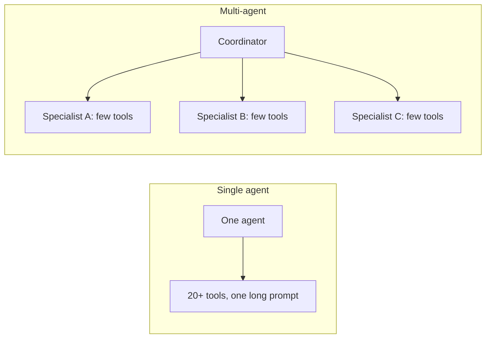
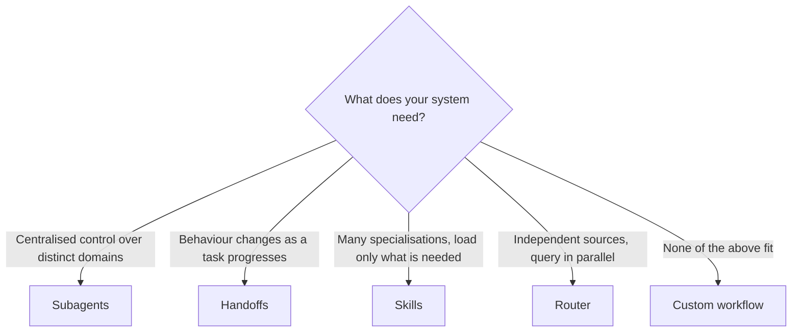
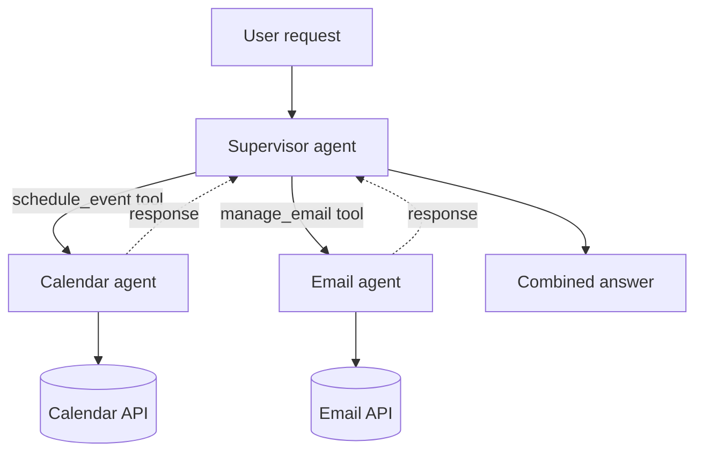
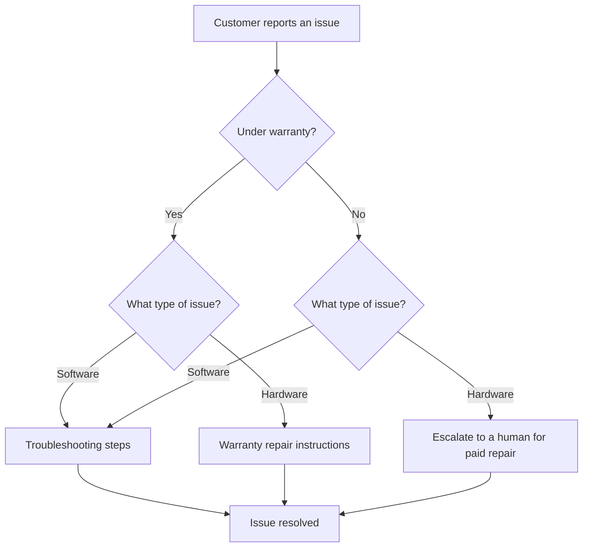
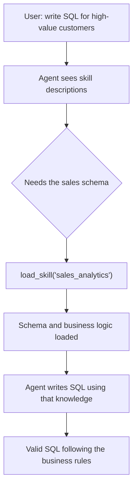
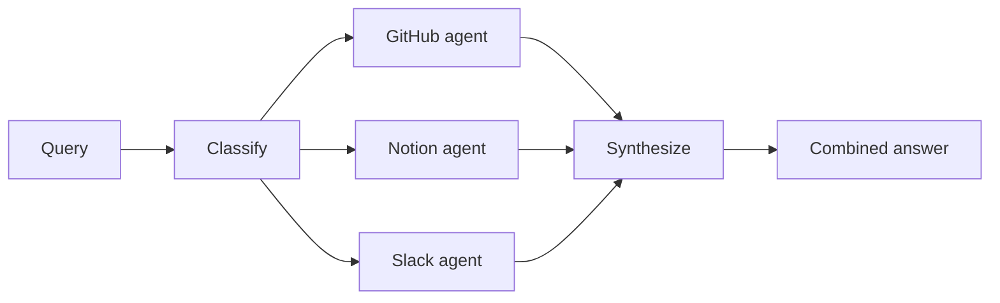
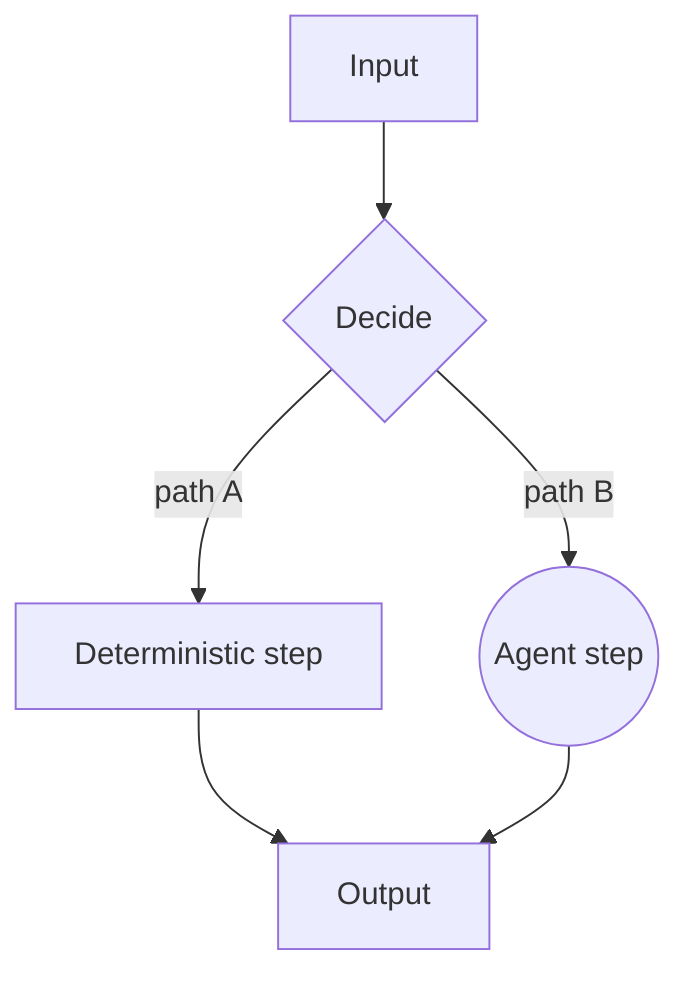

# Multi-agent patterns
> lead: The five official LangChain v1 multi-agent patterns (subagents, handoffs, skills, router and custom workflow), when to use each, what they cost in model calls, and the project built around each.
meta: Weekend 14 | Notebook-based, no class summary | 50 min read | Code: Weekend 14

:::repo This chapter comes from notebooks, not a class write-up
There is no written summary for this weekend. The content is built from the repo's multi-agent notebooks: an overview, four project notebooks and one large combined notebook. The student-facing notebooks call a live OpenAI model, so they need an `OPENAI_API_KEY`.
:::

## Why it matters

"When would you use multi-agent?" is a senior-level question, and the honest answer is "less often than people think". This chapter gives you a decision guide, the cost of each pattern in model calls, and the ability to say which pattern fits a scenario and why. Because patterns combine, the skill is choosing **per sub-problem**, not once for the whole system.

:::key Default to a single agent first
Reach for multi-agent only when tools, context, teams or latency genuinely demand it. A single agent with dozens of similar-looking tools and one long prompt works fine until it does not: the model must choose between look-alike tools, hold unrelated domains in one context window and follow one prompt that tries to cover every situation.
:::



Practitioner discussions in 2025 and 2026 (cited in the course's interview question file) echo this: **too many tools can degrade the model's tool choices**, though the exact threshold varies by task and model. That is one real reason specialised agents with narrower toolsets exist.

The core idea stays **Agent = Model + Harness** (Chapter 1). A multi-agent system is several agent objects wired together in one of a small number of well-understood shapes.

:::note Code in this chapter is simplified
The snippets below are condensed sketches that show each pattern's shape. They follow the notebooks but are not copied line for line. For the full, runnable versions open the notebooks linked under Sources.
:::

## The five patterns at a glance

| Pattern | Core mechanism | Best fit |
| --- | --- | --- |
| **Subagents** | A supervisor agent calls other agents **as tools** | Distinct domains, each with its own tools and prompt, with centralised control |
| **Handoffs** | One agent's prompt and tools **change based on state** (or agents trade off with `Command`) | A sequential workflow where behaviour should change as it progresses |
| **Skills** | One agent **loads specialised prompt content on demand** | Many possible specialisations, loaded only when needed, keeping context small |
| **Router** | A **classification step** fans out to specialised agents in parallel, then synthesises | Distinct knowledge **verticals** queried independently and combined |
| **Custom workflow** | A hand-built LangGraph graph, any shape | Anything the others do not fit, or a mix |



## Core ideas

### 1. Subagents, handoffs and router: do not confuse them

- **Subagents:** the **supervisor is itself a full agent**. It decides, turn by turn, which sub-agent-as-tool to call, sequentially or in parallel. The sub-agents do not talk to the user directly, and the supervisor sees only their final answers, not their internal reasoning or tool calls.
- **Handoffs:** there is **no supervisor** doing live reasoning about where to route. **State** (such as `current_step`, or which agent is active) determines which prompt and tools are in effect right now.
- **Router:** a **classification step** (often one structured-output LLM call, not a full agent) decides **once** which specialists are relevant, dispatches to all of them **in parallel**, and a synthesis step combines the answers. No multi-turn orchestration.

:::key Supervisor vs router
A supervisor is a full agent that maintains conversation state and decides across multiple turns. A router is a single classification step with no ongoing state. Use a router for explicit control over parallel execution with light classification. Use subagents when you want the model to decide dynamically, turn by turn.
:::

### 2. Pattern 1: Subagents

```python
@tool
def check_seat_availability(showtime: str) -> str:
    """Check how many seats are left for a showtime."""
    return f"{showtime}: 12 seats remaining in Screen 3."

booking_specialist = create_agent(model, tools=[check_seat_availability], ...)

@tool
def book_seats(request: str) -> str:
    """Delegate a booking request to the booking specialist."""
    result = booking_specialist.invoke({"messages": [("user", request)]})
    return result["messages"][-1].content

supervisor = create_agent(model, tools=[book_seats, ...])
```

**The project: a personal assistant.** A **supervisor** coordinates a **calendar agent** (scheduling, availability, events) and an **email agent** (drafting and sending), with human-in-the-loop review so a person can approve, edit or reject sensitive actions such as an outbound email. The low-level tools (`create_calendar_event`, `get_available_time_slots`, `send_email`) are stubs, so the whole notebook runs without any external service. The calendar agent never sees `send_email`. Each specialist is independently testable.



**Tool design choices:**

| Pattern | Best for | Trade-off |
| --- | --- | --- |
| **Tool per agent** | Fine-grained control over each subagent's input and output | More setup, more customisation. Pick it for a handful of subagents you tune individually |
| **Single dispatch tool** (`task(agent_name, description)`) | Many agents, distributed teams, convention over configuration | Simpler composition, less per-agent customisation |

**Sync or async?** Synchronous when the main agent's next move depends on the result, or failures should block the response. Asynchronous when the work is independent and the user should not be frozen waiting.

### 3. Pattern 2: Handoffs (state machine)

A single agent whose **system prompt and tools change** depending on where the conversation is. The core is a state field such as `current_step`.

```python
from langchain.agents import AgentState, create_agent
from langchain.agents.middleware import wrap_model_call, ModelRequest, ModelResponse
from typing_extensions import NotRequired
from typing import Literal

class SupportState(AgentState):
    current_step: NotRequired[Literal["warranty_collector", "issue_classifier", "resolution_specialist"]]

@wrap_model_call
def apply_step(request: ModelRequest, handler):
    step = request.state.get("current_step", "warranty_collector")
    # choose the prompt and the tool list for this step, then continue
    return handler(request.override(system_prompt=PROMPTS[step], tools=TOOLS[step]))
```

**The project: customer support.** The agent collects warranty information, classifies the issue as hardware or software, then gives a solution or escalates to a human, keeping state across turns.



:::key Tools drive the state
The key idea: **tools return `Command` objects that update both the data they collected and the workflow step.** Each "step" is a different configuration of the **same underlying agent**, selected dynamically by state. It is not a separate agent instance. This reuses Chapter 6's custom state, Chapter 9's `wrap_model_call` and Chapter 10's `Command`.
:::

### 4. Pattern 3: Skills (progressive disclosure)

The agent sees lightweight skill **descriptions** up front and loads the **full content on demand** through a tool call, instead of swapping the whole system prompt.

```python
SKILLS = {
    "refund_policy": "Full refund if cancelled 2+ hours before showtime; 50% credit within 2 hours.",
}

@tool
def load_skill(skill_name: str) -> str:
    """Load a specialised skill's full content.

    Available skills:
    - refund_policy: refund and cancellation rules
    """
    return SKILLS.get(skill_name, f"Unknown skill: {skill_name}")
```

**The project: a SQL assistant** for an organisation with many business verticals. Loading every schema into the prompt would overwhelm the context window. The agent sees the descriptions of two skills (`sales_analytics`, `inventory_management`) and loads the full schema and business logic only when relevant.



| Why progressive disclosure | Trade-off |
| --- | --- |
| Only 2 to 3 relevant skills load per task, not all | Loading adds one extra tool-call round trip the first time |
| Different teams maintain their own skills independently | Basic versions rely on prompting, not hard constraints |
| Scales to dozens or hundreds of skills | Enforcing "always load A before B" needs custom logic |
| One agent, one thread, no sub-agent orchestration to track | |

### 5. Pattern 4: Router

```python
import operator
from typing import Annotated, TypedDict
from langgraph.graph import StateGraph, START, END
from langgraph.types import Send

class RouterState(TypedDict, total=False):
    query: str
    answers: Annotated[list[str], operator.add]     # results from parallel branches are merged
    final: str
```

A `classify` node picks the relevant specialists, `Send` dispatches to each in parallel, and a `synthesize` node combines the answers.

**The project: a multi-source knowledge base.** A router queries a **GitHub agent** (code, issues, pull requests), a **Notion agent** (documentation) and a **Slack agent** (threads) at the same time, then synthesises. For "How do I authenticate API requests?" the router decomposes the question into source-specific sub-questions. Three state shapes keep it clear: `AgentInput` (just a query), `AgentOutput` (source plus result) and `RouterState` (the workflow).



### 6. Pattern 5: Custom workflow

A hand-built LangGraph `StateGraph`, node by node, mixing deterministic steps and agent steps in any shape. There is no separate "custom workflow API": it is the same `StateGraph`, `START` and `END` building blocks used elsewhere. The router example is already one.



## Choosing a pattern

| Your situation | Pattern |
| --- | --- |
| A central agent keeps conversational control and calls specialists | Subagents |
| One task flows through clear stages, each needing different tools or instructions | Handoffs |
| Many optional specialisations, most irrelevant to a given request | Skills |
| Independent knowledge sources that can be queried at the same time | Router |
| None of these describe your system | Custom workflow |

**What each pattern optimises for** (five stars is best):

| Optimise for | Subagents | Handoffs | Skills | Router |
| --- | :-: | :-: | :-: | :-: |
| Distributed development (separate teams) | 5 | none | 5 | 3 |
| Parallelisation | 5 | none | 3 | 5 |
| Multi-hop (chaining several subagents) | 5 | 5 | 5 | none |
| Direct user interaction | 1 | 5 | 5 | 3 |

**Cost in model calls** (more calls means more latency and cost). The notebook summarises the official worked examples:

| Scenario | Subagents | Handoffs | Skills | Router |
| --- | :-: | :-: | :-: | :-: |
| One-shot request | 4 calls | **3 calls** | **3 calls** | **3 calls** |
| Repeat request (same turn type) | 8 calls (4 plus 4) | **5 (3 plus 2)** | **5 (3 plus 2)** | 6 (3 plus 3) |
| Multi-domain (3 parallel topics) | **5 calls, about 9K tokens** | 7+ calls, 14K+ tokens | 3 calls, about 15K tokens | **5 calls, about 9K tokens** |

:::key What the numbers mean
**Subagents** are stateless by design: strong context isolation, but they repeat the full flow every request, so there is no "already loaded" discount. They suit parallel, large-context domains. **Handoffs and skills** are stateful: once a step or skill is active, repeat requests skip re-routing or re-loading, saving **40 to 50% of calls** on the second ask. They suit repeated requests needing direct user conversation. **Router** is stateless per request (a classification call every time) but supports true parallel fan-out, best for clear parallel verticals when the router itself need not remember anything.
:::

:::tip Patterns compose
A subagents system can have a sub-agent that is internally a router. A handoffs stage can use skills to manage its own context. A subagent architecture can call tools that run custom workflows. Pick **per sub-problem**.
:::

## How the notebooks verify themselves without a key

The combined notebook defines a small test double, `ScriptedToolModel`, which plays back a scripted list of `AIMessage`s (some with `tool_calls`) in order. Everything downstream is real: `create_agent` runs its loop, tools execute, `Command` objects update real graph state, `StateGraph.invoke()` traverses real nodes, and `InMemorySaver` persists real checkpoints. Only **which words the model chooses** is scripted. A `DeterministicFakeEmbedding` stands in for real embeddings so a vector store can be built and queried with zero network calls. The point is that the interesting part (wiring, state transitions, tool dispatch, handoffs) does not depend on what a live model says. The student-facing notebooks, by contrast, need a real key.

<!-- docs-add -->
## From the docs: what the multi-agent pages add

*Added from the LangChain Subagents, Skills and Router pages (read 30 Oct 2026). Choosing a pattern, handoffs, custom workflows and the tutorials follow in the next section.*

**Subagents (supervisor).** Subagents are called as tools and are **stateless by default**, so the main agent holds all memory; each call runs in a clean context ("context isolation"). A supervisor is a full agent that keeps context across turns and can call several subagents in parallel; a router is usually one dispatch step.

| Decision | Options |
| --- | --- |
| Sync or async | Sync blocks; async starts a background job, usually with three tools (start, check status, get result) and needs a way to notify the user |
| Tool pattern | One tool per agent (fine control) or a single `task` dispatch tool taking an agent name (scales better, less per-agent control) |
| Specs for a dispatch tool | List agents in the prompt (under about 10), constrain the name with an enum, or give a discovery tool for large registries |
| Inputs | **Isolated** (only the task; clean but re-derives work) or **forked** (parent history; continues work but a bigger prompt) |
| Outputs | Tell the subagent to put results in its **final message**, since the supervisor sees only that; extra state can come back via a `Command` |

By default a subagent uses an inherited checkpointer (fresh each call, supports interrupts, safe in parallel); `checkpointer=True` gives it persistent history. Because subagents run inside tool functions, LangGraph cannot discover them statically, so `get_state` with subgraphs will not show their state; call the subagent from a node in a custom graph to inspect it. The `langgraph-supervisor` package is no longer maintained.

**Skills.** Skills are mainly **specialised prompts** loaded on demand: a `load_skill(skill_name)` tool whose docstring lists the available skills, plus a system prompt naming them. This is **progressive disclosure**, the same idea as Agent Skills and `llms.txt`. Use it when one agent needs many specialisations, you do not need constraints between skills, or several teams build capabilities independently. Extensions: loading a skill can also **register new tools** in state, skills can form a **tree** (a `data_science` skill with sub-skills), and a skill's prompt can point to files read only when needed.

**Router.** A routing step classifies input and sends it to specialised agents, zero or more in parallel, then results are synthesised. Use `Command` (with `goto`) for one target and **`Send`** for parallel fan-out (a list of `Send` objects each carrying a sub-query). Routers are **stateless** by default. For multi-turn, either wrap the router as a tool inside a conversational agent (simplest) or store history in the router yourself, which needs custom management and can feel disjointed if agents have different tones. When multi-turn conversation is central the docs recommend handoffs or subagents.

<!-- /docs-add -->

<!-- docs-add2 -->
## From the docs: choosing a pattern, workflows and the tutorials

*Added from the LangChain multi-agent overview, Handoffs and Custom workflow pages and the two tutorials below (read 30 Oct 2026; the overview and custom workflow from search excerpts, handoffs in full).*

### Do you need multi-agent at all?

The docs open with a warning: not every complex task needs it, and **a single agent with the right (sometimes dynamic) tools and prompt can often do the job**. Multi-agent earns its place when:

- a single agent has **too many tools** and picks badly,
- tasks need **specialised knowledge with long context** (long prompts, domain tools),
- **different teams** must build and maintain parts independently.

At the centre is **context engineering**: deciding what each agent sees (Chapter 6A). You can also **mix patterns**: a subagent can call tools that run workflows or routers, and subagents can use skills to load context on demand. For built-in support the docs point to **Deep Agents** (subagents, skills, planning, virtual filesystem, context management).

### The comparison table

Star ratings from the LangChain blog post that mirrors the docs table (5 is best, a dash means the pattern does not offer it):

| Pattern | Distributed development | Parallelisation | Multi-hop | Direct user interaction |
| --- | --- | --- | --- | --- |
| Subagents | 5 | 5 | 5 | 1 |
| Skills | 5 | 3 | 5 | 5 |
| Handoffs | - | - | 5 | 5 |
| Router | 3 | 5 | - | 3 |

Meaning of the columns: *distributed development* (can different teams maintain parts?), *parallelisation* (can agents run at once?), *multi-hop* (can it call several agents in series?), *direct user interaction* (can the specialist talk to the user?).

| Your need | Pattern |
| --- | --- |
| Several independent domains, central control | Subagents |
| One agent with many specialisations, loaded on demand | Skills |
| Sequential steps, the agent converses with the user throughout | Handoffs |
| Distinct verticals, query many sources in parallel and merge | Router |
| None of the above, or you need loops and branches | Custom workflow |

### Performance: calls and tokens

| Scenario | What the docs found |
| --- | --- |
| One-shot request | Handoffs, Skills and Router take about 3 calls; **Subagents add one** because results flow back through the main agent (the price of central control). The coffee example takes 4 calls with subagents |
| Repeat request in the same chat | **Stateful** patterns (Handoffs, Skills) save about **40 to 50 percent** of calls by keeping context. Subagents are stateless, so every request repeats the full flow |
| Multi-domain request | Patterns that run in parallel (**Subagents, Router**) win. Skills has fewer calls but **high token use** because loaded context accumulates. Handoffs is inefficient because it runs sequentially. The docs' example: 5 calls and about 9K tokens with subagents |

:::key The trade-off in one line
Subagents give isolation and parallelism but are stateless; Handoffs and Skills remember but run one thing at a time; Routers are cheap and parallel but stateless.
:::

### Handoffs, in full

The term comes from OpenAI, who used tool calls such as `transfer_to_sales_agent` to move control. The state-variable idea (`current_step` or `active_agent`) is the same one you met above.

- **Use when** steps must happen in a fixed order, capabilities unlock only after preconditions (collect a warranty id before a refund), or you build a multi-stage conversation.
- **The tool must return a `ToolMessage`.** A handoff tool returns a `Command` updating state, and when it also updates messages it **must include a `ToolMessage` with the matching `tool_call_id`**, or the history is malformed.
- **Approach 1, single agent with middleware** (recommended): a `wrap_model_call` reads `current_step` and overrides the system prompt and tools for that call. State extends `AgentState`; a checkpointer keeps it across turns.
- **Approach 2, agent subgraphs**: each agent is a graph node; handoff tools return `Command(goto=..., graph=Command.PARENT)`; an `active_agent` field records who is in control; router functions end the run or hand over depending on `active_agent` and whether the last message has tool calls. Use it only when a node needs its own complex internals.
- **Context for subgraph handoffs**: pass only **two messages**, the `AIMessage` holding the handoff tool call and a `ToolMessage` acknowledging the transfer, **not** the whole sub-agent history. That keeps the receiver focused and tokens low; if it needs more, **summarise inside the `ToolMessage`**. When returning control to the user, the final message should be an `AIMessage`.
- **Decide**: how much history each agent gets (full, filtered, summary), whether a handoff tool only routes or also has side effects (opening a ticket), and how you control token growth.

### Custom workflows

When standard patterns do not fit, build your own graph with LangGraph. You control the structure: **sequential steps, conditional branches, loops and parallel execution**, and you mix deterministic logic with agentic behaviour. Each node can be a plain function, an LLM call or a **whole agent with tools**. The key trick is that you can call a LangChain agent directly inside any LangGraph node, and the router pattern is itself an example of a custom workflow.

The docs' RAG example has three kinds of node: a **model node** (rewrite the query with structured output), a **deterministic node** (vector search, no LLM) and an **agent node** (reason over the retrieved context and fetch more through tools). LangGraph state passes data between nodes.

### Tutorial: personal assistant with subagents

A supervisor coordinates a **calendar agent** (parses "next Tuesday at 2pm" into an ISO time, checks availability, creates events) and an **email agent** (writes and sends messages). The steps:

1. Define stub tools (`create_calendar_event`, `get_available_time_slots`, `send_email`).
2. Make each specialist with `create_agent` and a focused system prompt.
3. **Wrap each specialist as a high-level tool** (`schedule_event`, `manage_email`). The supervisor sees these, not the low-level API tools.
4. Create the supervisor. A request needing both runs `schedule_event` then `manage_email`; by default dispatch is sequential.
5. Add human-in-the-loop on the sensitive tools inside the sub-agents (approve, edit or reject); the **checkpointer goes only on the top-level agent**.
6. Control information flow: what the sub-agent receives, and what comes back to the supervisor (only its **final response**, since the supervisor does not need intermediate reasoning).

Lessons the page states: write clear tool descriptions because they drive the supervisor's choices, start from clear domain boundaries, and test each layer on its own. If you are migrating from the `langgraph-supervisor` package (no longer maintained) there is a migration guide.

### Tutorial: a multi-source router

Three specialists (a **GitHub** agent searching code, issues and PRs, a **Notion** agent for docs, a **Slack** agent for threads) behind a router built with `StateGraph`:

1. **Classify**: a small model with **structured output** returns a list of `Classification` items, each with a `source` (`Literal["github", "notion", "slack"]`) and a targeted sub-question. Only relevant sources are returned.
2. **Route**: a function returns a list of **`Send`** objects, one per classification, used through `add_conditional_edges`, so the agent nodes run **in parallel**.
3. **Query**: each agent node receives a simple input and returns its answer.
4. **Synthesize**: combine results into one reply.

Collecting parallel results needs a **reducer** on the state field: `results: Annotated[list[AgentOutput], operator.add]`. For "How do I authenticate API requests?" the router picked GitHub and Notion but not Slack. The three phases are decompose, route and synthesise.

**Router vs subagents here:** choose the router for independent knowledge sources, low latency and explicit routing logic; choose subagents when you want the model to decide dynamically which agents to call.

:::note Not read
The customer-support-with-handoffs tutorial and the SQL-assistant-with-skills tutorial were not read in this session, only the handoffs and skills concept pages.
:::
<!-- /docs-add2 -->

## Common mistakes

| Mistake | Symptom | Fix |
| --- | --- | --- |
| Going multi-agent too early | Extra latency and cost for no gain | Start with one agent |
| Confusing a supervisor with a router | Wrong design | Supervisor: full agent, multi-turn. Router: one classification, parallel |
| Subagents for repeat user requests | Repeats the whole flow every time (8 calls) | Handoffs or skills are stateful and cheaper |
| Loading every schema into one prompt | Overflowing context | Skills with progressive disclosure |
| Skills where an order must be enforced | Prompts only guide, not enforce | Add custom logic or use handoffs |
| A router that needs memory | It is stateless per request | Use a stateful pattern |
| Forgetting results from parallel branches must merge | Lost answers | Use a reducer such as `Annotated[list, operator.add]` |
| Handoffs implemented as separate agents | Lost state | One agent, state field, `wrap_model_call` |

## Hands-on lab

1. Build the calendar and email subagents behind a supervisor, then add HITL on `send_email`.
2. Build the support state machine with `current_step` and tools that return `Command`.
3. Build the SQL assistant with two skills and watch the `load_skill` call in the message history.
4. Build the three-source router with `Send` and a reducer.
5. Count model calls for the same request under each pattern and compare with the table.
6. Take one real problem of yours and justify a pattern, and the single-agent baseline, in two sentences.

## Interview corner

:::pitch
I start with one agent and go multi-agent only when tools, context or latency demand it. If a central agent should coordinate distinct domains I use subagents. If behaviour changes as a task progresses I use handoffs with a state field. If there are many optional specialisations I load skills on demand. If independent sources can be queried at once I use a router with parallel fan-out. Anything else is a custom LangGraph workflow, and patterns combine per sub-problem.
:::

### Basics

:::qa Why multi-agent at all?
A single agent with many tools and one long prompt struggles to choose between similar tools and hold unrelated domains in context. Splitting into focused specialists keeps each simple and independently testable.
:::

:::qa Name the five patterns.
Subagents, handoffs, skills, router and custom workflow.
:::

:::qa Subagents vs handoffs vs router?
Subagents: a supervisor agent calls other agents as tools, deciding turn by turn. Handoffs: one agent's prompt and tools change with state. Router: one classification step fans out to specialists in parallel and then synthesises.
:::

### Intermediate

:::qa When would you choose skills?
When one agent has many possible specialisations and most are irrelevant to any request. It loads descriptions up front and full content on demand, so context stays small and teams can maintain skills independently.
:::

:::qa How does a handoff work in practice?
A custom state field (such as `current_step`) selects the system prompt and tool list in `wrap_model_call`, and tools return `Command` objects that update the data and the step. It is the same agent in a different configuration each step.
:::

:::qa How are parallel router results combined?
`Send` dispatches to each specialist, and a reducer such as `Annotated[list[str], operator.add]` merges their outputs into shared state before a synthesis step.
:::

:::qa Tool per agent or a single dispatch tool?
Tool per agent for a few subagents you tune individually, with fine control and more setup. A single `task(agent_name, description)` tool for many agents or distributed teams, with simpler composition and less per-agent customisation.
:::

:::qa Sync or async subagents?
Sync when the next step depends on the result or failures should block. Async when the work is independent and the user should not be frozen.
:::

### Tricky

:::qa Which pattern is cheapest for a repeat request, and why?
Handoffs and skills (about 5 calls for a repeat against 8 for subagents), because they are stateful: once a step or skill is active, repeat requests skip re-routing or re-loading. Subagents repeat the whole flow each time.
:::

:::qa Which pattern wins for three parallel topics?
Subagents and router (about 5 calls and 9K tokens each), because they parallelise. Handoffs would need 7 or more calls and 14K or more tokens, and skills load about 15K tokens.
:::

:::qa Can you combine patterns?
Yes. A subagents system can have a router inside a sub-agent, a handoffs stage can use skills, and a subagent can wrap a custom workflow. Choose per sub-problem.
:::

:::qa What is the weakness of skills?
They rely on prompting to guide usage, not hard constraints, and loading adds an extra round trip the first time. Enforcing order needs custom logic.
:::

:::qa How can you test multi-agent wiring without calling a model?
Use a scripted fake chat model that plays back predetermined `AIMessage`s with tool calls. The graph, tools, state updates and checkpoints still run for real. Only the model's wording is scripted.
:::

## Quick revision

- [ ] I can state why to default to one agent
- [ ] I can define all five patterns in one line each
- [ ] I can separate supervisor, handoffs and router
- [ ] I can sketch each project: assistant, support, router and SQL
- [ ] I can pick a pattern from a scenario and justify it with the cost table
- [ ] I know why handoffs and skills save calls on repeats
- [ ] I can name the trade-offs of skills and of subagents
- [ ] I know patterns compose
- [ ] I can explain how the notebooks test without a key

## Sources and further reading

- [Multi-agent overview notebook]({{src:Weekend 14 - Oct 3 & Oct 4/Multi Agents in Langchain/00_Multi_Agent_Overview.ipynb}})
- [Subagents: personal assistant]({{src:Weekend 14 - Oct 3 & Oct 4/Multi Agents in Langchain/01_Subagents_Personal_Assistant.ipynb}})
- [Handoffs: customer support]({{src:Weekend 14 - Oct 3 & Oct 4/Multi Agents in Langchain/02_Handoffs_Customer_Support.ipynb}})
- [Router: knowledge base]({{src:Weekend 14 - Oct 3 & Oct 4/Multi Agents in Langchain/03_Router_Knowledge_Base.ipynb}})
- [Skills: SQL assistant]({{src:Weekend 14 - Oct 3 & Oct 4/Multi Agents in Langchain/04_Skills_SQL_Assistant.ipynb}})
- [All five patterns in one notebook]({{src:Weekend 14 - Oct 3 & Oct 4/Multi Agents in Langchain/LangChain_MultiAgent_Patterns_VSCode.ipynb}})
- [Multi-agent folder README]({{src:Weekend 14 - Oct 3 & Oct 4/Multi Agents in Langchain/README.md}})
- [Multi-agent folder]({{tree:Weekend 14 - Oct 3 & Oct 4/Multi Agents in Langchain}})
