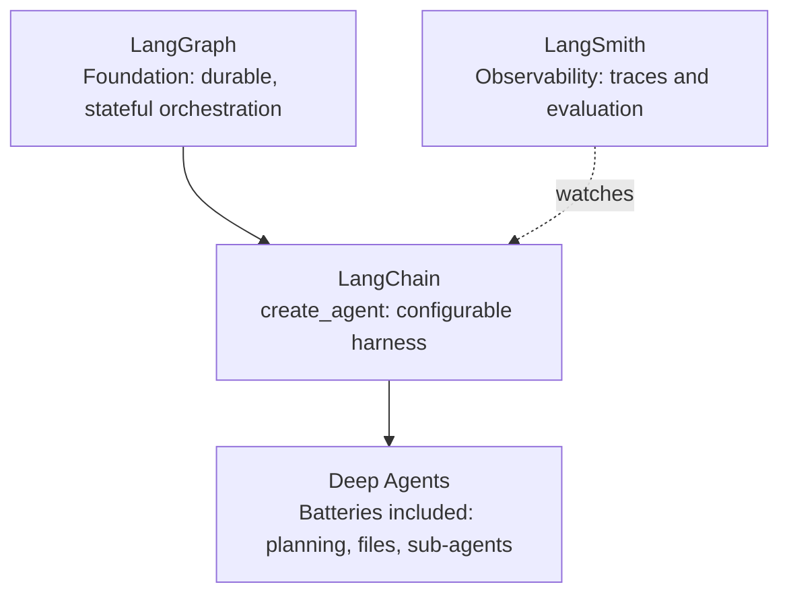

# The LangChain family and harness engineering
> lead: A map of the four "Lang" products, how the framework got here, and how to set up an environment where every later notebook just works.
meta: Class 07 | 18 to 19 July | 30 min read | Code: Weekend 04

## Why it matters

Most confusion later in the course comes from starting to code without a map. Interviewers ask "LangChain vs LangGraph?" constantly, and old tutorials (pre-v1) quietly break on current code. This chapter gives you the map, the timeline, and a working environment.

:::key The sentence to memorise
==An agent is a model calling tools in a loop until a task is complete. A harness is everything around that loop.==

Nearly everything later (RAG, memory, multi-agent, database agents) is a **different configuration of the harness around the same model**. The model does not change. What you give it access to, and the rules for using it, do.
:::

## Core ideas

### 1. Model, harness and "harness engineering"

:::analogy Engine, car and harness
The model is the engine. It has extraordinary power but cannot go anywhere alone. The harness (system prompt, tools, memory, middleware, guardrails) turns it into a car you can drive. Even Claude Code and ChatGPT are a brain wrapped in connectors, skills, memory and search.
:::

**Harness engineering** is a term gaining popularity for exactly this skill: wrapping a raw model with the right prompt, tools, middleware, guardrails and checkpoints so it becomes useful.

:::trap "I used a small model but expected the smartest agent"
The capability of the agent is capped by the brain you chose. A harness improves behaviour, but it cannot make a weak model reason like a flagship one.
:::

The components of an agent, as named in class:

| Part | Role |
| --- | --- |
| Model | The reasoning brain |
| Tools | What the agent may reach for |
| System prompt | How it should behave |
| Memory | What it remembers across turns |
| Context | Previous messages, documents |
| Sub-agents | Helpers it can delegate to |

`create_agent` officially exposes the model, tools, system prompt, structured output, invocation and streaming, and later the harness configuration (middleware). Each gets its own chapter.

### 2. The four "Lang" products

None of these compete. You do not pick one; you use as many as your project needs.



| Product | One-line job | Reach for it when |
| --- | --- | --- |
| **LangGraph** | Low-level orchestration: branching, loops, persistence, durable execution, human-in-the-loop | You need to wire every step yourself |
| **LangChain** | `create_agent`, a configurable harness built **on top of** LangGraph | You want to build agents quickly with a lot of control |
| **Deep Agents** | `create_deep_agent`: LangChain plus planning tools, a virtual file system and sub-agents | You want those pre-wired |
| **LangSmith** | Records a trace of every model call, tool call and decision | You need to know what an agent actually did |

:::key LangGraph is underneath, not on top
LangChain's docs say its agents are built on LangGraph, so you get durable execution, human-in-the-loop support and persistence without learning LangGraph first. You are not avoiding LangGraph by using LangChain; you are standing on it.
:::

**Why start with LangChain, not Deep Agents?** Starting with Deep Agents is like starting a chef's job knowing only how to order delivery. You get food but no control. The intended order is **LangChain, then LangGraph, then Deep Agents**, because Deep Agents becomes easy once the other two are solid.

:::trap LangFuse is not in the family
It shares the word "Lang" but is an independent, open-source observability platform.
:::

### 3. LangSmith: the flight's black box

With normal code, a stack trace and the source tell you what happened. An agent decides what to do **at runtime**, so the code only describes what it *could* do. A **trace** is the timestamped record of what it *did*: each model call, tool call and middleware step.

Two environment variables turn it on:

```bash
LANGSMITH_TRACING=true
LANGSMITH_API_KEY=your-key-here
```

The reference notebook notes a free Developer tier of 5,000 traces a month as of 2026, plenty for learning. LangSmith also works with OpenTelemetry, so it can watch more than LangChain.

### 4. The timeline

| Date | What happened |
| --- | --- |
| Oct 2022 | LangChain launches with LLM abstractions and **chains**: fixed sequences like retrieve, then generate |
| Dec 2022 | First general-purpose agents, based on the **ReAct** paper (Reason plus Act). The model emitted JSON for a tool call and LangChain parsed it by hand |
| Feb 2024 | **LangGraph** released: streaming, durable execution, short-term memory, human-in-the-loop |
| Oct 2024 | LangGraph becomes the preferred way beyond a single call; most old chains and agents deprecated |
| 20 Oct 2025 | **LangChain v1.0**: one unified agent abstraction on top of LangGraph |
| 15 Mar 2026 | **Deep Agents** released |

:::repo Small date difference between sources
The class transcript places the ReAct agent in "late 2022 or 2023". The reference notebook says Dec 2022. Treat it as end of 2022.
:::

:::trap Old tutorials: AgentExecutor and initialize_agent
These are the pre-v1 approach. Importing `AgentExecutor` straight from `langchain` now raises an `ImportError`, because that code deliberately lives in a separate **`langchain-classic`** package. Seeing it in a 2026 tutorial is a signal the content is outdated, not that your setup is broken.
:::

:::analogy Low-level vs high-level
A low-level layer gives more control and more effort, like having everything on your own desk. A high-level layer hides detail for speed. LangGraph is low-level; LangChain is higher; Deep Agents is higher still.
:::

## Setting up the environment

### Colab vs VS Code

| | Google Colab | VS Code (local) |
| --- | --- | --- |
| Best for | Learning line by line | Real projects |
| Setup | None, free, works on weak laptops | Proper environment, many files, frontend plus backend |
| Keys | Built-in **Secrets** manager (key icon) | `.env` file |

Notebooks are also on GitHub. The instructor's advice: watch live, then practise from the recording rather than coding along. Class also used **Pomodoro** blocks: 15 to 20 minutes of focus, then a short break.

### Local project

```bash
uv init langchain-course
cd langchain-course
uv add langchain langchain-openai langchain-community langgraph python-dotenv
uv add langchain-mcp-adapters langchain-chroma chromadb pypdf   # needed in later modules
```

The second line installs packages for MCP and retrieval that you will need later, so you do not stop mid-course.

Create `.env` with `OPENAI_API_KEY=...` and make sure `.gitignore` contains `.env`. Then use this check at the top of every notebook:

```python
import os
from dotenv import load_dotenv

load_dotenv()                                  # read .env into the environment
assert os.environ.get("OPENAI_API_KEY"), "Key missing: check .env"
print(os.environ["OPENAI_API_KEY"][:5])        # first 5 characters only, never the whole key
```

:::tip If you get an authentication error
Two causes cover most cases. (1) `.env` is not in the folder you are running from. (2) You created `.env` **after** starting the notebook session, so restart the kernel so `load_dotenv()` sees it. A third one seen live: VS Code had the wrong Python interpreter selected. Pick the project's own `.venv`.
:::

### The sanity check

If this runs in both Colab and VS Code, your whole environment is wired correctly:

```python
from langchain.agents import create_agent

def get_weather(city: str) -> str:
    """Get weather for a given city."""
    return f"It's always sunny in {city}!"

agent = create_agent(
    model="openai:gpt-5.5",       # any model you have access to
    tools=[get_weather],
    system_prompt="You are a helpful assistant.",
)
agent.invoke({"messages": [{"role": "user", "content": "Weather in SF?"}]})
```

### How LangChain finds your key

LangChain expects the **exact standard variable name** per provider (`OPENAI_API_KEY`, `ANTHROPIC_API_KEY`, and so on). Renaming it (say `OPENAI_API_KEY_2`) or switching provider without the matching variable gives an authentication error. This was shown live by switching to a Claude model without setting `ANTHROPIC_API_KEY`.

## Your first model call

`init_chat_model` is the universal entry point. The string is `"provider:model"`, and the rest of your code does not change when you swap it.

```python
from langchain.chat_models import init_chat_model

model = init_chat_model("openai:gpt-5.5")
response = model.invoke("Tell me what LangChain is")
print(response.content)
```

Without LangChain you would write different code for OpenAI, Claude, Groq and OpenRouter. LangChain gives one interface. Other frameworks copy the same idea: CrewAI's docs also say "give me any LLM", so learning it here pays off everywhere.

**Models differ in capability.** Each supports a different mix of tool calling, structured output, multimodality (text plus images) and reasoning. Check the capability sheet of the model you plan to use.

### Messages: why a list, not one string

You could send one long string with instructions and the question mixed. The model has no reliable way to tell which part is the instruction. A **message list** labels each part:

| Message | Meaning |
| --- | --- |
| `SystemMessage` | Instructions for behaviour: the "director's note" |
| `HumanMessage` | What the user said |
| `AIMessage` | What the model said earlier |
| `ToolMessage` | A tool's result, sent back to the model |

```python
from langchain_core.messages import SystemMessage, HumanMessage

messages = [
    SystemMessage(content="You are a pirate. Answer everything in pirate language."),
    HumanMessage(content="What is the capital of France?"),
]
print(model.invoke(messages).content)     # a pirate-flavoured answer
```

The pirate instruction never mixes with the question. That separation is the whole point. `ChatModel` does **not** manage or sort chat history for you; that is still on you.

### Open vs closed source

| | Open source | Closed source |
| --- | --- | --- |
| Weights available | Yes: self-host, fine-tune | No |
| Where it runs | Your own infrastructure | The provider's API only |
| Cost | Often free, plus your hardware | Pay per use |
| Examples | GPT-OSS releases | Most flagship GPT and Claude models |

<!-- docs-add -->
## From the docs: what a harness is made of

*Added from the LangChain agents page (read 30 Oct 2026).*

The docs define an agent as **a model calling tools in a loop until the task is complete**, and the **harness** as everything around that loop: the prompt, the tools and the middleware. Its job is to get the model **the right context at the right time**.

The agents page groups harness middleware like this, which is a good mental map for Chapters 7 to 9:

| Concern | Middleware named on the page |
| --- | --- |
| Execution environment | `FilesystemMiddleware` (from `deepagents`) with a backend such as `StateBackend` |
| Context management | `SummarizationMiddleware`, `MemoryMiddleware`, `SkillsMiddleware` |
| Planning and delegation | `TodoListMiddleware`, `SubAgentMiddleware` (sub-agents with isolated context) |
| Fault tolerance | `ModelRetryMiddleware`, `ToolRetryMiddleware` |
| Guardrails | `PIIMiddleware` |
| Steering (human in the loop) | `HumanInTheLoopMiddleware` |

`create_deep_agent` pre-assembles a harness (filesystem, summarisation, sub-agents, prompt caching) for long-running tasks. Managed Deep Agents builds on `create_agent` with planning, file tools, sub-agents and memory preassembled.
<!-- /docs-add -->

## Common mistakes

| Mistake | Symptom | Fix |
| --- | --- | --- |
| Following pre-v1 tutorials | `ImportError` on `AgentExecutor` | Use `create_agent`; only install `langchain-classic` deliberately |
| `.env` created after the kernel started | Auth error | Restart the kernel |
| Wrong interpreter in VS Code | `.env` not read, packages missing | Select the project's `.venv` |
| Renamed API key variable | Auth error | Use the provider's standard name |
| Putting instructions in a user string | Inconsistent behaviour | Use `SystemMessage` |
| Expecting a small model to act like a flagship | Weak reasoning | Choose the model for the job |
| Mixing up LangFuse and LangChain | Wrong tool for the task | LangFuse is a separate observability tool |

## Hands-on lab

1. Create the project and install the packages above.
2. Run the key check, then the sanity check, in both Colab and VS Code.
3. Switch the model string to a second provider and watch the auth error when its key is missing. Fix it.
4. Send the pirate messages. Then move the instruction into the user message and compare.
5. Draw the family diagram from memory and say what each box does.

## Interview corner

:::pitch
LangGraph is the low-level engine. LangChain's `create_agent` is a configurable harness built on top of it. Deep Agents adds planning, a file system and sub-agents on top of that. LangSmith is separate: it traces what an agent actually did. An agent is a model calling tools in a loop; the harness is everything around the loop.
:::

### Basics

:::qa Define agent and harness.
An agent is a model calling tools in a loop until a task is complete. The harness is everything around that loop: system prompt, tools, middleware, memory and guardrails. The model supplies reasoning; the harness supplies capability and rules.
:::

:::qa Is LangChain built on LangGraph, or the other way round?
LangChain is built **on top of** LangGraph. A common wrong answer is that LangGraph sits on LangChain. LangChain's agents get durable execution, persistence and human-in-the-loop support from LangGraph.
:::

:::qa What is LangSmith and why do agents need it?
An observability and evaluation platform. Agents decide at runtime, so reading code does not tell you what happened on one run. A trace records every model call, tool call and decision in order. It is enabled with `LANGSMITH_TRACING=true` and an API key.
:::

:::qa Is LangFuse part of LangChain?
No. It is an independent open-source observability platform that shares the name prefix.
:::

### Intermediate

:::qa Why learn LangChain before Deep Agents?
Deep Agents is batteries included with little control, and it is built on LangChain agents. If you only know the pre-built version, you cannot customise or debug it. The suggested order is LangChain, LangGraph, then Deep Agents.
:::

:::qa A 2026 tutorial uses `AgentExecutor`. What does that tell you?
It targets pre-v1 LangChain. v1.0 (Oct 2025) unified everything into `create_agent`, and the old classes now live in the separate `langchain-classic` package, so importing them from `langchain` raises `ImportError`.
:::

:::qa How does LangChain find an API key?
From the provider's standard environment variable (for example `OPENAI_API_KEY`). A different name, or a missing variable after switching provider, gives an authentication error.
:::

:::qa Why use a message list instead of one string?
So the model can tell instructions (`SystemMessage`) from user input (`HumanMessage`) and earlier replies (`AIMessage`). It is also the format tool results use (`ToolMessage`).
:::

### Tricky

:::qa Does the framework make a weak model smarter?
No. The harness shapes behaviour and adds tools, but reasoning quality is limited by the model. Choose the model for the task and budget.
:::

:::qa Why might a notebook fail on an auth error even though `.env` has the key?
Usually the `.env` is in a different folder, was created after the kernel started (restart it), or the wrong interpreter is selected. Only after ruling those out would I suspect the key itself.
:::

:::qa Open vs closed models: when would you choose each?
Open weights when I need self-hosting, privacy, fine-tuning or no per-call cost, accepting I run the hardware. Closed models when I want top quality with no infrastructure, accepting per-use pricing and no fine-tuning.
:::

### From the course's interview question bank

:::qa What is the ReAct pattern?
Reasoning plus Acting. The model alternates a **thought** (reasoning), an **action** (usually a tool call) and an **observation** (reading the result), and repeats until it gives a final answer instead of another action. It is the ancestor of today's agentic loop.
:::

:::qa Do you know a real security vulnerability in langchain-core?
Yes: **CVE-2025-68664**, disclosed December 2025, rated CVSS 9.3. It was a serialisation injection in `dumps()` and `dumpd()`: they failed to escape the reserved internal key `"lc"` in free-form dictionaries, so attacker-controlled data (reachable through prompt injection into fields such as model response metadata) could be treated as a trusted internal object when deserialised, potentially exposing secrets from environment variables. It is patched in `langchain-core` 0.3.81 and 1.2.5 or later. The interviewer is checking that you **track security advisories** for the frameworks you ship.
:::

## Quick revision

- [ ] I can quote the agent and harness definitions
- [ ] I can draw LangGraph, LangChain, Deep Agents and LangSmith and say how they relate
- [ ] I know the timeline from Oct 2022 to Mar 2026 and why `AgentExecutor` is outdated
- [ ] I can set up the project, load `.env` and run the sanity check
- [ ] I can explain the four message types
- [ ] I can compare open and closed models

## Sources and further reading

- [Class 07 full notes]({{src:classes_transcription_summary/07 - 18 Jul - LangChain Family & Harness Engineering.md}})
- [Class 07 short summary]({{src:classes_summary/07 - 18 Jul - LangChain Family & Harness Engineering.md}})
- [Landscape reference notebook]({{src:Weekend 04 - 18-19 Jul/07-08 - 18-19 Jul - LangChain Family & the Model Layer/Notebook For Reference/01_landscape_student_notes.ipynb}})
- [Environment, models and messages notebook]({{src:Weekend 04 - 18-19 Jul/07-08 - 18-19 Jul - LangChain Family & the Model Layer/Notebook For Reference/02_03_environment_models_messages_student_notes.ipynb}})
- [Class slides (Langchain.pdf)]({{src:Weekend 04 - 18-19 Jul/07-08 - 18-19 Jul - LangChain Family & the Model Layer/Langchain.pdf}})
- [Weekend 04 code folder]({{tree:Weekend 04 - 18-19 Jul/07-08 - 18-19 Jul - LangChain Family & the Model Layer}})
- [Researched LangChain interview questions (PDF)]({{src:Weekend 05 - 25-26 Jul/09-10 - 25-26 Jul - Structured Output & Tools (CineBot)/Assignment & Questions/LangChain_Interview_Questions_Researched.md.pdf}})
