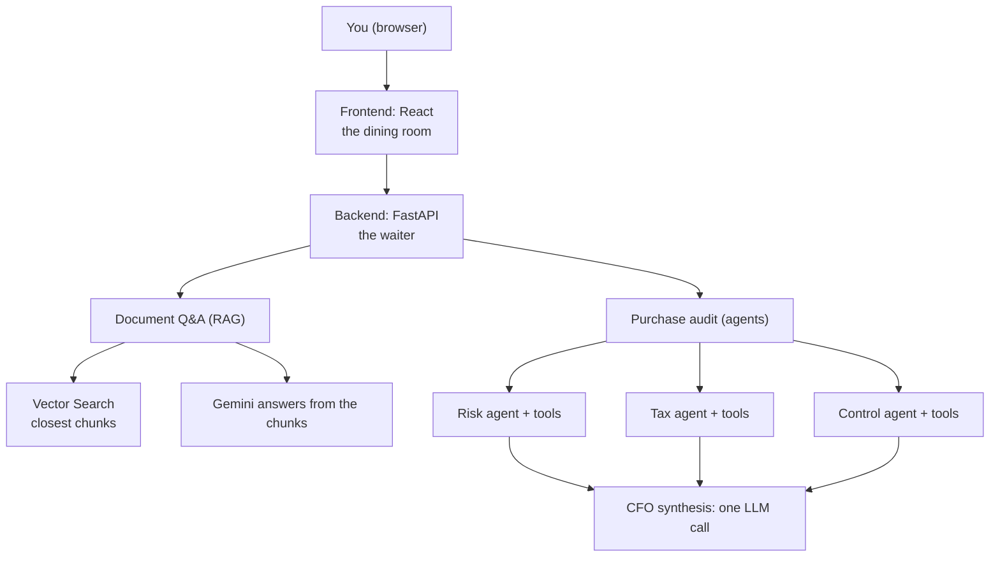

# Meridian AI: a full-stack project tour
> lead: A small web app that answers questions about your documents (RAG) and audits a purchase request with three specialist agents and a CFO memo. A tour of how the pieces fit, why the code is split, and how it deploys.
meta: Weekend 14 | Project, no class summary | 40 min read | Code: Weekend 14

:::repo This chapter comes from the project's own README and code
No class write-up exists for this weekend. It is built from the `meridian-ai-learner-main` folder: its README, `DEPLOY.md` and the backend source. The Oct 10 to 11 weekend folder holds only two links: the repo `mayank953/meridian-ai-learner` and a course site, `meridian-ai-course.netlify.app`. The project is **fictional**: the company, *Aldermoor Industries*, and its sample documents contain made-up data.
:::

## Why it matters

This is a capstone-style "put it all together" project: RAG, multiple agents with tools, an API, a front end, logging, tests, containers and cloud deployment. In an interview, being able to walk through **how a real system is laid out and why** matters as much as any single concept. It also contains two honest teaching points: the audit runs agents one after another (not in parallel), and its "checks" are done by an AI from general knowledge, so it is a demo and not a compliance tool.

:::key What it does
1. **Document Q&A (RAG).** Upload PDFs (policies, contracts, reports) and ask in plain English. Answers use **only** what is in the documents.
2. **Purchase audit (agents).** Paste a purchase request. Three specialist agents review it (risk, tax, accounting), and a final "CFO" step writes one short memo with a decision: **approved**, **conditional hold** or **rejected**.
:::

## Core ideas

### 1. The technologies, as a restaurant

| Technology | What it is | Restaurant analogy |
| --- | --- | --- |
| **React** (frontend) | The page you click on | The dining room, menu and buttons |
| **FastAPI** (Python) | Receives requests and returns answers | The **waiter** |
| **Pydantic** | Checks requests are filled in correctly | The order form |
| **LangChain** | Connects AI steps together | The recipe book and workflow |
| **Gemini** (Google's model) | Reads text, writes answers | The **chef** |
| **Embeddings** | Turn text into numbers that capture meaning | GPS coordinates for ideas: similar ideas sit close |
| **Vertex AI Vector Search** | Finds stored text closest in meaning to a question | A library catalogue organised by meaning |
| **RAG** | Find the right pages first, then answer from them | An **open-book exam** |
| **Agents and tools** | AI that decides to run small programs to get facts | A chef who uses a scale and a thermometer |
| **Cloud Storage** | Keeps files in Google Cloud | A filing cabinet |
| **Docker** | Packs the app and its needs into one box | A lunchbox that opens the same anywhere |
| **Cloud Run** | Runs that box on the internet, only when someone visits | A pop-up shop |
| **Secret Manager** | Stores keys and passwords safely | A safe |
| **GitHub Actions** | Builds and delivers the app automatically | A delivery robot |
| **Logging** (structlog) | The app writes down what it does | The kitchen diary |

### 2. How it fits together



**Asking a question.** The page sends it to the backend, which turns it into an embedding. Vector Search returns the **three** stored pieces closest to it. The backend gives Gemini those pieces and the question ("answer using only this"), and the answer goes back to the page.

**Running an audit.** You submit a request. The risk, tax and control agents each read it, decide which tools to use (for example "check the exchange rate") and write a short report. A final step reads the three reports and writes one memo with a decision.

### 3. Why the code is split into many files

A ten-line experiment can live in one file. A real app cannot: it is a kitchen where everyone cooks on one table. The rule is **one file, one job**.

| Problem with one big file | How splitting helps |
| --- | --- |
| Hard to find things | The name tells you where to look |
| Changing one thing breaks another | A change stays inside its own file |
| Hard to test (needs the internet to start) | Parts can be tested alone |
| Copy-pasted code drifts | One function written once and reused |
| Many people editing one file clash | People work in different files |
| Intimidating to read | Read one small file at a time |

```
backend/
  api/        the "waiter": main.py (creates the app), endpoints.py (web addresses), schemas.py (request shapes)
  rag/        llm.py, embeddings.py, vector_store.py, data_ingestion.py, retrieval.py
  agent/      tools.py (five tools), prompts.py (instructions per agent), agents.py (creates and runs agents)
  config/     settings.py (keys and names from outside the code)
  logger/     custom_logger.py (JSON log lines)
  tests/      automatic checks that need no accounts
frontend/     React + TypeScript; src/lib/api.ts is the only file that talks to the backend
sample_docs/  four made-up PDFs
.github/workflows/deploy.yml   builds and deploys
Dockerfile, requirements.txt, .env.example, DEPLOY.md
```

:::key The dependency rule
Each package depends only on the ones below it: **`api` depends on `rag` and `agent`, which depend on `config` and `logger`.** The web layer does not know how AI works. The AI code does not know what a web address is. This is a clean layered architecture you can name in an interview.
:::

### 4. The RAG side

**Ingestion:** PDF, then pages, then chunks of about 1,000 characters, then embeddings, then Vector Search. Neighbouring chunks share **100 characters** (`CHUNK_OVERLAP = 100`) so sentences are not cut off. Each chunk keeps its `source` in metadata so an answer can be traced to a file.

```python
splitter = RecursiveCharacterTextSplitter(chunk_size=CHUNK_SIZE, chunk_overlap=CHUNK_OVERLAP)
```

**Retrieval:** three strategies, chosen by a parameter:

| Strategy | What it does |
| --- | --- |
| `similarity` (default) | The **3** chunks closest in meaning to the question. Fast |
| `multiquery` | Gemini **rewrites the question several ways** and merges the results |
| `contextual` | Fetch **10** chunks, then Gemini **trims each** to the relevant part |

```python
rag_chain = create_retrieval_chain(build_retriever(retriever_type), question_answer_chain)
```

The system prompt says: use the retrieved context, and **if you do not know based on the context, say so**. That is the guard against making things up. Try it: ask something not in the documents and the answer should say it does not know.

:::repo The retrieval code imports from `langchain_classic`
`retrieval.py` imports chains and retrievers from `langchain_classic` (the legacy package from Chapter 2) while the agents use the current `create_agent`. The project mixes old and new, which is realistic. Know which parts are Classic when you read it.
:::

Embedding settings come from configuration: the embedding model must output **768 dimensions** to match the Vector Search index. A mismatch is a classic deployment bug.

:::beyond Retriever search types in LangChain
Any vector store becomes a retriever with `.as_retriever()`, which accepts a `search_type`: `"similarity"` (closest by meaning), `"mmr"` (maximal marginal relevance: relevant **and** diverse, so you do not get three near-duplicate chunks) or `"similarity_score_threshold"` (only chunks above a relevance score), plus `search_kwargs` such as `k`. Because every vector store implements the same interface, swapping the database is a one-line change. Source: the course's LangChain interview question PDF.
:::

### 5. The audit side

```python
class ProcurementSupervisor:
    def __init__(self):
        self.risk_agent = create_specialized_agent(
            [check_sanctions_list, get_vendor_credit_score], RISK_AGENT_PROMPT)
        self.tax_agent = create_specialized_agent(
            [calculate_cross_border_tax, validate_fx_hedge], TAX_AGENT_PROMPT)
        self.control_agent = create_specialized_agent(
            [categorize_expense], CONTROL_AGENT_PROMPT)

    def run_audit(self, request: str) -> dict:
        risk_result = self._invoke_agent(self.risk_agent, request)       # phase 1
        tax_result = self._invoke_agent(self.tax_agent, request)         # phase 2
        control_result = self._invoke_agent(self.control_agent, request) # phase 3
        cfo_memo = self.llm.invoke(SYNTHESIS_PROMPT_TEMPLATE.format(...)) # phase 4, no tools
        return {"risk_result": ..., "tax_result": ..., "control_result": ..., "cfo_memo": ...}
```

| Agent | Tools | What it checks |
| --- | --- | --- |
| **Risk and compliance** | `check_sanctions_list`, `get_vendor_credit_score` | Whether the vendor is on restricted lists; creditworthiness |
| **Tax and treasury** | `calculate_cross_border_tax`, `validate_fx_hedge` | VAT or GST and import duties; whether the FX rate is within a 5% variance of market |
| **Financial control** | `categorize_expense` | Capital (CapEx) or operational (OpEx) under accounting standards |
| **CFO synthesis** | None (one plain LLM call) | Reads the three reports and writes one memo with a decision |

:::trap This is not the subagents pattern, and not parallel
Chapter 19's patterns do not quite describe this. The supervisor is **plain Python** that runs three agents **one after another** and then makes one LLM call. Each specialist is a `create_agent` with its own prompt and tools. It is a fixed pipeline (closer to a custom workflow) rather than a supervisor agent deciding dynamically. Because the three checks are independent, a **router with parallel fan-out** would be faster, and that is a good improvement to propose in an interview.
:::

:::note Honest limits, stated in the README
The audit's checks are done by the AI from **general knowledge**. Only the exchange-rate check uses a live data source. It is a demo of how such a system is built, **not** a real compliance tool. Answers change wording each run, but the layout stays the same. `create_agent` is built on LangGraph, but the project never writes graph code.
:::

The audit endpoint is `POST /api/agent/audit` with a body such as `{"request_text": "Purchase of 200 PLC controllers from Takumi Controls Europe B.V. (Netherlands). Total 480,000 EUR. Origin JP, destination DE. FX rate quoted: 1 EUR = 163.5 JPY."}`. It returns four texts: the risk, tax and control reports and the CFO memo, and can take a minute or more because several AI calls happen.

### 6. Running it

```bash
git clone https://github.com/mayank953/meridian-ai-learner.git
cd meridian-ai-learner
python3.12 -m venv .venv && source .venv/bin/activate
pip install -r requirements-dev.txt
cp .env.example .env            # set GOOGLE_API_KEY to your Gemini key
uvicorn api.main:app --app-dir backend --reload --port 8080
```

Then open `http://localhost:8080/docs` (FastAPI's automatic page). Try `GET /api/health` (returns `{"status": "ok"}`), then `POST /api/agent/audit`. For the web page, run `npm install` and `npm run dev` in `frontend/` and open `http://localhost:3000`. **Run every command from the project's main folder**, because the app looks for `.env` where you start it.

**Document Q&A needs Google Cloud.** Upload the `sample_docs/` PDFs and ask: total revenue in FY2024 (about **EUR 2.84 billion**), payment terms for servo motor suppliers (Net-45), customs duty on PLC controllers from Japan (2.2%), depreciation of filling line equipment (10 years). Then ask something not in the documents to check it admits it does not know.

### 7. Deploying to Google Cloud

You do four things: make a Google Cloud project, make a **robot (service) account** GitHub can use, give GitHub the robot's key and your Gemini key, and press **Run workflow**. The workflow `.github/workflows/deploy.yml` creates everything with `gcloud` (database, storage, server) and publishes the app: no manual setup.

| Service | How you are charged |
| --- | --- |
| **Vector Search** | **By the hour while running, even if unused.** The main cost |
| Cloud Run | Only when used. Light use is usually inside the free allowance |
| Cloud Storage, Cloud Build, Secret Manager | A few cents or free allowances |
| Gemini API | A free tier exists, and free-tier content may be used to improve products, so use only the sample documents |

:::trap Vector Search bills while idle
The setup script does not choose a machine size or replica count. Google's documentation says replicas default to **2**, so the hourly cost can be higher than one small machine. **Do your cloud work in one sitting and switch the database off when you finish.** Recreating it takes 30 to 45 minutes.
:::

- **The $300 free credit:** new customers get $300 for 90 days, need a card (a temporary hold, not a charge), and are not charged automatically at the end. The trial ends at whichever comes first: 90 days or $300. After a 30-day grace period, trial resources are **deleted**. Only new customers qualify, and some generative-AI services are restricted on trial accounts.
- **Set a budget alert first.** It emails you as spending grows but does **not** stop it.
- The chat model uses your Gemini key, so trial limits do not affect it; the **embedding** step can be rate-limited.

### 8. Tests, logging and settings

- **Tests need no accounts**, so the project can be verified without cloud credentials (`backend/tests`, `conftest.py`).
- **Structured logging** writes JSON log lines (`structlog`): "the kitchen's diary". The audit logs each phase start and result, which is how you trace a slow or wrong audit.
- **Settings** are read from outside the code via a `Settings` class with environment variable aliases (for example `VERTEX_LLM_MODEL_NAME` and `VERTEX_EMBEDDING_MODEL_NAME`). Keys live in `.env` and Secret Manager, never in Git, as in Chapter 1.

<!-- sites-add -->
## The Meridian slides: a map of all 40 chapters

*Added from the instructor's course-slides site, `meridian-ai-course.netlify.app` (read 30 Oct 2026: the module and chapter list only, not the individual slides, about 600 in total). It builds a procurement assistant for a fictional manufacturer, Aldermoor Industries, that answers from documents, audits a purchase with a team of agents, and runs on a laptop and in the cloud.*

| Module | Theme | Chapters |
| --- | --- | --- |
| 1 | The case (no code) | 1 Meet Aldermoor Industries; 2 Why this is a bigger problem than it looks; 3 What we are going to build; 4 The AI engineer's view; 5 The forward-deployed engineer's view |
| 2 | Set up from scratch | 6 What is in a project; 7 Your tools and the new project; 8 Packages and the environment; 9 The folder structure |
| 3 | The backbone | 10 Settings; 11 `config/settings.py` chunk by chunk; 12 Errors and logging |
| 4 | Document question and answer (RAG) | 13 RAG explained; 14 Types of RAG; 15 Embeddings, vector databases and frameworks; 16 Talking to Gemini and turning text into numbers; 17 Storing meaning and keeping the originals; 18 Ingestion; 19 Retrieval and the answer; 20 Lab: ask the four documents; 21 More RAG in code: HyDE, MMR, hybrid search, reranking, parent pages, decomposition |
| 5 | The audit team | 22 Agents with LangChain; 23 Tools; 24 Prompts are job descriptions; 25 Middleware; 26 The audit team; 27 Lab: three audits |
| 6 | The service and the screen | 28 An API with FastAPI; 29 Request shapes and routes; 30 The server; 31 Logging; 32 Tests; 33 The screen; 34 Run it all, locally |
| 7 | Ship it: Docker and Google Cloud | 35 Docker; 36 Google Cloud in plain words; 37 Prepare the cloud; 38 The robot account and its key; 39 GitHub and the first run; 40 Deploy it, explained |

Each slide ends with an "In short" line and commands sit under a "Do it" box with a Copy button. The site also has a page of software and download links.
<!-- /sites-add -->

<!-- repo2-add -->
## Update from the current Meridian learner repo

*Added from a fresh clone of `github.com/mayank953/meridian-ai-learner` (read 30 Oct 2026): its README, the 18-file `docs/` learner guide, and the backend code. This repo is **newer than the copy in the course folder** that the sections above were built from.*

:::trap What changed since the earlier copy
The current repo adds an **`APP_MODE`** switch (local or cloud), writes the RAG chain as a plain **LCEL pipeline** instead of `create_retrieval_chain` from `langchain-classic`, and puts a **middleware stack** around all three agents. Where the sections above describe `create_retrieval_chain` or have no middleware, the current repo differs.
:::

### The four scenarios to try

All work with the four sample PDFs in `sample_docs/`.

| Scenario | Do this | Expect | Why it matters |
| --- | --- | --- | --- |
| A. A policy question | Ask for FY2024 revenue; also payment terms for servo-motor suppliers, duty on PLC controllers from Japan, depreciation of filling-line equipment | About EUR 2.84 billion; Net-45 for suppliers with a credit score of 75 or more; 2.2 percent duty; 10 years straight line | The answer comes from **your documents**, not the model's memory |
| B. Not in the documents | Ask "Who won the 2018 World Cup?" | The app says it does not know | The prompt says to answer only from context; "I don't know" beats inventing |
| C. A normal audit | 200 PLC controllers, 480,000 EUR, a Netherlands supplier, made in Japan, `1 EUR = 163.5 JPY` | Cautious risk report for an unknown supplier, import VAT near 19 percent plus duty, CapEx needing a Department Head's sign-off (over EUR 250,000; over EUR 1,000,000 needs the CFO and Management Board), and a CFO memo | Three specialist reports feed one memo |
| D. A suspicious rate | Same request with `1 EUR = 190 JPY` | The tax report flags **FX ALERT** (more than 5 percent from market) and the memo becomes **CONDITIONAL HOLD** | The decision follows written rules, not mood |

### The CFO decision rules

The CFO step reads exact words in the three reports:

| Word found | Decision |
| --- | --- |
| `RED ALERT` | REJECTED |
| `FX ALERT` or `HOLD FOR TREASURY AUDIT` | CONDITIONAL HOLD |
| All `APPROVED` or `SUCCESS` | APPROVED TO PAY |

:::key Fixed layouts are a contract
The CFO rules depend on those keywords, so each agent prompt ends with an exact output layout and a rename must be made in both places. Each agent prompt has the same four parts: a role, responsibilities, a decision framework and an output format.
:::

### What the app does not do

| Limit | Consequence |
| --- | --- |
| Four of the five tools ask the model from general knowledge; only the exchange-rate check uses live data (and falls back to the model if the site is unreachable) | A real system needs sanctions, credit and tax services |
| Wording changes between runs | A person reviews important decisions |
| No sign-in and open access | Never upload private documents to a public demo |
| Upload history lives in memory | A database would keep it |
| Only text-based PDFs work | Scanned images need OCR first |

A tool that fails returns a `SYSTEM WARNING ... Manual review required` text instead of crashing the audit, so errors can hide inside text: read the logs.

### Local mode and cloud mode

One line in `.env` decides where data lives: `APP_MODE=local` (a Gemini API key only, Chroma on disk) or `APP_MODE=cloud` (Vertex AI Vector Search and Cloud Storage).

| Concern | Local | Cloud |
| --- | --- | --- |
| Embeddings | `gemini-embedding-001` (API key) | `text-embedding-005` (Vertex AI) |
| Vector database | Chroma in `.meridian/chroma` | Vertex AI Vector Search |
| Original PDFs | `.meridian/uploads/` | A Cloud Storage bucket |
| Log upload | Skipped | Copied to the bucket on shutdown |

Everything that needs storage asks one question (`settings.is_cloud`) and gets back a LangChain `VectorStore`, so ingestion and retrieval never know which database is behind them. This is the **strategy pattern**: same interface, swappable implementation. Both modes use 768-dimensional vectors, but the two databases are separate, so re-upload after switching. If `APP_MODE=cloud` but the index id is empty, the API answers **503** with the list of missing settings instead of a stack trace.

### The RAG chain as LCEL, and the three retrieval strategies

```python
def build_rag_chain(retriever_type: str = "similarity"):
    """question (str) -> answer (str), written as one LCEL pipeline."""
    return (
        {"context": build_retriever(retriever_type) | format_docs, "input": RunnablePassthrough()}
        | ANSWER_PROMPT
        | get_llm()
        | StrOutputParser()
    )
```

Each strategy is a plain function from a question to a list of documents:

| Choice in the screen | `retriever_type` | What it does | Trade-off |
| --- | --- | --- | --- |
| Normal | `similarity` | The 3 closest chunks (`k=3`) | Fastest |
| Multi-Query | `multiquery` | The model writes 3 alternative phrasings with **structured output**, searches with all 4, and merges while dropping duplicates | Finds more, slower |
| Contextual Compression | `contextual` | Fetches 10 chunks, then the model copies only the relevant sentences from each (or replies `NO_OUTPUT`, which drops the chunk) | Cleanest, slowest |

The legacy helpers moved to `langchain-classic` in LangChain v1, so the two advanced strategies are written out in a few lines each, which is also easier to explain in an interview.

### The middleware stack around the agents

```python
def build_agent_middleware() -> list[AgentMiddleware]:
    return [
        PIIMiddleware("email", strategy="redact", apply_to_input=True),
        PIIMiddleware("credit_card", strategy="mask", apply_to_input=True),
        ModelCallLimitMiddleware(run_limit=settings.agent_max_model_calls, exit_behavior="end"),
        ToolCallLimitMiddleware(run_limit=settings.agent_max_tool_calls, exit_behavior="continue"),
        ModelRetryMiddleware(max_retries=settings.agent_max_retries, initial_delay=1.0),
        ToolRetryMiddleware(max_retries=settings.agent_max_retries, initial_delay=0.5),
        log_tool_calls,
    ]
```

| Step | Middleware | Purpose here |
| --- | --- | --- |
| 1 | `PIIMiddleware` for e-mail (redact) and card numbers (mask) | Hide contact details before Gemini sees the request |
| 2 | `ModelCallLimitMiddleware` | End a phase after N model calls, a cost guard against loops |
| 3 | `ToolCallLimitMiddleware` | Cap tool calls per phase |
| 4 | `ModelRetryMiddleware` | Retry Gemini on transient errors (429 and 503) with backoff |
| 5 | `ToolRetryMiddleware` | Retry flaky tools such as the live exchange-rate API |
| 6 | `log_tool_calls` (custom) | One JSON log line per tool call: name, arguments, duration, result preview |

The custom one is about ten lines with `@wrap_tool_call`: log "started", call `handler(request)`, log "finished" with the duration and a 200-character preview, or log the error and re-raise. It is the same shape as the middleware in Chapters 7 and 9, so it makes a good interview example.

### Design decisions, and which are shortcuts

| Choice | Why | Shortcut or trade-off |
| --- | --- | --- |
| Three specialist agents, not one | Short, focused prompts and only the tools each needs | More model calls: slower and costlier |
| Plain-Python supervisor plus one summary call | Control flow you can read and debug | Less flexible than a self-organising graph |
| Agents run one after another | Easy to follow in logs | Could run in parallel |
| `temperature = 0` | Same question, nearly the same answer, easier to debug | |
| Models and connections created on first use (`lru_cache`) | The app starts, and `/api/health` and tests work, before any cloud setup | |
| `/api/status` never calls the cloud | It must work exactly when the cloud is misconfigured | |
| Tests use fake settings | Anyone can run them with no accounts | They test wiring, not answer quality |
| Docker with a two-stage build and `.dockerignore` hiding `.env` | Small image, secrets never packed | |
| `--max-instances 3` | Limits cost and abuse | Heavy traffic is limited |
| `--allow-unauthenticated`, a project-wide secret grant, a key file for the robot, and broad `editor` plus `projectIamAdmin` roles | Simplest setup | **Shortcuts**: production uses sign-in, narrow roles and keyless sign-in |

**A production version would add:** real data sources for sanctions, credit and tax; sign-in and tighter permissions; a database for history; automatic tests in the workflow; answer-quality measurement; real streamed progress for the audit; keyless sign-in from GitHub to Google Cloud.

| Layer | Used here | Alternatives the guide lists |
| --- | --- | --- |
| Cloud | Google Cloud | AWS, Azure |
| Web framework | FastAPI | Flask, Django, Express |
| Vector database | Vertex AI Vector Search | Postgres with pgvector, Pinecone, Chroma |
| Agents | LangChain `create_agent` | LangGraph, Google ADK, CrewAI, AutoGen |
| Hosting | Cloud Run | App Engine, Kubernetes, a virtual machine |
| Cloud setup | `gcloud` in GitHub Actions | Terraform (not used) |

### Costs and accounts

| Item | Detail |
| --- | --- |
| Gemini API key | Free tier with rate limits; free-tier content may be used by Google, so use only the sample documents |
| Google Cloud | $300 credit for new customers, 90 days, card required (a hold, not a charge) |
| **Vector Search** | Billed **by the hour while deployed, even with no users**; it is the main cost and the likeliest surprise bill. Delete it when you stop |
| Cloud Run, Storage, Cloud Build, Secret Manager | Usually inside free allowances |

### The most common errors

| You see | Do this |
| --- | --- |
| `ModuleNotFoundError: No module named 'api'` | Run from the main folder: `uvicorn api.main:app --app-dir backend --reload --port 8080` |
| Browser says blocked by CORS | The backend is not reachable; start it on port 8080 |
| `404 ... model ... not found` | The model was retired; set a current model name |
| `ImportError: cannot import name 'create_agent'` | An old `langchain`; reinstall requirements |
| Tool results say `LLM_ERROR` or `SYSTEM WARNING` | A tool's own model call failed (key, quota, model); check the logs |
| `DefaultCredentialsError` | `gcloud auth application-default login` |
| Searches return nothing right after upload | New data takes about a minute to become searchable |
| Container failed to listen on the port | The app crashed or ignored `$PORT`; read the Cloud Run logs |

Exercises from the guide: set `AGENT_MAX_TOOL_CALLS=1` and see which report changes; add `PIIMiddleware("url", strategy="redact")` and paste a link; write a `@before_model` hook that logs the message count; switch to `APP_MODE=cloud` with an empty index id and read the 503; add a sixth tool and give it to the Control agent; change the `75` credit threshold in the risk prompt.
### The frontend in one page

React with Vite, TypeScript, Tailwind and a shadcn-style component set (49 generated UI files you can ignore). The real code is small: `pages/Index.tsx` (95 lines) hosts four tabs, **System Status**, **Index Documents**, **RAG Q&A** and **Procurement Audit** (`components/*Tab.tsx`), and `lib/api.ts` (84 lines) is the only place that talks to the backend.

| Function in `lib/api.ts` | Calls |
| --- | --- |
| `uploadDocument(s)` | `POST /api/rag/upload` (reports `status`, `pages`, `chunks` or a skip reason per file) |
| `listUploads` | `GET /api/rag/uploads` |
| `askQuestion(query, retrieverType)` | `POST /api/rag/ask` |
| `triggerStoreIngestion` | `POST /api/rag/ingest` (import PDFs already in the bucket) |
| `runAudit(requestText)` | `POST /api/agent/audit` |
| `healthCheck`, `getSystemStatus` | `GET /api/health`, `GET /api/status` (returns `local` or `cloud`) |

The audit tab's progress steps run on **timers**; the real answer arrives only at the end, so "steps move but nothing arrives" means wait and read the terminal. Tests use Vitest and Playwright.
<!-- /repo2-add -->

<!-- slides-add -->
## What the Meridian slides teach, module by module

*Added from the instructor's course-slides site (read 30 Oct 2026). I read each slide's "In short" summary for modules 1 and 3 to 7 (about 480 of the 600 slides) and the full text of the advanced-RAG chapter; module 2 (project basics, tools, packages, folders) I read only as a chapter list. These are digests, not copies.*

### Module 1: the case and two engineering views

- **The rule:** nothing is paid until it is checked, always in the order risk, tax, control, then the CFO decides. Four pains: slow, rules hidden in PDFs, different answers from different people, and no record of why something was approved.
- **Why the obvious fixes fall short:** reminder emails speed things a little but fix nothing else; a shared folder makes rules findable but someone must still apply them; a general chatbot has never seen your documents and cannot check a sanctions list. The mental model: an AI model alone is a brilliant new hire on day one, smart but with no files and no phone. Fix one is **retrieval** (give it the documents); fix two is **tools** (give it the phone).
- **The AI engineer's route** (six steps): the problem, split it into jobs, one tool per job, build the smallest thing first, verify against known answers, watch time, cost and mistakes. Start with the problem as one sentence for the finance director, not with the model. **One giant prompt** is the classic mistake: hard to test, costly, shows no source. Use **ordinary code for anything exact** (the 5 percent exchange-rate comparison, removing e-mail addresses) and the model for judgement. AI work always looks good even when wrong, so check with automated tests (17 here, running in seconds with no key because the model is replaced by a stand-in) and by reading real outputs. An audit took roughly 70 to 150 seconds, so cap calls.
- **The forward-deployed engineer's route** (six steps): observe, measure, roles, connect, pilot, hand over. Start with the people (sit with a buyer and ask what they did yesterday), **measure the baseline first** (days from request to payment, hand-offs, requests sent back) so "it feels faster" becomes "it took X days and now takes Y", decide where the system prepares and where people decide, and find where the real information lives (here the documents and a live exchange rate are real, sanctions, tax tables and credit data are simulated). In testing the tax tool said customs duty on the Japanese controllers was zero while the company's tariff document says 2.2 percent: **take disagreements to the owner of the rule, do not pick one**. Start narrow (one category, one team), work inside the customer's privacy and access rules, make it trusted by logging every tool call, and leave the team able to run and change it.
- **Two lenses:** the AI engineer asks "does it work and can we prove it"; the forward-deployed engineer asks "will people use it and trust it".

### Module 3: the backbone (settings, errors, logging)

- **Three ways hard-coded values hurt:** a key typed into a Python file is public for good once pushed; a model name typed everywhere is a pain to change; and secrets and settings are mixed. The fix is environment variables, held in a `.env` that Git ignores, with a `.env.example` template.
- **`config/settings.py` in eight chunks:** `BaseSettings` reads the environment and `.env`; each setting has a type and default; wrong values are refused with a clear error; `app_mode` is the local or cloud switch; `app_env` has an alias (`ENVIRONMENT` in `.env`); a `missing_cloud_settings` helper lists the empty cloud settings; and a small block sets Google credentials from a key file only on a laptop (on Cloud Run nothing is needed).
- **Custom errors:** `MeridianError` is the base class; `ConfigurationError` becomes HTTP 503 and `IngestionError` becomes 422. The user should read one sentence saying what is wrong and what to do, not a stack trace.
- **Structured logging with `structlog`:** a JSON line with fields beats a sentence. The only custom piece is `add_severity`, a processor that copies the level in upper case (Google's log viewer uses it). A console handler and a file handler write the same line; one shared `GLOBAL_LOGGER` is imported everywhere.

### Module 4: document Q&A (RAG), chapter by chapter

- **Ch 13, RAG explained:** the model cannot know your documents; RAG is look up, then answer. Two stages: index once (read, chunk, embed, store), then per question (embed the question, find the closest chunks, prompt, answer). Keyword search misses what meaning search finds (for "who has to approve a very expensive order" they share no useful word). A "meaning map" shows 22 sentences as dots. Eight things go wrong, and a confident wrong answer usually means the right chunk was not retrieved.
- **Ch 14, the types of RAG:** basic RAG hurts when the words differ, the answer is split across chunks, or the right chunk is not first. Improve it **before** the search (change the question), **during** (change what is searched or how), **after** (clean the results) or **beyond** it. The site compares **thirteen variants** (I saw these among them: multi-query, contextual compression, HyDE, query decomposition, follow-up rewrite, hybrid search and reranking) and names four bigger ideas, of which I saw three: corrective RAG grades the retrieved chunks and tries again if they are poor, agentic RAG lets an agent decide whether, what and how often to search, and graph RAG works from a graph of the documents. Which first: right chunk found but not first, try reranking; users phrase things differently, try multi-query or HyDE; several-part questions, decomposition. Meridian uses three: similarity, multiquery and contextual (first-run times 7.1, 12.0 and 9.7 seconds).
- **Ch 15, the tools behind RAG:** a RAG system has **eight parts** (parse, chunk, embed, store, retrieve, rerank, generate, evaluate), each a decision. For embeddings check dimensions (768 here), languages, input length, hosted or open, and the rule that **one model must index and search**. Choosing a vector database: how many vectors, do you already run Postgres or Elasticsearch, filtering, managed or self-run, cost.
- **Ch 16, Gemini and embeddings:** one shared model connection, created on first use with `lru_cache`. `extract_text` joins Gemini's content blocks because a reply may be a **list of blocks**. Real closeness scores sit in a narrow band (0.85 for the right sentence against 0.55 and 0.57 for the others), so unrelated is not zero. Numbers from two embedding models are like temperatures in two unknown units: they cannot be compared.
- **Ch 17, storing meaning:** a vector store keeps numbers, text and source, and survives a restart because Chroma writes to a folder. **Keep the originals**: a new embedding model, chunk size or bug fix means re-indexing everything. `basename` keeps only the file name so an uploaded name cannot write outside the folder.
- **Ch 18, ingestion:** three reasons to cut (a document is too big, one vector for a page describes everything and nothing, and a sentence can be lost). Chunk ids are a `sha1` of source, page and position, so **indexing the same file twice replaces rather than duplicates** (the count stays at one).
- **Ch 19, retrieval and the answer:** three strategies with one signature (question in, documents out) chosen from a dictionary, wrapped in `RunnableLambda`, then the whole chain in sixteen lines. Contextual compression runs `batch` over the chunks in parallel. Similarity is one model call, multi-query two, contextual one plus one per chunk.
- **Ch 20, the lab:** write the expected answers first, because a test without an expected answer is just a demo (EUR 2.84 billion, Net-45, 2.2 percent, 10 years, an honest refusal). All five matched in about 24 seconds. Ask the log, not memory: each question leaves a `RAG query received` line.
- **Ch 21, more RAG in code:** see the next section.

### Module 5: the audit team

- **Ch 22:** a chain is a path you write; in an agent the model chooses the path. A real message trail is human, AI (with a tool call as data, nothing has run yet), tool, AI: the loop turned once. LangChain is a family: `langchain-core` (messages, prompts, tools, runnables), `langchain` (`create_agent`, middleware) and `langgraph` (the runtime). Three narrow specialists with few tools each are easier to steer and test than one agent with five tools.
- **Ch 23, tools:** `_ask_llm` turns any failure into the text `LLM_ERROR`, so a tool never crashes the agent. The tax tool asks for **strict JSON**, strips markdown fences, parses with `json.loads` and fills missing keys with defaults. `validate_fx_hedge` asks a real exchange-rate API first, swallows failures on purpose, falls back to the model only if needed, and applies the **5 percent rule in code**, so it never varies (`FX ALERT` and `FX SUCCESS` are keywords). `categorize_expense` has a conservative fallback if Gemini is down. Four of the five tools use the model's memory, so the sanctions tool is a hint, not a screening.
- **Ch 24, prompts are job descriptions:** a four-part recipe (role, responsibilities, decision framework, output format). Sanctions come first because they are a hard blocker; credit is in three bands (75 or more low risk, 50 to 74 needs a deposit or letter of credit, below 50 needs prepayment and a guarantee or rejection). **The keywords are the contract:** `RED ALERT` is born in the sanctions tool, repeated in the Risk prompt and read by the CFO; the first matching rule wins, so `RED ALERT` beats a hold.
- **Ch 25, middleware:** four concerns (privacy, cost, resilience, observability). A request passes privacy, the model call limit, the model retry, then Gemini; a tool call passes retry, call limit, your logging, then the tool. The lab shows two agents with the same question: without the guard the model repeats the e-mail address because it received it, with the guard it can only repeat the placeholder. An agent allowed one model call ends politely.
- **Ch 26, the supervisor:** four ingredients per agent (model, tools, prompt, middleware). `_invoke_agent` sends the request as the first human message and keeps only the last message. Design choices said plainly: sequential on purpose (simple code and a readable log, 67 to 96 seconds per audit), no graph code because `create_agent` hides LangGraph.
- **Ch 27, the lab:** predict first. Case one (20 servo motors, 38,000 euros, rate 176.5) is approved to pay; case two (200 controllers, 480,000 euros, 163.5 yen) is held because Tax saw a 7.8 percent FX variance and the credit score was 45; a third case is rejected on a sanctions hit. The FX check takes under a tenth of a second (a real API) while every model-backed tool takes 4 to 13 seconds. Say honestly that audits take 67 to 150 seconds, that the memo date is invented, and that anything over EUR 250,000 needs people.

### Module 6: the service and the screen

- **Ch 28, an API with FastAPI:** a request is a method, a path and sometimes a body; a reply is a status and a body (200 worked, 422 FastAPI refused the input). A request passes Uvicorn, Starlette, FastAPI, Pydantic, then your function. FastAPI writes documentation at `/docs` with a Try it out button.
- **Ch 29, schemas and routes:** refuse a bad request at the door, not halfway through a one-minute audit. Seven routes in four groups; the status route makes no Google call. Every route follows one pattern: validate, call the real code, return. The upload route keeps only the file name, skips non-PDFs, stores the original first and runs the slow indexing in a worker thread.
- **Ch 30, the server:** a `lifespan` function logs at start and flushes the log on shutdown; **CORS** is the browser asking first because the screen (port 3000) and the API (port 8080) are different origins. A missing setting is a 503, bad input a 422, a bug a 500. After `npm run build` the same server also serves the screen, and API paths never fall through to the web page.
- **Ch 31, logging:** three kinds of lines share the console (yours as JSON, Uvicorn's, libraries'); access lines go only to the console, so the file has no health-check lines. One command over the log answers "where did the minute go" by listing each tool's duration.
- **Ch 32, tests:** a test must not call Google (slow, costs money, differs each time). `conftest.py` sets a fake environment first so a real key can never leak into a test. 17 tests run in about five seconds. They prove the plumbing, not answer quality; retrieval quality was judged by eye and the frontend has only a smoke test.
- **Ch 33, the screen:** React, TypeScript, Vite, Tailwind and shadcn/ui. `api.ts` is the only file that talks to the server. Honest details: the **progress steps are three timers** (3, 6 and 9 seconds), so "Complete" can appear early; the Q&A card says "Verified Answer" but nothing verifies it; the status tab polls every five seconds, which is why its route makes no Google call.
- **Ch 34, run it all:** two terminals in development, or one server in single-server mode. It ends with seven honest limits: this shows how the pieces fit, it is not a compliance system.

### Module 7: Docker and Google Cloud

- **Ch 35, Docker:** a Dockerfile is the recipe, an image is the sealed box, a container is the running image, a registry holds images. **Two stages:** stage one uses 843 MB of tools to produce a 436 kB screen, and only the screen crosses into the final image. Copy the package list first so Docker's cache makes rebuilds almost instant (218 seconds first build). `.dockerignore` keeps `.env` out; settings arrive at start-up through an env file. Containers forget: a volume keeps data.
- **Ch 36, Google Cloud in plain words:** the $300 credit for 90 days. Cloud Run runs the container (deploy, visitors arrive, nobody arrives: scales to zero). Cloud Build makes the image. Cloud Storage keeps files, the embedding model makes 768 numbers, Vector Search finds closest meaning, Gemini writes. Secret Manager keeps the key, IAM decides who may do what (the roles here are broader than needed). A budget alert warns and never stops. **Remember:** a deployed Vector Search index bills by the hour whether or not anyone uses it.
- **Ch 37, prepare the cloud:** the Gemini key, an account, a project, billing with a budget alert, and `gcloud`. Project ids are 6 to 30 characters of lowercase letters, numbers and hyphens.
- **Ch 38, the robot account:** four ways of signing in (you, the robot with a key file, the robot keyless, the app itself). If key creation is refused, an organisation policy is blocking it: **do not change a company's security policy without permission**. The key is a password; keep it out of any Git folder.
- **Ch 39, GitHub and the first run:** three GitHub secrets (project id, the robot's key, the Gemini key). `deploy.yml` is five ideas: a name, triggers, shared settings, jobs of steps, and two kinds of step. Every push to main deploys; one run goes at a time. The first run is long because it builds the index and endpoint.
- **Ch 40, deploy explained:** six phases (switch on the cloud, make a place for files, build the search, hide the key, build the box, open the doors), the AWS and Azure equivalents, and what happens under load (instances fill, a queue forms, and 429 errors appear when the maximum instances are reached).

## The advanced-RAG lab: seven ways to change retrieval

*From Chapter 21 of the slides, read in full. It runs seven retrieval variants on the same 22 sentences from the four sample PDFs (ids P procurement, A accounting, R annual report, T tariff) and one question: **when do we pay servo motor suppliers?** The right answer is P1 (Net-45); T2 ("Servo motors: 2.7 percent" duty) is a tempting distraction; P2 and P3 are the same page but the wrong risk class.*

```python
def mmr(question, k=3):
    return store.max_marginal_relevance_search(question, k=k, fetch_k=10)

def hyde(question, k=3):
    reply = get_llm().invoke(f"Write one sentence that could answer this question: {question}")
    imagined = extract_text(reply.content)      # a plain string; reply.text breaks the embedding client
    return store.similarity_search(imagined, k=k)

def hybrid(question, k=3):
    by_meaning = [d.metadata["id"] for d in store.similarity_search(question, k=len(DOCS))]
    fused = {}
    for ranking in (keyword_rank(question), by_meaning):
        for position, id_ in enumerate(ranking):
            fused[id_] = fused.get(id_, 0) + 1 / (60 + position)   # reciprocal rank fusion
    return [BY_ID[i] for i in sorted(fused, key=fused.get, reverse=True)[:k]]

def rerank(question, k=3):
    candidates = store.similarity_search(question, k=8)            # over-fetch
    # ask the model to score each candidate 0-10 (structured output), keep the best k
```

| Variant | Idea | Cost | What came back (one run) |
| --- | --- | --- | --- |
| Basic | Plain similarity | None | P1, T2, P3: answer first, distractor and wrong class come along |
| MMR | Fetch 10, pick 3 that are relevant **and different** | None | P1, T2, T4: more variety, but here that meant another unrelated sentence |
| HyDE | Search with an **imagined answer** instead of the question | One model call | P1, P4, T2 (other runs: P1, P2, P3): varies between runs |
| Hybrid | Keyword ranking plus meaning ranking, merged with **reciprocal rank fusion** (60 is the usual damping constant; needs no weights) | None extra | T2, P1, P2: the word "servo" pushed the tariff line to first. Worst here |
| Rerank | Over-fetch 8, the model scores each 0 to 10, keep the best 3 | One model call | P1, P3, P2: removed T2 from the top three. **Best here** |
| Parent pages | Search small pieces, hand over the **whole page** | None | Whole procurement and tariff pages: answer with context, bigger prompt |
| Decomposition | Split a many-part question into simple ones, search each, merge by id | One model call | Found both parts: T2 (duty), P1 (terms), T1 |
| Follow-up rewrite | Turn "And for moderate risk?" into a question that stands alone | One model call | "What terms do moderate risk vendors get?" |

The keyword side is a home-made ranking (shared words weighted by rarity, i.e. inverse document frequency); real systems use BM25 or a search engine. Run on 10 Oct 2026 with gemini-3.8-flash and gemini-embedding-001; the page itself calls it **an illustration, not a benchmark**.

:::key What to take away
No variant wins everywhere (hybrid made this question worse, reranking made it better, and on another question it could flip), and each has a price: extra model calls, a second index, bigger prompts. Start with basic RAG, add one variant at a time, and **measure on your own list of real questions with known answers**. MMR and parent pages change what is returned (variety and context, no model cost); HyDE, decomposition and the follow-up rewrite fix the question (one extra call each); hybrid helps with exact terms; reranking removed the distraction in this test.
:::

Other numbers the slides record (verified by the instructor on 10 Oct 2026): the four sample PDFs are 645, 664, 845 and 950 characters and each becomes one chunk; on eight questions over the 22 sentences keyword search found a correct sentence in its top three for 2 and meaning search for 8 (the instructor's own judgement of "correct"); the chunk explorer is a JavaScript port of `RecursiveCharacterTextSplitter` that matched the library on 120 size and overlap combinations; the 2D meaning map keeps only about 26 percent of the variance, so the ranked list is the truth; library versions were langchain 1.2.11, langchain-core 1.2.18, langchain-chroma 1.1.0 and langchain-google-genai 4.2.1. Not tested: Windows PowerShell variants and cloud mode for any file.
<!-- /slides-add -->

## Common mistakes

| Mistake | Symptom | Fix |
| --- | --- | --- |
| Leaving Vector Search running | Surprise bill | Switch it off when done; set a budget alert |
| Embedding dimensions not matching the index | Indexing or search errors | Use a 768-dimension embedding model |
| Running commands from the wrong folder | `.env` not found | Run from the project's main folder |
| Treating the audit as real compliance | False confidence | It is a demo using general knowledge |
| Uploading private documents with a free Gemini key | Content may be used by Google | Use only the sample documents |
| One giant file | Untestable, tangled | One file, one job; respect the dependency rule |
| Running independent agents sequentially | Slow audits | A router with parallel fan-out |
| Putting keys in Git | Leaked credentials | `.env`, Secret Manager, `.env.example` |

## Hands-on lab

1. Run the backend locally and call `GET /api/health`, then `POST /api/agent/audit` with the sample request.
2. Read `agents.py` and draw the four phases.
3. Read `tools.py` and note which tool uses live data (the FX one) and which rely on the model's knowledge.
4. Read `retrieval.py` and explain the three retrievers.
5. If you have a Google Cloud account, deploy with the workflow, upload the sample PDFs, ask the four sample questions and one out-of-scope question, then **switch everything off**.
6. Rewrite the audit as a parallel router and measure the time.

## Interview corner

:::pitch
Meridian is a layered full-stack app: a React front end, a FastAPI backend, a RAG module (chunk, embed, store in Vector Search, retrieve three chunks, answer only from them) and an agent module with three tool-using specialists and a CFO synthesis step. Dependencies flow one way (api to rag and agent to config and logger), it logs structured JSON, tests run without cloud accounts, and it deploys through Docker, Cloud Run and GitHub Actions. I would make the independent audit checks run in parallel.
:::

### Basics

:::qa What does Meridian do?
Two things: answer questions about uploaded documents using RAG, and audit a purchase request with risk, tax and control agents plus a CFO memo that decides approved, conditional hold or rejected.
:::

:::qa What is RAG?
Find the right pages first, then answer from them: an open-book exam. Chunks of your documents are embedded, stored in a vector database and retrieved by meaning, then given to the model with the question.
:::

:::qa How does it stop the model making things up?
The prompt says to answer from the retrieved context and to say "I do not know" otherwise.
:::

### Intermediate

:::qa Why split the code into many files?
So each file has one job: findable, testable in isolation, no duplication and no clashes between people. The web layer does not know about AI, and the AI code does not know about web addresses.
:::

:::qa State the dependency rule.
`api` depends on `rag` and `agent`, which depend on `config` and `logger`. Dependencies go one way, downwards.
:::

:::qa What are the three retrieval strategies?
Similarity (top 3 by meaning), multi-query (the model rewrites the question several ways and merges results) and contextual (fetch 10, then compress each to the relevant part).
:::

:::qa Why do chunks overlap?
So a sentence cut at a chunk boundary still appears whole in the neighbouring chunk. Meridian uses chunks of about 1,000 characters with 100 characters of overlap.
:::

:::qa Which audit tools exist and what does each agent do?
Risk: `check_sanctions_list` and `get_vendor_credit_score`. Tax: `calculate_cross_border_tax` and `validate_fx_hedge`. Control: `categorize_expense`. A final CFO step (a plain LLM call) writes the memo.
:::

### Tricky

:::qa Which multi-agent pattern is the audit, and how would you improve it?
It is a fixed sequential pipeline (closer to a custom workflow) with plain Python orchestration, not a subagents supervisor. The three checks are independent, so a router that fans out in parallel then synthesises would cut latency.
:::

:::qa What is the biggest cost risk of deploying it?
Vector Search, billed by the hour even when idle, and possibly with two replicas by default. Do the work in one sitting, switch it off and set a budget alert (which does not stop spending).
:::

:::qa How trustworthy is the audit?
It is a demo. The checks come from the model's general knowledge, and only the FX check uses a live source. It must not be used as a real compliance tool.
:::

:::qa What breaks if the embedding model's output size differs from the index?
Indexing or search fails: the index expects 768 dimensions, so the embedding model must output 768.
:::

:::qa How is this project tested without cloud accounts?
The tests in `backend/tests` are written to need no accounts, using test fixtures instead of live services.
:::

## Quick revision

- [ ] I can describe the two features and the restaurant analogy
- [ ] I can draw the RAG flow and the audit flow
- [ ] I can state the one-file-one-job idea and the dependency rule
- [ ] I can name the chunk size, overlap and the three retrievers
- [ ] I can list the agents and their tools
- [ ] I can say why the audit is sequential and how to parallelise it
- [ ] I know the honest limits and the cost traps
- [ ] I can describe the deploy flow (Docker, Cloud Run, Secret Manager, GitHub Actions)

## Sources and further reading

- [Meridian project folder]({{tree:Weekend 14 - Oct 3 & Oct 4/meridian-ai-learner-main}})
- [Project README]({{src:Weekend 14 - Oct 3 & Oct 4/meridian-ai-learner-main/README.md}})
- [Deployment guide]({{src:Weekend 14 - Oct 3 & Oct 4/meridian-ai-learner-main/DEPLOY.md}})
- [`agents.py`]({{src:Weekend 14 - Oct 3 & Oct 4/meridian-ai-learner-main/backend/agent/agents.py}})
- [`tools.py`]({{src:Weekend 14 - Oct 3 & Oct 4/meridian-ai-learner-main/backend/agent/tools.py}})
- [`retrieval.py`]({{src:Weekend 14 - Oct 3 & Oct 4/meridian-ai-learner-main/backend/rag/retrieval.py}})
- [`data_ingestion.py`]({{src:Weekend 14 - Oct 3 & Oct 4/meridian-ai-learner-main/backend/rag/data_ingestion.py}})
- [Deploy workflow]({{src:Weekend 14 - Oct 3 & Oct 4/meridian-ai-learner-main/.github/workflows/deploy.yml}})
- [Weekend 15 links]({{src:Weekend 15 - Oct 10 & 11}})
- [Meridian repository](https://github.com/mayank953/meridian-ai-learner)
- [Meridian course site](https://meridian-ai-course.netlify.app)
