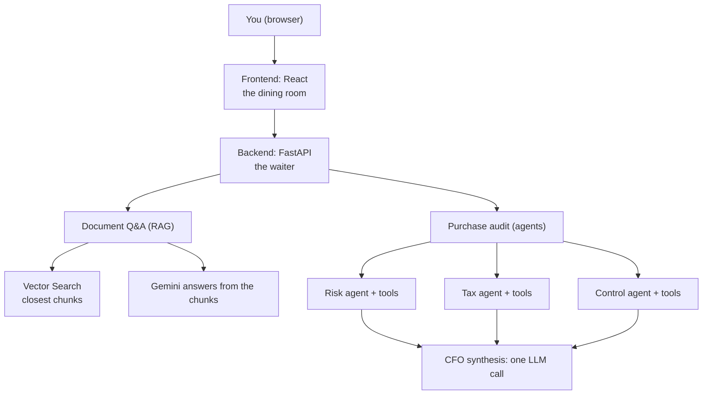

# Meridian AI: a full-stack project tour
> lead: A small web app that answers questions about your documents (RAG) and audits a purchase request with three specialist agents and a CFO memo. A tour of how the pieces fit, why the code is split, and how it deploys.
meta: Weekend 14 | Project, no class summary | 40 min read | Code: Weekend 14

:::repo This chapter comes from the project's own README and code
No class write-up exists for this weekend. It is built from the `meridian-ai-learner-main` folder: its README, `DEPLOY.md` and the backend source. The Oct 10 to 11 weekend folder holds only two links: the repo `mayank953/meridian-ai-learner` and a course site, `meridian-ai-course.netlify.app`. The project is **fictional**: the company, *Aldermoor Industries*, and its sample documents contain made-up data.
:::

## Why it matters

This is a capstone-style "put it all together" project: RAG, multiple agents with tools, an API, a front end, logging, tests, containers and cloud deployment. In an interview, being able to walk through **how a real system is laid out and why** matters as much as any single concept. It also contains two honest teaching points: the audit runs agents one after another (not in parallel), and its "checks" are done by an AI from general knowledge, so it is a demo and not a compliance tool.

:::key What it does
1. **Document Q&A (RAG).** Upload PDFs (policies, contracts, reports) and ask in plain English. Answers use **only** what is in the documents.
2. **Purchase audit (agents).** Paste a purchase request. Three specialist agents review it (risk, tax, accounting), and a final "CFO" step writes one short memo with a decision: **approved**, **conditional hold** or **rejected**.
:::

## Core ideas

### 1. The technologies, as a restaurant

| Technology | What it is | Restaurant analogy |
| --- | --- | --- |
| **React** (frontend) | The page you click on | The dining room, menu and buttons |
| **FastAPI** (Python) | Receives requests and returns answers | The **waiter** |
| **Pydantic** | Checks requests are filled in correctly | The order form |
| **LangChain** | Connects AI steps together | The recipe book and workflow |
| **Gemini** (Google's model) | Reads text, writes answers | The **chef** |
| **Embeddings** | Turn text into numbers that capture meaning | GPS coordinates for ideas: similar ideas sit close |
| **Vertex AI Vector Search** | Finds stored text closest in meaning to a question | A library catalogue organised by meaning |
| **RAG** | Find the right pages first, then answer from them | An **open-book exam** |
| **Agents and tools** | AI that decides to run small programs to get facts | A chef who uses a scale and a thermometer |
| **Cloud Storage** | Keeps files in Google Cloud | A filing cabinet |
| **Docker** | Packs the app and its needs into one box | A lunchbox that opens the same anywhere |
| **Cloud Run** | Runs that box on the internet, only when someone visits | A pop-up shop |
| **Secret Manager** | Stores keys and passwords safely | A safe |
| **GitHub Actions** | Builds and delivers the app automatically | A delivery robot |
| **Logging** (structlog) | The app writes down what it does | The kitchen diary |

### 2. How it fits together



**Asking a question.** The page sends it to the backend, which turns it into an embedding. Vector Search returns the **three** stored pieces closest to it. The backend gives Gemini those pieces and the question ("answer using only this"), and the answer goes back to the page.

**Running an audit.** You submit a request. The risk, tax and control agents each read it, decide which tools to use (for example "check the exchange rate") and write a short report. A final step reads the three reports and writes one memo with a decision.

### 3. Why the code is split into many files

A ten-line experiment can live in one file. A real app cannot: it is a kitchen where everyone cooks on one table. The rule is **one file, one job**.

| Problem with one big file | How splitting helps |
| --- | --- |
| Hard to find things | The name tells you where to look |
| Changing one thing breaks another | A change stays inside its own file |
| Hard to test (needs the internet to start) | Parts can be tested alone |
| Copy-pasted code drifts | One function written once and reused |
| Many people editing one file clash | People work in different files |
| Intimidating to read | Read one small file at a time |

```
backend/
  api/        the "waiter": main.py (creates the app), endpoints.py (web addresses), schemas.py (request shapes)
  rag/        llm.py, embeddings.py, vector_store.py, data_ingestion.py, retrieval.py
  agent/      tools.py (five tools), prompts.py (instructions per agent), agents.py (creates and runs agents)
  config/     settings.py (keys and names from outside the code)
  logger/     custom_logger.py (JSON log lines)
  tests/      automatic checks that need no accounts
frontend/     React + TypeScript; src/lib/api.ts is the only file that talks to the backend
sample_docs/  four made-up PDFs
.github/workflows/deploy.yml   builds and deploys
Dockerfile, requirements.txt, .env.example, DEPLOY.md
```

:::key The dependency rule
Each package depends only on the ones below it: **`api` depends on `rag` and `agent`, which depend on `config` and `logger`.** The web layer does not know how AI works. The AI code does not know what a web address is. This is a clean layered architecture you can name in an interview.
:::

### 4. The RAG side

**Ingestion:** PDF, then pages, then chunks of about 1,000 characters, then embeddings, then Vector Search. Neighbouring chunks share **100 characters** (`CHUNK_OVERLAP = 100`) so sentences are not cut off. Each chunk keeps its `source` in metadata so an answer can be traced to a file.

```python
splitter = RecursiveCharacterTextSplitter(chunk_size=CHUNK_SIZE, chunk_overlap=CHUNK_OVERLAP)
```

**Retrieval:** three strategies, chosen by a parameter:

| Strategy | What it does |
| --- | --- |
| `similarity` (default) | The **3** chunks closest in meaning to the question. Fast |
| `multiquery` | Gemini **rewrites the question several ways** and merges the results |
| `contextual` | Fetch **10** chunks, then Gemini **trims each** to the relevant part |

```python
rag_chain = create_retrieval_chain(build_retriever(retriever_type), question_answer_chain)
```

The system prompt says: use the retrieved context, and **if you do not know based on the context, say so**. That is the guard against making things up. Try it: ask something not in the documents and the answer should say it does not know.

:::repo The retrieval code imports from `langchain_classic`
`retrieval.py` imports chains and retrievers from `langchain_classic` (the legacy package from Chapter 2) while the agents use the current `create_agent`. The project mixes old and new, which is realistic. Know which parts are Classic when you read it.
:::

Embedding settings come from configuration: the embedding model must output **768 dimensions** to match the Vector Search index. A mismatch is a classic deployment bug.

### 5. The audit side

```python
class ProcurementSupervisor:
    def __init__(self):
        self.risk_agent = create_specialized_agent(
            [check_sanctions_list, get_vendor_credit_score], RISK_AGENT_PROMPT)
        self.tax_agent = create_specialized_agent(
            [calculate_cross_border_tax, validate_fx_hedge], TAX_AGENT_PROMPT)
        self.control_agent = create_specialized_agent(
            [categorize_expense], CONTROL_AGENT_PROMPT)

    def run_audit(self, request: str) -> dict:
        risk_result = self._invoke_agent(self.risk_agent, request)       # phase 1
        tax_result = self._invoke_agent(self.tax_agent, request)         # phase 2
        control_result = self._invoke_agent(self.control_agent, request) # phase 3
        cfo_memo = self.llm.invoke(SYNTHESIS_PROMPT_TEMPLATE.format(...)) # phase 4, no tools
        return {"risk_result": ..., "tax_result": ..., "control_result": ..., "cfo_memo": ...}
```

| Agent | Tools | What it checks |
| --- | --- | --- |
| **Risk and compliance** | `check_sanctions_list`, `get_vendor_credit_score` | Whether the vendor is on restricted lists; creditworthiness |
| **Tax and treasury** | `calculate_cross_border_tax`, `validate_fx_hedge` | VAT or GST and import duties; whether the FX rate is within a 5% variance of market |
| **Financial control** | `categorize_expense` | Capital (CapEx) or operational (OpEx) under accounting standards |
| **CFO synthesis** | None (one plain LLM call) | Reads the three reports and writes one memo with a decision |

:::trap This is not the subagents pattern, and not parallel
Chapter 19's patterns do not quite describe this. The supervisor is **plain Python** that runs three agents **one after another** and then makes one LLM call. Each specialist is a `create_agent` with its own prompt and tools. It is a fixed pipeline (closer to a custom workflow) rather than a supervisor agent deciding dynamically. Because the three checks are independent, a **router with parallel fan-out** would be faster, and that is a good improvement to propose in an interview.
:::

:::note Honest limits, stated in the README
The audit's checks are done by the AI from **general knowledge**. Only the exchange-rate check uses a live data source. It is a demo of how such a system is built, **not** a real compliance tool. Answers change wording each run, but the layout stays the same. `create_agent` is built on LangGraph, but the project never writes graph code.
:::

The audit endpoint is `POST /api/agent/audit` with a body such as `{"request_text": "Purchase of 200 PLC controllers from Takumi Controls Europe B.V. (Netherlands). Total 480,000 EUR. Origin JP, destination DE. FX rate quoted: 1 EUR = 163.5 JPY."}`. It returns four texts: the risk, tax and control reports and the CFO memo, and can take a minute or more because several AI calls happen.

### 6. Running it

```bash
git clone https://github.com/mayank953/meridian-ai-learner.git
cd meridian-ai-learner
python3.12 -m venv .venv && source .venv/bin/activate
pip install -r requirements-dev.txt
cp .env.example .env            # set GOOGLE_API_KEY to your Gemini key
uvicorn api.main:app --app-dir backend --reload --port 8080
```

Then open `http://localhost:8080/docs` (FastAPI's automatic page). Try `GET /api/health` (returns `{"status": "ok"}`), then `POST /api/agent/audit`. For the web page, run `npm install` and `npm run dev` in `frontend/` and open `http://localhost:3000`. **Run every command from the project's main folder**, because the app looks for `.env` where you start it.

**Document Q&A needs Google Cloud.** Upload the `sample_docs/` PDFs and ask: total revenue in FY2024 (about **EUR 2.84 billion**), payment terms for servo motor suppliers (Net-45), customs duty on PLC controllers from Japan (2.2%), depreciation of filling line equipment (10 years). Then ask something not in the documents to check it admits it does not know.

### 7. Deploying to Google Cloud

You do four things: make a Google Cloud project, make a **robot (service) account** GitHub can use, give GitHub the robot's key and your Gemini key, and press **Run workflow**. The workflow `.github/workflows/deploy.yml` creates everything with `gcloud` (database, storage, server) and publishes the app: no manual setup.

| Service | How you are charged |
| --- | --- |
| **Vector Search** | **By the hour while running, even if unused.** The main cost |
| Cloud Run | Only when used. Light use is usually inside the free allowance |
| Cloud Storage, Cloud Build, Secret Manager | A few cents or free allowances |
| Gemini API | A free tier exists, and free-tier content may be used to improve products, so use only the sample documents |

:::trap Vector Search bills while idle
The setup script does not choose a machine size or replica count. Google's documentation says replicas default to **2**, so the hourly cost can be higher than one small machine. **Do your cloud work in one sitting and switch the database off when you finish.** Recreating it takes 30 to 45 minutes.
:::

- **The $300 free credit:** new customers get $300 for 90 days, need a card (a temporary hold, not a charge), and are not charged automatically at the end. The trial ends at whichever comes first: 90 days or $300. After a 30-day grace period, trial resources are **deleted**. Only new customers qualify, and some generative-AI services are restricted on trial accounts.
- **Set a budget alert first.** It emails you as spending grows but does **not** stop it.
- The chat model uses your Gemini key, so trial limits do not affect it; the **embedding** step can be rate-limited.

### 8. Tests, logging and settings

- **Tests need no accounts**, so the project can be verified without cloud credentials (`backend/tests`, `conftest.py`).
- **Structured logging** writes JSON log lines (`structlog`): "the kitchen's diary". The audit logs each phase start and result, which is how you trace a slow or wrong audit.
- **Settings** are read from outside the code via a `Settings` class with environment variable aliases (for example `VERTEX_LLM_MODEL_NAME` and `VERTEX_EMBEDDING_MODEL_NAME`). Keys live in `.env` and Secret Manager, never in Git, as in Chapter 1.

## Common mistakes

| Mistake | Symptom | Fix |
| --- | --- | --- |
| Leaving Vector Search running | Surprise bill | Switch it off when done; set a budget alert |
| Embedding dimensions not matching the index | Indexing or search errors | Use a 768-dimension embedding model |
| Running commands from the wrong folder | `.env` not found | Run from the project's main folder |
| Treating the audit as real compliance | False confidence | It is a demo using general knowledge |
| Uploading private documents with a free Gemini key | Content may be used by Google | Use only the sample documents |
| One giant file | Untestable, tangled | One file, one job; respect the dependency rule |
| Running independent agents sequentially | Slow audits | A router with parallel fan-out |
| Putting keys in Git | Leaked credentials | `.env`, Secret Manager, `.env.example` |

## Hands-on lab

1. Run the backend locally and call `GET /api/health`, then `POST /api/agent/audit` with the sample request.
2. Read `agents.py` and draw the four phases.
3. Read `tools.py` and note which tool uses live data (the FX one) and which rely on the model's knowledge.
4. Read `retrieval.py` and explain the three retrievers.
5. If you have a Google Cloud account, deploy with the workflow, upload the sample PDFs, ask the four sample questions and one out-of-scope question, then **switch everything off**.
6. Rewrite the audit as a parallel router and measure the time.

## Interview corner

:::pitch
Meridian is a layered full-stack app: a React front end, a FastAPI backend, a RAG module (chunk, embed, store in Vector Search, retrieve three chunks, answer only from them) and an agent module with three tool-using specialists and a CFO synthesis step. Dependencies flow one way (api to rag and agent to config and logger), it logs structured JSON, tests run without cloud accounts, and it deploys through Docker, Cloud Run and GitHub Actions. I would make the independent audit checks run in parallel.
:::

### Basics

:::qa What does Meridian do?
Two things: answer questions about uploaded documents using RAG, and audit a purchase request with risk, tax and control agents plus a CFO memo that decides approved, conditional hold or rejected.
:::

:::qa What is RAG?
Find the right pages first, then answer from them: an open-book exam. Chunks of your documents are embedded, stored in a vector database and retrieved by meaning, then given to the model with the question.
:::

:::qa How does it stop the model making things up?
The prompt says to answer from the retrieved context and to say "I do not know" otherwise.
:::

### Intermediate

:::qa Why split the code into many files?
So each file has one job: findable, testable in isolation, no duplication and no clashes between people. The web layer does not know about AI, and the AI code does not know about web addresses.
:::

:::qa State the dependency rule.
`api` depends on `rag` and `agent`, which depend on `config` and `logger`. Dependencies go one way, downwards.
:::

:::qa What are the three retrieval strategies?
Similarity (top 3 by meaning), multi-query (the model rewrites the question several ways and merges results) and contextual (fetch 10, then compress each to the relevant part).
:::

:::qa Why do chunks overlap?
So a sentence cut at a chunk boundary still appears whole in the neighbouring chunk. Meridian uses chunks of about 1,000 characters with 100 characters of overlap.
:::

:::qa Which audit tools exist and what does each agent do?
Risk: `check_sanctions_list` and `get_vendor_credit_score`. Tax: `calculate_cross_border_tax` and `validate_fx_hedge`. Control: `categorize_expense`. A final CFO step (a plain LLM call) writes the memo.
:::

### Tricky

:::qa Which multi-agent pattern is the audit, and how would you improve it?
It is a fixed sequential pipeline (closer to a custom workflow) with plain Python orchestration, not a subagents supervisor. The three checks are independent, so a router that fans out in parallel then synthesises would cut latency.
:::

:::qa What is the biggest cost risk of deploying it?
Vector Search, billed by the hour even when idle, and possibly with two replicas by default. Do the work in one sitting, switch it off and set a budget alert (which does not stop spending).
:::

:::qa How trustworthy is the audit?
It is a demo. The checks come from the model's general knowledge, and only the FX check uses a live source. It must not be used as a real compliance tool.
:::

:::qa What breaks if the embedding model's output size differs from the index?
Indexing or search fails: the index expects 768 dimensions, so the embedding model must output 768.
:::

:::qa How is this project tested without cloud accounts?
The tests in `backend/tests` are written to need no accounts, using test fixtures instead of live services.
:::

## Quick revision

- [ ] I can describe the two features and the restaurant analogy
- [ ] I can draw the RAG flow and the audit flow
- [ ] I can state the one-file-one-job idea and the dependency rule
- [ ] I can name the chunk size, overlap and the three retrievers
- [ ] I can list the agents and their tools
- [ ] I can say why the audit is sequential and how to parallelise it
- [ ] I know the honest limits and the cost traps
- [ ] I can describe the deploy flow (Docker, Cloud Run, Secret Manager, GitHub Actions)

## Sources and further reading

- [Meridian project folder]({{tree:Weekend 14 - Oct 3 & Oct 4/meridian-ai-learner-main}})
- [Project README]({{src:Weekend 14 - Oct 3 & Oct 4/meridian-ai-learner-main/README.md}})
- [Deployment guide]({{src:Weekend 14 - Oct 3 & Oct 4/meridian-ai-learner-main/DEPLOY.md}})
- [`agents.py`]({{src:Weekend 14 - Oct 3 & Oct 4/meridian-ai-learner-main/backend/agent/agents.py}})
- [`tools.py`]({{src:Weekend 14 - Oct 3 & Oct 4/meridian-ai-learner-main/backend/agent/tools.py}})
- [`retrieval.py`]({{src:Weekend 14 - Oct 3 & Oct 4/meridian-ai-learner-main/backend/rag/retrieval.py}})
- [`data_ingestion.py`]({{src:Weekend 14 - Oct 3 & Oct 4/meridian-ai-learner-main/backend/rag/data_ingestion.py}})
- [Deploy workflow]({{src:Weekend 14 - Oct 3 & Oct 4/meridian-ai-learner-main/.github/workflows/deploy.yml}})
- [Weekend 15 links]({{src:Weekend 15 - Oct 10 & 11}})
- [Meridian repository](https://github.com/mayank953/meridian-ai-learner)
- [Meridian course site](https://meridian-ai-course.netlify.app)
