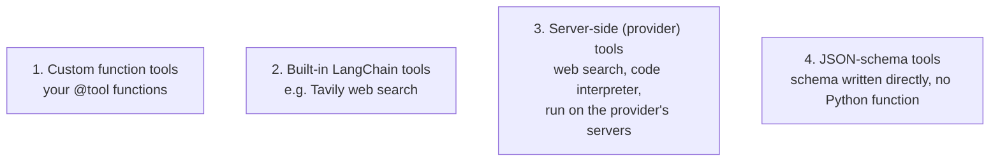
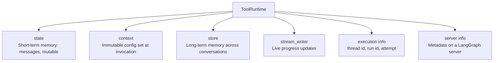
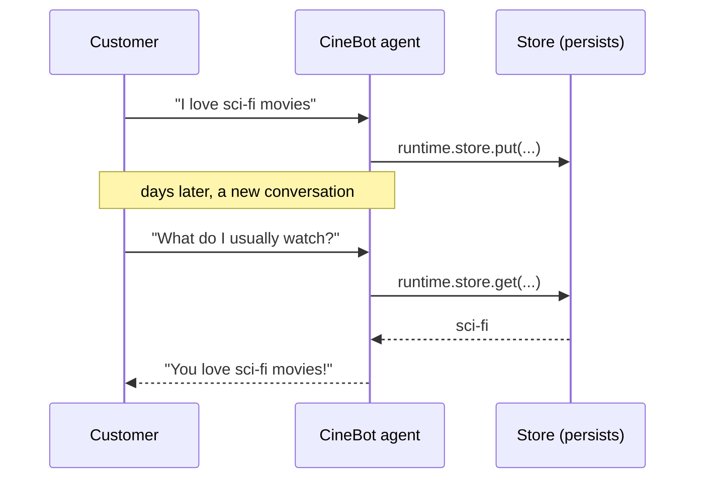

# Tools deep dive
> lead: A model is a brain without hands. Tools are how it acts: writing them well, controlling what the model sees, and giving them runtime access to state, context and long-term memory.
meta: Class 10 | 26 July | 40 min read | Code: Weekend 05

## Why it matters

Tools are where agents meet the real world: databases, APIs, bookings, search. Interview questions go beyond "what is a tool" into schemas, reserved names, server-side tools and how a tool reads memory. This chapter keeps CineBot, the movie booking agent, as the running example.

:::key A brain without hands
Ask a model with good reasoning and clean structured output "Is Interstellar showing tonight at 7pm?" and it honestly says it has no access to live showtimes. No matter how smart, a model cannot look anything up, book anything or change anything outside the conversation. Tools close that gap.
:::

## Core ideas

### 1. A tool is a function with a good description

```python
from langchain_core.tools import tool

@tool
def check_showtimes(movie_title: str) -> str:
    """Get available showtimes for a given movie."""
    return "Interstellar: 7:00 PM, 9:30 PM"
```

- The **function name** becomes the tool name.
- The **docstring** becomes the description, and it is what the model reads to decide when to use the tool.
- Mental model from class: **tools are glorified API calls or functions.** If you can write a clean function that calls a database or an API, you can write a tool. There is no extra magic.

### 2. Override the name and description

When a function is named for another purpose, rename it for the model without touching the code:

```python
@tool("book_seats", description="Book or reserve a seat. Use whenever a customer wants to book.")
def reserve(movie: str, seats: int) -> str:
    """A short internal docstring."""
    return f"Reserved {seats} seat(s) for {movie}"
```

### 3. Pre-built tools

Not every tool is hand-written. LangChain ships ready-made ones, such as web search through Tavily:

```python
from langchain_tavily import TavilySearch
search_tool = TavilySearch()      # needs an API key, then bind it like any tool
```

### 4. Argument schemas: `Field()` beats plain type hints

A bare signature tells the model little. A Pydantic schema tells it everything.

```python
from pydantic import BaseModel, Field
from typing import Literal

class SeatBookingInput(BaseModel):
    movie_title: str = Field(description="Exact movie title")
    seat_count: int = Field(gt=0, description="Number of seats")
    preferred_row: Literal["front", "middle", "back"] = Field(default="middle")

@tool(args_schema=SeatBookingInput)
def book_seats(movie_title: str, seat_count: int, preferred_row: str) -> str:
    """Book seats for a movie."""
    return f"Booked {seat_count} seat(s) for {movie_title} in the {preferred_row} row"
```

Print `book_seats.args`. Without a schema you get almost nothing. With one you get descriptions, constraints ("greater than zero"), defaults, everything needed to fill arguments correctly the first time.

:::tip "But a richer schema costs more tokens"
Slightly, but that is the wrong thing to optimise first. The goal is the right answer in the fewest round trips. A malformed call that needs an error and a retry costs far more than the 20 to 30 tokens a good schema adds. Plain functions without `@tool` still work, but the model's chance of bad input goes up.
:::

:::trap Field names must match exactly
The schema field `seat_count` and the function parameter `seats` will not be linked. There is no automatic mapping. Also, plain Python does not enforce types at runtime; Pydantic is what adds enforcement.
:::

### 4b. Two names you can never use: `config` and `runtime`

```python
@tool
def get_weather(location: str, config: str) -> str:    # defines fine, fails when the agent calls it
    ...
```

:::trap A failure that only shows up at runtime
`config` and `runtime` are **reserved parameter names**. Defining the tool raises nothing. The error appears when an agent actually calls it. LangChain cannot know at definition time how the function will be used (it might be handed to another framework where those names are fine), so it waits until it is executing inside a LangChain agent. If you want configuration data, name it something else.
:::

Python itself has no compile-time type checking (unlike Java), which is part of why this surfaces late. Tools like MyPy or Pyright can add it. You do not need to memorise every framework's reserved words; check the docs when something unexpected happens.

### 5. Binding is not running

:::key The model can never call a tool itself
Not now, not with any framework, ever. A model with tools bound can only **decide** that a tool should be called and **describe** the call. An agent, or your own code, executes it.
:::

```python
model_with_tools = model.bind_tools([check_showtimes, book_seats])
response = model_with_tools.invoke("Is Interstellar showing tonight, can you book two seats?")

for tool_call in response.tool_calls:
    print(tool_call["name"], tool_call["args"])
```

`content` is empty. The instruction is in `tool_calls`: the tool name (`book_seats`), arguments (`movie_title`, `seat_count`, `preferred_row`) and an id. In the demo the model even tried to fill a `config` value automatically, a live reminder of why that name is off-limits. A "model with tools" and an "agent" are different things; only the agent closes the loop.

### 6. Four kinds of tools



| Kind | Who runs it | Notes |
| --- | --- | --- |
| Custom function | Your code | What you build most |
| Built-in | Your code | Pre-packaged, needs a key |
| **Server-side** | The **model provider's servers** | A capability baked into how the model is served. You cannot inspect or control it |
| JSON-schema | Your code | Valid and worth recognising, but Pydantic is more readable |

When ChatGPT or Claude searches the web inside the chat, that search does **not** run on your machine. It is a server-side tool.

### 7. Tool runtime: the mirror analogy

:::analogy A model only sees its own reflection
The model sees only the arguments a tool declares. For `get_weather(location: str)` it sees one thing: `location`. Behind the mirror, the tool can see much more through a special `runtime` parameter that the model never sees.
:::

```python
from langchain.tools import ToolRuntime

@tool
def get_weather(location: str, runtime: ToolRuntime) -> str:
    """Get weather for a location."""
    # location: visible to the model
    # runtime:  invisible to the model, backend-only context
    ...
```

Print `.args` and `runtime` never appears, only `location`. LangChain recognises the `ToolRuntime` type and leaves it out of the schema, so the model never tries to guess it.



| Part | What it is | Example |
| --- | --- | --- |
| `state` | Short-term memory for this conversation | Previous messages |
| `context` | Immutable per-run configuration | Is this user on a paid plan? |
| `store` | Long-term memory **across** conversations | Saved preferences |
| `stream_writer` | Progress updates while a tool runs | A "searching the web..." indicator |
| execution info | Identifiers and retry info | Thread id, run id, attempt number |
| server info | Metadata on a LangGraph server | An advanced, separate topic |

Context is why a tool can run longer for paid users: the tool reads the plan from `context` at runtime. This is not specific to LangChain; every serious framework has an equivalent.

### 8. A tool with memory

With `runtime`, a tool is no longer stateless. It can read and write data that persists across conversations.

```python
from langgraph.store.memory import InMemoryStore
from langchain.tools import ToolRuntime, tool

loyalty_store = InMemoryStore()

@tool
def save_favorite_genre(customer_id: str, genre: str, runtime: ToolRuntime) -> str:
    """Save a customer's favorite movie genre for future visits."""
    runtime.store.put(customer_id, "preferences", {"favorite_genre": genre})
    return f"Got it! I'll remember you like {genre} movies."

@tool
def recall_favorite_genre(customer_id: str, runtime: ToolRuntime) -> str:
    """Recall a customer's favorite genre if previously saved."""
    result = runtime.store.get(customer_id, "preferences")
    if result:
        return f"Your favorite genre is {result.value['favorite_genre']}"
    return "We don't have any saved preference for this customer."

agent = create_agent(model=model, tools=[save_favorite_genre, recall_favorite_genre],
                     store=loyalty_store)
```



:::trap `InMemoryStore` is RAM
It is a dictionary in memory, so everything is lost when the process stops. Production uses a persistent store such as one backed by PostgreSQL. Store performance and scaling depend on the database underneath, not on LangChain, which only provides the read and write interface. Using LangGraph's store inside LangChain is not mixing frameworks, because LangChain is built on LangGraph.
:::

### 8b. Inspecting the store, and two quieter runtime parts

Besides `.put()` and `.get()`, a store supports **`.search()`**: list everything saved under a namespace without knowing each key. Useful for debugging or an admin view.

```python
for item in loyalty_store.search(("priya_01", "preferences")):
    print(item)

@tool
def log_booking_context(runtime: ToolRuntime) -> str:
    """Log identity info about the current booking session."""
    info = runtime.execution_info
    print(f"thread={info.thread_id}, run={info.run_id}, attempt={info.node_attempt}")
    print("server_info is None locally:", runtime.server_info is None)
    return "Logged."
```

`server_info` is filled **only** when running on LangGraph Server. Locally it is `None`, which is expected, not a bug.

### 9. Return directly, and dynamic loading

- **`return_direct`** sends a tool's raw output straight to the user and skips the model's final pass. Use it when rewording could dangerously change the meaning, such as a refund policy. You cannot also have the model double-check the output, because that puts the model back in the loop and reintroduces the risk.
- **Dynamic calling vs dynamic loading.** The model already chooses among available tools per request (calling). *Loading* is a separate concern: deciding before the model runs which subset of many tools (say 25 to 50) to expose at all.
- A tool left out of the list is unavailable **no matter what the conversation says**. Mentioning VIP status in the system prompt does not unlock VIP-only tools. Acting on that kind of state needs middleware (Chapters 6 and 7).
- **MCP is not an alternative to dynamic loading.** MCP is a packaged collection of tools. Loading decides which tools, MCP-based or not, get exposed.

<!-- docs-add -->
## From the docs: more on tools

*Added from the LangChain Tools page (read 30 Oct 2026).*

- **Naming**: `@tool("web_search")` sets the name (snake_case recommended) and `@tool("calculator", description="...")` replaces the description. Type hints are required because they define the schema.
- **`args_schema`** takes a Pydantic model (with `Field(description=...)`, defaults, `Literal`) or a raw JSON Schema dict.
- **Reserved names**: `config` and `runtime` cannot be tool arguments.
- **`ToolRuntime`** attributes: `state`, `context`, `store`, `stream_writer`, `execution_info` (thread id, run id, node attempt), `server_info` (assistant id, graph id, user identity; `None` outside LangGraph Server), `config` and `tool_call_id`.
- **Return types**: a `str` becomes a `ToolMessage`; a dict is serialised; a **list of content blocks** gives multimodal output (the model must support it); a **`Command`** updates state and, if it targets the current graph, must include a matching `ToolMessage` (parallel calls writing the same field need a reducer).
- **`return_direct=True`** ends the loop and returns the tool output without another model call, but only when **every** tool call in that step has it. In a mixed batch all `ToolMessage`s go back to the model.
- **`ToolNode`** (`langgraph.prebuilt`) runs tools in LangGraph workflows and raises `ValueError` if a `Command` update lacks the `ToolMessage`.
- **Error handling** is a `@wrap_tool_call` middleware: `(request, handler) -> ToolMessage`, with try/except and a `ToolMessage` using `tool_call_id=request.tool_call["id"]`.
- **Dynamic tools**: filter registered tools with `@wrap_model_call` and `request.override(tools=[...])`. To add tools that were never registered, also implement `wrap_tool_call` and route with `request.override(tool=...)`, or the agent cannot run them.
- **Headless tools** (Python): `tool(name=..., description=..., args_schema=...)` creates a `HeadlessTool` with **no implementation**. On a call the graph interrupts with `{"type": "tool", "tool_call": {...}}`, your app does the action and resumes with the result. There is no `.implement()` in Python (that is JavaScript).
- **Server-side tools** run on the provider and are enabled through the chat model integration, not defined by you.
<!-- /docs-add -->

## Common mistakes

| Mistake | Symptom | Fix |
| --- | --- | --- |
| Using `config` or `runtime` as an ordinary argument | Runtime error when the agent calls it | Rename the argument |
| Vague docstring | Wrong tool or no tool | Say what it does and when to use it |
| No `args_schema` | Malformed arguments, retries | Add a Pydantic schema with `Field()` descriptions |
| Schema and function names differ | Arguments not linked | Make them match exactly |
| Believing a bound tool runs itself | Empty `content`, nothing happens | Use `create_agent`, or run the call yourself |
| Putting secrets in the schema | The model sees them | Use `runtime` or `context` for hidden data |
| Using `InMemoryStore` in production | Memory lost on restart | Use a persistent store |
| Gating tools through the system prompt | Model may still offer them | Filter the tool list with middleware |

<!-- runlab -->
## Spot the bug

```python
# BROKEN: bind_tools only ADVERTISES the tools; this never runs anything
model_with_tools = model.bind_tools([check_showtimes, book_seats])
reply = model_with_tools.invoke("Book 2 seats for Dune")
print(reply.content)   # often empty: the answer is in reply.tool_calls
```

```python
# FIXED: read the requested calls, run them yourself, and send the results back
for call in reply.tool_calls:
    result = {"check_showtimes": check_showtimes,
              "book_seats": book_seats}[call["name"]].invoke(call["args"])
    # append a ToolMessage with the result, then invoke the model again
```

An agent (`create_agent`) does this loop for you; `bind_tools` alone does not.
<!-- /runlab -->

## Hands-on lab

1. Write a `@tool` function with a clear docstring and confirm the model uses it.
2. Rename a tool with `@tool("name", description=...)`.
3. Add an `args_schema` and compare `.args` before and after.
4. Name an argument `config`, call it from an agent, and see the runtime failure.
5. Add `runtime: ToolRuntime` and print `.args` to confirm it is hidden.
6. Rebuild `save_favorite_genre` and `recall_favorite_genre` with `InMemoryStore`.

## Interview corner

:::pitch
A tool is just a function with a name, description and argument schema, wrapped so an agent can call it. The model never executes it. It only requests a call, and the agent runs it. Richer schemas make the first call correct, and `ToolRuntime` gives tools hidden access to state, context and long-term store without exposing any of that to the model.
:::

### Basics

:::qa What is a tool in LangChain?
A function wrapped (usually with `@tool`) so an agent can discover and call it. The function name becomes the tool name and the docstring becomes the description the model reads.
:::

:::qa How do you rename a tool or change its description?
`@tool("book_seats", description="...")` overrides both without changing the function.
:::

:::qa What does `args_schema` add?
A Pydantic schema with field descriptions, constraints and defaults, so the model fills arguments correctly the first time. It automates what you hand-wrote as JSON in the raw-Python version.
:::

:::qa Can a model call a tool?
No. It only decides and describes the call (name, arguments, id). An agent or your code runs it and returns the result. This is true in every framework.
:::

### Intermediate

:::qa What are the four kinds of tools?
Custom function tools, built-in LangChain tools (like Tavily), server-side or provider tools (web search and code interpreters running on the provider's servers) and JSON-schema-defined tools.
:::

:::qa What is a server-side tool and how is it different from a custom tool?
It runs on the model provider's infrastructure as part of how the model is served, so you did not write it and cannot inspect it. A custom tool is your code, running where you run it.
:::

:::qa What does `ToolRuntime` give a tool, and why is it hidden from the model?
Access to `state` (short-term), `context` (immutable per-run data), `store` (long-term memory), `stream_writer` and execution info. LangChain recognises the type and excludes it from the schema, so the model never sees or guesses it.
:::

:::qa How does a tool remember a customer across conversations?
Through `runtime.store`. Attach a store when creating the agent, then `put` and `get` inside tools. `InMemoryStore` is for learning; use a persistent store in production.
:::

### Tricky

:::qa Why can't you name a tool argument `config` or `runtime`?
They are reserved by LangChain for internal use. Definition succeeds silently and the failure appears only when an agent calls the tool, because LangChain cannot know at definition time how the function will be used. Rename the argument.
:::

:::qa A richer schema costs tokens. Is it worth it?
Yes. A few tokens more per call is cheaper than a malformed call plus an error plus a retry. Optimise for the right answer in the fewest round trips first.
:::

:::qa What is `return_direct`, and can the model still verify the output?
It returns the tool's raw output to the user, skipping the model's final rewrite, for cases where rewording could change the meaning (a refund policy). No, it conflicts with verification, because verifying puts the model back in the loop.
:::

:::qa How do you stop non-premium users from using a premium tool?
Do not rely on the system prompt. A model can be talked around. Filter the tool list before the model sees it, with middleware reading runtime state or context, so the tool is not an option at all.
:::

:::qa Dynamic tool calling vs dynamic tool loading?
Calling is what the model already does: choose among available tools per request. Loading is choosing before the call which subset of many tools to expose, usually to keep the toolset small and decisions accurate. MCP is a packaging format for tools, not a substitute for loading.
:::

<!-- assign-add -->
### Course assignment questions

*From `Assignment_LangChain_Fundamentals_Landscape_to_Tools.ipynb` and its answer-key notebook (Weekend 05, the GreenPlate restaurant scenario). Answers are condensed from the instructor's key.*


:::qa The docstring is "the tool's entire pitch to the model". Defend or challenge it.
Largely right: the model reads the docstring to decide whether and when to call the tool. It matters least for a tool that is the only option and always needed, but even then a poor docstring can make the model second-guess calling it, so it is rarely irrelevant.
:::

:::qa What does `ToolRuntime` hide from the model, and how does LangChain know?
It hides `state`, `context`, `store`, `execution_info` and `server_info`; none appear in the tool schema. LangChain recognises the `ToolRuntime` **type annotation** on the parameter named `runtime` and excludes it when building what the model sees.
:::

:::qa Compare `runtime.state`, `runtime.context` and `runtime.store`.
State: this conversation only, mutable, gone when the thread ends (what the customer already said). Context: immutable, set per invocation and passed fresh every call (a user's membership tier for this request). Store: survives across any number of sessions (a saved dietary preference recalled weeks later).
:::

:::qa A tool declares a parameter named `config`. What happens?
`config` is reserved for `RunnableConfig`. The framework intercepts it before the function body runs, typically producing a `TypeError` about a missing argument. It is an easy accident because `config` is an ordinary variable name.
:::

:::qa A plain string versus a `Command` return?
A string only answers. A `Command` can write to agent state. Example: a tool that upgrades a customer's loyalty tier after a large order must confirm the upgrade **and** store the new tier for later tools and turns, which a string cannot do.
:::

:::qa Why is `wrap_model_call` gating stronger than telling the model in the prompt not to use a tool?
A prompt instruction depends on the model choosing to comply and a persuasive message may talk it round. Gating removes the tool from `request.tools` before the call, so no tool definition exists to reference: a structural guarantee, not a request.
:::

:::qa What is a headless tool, and what could only be done that way?
Its schema is registered on the server so the model can call it, but it **executes on the client** (typically the browser) through an interrupt and resume handshake. Example: reading the user's live geolocation, which a Python server cannot access.
:::
<!-- /assign-add -->

## Quick revision

- [ ] I can write a tool and explain where its name and description come from
- [ ] I can add an `args_schema` and explain why it is worth the tokens
- [ ] I can explain why `config` and `runtime` are forbidden and why the error is late
- [ ] I can say precisely why a bound tool does not run
- [ ] I can list the four tool kinds and explain server-side tools
- [ ] I can list the parts of `ToolRuntime` and the mirror analogy
- [ ] I can build a tool that remembers across conversations
- [ ] I can explain `return_direct` and dynamic loading

## Sources and further reading

- [Class 10 full notes]({{src:classes_transcription_summary/10 - 26 Jul - LangChain - Tools Deep Dive.md}})
- [Class 10 short summary]({{src:classes_summary/10 - 26 Jul - Tools Deep Dive.md}})
- [Tools notebook]({{src:Weekend 05 - 25-26 Jul/09-10 - 25-26 Jul - Structured Output & Tools (CineBot)/Langchain-Tools.ipynb}})
- [Fundamentals assignment]({{src:Weekend 05 - 25-26 Jul/09-10 - 25-26 Jul - Structured Output & Tools (CineBot)/Assignment & Questions/Assignment_LangChain_Fundamentals_Landscape_to_Tools.ipynb}})
- [Researched LangChain interview questions (PDF)]({{src:Weekend 05 - 25-26 Jul/09-10 - 25-26 Jul - Structured Output & Tools (CineBot)/Assignment & Questions/LangChain_Interview_Questions_Researched.md.pdf}})
- [Weekend 05 code folder]({{tree:Weekend 05 - 25-26 Jul/09-10 - 25-26 Jul - Structured Output & Tools (CineBot)}})
- [Student reference notebook: structured output and tools]({{src:Weekend 05 - 25-26 Jul/09-10 - 25-26 Jul - Structured Output & Tools (CineBot)/Assignment & Questions/Student_Reference_Structured_Output_and_Tools.ipynb}})
