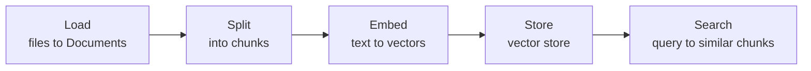

# Retrieval and the SQL agent
> lead: Giving an agent knowledge it was not trained on: loading, splitting, embedding and searching documents, and letting an agent query a database safely. From the LangChain documentation tutorials.

meta: LangChain docs | read 30 Oct 2026 | 18 min read | Not covered in class (the Meridian project in Chapter 20 uses retrieval) | Partly from search excerpts

:::note How this chapter was built
The semantic-search and SQL-agent tutorial pages could not be fetched whole in this session. This chapter uses their search excerpts, so the concepts and the main calls are reliable, but exact numbers and long code are not reproduced. Items marked "third-party" come from a blog post that follows the tutorial, not from the LangChain page.
:::

## Why it matters

A model knows only its training data. To answer about **your** documents or **your** database, the agent needs retrieval. This chapter sits right after Tools because retrieval is a tool: the agent decides when to search, and the search result comes back as a `ToolMessage`. It also explains the building blocks you meet again in the Meridian project (Chapter 20).

## Part 1: Semantic search

### The pipeline



### 1. The Document

LangChain's `Document` represents a unit of text plus metadata. A single `Document` is often one **chunk** of a larger source. It has three attributes: the text (`page_content`), a `metadata` dict, and an optional id.

### 2. Loading

A loader turns a source into `Document` objects. `PyPDFLoader` gives **one Document per PDF page**, and each carries the page text plus metadata such as the source and page number. The tutorial needs `pip install langchain-community pypdf`.

### 3. Splitting

A whole page is too coarse for retrieval, and splitting keeps related meaning together in smaller pieces.

```python
from langchain_text_splitters import RecursiveCharacterTextSplitter

splitter = RecursiveCharacterTextSplitter(
    chunk_size=1000, chunk_overlap=200, add_start_index=True,
)
chunks = splitter.split_documents(docs)
```

- `chunk_size`: target size of each chunk (in characters).
- `chunk_overlap`: shared text between neighbouring chunks, so an idea cut at a boundary is not lost.
- `add_start_index=True`: keeps where each chunk begins in the original as the metadata field `start_index`.

### 4. Embeddings

An embedding model turns text into a vector. Similar meanings land close together, so a query can find related text **without sharing keywords**. You compare vectors with a similarity measure such as cosine similarity. The query must be embedded with the **same model and dimension** as the documents.

### 5. Vector stores

A `VectorStore` adds documents and queries them by similarity. It is created with an embedding model, which decides how text becomes numbers.

```python
from langchain_core.vectorstores import InMemoryVectorStore

vector_store = InMemoryVectorStore(embeddings)
ids = vector_store.add_documents(documents=chunks)
```

The in-memory store suits light or demo work. Many integrations connect to a real store (give a client or index name).

### 6. Searching

```python
results = vector_store.similarity_search("When was the company incorporated?")
results = await vector_store.asimilarity_search("...")        # async
```

Third-party examples also show `similarity_search_with_score(...)` (returns a document and a score) and `as_retriever(search_type="similarity", search_kwargs={"k": 3})` to turn the store into a retriever for pipelines. A score's meaning (distance or similarity) depends on the store, so read its docs.

### 7. Retrieval as an agent tool

Wrap the search in a `@tool` and hand it to `create_agent`. The model then decides when to look something up. Return the text the model needs and, if you want the source for citations, keep it in the tool message's `artifact` (Chapter 3).

```python
@tool
def search_docs(query: str) -> str:
    """Search the company documents for relevant passages."""
    hits = vector_store.similarity_search(query, k=3)
    return "\n\n".join(h.page_content for h in hits)
```

:::tip Where else this appears
Chapter 19's router pattern fans a question out to several knowledge sources (the docs' own example queries GitHub, Notion and Slack), and the custom-workflow pattern's example is a RAG pipeline. Both rely on the building blocks above.
:::

## Part 2: A SQL agent

An agent that answers questions about a database. The tutorial's flow: **list tables, read the schema of the relevant ones, write a query, check it, run it, answer from the result.**

### 1. The toolkit

```python
from langchain_community.agent_toolkits import SQLDatabaseToolkit

toolkit = SQLDatabaseToolkit(db=db, llm=model)
tools = toolkit.get_tools()
```

The toolkit provides tools including `sql_db_schema` (read table definitions with sample rows) and `sql_db_query_checker` (double-check a query before running it). The tutorial says the **checker should always be used before** `sql_db_query`. You can also write the tools yourself as thin `@tool` wrappers.

### 2. The system prompt

The prompt tells the agent it is working with a SQL database of a given **dialect**, to write a syntactically correct query, to **limit results** (the tutorial uses `top_k=5`), to **never select all columns**, and to look at the schema of relevant tables first.

### 3. Errors are useful feedback

When a query fails, the error message goes back to the model, which fixes the query. The docs call this feedback pattern very powerful.

### 4. Safety

:::trap A database tool is a real attack surface
The tutorial warns the model-driven design can be made safer, not safe. The JavaScript version of the tutorial shows a **read-only gate**: allow a single statement only, require it to start with `SELECT`, reject DML and DDL keywords, and add a `LIMIT` if missing. The LangGraph version says its tool wrappers are minimal demonstrations that are **not secure and not for production**. Use a read-only database user in real systems.
:::

### 5. Human review before queries run

```python
agent = create_agent(
    model, tools,
    system_prompt=system_prompt,
    middleware=[HumanInTheLoopMiddleware(interrupt_on={"sql_db_query": True})],
    checkpointer=InMemorySaver(),
)
```

The agent pauses before `sql_db_query`. A human approves, and you resume with a `Command` (Chapter 10). A checkpointer is what lets it pause and resume. You can make the interrupt **conditional** so only write queries need approval (the `when` option, covered in the Chapter 10 additions).

## Common mistakes

| Mistake | Symptom | Fix |
| --- | --- | --- |
| Splitting with no overlap | Answers cut at chunk edges | Add `chunk_overlap` |
| Different embedding models for documents and queries | Poor or meaningless matches | Use the same model everywhere |
| Treating a similarity score as universal | Wrong thresholds | Read the store's score definition |
| Letting the SQL agent write data | Destructive queries | Read-only user, gate, HITL |
| No result limit in the prompt | Huge outputs and cost | `LIMIT` and top-k in the prompt |
| HITL on `sql_db_query` without a checkpointer | Cannot resume | Add a checkpointer |

## Hands-on lab

1. Load a PDF with `PyPDFLoader` and print one page's metadata.
2. Split it with chunk size 1000 and overlap 200, and inspect `start_index`.
3. Index it in an `InMemoryVectorStore` and run three searches.
4. Wrap the search as a tool and ask an agent a question only the PDF can answer.
5. Create a small SQLite database and build the SQL agent with the toolkit.
6. Add `HumanInTheLoopMiddleware` on `sql_db_query` and approve one query.
7. Try to get it to run a `DELETE` and note how your gate stops it.

## Interview corner

:::pitch
Retrieval has five steps: load documents, split them into overlapping chunks, embed the chunks, store the vectors, and search by similarity. I expose search as a tool so the agent decides when to use it. For databases I give the agent schema and query tools, a prompt that limits results, a read-only connection, and human approval before queries run.
:::

### Basics

:::qa What are the steps of a semantic search pipeline?
Load, split, embed, store, search. A `Document` carries text and metadata, and a vector store retrieves chunks by similarity to the query embedding.
:::

:::qa Why split documents?
Smaller chunks keep related meaning together and make retrieval precise. Overlap stops an idea being lost at a boundary.
:::

:::qa How does semantic search find text with different wording?
Both query and text become vectors; similar meanings are close, so matching does not need shared keywords.
:::

### Intermediate

:::qa What does `add_start_index=True` do?
It stores each chunk's starting position in the original document as `start_index` metadata.
:::

:::qa Why must the query use the same embedding model as the documents?
Vectors from different models live in different spaces and dimensions, so similarity between them is meaningless.
:::

:::qa What does a SQL agent do, step by step?
Lists tables, reads relevant schemas, writes a query, checks it, runs it and answers from the result, feeding errors back to the model to fix.
:::

### Tricky

:::qa How do you make a SQL agent safe?
Use a read-only database account; allow one statement, `SELECT` only, and reject DML and DDL; add a limit; and add human-in-the-loop approval on the query tool. The docs call these mitigations, not guarantees.
:::

:::qa Retrieval as a tool vs always retrieving first?
As a tool, the agent searches only when needed and can search several times with refined queries. Always retrieving is simpler and cheaper per call but wastes context on questions that do not need documents.
:::

## Quick revision

- [ ] I can draw the five-step retrieval pipeline
- [ ] I can explain chunk size, overlap and `start_index`
- [ ] I can explain why embeddings find meaning, not keywords
- [ ] I can wrap search as a tool
- [ ] I can list the SQL agent's steps and its safety measures

## Sources and further reading

- [Build a semantic search engine (LangChain docs)](https://docs.langchain.com/oss/python/langchain/knowledge-base)
- [Build a SQL agent (LangChain docs)](https://docs.langchain.com/oss/python/langchain/sql-agent)
- [Meridian project tour](#agentic-ai-ch20) in this book
