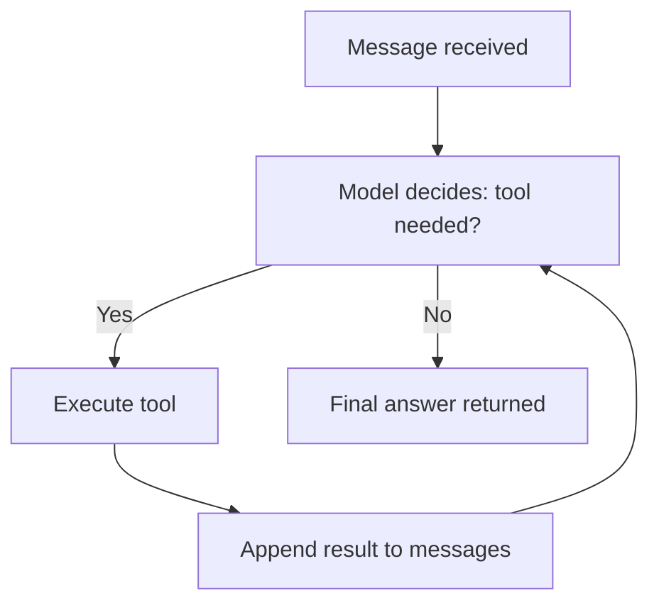
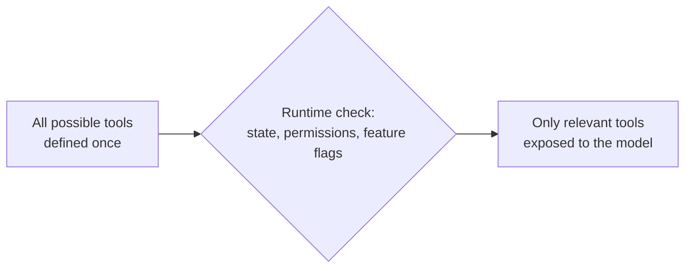
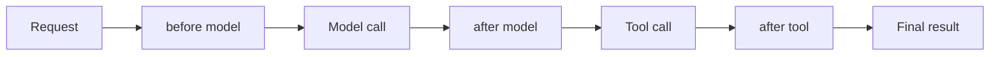
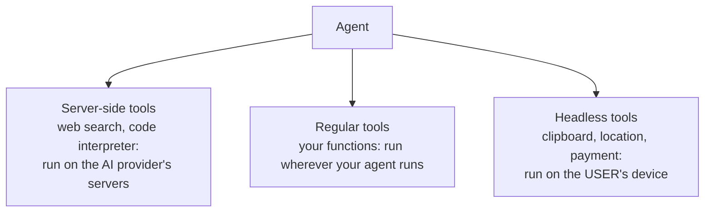

# Agents, memory and middleware
> lead: Everything so far was already an agent. This chapter restates the loop, shows why tools must be loaded per user with middleware, introduces headless tools and builds TripMate with real tools and real memory.
meta: Class 11 | 1 August | 40 min read | Code: Weekend 06

## Why it matters

A real agent has to answer three questions the earlier chapters left open. Which tools should *this* user even see? How does it remember a conversation? Where should different kinds of memory live? Interviews love these because the wrong answers (asking the user, or telling the model "please don't") sound plausible.

:::key Models, messages, structured output and tools were always the agent
They were never separate topics. They are the parts an agent is built from. As the instructor put it: apart from the LLM, little else has changed in four or five years. The whole game is how best to **harness** the model.
:::

## Core ideas

### 1. The agentic loop, restated



This was once called the **ReAct pattern**. "Agentic loop" is the more accurate term today. A tool's result **always goes back to the model, never straight to the user**. The user sees only the model's final reply after it has processed the result. (The exception, `return_direct` from Chapter 5, deliberately skips that step.)

### 2. The problem: not every tool belongs to every user

CineBot has a standard booking tool, a VIP lounge tool and an admin tool. A regular user asks for a VIP seat. Two tempting fixes fail:

- **Ask the user if they are a VIP.** They will always say yes.
- **Remove the VIP tool.** Then real VIPs cannot use it.

:::analogy A menu that reprints itself
A VIP sees the full menu, a regular guest sees a shorter one. Not because they were told "please do not order the VIP item", but because those items are **not printed on their menu at all**. The tool is not an option, rather than being discouraged.
:::

**Why it costs money.** In class, ChatGPT's connector settings showed that each connector is just a collection of tools (Gmail has write and delete tools, Slack has 11). On a free account, ChatGPT still prepares for around 500 tools it will never let you use, loading them into context and sending unwanted tokens to the model on every call. Companies lose money on this daily. A small related example: asking "who won the FIFA World Cup" triggered an unneeded web search that returned the wrong year, a tool firing when it should not.

### 3. Dynamic tool loading

:::key Say this line precisely
With dynamic tool loading, the set of tools available to the agent is **modified at runtime**, not defined all upfront.
:::



Two approaches, depending on whether the tools are known ahead of time:

- **Filter pre-registered tools:** register every tool at creation, then filter what is exposed using state, permissions and context.
- **Register tools dynamically:** for when the full toolset is not known upfront, for example tools arriving through MCP.

**Why not a plain Python `if/else`?** Your code outside the agent cannot read what the agent has access to: its state or its store. For example, when the message count grows, plain code does not see it. That is only possible when running **inside** the agent.

### 4. Middleware: cutting into the loop

> "What if you cut a few things in the middle here?" Before the model call, after it, before a tool, after a tool, after observing.



Middleware is a universal idea (the instructor compared it to Java's Spring ecosystem), not a LangChain quirk. Chapter 7 covers the built-in ones in depth.

**State-based filtering**, as shown in class:

```python
def only_public_tools_if_unauthenticated(request):
    if not request.state.get("authenticated"):
        request.tools = [t for t in request.tools if t.name.startswith("public_")]
    return request
```

A second example read `request.runtime.context` (a user id and feature flags) to decide which tools to load. The instructor's design warning: if you have 1,000 tools, your design is wrong in the first place.

:::beyond Real syntax is slightly different
The snippets above are simplified for teaching. In current LangChain, such a function is written with the `wrap_model_call` hook, which is how the interview PDF in the repo describes filtering the tool list. Chapters 8 and 9 show the real hooks.
:::

### 5. The VIP demo and its live bug

```python
def vip_gate_middleware(request):
    is_vip = request.state.get("is_vip_member", False)
    if not is_vip:
        request.tools = [t for t in request.tools if t.name != "vip_lounge_booking"]
    return request
```

With a regular user the agent genuinely had no idea a VIP tool existed. But passing `is_vip_member=True` into `invoke()` **did not work**: the middleware always read `False`.

:::trap Agent state has to be declared
The fix was a **custom state schema** that tells the agent to track `is_vip_member` alongside its built-in fields (like the message list). Without it, the field was silently dropped. Once declared, the same middleware read the flag correctly and exposed the VIP tool. The take-away: based on the user, **at runtime**, you can change which tools the agent has.
:::

### 6. Headless tools

Where does a tool run? Payment, clipboard, location: on the server or on the user's machine?



A **headless tool** has its definition (name, description, argument schema) registered on the server with the agent, but its **implementation** registered only on the client, executed after a short interrupt-and-resume handshake. The idea is not AI-specific (geolocation, clipboard and IndexedDB are normal browser APIs). Amazon needs your location, so it runs in your browser and sends the result back, because its US server has no way to get it.

### 7. TripMate: real tools instead of mocks

Alongside CineBot (kept for concepts), class introduced **TripMate**, a travel-planning agent, with four real tools:

| Tool | What it uses | Note |
| --- | --- | --- |
| Weather | **Open-Meteo**, a free, keyless, open-source weather API | Read its docs |
| Web search | **Tavily** | A third-party service; LangChain just makes integration easier |
| Save trip | SQLite `trips` table | Stores by user id |
| Get saved trip | SQLite | Retrieves by user id |

SQLite is only for local mocking. Any store works: ChromaDB, Postgres, MongoDB. Because the data lives **outside** the process, a restart does not lose it.

### 8. The forgetting problem, and the fix

Tell the agent "my name is Mayank", then ask "who am I?" It does not know. An agent should remember, **but by default it does not**.

```python
from langgraph.checkpoint.memory import InMemorySaver

checkpointer = InMemorySaver()

agent_with_memory = create_agent(
    model=model,
    tools=[...],
    checkpointer=checkpointer,
)

config = {"configurable": {"thread_id": "mayank-session-1"}}
agent_with_memory.invoke({"messages": [...]}, config=config)
```

This is the official approach from the documentation. The **`thread_id`** is simply a unique id so the checkpointer can locate the chat. The **application controls it**, not the user: "Session 1" for the first chat, a different id for a new session. It is not a reserved keyword; it is the key the checkpointer looks for in the config. Swap the id and the agent forgets again. `InMemorySaver` lasts as long as the Python process; a persistent backend such as Postgres follows the same pattern.

### 9. Memory saver, memory store, caching, database

There is no single right answer. Think of Swiggy or Amazon's chatbot: if you do not reply in 10 minutes the chat closes. Keeping that chat in memory forever would not help.

| Concept | What it is for | Typical lifetime |
| --- | --- | --- |
| **Memory saver** (checkpointer) | One conversation's history, tied to a `thread_id`, so the agent can resume | As long as that thread needs: minutes to persistent |
| **Memory store** | Facts **about a user** (preferences) usable across many conversations | Persistent by design |
| **Caching** | Avoid repeating expensive near-identical calls | Short and tunable: an hour, a day |
| **Database** | General persistent storage for the app | Persistent, application-defined |

"I like Python as a language" belongs in the **store**, not the saver, because it should be usable in other chats too. That is long-term memory. For caching: if "weather in Delhi" is asked a million times in an hour, cache it. API calls at scale are not cheap.

<!-- docs-add -->
## From the docs: `create_agent` parameters and memory details

*Added from the LangChain Agents, Short-term memory and Long-term memory pages (read 30 Oct 2026).*

**`create_agent` parameters**

| Parameter | Role |
| --- | --- |
| `model` | `"provider:model"` string or a model instance |
| `tools` | Callables, LangChain tools or tool dicts |
| `system_prompt` | String or `SystemMessage` |
| `response_format` | Validated schema for the final answer |
| `state_schema` | `AgentState` subclass for extra state fields |
| `context_schema` | Per-run data, read via `runtime.context` |
| `checkpointer` | Needed for `thread_id` persistence locally |
| `middleware` | The harness extensions |
| `store` | Long-term memory store |
| `name` | Identifier, useful when the agent is a sub-agent |

On LangSmith Deployment a checkpointer is provisioned for you.

**Short-term memory.** Memory is saved per `thread_id` by a checkpointer; state is read at the start of each step and updated after each step. Same id continues, a new id starts fresh. In production use a database checkpointer (for example `PostgresSaver` after `checkpointer.setup()`; SQLite and Azure Cosmos DB also exist). Extend state with `class MyState(AgentState): user_id: str` passed as `state_schema`.

**Controlling long conversations**

1. **Trim** with `@before_model`, returning `RemoveMessage(id=REMOVE_ALL_MESSAGES)` followed by the messages to keep.
2. **Delete** specific messages with `RemoveMessage(id=m.id)`, or all of them. This needs a state key with the `add_messages` reducer, which the default `AgentState` has. Also available in `@after_model`.
3. **Summarise** with `SummarizationMiddleware(model=..., trigger=("tokens", 4000), keep=("messages", 20))`.

:::trap Keep the remaining history valid
Some providers require history to start with a `user` message, and every tool-call message must be followed by its tool result. Deleting the wrong messages produces provider errors.
:::

**Where memory can be read or changed**

| Place | How |
| --- | --- |
| Tool (read) | `runtime: ToolRuntime`, then `runtime.state["user_id"]` (hidden from the model) |
| Tool (write) | Return `Command(update={...})` with a `ToolMessage(tool_call_id=runtime.tool_call_id)` |
| Prompt | `@dynamic_prompt` reading `request.runtime.context` |
| Before or after model | `@before_model` and `@after_model` get `state` and `runtime` |

**Long-term memory.** It survives across threads and sessions and is built on a **store** that saves JSON documents under a **namespace** (a tuple such as `("users",)`) and a **key**.

| Call | Does |
| --- | --- |
| `put(namespace, key, value)` | Save a JSON dict (replaces an existing key) |
| `get(namespace, key)` | Item with `.value`, or `None` |
| `search(namespace, filter=..., query=...)` | Filter by content; `query` ranks by vector similarity if an index exists |

Semantic search needs `IndexConfig(embed=..., dims=...)` with `dims` matching the embedding size. Use `InMemoryStore` for development and `PostgresStore` (`from_conn_string`, then `setup()` once) in production; Redis and MongoDB stores exist. Tools reach it through `runtime.store` (check it is not `None`) and scope by `runtime.context.user_id`.
<!-- /docs-add -->

<!-- docs-memory-concept -->
### Memory, the concept (from the conceptual overview)

:::note Source
LangChain docs, [Memory overview](https://docs.langchain.com/oss/python/concepts/memory), read on 31 Oct 2026 from the docs source on GitHub (text and tables of every section; long code samples skimmed).
:::

- **Short-term memory** is the conversation inside one thread, kept as agent state and saved by a thread-scoped checkpointer. Long histories can overflow the context window or distract the model, so trim or forget stale messages.
- **Long-term memory** lasts across threads and lives in a store, organised by **namespace** (like a folder) and **key** (like a file name).
- **Three kinds, borrowed from people.** *Semantic* memory holds facts, either as one continuously updated **profile** (a JSON document) or a **collection** of small documents (easier to extend, less likely to lose information, harder to keep consistent). *Episodic* memory holds past experiences, often as few-shot examples. *Procedural* memory holds the rules for doing tasks, often by updating the agent's own instructions.
- **When to write.** *In the hot path*: the agent decides during the conversation, so memories are available at once and users can see them, but it adds latency and complexity. *In the background*: a separate job writes memories, with no added latency, but you must decide when it runs (after a delay, on a schedule, or on demand).
<!-- /docs-memory-concept -->

## Common mistakes

| Mistake | Symptom | Fix |
| --- | --- | --- |
| Asking the user if they are a VIP | Everyone says yes | Decide from trusted state or context |
| Telling the model "do not offer VIP tools" | Model may still offer them | Remove the tool from the list with middleware |
| Passing a custom field to `invoke` without declaring it | Middleware always sees the default | Add a custom state schema |
| Loading hundreds of tools for everyone | Wasted tokens and cost | Dynamic loading |
| No checkpointer or no `thread_id` | Agent forgets between calls | Add `InMemorySaver` and reuse the id |
| Using `InMemorySaver` in production | Memory lost on restart | Use a persistent backend |
| Storing user preferences only in the saver | Lost in other chats | Use the store |
| Caching everything | Stale answers | Choose a TTL per data type |

## Hands-on lab

1. Rebuild the VIP middleware and trigger the "state not tracked" bug on purpose, then fix it with a custom state schema.
2. Write middleware that filters tools using `request.state`.
3. Build one real tool from a free public API, such as Open-Meteo.
4. Add `InMemorySaver` and a `thread_id`. Confirm it remembers your name, then change the id and confirm it forgets.
5. Walk through TripMate: real weather, real search, SQLite save and fetch.
6. For five facts (a chat history, a language preference, a repeated weather lookup, an order record, a feature flag) say which of the four stores each belongs in.

## Interview corner

:::pitch
An agent is a model plus a harness, running the agentic loop: model decides, tool executes, result goes back to the model. To control it, I use middleware, which hooks into the loop before and after the model and tools. For per-user tool access I filter the tool list at runtime so unauthorised tools are not even visible, and for memory I use a checkpointer with a thread id for conversations and a store for long-term facts.
:::

### Basics

:::qa Does a tool result go to the user?
No. It goes back to the model, which produces the final reply. The user sees only that. (`return_direct` is the deliberate exception.)
:::

:::qa What is the agentic loop?
Receive a message, the model decides whether a tool is needed, run it, append the result, and repeat until the model answers in plain text. It was called the ReAct pattern.
:::

:::qa How does an agent remember a conversation?
A checkpointer (for example `InMemorySaver`) passed to `create_agent`, plus a `thread_id` in the config. The same id restores the history; a new id starts fresh.
:::

:::qa Is `thread_id` a reserved keyword?
No. It is just the identifier the checkpointer looks for in the config. The application decides how ids are generated and assigned.
:::

### Intermediate

:::qa How would you give VIP users an extra tool?
Use middleware that reads trusted state or context and filters the tool list before the model call, so non-VIPs never see the tool. Do not ask the user, and do not rely on a system-prompt instruction.
:::

:::qa Why not use an `if/else` outside the agent to choose a tool list?
Code outside the agent cannot read the agent's live state or store (for example a growing message count). Only code running inside the agent, such as middleware, can.
:::

:::qa What is dynamic tool loading, and what are its two approaches?
Modifying the available tools at runtime instead of defining them all upfront. Either filter a pre-registered set based on state, permissions and flags, or register tools dynamically when they are not known ahead (for example from MCP).
:::

:::qa Memory saver vs memory store vs cache vs database?
Saver: one conversation's history by thread id. Store: facts about a user across conversations. Cache: short-lived results of repeated expensive calls. Database: general persistent application data. Choose by use case and lifetime.
:::

### Tricky

:::qa The middleware kept reading `is_vip_member` as False even when you passed True. Why?
The agent only tracks fields in its state schema. A custom field passed to `invoke` is dropped unless a **custom state schema** declares it. Declare it and the middleware sees it.
:::

:::qa What is a headless tool?
A tool whose definition lives on the server with the agent, but whose implementation runs on the **client** (clipboard, location, payment), executed through an interrupt-and-resume handshake. The agent decides to use it; the user's device does the work.
:::

:::qa Why is loading hundreds of tools bad even if the user cannot use them?
Their definitions are loaded into context and sent to the model on every call, costing tokens and possibly causing wrong tool choices. Load only what is relevant.
:::

:::qa Where would you store "I prefer Python"?
In the **store** (long-term memory), so every future conversation can use it. A checkpointer is tied to one thread and would not carry it across chats.
:::

:::qa Does a tool call cost money like a model call?
No. Only model calls consume tokens. A tool running on its own, with no model call, does not (though the tool's own API may have fees).
:::

<!-- assign-add -->
### Assignment 2 questions (practice)

*From `Assignment_2_Agents_and_Prebuilt_Middleware.ipynb` (Weekend 06, a "NovaBank" banking scenario). The repo ships the questions only, with **no answer key**, so I list them for practice and point to where this book answers them.*

| Question (short form) | Where to find the answer |
| --- | --- |
| Describe the agent loop mechanically when a tool call is involved | Foundations chapter 3 and Chapter 6, section 1 |
| `thread_id` alone does not persist a conversation: what else is needed and what breaks without it | Chapter 6 (checkpointer) and Chapter 10 |
| Distinguish `thread_id` from `context` and what data belongs in each | Chapter 10 |
| Name the three practical `stream_mode` options and what each suits | Chapter 10A |
| Why does naming an agent (`name=`) cost nothing now but matter later | Chapters 10A and 19 (`lc_agent_name`, subagents) |
<!-- /assign-add -->

## Quick revision

- [ ] I can restate the loop and say where the tool result goes
- [ ] I can explain the menu analogy and why asking the user or using the prompt fails
- [ ] I can define dynamic tool loading in one sentence and give two approaches
- [ ] I can draw the middleware hook points
- [ ] I can explain the VIP bug and the custom state fix
- [ ] I can define a headless tool and give three examples
- [ ] I can set up a checkpointer with a thread id
- [ ] I can sort memory saver, store, cache and database by purpose

<!-- res -->
## Course resources for chapters 6 to 9

| Craft entry | What is attached |
| --- | --- |
| **16 Aug** | `Assignment_2_Agents_and_Prebuilt_Middleware.ipynb`, `Assignment_LangChain_Fundamentals_SOLUTIONS.ipynb`, a "Custom Middleware" Colab |

The 8 to 9 August Craft entry is empty apart from its title, so there is nothing to add for it.
<!-- /res -->

<!-- proj4 -->
## Practice project: Study buddy with memory

**Goal:** an assistant that remembers your weak topics across sessions.

- A checkpointer and `thread_id` for each session, plus a **store** for long-term facts ("weak on topic X").
- Read the store with `ToolRuntime`, and pass the user id through **context**.
- **Stretch:** summarise old history with `SummarizationMiddleware` and compare token usage.
- **Interview story:** the difference between saver, store and state, and which you chose for each fact.
<!-- /proj4 -->

## Sources and further reading

- LangChain docs: [Memory overview](https://docs.langchain.com/oss/python/concepts/memory)
- [Class 11 full notes]({{src:classes_transcription_summary/11 - 01 Aug - LangChain - Agents, Memory, Middleware.md}})
- [Class 11 short summary]({{src:classes_summary/11 - 01 Aug - Agents, Middleware & Memory.md}})
- [Middleware notebook]({{src:Weekend 06 - 1 Aug/11-12 - 1-8 Aug - Agents, Memory & Middleware/MIddleware.ipynb}})
- [Middleware architecture sketch notebook]({{src:Weekend 06 - 1 Aug/11-12 - 1-8 Aug - Agents, Memory & Middleware/Middleware-Architecture-Sketch.ipynb}})
- [Assignment 2: agents and prebuilt middleware]({{src:Weekend 06 - 1 Aug/11-12 - 1-8 Aug - Agents, Memory & Middleware/Assignment & Questions/Assignment_2_Agents_and_Prebuilt_Middleware.ipynb}})
- [Architecture diagram (PDF)]({{src:Weekend 06 - 1 Aug/11-12 - 1-8 Aug - Agents, Memory & Middleware/Agent-Middleware-Architecture.pdf}})
- [Weekend 06 code folder]({{tree:Weekend 06 - 1 Aug/11-12 - 1-8 Aug - Agents, Memory & Middleware}})
