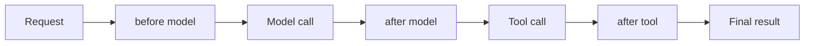

# Mastering middleware
> lead: A full tour of the six built-in middlewares (summarization, human-in-the-loop, call limits, model fallback, PII) and how to decide between middleware, guardrails and LangGraph.
meta: Class 12 | 8 August | 35 min read | Code: Weekend 07

## Why it matters

Before middleware, nothing stopped an agent replying rudely if asked to, and nothing flagged personal data handed to it. The agent already had a model, tools, prompts and messages. What developers lacked was a way to **intervene between those components**. Middleware is that control, and each built-in maps to a classic interview scenario: cost, outage, privacy, approval.

:::key Middleware hooks into six points
Before the agent runs, after it runs, before the model, after the model, before a tool and after a tool. The same idea has other names: Google's Agent Development Kit calls it a **callback**, and Claude Code and Cursor call it **hooks**. The pattern is universal.
:::



For anyone with general software experience: it is the same control you already have in ordinary code, deciding what happens before or after an action, applied to the agent's flow.

## The six built-in middlewares

| # | Middleware | Problem it solves |
| --- | --- | --- |
| 1 | `SummarizationMiddleware` | Context grows with the conversation |
| 2 | `HumanInTheLoopMiddleware` | A tool call should be approved before it runs |
| 3 | Model call limit | Runaway model calls cost money |
| 4 | Tool call limit | Runaway tool calls bloat context and cost |
| 5 | `ModelFallbackMiddleware` | The primary provider has an outage |
| 6 | `PIIMiddleware` | Sensitive data should not reach the model |

### 1. Summarization

An agent's context grows as the conversation runs. At some point it must be condensed instead of resent in full.

```python
from langchain.agents import create_agent
from langchain.agents.middleware import SummarizationMiddleware

agent = create_agent(
    model=model,
    tools=[...],
    middleware=[
        SummarizationMiddleware(
            model="anthropic:claude-haiku",     # a separate, often cheaper model
            trigger=("tokens", 4000),
            keep=("messages", 10),
        )
    ],
)
```

| Option | Meaning |
| --- | --- |
| `model` | Summarising is itself a task that needs a brain. It does not have to be the main model. A cheaper one works |
| `trigger` | When to start: a token count, a message count, or a fraction of the context length (say 80% full) |
| `keep` | How much recent conversation to leave untouched: a fraction, tokens or messages. The example kept the last 10 messages and summarised everything before |

You have seen this without realising: the "conversation has been compacted" behaviour in long Claude chats is this mechanism. Claude Code's `/compact` command shows a context breakdown (system prompt, tools, custom instructions, messages) as a real-world instance.

:::trap Summaries can lose information
Compressing a long history can drop detail, which is part of why models seem to "forget" or hallucinate as a conversation grows. Zero loss cannot be guaranteed. If something **must** be retained, save it separately into long-term memory instead of relying on the summary.
:::

:::note Summaries are text only
Summarisation compresses **text**. It does not shrink images, audio or video. Recent messages kept by `keep` retain their original media, but older media that gets summarised survives only as the text summary. For image-heavy apps, store media in a file system or object store and pass URLs or references through the history.
:::

### 2. Human-in-the-loop (HITL)

Pause execution so a human can **approve, edit or reject** a proposed tool call before it runs. If an agent decided to spend a large sum, should it be allowed to without asking? This is what Claude and similar assistants do when they ask permission: you are the human in the loop.

**Why only tool calls?** Everything before a tool call is the model reasoning. The tool call is the hands changing something in the real world. That is the moment worth pausing on.

```python
from langchain.agents.middleware import HumanInTheLoopMiddleware

agent = create_agent(
    model=model,
    tools=[read_email, send_email],
    checkpointer=checkpointer,
    middleware=[
        HumanInTheLoopMiddleware(
            interrupt_on={
                "send_email": {"allowed_decisions": ["approve", "edit", "reject"]},
                "read_email": False,        # no interrupt needed
            }
        )
    ],
)

config = {"configurable": {"thread_id": "hitl-demo"}}
agent.invoke({"messages": [{"role": "user",
    "content": "Send an email to my manager saying I won't be in tomorrow."}]}, config=config)
```

In the demo, the model decided to call `send_email`, and before it could run LangChain raised an **interrupt**. Resolving it is up to you. LangChain provides no UI out of the box. Resume programmatically with LangGraph's `Command(resume=...)`, or wire it to a pop-up or approve and reject buttons.

:::note A checkpointer is required
The agent is paused mid-run, so its state must be saved. That is why the example passes a `checkpointer` and a `thread_id`. Chapter 10 covers interrupts in depth.
:::

:::trap Escalating to a human agent is not HITL
A support bot handing the conversation to a person is a **transfer**: the agent steps out. True human-in-the-loop keeps the agent in the loop, paused for a decision, such as proposing a refund and asking a representative to approve or adjust the amount.
:::

### 3 and 4. Model call limit and tool call limit

One hundred model calls in a single run cost real money. This formalises the `max_turns` safeguard from the raw-Python loop, with better checks. The same reasoning applies to **tool calls**: an agent asked to find important emails could keep digging through years of mail, and every extra call grows context and cost.

:::tip Where should the number come from?
From domain knowledge, not a framework default. A web-search agent probably needs 5 to 15 searches for most tasks. The developer who understands the use case sets the cap, rather than leaving it unbounded or guessing high.
:::

**In code**, from the course notebook:

```python
from langchain.agents.middleware import ModelCallLimitMiddleware

call_limited_agent = create_agent(
    model="openai:gpt-5-mini",
    tools=cinebot_tools,
    checkpointer=InMemorySaver(),        # needed for thread_limit to persist across calls
    middleware=[
        ModelCallLimitMiddleware(
            thread_limit=5,              # across the whole conversation
            run_limit=2,                 # per single .invoke()
            exit_behavior="end",         # stop gracefully instead of raising an exception
        ),
    ],
)
```

`exit_behavior="end"` makes the agent stop cleanly when the cap is hit, rather than throwing. The tool version (`ToolCallLimitMiddleware`) is in Chapter 8.

### 5. Model fallback

If the primary provider has an outage, should the app stop? Fallback routes to a secondary model automatically.

```python
from langchain.agents.middleware import ModelFallbackMiddleware

agent = create_agent(
    model=model,
    middleware=[ModelFallbackMiddleware(model="openai:gpt-5.4-mini")],   # used if the primary fails
)
```

A "failure" means a hard error such as a 404 or an expired key. Fallback is **not** routing by speed or cost, and it is not a smart dispatcher choosing the best model per task. It activates only when the primary genuinely fails, and the full conversation history is passed to whichever model takes over.

### 6. PII detection

Personal identifiable information (date of birth, phone, email, government ids, passwords) should not reach the model if it can be avoided.

```python
from langchain.agents.middleware import PIIMiddleware

agent = create_agent(
    model=model,
    middleware=[
        PIIMiddleware("email", strategy="redact", apply_to_input=True),
        PIIMiddleware("credit_card", strategy="mask", apply_to_input=True),
    ],
)
```

| Strategy | What happens |
| --- | --- |
| **Redact** | The sensitive value is removed entirely before it reaches the model |
| **Mask** | Part of the value is replaced (for example only the last digits shown), so the model knows something is present without seeing it |

**Custom detectors.** Id formats such as Aadhaar or PAN are country-specific, so LangChain cannot ship detectors for every country. Define your own with a regular expression:

```python
import re
from langchain.agents.middleware import PIIMiddleware

aadhaar_pattern = re.compile(r"\b\d{12}\b")

agent = create_agent(
    model=model,
    middleware=[PIIMiddleware("aadhaar", detector=aadhaar_pattern, strategy="mask")],
)
```

:::key Guardrail is the concept. Middleware is the mechanism.
A **guardrail** is the goal of protecting an agent from doing something undesirable. **Middleware** is how you implement it. They are not two competing systems. This distinction came up repeatedly in class and is a common interview question.
:::

:::beyond Two more middlewares imported in the notebook
The course notebook also imports `ModelRetryMiddleware` and `ContextEditingMiddleware` with `ClearToolUsesEdit`, without a full demo. From LangChain's documentation: **model retry** retries failed model calls with backoff (the model-side twin of tool retry in Chapter 8), and **context editing** with `ClearToolUsesEdit` clears older tool outputs from the context when it grows too large, a lighter alternative to summarising everything. Check your installed version's reference for exact parameters.
:::

## Using several middlewares

You can attach many to one agent as a list. They do not run in random order: either a defined priority applies or they follow the order you declared them. They are designed not to collide, and you do not need a separate agent per concern.

## Middleware, or LangGraph?

Middleware exists in LangGraph too; it is not unique to LangChain. Stay with LangChain plus middleware for most agents, including a simple enterprise RAG chatbot (which may not even need middleware). Move to LangGraph when you must precisely control what happens internally and build a genuinely deterministic flow, with deeper control over checkpointers, stores and interrupts. LangChain sits on top of LangGraph and gives a more convenient interface to the same machinery.

Tools like Claude Code or Cursor that build agents with MCP and plain instructions do essentially the same thing under another name (**hooks**). The difference: those agents are generally not deployable as standalone applications. They stay local developer tools.

<!-- docs-add -->
## From the docs: the full built-in middleware reference

*Added from the LangChain "Prebuilt middleware" page (read 30 Oct 2026). Defaults are as the page states them.*

| Middleware | What it does | Key parameters and defaults |
| --- | --- | --- |
| `ToolErrorMiddleware` (`langchain>=1.3.14`) | Turns tool exceptions into error `ToolMessage`s the model sees | `on_error` (return content, or `None` to propagate), `aon_error`, `tools` (default all) |
| `ToolRetryMiddleware` | Retries failed tools with backoff | `max_retries=2`, `retry_on`, `on_failure="continue"` (or `"error"` or a callable), `backoff_factor=2.0`, `initial_delay=1.0`, `max_delay=60.0`, `jitter=True` (plus or minus 25%) |
| `ModelRetryMiddleware` | Same for model calls | Same parameters; on failure returns an `AIMessage` with details by default |
| `ModelFallbackMiddleware` | Switch models when one fails | `first_model` then more models, tried in order |
| `SummarizationMiddleware` | Summarise old history | `model`, `trigger` (fraction, tokens or messages; a list means OR), `keep=("messages", 20)`, `trim_tokens_to_summarize=4000` |
| `HumanInTheLoopMiddleware` | Pause for a decision | `interrupt_on`, see Chapter 10 additions. Needs a checkpointer |
| `ModelCallLimitMiddleware` | Cap model calls | `thread_limit`, `run_limit`, `exit_behavior="end"` (or `"error"`) |
| `ToolCallLimitMiddleware` | Cap tool calls, global or per tool | `tool_name`, `thread_limit`, `run_limit` (at least one), `exit_behavior="continue"`, `"error"` or `"end"` |
| `PIIMiddleware` | Find and handle PII | `pii_type`, `strategy="redact"`, `detector`, `apply_to_input=True`, `apply_to_output=False`, `apply_to_tool_results=False` |
| `TodoListMiddleware` | Adds `write_todos` and planning prompts | `system_prompt`, `tool_description` |
| `LLMToolSelectorMiddleware` | An LLM picks relevant tools first | `model`, `system_prompt`, `max_tools`, `always_include` (not counted in `max_tools`) |
| `ProviderToolSearchMiddleware` | Defer tools behind the provider's server-side tool search (Anthropic Claude 4 family, OpenAI gpt-5.5 and later) | `searchable_tools`; other providers raise `ValueError` |
| `ShellToolMiddleware` | Persistent shell session; not yet compatible with interrupts | `workspace_root`, `startup_commands`, `execution_policy` (default `HostExecutionPolicy`, full host access; `DockerExecutionPolicy`, `CodexSandboxExecutionPolicy`), `redaction_rules`, `env` |
| `FilesystemMiddleware` (`deepagents`) | `ls`, `read_file`, `write_file`, `edit_file` | `backend` (default `StateBackend`), `tools` allowlist |
| `SubAgentMiddleware` (`deepagents`) | Adds a `task` tool for delegation; a `general-purpose` sub-agent always exists | `default_model`, `default_tools`, `subagents` |
| `RubricMiddleware` (beta, `deepagents>=0.6.5`) | The agent grades itself against a rubric and iterates | `model` (judge), `max_iterations` |
| `FilesystemFileSearchMiddleware` | Adds glob and grep | `root_path`, `use_ripgrep=True`, `max_file_size_mb=10` |
| `ContextEditingMiddleware` | Clears old tool outputs when context grows | `edits=[ClearToolUsesEdit()]` with `trigger=100000`, `keep=3`, `clear_at_least=0`, `clear_tool_inputs=False`, `exclude_tools=()`, `placeholder="[cleared]"` |
| `LLMToolEmulator` | Replaces tool execution with LLM-made responses, for testing | `tools` (`None` all, `[]` none), `model` |

Provider-specific middleware also exists (Anthropic: prompt caching, bash tool, text editor, memory, file search; AWS: Bedrock prompt caching; OpenAI: content moderation). The page names them but gives no parameters.

:::trap Two defaults that surprise people
`ShellToolMiddleware` defaults to **full host access**, so use a Docker or sandbox policy for anything untrusted, and note that `redaction_rules` are applied after execution and are **not** a guard against secret exfiltration. `ToolCallLimitMiddleware` defaults to `exit_behavior="continue"`, which blocks extra calls with an error message but lets the run go on.
:::
<!-- /docs-add -->

## Common mistakes

| Mistake | Symptom | Fix |
| --- | --- | --- |
| "Do not call the tool more than twice" in the prompt | Ignored, or breaks when the model changes | Use a call limit middleware |
| HITL without a checkpointer | Cannot pause and resume | Add a checkpointer and thread id |
| Treating escalation as HITL | Agent leaves the conversation | Keep the agent in the loop, paused |
| Expecting fallback to pick the best model | It only fires on failure | Build routing separately |
| Relying on a summary to keep critical facts | Lost detail | Save them to long-term memory |
| No custom detector for local ids | Aadhaar or PAN reach the model | Add a regex `PIIMiddleware` |
| One agent per concern | Complexity | Attach several middlewares to one agent |

## Hands-on lab

1. Recreate `SummarizationMiddleware` with your own `trigger` and `keep`, and watch it fire on a long conversation.
2. Build the send-email HITL demo. Resolve the interrupt with `Command(resume=...)` and then with your own simple approve and reject logic.
3. Add a model call limit and a tool call limit, and trigger both.
4. Add `ModelFallbackMiddleware`, simulate a failure with a wrong API key, and confirm the fallback fires.
5. Write a custom PII detector with `re` for an id format in your country.
6. Explain guardrail vs middleware in your own words.

## Interview corner

:::pitch
Middleware lets me intervene around the agent loop: before and after the agent, the model and each tool. I use the built-ins for common needs: summarisation for growing context, human-in-the-loop for approving risky tool calls, call limits for cost, fallback for provider outages, and PII redaction or masking for privacy. A guardrail is the goal; middleware is how I implement it.
:::

### Basics

:::qa What are the six built-in middlewares?
Summarisation, human-in-the-loop, model call limit, tool call limit, model fallback and PII detection.
:::

:::qa Why is HITL only applied to tool calls?
Because reasoning before a tool call changes nothing in the world. The tool call is where the agent acts, so that is where a human decision matters.
:::

:::qa Guardrail vs middleware?
A guardrail is the concept, protecting the agent from undesirable behaviour. Middleware is the mechanism used to implement it. Guardrails are applied as middleware.
:::

:::qa Redact vs mask?
Redact removes the sensitive value before it reaches the model. Mask replaces part of it (for example the last digits stay visible) so the model knows something exists without seeing the real value.
:::

### Intermediate

:::qa How do you configure summarisation?
`SummarizationMiddleware` with a `model` (can be a cheaper one), a `trigger` (tokens, messages or a fraction of context) and `keep` (how much recent history stays untouched).
:::

:::qa How does HITL actually work?
The middleware interrupts before a configured tool runs. The state is saved by the checkpointer. A human approves, edits or rejects, and the developer resumes with `Command(resume=...)` or through a custom UI. LangChain ships no UI.
:::

:::qa Can I have two levels of sign-off?
Not out of the box. That needs custom middleware.
:::

:::qa Why not just tell the model "do not call the tool more than twice"?
A model can ignore the instruction, and it breaks if the model is swapped. A call limit enforced in code is specific and dependable.
:::

:::qa Is a transfer to a human agent human-in-the-loop?
No. A transfer hands off the whole conversation. HITL keeps the agent in the loop and pauses only for a decision.
:::

### Tricky

:::qa What does model fallback not do?
It does not route by cost or speed or choose the best model for a task. It switches only when the primary model hard-fails (for example a 404 or an expired key), passing the full history to the backup.
:::

:::qa Will middleware add latency?
Depends. If it calls a model (summarisation does), some. If it is pure code (a call limit check), minimal.
:::

:::qa Does a summarising middleware share the agent's main context?
No. It runs against its own separate text rather than the agent's main running context.
:::

:::qa In what order do multiple middlewares run?
Not randomly: by a defined priority or the order declared. They are designed not to collide.
:::

:::qa How do you handle country-specific ids like Aadhaar?
Built-ins cannot cover every country. Define a custom detector with a regular expression and pass it to `PIIMiddleware` with a strategy such as mask.
:::

:::qa When do you drop from LangChain middleware to LangGraph?
When you need precise, deterministic control of internals such as checkpointers, stores and interrupts. For most agents, including simple RAG chatbots, LangChain with built-in middleware is enough.
:::

## Quick revision

- [ ] I can name the six hook points and the six built-in middlewares
- [ ] I can configure summarisation and explain `trigger` and `keep`
- [ ] I can explain HITL, why only tool calls, and how to resume
- [ ] I can explain redact vs mask and write a custom detector
- [ ] I can say what fallback does and does not do
- [ ] I can separate guardrail from middleware
- [ ] I can say when LangGraph is worth it

## Sources and further reading

- [Class 12 full notes]({{src:classes_transcription_summary/12 - 08 Aug - LangChain - Mastering Middleware.md}})
- [Class 12 short summary]({{src:classes_summary/12 - 08 Aug - Mastering Middleware.md}})
- [Weekend 07 middleware notebook]({{src:Weekend 07 - 8-9 Aug/MIddleware.ipynb}})
- [Agent middleware architecture (PNG)]({{src:Weekend 07 - 8-9 Aug/Agent-Middleware-Architecture.png}})
- [Weekend 07 code folder]({{tree:Weekend 07 - 8-9 Aug}})
