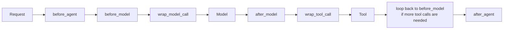
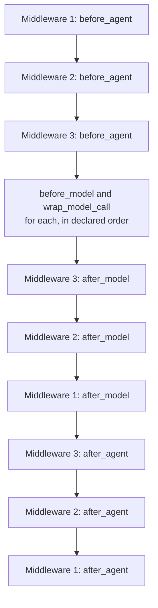

# Shell tools and custom middleware
> lead: How coding assistants really edit files (a terminal), then how to write your own middleware with the six hooks, decorators and classes, and the rule for execution order.
meta: Class 14 | 16 August | 45 min read | No code folder shared for this class

:::repo No code was shared for this class
The repo has a written summary but no code folder for Class 14. Snippets come from that summary. Verify exact names against your installed LangChain version, and confirm hook order yourself with the print-statement lab at the end.
:::

## Why it matters

Built-in middleware is generic by design. Your business rules are not: no customer books more than two movies in a session, flag any mention of a competing cinema, log every cancellation in a specific audit format. Custom middleware is how you encode rules only you know. It is also a favourite interview topic because **hook order** and **`before_model` vs `wrap_model_call`** trip people up.

## Core ideas

### 1. Shell tool middleware: how "AI that edits your code" works

How do Claude Code, Cursor and GitHub Copilot create and edit real files on your machine? They all have one thing in common: **access to a terminal.** Anyone who can run shell commands can create, edit and delete files and run scripts. That is the whole trick.

```python
from langchain.agents.middleware import ShellToolMiddleware, HostExecutionPolicy
from langchain.agents import create_agent

cinebot_shell_agent = create_agent(
    model=model,
    tools=[],
    middleware=[
        ShellToolMiddleware(
            workspace_root="/content/cinebot_workspace",     # a real Colab path
            execution_policy=HostExecutionPolicy(),
        ),
    ],
)
```

**Tool or middleware?** Both, honestly. It behaves like a tool, and LangChain files it under middleware as a design choice. What matters is what it does: it exposes a **persistent shell session** the agent can send real commands through.

:::key Where does the agent actually run?
Not on a LangChain server. On the machine running your code. Google Colab is a full Linux machine with its own file system rooted at `/content`. The model provider only supplies the **brain**, deciding which command should run. The execution happens wherever your agent's code runs, with whatever shell access it was given. `workspace_root` scopes every file operation to that folder.
:::

| Execution policy | Behaviour |
| --- | --- |
| `HostExecutionPolicy()` | Full direct access to the host: fine for a trusted environment such as a personal Colab or dev sandbox |
| Docker-based | An isolated container per run, so nothing touches the host |
| Codex sandbox | Reuses an existing Codex CLI sandbox for extra isolation |

The live demos all followed the same pattern: the model requests a shell command, the tool runs it, and the result returns as a tool message before the model summarises.

- "Create a reports folder if it does not exist": a real folder appeared.
- "Research the NBA and save it to nba_research.txt": asking ChatGPT gives a file that exists only in **ChatGPT's own sandbox** and can never reach your machine. With shell access, the file landed in the workspace.
- "Create `Hello_world.py`": the history showed human message, AI message with the tool call (`cat > Hello_world.py << ...`), tool message confirming the write, final AI summary.
- "Write a script, run it, delete it" and "create and run a calculator app": a full write, execute, clean-up cycle.

Two related pieces belong to a later module, Deep Agents: a filesystem middleware with four scoped operations (not full shell access) and sub-agent orchestration.

### 2. Why custom middleware

Generic middleware cannot know your rules. This is the same relationship Pydantic has to Python: Python has no field-level validation, so a layer was built on top to add it. Custom middleware is the layer for **your** rules.

### 3. The six hooks

Hooks are extension points that let you intercept, inspect or modify agent execution at specific stages.



| Hook | Runs | Use for |
| --- | --- | --- |
| `before_agent` | **Once**, at the very start | Setup: open a connection, load data |
| `before_model` | Every loop pass | Observe or change state before the model |
| `wrap_model_call` | Every loop pass | Rewrite the **actual request** to the model |
| `after_model` | Every loop pass | Inspect or change what the model returned |
| `wrap_tool_call` | Every loop pass | Wrap a tool execution |
| `after_agent` | **Once**, at the very end | Teardown: close connections |

:::trap Why is there no before_tool or after_tool?
A LangChain design choice, not a universal rule. Google's ADK exposes separate before and after tool callbacks. LangChain folds that into `wrap_tool_call`, which can do the same. Frameworks make different trade-offs, like Python needing Pydantic for validation while Java and C++ have it built in.
:::

:::key before_model vs wrap_model_call
`before_model` gives you **state and runtime**: good for observing and logging, but you cannot rewrite the request. `wrap_model_call` gives you the **actual request object**, so you can swap the model, strip tools or change messages before handing control to the handler.

Restaurant analogy: `before_model` is being seated before the restaurant: you can observe and set up some things. `wrap_model_call` wraps the whole experience: you give your exact order, down to "no onions, I am allergic."
:::

What `wrap_model_call` can change on the outgoing request: the model, messages, system message, tool choice, tools list, response format, state, runtime and model settings. Any of those fields is fair game.

### 4. Decorator-based middleware

```python
from langchain.agents.middleware import before_model, before_agent, after_agent
from langchain.agents import AgentState
from langgraph.runtime import Runtime
from typing import Any

@before_model
def log_before_model(state: AgentState, runtime: Runtime) -> dict[str, Any] | None:
    """Log every call about to be made to the model."""
    print(f"[LOG] About to call model with {len(state['messages'])} messages so far")
    return None            # None means "observed, nothing to change"

logged_agent = create_agent(model=model, tools=[], middleware=[log_before_model])
```

Returning `None` is meaningful: it says "I observed, I did not change anything", as opposed to returning a value that modifies state.

**Setup and teardown:**

```python
@before_agent
def connecting_to_DB(state: AgentState, runtime: Runtime) -> dict[str, Any] | None:
    print("I have connected to DB")
    return None

@after_agent
def disconnecting_to_DB(state: AgentState, runtime: Runtime) -> dict[str, Any] | None:
    print("I have disconnected to DB")
    return None

agent = create_agent(model=model, tools=[],
                     middleware=[connecting_to_DB, log_before_model, disconnecting_to_DB])
# Output order: connected, then the model log, then disconnected
```

:::trap A hook needs the parameters its type provides
Leaving out `state` and `runtime` on a `@before_model` function throws "takes 0 positional arguments but 2 were given", because the framework still calls it with both. You do not pass them yourself; LangChain calls your function.
:::

### 5. Why "before model" is its own hook

A user's first message contains a name, email and booking id. Redact at `before_agent` or at `before_model`?

It depends on what still needs the raw value. A `cancel_booking` tool may genuinely need the real booking id, so stripping it too early at `before_agent` would break it. But the **model** does not need the raw value. Masking at `before_model` protects the brain from sensitive data while leaving it available to tools. That is why the hooks are separate, deliberate stages.

### 6. `wrap_model_call`: VIP gating and dynamic model selection

```python
@wrap_model_call
def gate_vip_tools(request, handler):
    """Only expose book_vip_lounge to VIP members."""
    is_vip = request.state.get("is_vip_member", False)
    if not is_vip:
        allowed = [t for t in request.tools if t.name != "book_vip_lounge"]
        request = request.override(tools=allowed)
    return handler(request)
```

**Cost-aware model selection:**

```python
advanced_model = init_chat_model("anthropic:claude-sonnet-4-6")
basic_model = init_chat_model("anthropic:claude-haiku-4-5-20251001")

@wrap_model_call
def dynamic_model_selection(request, handler):
    """Cheap model for short conversations, capable one once it gets complex."""
    message_count = len(request.state["messages"])
    chosen = advanced_model if message_count > 10 else basic_model
    return handler(request.override(model=chosen))

cost_aware_agent = create_agent(model=basic_model, tools=cinebot_tools,
                                middleware=[dynamic_model_selection])
```

A short exchange does not need the most expensive model. Past 10 messages the agent upgrades. This is the idea behind ChatGPT's and Claude's automatic model routing. `wrap_model_call` is right because it gives the exact request to override the model, which `before_model` cannot do.

:::tip What gets used in real client work
Two patterns: **automatic model selection** by conversation complexity, and **dynamic tool loading**. The same two taught in class, not exotic edge cases.
:::

### 7. Decorator or class?

| | Decorator | Class (`AgentMiddleware`) |
| --- | --- | --- |
| Best for | One hook, quick prototype | Several hooks, reuse, configuration |
| Sync and async | One implementation | Can define both for the same hook |
| Reuse | Re-decorate each time | Define once, instantiate across projects |
| State | Awkward | Holds its own state across calls (`self._num_calls`) |

```python
class CallCounterMiddleware(AgentMiddleware):
    def __init__(self, warn_after: int = 3):
        super().__init__()
        self._num_calls = 0
        self.warn_after = warn_after

    def before_model(self, state, runtime):
        self._num_calls += 1
        if self._num_calls > self.warn_after:
            print("That is a lot of calls. Keep your credit card ready.")
        return None
```

A method with the exact hook name (for example `def wrap_model_call(self, ...)`) is picked up automatically; no decorator needed inside a class.

**Extending a built-in.** You can subclass `PIIMiddleware` and add behaviour, for example a new `wrap_model_call` the parent never used. If you override `before_model` or `after_model`, you **replace** that hook, so copy the original logic first and add to it so you do not lose existing behaviour.

### 8. Execution order: the cooking analogy

Think of tasting food while cooking as a middleware with **two hook points**: after adding salt, and again before serving. One middleware, two places it runs.



:::key Before and wrap in order. After in reverse.
Every `before` and `wrap` hook runs in the **order you declared** the middlewares. Every `after` hook runs in **reverse**. Whatever opens first should close last: a stack (last in, first out), not a queue. If middleware 1 opens a database in `before_agent`, it should be the **last** to close it in `after_agent`.

The class notes say `wrap_tool_call` does not reverse: it runs in declared order. Verify with the print-statement lab below.
:::

A good PII middleware needs **two** hook points: mask input at `before_model` so it never reaches the brain, and check the model's output at `after_model` in case it generates something sensitive (like a made-up Aadhaar number) before it reaches the user.

### 9. Best practices

- One middleware, one job.
- Handle errors inside the middleware so its own bug does not crash the agent.
- Node-style hooks (`before_model`) for observing; wrap-style (`wrap_model_call`, `wrap_tool_call`) when the request must change.
- Document any custom state properties a middleware relies on.
- Test middleware independently.
- **Default to a built-in** whenever one covers the need.

## Questions from class worth knowing

:::qa Multi-agent: LangChain or LangGraph?
The same agent from the end user's view. LangGraph gives deeper control of the underlying graph. LangChain already supports multi-agent setups. Use LangGraph when you must intervene inside the graph (custom state changes, fine control).
:::

:::qa Is the execution graph a DAG?
No. The agentic loop can cycle: model, tool, model again. LangGraph exposes and lets you control that graph; LangChain builds and runs it for you.
:::

:::qa Should I use an agent to validate login or session status?
No. That is plain coding. Reserve agents for points that need intelligence or tools. Putting an agent on routine auth is a design mistake.
:::

:::qa Does every workflow step cost tokens?
No. Tokens are consumed only when the model is called. Your own Python logic costs nothing, and tool execution triggered by a model decision adds no extra holding cost. Prompt caching reduces cost.
:::

:::qa Should one project mix LangChain, LangGraph and other frameworks?
Generally no. Pick one framework and build multiple agents inside it. For separate systems that must talk, connect them with A2A (agent-to-agent) or a plain API.
:::

:::qa I edited a transfer amount in HITL and the agent asked for approval again. Why?
That came from the **model's** judgment, not the framework. After the partial transfer, it reasoned a remaining balance needed handling and asked again. It is not scripted behaviour of `HumanInTheLoopMiddleware`.
:::

:::qa Can an agent reach a remote secured machine (for example Kubernetes) over SSH?
Yes: set the SSH connection as a startup command in the shell tool's configuration, and the agent inherits that access through your connected machine.
:::

:::qa Can a browser web app get a terminal like Claude Code?
No. Browsers are sandboxed and cannot reach your file system or terminal, which would be a severe security flaw. You need an installed application (a VS Code extension) or a proper access layer like MCP, never raw browser automation.
:::

:::qa Is it safe for an agent to read an OTP to automate a login?
Only through an explicit, legitimate integration (an MCP connection or messaging tool that accesses mail or messages with the user's knowledge). Never by simulating browser or screen automation to intercept an OTP. That is a serious security anti-pattern.
:::

## Common mistakes

| Mistake | Symptom | Fix |
| --- | --- | --- |
| Using `before_model` to change the request | Cannot rewrite what is sent | Use `wrap_model_call` |
| Redacting too early at `before_agent` | A tool loses a value it needs | Redact at `before_model` |
| Hook function missing `state` and `runtime` | "takes 0 positional arguments but 2 were given" | Accept the parameters the hook provides |
| Overriding a parent hook without copying its logic | Original behaviour lost | Copy, then extend |
| Assuming `after` hooks run in declared order | Resources closed in the wrong order | After hooks run in reverse |
| Giving `HostExecutionPolicy` to an untrusted workload | Host exposed | Use Docker or a sandbox policy |
| Building custom middleware for something built-in | Needless code | Check the built-ins first |
| One big middleware doing many things | Hard to test | One job per middleware |

## Hands-on lab

1. Recreate the shell demo: create a file, run a script, clean up, and map each step in the message history.
2. Write a `before_agent` and `after_agent` pair and confirm the print order.
3. Build `dynamic_model_selection` with your own two models and threshold.
4. Convert a decorator middleware into a class with a call counter.
5. Subclass `PIIMiddleware` and add a new hook.
6. Attach three middlewares, print in every hook, and verify before-in-order and after-in-reverse, including `wrap_tool_call`.

## Interview corner

:::pitch
Middleware exposes six hooks around the agent loop: `before_agent` and `after_agent` run once, and `before_model`, `wrap_model_call`, `after_model` and `wrap_tool_call` run on every loop pass. I use decorators for a single hook and classes when I need several hooks, state or reuse. Before and wrap hooks run in declared order and after hooks run in reverse, like a stack.
:::

### Basics

:::qa Name the six hooks and which run once.
`before_agent`, `before_model`, `wrap_model_call`, `after_model`, `wrap_tool_call`, `after_agent`. Only `before_agent` and `after_agent` run once per invocation; the others run on each pass through the loop.
:::

:::qa How do coding assistants edit files?
They have terminal access. A shell tool lets the model request commands, your machine runs them and the output returns as a tool message. The model supplies the brain; execution happens where the agent runs.
:::

:::qa Decorator or class middleware?
Decorators for a quick single hook. Classes for several hooks, internal state, sync and async versions and reuse across projects.
:::

### Intermediate

:::qa `before_model` vs `wrap_model_call`?
`before_model` receives state and runtime and is for observing or setting state. `wrap_model_call` receives the actual request so you can change the model, messages, tools and settings before calling the handler.
:::

:::qa Where would you redact PII, `before_agent` or `before_model`?
At `before_model`, because tools may need the raw value but the model does not. Also check the model's output at `after_model`.
:::

:::qa Where would you open and close a database connection?
Open in `before_agent` and close in `after_agent`: each runs exactly once per invocation.
:::

:::qa How would you implement cost-aware model selection?
A `wrap_model_call` that counts messages and calls `handler(request.override(model=...))`, using a cheap model for short chats and a stronger one past a threshold.
:::

### Tricky

:::qa In what order do hooks run with several middlewares?
`before` and `wrap` hooks in the declared order. `after` hooks in reverse, so whatever opened first closes last. The class says `wrap_tool_call` stays in declared order; I would confirm that with a quick print test.
:::

:::qa Why is there no `before_tool` hook?
A LangChain design choice: `wrap_tool_call` covers it. ADK exposes separate before and after tool callbacks. Different frameworks make different trade-offs.
:::

:::qa A subclass overrides `before_model`. What happens to the parent's behaviour?
It is replaced. Copy the parent's logic first and add to it, or you lose existing behaviour. You can also add a hook the parent never defined.
:::

:::qa Should authentication use an agent?
No. It is routine code. Use agents where intelligence or tool access is needed, not for login or session checks.
:::

:::qa When is `HostExecutionPolicy` acceptable?
For trusted environments such as a personal notebook or dev sandbox. For anything less trusted, use an isolated Docker or sandbox policy so nothing touches the host.
:::

## Quick revision

- [ ] I can explain how a shell tool powers coding assistants and where it runs
- [ ] I can list the three execution policies and when to use each
- [ ] I can name the six hooks and which run once
- [ ] I can explain `before_model` vs `wrap_model_call` with the restaurant analogy
- [ ] I can write a decorator middleware and a class middleware with state
- [ ] I can explain before in order, after in reverse, and the stack idea
- [ ] I can explain why PII needs two hook points
- [ ] I can list the best practices for writing middleware

## Sources and further reading

- [Class 14 full notes]({{src:classes_transcription_summary/14 - 16 Aug - LangChain - Shell Tools & Custom Middleware.md}})
- [Class 14 short summary]({{src:classes_summary/14 - 16 Aug - Shell Tools & Custom Middleware.md}})
- [Weekend 08 overview]({{src:Weekend 08 - 15-16 Aug/README.md}})
