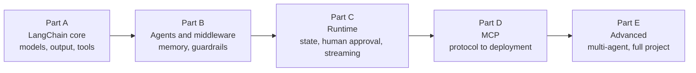

# Agentic AI with LangChain
> lead: A chapter-by-chapter reader built from the live class code, notebooks, PDFs and class summaries, written so you can learn each topic and defend it in an interview.
meta: Book 3 of the library | Draft for review

## How to read this book

:::key Read the earlier books first
This is book 3 of the library. It assumes **Python and Agent Foundations** (the agent loop, tokens, setup) and **Pydantic** (used for structured output in chapter 4). Read those first, or skim them if you already know the basics.
:::

:::key Read in order
Each chapter builds on the one before it. Chapter 1 explains `create_agent()`, Chapter 6 adds memory and middleware, and Chapter 10 adds human approval. If you skip ahead, the later chapters will assume terms you have not seen.
:::

Every chapter has the same shape, so you always know where to look:

| Section | What it gives you |
| --- | --- |
| **Why it matters** | The problem the topic solves, in a few lines |
| **Core ideas** | The concepts, with diagrams and analogies |
| **Code** | The key patterns, trimmed and explained line by line |
| **Under the hood** | What actually happens, so you can answer follow-up questions |
| **Common mistakes** | Mistake, symptom and fix in one table |
| **Hands-on lab** | A small exercise to make the idea stick |
| **Interview corner** | A 30-second pitch, then questions with model answers (tap to reveal), including tricky ones |
| **Quick revision** | A tickable checklist; your ticks are remembered on this device |
| **Sources** | Links to the exact class notes and code files in the course repository |

:::tip How to use the interview corner
Cover the answer, say yours out loud, then open it and compare. Aim to match the structure of the model answer, not the exact words.
:::

:::beyond How to read the labels
A box marked **Beyond the class** means the content comes from a different class than the chapter's own, or is my explanation added to fill a gap. Everything else comes from the class itself. Boxes marked **Repo note** point out problems or details in the course code.
:::

:::key Quiz me
The **Quiz me** page in the sidebar pulls every interview question from the chapters that are written. It shows one at a time with the answer hidden. Mark the ones you knew and they stop appearing.
:::

## The course at a glance

| Part | Classes | You will be able to |
| --- | --- | --- |
| A. LangChain core | 06 to 10 | Build agents with `create_agent`, control models, get structured output, write good tools |
| B. Agents and middleware | 11 to 14 | Add memory, guardrails, retries, todo lists and shell tools; write custom middleware |
| C. Runtime | 15 | Use runtime context and state, stream output, and pause for human approval |
| D. MCP | 16 to 22 | Explain why MCP exists, its lifecycle and primitives, then build, deploy and compare versions |
| E. Advanced | Weekends 13 to 14 | Use MCP inside LangChain, choose a multi-agent pattern, tour a full-stack project |

The foundations (classes 01 to 05) are in book 1, and the document Q&A half of Meridian is in book 4, **RAG**.

<!-- induction-add -->
## The course roadmap, from the induction session

*From `classes_transcription_summary/00 - 21 June - Course Induction & Roadmap.md` (the batch induction with the founder and the lead mentor).*

| | Agentic 2.0 | Agentic 3.0 |
| --- | --- | --- |
| Focus | Understanding agents | **Using and deploying** agents |
| Frameworks | Older LangChain and LangGraph | Latest LangChain, MCP, A2A, the Claude Agent SDK |
| Tools | Basic | Claude Code and other coding agents |
| Projects | Simpler builds | Production-grade, multi-agent, CI/CD-driven |
| New roles | None | Harness engineering, forward-deployed engineer |

2.0 comes free with 3.0 enrolment but is not a prerequisite. Azure AI Foundry, Bedrock and Vertex AI each get dedicated sessions.

**The curriculum flow:** foundations (LLMs and providers), core frameworks and protocols (LangChain, LangGraph, MCP, A2A, RAG, context engineering), mini-projects, interim projects deployed on cloud and a VPS, the coding-agent ecosystem, extended frameworks (ADK, Claude Agent SDK), and about nine production capstone projects. **Format:** Saturdays and Sundays 8 to 11 AM IST for five to six months, recordings within 24 hours, two years of access, and about two hours a week of self-practice.

**Two featured demos:** a document-intelligence RAG agent for a US client (Dockerised, with a chunking pipeline that divides data by update relevance) and a multi-agent procurement and finance system on Google Cloud Run with a risk agent, a tax agent, a control agent and a supervisor. The second is the Meridian project in Chapter 20.

**The four post-production KPIs** (the mentor's "golden rules", and a good interview answer to "how do you judge an agent in production"): **cost** (including tokens), **failure rate** (should trend to zero), **latency**, and **quality** (is the output actually useful?). His engineering philosophy: *simple is scalable*; minimise external, API and LLM calls because every hop costs time and money; prefer the simplest system that solves the problem instead of over-engineering for scale that never comes; use multiple LLMs only when the problem demands it (for example failover), because calling models in parallel by default just doubles cost.
<!-- /induction-add -->

<!-- practice -->
## Practice projects

Eight small projects, each placed beside the chapter it exercises. Build one at a time.

:::note About the domain
Examples lean towards clinical education and research, because a project in a field you know is easier to judge. **Never use real patient data** with any model or tool; use synthetic or de-identified examples, and keep a human in the loop for anything clinical.
:::

Choose the project that matches the block you want to master. Then write a **two-sentence story** you can say in an interview: the problem, the design choice (and the alternative you rejected), and one thing that failed and how you fixed it.

| # | Project | Where it is |
| --- | --- | --- |
| 1 | Guideline Q&A with RAG | [RAG book, start page](#rag-home) |
| 2 | Exam question generator | [Chapter 4](#agentic-ai-ch4) |
| 3 | Manuscript checklist reviewer | [Chapter 5](#agentic-ai-ch5) |
| 4 | Study buddy with memory | [Chapter 6](#agentic-ai-ch6) |
| 5 | Safe-action assistant | [Chapter 10](#agentic-ai-ch10) |
| 6 | Your own MCP server | [Chapter 16](#agentic-ai-ch16) |
| 7 | MCP-powered agent | [Chapter 18](#agentic-ai-ch18) (also the newsletter project) |
| 8 | Parallel reviewer panel | [Chapter 19](#agentic-ai-ch19) |

## A weekly rhythm

1. Pick one project and write its two-sentence interview story **before** you start.
2. Build the smallest version that works end to end.
3. Break it on purpose (bad input, a failing tool, a long conversation) and fix it.
4. Add one stretch item.
5. Update your story with what failed. That detail is what makes it sound real.
<!-- /practice -->

<!-- craftnotes -->
## The Colab notebook index in the course repo

The repo's `COLAB_NOTEBOOKS.md` lists every notebook shared "anyone with the link" in class, by class number, and most of the Colab links on the Craft page appear there. It matches the Craft entries: classes 07 and 08 (models, streaming, tools, structured output, messages, plus a revision notebook for parts 1 to 4), 09 (the CineBot structured-output notebook), 10 (the student reference for structured output and tools), 11 and 12 (all nine built-in middlewares worked live), 14 (shell tools, the six middleware hooks, decorator versus class middleware), and 15 (runtime and HITL). The same notebooks are checked into the repo as `.ipynb` files, which is what the middleware, runtime and structured-output chapters were built from. I did not open the Colab links themselves.

## What the Craft PDFs are

I extracted the text of all 15 PDFs attached on Craft that are also in the repo. Most are **single-page Excalidraw whiteboard exports** (class diagrams such as the agent and middleware architecture, the MCP overview, runtime and HITL, structured output and tools), so the text is scattered labels and the information is already in the class write-ups and the chapters. The few small extras: tool use costs **at least two model calls** (one to choose the tool, one to summarise its output); a middleware slide shows the hook order (`before_agent`, `before_model`, `wrap_model_call`, the model call, `after_model`, `wrap_tool_call`, tool execution, `after_agent`); and the MCP slide frames the idea as "not more intelligence, but the ability to see more". The 22-page **AI Industry Handbook** is a separate business-audience handout from an "ET Masterclass" (industry-by-industry use cases and companies) and is marked "Not for redistribution", so I did not reproduce it.

## What I did not read

- The Excalidraw files attached on the Craft page, and the LangChain Colab links themselves (the same notebooks are checked into the repo and were read from there).
- The clipped tail of the newsletter prompt.
- The 22-page AI Industry Handbook, which is marked "Not for redistribution" and is a business handout, not course content.
- The bodies of the instructor's series guides on APIs, AI web versus API economics, open source AI, production readiness and MCP, and of the RAG guide (I read their section names only; they are listed in the matching chapters).
- For the AI terms and Python-agents sites, only the first part of each page; the Pydantic site was read in full.
<!-- /craftnotes -->

## What is in this draft

:::note What is in this book
All 20 course chapters are written. Chapter 10A and the sections titled **From the docs** inside other chapters come from LangChain documentation pages that were read in full (30 Oct 2026). The instructor's Craft-page resources, the mini-project ideas and the notes on what was not read now sit on this page and beside the chapters they belong to.
:::

:::repo Gaps in the source repository
Classes 13 to 15 have written summaries but no shared code. There is no Weekend 12 folder. The Oct 10 to 11 folder contains only two links, so there is no class content for that weekend yet.
:::
