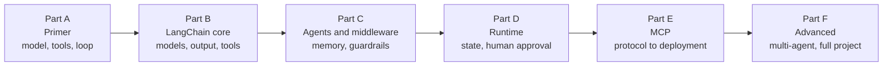

# Agentic AI 3.0 Study Notes
> lead: A chapter-by-chapter reader built from the live class code, notebooks, PDFs and class summaries, written so you can learn each topic and defend it in an interview.
meta: Draft for review | Primer and Chapter 1 ready

## How to read this book

:::key Read in order
Each chapter builds on the one before it. Chapter 1 explains `create_agent()`, Chapter 6 adds memory and middleware, and Chapter 10 adds human approval. If you skip ahead, the later chapters will assume terms you have not seen.
:::

Every chapter has the same shape, so you always know where to look:

| Section | What it gives you |
| --- | --- |
| **Why it matters** | The problem the topic solves, in a few lines |
| **Core ideas** | The concepts, with diagrams and analogies |
| **Code** | The key patterns, trimmed and explained line by line |
| **Under the hood** | What actually happens, so you can answer follow-up questions |
| **Common mistakes** | Mistake, symptom and fix in one table |
| **Hands-on lab** | A small exercise to make the idea stick |
| **Interview corner** | A 30-second pitch, then questions with model answers (tap to reveal), including tricky ones |
| **Quick revision** | A tickable checklist; your ticks are remembered on this device |
| **Sources** | Links to the exact class notes and code files in the course repository |

:::tip How to use the interview corner
Cover the answer, say yours out loud, then open it and compare. Aim to match the structure of the model answer, not the exact words.
:::

:::beyond How to read the labels
A box marked **Beyond the class** means the content comes from a different class than the chapter's own, or is my explanation added to fill a gap. Everything else comes from the class itself. Boxes marked **Repo note** point out problems or details in the course code.
:::

:::key Quiz me
The **Quiz me** page in the sidebar pulls every interview question from the chapters that are written. It shows one at a time with the answer hidden. Mark the ones you knew and they stop appearing.
:::

## The course at a glance

| Part | Classes | You will be able to |
| --- | --- | --- |
| A. Primer | 01 to 05 | Explain what an agent is and write the tool-calling loop from memory |
| B. LangChain core | 06 to 10 | Build agents with `create_agent`, control models, get structured output, write good tools |
| C. Agents and middleware | 11 to 14 | Add memory, guardrails, retries, todo lists and shell tools; write custom middleware |
| D. Runtime | 15 | Use runtime context and state, and pause for human approval |
| E. MCP | 16 to 22 | Explain why MCP exists, its lifecycle and primitives, then build, deploy and compare versions |
| F. Advanced | Weekends 13 to 14 | Use MCP inside LangChain, choose a multi-agent pattern, tour a full-stack project |

<!-- induction-add -->
## The course roadmap, from the induction session

*From `classes_transcription_summary/00 - 21 June - Course Induction & Roadmap.md` (the batch induction with the founder and the lead mentor).*

| | Agentic 2.0 | Agentic 3.0 |
| --- | --- | --- |
| Focus | Understanding agents | **Using and deploying** agents |
| Frameworks | Older LangChain and LangGraph | Latest LangChain, MCP, A2A, the Claude Agent SDK |
| Tools | Basic | Claude Code and other coding agents |
| Projects | Simpler builds | Production-grade, multi-agent, CI/CD-driven |
| New roles | None | Harness engineering, forward-deployed engineer |

2.0 comes free with 3.0 enrolment but is not a prerequisite. Azure AI Foundry, Bedrock and Vertex AI each get dedicated sessions.

**The curriculum flow:** foundations (LLMs and providers), core frameworks and protocols (LangChain, LangGraph, MCP, A2A, RAG, context engineering), mini-projects, interim projects deployed on cloud and a VPS, the coding-agent ecosystem, extended frameworks (ADK, Claude Agent SDK), and about nine production capstone projects. **Format:** Saturdays and Sundays 8 to 11 AM IST for five to six months, recordings within 24 hours, two years of access, and about two hours a week of self-practice.

**Two featured demos:** a document-intelligence RAG agent for a US client (Dockerised, with a chunking pipeline that divides data by update relevance) and a multi-agent procurement and finance system on Google Cloud Run with a risk agent, a tax agent, a control agent and a supervisor. The second is the Meridian project in Chapter 20.

**The four post-production KPIs** (the mentor's "golden rules", and a good interview answer to "how do you judge an agent in production"): **cost** (including tokens), **failure rate** (should trend to zero), **latency**, and **quality** (is the output actually useful?). His engineering philosophy: *simple is scalable*; minimise external, API and LLM calls because every hop costs time and money; prefer the simplest system that solves the problem instead of over-engineering for scale that never comes; use multiple LLMs only when the problem demands it (for example failover), because calling models in parallel by default just doubles cost.
<!-- /induction-add -->

## What is in this draft

:::note What is in this book
All 20 course chapters are written. Chapter 10A and the sections titled **From the docs** inside other chapters come from LangChain documentation pages that were read in full (30 Oct 2026). The last page, **From the Craft notes**, indexes the instructor's Craft page.
:::

:::repo Gaps in the source repository
Classes 13 to 15 have written summaries but no shared code. There is no Weekend 12 folder. The Oct 10 to 11 folder contains only two links, so there is no class content for that weekend yet.
:::
