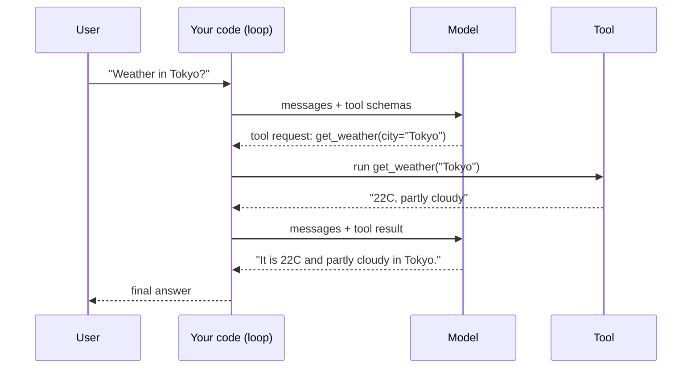

# Primer: what an agent is
> lead: An agent is an LLM that decides which tool to call, inside a loop, with its memory kept as a growing list of messages. Every later chapter is a better-engineered version of this loop.
meta: Part A | Classes 01 to 05 condensed | 15 min read

## Why it matters

Frameworks change every year, but this loop does not. Interviewers who ask about LangChain, LangGraph or MCP are usually checking whether you understand what sits underneath. If you can write the loop on a whiteboard, every framework question becomes easier.

## Core ideas

### 1. LLM calls are stateless

:::key The model remembers nothing
Each API call takes an input and returns an output. A chat app only *looks* like it remembers because it **resends the whole conversation on every message**. Memory is something you build around the model.
:::

### 2. Model, chatbot, agent

| | Model | Chatbot | Agent |
| --- | --- | --- | --- |
| Has history | No | Yes | Yes |
| Has tools | No | No | Yes |
| Decides what to do next | No | No | Yes |

An agent has three parts: a **brain** (the LLM), **memory** (the message list) and **tools** (functions it may call).

### 3. The model never runs a tool

:::trap "The model calls the function"
It does not. The model only returns a **request**: a tool name and its arguments. Your code runs the function and sends the result back as a new message. This is why you can validate, log, approve or block any call before it runs.
:::

### 4. The model sees a description, not your function

You give the model a schema for each tool: a name, a description and the parameters. The **description** is what it reads to decide when to use the tool, so write it like an instruction.

```python
get_weather_schema = {
    "type": "function",
    "function": {
        "name": "get_weather",
        "description": "Get the current weather for a city. Use this whenever "
                       "the user asks about weather in a specific place.",
        "parameters": {
            "type": "object",
            "properties": {"city": {"type": "string", "description": "e.g. 'Tokyo'"}},
            "required": ["city"],
        },
    },
}
```

One question can trigger **several tool calls in a single reply**. In class, a single question about capitals produced three calls at once.

## The agentic loop



```python
def run_agent(messages, max_turns=4):
    for _ in range(max_turns):
        response = client.chat.completions.create(
            model=model, messages=messages, tools=TOOL_SCHEMAS)
        message = response.choices[0].message

        if not message.tool_calls:               # plain text = final answer
            messages.append({"role": "assistant", "content": message.content})
            return message.content

        messages.append(message)                 # keep the model's tool request
        for call in message.tool_calls:          # may be several in one reply
            args = json.loads(call.function.arguments)
            result = TOOLS_BY_NAME[call.function.name](**args)
            messages.append({"role": "tool",
                             "tool_call_id": call.id,
                             "content": str(result)})
    return "Reached max_turns without a final answer."
```

:::key Why the loop calls the model again
The model cannot see a tool's output until you **append it as a message**. So after every tool run, you call the model again. The loop ends when the model replies with plain text instead of a tool request.
:::

## Under the hood

- **Memory is a Python list.** In the terminal chat, `conversation_memory` is one growing list. In Streamlit it lives in `st.session_state`, because plain variables reset on every rerun.
- **`max_turns` is a safety cap.** Without it, a confused model can loop forever and run up cost.
- **No tool means no tool call.** Asked for a currency conversion with no currency tool defined, the model answered in plain text instead of inventing a call.
- **Providers share one shape.** OpenAI, Groq and OpenRouter use the same chat format. Anthropic's SDK differs: `client.messages.create()` and `response.content[0].text`.
- **Structured output.** To get reliable data, ask for JSON only, strip any code fences, then validate with Pydantic before trusting a field.
- **Safe `eval`.** The calculator tool allowed only digits, operators and parentheses before running `eval()`.

<!-- sites-add -->
## From the instructor's interactive sites

*Added from the instructor's Netlify sites linked on the Craft page (read 30 Oct 2026): AI terms, the context-window simulator, Pydantic reference and "Agents, with just Python". The widgets below are rebuilt from those sites' own logic, not copied pages.*

### See tokens

:::widget tokenizer
Interactive demo (needs JavaScript): type a sentence and see it split into token-like pieces.
:::

### Watch the loop

:::widget agent-loop
Interactive demo: perceive, reason, act, observe, repeat.
:::

### Play with the context window

:::widget ctx-window
Interactive demo: a conversation that forgets its oldest messages when the window is full.
:::

:::widget ctx-memory
Interactive demo: save a fact, flood the window, and see a hallucinated answer appear.
:::

### AI terms in plain words (21 terms)

The instructor's glossary site groups 21 terms in six groups and gives each one an analogy.

| Group | Term | One line and the analogy |
| --- | --- | --- |
| Foundation | Large language model | A next-word predictor wearing the costume of understanding: a friend who read everything but was never told what any of it means |
| Foundation | Tokens | Lego bricks, not whole words. Prices are counted in tokens, so unusual long words cost more |
| Foundation | Vectors (embeddings) | A GPS coordinate for meaning: similar meanings sit close together, so distance between ideas can be measured |
| Foundation | Context window | A whiteboard of fixed size: once full, the oldest writing is erased whether or not it mattered |
| Foundation | Parameters | Billions of tiny mixing-console sliders, none meaningful alone. Size is only a rough proxy for capability |
| Reads you | Attention | Each word decides which neighbours matter ("bank" plus "deposited" means money), for every word at once |
| Reads you | Transformer | The engine; the LLM is the car. GPT, Claude, Gemini and Llama all run a version of it |
| Learns | Training | Millions of fill-in-the-blank quizzes where the real text is its own answer key |
| Learns | Fine-tuning | A focused residency after a general degree; it also teaches what not to say |
| Learns | RLHF | Puppy training at scale: humans pick the better answer, nudging behaviour. Raters can reward a confident tone over honesty |
| Talking to it | Prompting | Zero-shot is a one-line instruction; few-shot adds worked examples and makes output far more consistent |
| Talking to it | Temperature | A dial between the safe answer and the adventurous one. Low for facts and code, higher for brainstorming |
| Talking to it | Hallucination | A confident guess wearing the costume of a fact; the matching tone is what makes it dangerous |
| Getting smarter | RAG | An open-book exam: fetch relevant documents first, then answer. Only as good as what is retrieved |
| Getting smarter | Context engineering | Deciding what is already on the table before the model speaks: history summary, documents, preferences |
| Getting smarter | MCP | One universal port (USB-C) instead of a drawer of custom cables |
| Beyond chat | AI agents | Hands, not just a mouth: a goal, steps, tools, observe, loop until done |
| Beyond chat | Multimodal | More than one sense: images, audio and video as well as text |
| Beyond chat | Reasoning models | Trained to think step by step before the final answer |
| Beyond chat | Small language models | A tutor for a few subjects, often distilled from a large model: faster and cheaper |
| Beyond chat | AGI vs ASI | AGI matches a skilled human at any task; ASI exceeds human ability broadly. Neither exists today |

### Agents, with just Python: the concept path

The instructor's site builds an agent in 16 small ideas, always with the "windowless room" analogy (a brilliant reader with no phone). This is the same loop as above.

| Step | Idea in one line |
| --- | --- |
| AI model, chatbot, agent | A model guesses the next words; a chatbot is the same model handed the whole transcript each turn; an agent is the same model handed a phone and **deciding itself** when to use it |
| Calling a real model | One plain function call: text in, text out; everything else is a layer around it |
| Paid vs free providers | The shape of the call barely changes between providers (one difference in how the reply is unpacked) |
| Failing loudly | With no working provider, raise a clear error; a confidently fake answer is far worse |
| Structured output | Ask for a fixed JSON shape so code can read the reply |
| Validation | Check the shape the moment the reply arrives and reject anything that does not match |
| What is a tool | An ordinary function with no awareness of AI |
| Manual tool calling | We still decide and call it; the model decides nothing yet |
| The tool schema | A menu, not the kitchen: the model only sees the description, so the wording carries the weight |
| The model chooses | Given a question and the schema, it states which tool and arguments it wants, before any code runs: this is the moment it becomes an agent |
| The agent loop | Decide, act, observe, repeat; the number and order of steps are decided fresh each time |
| Memory | A growing list of messages and tool results re-sent on every call; no hidden memory system |
| The complete agent and why no framework first | Every piece in plain code; a framework later is the same loop with less repetition |

### Pydantic reference map

The instructor's Pydantic site is a ten-part reference. Its sections, in order: why Pydantic exists (type hints are documentation, not enforcement), your first model (`BaseModel` versus dataclass versus plain class, coercion, `model_dump()`), field constraints and custom validators (`Field()`, `Annotated`, `field_validator`, `model_validator`), computed fields and serialization control, nested models, Pydantic Settings (`BaseSettings`, `.env`, `SecretStr`), Pydantic with FastAPI, the AI bridge (validating what an LLM returns, OpenAI and Claude structured outputs, `Literal` and the retry pattern), where Pydantic goes next, and a final project that triages AI support tickets. Try its validation idea here:

:::widget pydantic-playground
Interactive demo: edit JSON and validate it against a small Pydantic-style model.
:::
<!-- /sites-add -->

<!-- repo3-add -->
## From the course repo: setup files and the Python agent projects

*Added from files I had listed but not read: `PREREQUISITES.md`, the Weekend 01 and 02 Python and Project 0 scripts, and the Weekend 04 LangChain notebooks (read 30 Oct 2026). Python itself stays a primer here, as you asked.*

### One-time setup (from `PREREQUISITES.md`)

| Step | What the repo says |
| --- | --- |
| Python | 3.10 or newer; individual projects pin an exact version in `.python-version` (the course pins 3.13) |
| `uv` | The package and project manager used all course long; each code folder ships `pyproject.toml` and `uv.lock`, so `uv sync` rebuilds the exact environment |
| Windows | Use Git Bash or Windows Terminal, never plain CMD or PowerShell |
| Editor | VS Code, because the course leans on `.py` scripts, a real terminal and proper debugging, not only notebooks |
| LLM key | At least **one** provider key. Free: **Groq** and **OpenRouter** (its `openrouter/free` model name auto-routes to a free model so it never goes stale). Paid: OpenAI, Anthropic |
| `.env` | Copy `.env.example` to `.env`, paste a real key (for example `GROQ_API_KEY=...`), then `uv run main.py`. `.env` is git-ignored at the repo root, so a real key cannot be committed by accident |

The free model in the LangChain notebook is created with `init_chat_model("openrouter/free", model_provider="openrouter")` (the notebook also names one specific free model, `nvidia/nemotron-3-super-120b-a12b:free`).

:::trap A real key is hard-coded in a notebook
`Langchain (1).ipynb` (Weekend 04, Models) sets an OpenRouter key directly in a cell. I am not reproducing it. Treat any key that has been committed as compromised: revoke it and use `.env`. (Chapter 18 notes a similar case.)
:::

### Project 0: the agent built in seven files

Weekend 02's `Project 0/` folder builds a complete agent with **no framework**, one idea per file. This is the same loop as the primer's, written out in code.

| File | Idea |
| --- | --- |
| `_01_ai_model_vs_chatbot_vs_agent.py` | A model alone, a chatbot (history re-sent), an agent |
| `_02_calling_the_ai_paid_and_free.py` | The same call against Groq, OpenRouter or OpenAI |
| `_03_structuring_with_pydantic.py` | Ask for a fixed shape, validate it |
| `_04_giving_it_a_tool.py` | A plain function that knows nothing about AI |
| `_05_teaching_it_to_choose.py` | The tool schema, so the **model** chooses |
| `_06_project_zero_agent.py` | The assembled loop with `max_turns` as a safety limit |
| `_07_streamlit_app.py` | A chat UI with three tools (sample weather, a guarded calculator, currency conversion) |

Three patterns worth stealing from them:

- **A provider picker.** Groq, OpenRouter and OpenAI all speak the OpenAI-compatible API, so one client works for all three by changing `base_url` and the model name (`llama-3.3-70b-versatile` on Groq, `openrouter/free` on OpenRouter, `gpt-4o-mini` on OpenAI), and it raises a clear error if no key is set. Anthropic's tool-calling response has a different shape and is covered later in the course.
- **`max_turns`.** The loop gives up after a fixed number of turns and returns "Reached max_turns without a final answer", so a confused model cannot loop forever (the same idea as `ModelCallLimitMiddleware` in Chapter 7).
- **A guarded calculator.** Only digits, operators and parentheses are allowed through before `eval()` runs, so arbitrary code cannot be smuggled in through the expression.

In `_07`, memory is `st.session_state.messages`, a plain list. The Python refresher's last files (`_10` to `_14`) build the same agent as a class: a tool that calls the model, an agent that only talks, an agent with one tool, with three tools (currency, weather, calculator), and finally with memory, whose docstring says memory "is just a Python list" that has been there since `_11` as `self.messages`.

:::repo `_06_project_zero_agent.py` does not run as committed
It parses, but it will fail on the first tool call. It defines `get_currency` twice (the second definition is just `pass`, so it returns `None` and replaces the first), lists only `get_weather` in `TOOL_SCHEMAS`, and has leftover live-coding scratch inside `run_agent`: a line that builds a `tool_calls` list using an undefined name `function` (a `NameError` when reached), plus `l1 = [1,2,3,4,5]` and some empty nested loops after the function. Use `_07_streamlit_app.py` for a version that is meant to run.
:::
<!-- /repo3-add -->

<!-- refresher-add -->
### The Python refresher files, in teaching order

*From the Weekend 01 README. This is an index only; Python stays a primer.*

| File | Covers |
| --- | --- |
| `_0` to `_4` | Basics recap, data structures (lists, dicts, tuples, list of dicts), OOP (a `BankAccount` and a `Book`), error handling (`try` and `except`), decorators (the generic wrapper pattern) |
| `_5_calling_a_real_api.py` | `requests` against a real currency API, the first real API and no AI |
| `_6_fake_ai_call.py` | The OpenAI-style call shape with zero dependencies, the first AI mention |
| `_7_ai_call_free_and_paid.py` | Groq and OpenRouter (free), OpenAI (paid, shown not required) |
| `_8_pydantic_with_ai.py` | The main Pydantic topic: `BaseModel`, `Field`, validators, nested models, validating LLM output |
| `_9` and `_10` | The API call from `_5` now Pydantic-validated, then a validated tool plus an AI call side by side with a decorator applied for real |
| `_11` to `_14` | The agent as a class: brain only, plus one tool (currency), plus weather and a calculator, plus memory |

The class-03 write-up also gives the **five AI terms** to know before building an agent: an LLM predicts the next *token*, not the next word; tokens are the billing currency and output costs more than input; embeddings put similar meaning close together; the context window is a whiteboard of fixed size; parameters are billions of weights fixed at training time, not the same thing as tokens.
<!-- /refresher-add -->

## Common mistakes

| Mistake | Symptom | Fix |
| --- | --- | --- |
| Not appending the tool result | Model asks for the same tool again | Append a `tool` message with the matching `tool_call_id` |
| No turn cap | Endless loop, surprise bill | Always set `max_turns` |
| Trusting model JSON blindly | Crash on a missing field | Strip fences, parse, validate with Pydantic |
| Memory in a local variable (Streamlit) | Forgets after each interaction | Use `st.session_state` |
| Vague tool description | Wrong tool chosen, or none | Write the description as an instruction |

## Interview corner

:::pitch
An agent is an LLM in a loop. It reads the conversation, decides whether to answer or call a tool, my code runs the tool and returns the result as a message, and the loop repeats until the model answers in plain text. Memory is just the message list I keep resending.
:::

:::qa Why do LLMs need memory added to them?
Each API call is stateless. The app stores the messages and sends the **full history** on every call, so the model can use earlier turns.

**Follow-up to expect:** "What is the cost of that?" Tokens grow with every turn, which is why later chapters cover trimming and summarising history.
:::

:::qa Who actually executes a tool call?
My code does. The model only emits the tool name and arguments. That separation lets me validate arguments, log calls, require approval or block a call before anything runs.
:::

:::qa How is an agent different from a chatbot?
A chatbot has history. An agent also has **tools** and a **loop** in which the model decides what to do next, including whether to stop.
:::

:::qa What stops an agent looping forever?
A turn cap such as `max_turns`, plus timeouts and clear tool descriptions. Production systems also add budgets and monitoring.
:::

:::qa The model returned an empty answer with a tool call. Is that a bug?
No. When the model wants a tool, `content` is empty and the useful data is in `tool_calls`. Your loop should check for `tool_calls` first.
:::

## Quick revision

- [ ] I can explain statelessness in two sentences
- [ ] I can draw brain, memory and tools
- [ ] I can write the loop from memory and say why it calls the model again
- [ ] I know the model returns a request, not a result
- [ ] I can explain why the tool description matters

## Sources and further reading

- [Class 04 notes: anatomy of an agent]({{src:classes_transcription_summary/04 - 5 Jul - Anatomy of an Agent.md}})
- [Class 05 notes: the agentic loop]({{src:classes_transcription_summary/05 - 11 Jul - The Agentic Loop (Pure Python).md}})
- [Project Zero code (files `_01` to `_07`)]({{tree:Weekend 02 - 4-5 Jul/04-05 - 5 Jul & 11 Jul - Anatomy of an Agent & The Agentic Loop/Project 0}})
- [Class 5 whiteboard slide (PDF)]({{src:Weekend 03 - 11-12 Jul/06 - 12 Jul - Introduction to LangChain/Agentic-Python.pdf}})
