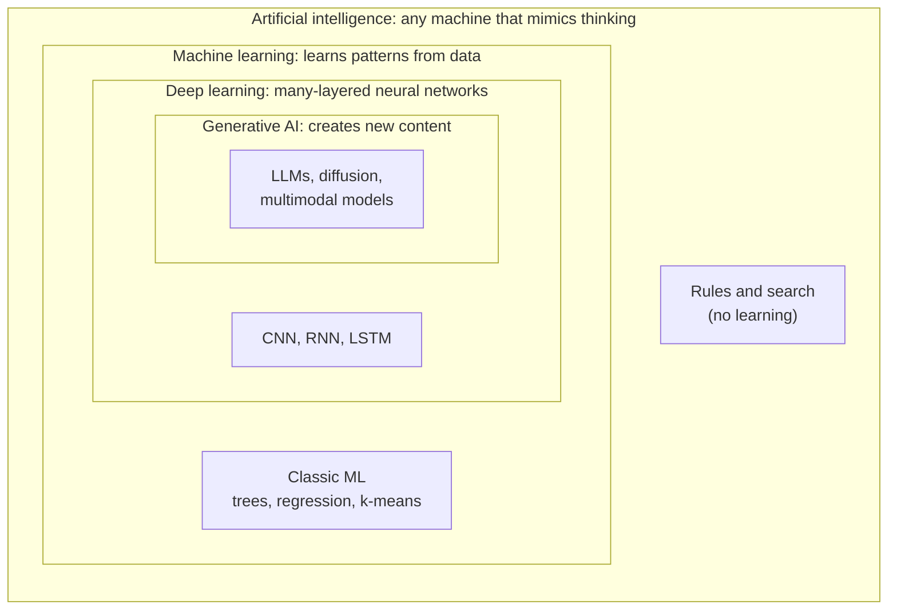

# AI, machine learning, deep learning and generative AI

*Four terms that get used as if they meant the same thing. They are four nested layers, and knowing which one a product really uses tells you what it can and cannot do.*

> [!NOTE]
> **📍 At a glance**
> - **You will learn:**
>   - the four nested layers
>   - AI that does not learn, and the three ways machines learn
>   - how a neural network trains
>   - what generative AI adds, and what a "model" actually is
> - **You will build:** a one-neuron classifier trained over many epochs, and a confidence threshold that answers "unknown"
> - **Level:** beginner · **Time:** about 40 minutes
> - **Builds on:** nothing; this is where the AI fundamentals start. Read it before [The SAP AI landscape](sap-ai-landscape.md) if AI is new to you

**After this chapter you can:**

- Place any AI product in the right layer: AI, machine learning, deep learning or generative AI
- Explain supervised, unsupervised and reinforcement learning with an everyday example each
- Describe what happens in training: weights, epochs, loss and test data
- Explain why a two-class image model labels an unrelated photo with high confidence, and how to guard against it
- Say what you download when you "download a model"

## 13.1 Four nested layers

- Think of a Russian doll: each layer sits inside the one around it.
- Moving inwards, each layer is more specialised, and more powerful for its kind of task.



| Layer | Goal | Includes | Example |
|---|---|---|---|
| **AI** | Mimic human thinking: reasoning, planning, language, decisions | Rules, search, ML, DL, GenAI | Spam filter, chess engine |
| **Machine learning** | Learn patterns from data instead of hand-written rules | Supervised, unsupervised, reinforcement learning | House price prediction |
| **Deep learning** | Learn the useful features automatically, with many-layered neural networks | CNNs, RNNs, transformers | Face recognition, translation |
| **Generative AI** | Create new content | Large language models (LLMs), diffusion models, multimodal models | ChatGPT, Claude, image generators |

## 13.2 AI that does not learn: rules and search

- **AI is the goal; machine learning is one way to reach it.** A thermostat that follows rules is AI. So is a neural network.
- **Rule-based AI:** if-then logic, written by people.
  - Characters in a video game that react to the player follow rules.
  - Deep Blue beat chess champion Kasparov in 1997 with hand-coded rules and search, and no learning at all.
- **Search and planning:** finding the best option among millions.
  - A route planner such as Google Maps searches for the best path to your destination.
  - A web search engine finds pages for your keywords.
- **Recommendation engines** suggest shows or products from what you and similar users did.
- Most of these systems pick from things that already exist. Until generative AI, machines rarely created new content.

## 13.3 Machine learning: learning from data

- Instead of writing the rules, you show examples. The algorithm finds the pattern and applies it to new inputs.

| Type | Data | How it learns | Examples |
|---|---|---|---|
| **Supervised** | Labelled: every example has the right answer | Learns to predict the label | Photos labelled "watch" or "clock"; spam detection; price prediction |
| **Unsupervised** | No labels | Finds structure on its own, such as groups | Customer segmentation, anomaly detection, topic grouping |
| **Reinforcement** | Feedback while acting | Tries, receives a reward or penalty, improves | Game playing, robot control; chat apps asking which of two answers you prefer |

- **Classic ML is not deep learning.** Linear regression, decision trees, random forests, support vector machines and k-means need no neural network.
- **Reinforcement learning from human feedback (RLHF):** when a chat app shows two answers and asks which you prefer, your click is a training signal.

> [!TIP]
> **One-line test for the type:** if you have the right answers, it is supervised. If you have only the data, it is unsupervised. If you have only a score for each attempt, it is reinforcement.

## 13.4 The data decides the quality

- **A model is only as good as its data.** It cannot learn a pattern that is not in the examples.
- *Quick, Draw!* is a Google game where you doodle and a neural network guesses the drawing.
  - Over 15 million players have drawn in it; Google open-sourced 50 million of the drawings as a dataset.
  - The guesses are good because so many people drew the same objects in so many ways.
- More data points help more than more training rounds: after a while, extra epochs barely improve the model.

> [!WARNING]
> **Biased data gives biased models**
> - If the examples come from one region, one product line or one type of customer, the model fails quietly on the others.
> - Check what the training data covers before trusting a model's accuracy figure.

## 13.5 Training a classifier without code

- **Teachable Machine** (by Google) trains an image, sound or pose classifier in the browser, with no code.
  1. **Gather:** create classes and add examples to each, from files or the webcam.
  2. **Train:** click *Train Model*; it takes seconds.
  3. **Export:** download or host the model. It is a real TensorFlow.js model that runs wherever JavaScript runs.
- This is supervised learning: each class name is the label.
- **The unknown-class trap:**
  - Train two classes, say two cartoon characters. Then show a photo of a third character the model never saw.
  - It still answers one of the two, often with high confidence. A two-class model must split 100% between its two classes.
  - Fixes: add an "other" class with varied examples, and refuse to answer below a confidence threshold.

```python
def classify(scores, threshold=0.75):
    """Return the top label, or 'unknown' when the model is not sure enough."""
    label, best = max(scores.items(), key=lambda kv: kv[1])
    return label if best >= threshold else "unknown"


# A two-class model must split 100% between its two classes
print(classify({"cat": 0.92, "dog": 0.08}))   # a clear cat photo
print(classify({"cat": 0.55, "dog": 0.45}))   # a rabbit photo: neither class fits
```

- Output: `cat`, then `unknown`.

✅ *Verified: run with Python 3 (details at the end).*

> [!CAUTION]
> **🔒 Keep company data out of free tools**
> - Free web tools are fine for learning, but never upload customer photos, documents or personal data to them.
> - Teachable Machine can run entirely on your own device, so images need not leave your computer. Check that before using any similar tool.

## 13.6 Neural networks and deep learning

- A **neural network** is loosely modelled on the brain: software "neurons" in layers, connected to each other.
  - **Input layer:** the raw data, such as pixels or numbers.
  - **Hidden layers:** each turns the previous layer's output into more abstract features. "Deep" means many hidden layers.
  - **Output layer:** the prediction.
- Every connection has a **weight**: how strongly one neuron's output counts for the next.

**How training works**
1. Start with random weights. There is no right or wrong starting point.
2. Run the training examples through the network and compare its predictions with the right answers. The size of the error is the **loss**.
3. Adjust every weight a little in the direction that lowers the loss.
4. Repeat. One full pass over the training data is an **epoch**.
- Connections that lead to right answers get stronger; the others fade. It is like a road you drive every day, or a language you stop speaking.
- **Test data** is held back from training. A model that does well on training data but badly on test data has memorised instead of learned (**overfitting**).
- For forecasting, the same idea is called **backtesting**: predict months you already have actuals for, and measure the gap.


- *TensorFlow Playground* (above) trains a small network in the browser. Press play and watch the weights and the decision boundary change, epoch by epoch.
- The spiral dataset stumps a shallow network; extra hidden layers let it bend the boundary around both spirals.

```python
import math
import random

random.seed(7)

# Toy data: (hours studied, hours slept) -> passed (1) or failed (0)
data = [((1, 4), 0), ((2, 5), 0), ((3, 6), 0), ((5, 7), 1),
        ((6, 6), 1), ((7, 8), 1), ((2, 8), 0), ((8, 5), 1)]

w = [random.uniform(-1, 1), random.uniform(-1, 1)]  # random starting weights
b = 0.0
lr = 0.05                                           # learning rate: size of each nudge


def predict(x):
    z = w[0] * x[0] + w[1] * x[1] + b
    return 1 / (1 + math.exp(-z))                   # squash to a 0..1 probability


for epoch in range(1, 501):                         # one epoch = one pass over the data
    loss = 0.0
    for x, y in data:
        p = predict(x)
        loss += -(y * math.log(p) + (1 - y) * math.log(1 - p))
        err = p - y                                 # how wrong this guess was
        w[0] -= lr * err * x[0]                     # adjust each weight a little
        w[1] -= lr * err * x[1]
        b -= lr * err
    if epoch in (1, 10, 100, 500):
        print(f"epoch {epoch:3d}  loss {loss / len(data):.3f}")

print("new student (4 h study, 7 h sleep):", round(predict((4, 7)), 2))
```

- Output: the loss falls from 1.490 (epoch 1) to 0.235, 0.042 and 0.011 (epoch 500); the new student gets 0.23, a likely fail.
- This is one neuron. A deep network stacks thousands of them in layers, but each one is trained the same way.

✅ *Verified: run with Python 3 (details at the end).*

| Architecture | Built for |
|---|---|
| **CNN** (convolutional) | Images and vision |
| **RNN, LSTM** (recurrent) | Sequences such as text or time series, one step at a time |
| **Transformer** | Language and much more; looks at the whole sequence at once (chapter 14) |

> [!WARNING]
> **More layers is not always better.** Depth adds cost and can make training unstable or overfit, with diminishing returns. Data quality and the right architecture matter more than size.

## 13.7 Generative AI: models that create

- Earlier AI mostly predicted, classified or recommended. People wrote the poems, songs and pictures.
- The **transformer** architecture and its **self-attention** mechanism (2017) turned models into creators: text, code, images, audio, video, even new molecules.
- How it learns: train on a huge amount of one kind of content, such as music.
  - The model learns the patterns: what is noise and what is music, how a beat or a jazz phrase sounds.
  - Asked for "a pop song", it uses those patterns to produce one that did not exist before. It does not search for an existing song.
- **Multimodal** models handle several kinds of content in one model: text, images, audio and video, in and out.

| Family | Creates | Examples |
|---|---|---|
| **Large language models (LLMs)** | Text and code | GPT, Claude, Gemini |
| **Diffusion models** | Images, video | Stable Diffusion |
| **Audio models** | Music, speech | Suno (songs), text-to-speech models |
| **Multimodal models** | Several kinds at once | Most current frontier chat models |

- To try many kinds of model in one place, Google AI Studio offers text, image, video, audio and music models side by side.

## 13.8 Putting it together: one chat assistant, four layers

| Layer | What it means for ChatGPT or Claude |
|---|---|
| **AI** | The goal: understand questions and answer helpfully |
| **Machine learning** | Trained on vast amounts of text, then improved with human feedback (RLHF) |
| **Deep learning** | Its architecture is a transformer: a deep network with billions of parameters in many layers |
| **Generative AI** | The answer is generated token by token: new text, not stored text |

**Myths to retire**

| Myth | Reality |
|---|---|
| "AI and machine learning are the same" | ML is one approach to AI; rules and search are AI without ML |
| "Deep learning always needs huge data" | Only partly true. A pre-trained model fine-tuned on a small, high-quality dataset can work well |
| "GenAI understands what it says" | LLMs predict the next token. They sound fluent but can be fooled, which is why they add disclaimers on medical, legal or financial questions |
| "More layers is always better" | Returns diminish; cost, overfitting and data quality decide |

## 13.9 What a "model" is

- Training produces a set of learned **weights**. That file of numbers is what everyone calls the **model**.
- "Downloading a model" from a hub such as Hugging Face means downloading those weights.
- "Model" covers any trained ML output: a house-price regression is a model; so is GPT.
- A **large language model** is a model specialised in text. It is "large" because it has billions of parameters and was trained on a vast amount of text.
- Image models mostly use a technique called **diffusion**; Stable Diffusion is a well-known example.
- **Pre-trained models change the work.** Someone else has trained the model on a huge corpus and improved it with human feedback. You use it in one of two ways:
  - through the vendor's API, paying per use
  - by running an open-weight model on your own hardware, if you have enough memory and GPU

> [!IMPORTANT]
> **🏭 In production**
> - Choose the simplest layer that solves the problem.
>   - Rules when the logic is known and must be auditable.
>   - Classic ML or a tabular model for predictions from table data.
>   - Generative AI for language, documents and code.
> - Rules are the cheapest to run and the easiest to explain to an auditor. An LLM is the most flexible, and the most expensive per decision.
> - Record which model version produced each prediction, so a wrong answer can be traced and the model rolled back.
>
> *Added by Claude*

## 13.10 Added by Claude, not from the sources

- **Classic ML is still the default for most enterprise predictions on tables** (churn, demand, credit risk): it is cheap, fast and explainable. Reach for deep learning when the data is images, sound or free text.
- **Hold out test data before you look at results**, and never tune the model on it. Otherwise the test score flatters the model.
- **Models drift.** A model trained on last year's data degrades when customers, prices or processes change. Schedule a re-check of accuracy, not just a one-time go-live test.

## 13.11 Interview corner

**What interviewers listen for:** clean definitions of the four layers, an example for each type of learning, and awareness of what goes wrong: bad data, overfitting and forced classifications.

### 🟢 Basic

<details class="qa"><summary>1. What is the difference between AI, machine learning, deep learning and generative AI?</summary>

- They are nested: AI is the broad goal; ML learns from data; DL uses many-layered neural networks; GenAI is DL that creates new content
- Rules and search are AI without any learning
- *Stronger answer:* place a real product in each layer, such as a chess engine, a churn model, face recognition and ChatGPT

</details>

<details class="qa"><summary>2. Explain supervised, unsupervised and reinforcement learning.</summary>

- Supervised: labelled examples, predict the label (spam or not spam)
- Unsupervised: no labels, find groups (customer segments)
- Reinforcement: learn from rewards while acting (game playing; choosing between two chat answers)
- *Stronger answer:* add that chat models combine all three in their training pipeline, ending with human feedback

</details>

### 🟡 Intermediate

<details class="qa"><summary>3. What happens when you "train" a neural network?</summary>

- Weights start random; predictions are compared with the right answers to give a loss
- Each weight is nudged to lower the loss; one pass over the data is an epoch
- Test data, held back from training, shows whether the model generalises
- *Stronger answer:* mention overfitting (training loss low, test loss high) and diminishing returns from extra epochs

</details>

<details class="qa"><summary>4. A two-class image model labelled an unrelated photo with 90% confidence. Why?</summary>

- A classifier must spread 100% over the classes it knows; it has no "none of these" option
- High confidence only means "more like A than B", not "this is A"
- Fix: add an "other" class with varied examples, and a confidence threshold that returns "unknown"
- *Stronger answer:* add monitoring of low-confidence cases in production, and send them to a person

</details>

<details class="qa"><summary>5. Is ChatGPT machine learning, deep learning or generative AI?</summary>

- All of them at once: it is AI, trained by ML, built on a deep transformer, and it generates text token by token
- *Stronger answer:* name RLHF as the ML step that made it follow instructions

</details>

### 🔴 Senior

<details class="qa"><summary>6. A customer asks to "use GenAI" to forecast next quarter's sales. What do you advise?</summary>

- Forecasting from a table is a prediction task; an LLM is the wrong tool and the most expensive one
- Use time-series ML, or a tabular foundation model such as SAP-RPT-1, and backtest it on months with known actuals
- Use GenAI around it: explaining the forecast, or answering questions about it in plain language
- *Stronger answer:* agree an error measure and a baseline (last year's figure) before building anything

</details>

<details class="qa"><summary>7. "More data and more layers always make a better model." Agree?</summary>

- More relevant, clean data usually helps; more layers have diminishing returns and raise cost and overfitting risk
- Biased or noisy data makes a model confidently wrong, however large it is
- *Stronger answer:* point to transfer learning, where a small high-quality dataset fine-tunes a pre-trained model

</details>

> [!TIP]
> **🧩 Design question:** a utility wants field technicians' photos sorted into "damaged meter", "intact meter" and anything else. Design it end to end.
> - Collect labelled photos per class, plus an "other" class (blurred shots, wrong objects).
> - Hold out test photos from different regions and seasons.
> - Train, then set a confidence threshold below which a person reviews the photo.
> - Monitor accuracy monthly and retrain when new meter models appear.

## Cheat sheet

| Term | One line |
|---|---|
| AI | Machines that mimic thinking; includes rules and search |
| Machine learning | Learns patterns from data: supervised, unsupervised, reinforcement |
| Deep learning | ML with many-layered neural networks |
| Generative AI | Deep learning that creates new content |
| Weight | Strength of one connection; what training adjusts |
| Epoch | One full pass over the training data |
| Loss | How wrong the predictions are; training lowers it |
| Overfitting | Good on training data, bad on new data |
| Model | The file of learned weights |
| LLM | A large model for text, with billions of parameters |

## Recap

- AI ⊃ machine learning ⊃ deep learning ⊃ generative AI; rules and search are AI without learning
- Supervised needs labels, unsupervised finds structure, reinforcement learns from rewards
- Training adjusts weights over epochs to lower the loss; test data catches overfitting
- A two-class model always picks one of its two classes; add "other" and a threshold
- Generative AI creates new content; LLMs, diffusion and multimodal models are its families
- A model is a file of weights, usually pre-trained by someone else and used through an API or run locally

## Practice

1. Open *Quick, Draw!* and draw six objects. Note which ones it guesses and which it misses, and why that might be.
2. In Teachable Machine, train two classes from your webcam (for example thumbs up and thumbs down). Then show a third gesture and note the confidence it reports.
3. In TensorFlow Playground, train the spiral dataset with one hidden layer of two neurons, then with three layers. Compare the test loss.
4. Change the threshold in the `classify` snippet to 0.5 and explain what happens to the rabbit photo.

## How this chapter was checked

- **Lecture 7 recording:** captions 0:00 to 0:38 and the Q&A at 2:52 to 2:55 read in full (the four layers, ML types, the demos, what a model is).
- **Course Drive (read in full):** the deck *AI · ML · DL · GenAI: the nested universe* (10 slides) and the *Live Demo Websites* document.
- **Read in full on 20 Nov 2026:** the Quick, Draw! data page, the Teachable Machine home page, and the TensorFlow Playground explanation.
- **Screenshot:** TensorFlow Playground, taken on 20 Nov 2026 (spiral dataset, three hidden layers, 655 epochs).
- **Run with Python 3.12, standard library only:**
  - the `classify` snippet prints `cat` and `unknown`
  - the training snippet prints a loss of 1.490, 0.235, 0.042 and 0.011 at epochs 1, 10, 100 and 500, then 0.23 for the new student

## Sources and further reading

- BTPAI course, Lecture 7 recording (BT018); course Drive: *AI ML Presentation* decks (BT051) and *Live Demo Websites AI* (BT060)
- Google, *Quick, Draw! The Data*: https://quickdraw.withgoogle.com/data
- Google, *Teachable Machine*: https://teachablemachine.withgoogle.com
- TensorFlow, *A Neural Network Playground*: https://playground.tensorflow.org
- Hugging Face, *Models*: https://huggingface.co/models
- fast.ai, the *Practical Deep Learning for Coders* course and book (recommended in the lecture for AI fundamentals): https://www.fast.ai
- Michael Nielsen, *Neural Networks and Deep Learning* (recommended on the Playground page): http://neuralnetworksanddeeplearning.com

Previous: [SAP AI certifications, roles and staying current](sap-ai-careers-certifications.md) · Next: [Inside a large language model: from prompt to answer](llm-prompt-to-answer.md)
