# Global account, subaccount and your first service subscription

*The six steps that take any BTP service from "licensed" to "open in your browser", shown end to end with Cloud Transport Management.*

> [!NOTE]
> **📍 At a glance**
> - **You will learn:** global accounts and subaccounts, how entitlements activate a licence, subscriptions versus instances, why an app needs a role collection, and the trial traps
> - **You will build:** a subaccount in AWS US East with Cloud Transport Management subscribed and opened, the same flow as Assignment 1
> - **Level:** beginner · **Time:** about 30 minutes reading, 20 minutes hands-on in a trial
> - **Builds on:** [Inside BTP: Neo, hyperscalers and regions](btp-neo-hyperscalers-regions.md). **Leads to:** [Choosing BTP services for a requirement](btp-services-for-a-requirement.md)
> - **Last checked:** 20 Nov 2026

**After this chapter you can:**

- Explain a global account and a subaccount with one analogy each, and say what lives in each
- Create a subaccount and choose its display name, region and subdomain
- Assign an entitlement (service plan and quota) from the global account to a subaccount
- Subscribe to an application and tell a subscription apart from a service instance
- Fix "you need at least the Viewer role" by assigning a role collection and logging in again
- Release quota in a trial account so a new subaccount can use it

## 4.1 The whole flow in one picture

Every BTP service follows the same path. Skip a step and the next one fails.

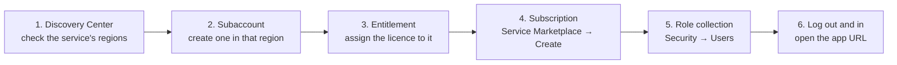

> [!TIP]
> The class analogy: an **entitlement** is paying at the tea-stall counter and getting a receipt. A **subscription** is handing the receipt to the vendor and getting your tea. No receipt, no tea, however long you wait.

## 4.2 Global account: the contract

- When a company orders BTP services, SAP creates a **global account** for it.
- The global account is the digital form of the contract. It holds every licence (service and plan) and how much of each (quota).
- Analogy: a metro card. It identifies you to the metro and holds the balance you spend on rides.
- Access is usually limited to a few administrators: platform owners, senior admins, sometimes the CTO's team.
- Real UI path to see your licences: *Global account → Entitlements → Service Assignments*.

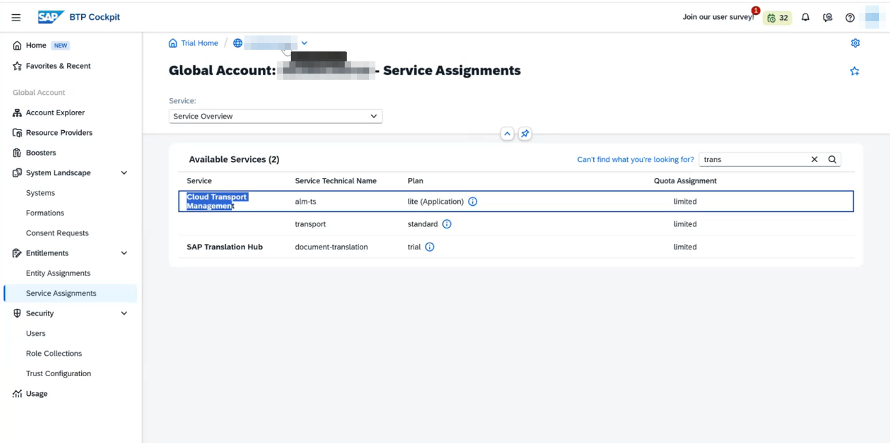

- One service can appear with two technical names. Here `alm-ts` is the app you open in a browser and `transport` is the API you call from code.
- A service that shows up in Service Assignments is one you are licensed for. If it is not there, nothing later will work.

## 4.2a How a global account reaches you, and what its header shows

- **Ordering is a business task.** A procurement or business team orders the BTP services; consultants don't.
- While ordering, they name one person as the first administrator.
- When the order is processed (a few hours), that person gets a "Welcome to SAP BTP" email with the cockpit URL. They log in with their company S-user.
- The new global account is empty: one user, no subaccounts, no directories. The first job is to check that the licences in Service Assignments match the bill of material.

| In the Account Explorer header | Meaning |
|---|---|
| Global account name | Usually the company name |
| Subdomain | The global account's own subdomain, unique across all of BTP |
| Open in Audit Log Viewer | Every admin action (creating subaccounts, adding users, assigning licences) is recorded and can be reviewed |
| Switch Global Account | Jump to another global account you have access to |
| Delete Trial Account | Exists only in trials. A productive global account cannot be deleted from the cockpit |

- **Few people get global-account access:** senior BTP administrators, sometimes finance (for cost) and the platform owner.
- Everyone else works in the subaccounts that match their job: integration people where Integration Suite runs, AI people where the AI services run, and so on.
- Only a global account administrator can move entitlements. A subaccount administrator can't, unless they also have global-account rights.

## 4.3 Subaccount: your foothold in one region

- A **subaccount** belongs to a global account and points at **one region of one provider**, such as US East (VA) on AWS.
- Services run inside subaccounts, along with apps, database instances, users and their rights.
- Real UI path: *Global account → Account Explorer → Create → Subaccount*.

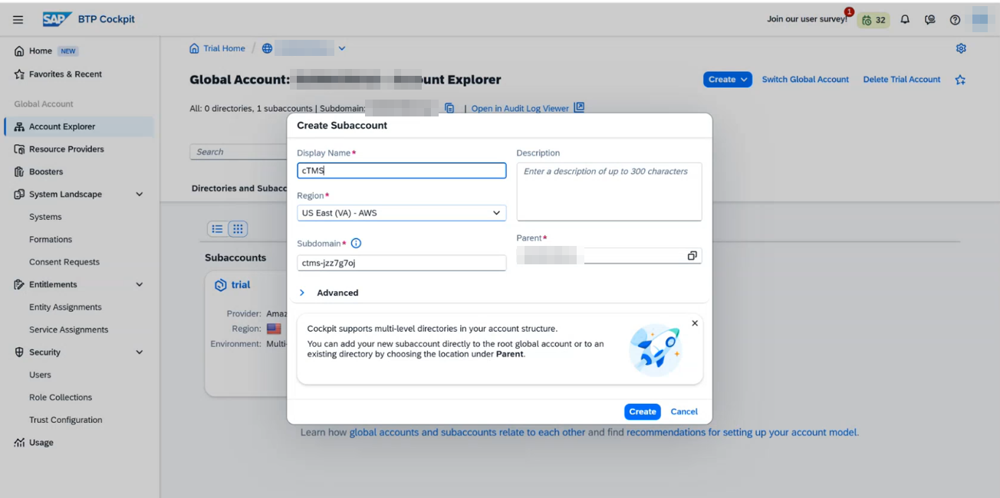

| Field | What it does |
|---|---|
| Display Name | A readable name; you can change it later. Name it after its purpose, for example `cTMS` |
| Region | The provider and data centre. It can't be changed later |
| Subdomain | Becomes part of every app URL in this subaccount. It must be unique in the region and can't be changed later |
| Parent | The global account, or a directory inside it (directories group subaccounts; covered later) |
| Advanced | *Used for production* flag, beta features and labels |

- The subdomain fills in from the display name, with random characters added. Change it before you click Create if you want a readable URL.
- Example from the course slides: subdomain `ctmszzz` in US East gives the app URL `https://ctmszzz.transport.cfapps.us10.hana.ondemand.com`.

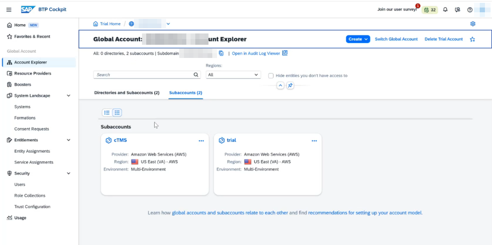

## 4.3a Creating subaccounts like a project, not one by one

**One subaccount per app per landscape**
- A custom app usually gets one subaccount per landscape tier, such as `LeaveApp-Dev`, `LeaveApp-Test` and `LeaveApp-Prod`.
- All three need the same services, because it is the same app.
- Some services are different: Cloud Transport Management is one central instance that moves releases between the dev, test and prod subaccounts. It is never tripled.
- When to share a subaccount and when to split is an "account model" decision; see [Directories, landscape tiers and commercial models](btp-directories-tiers-commercial-models.md), 9.1 to 9.5.

**Copy an existing subaccount instead of repeating the entitlements**
- Real UI path: *Account Explorer → Create*, then the option to create from an existing subaccount. This opens the **Create as New Subaccount** dialog.
- Pick the **Source Subaccount** and keep **Copy service plan assignments** on.
- The new subaccount gets the same entitlements. **Subscriptions and instances are not copied**: you still subscribe in each one.

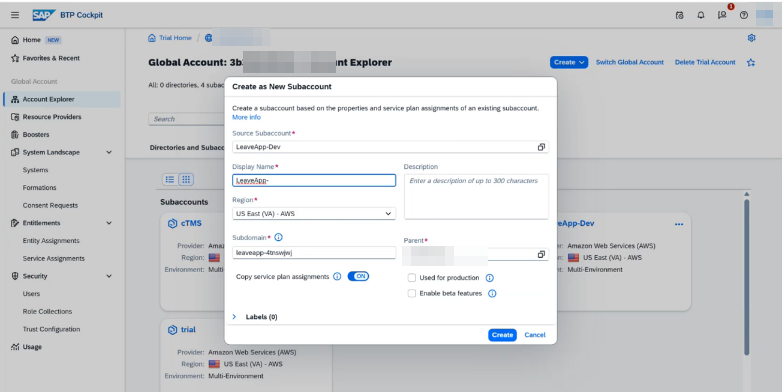

- Missed an entitlement in dev after copying it to test? Add it by hand in both: *Entity Assignments → select dev → Edit → add*, then the same for test.
- The copy only works if the global account still has enough free quota for every plan.

**The optional fields under Advanced**

| Field | What it does |
|---|---|
| Used for production | Marks the subaccount as productive |
| Enable beta features | Lets this subaccount use services and features SAP still has in beta |
| Labels | Free-text name and value tags (for example `app: leaveapp`, `region: europe`). For finding and grouping; no technical effect |

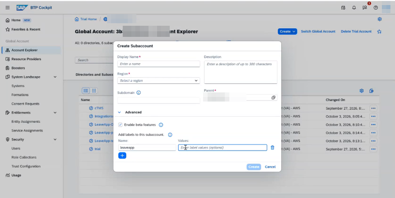

- In Account Explorer, **Hide entities you don't have access to** trims the list to your own subaccounts. You can switch between a list (tree) view and a tile view.

## 4.4 Entitlements: switch the licence on in that region

- The hyperscaler will not run a paid service until it sees a licence in that region. You show it by assigning an **entitlement** to the subaccount.
- An entitlement is a **service plan** plus a **quota** (how much of it this subaccount may use).
- Free and always-free services are entitled automatically when a subaccount is created. Paid ones you add by hand.
- Real UI path: *Global account → Entitlements → Entity Assignments → select the subaccount → Edit → Add Service Plans*.

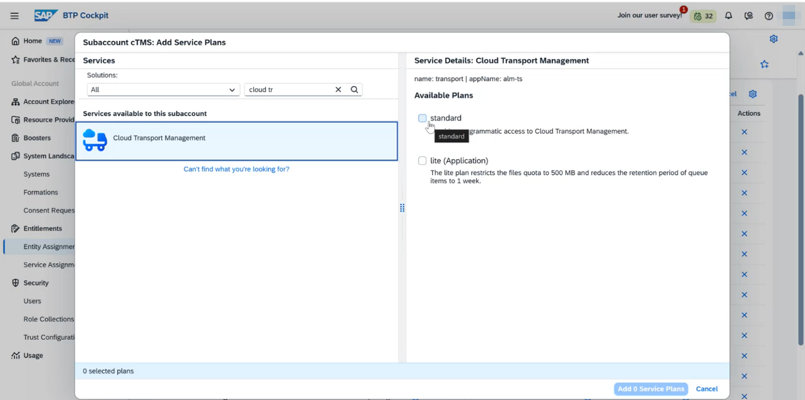

- Pick the service, tick the plan(s), click **Add Service Plans**, then **Save**.
- **Service plans** exist because one service serves several purposes. Here `lite (Application)` gives the user interface, `standard` gives API access.
- Check the result in the subaccount: *Subaccount → Entitlements*.

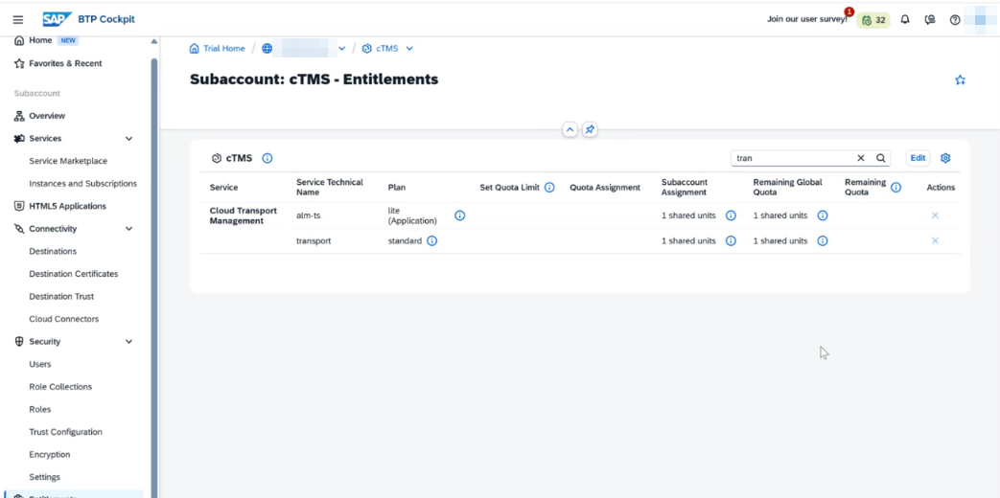

| View | Where | Shows |
|---|---|---|
| Service Assignments | Global account → Entitlements | Everything the company bought, and total quota |
| Entity Assignments | Global account → Entitlements | What each subaccount or directory has been given |
| Entitlements | Subaccount | What this subaccount may use now |

## 4.4a Entitlements in depth

**Service Assignments vs Entity Assignments**
- **Service Assignments** shows the whole contract: every service, plan and total quota in the global account.
- What it shows depends on the commercial model. Under a subscription contract you see what you bought. Under CPEA/BTPEA or Pay-As-You-Go you see everything you may consume.
- **Entity Assignments** shows what one *entity* has. An entity is a subaccount or a directory.
- You can select several entities at once and compare them. Paid accounts add a central search across all selected subaccounts.
- In edit mode you can tick several plans and add them in one go, or remove several at once, then **Save**.


**The four columns, and what each means**

| Column | Meaning | Example |
|---|---|---|
| Service | Readable name | Cloud Transport Management |
| Service technical name | Unique across BTP; what the CLI, Terraform and `mta.yaml` use | `alm-ts`, `transport`, `cloudfoundry`, `xsuaa` |
| Plan | One way of using the service | `lite (Application)` for the UI, `standard` for APIs |
| Quota | How much, in the service's own unit (its "metric") | Cloud Foundry in GB of memory, Business Application Studio in users, Integration Suite in messages |

**Why one service has several plans**
- **Audit Log Management:** `central` reads the global account's audit logs, `default` reads one subaccount's (web-checked).
- **Cloud Transport Management:** the application plan gives people the UI. The `standard` plan gives another system, such as Cloud ALM, API access to monitor transports.
- Because plans are counted separately, a subaccount can show more entitlements than the global account has services. One service with four plans counts four times.

**Shared units, and who may change a subaccount's entitlements**
- Some plans count in **shared units**. One unit is a bundle, for example a block of API calls or users, that several subaccounts draw on.
- The quota isn't split up front. Whichever subaccounts use the service consume the bundle between them, month by month.
- Trial accounts make most free plans shared, so "1 shared unit" appears everywhere. In a paid account the quantities are usually clearer.
- Cloud Foundry Runtime memory is the exception in a trial: all 4 GB sit in the "trial" subaccount and can't be moved elsewhere.

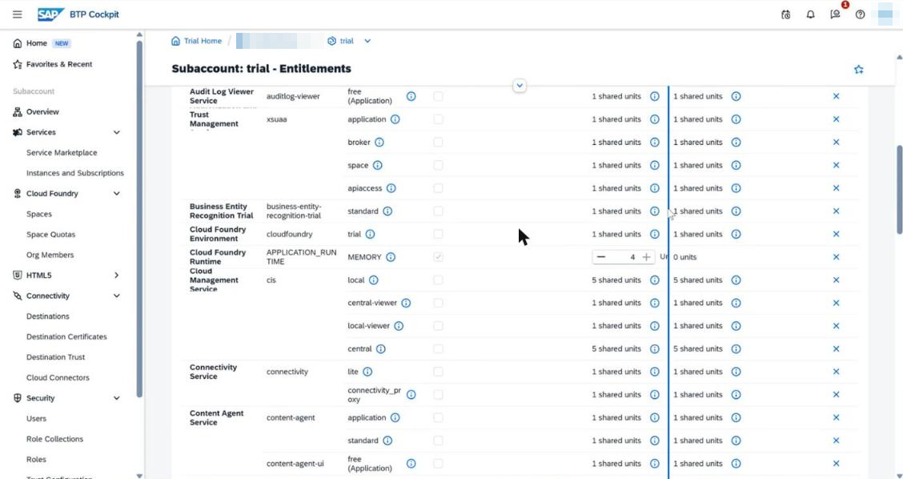

- A subaccount's own *Entitlements* page is the same list as *Entity Assignments* with only that subaccount selected.
- Its **Edit** button works only if you are also a global account admin. A subaccount admin alone sees it greyed out.
- In a managed directory, the directory admin assigns the plans instead ([directories](btp-directories-tiers-commercial-models.md)).

**Always-free services**
- Some services are always free. Every new subaccount gets them automatically, if they are offered in its region.
- Discovery Center marks them **Always Free**. Paid services you still assign by hand in Entity Assignments.

## 4.5 Subscribe: install the app in the subaccount

- Real UI path: *Subaccount → Services → Service Marketplace → Cloud Transport Management → Create*.
- Choose the plan (here the application plan) and click **Create**.

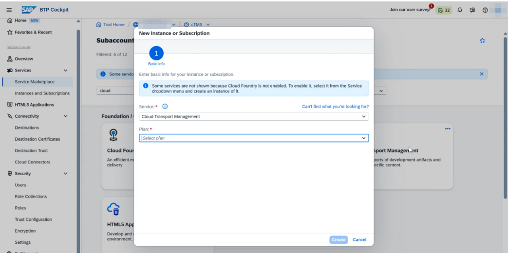

- Watch progress in *Subaccount → Services → Instances and Subscriptions*. The status moves from **Processing** to **Subscribed**.

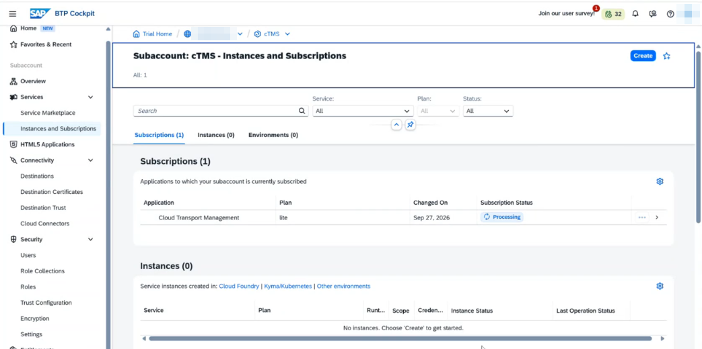

- When it says Subscribed, the row's menu offers **Go to Application**, with a URL built from your subdomain.

| | Subscription | Service instance |
|---|---|---|
| What you get | Your own tenant of a ready-made SAP application | A service resource your own app binds to (a database, a destination, a credential) |
| How you use it | Open its URL in a browser | Bind it to an app, read its keys from code |
| Needs Cloud Foundry or Kyma | No | Yes, it is created in a CF space or Kyma namespace |
| Example | Cloud Transport Management UI | A HANA Cloud database for your Node.js app |

> [!NOTE]
> - The banner in the dialog above ("Some services are not shown because Cloud Foundry is not enabled") is about instances.
> - Subscriptions to SAP applications work without Cloud Foundry. Services you create as instances need an environment first.

## 4.6 Authorize: role collections, then log in again

- Opening the app right after subscribing gives an error. Subscribing installed the app, but your user has no rights in it yet.

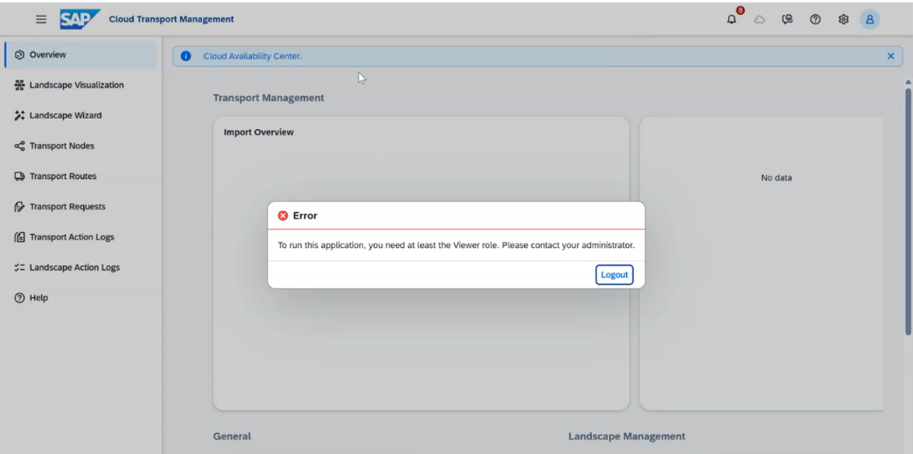

- Rights come as **role collections**: bundles of roles that you assign to users.
- Whoever creates a subaccount gets the *Subaccount Administrator* role collection on it. That allows administering the subaccount, but not using its apps.
- Real UI path: *Subaccount → Security → Users → select the user → Role Collections → Assign Role Collection*.

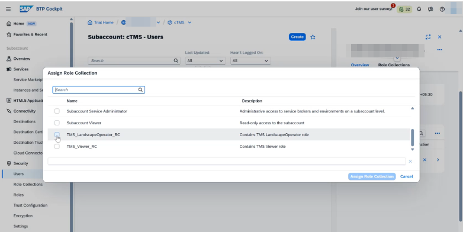

- Pick the collections the app delivered (here `TMS_LandscapeOperator_RC` or `TMS_Viewer_RC`) and confirm.
- **Log out and log in again.** Your rights travel in the login token, and a new token only comes with a new login.
- The app now opens without the error.

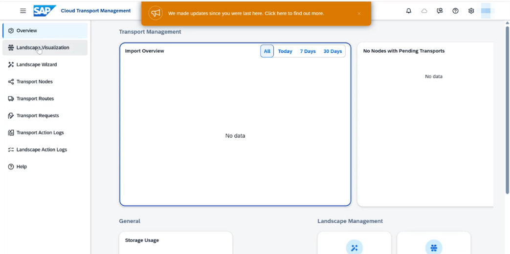

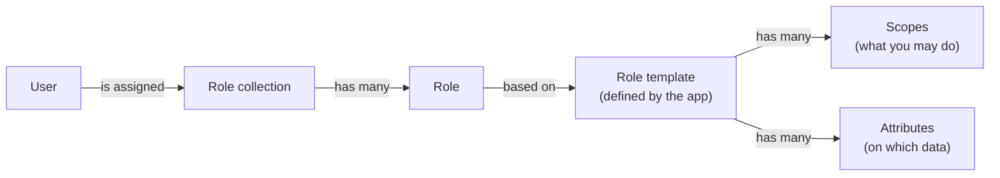

> [!NOTE]
> **Role collection names vary**
> - The cockpit in the recording offered `TMS_LandscapeOperator_RC` and `TMS_Viewer_RC`. Use the collections your own cockpit lists.
> - The Day 1 slides call it "TMS_Admin". SAP's developer tutorial instead creates a "TMS Admin" collection by hand and adds the app's *Administrator* role to it (web-checked).
> - [Users, role collections and access at every level](btp-users-role-collections.md) goes deeper.

> [!CAUTION]
> **🔒 Security**
> - Give each person the smallest role collection that does the job. A viewer does not need landscape-operator rights.
> - Subaccount Administrator is powerful. Keep it to the platform team, not every app user.
> - Review role assignments regularly; the cockpit's *Open in Audit Log Viewer* link shows who changed what.

## 4.7 The trial account and its traps

- Sign up from SAP's trial page. You choose **US East (VA) on AWS** or **Singapore on Azure**, the only two trial regions.

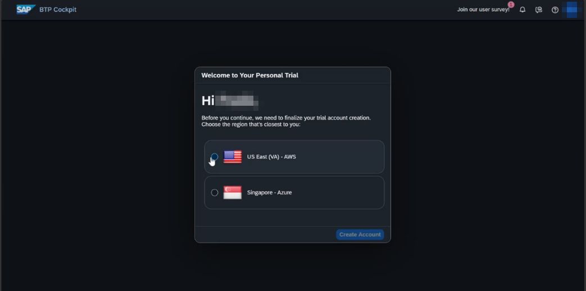

- The trial lasts **90 days**. Log in at least once every 30 days, or the account may be deleted (SAP trial FAQ, checked 19 Nov 2026).
- You need an sap.com account first; the sign-up asks to verify a phone number.
- One email and phone number give one trial global account. Inside it you can create as many subaccounts as you like, but only in the two trial regions.
- Because SAP assumes you are new, it sets everything up for you. A productive global account arrives empty instead.

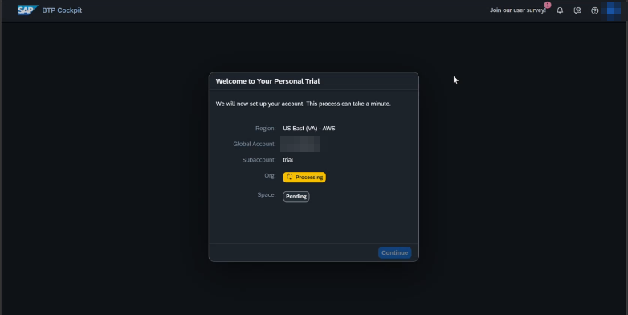

| SAP creates | What it is |
|---|---|
| Global account | Your trial "contract" |
| Subaccount `trial` | In the region you picked, holding **all** of the trial's quota |
| Cloud Foundry org | The Cloud Foundry account registered to that subaccount |
| Space `dev` | Where apps and service instances actually run inside the org |
| Business Application Studio subscription | Ready to use; it can't be removed while subscribed |

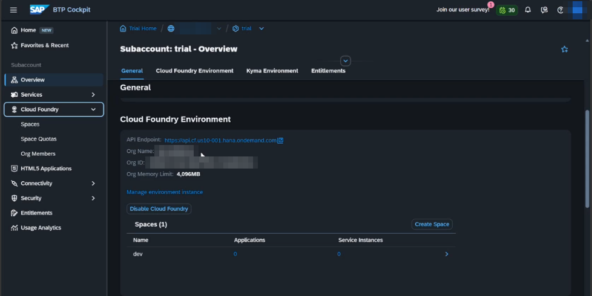

- The subaccount's left menu gains a **Cloud Foundry** section (Spaces, Space Quotas, Org Members) once Cloud Foundry is enabled.
- Org and space are covered properly in the Cloud Foundry chapter (Assignment 2 practises creating a space).
- SAP creates a subaccount called **trial** and gives it **all** of the trial's quota.
- So a new subaccount you create shows every paid service greyed out, with 0 quota left.
- Fix: release quota from "trial" first.
  - *Global account → Entitlements → Entity Assignments → select "trial" → Edit*
  - reduce or remove the service (for example Cloud Transport Management), then **Save**
  - select your new subaccount and assign the freed plan

> [!WARNING]
> **⚠️ Pitfall: never remove Cloud Foundry Runtime from the "trial" subaccount**
> The class slides warn that a trial cannot re-enable the Cloud Foundry runtime entitlement once it is removed. Release other services' quota instead.

- You also can't remove an entitlement that is in use. Unsubscribe or delete the instance first, or the cockpit refuses.
- Forgetting **Save** after removing quota is the usual reason the plan still looks greyed out in the new subaccount.

| | Trial account | Free tier in a productive account |
|---|---|---|
| Purpose | Non-commercial, time-limited test | Free plans inside a paid enterprise or Pay-As-You-Go account |
| Lifetime | 90 days, then everything is deleted | No time limit |
| Regions | US East (VA) AWS, Singapore Azure | Any region where the free plan exists |

## 4.8 Doing the same steps as code

The cockpit is fine for learning. Real projects script these steps so every environment is built the same way.

```bash
# Not run (needs a BTP login). btp CLI version of the flow; IDs and names are examples
btp login --sso

# Step 2: subaccount in AWS US East
btp create accounts/subaccount --display-name "cTMS" --subdomain "ctms-demo-1234" --region us10

# Step 3: entitlement (service technical name + plan) for that subaccount
btp assign accounts/entitlement --to-subaccount <subaccount-id> --for-service alm-ts --plan lite --amount 1

# Step 4: subscribe to the application
btp subscribe accounts/subaccount --subaccount <subaccount-id> --to-app alm-ts --plan lite

# Step 5: give a user a role collection
btp assign security/role-collection "TMS_Viewer_RC" --to-user someone@example.com --subaccount <subaccount-id>
```

```hcl
# Not run. Terraform provider SAP/btp: the same flow as reviewed, repeatable code
resource "btp_subaccount" "ctms" {
  name      = "cTMS"
  subdomain = "ctms-demo-1234"
  region    = "us10"
}

resource "btp_subaccount_entitlement" "tms_ui" {
  subaccount_id = btp_subaccount.ctms.id
  service_name  = "alm-ts"
  plan_name     = "lite"
}

resource "btp_subaccount_subscription" "tms" {
  subaccount_id = btp_subaccount.ctms.id
  app_name      = "alm-ts"
  plan_name     = "lite"
  depends_on    = [btp_subaccount_entitlement.tms_ui]
}

resource "btp_subaccount_role_collection_assignment" "viewer" {
  subaccount_id        = btp_subaccount.ctms.id
  role_collection_name = "TMS_Viewer_RC"
  user_name            = "someone@example.com"
  depends_on           = [btp_subaccount_subscription.tms]
}
```

- `depends_on` mirrors the tea-stall rule: no subscription before the entitlement, no role assignment before the app exists.
- Plans without a numeric quota may need `--enable true` instead of `--amount` in the CLI. Run `btp help assign accounts/entitlement` to confirm for your plan.

> [!IMPORTANT]
> **🏭 In production**
> - Script subaccounts, entitlements, subscriptions and role assignments (btp CLI in pipelines, or Terraform). Hand-clicked setups drift between dev, test and production.
> - Agree a naming rule for display names and subdomains early, because subdomains are permanent and appear in every URL.
> - Give quota deliberately. A subaccount that holds quota it does not use blocks other teams, the same way the trial subaccount does.
>
> *Added by Claude*

## 4.9 Added by Claude, not from the sources

- A subdomain must be unique across all subaccounts in the region, not just in your global account. Generic names like `dev` are usually taken already.
- Role collections change only after a new login because the rights are copied into the user's token at login. That is also why removing someone's access takes effect only when their token expires or they log in again.
- The `btp` CLI and the Terraform provider for SAP BTP are both official SAP tools. Terraform is the usual choice when several subaccounts must stay identical.

## 4.10 Interview corner

**What interviewers listen for:** the exact order of steps and *why* each is needed, the subscription-versus-instance distinction, and the trial quota trap explained from first principles.

### 🟢 Basic

<details class="qa"><summary>1. What is the difference between a global account and a subaccount?</summary>

- Global account: the contract with SAP; it holds all licences and quotas
- Subaccount: points at one region of one provider; services, apps and users live there
- *Stronger answer:* use the analogies (metro card for the global account, a foothold in a specific data centre for the subaccount) and add that region and subdomain are permanent

</details>

<details class="qa"><summary>2. What is an entitlement, and why do you need one before subscribing?</summary>

- An entitlement is a service plan plus quota, assigned from the global account to a subaccount
- Without it the hyperscaler region has no proof you bought the service, so it refuses to run it
- *Stronger answer:* the tea-stall analogy (receipt first, tea second), and that free services are entitled automatically

</details>

<details class="qa"><summary>3. Why log out and back in after assigning a role collection?</summary>

- Your rights are copied into your login token when you log in
- A new token, with the new role collection, only comes with a new login
- *Stronger answer:* the same mechanism explains why removing access is not instant for a user who is already logged in

</details>

### 🟡 Intermediate

<details class="qa"><summary>4. In a trial, every service in my new subaccount is greyed out. Why, and how do I fix it?</summary>

- The automatic "trial" subaccount holds 100% of the trial quota, so nothing is left for new subaccounts
- Edit the "trial" subaccount in Entity Assignments, reduce or remove the service's quota, save, then assign it to the new subaccount
- *Stronger answer:* warn never to remove the Cloud Foundry Runtime entitlement from "trial", since a trial cannot re-enable it

</details>

<details class="qa"><summary>5. What is the difference between a subscription and a service instance?</summary>

- Subscription: your own tenant of a ready-made SAP application, opened by URL; needs no runtime
- Instance: a service resource your code uses (database, destination), created inside Cloud Foundry or Kyma
- *Stronger answer:* one service can offer both, as Cloud Transport Management does (application plan for the UI, standard plan for the API)

</details>

<details class="qa"><summary>6. What decides an application's URL after subscribing?</summary>

- The subaccount's subdomain, plus the app name and the region's domain
- Example: `https://ctmszzz.transport.cfapps.us10.hana.ondemand.com` for subdomain `ctmszzz` in `us10`
- *Stronger answer:* the subdomain must be unique in the region and can't be changed, so name it on purpose

</details>

### 🔴 Senior

<details class="qa"><summary>7. You must give 30 developers access to Cloud Transport Management in three landscapes (dev, test, prod). How do you set it up?</summary>

- One subaccount per landscape, each with its own entitlement and subscription, created by script or Terraform
- Role collections assigned through groups from the identity provider, not user by user
- Viewer for most developers, operator or admin rights for a small transport team
- *Stronger answer:* add audit-log review and a naming convention, and keep quota assignments in code so they can be reviewed

</details>

<details class="qa"><summary>8. A subscription is stuck in "Processing" or failed. How do you troubleshoot?</summary>

- Check the entitlement exists in this subaccount with free quota, and that the plan matches the one subscribed
- Check the service is offered in this region (Discovery Center) and look at the error detail on the subscription row
- *Stronger answer:* check for a subdomain clash or a previous failed subscription that needs deleting first, then retry; raise an SAP incident with the subaccount ID if it persists

</details>

<details class="qa"><summary>9. You built LeaveApp-Dev with ten entitlements. How do you create test and production without repeating the work?</summary>

- Create them from the existing subaccount ("Create as New Subaccount") with "Copy service plan assignments" on
- Only entitlements are copied; subscriptions and instances are created again in each subaccount
- *Stronger answer:* check free quota first, and remember a later addition to dev must be added by hand to test and prod too (or script it)

</details>

<details class="qa"><summary>10. Why does one service show several plans, and what is a quota unit?</summary>

- A plan is one way of using a service, for example a UI application plan vs an API plan, or Audit Log Management's central (global account) vs default (subaccount)
- Quota is the amount in the service's own metric: GB of memory for Cloud Foundry, users for Business Application Studio, messages for Integration Suite
- *Stronger answer:* the technical name plus plan is exactly what you put in the CLI, Terraform or `mta.yaml`

</details>

> [!TIP]
> **🧩 Design question**
> *"A customer bought five BTP services for a European rollout. Design their first subaccounts and the provisioning steps."* Talk about:
> - the region choice (EU data residency, co-location) and one subaccount per landscape
> - naming and subdomain rules, and only the quota each subaccount needs
> - subscriptions versus instances, and role collections by group
> - scripting it all with the btp CLI or Terraform

## Cheat sheet

| Step | Where (cockpit) | Code |
|---|---|---|
| 1. Check regions | Discovery Center → service → Pricing | none |
| 2. Create subaccount | Global account → Account Explorer → Create → Subaccount | `btp create accounts/subaccount` |
| 3. Assign entitlement | Global account → Entitlements → Entity Assignments → Edit → Add Service Plans → Save | `btp assign accounts/entitlement` |
| 4. Subscribe | Subaccount → Services → Service Marketplace → Create | `btp subscribe accounts/subaccount` |
| 5. Assign role collection | Subaccount → Security → Users → Assign Role Collection | `btp assign security/role-collection` |
| 6. Open | Log out and in → Instances and Subscriptions → Go to Application | none |

## Recap

- A global account is the contract and holds licences and quotas; a subaccount points at one region and holds what runs there
- Entitlements copy a plan and quota from the global account into a subaccount, which tells the region you are licensed
- Subscribing installs your tenant of an SAP application; instances are service resources for your own apps and need Cloud Foundry or Kyma
- A new subscription still needs a role collection, and the user must log in again to pick it up
- In a trial, the "trial" subaccount holds all the quota; release some before using a new subaccount, but never remove Cloud Foundry Runtime
- The same steps can be scripted with the btp CLI or Terraform, which real projects do
- A business team orders BTP, and the named administrator receives an empty global account; very few people get global-account access
- "Create as New Subaccount" copies entitlements (not subscriptions), which suits dev, test and prod copies of one app
- Entity Assignments shows one subaccount's or directory's licences; Service Assignments shows the whole contract; plans and quota units differ per service
- A trial sets up the global account, the "trial" subaccount, a Cloud Foundry org, a dev space and Business Application Studio for you

## Practice

Assignment 1 from the course, in your own trial:

1. Create a subaccount in your trial global account.
2. Remove the Cloud Transport Management entitlement from the "trial" subaccount.
3. Assign that entitlement to the new subaccount.
4. Subscribe to Cloud Transport Management in the new subaccount, and check it shows as Subscribed.
5. Assign yourself a Cloud Transport Management role collection.
6. Log out and in, open Cloud Transport Management, and confirm it loads without the Viewer-role error.

Then, as a stretch: write the btp CLI commands for steps 1, 3 and 4, and compare them with section 4.8.

## How this chapter was checked

- **Lecture 1 recording:** captions 1:20 to 1:50 and the questions at 2:01 to 2:13 read in full. The trial sign-up at about 3:00 has no captions, so only its screen is used.
- **Screenshots:** frames at 1:34:25, 1:39:55, 1:43:48, 1:44:55, 1:45:50, 1:46:37, 1:47:05, 1:47:52, 1:49:20, 1:49:52 and 3:00:00. Account IDs, names, emails and avatars are pixelated.
- **Course files**, all read in full and merged:
  - Day 1 slides 9 to 12, and Assignment 1
  - the "How to create a subaccount and subscribe a service" guide
  - the BTP Basics notes pages on services, entitlements, instances and security artifacts
- **Web-checked on 19 Nov 2026:**
  - the trial regions, duration and inactivity rule (SAP trial FAQ)
  - the Cloud Transport Management plans and role collections
  - that region and subdomain can't be changed after creation
  - the btp CLI and Terraform resource names
- **Not run:** the btp CLI and Terraform snippets, which need a BTP login. Flags follow SAP samples and tutorials, not a live run.
- **Enriched on 19 Nov 2026** (sections 4.2a, 4.3a, 4.4a, the trial part of 4.7, questions 9 and 10):
  - Lecture 1 captions 2:29:33 to 3:49:04, read in full once they became available
  - Lecture 2 captions 50:52 to 1:11:34 and 2:22:42 to 2:41:19, with their questions, read in full
  - Day 2 Notes pages 9 and 13 to 16
- **New screenshots:** Lecture 2 at 1:06:43, 1:22:45 and 2:30:12; Lecture 1 at 3:01:25 and 3:05:10. IDs, company names, org IDs and avatars are pixelated.
- **Web-checked:** the Audit Log Management central and default plans. That the copy dialog exists was confirmed by an SAP KBA and by the recording's screen.
- **Enriched on 20 Nov 2026** (shared units and subaccount entitlement rights in 4.4a): Lecture 4 captions 16:07 to 22:18 read in full; screenshot at 19:55, account name and avatar pixelated.

## Sources and further reading

- BTPAI course, Lecture 1 recording, 27 Sep 2026 (BT001); *Day 1 BTP Fundamentals* slides (BT005); *Assignment 1* (BT003); *How to create a sub account and subscribe a service* (BT004); *1. BTP Basics* notes (BT002)
- BTPAI course, Lecture 2 recording, *BTP capabilities and global account walkthrough* (BT006); *SAP BTP Fundamentals Day 2 Notes* (BT008)
- BTPAI course, Lecture 4 recording, *Sub Account Walkthrough, Directory Concept, Commercial Model* (BT011)
- SAP Knowledge Base, KBA 3720222 (central vs subaccount audit logs): https://userapps.support.sap.com/sap/support/knowledge/en/3720222
- SAP Knowledge Base, KBA 3610974 (creating a subaccount from a source subaccount): https://userapps.support.sap.com/sap/support/knowledge/en/3610974
- SAP, *SAP BTP trial*, FAQ: https://www.sap.com/products/technology-platform/trial.html (read 19 Nov 2026)
- SAP Developers, *Get started with SAP Cloud Transport Management*: https://developers.sap.com/tutorials/btp-transport-management-getting-started.html
- SAP Developers, *Manage entitlements on SAP BTP trial*: https://developers.sap.com/tutorials/cp-trial-entitlements.html
- SAP Developers, *Get started with the Terraform provider for SAP BTP*: https://developers.sap.com/tutorials/btp-terraform-get-started.html
- Terraform Registry, *SAP/btp provider*: https://registry.terraform.io/providers/SAP/btp/latest/docs
- SAP Learning, *Explaining SAP BTP account model*: https://learning.sap.com/courses/operating-sap-business-technology-platform/explaining-sap-btp-account-model

Previous: [Inside BTP: Neo, hyperscalers and regions](btp-neo-hyperscalers-regions.md) · Next: [Choosing BTP services for a requirement](btp-services-for-a-requirement.md)
