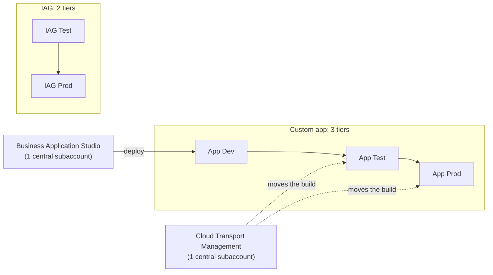
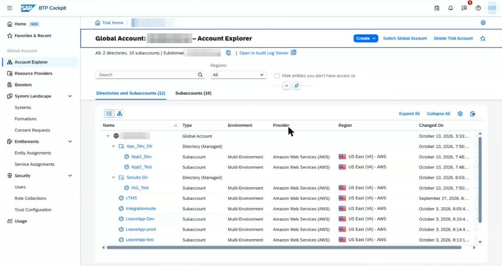
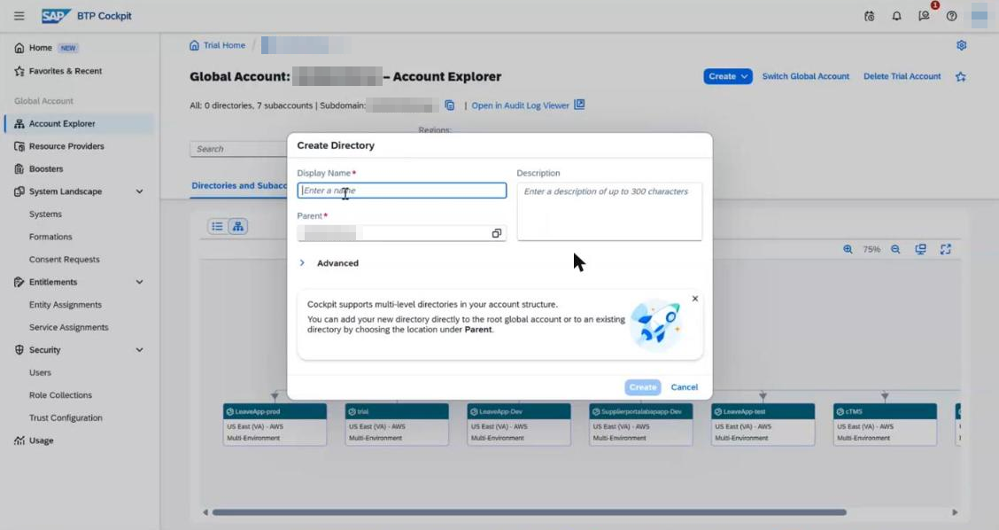
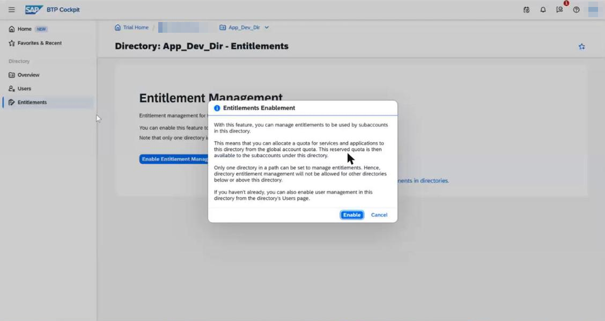
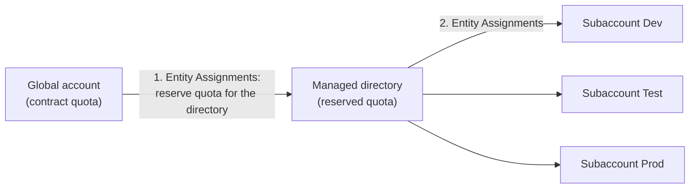
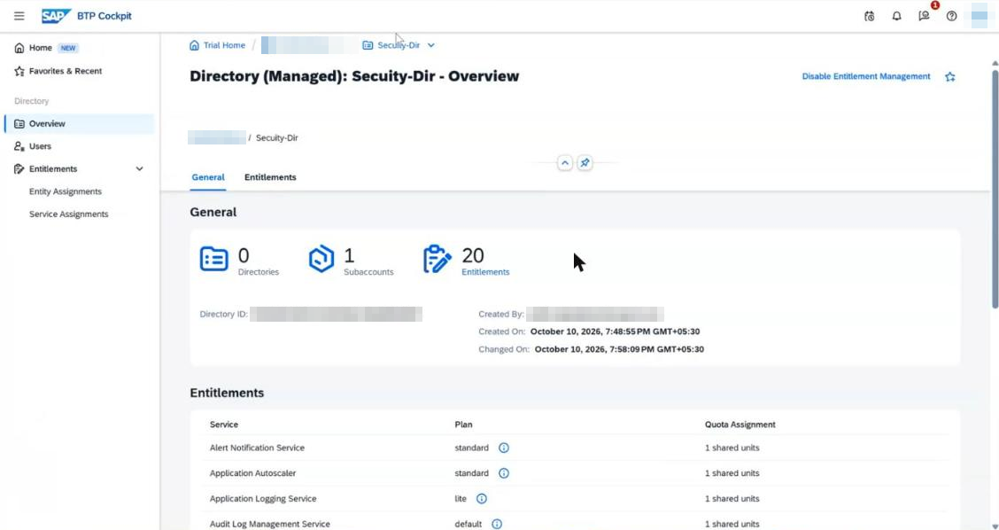
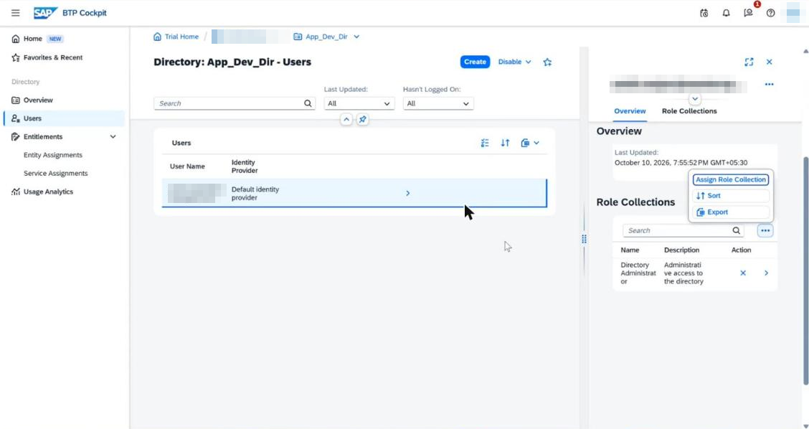
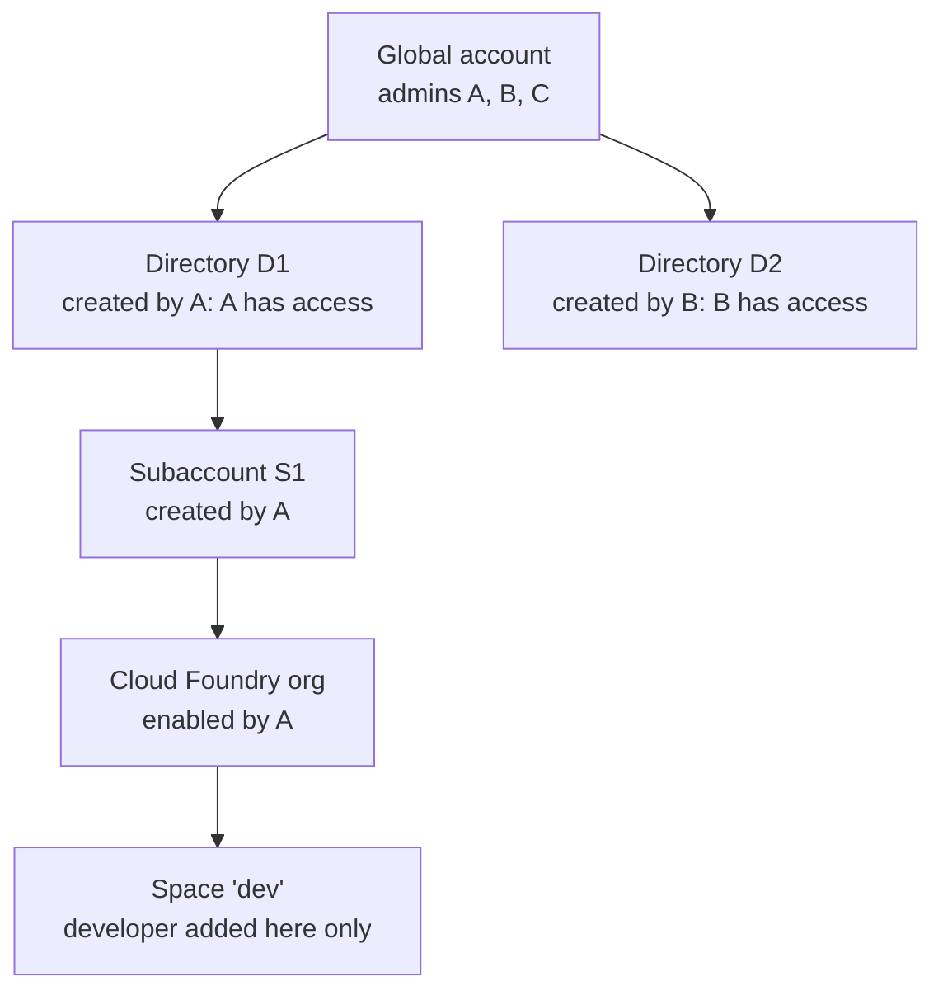
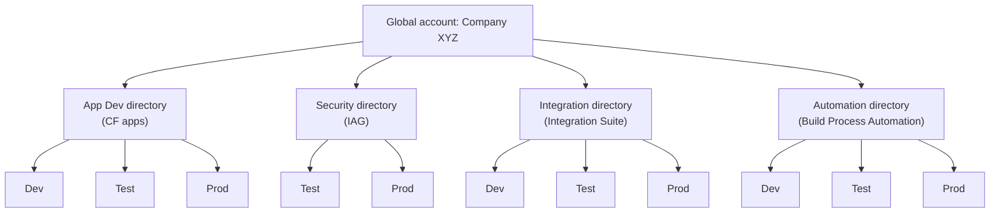

# Directories, landscape tiers and commercial models

*Keeping a growing BTP landscape in order: how many subaccounts each service needs, directories that group subaccounts and hand out licences, who gets access at each level, and how SAP bills you.*

> [!NOTE]
> **📍 At a glance**
> - **You will learn:** the 3-2-1 tier rule, what directories are and their limits, the "who creates gets access" rule, the subscription and consumption commercial models, and budgets
> - **You will build:** an account model for a company with eight teams: managed directories, directory admins, Dev/Test/Prod subaccounts, and a monthly budget with alerts
> - **Level:** beginner to intermediate · **Time:** about 40 minutes
> - **Builds on:** [Users, role collections and access at every level](btp-users-role-collections.md) and [Inside a subaccount](btp-subaccount-walkthrough.md)

**After this chapter you can:**

- Decide whether a service needs three, two or one subaccount, and say why
- Create a directory, turn on entitlement and user management, and pass its quota on to subaccounts
- State the directory limits: five directory levels, and one managing directory per path
- Explain "who creates gets access" from the global account down to a Cloud Foundry space
- Compare Subscription, Pay-As-You-Go, CPEA and BTPEA, and say which fits a customer
- Set a budget with alerts, and say who watches costs at each level

## 9.1 Landscape tiers: how many subaccounts a service needs

- Every new service raises one question: one, two or three subaccounts?
- Too many tiers cost money and admin time. Too few let untested changes reach production.

| What you do with the service | Tiers | Subaccounts | Examples |
|---|---|---|---|
| **Build** something: code, integration flows, automations, database schemas (PaaS) | 3 | Dev → Test → Prod | Integration Suite, SAP Build Process Automation, custom apps on Cloud Foundry, Kyma or ABAP |
| Only **configure** a finished SAP app (SaaS) | 2 | Test → Prod | SAP Identity Access Governance (IAG), Digital Manufacturing, Cloud ALM |
| **Shared developer and transport tools** | 1 | One central subaccount | Business Application Studio, Cloud Transport Management, CI/CD |

**Why each number**
- **Three for PaaS:** you write the artifact, so it is built in Dev, tested in Test, and only then moved to Prod.
- **Two for SaaS:** SAP built and tested the app. You test only your configuration in Test, then repeat it in Prod.
- **One for tools:**
  - Business Application Studio is where code is *written*, not where it runs. It is deployed to Cloud Foundry in each tier.
  - Cloud Transport Management *moves* artifacts from Dev to Test to Prod. A second copy would have nothing to do.
  - AI Launchpad works the same way: one subscription for all AI engineers, connected through service keys to AI Core instances in other subaccounts.
- Some customers add a fourth tier, such as pre-production. Treat three as the minimum for anything you build.



> [!IMPORTANT]
> **🏭 In production**
> - Agree a naming rule before the first subaccount, for example `<area>-<app>-<tier>`, and add a `tier` label. Subdomains can't be renamed later.
> - Mark only Prod subaccounts as *Used for production*, and give Prod the shortest admin list.
> - Write the tier decision for each service into the architecture document, so later teams don't add a Dev tier to a SaaS app "just in case".
>
> *Added by Claude*

## 9.2 Why directories: when subaccounts sprawl

- The tier rule multiplies quickly. Five custom apps × three tiers is already 15 subaccounts.
- Add Integration Suite, Build Process Automation, IAG and the shared tools, and a few years later there are 50, 100 or 300 subaccounts.
- If they all sit flat under the global account:
  - one global account admin hands out every licence, and everyone queues for them
  - nobody can see cost per team
  - user management turns into a long, flat list
- SAP's answer is the **directory**: a folder in the cockpit that behaves like a small global account. It can hold subaccounts and further directories.

**How the pieces relate (cardinality)**

| Parent | Can hold |
|---|---|
| Global account | Any number of directories and subaccounts |
| Directory | Any number of directories and subaccounts |
| Subaccount | One Cloud Foundry org at most (one Cloud Foundry environment) |
| Cloud Foundry org | Any number of spaces |

**Facts worth knowing**
- **No cost.** Directories and subaccounts are free. You pay for the services that run in them.
- **Depth:** up to 7 levels in one path: the global account, up to 5 levels of directories, then the subaccount (SAP docs).
- **Moving:** a subaccount can move between directories, or to and from the global account level.
  - It keeps its region, apps and data. Only its place in the tree changes.
  - It takes its entitlements with it, and the source and target directories are adjusted.
  - Real UI path: *Account Explorer → the subaccount's Actions (…) → Move*, then pick a new parent. Drag-and-drop works too.
- **Labels** on a directory are inherited by every subaccount below it, so filters by label find the whole branch.



> [!NOTE]
> **Six levels or seven?**
> - **The course:** directories can go "six levels" deep.
> - **SAP's docs:** up to 7 levels, counting the global account and the subaccount, which leaves up to 5 levels of directories.
> - Both agree on the part you design: **at most five directory levels**.

> [!WARNING]
> **⚠️ A subaccount can move, but it can't be split**
> - If one subaccount already runs security tools, automation tools and DevOps tools together, you can't separate them later.
> - Subscriptions and instances are tied to that subaccount. Splitting means setting up new subaccounts and migrating, if the service offers migration at all.
> - So decide the account model before the landscape grows.

## 9.3 Creating a directory and handing it licences

- Real UI path: *Global account → Account Explorer → Create → Directory*.
- Fill in **Display Name** and **Parent**: the global account, or another directory. **Advanced** holds the optional features and labels.



**The three directory features**

| Cockpit option | Terraform value | What it gives | Rule |
|---|---|---|---|
| (always on) | `DEFAULT` | Group and filter subaccounts, labels | none |
| Enable Entitlement Management | `ENTITLEMENTS` | The directory receives quota from the global account and passes it to its subaccounts. The cockpit then shows "Directory (Managed)" | Only **one** directory per path |
| Enable User Management | `AUTHORIZATIONS` | The directory gets its own Users page and the Directory Administrator and Directory Viewer collections | Only together with entitlement management, on the same directory |

- Features are off by default. You can switch them on later from the directory's *Entitlements* or *Users* page.
- **The one-per-path rule:** in any single path from the global account down to a subaccount, only one directory may manage entitlements or users.
  - Example: global account → Directory A (managed) → Directory B. Directory B can still group subaccounts, but it can't manage entitlements.
  - The cockpit states the rule in the dialog itself:



**How a licence flows to a subaccount in a managed directory**
1. The global account admin opens *Entitlements → Entity Assignments*, selects the **directory**, adds the plan and quota, and saves.
2. The directory admin opens the directory's *Entitlements → Entity Assignments*, selects a **subaccount** below it, adds the plan, and saves.
3. The subaccount can now subscribe to the service or create an instance.



- A managed directory can only hand out what the global account reserved for it. Ask the global account admin for more.
- **Auto-assign:** a directory entitlement can be set to give a fixed quota automatically to every subaccount *created in or moved into* the directory. Subaccounts already there are not changed.
- Always-free services show up in a directory's list on their own, because its subaccounts receive them automatically.



**The same model as code (Terraform, SAP/btp provider)**

```terraform
# A managed directory with its own users
resource "btp_directory" "app_dev" {
  name     = "App Dev"
  features = ["DEFAULT", "ENTITLEMENTS", "AUTHORIZATIONS"]
}

# Reserve a plan for the directory; give it to current and future subaccounts
resource "btp_directory_entitlement" "alert_notification" {
  directory_id = btp_directory.app_dev.id
  service_name = "alert-notification"
  plan_name    = "free"
  distribute   = true
  auto_assign  = true
}

# A subaccount created inside the directory
resource "btp_subaccount" "app2_dev" {
  name      = "App2 Dev"
  subdomain = "app2-dev-1234"
  region    = "us10"
  parent_id = btp_directory.app_dev.id
}
```

- The `btp` CLI has the same operations: `btp create accounts/directory`, then `btp target` to work inside it. Check `btp help create accounts/directory` for the flags in your version.

> [!WARNING]
> **⚠️ Don't move a subaccount by editing Terraform**
> - The provider docs say changing `parent_id` on `btp_subaccount` **deletes and recreates** the subaccount, with everything that depends on it.
> - Move subaccounts in the cockpit (or with the CLI), then update your Terraform state to match.

## 9.4 Who creates gets access

- The rule: whoever **creates** a directory, subaccount, Cloud Foundry org or space gets access to it. Nobody else does by default.
- Global account admins don't automatically get admin rights in subaccounts either (SAP docs, 20 Nov 2026).
- But a global account admin can give themselves access: *Account Explorer → the subaccount's Actions (…) → Add Me as Admin*. A company can opt out of this shortcut through an SAP support request.

**An example with two global account admins, A and B**
- A creates subaccount S1 and becomes its administrator automatically. B has no access to S1 yet.
- B gets in either by using **Add Me as Admin** on S1, or by A adding B under S1's *Security → Users*.
- A makes a third person, C, Directory Administrator of D1. C can now hand out D1's quota, but has no access inside the subaccounts below until added.
- A enables Cloud Foundry in S1, and creates a space. Other S1 admins must be added as org and space members to see them.

**Skip the hierarchy**
- A developer who only deploys apps can be added **straight to one Cloud Foundry space** as a Space Developer.
- They need no role at the global account, directory, subaccount or org level.
- Grant access only where the work happens: that is least privilege, and it keeps reviews short.

| Level | Who has access automatically | Where you add others |
|---|---|---|
| Global account | The admins SAP onboarded | *Global account → Security → Users* |
| Directory (user management on) | The creator, as Directory Administrator | *Directory → Users* |
| Subaccount | The creator, as administrator | *Subaccount → Security → Users*; global account admins can use Add Me as Admin |
| Cloud Foundry org | The person who enabled Cloud Foundry | *Subaccount → Cloud Foundry → Org Members* |
| Cloud Foundry space | The person who created the space | *Space → Members* |





## 9.5 Case study: an account model for eight teams

- A company runs eight project teams: Security, Data Intelligence, Integration, S/4HANA ABAP customisation, Automation, Data Warehousing (Datasphere), Analytics and Custom App Development.

| Person | Owns | In BTP |
|---|---|---|
| CTO or finance admin | The contract and the invoice | Global account admin; Costs and Usage |
| Senior manager | Four tracks (Automation, Data Intelligence, Integration, ABAP), 40+ consultants | Directory admin of a managed directory |
| Deputy manager | Day-to-day delivery for some of those tracks | Added as a second directory admin; allocates quota to Dev, Test and Prod |
| Consultants and developers | Build, test and transport | Subaccount or space members only |



- Each directory follows the tier rule: three subaccounts for things you build, two for IAG.
- Managed directories take licence work off the global account admin. The senior manager, or a deputy, distributes quota inside their branch.
- **Cost answers to the level above.** Each level has its own usage view:
  - subaccount owner: *Subaccount → Usage Analytics*
  - directory admin: *Directory → Usage Analytics*, filtered by subaccount
  - finance: *Global account → Costs and Usage*
- So a cost spike is explained bottom-up: developer to subaccount owner, to directory admin, to the person who holds the budget.

## 9.6 Commercial models: how SAP bills BTP

- There are two families: **subscription-based** and **consumption-based**.
- Consumption-based comes in three flavours: **SAP BTPEA** (SAP BTP Enterprise Agreement), **CPEA** (Cloud Platform Enterprise Agreement) and **Pay-As-You-Go**.

| | Subscription | Pay-As-You-Go | BTPEA (and CPEA) |
|---|---|---|---|
| Services you get | Only what you ordered, in the quantity ordered | All services eligible for the consumption model | Same as Pay-As-You-Go |
| Upfront | Fixed price for a fixed period (typically 1 to 3 years), paid in advance | Nothing; no minimum usage | Prepaid cloud credits with an annual commitment and a minimum investment |
| What you pay | The fixed price, used or not | Actual use, billed monthly in arrears at list price | Monthly use deducted from the credits; overage billed in arrears at list price |
| Discount | Bundles can be cheaper than single services | None: charges are non-discountable | Volume-based discounts |
| Fits | Stable, well-known needs | Trials and proofs of concept in a productive account | Planned BTP programmes with steady use |

**One service under each model**
- Business Application Studio, standard edition, lists at **EUR 28 per user per month** (Discovery Center, SAP BTPEA list price, read 20 Nov 2026). The free plan is EUR 0.
- **Subscription:** you order five users and pay 5 × 28 every month, whether anyone logs in or not. More users means a new order.
- **Pay-As-You-Go or BTPEA:** you may assign ten users, but you pay for the users actually counted that month.
- **Cloud Foundry in consumption accounts:** every subaccount gets a default runtime-memory quota of 200 GB. You pay for the memory your apps really use (SAP docs).

**Credits, in the course's words**
- With BTPEA you buy credits upfront, for example 100,000 USD. One credit is one unit of currency.
- Each month's usage is deducted, and SAP sends a balance statement: opening credits, this month's use, closing credits.
- Unused credits expire at the end of the contract year. SAP occasionally carries them over, for large customers only.
- Running out does not stop your services. The overage is billed.

**Where to see your model**
- *Global account → Entitlements → Service Assignments*. Switch on **Show commercial info**, or filter by **Entitlement Source**.


**Mixing and switching (SAP docs)**
- A global account can combine the subscription model with **one** consumption flavour.
- It can't combine two consumption flavours, such as BTPEA and Pay-As-You-Go.
- Pay-As-You-Go can move to CPEA seamlessly if you have no other CPEA global account. Consumption can also change to subscription, but not every service supports subscription.

> [!NOTE]
> **CPEA and BTPEA: the same thing?**
> - **The lecture:** BTPEA is the new name for CPEA; behind the scenes it is the same. Later in the same lecture, CPEA is described as a wider agreement that also covers SAP cloud apps such as SuccessFactors and Ariba.
> - **SAP's docs (read 20 Nov 2026):** they are separate flavours of the consumption model. BTPEA came in April 2024 as the evolution of CPEA.
>   - CPEA's service list is frozen; new services come only to BTPEA.
>   - Since 15 April 2024, CPEA is for existing accounts only, and the two can't share a global account.
> - This book follows SAP: same mechanics (prepaid credits, monthly deduction), different contracts.

> [!NOTE]
> **Who uses the subscription model?**
> - **The course:** almost only SAP partners, for R&D and proofs of concept, with a three-month minimum; customers are steered to Pay-As-You-Go or BTPEA.
> - **SAP's docs:** any organisation that knows which services it needs, at a fixed price for a fixed term (typically 1 to 3 years), often as cheaper bundles.

> [!WARNING]
> **⚠️ A number to handle with care**
> - The course quotes a "20 to 30%" discount for BTPEA. SAP only says "volume-based discounts are available".
> - Real discounts are negotiated per contract. Use the course figure as an illustration, not a quote.

> [!CAUTION]
> **🔒 Unlimited entitlements need approvals**
> - In consumption accounts every eligible service is available in unlimited quantity. Nothing stops an admin assigning, or a user subscribing, something nobody approved.
> - Assign only approved entitlements, and keep the assignment rights to a few people.
> - A global account can't hold two consumption flavours. After a move from Pay-As-You-Go to an enterprise agreement, check *Service Assignments* with **Show commercial info** to confirm what each plan now bills under.

## 9.7 Watching spend: usage views and budgets

- **Budgets** live in *Global account → Costs and Usage → Budgets → Create*. They exist for consumption-based global accounts.
- You need Global Account Administrator or Global Account Viewer to see them.


| Setting | Meaning |
|---|---|
| Budget type | **Cost** (money) or **Charged Usage** (units) |
| Period | Start month, optional end month; a budget without an end month stays active |
| Monthly amount | The limit, in your contract currency |
| Thresholds | Alert points, such as 80, 90 and 100% of the amount |
| Alerts | Optional automatic emails to global account admins. SAP Alert Notification service can send custom alerts |
| Scope | All subaccounts and plans, or only the ones you pick |

- **A budget never stops anything.** SAP doesn't suspend services when a threshold is passed; someone has to act.
- Figures since the last balance statement are estimates, and alerts can arrive late.
- Usage covered by a prepaid subscription isn't counted against a budget.
- A global account can have up to 30 active budgets.

**Who watches the money**
- Usually a project manager, a business analyst or a cost owner. Give them the usage reporting roles, not admin rights.
- SAP has dedicated roles for this: *Global Account Usage Reporting Viewer* and *Directory Usage Reporting Viewer*.
- The solution architect designs the landscape and explains the bill, but doesn't track it day to day.

## 9.8 Added by Claude, not from the sources

- Put a `cost-center` label on each directory. Subaccounts inherit it, so you can filter Account Explorer and export usage by owner.
- In Account Explorer, tick **Hide entities you don't have access to**. On a large landscape it shows only what you can actually open.
- Budgets can raise events in SAP Alert Notification service, so they can route to a team chat or ticketing tool, not only to email.

## 9.9 Interview corner

**What interviewers listen for:** the 3-2-1 tier rule with reasons, the one-managing-directory-per-path rule, "who creates gets access", and a clear Pay-As-You-Go versus BTPEA answer.

### 🟢 Basic

<details class="qa"><summary>1. Why does Integration Suite get three subaccounts, but IAG only two?</summary>

- Integration Suite is PaaS: you build integration flows, so they need Dev, Test and Prod
- IAG is SaaS: SAP built it, you only configure it, so Test and Prod are enough
- *Stronger answer:* add the one-tier exception for shared tools such as Business Application Studio and Cloud Transport Management

</details>

<details class="qa"><summary>2. What is a directory, and what does it cost?</summary>

- A folder in the account tree that groups subaccounts and other directories, like a small global account
- It is free; only services cost money
- *Stronger answer:* it can optionally manage entitlements and users for its branch, which takes licence work off the global account admin

</details>

<details class="qa"><summary>3. What is the difference between Pay-As-You-Go and BTPEA?</summary>

- Both give all eligible services and charge only for use
- Pay-As-You-Go: nothing upfront, monthly bill at list price, no discount
- BTPEA: prepaid credits with an annual commitment, usage deducted monthly, volume discounts
- *Stronger answer:* Pay-As-You-Go suits a proof of concept; BTPEA suits a planned programme, and Pay-As-You-Go can convert to an enterprise agreement later

</details>

### 🟡 Intermediate

<details class="qa"><summary>4. Can you enable entitlement management on a directory and on its parent directory?</summary>

- No. Only one directory in any path can manage entitlements or users
- The other directories in that path can still group subaccounts
- *Stronger answer:* pick the level that matches budget ownership, usually the business unit, and turn it on there only

</details>

<details class="qa"><summary>5. A global account admin can't open a subaccount another admin created. Why, and what do you do?</summary>

- Who creates gets access; global account admins don't get subaccount admin rights automatically
- They can use **Add Me as Admin** in Account Explorer, or the creator adds them under *Security → Users*
- *Stronger answer:* mention that a company can opt out of Add Me as Admin through SAP support, and that this shortcut is one more reason to keep the global account admin list short

</details>

<details class="qa"><summary>6. A developer only needs to deploy into one space. What access do you give?</summary>

- Space Developer in that space, nothing more
- No global account, directory, subaccount or org role is needed
- *Stronger answer:* that is least privilege; review space members with the rest of your access reviews

</details>

<details class="qa"><summary>7. How do you find out which commercial model a global account uses?</summary>

- *Entitlements → Service Assignments*, switch on **Show commercial info**, or filter by Entitlement Source
- Your contract and the monthly balance statement are the final word
- *Stronger answer:* a global account can mix subscription with one consumption flavour, so check per service

</details>

### 🔴 Senior

<details class="qa"><summary>8. Design the account model for a customer with eight teams and five custom apps.</summary>

- A directory per area (App Dev, Security, Integration, Automation and so on), with Dev/Test/Prod or Test/Prod subaccounts under each
- Enable entitlement and user management on the directory that matches budget ownership; make team leads directory admins
- One central subaccount for Business Application Studio and Cloud Transport Management
- *Stronger answer:* add naming rules, labels for tier and cost centre, budgets per area, and a rule that Prod admins are a short named list

</details>

<details class="qa"><summary>9. The monthly budget was exceeded. What happens, and how do you avoid surprises next time?</summary>

- Nothing stops: SAP keeps services running and bills the overage, or deducts it from credits
- Alerts come at the thresholds you set, possibly late, based on estimates
- *Stronger answer:* set budgets per directory scope, route alerts to the owners through Alert Notification, and review usage per level monthly

</details>

> [!TIP]
> **🧩 Design question**
> *"A customer has 120 subaccounts flat under one global account, one admin who hands out every licence, and no idea which team spends what."* Talk about:
> - grouping existing subaccounts into directories by area (moving is safe; splitting is not)
> - one managed directory per path, with team leads as directory admins
> - labels, budgets and usage views per level, and who answers for each

## Cheat sheet

| Task | Where |
|---|---|
| Tier rule | Build = 3 (Dev/Test/Prod) · Configure SaaS = 2 (Test/Prod) · Shared tools = 1 |
| Create a directory | Account Explorer → Create → Directory |
| Manage entitlements or users in a directory | Directory → Entitlements or Users → Enable (one directory per path) |
| Give a directory quota | Global account → Entity Assignments → select the directory |
| Move a subaccount | Account Explorer → Actions (…) → Move |
| Get into a subaccount you didn't create | Account Explorer → Actions → Add Me as Admin (global account admins), or ask its admin |
| See the commercial model | Service Assignments → Show commercial info |
| Set a budget | Costs and Usage → Budgets → Create |
| Limits | 5 directory levels · 1 Cloud Foundry org per subaccount · 30 active budgets |

## Recap

- PaaS you build needs three tiers, SaaS you configure needs two, shared developer and transport tools need one
- Directories group subaccounts, cost nothing, and nest up to five levels; subaccounts can move but can't be split
- A directory can manage entitlements, and users with them, but only one directory per path
- Who creates gets access; others are added level by level, and a developer can be added to just one space
- Subscription is a fixed order at a fixed price; Pay-As-You-Go and BTPEA give all services and bill actual use, BTPEA from prepaid, discounted credits
- Budgets in Costs and Usage alert you but never stop services; each level watches its own usage

## Practice

In your trial account:

1. Create two directories, *App Dev* and *Security*, under the global account.
2. Enable entitlement management on *App Dev*. Create a directory inside it and try to enable entitlement management there too. Note the message.
3. Move an existing subaccount into *App Dev*, and check that its region and subscriptions are unchanged.
4. In the global account's Entity Assignments, give *App Dev* an always-free plan, then assign it from the directory to the subaccount.

Stretch: write the same structure as Terraform with `btp_directory`, `btp_directory_entitlement` and `btp_subaccount`.

Budgets need a consumption-based global account, so you can't try them in a trial.

## How this chapter was checked

- **Lecture 4 recording:** captions 26:27 to 3:33:57 read in full (tiers, directories, access, commercial models, budgets, questions). 1:45:25 to 1:55:36 is the break.
- **Screenshots:** frames at 44:16, 52:33, 56:58, 1:40:12, 2:31:50, 2:42:40 and 2:42:58. Account names, IDs, emails, the company name and avatars are pixelated. The budget screenshot is cropped above the cost history chart.
- **SAP BTP Fundamentals Notes:** pages 6 to 15 and 17 to 20 read in full and merged (tiers, directories, case study, access, commercial models, Q&As).
- **Discovery Center:** Business Application Studio pricing tab read on 20 Nov 2026 (opened in the lecture at 2:04:54).
- **Web-checked on 20 Nov 2026 against SAP's docs:**
  - directory depth and features, the one-per-path rule, moving subaccounts, Add Me as Admin, Directory Administrator and Viewer
  - the three consumption flavours, the subscription model, the mixing rules, the 200 GB default, and budgets
- **Not run:** the Terraform snippet. Resource and attribute names follow the SAP/btp provider docs.

## Sources and further reading

- BTPAI course, Lecture 4 recording, *Sub Account Walkthrough, Directory Concept, Commercial Model* (BT011); *SAP BTP Fundamentals Notes* (BT014)
- SAP Discovery Center, *Business Application Studio, pricing*: https://discovery-center.cloud.sap/serviceCatalog/business-application-studio?region=all&tab=service_plan
- SAP Help (docs source on GitHub), *Account model*: https://github.com/SAP-docs/btp-cloud-platform/blob/main/docs/10-concepts/account-model-8ed4a70.md
- SAP Help, *Create a directory*: https://github.com/SAP-docs/btp-cloud-platform/blob/main/docs/50-administration-and-ops/create-a-directory-b8ef1c4.md
- SAP Help, *Configure entitlements and quotas for directories*: https://github.com/SAP-docs/btp-cloud-platform/blob/main/docs/50-administration-and-ops/configure-entitlements-and-quotas-for-directories-37f8871.md
- SAP Help, *Manage the Account Explorer hierarchy*: https://github.com/SAP-docs/btp-cloud-platform/blob/main/docs/50-administration-and-ops/manage-the-account-explorer-hierarchy-2e2a5b6.md
- SAP Help, *Add members to your subaccount*: https://github.com/SAP-docs/btp-cloud-platform/blob/main/docs/50-administration-and-ops/add-members-to-your-subaccount-1e1b7b6.md
- SAP Help, *What is the consumption-based commercial model?*: https://github.com/SAP-docs/btp-cloud-platform/blob/main/docs/10-concepts/what-is-the-consumption-based-commercial-model-7047eb4.md
- SAP Help, *What is the subscription-based commercial model?*: https://github.com/SAP-docs/btp-cloud-platform/blob/main/docs/10-concepts/what-is-the-subscription-based-commercial-model-239b6e0.md
- SAP Help, *Managing budgets in your global account*: https://github.com/SAP-docs/btp-cloud-platform/blob/main/docs/50-administration-and-ops/managing-budgets-in-your-global-account-e115d5f.md
- SAP Developers, *Get started with SAP BTP enterprise accounts* (BTPEA as the evolution of CPEA): https://developers.sap.com/tutorials/btp-ea-onboard-01-intro.html
- Terraform Registry, *SAP/btp provider*: https://registry.terraform.io/providers/SAP/btp/latest/docs

Previous: [Inside a subaccount: service types, environments and connectivity](btp-subaccount-walkthrough.md) · Next: [BTPAI book introduction](README.md)
