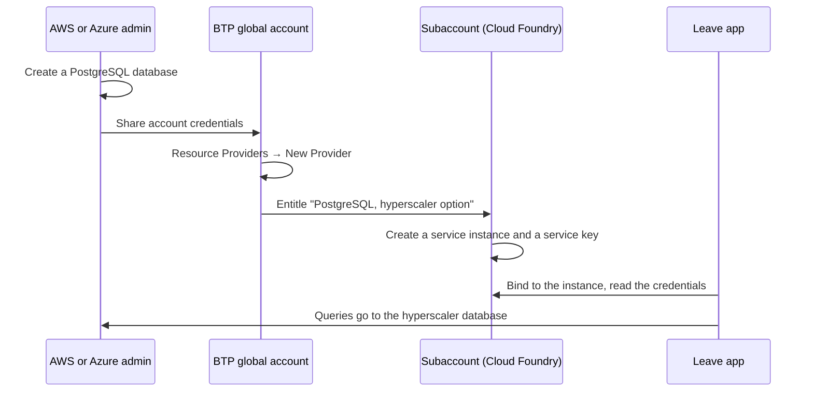
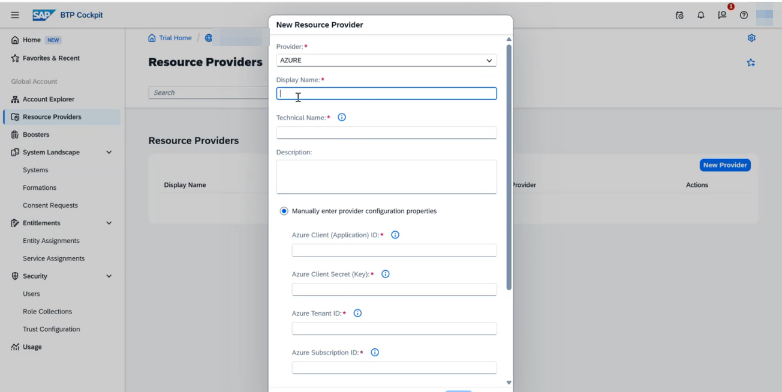
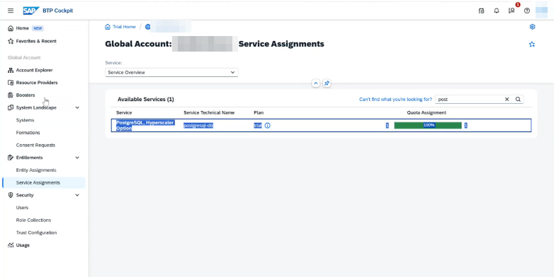
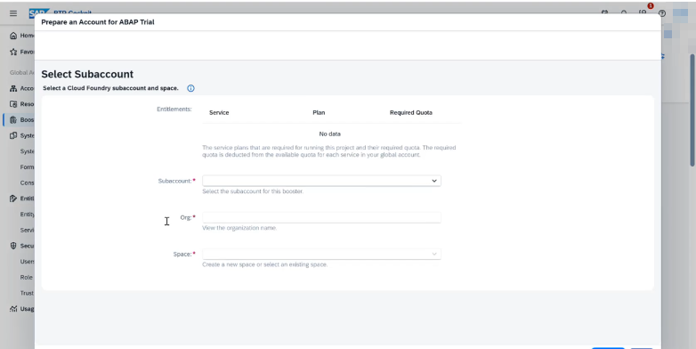
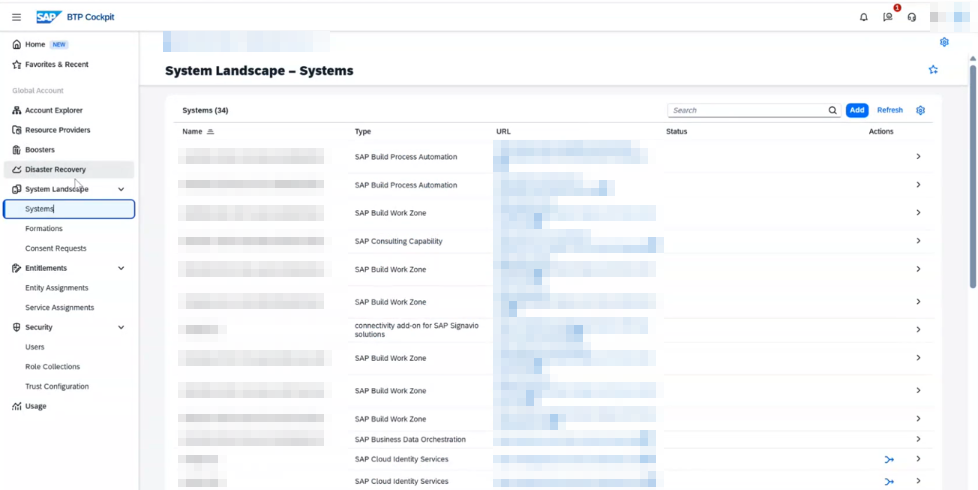
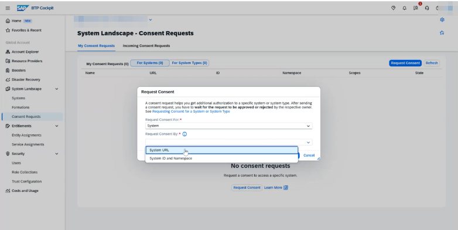
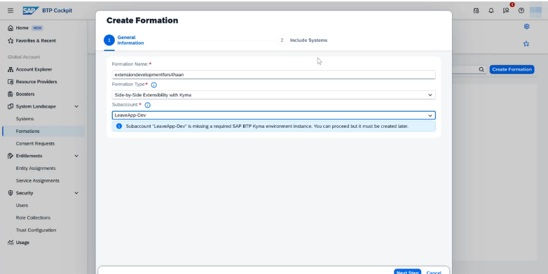
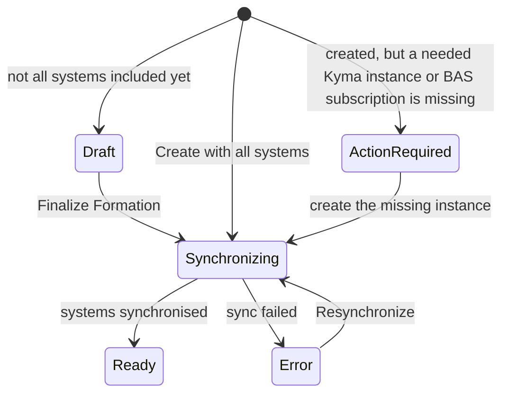
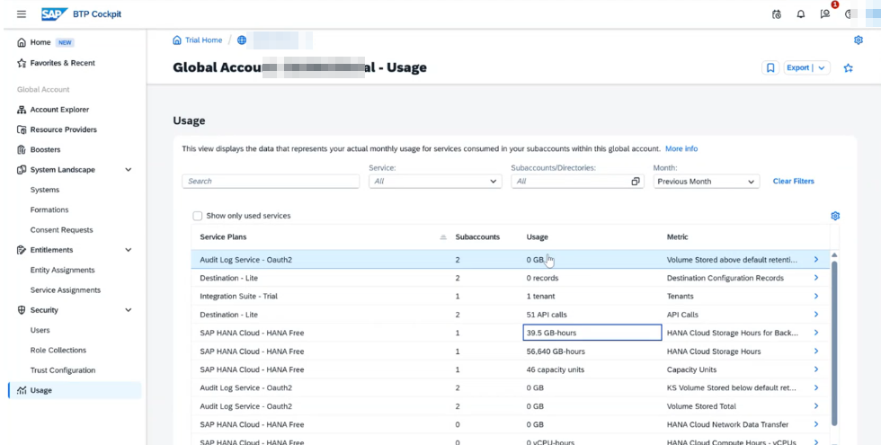

# Global account tools: Resource Providers, Boosters and System Landscape

*The global-account pages beyond entitlements: bringing your own hyperscaler database, setup wizards, and the map of every SAP system you own.*

> [!NOTE]
> **📍 At a glance**
> - **You will learn:** the global-account menu, Resource Providers for AWS or Azure databases, Boosters, and how Systems, Formations and Consent Requests connect your SAP landscape
> - **You will build:** a formation plan for one integration scenario, and the CLI calls that bind a hyperscaler database to an app
> - **Level:** beginner to intermediate · **Time:** about 30 minutes
> - **Builds on:** [Choosing BTP services for a requirement](btp-services-for-a-requirement.md) and [the account-model chapter](btp-account-model-first-subscription.md)
> - **Last checked:** 19 Nov 2026

**After this chapter you can:**

- Name every item in the global account's left menu and say what it is for
- Explain when a hyperscaler database beats HANA Cloud, and how it gets connected
- Run a booster and say what it does that the manual path doesn't
- Explain how a system gets into System Landscape: auto-discovery, token, or consent request
- Explain what a formation is, when you need one, and what its statuses mean
- Tell a customer ID, an S-user ID and an SAP Universal ID apart

## 6.1 The global account menu at a glance

| Menu item | What it is for | Where covered |
|---|---|---|
| Account Explorer | Directories and subaccounts: create, copy, list or tree view | [Account model](btp-account-model-first-subscription.md) |
| Resource Providers | Register your own AWS or Azure account for hyperscaler databases | 6.2 |
| Boosters | Guided wizards that do a multi-step setup for you | 6.3 |
| Disaster Recovery | New in late 2026 (see 6.6) | 6.6 |
| System Landscape | Systems, Formations, Consent Requests | 6.4, 6.5 |
| Entitlements | Service Assignments and Entity Assignments | [Account model](btp-account-model-first-subscription.md) |
| Security | Users, role collections and trust at global-account level | [Users and role collections](btp-users-role-collections.md) |
| Usage / Costs and Usage | Consumption and cost per subaccount and service | 6.6a |

## 6.2 Resource Providers: a hyperscaler database for a BTP app

**Why it exists**
- HANA Cloud is an in-memory database and costs a lot for a small app.
- AWS and Azure sell cheaper managed databases, such as PostgreSQL.
- Customers asked: "why not deploy everything on AWS then?" SAP's answer: keep the app on BTP, use the hyperscaler's database.

**How it fits together**



- Real UI path: *Global account → Resource Providers → New Provider*. Pick the provider and enter its credentials.



- Then the service shows up in your licences: *Global account → Entitlements → Service Assignments*, search "post".



```bash
# Not run (needs a Cloud Foundry login): create the database service, a key, and bind it to the app
cf create-service postgresql-db trial leave-pg          # technical name + plan from Service Assignments
cf create-service-key leave-pg leave-pg-key             # credentials for tools or other apps
cf bind-service leave-srv leave-pg                      # the app reads them from VCAP_SERVICES
cf restage leave-srv
```

- Resource Providers is only for databases. It cannot bring hyperscaler servers or other services into BTP.

> [!NOTE]
> **What the lecture showed, and what SAP's pages add**
> - **Lecture:** the dialog offers AWS and Azure only, and the databases are PostgreSQL (AWS) and Redis (Azure). Google Cloud is not supported.
> - **SAP's product pages (web-checked 19 Nov 2026):** "PostgreSQL, hyperscaler option" provisions PostgreSQL on AWS RDS or Azure Database for PostgreSQL, for Cloud Foundry apps.
> - "Redis on SAP BTP, hyperscaler option" also exists.
> - SAP's blogs describe registering your own hyperscaler account as "bring your own account".

## 6.3 Boosters: setup wizards

- A **booster** is a guided, automated setup for a common task. It asks a few questions and does the steps itself.
- Real UI path: *Global account → Boosters → pick a booster → Start*.
- Example: the ABAP environment booster.

| Manual path | Booster |
|---|---|
| Create or pick a subaccount | Select the subaccount (and Cloud Foundry org and space) |
| Entity Assignments → add the ABAP environment plan and quota | Assigns the required quota itself (ABAP memory comes in 16 GB units) |
| Subaccount → Service Marketplace → Create | Creates the instance or subscription |
| Assign yourself a role collection | Gives the creating user access automatically (for ABAP) |



- A trial shows a handful of boosters. A paid global account shows many more, including scenarios that pair BTP with S/4HANA, Ariba or SuccessFactors.
- The boosters you see depend on what your company bought.
- Experienced admins often still click manually. Boosters matter most when you are new, or when a setup has many steps.

## 6.4 System Landscape: Systems and Consent Requests

**Systems: one list of every SAP system you own**
- *Global account → System Landscape → Systems* lists the company's SAP systems.
- That includes your BTP subscriptions (Build Process Automation, Build Work Zone, Cloud Identity Services, and so on).
- It also includes systems that don't run on BTP, such as S/4HANA Cloud, Analytics Cloud, Signavio, LeanIX, IBP, Databricks and Cloud ALM.



**Three ways a system gets on the list**

| Way | When | How |
|---|---|---|
| Auto-discovered | It was bought under the same **customer ID** as this global account | Appears by itself (press Refresh if it is missing) |
| Added by token | Different customer ID (for example, a subsidiary), but the system supports registration | *Systems → Add* → choose type and scenarios → copy the token → paste it in the target system's admin screen |
| Consent request | The system supports neither of the above | *Consent Requests → Request Consent* → by **system URL** or by **system ID and namespace** (from SAP for Me) → the target system's owner approves |



- Consent scopes say what you want, for example integration (data is pulled) or system sharing (data is viewed, not copied).
- The target system's owner sees the request under **Incoming Consent Requests** and approves or rejects it.

## 6.5 Formations: a scenario that SAP pre-wires

- A **formation** is a logical group of SAP systems for one business scenario.
- Creating it does two things:
  - shows the scenario in one place
  - starts a background **synchronisation** that sets up baseline trust and connectivity between the systems
- You still configure the actual integration afterwards. The formation only does the SAP-defined groundwork.
- SAP defines three types: **business scenarios**, **integration with a specific BTP service**, and **extensibility**.
- Examples from class:
  - *Integration with Joule*: Joule plus SuccessFactors, Signavio, SAC, Build Process Automation and more
  - *Side-by-Side Extensibility with Kyma*: a Kyma subaccount plus Commerce Cloud
  - an S/4HANA extension built in Business Application Studio
- Real UI path: *Global account → System Landscape → Formations → Create Formation*. The steps are name and type → subaccount → include systems → review → create.





- **Statuses (SAP Help):** Ready, Draft, Action Required, Synchronizing, Error.
- **Resynchronize** is offered when the status is Error. **Reset and Resynchronize** applies to Side-by-Side Extensibility with Kyma formations.
- Deleting a formation excludes its systems, unassigns the subaccount, then removes it. To restore it you rebuild it.

**When do you need one?**
- Only when the SAP Help guide for your scenario says so. Many integrations, including most Integration Suite work, need none.
- Make one formation per landscape tier: dev systems together, test systems together, production systems together.
- Formations usually hold cloud systems. Cloud Connector is a different thing: on-premise software that opens a network tunnel to BTP.
- Removing a system breaks the trust SAP set up, so the scenario stops working. For example, the Joule icon disappears from Signavio. Your manual configuration is not touched.

> [!WARNING]
> **⚠️ Pitfall: a system can be "listed" but not "includable"**
> A system on the Systems page may still need an approved consent request before it can join a formation. Request consent early: approvals depend on another team.

> [!IMPORTANT]
> **🏭 In production**
> - Only global account administrators and system landscape administrators can create formations. Agree who owns them, because they span several product teams.
> - Keep formations aligned with your landscape tiers so a test change never re-synchronises production systems.
> - When a formation goes to Error, SAP's documented support component is `BC-CP-MP`.
>
> *Added by Claude*

## 6.6 Disaster Recovery: a new menu item

- In the lecture, a **Disaster Recovery** entry had just appeared in the productive global account, and not in the trial.
- The lecturer's first reading: it is for high-availability database replicas. For example, HANA Cloud replicas in another region take over if the primary fails.
- Treat this as preliminary: it was not checked against SAP documentation here.

## 6.6a Usage: what you consumed, where

- Real UI path: *Global account → Usage* (called *Costs and Usage* in some paid accounts).
- It shows each **service plan**, how many subaccounts use it, the **usage** and the **metric** it is measured in.
- Filter by service, subaccount or directory, and month (current or previous). Open a row to see usage per subaccount.
- Paid accounts add cost and billing views with charts.



- Each service has its own **metric**, for example:
  - GB-hours of storage or compute, and capacity units for HANA Cloud
  - API calls or configuration records for Destination
  - tenants for Integration Suite
- Inside a subaccount, *Usage Analytics* shows the same for that subaccount only.
- How each metric turns into a bill is the "commercial model" topic of a later lecture.

## 6.7 Customer ID, S-user ID and SAP Universal ID

| ID | Belongs to | Used for |
|---|---|---|
| Customer ID | The company's contract with SAP | Auto-discovering systems in System Landscape; visible to whoever manages SAP for Me |
| S-user ID | One person *within one customer*; always tied to exactly one customer number | Logging in to that customer's SAP resources (BTP, SAP for Me) |
| SAP Universal ID | One person, for life | Personal SAP access (learning, certification, trials), with S-user IDs linked to it |

- A consultant working for three customers holds three S-user IDs and one Universal ID (SAP Universal ID page, web-checked).
- Login IDs don't grant rights by themselves. Access to a subaccount still comes from role collections.

## 6.8 Added by Claude, not from the sources

- The SAP Help Portal calls the Systems, Formations and Consent Requests area **Unified Customer Landscape**. That is the term to search for in the docs.
- Because formations wire up trust automatically, treat them as security-relevant changes: log who created or changed them (the global account's audit log records it).
- For PostgreSQL on BTP, check the plan names in Service Assignments before scripting. Trial and productive accounts can offer different plans for the same technical name.

## 6.9 Interview corner

**What interviewers listen for:** you know which tools live at global-account level, you can explain formations as "baseline trust plus a scenario view", and you don't confuse formations with Cloud Connector.

### 🟢 Basic

<details class="qa"><summary>1. What is a booster?</summary>

- A guided wizard in the global account that performs a multi-step setup, such as entitlements, subscription and access, for a common scenario
- It reduces mistakes, especially for new admins
- *Stronger answer:* give the ABAP environment example and note that paid accounts show more boosters, depending on what was bought

</details>

<details class="qa"><summary>2. How does a system appear in System Landscape?</summary>

- Automatically, if it was bought under the same customer ID as the global account
- Otherwise by adding it with a token, or by a consent request that the system's owner approves
- *Stronger answer:* say where the system ID and namespace for a consent request come from (SAP for Me)

</details>

### 🟡 Intermediate

<details class="qa"><summary>3. What does creating a formation actually do?</summary>

- It groups systems for one scenario and synchronises them in the background, setting up baseline trust and connectivity defined by SAP
- You still configure the integration itself afterwards
- *Stronger answer:* list the statuses (Draft, Synchronizing, Ready, Action Required, Error) and say Resynchronize is how you recover from Error

</details>

<details class="qa"><summary>4. Formation vs Cloud Connector: what is the difference?</summary>

- A formation is a cloud-side grouping that sets up baseline trust between SAP cloud systems for a scenario
- Cloud Connector is on-premise software that opens a secure tunnel from BTP to on-premise systems
- *Stronger answer:* a scenario can use both; the formation does the SAP-defined setup, and Cloud Connector carries the on-premise data

</details>

<details class="qa"><summary>5. Why would a customer use a hyperscaler PostgreSQL instead of HANA Cloud?</summary>

- Cost: a small or non-critical app does not need an in-memory database
- The app still runs on BTP; only the database lives on AWS or Azure
- *Stronger answer:* weigh it against HANA-specific features, data residency and who operates the database

</details>

### 🔴 Senior

<details class="qa"><summary>6. You must integrate Joule with SuccessFactors and Signavio in dev, test and production. How do you set up the landscape?</summary>

- Make sure each system is on the Systems page (auto-discovered, token or consent) and on the right customer ID
- Create one "Integration with Joule" formation per tier, with only that tier's systems
- Follow the SAP Help guide for the remaining configuration, and check every formation reaches Ready
- *Stronger answer:* assign a formation owner, request consents early, and monitor for Error so you can resynchronise before go-live

</details>

<details class="qa"><summary>7. A subsidiary bought SAC under a different customer ID. Your Joule formation can't see it. What do you do?</summary>

- Add it to System Landscape manually with a token, or by consent request if token registration isn't supported
- Get the system ID and namespace from whoever manages SAP for Me for the subsidiary
- *Stronger answer:* once it is listed and consent is approved, include it in the formation; long term, consider aligning contracts under one customer ID

</details>

> [!TIP]
> **🧩 Design question**
> *"A group company has three subsidiaries on different customer IDs and wants Joule across all their SAP cloud systems."* Talk about:
> - which systems auto-discover and which need tokens or consent
> - one formation per landscape tier, and who approves consents in each subsidiary
> - the IAS requirements Joule brings, and how you would monitor formation status

## Cheat sheet

| Task | Where |
|---|---|
| Use an AWS or Azure database | Resource Providers → New Provider, then entitle `postgresql-db` |
| Guided setup | Boosters → Start |
| See all SAP systems | System Landscape → Systems |
| Add a system on another customer ID | Systems → Add (token) or Consent Requests → Request Consent |
| Pre-wire a scenario | System Landscape → Formations → Create Formation |
| Fix a failed formation | Formation in Error → Resynchronize |
| Formation statuses | Draft, Synchronizing, Ready, Action Required, Error |

## Recap

- Resource Providers let a BTP app use a cheaper AWS or Azure database instead of HANA Cloud; only databases, and not Google Cloud
- Boosters are wizards that assign entitlements, subscribe and give access in one flow
- System Landscape lists every SAP system: auto-discovered by customer ID, added by token, or added by an approved consent request
- A formation groups systems for one scenario and sets up baseline trust in the background; create one only when SAP's guide asks
- Formation statuses are Draft, Synchronizing, Ready, Action Required and Error; Resynchronize fixes Error
- A customer ID belongs to the company, an S-user ID to a person within one customer, and a Universal ID to the person for life

## 🧪 Lab 6: See exactly what a booster did

> [!NOTE]
> **Lab card**
> - **Goal:** run one booster, then prove what it changed by comparing CLI snapshots from before and after
> - **Time:** about 30 minutes · **Cost:** free · **Needs:** lab 1

> *Commands: syntax checked against SAP's btp CLI command reference on 21 Nov 2026. Not run here: they need your own trial login.*

**Steps**

1. Pick the subaccount the booster will use (usually `trial`), and save three snapshots:

    ```bash
    btp list accounts/entitlement --subaccount <id>          > before-entitlements.txt
    btp list accounts/subscription --subaccount <id>         > before-subscriptions.txt
    btp list accounts/environment-instance --subaccount <id> > before-environments.txt
    ```

2. Run a booster (6.3): *Global account → Boosters*. Pick one your trial lists, and read its last step before **Finish**: it names what it will create.
3. Save the same three lists as `after-*.txt`, then compare each pair:

    ```bash
    diff before-entitlements.txt after-entitlements.txt      # macOS, Linux, Git Bash
    ```

    ```powershell
    Compare-Object (Get-Content before-entitlements.txt) (Get-Content after-entitlements.txt)   # Windows PowerShell
    ```

4. Rebuild the manual-path table of 6.3 for your booster: one row per change the diffs show.
5. Open *Global account → System Landscape → Systems* (6.4), press **Refresh**, and look for what the booster subscribed to.

✅ *Verified: both compare commands ran on two sample text files (details at the end).*

**Check it worked:** every change the booster made appears in one of the three diffs.

**Clean up:** remove what the diffs show (unsubscribe, delete the instance), unless you want to keep it.

## Practice

1. In your trial, open Boosters and list three boosters with one line on what each sets up.
2. Open System Landscape → Systems in your trial and explain why each system there appeared.
3. Pick one formation type from the Create Formation list and find its SAP Help guide. Write down whether it is mandatory for that scenario.

## How this chapter was checked

- **Lecture 2 recording:**
  - captions 1:11:34 to 1:26:57 and 1:37:11 to 2:22:42 read in full (Resource Providers, Boosters, System Landscape)
  - the questions from 2:41 to 3:19 read in full
- **Screenshots:** frames at 1:16:40, 1:18:12, 1:40:40, 1:49:05, 2:00:15 and 2:09:55. Company names, system names, URLs, IDs and avatars are pixelated.
- **Day 2 Notes:** pages 11 to 14 and 15 to 18 read in full and merged.
- **SAP Help, "Automating Integrations Using Formations":** read in full on 19 Nov 2026. It is the source of the statuses, the formation types and the prerequisites.
- **Web-checked on 19 Nov 2026:** the PostgreSQL and Redis hyperscaler options, consent requests and auto-discovery, and the S-user vs Universal ID definitions.
- **Not run:** the `cf` commands, which need a Cloud Foundry login. The Disaster Recovery reading in 6.6 is unverified.
- **Enriched on 19 Nov 2026** (section 6.6a):
  - Lecture 3 captions 24:58 to 29:02 read in full
  - Day 3 Notes page 5
  - screenshot at 26:25
- **Lab 6 (added 21 Nov 2026):** `btp` syntax checked against SAP's btp CLI command reference; the commands were not run, because they need a trial login.
  - Run on 21 Nov 2026: `diff` (Git Bash) and `Compare-Object` (Windows PowerShell 5.1) on two sample text files. Both showed the one changed line.

## Sources and further reading

- BTPAI course, Lecture 2 recording (BT006); *SAP BTP Fundamentals Day 2 Notes* (BT008)
- SAP Help Portal, *Automating Integrations Using Formations*: https://help.sap.com/docs/btp/sap-business-technology-platform/including-sap-systems-in-formation (read 19 Nov 2026)
- SAP, *PostgreSQL on SAP BTP, hyperscaler option*: https://www.sap.com/products/technology-platform/postgresql-on-sap-btp-hyperscaler-option.html
- SAP Community, *Redis on SAP BTP, hyperscaler option*: https://blogs.sap.com/t5/technology-blogs-by-sap/redis-on-sap-btp-hyperscaler-option-now-available-for-customers-on-btp/ba-p/13656621
- SAP Learning, *Integrating and maintaining UCL components*: https://learning.sap.com/courses/sap-btp-fundamentals-level-2-administration-security-extensibility-data-to-value/integrating-and-maintaining-ucl-components
- SAP, *SAP Universal ID*: https://www.sap.com/sea/account/universal-id.html
- SAP Help, *btp CLI command reference* (used by the lab): https://help.sap.com/docs/btp/btp-cli-command-reference/btp-cli-command-reference

Previous: [Choosing BTP services for a requirement](btp-services-for-a-requirement.md) · Next: [Users, role collections and access at every level](btp-users-role-collections.md)
