# Identity: Cloud Identity Services, trust and federated authorization

*Replacing sap.com logins with your own identity provider: SAP Cloud Identity Services, SAML and OpenID Connect trust, platform vs application trust, shadow users, and role collections assigned from groups at login.*

> [!NOTE]
> **📍 At a glance**
> - **You will learn:** what an identity provider does, why companies replace the default one, the parts of SAP Cloud Identity Services, SAML vs OIDC, platform vs application trust, shadow users, federated authorization
> - **You will build:** your own Identity Authentication tenant, an OIDC trust from a subaccount, groups that map to role collections at login, and a platform trust for the cockpit
> - **Level:** intermediate · **Time:** about 45 minutes
> - **Builds on:** [Users, role collections and access at every level](btp-users-role-collections.md) and [Directories, landscape tiers and commercial models](btp-directories-tiers-commercial-models.md)

**After this chapter you can:**

- Explain identity provider, service provider, trust, SSO, authentication and authorization in plain words
- Get an Identity Authentication tenant from BTP and onboard its first administrator and users
- Set up subaccount trust both ways: SAML metadata exchange and the OIDC "Establish Trust" wizard
- Tell platform trust (global account) from application trust (subaccount), and log on to the cockpit through your own tenant
- Explain shadow users, and what happens when their automatic creation is switched off
- Map identity-provider groups to role collections so access is granted at login, with no manual assignment

## 10.1 Why an identity provider: one login for many systems

**The old way**
- A company runs an HR system, a CRM, a web shop and a vendor portal. Each keeps its own users.
- A new employee needs four accounts, created by four admins, with four login names (email, phone number, name, employee ID) and four passwords.
- Result: forgotten passwords, lockouts, and accounts nobody removes when people leave.

**The idea**
- Keep every employee **once**, in one central system: the **identity provider (IdP)**. It stores identities and checks logins.
- Each application, the **service provider (SP)**, **trusts** the IdP. When you open the app, it sends you to the IdP's login page, then lets you in.
- Logged in once in a browser session, you open the next trusting app without typing your password again: **single sign-on (SSO)**.

| Term | Meaning |
|---|---|
| Identity provider (IdP) | Stores users and authenticates them, for example SAP Cloud Identity Services or Microsoft Entra ID |
| Service provider (SP) | The application the user wants, for example Cloud Transport Management in a subaccount |
| Trust | Each side knows the other's endpoints and keys, so login requests and answers are accepted |
| Authentication | Proving **who** you are (user and password, 2FA) |
| Authorization | Deciding **what** you may do (role collections) |

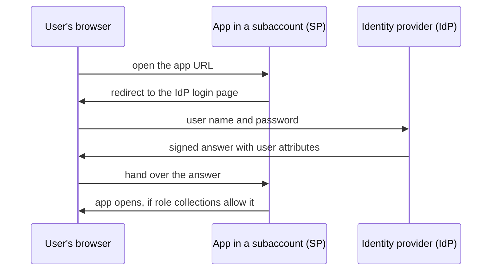

## 10.2 The default identity provider, and replacing it

- Every new global account and subaccount trusts **SAP ID service** (`accounts.sap.com`), SAP's own tenant of Cloud Identity Services. This is the **default identity provider**.
- It is what lets the first administrator log in. It also means every user needs an sap.com account.
- A company with 50,000 employees won't ask staff to register at sap.com, or keep its staff list at SAP. It wants its own user store, password rules and multi-factor authentication.

**What SAP recommends (SAP docs, read 20 Nov 2026)**
- Use your own tenant of **SAP Cloud Identity Services**. It integrates with other SAP solutions most easily.
- If the company already has a corporate IdP, put Cloud Identity Services **in front of it as a proxy**: SAP apps trust Cloud Identity Services, which forwards logins to the corporate IdP.
- For **platform users** (cockpit, btp CLI, Cloud Foundry CLI), Cloud Identity Services is **mandatory**. For business users of apps it is strongly recommended.

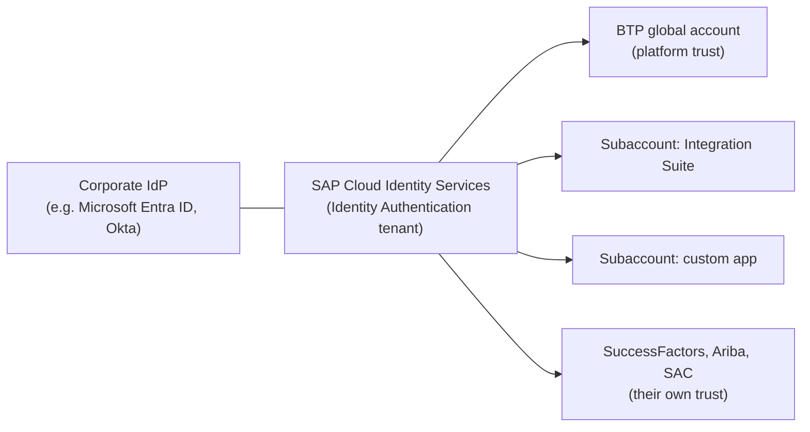

- Corporate IdPs you will meet: **Microsoft Entra ID**, Okta, PingFederate, and the AWS and Google identity services.
- Non-SAP apps can keep trusting the corporate IdP directly. Only the SAP side goes through Cloud Identity Services.

> [!NOTE]
> **"Azure AD FS" or "Entra ID"?**
> - **The course:** Azure AD FS is the old name of Azure Entra ID; both are the same.
> - **Microsoft (web-checked 20 Nov 2026):** **Azure AD** was renamed **Microsoft Entra ID** in July 2023. **AD FS** (Active Directory Federation Services) is a separate on-premise Windows Server product, and it was not renamed.

**Tenants and cost**
- Buying an SAP cloud solution bundled with Cloud Identity Services entitles you to one **productive** and one **test** tenant (SAP help, read 20 Nov 2026).
- Buying more SAP solutions doesn't add tenants: SAP reuses the existing one. Exceptions include several regions, or several SuccessFactors instances.
- SAP strongly recommends **one productive tenant** for all SAP cloud solutions, so SSO between them works out of the box.
- Products on BTP usually don't create a tenant for you: you request it in the cockpit (next section). Extra and trial tenants are requested the same way.
- To see which tenants your company already has: the *SAP Cloud Identity Services – Tenants* app (`iamtenants.accounts.cloud.sap`), or the Public Cloud Systems card in SAP for Me.
- A common split: the test tenant serves Dev and Test subaccounts, the productive one serves Prod. The course mentions companies paying for a third, so Dev has its own.
- Logins to **SAP** applications are covered. SAP's knowledge base lists logins to **non-SAP** applications through the tenant as an additional, charged item, so check the license before connecting them.

## 10.3 What SAP Cloud Identity Services contains

| Service | Short name | What it does |
|---|---|---|
| Identity Authentication | IAS | Login pages, password and 2FA/MFA policies, branding, and the **trust** with applications. Most of this chapter happens here |
| Identity Provisioning | IPS | Copies users and groups between systems, for example from SuccessFactors or Entra ID into the tenant, and on to target apps |
| Identity Directory | IDS | The store of users, their attributes and their groups (with a SCIM 2.0 API). It generates the Global User ID, the user's unique ID across the landscape |
| Authorization Management | AMS | Policy-based authorizations for applications |

> [!NOTE]
> **Three parts or four?**
> - **The course:** Cloud Identity Services has three components: IAS, IPS and IDS.
> - **SAP's help:** four, with Authorization Management as the fourth.
> - This chapter goes deep only on the three the course covers.

- The admin console's top menu: **Home · Users & Authorizations · Identity Provisioning · Applications & Resources · Identity Providers · Monitoring & Reporting**.
- People often say "IAS" for the whole service, because trust and login live there.

## 10.4 Getting a tenant from BTP

- Cloud Identity Services is SaaS you only configure, so it follows the **two-tier** rule ([landscape tiers](btp-directories-tiers-commercial-models.md)): one subaccount for Test, one for Prod.
- You can also request a tenant through SAP for Me (*Systems & Provisioning*). SAP says bundled and self-requested tenants don't differ technically or functionally.

**Steps in the cockpit**
1. Create subaccounts such as `cis-test` and `cis-prod`.
2. In *Entity Assignments*, give each the **Cloud Identity Services** entitlement.
3. In the subaccount: *Service Marketplace → Cloud Identity Services* (type Application) → **Create**.
4. Plan: choose **`default`**, the subscription with the full admin UI.

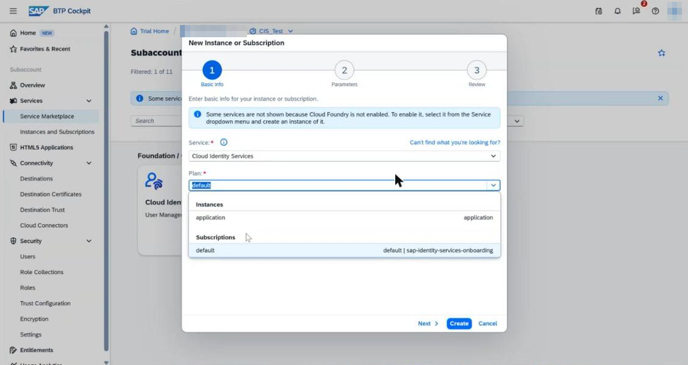

| Plan | Type | Gives you |
|---|---|---|
| `default` | Subscription | The tenant itself, with its browser admin console |
| `application` | Instance | Back-end credentials and API access to a tenant, for apps that call it |

5. Parameters: **Service type** `TEST` in the test subaccount, `PRODUCTIVE` in the production one. Then **Create**.

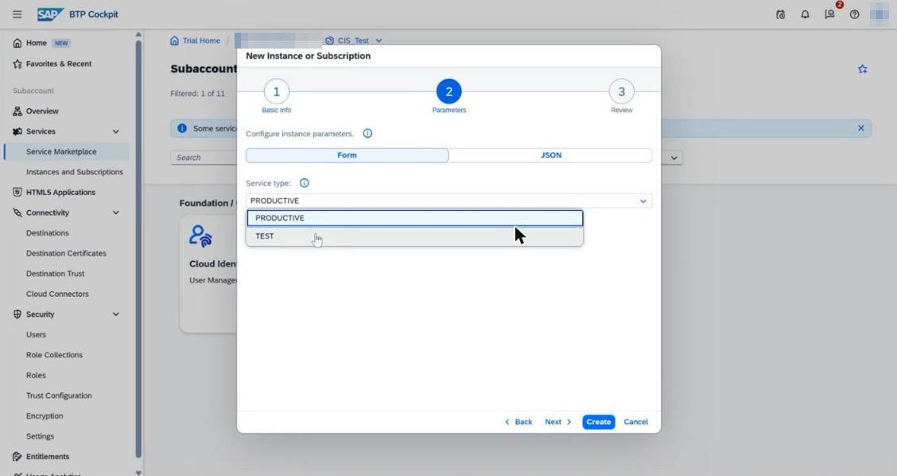

**What happens next**
- The person who subscribed gets an email: activate the account, set a password, and register two-factor authentication. They are the tenant's first administrator.
- No role collections appear in the subaccount. The tenant manages its own admins: *Users & Authorizations → Administrators*.
- Add employees under *Users & Authorizations → User Management*: one by one, by CSV import, or replicated from an HR system with Identity Provisioning. Each gets an activation email.

## 10.5 Two ways to build trust: SAML 2.0 and OpenID Connect

- Building trust means each side learns the other's URLs and signing keys. Only then do login requests and answers flow.

| | SAML 2.0 | OpenID Connect (OIDC) |
|---|---|---|
| Built on | XML messages (signed assertions) | OAuth 2.0 and JSON Web Tokens (JWT) |
| Setup in a BTP subaccount | Manual: download and upload metadata XML on both sides | **Establish Trust** wizard: a few clicks, BTP creates the app in the tenant |
| Expiry | Assertions carry a validity window | Tokens carry an expiry; BTP's token lifetimes are set per subaccount ([Settings → Token Validity](btp-users-role-collections.md)) |
| SAP's position | Still supported through a Cloud Identity Services tenant | **Strongly recommended**; required by some services, such as new SAP Build Work Zone subscriptions |
| Typical use | Many SAP cloud apps outside BTP: SuccessFactors, Ariba, Fieldglass, SAP Analytics Cloud | BTP subaccounts, and always the global account (platform trust) |

> [!NOTE]
> **Is SAML trust deprecated in BTP?**
> - **The course:** SAP has deprecated SAML for BTP; it won't be supported in productive accounts, and the metadata download will disappear. Never use SAML for BTP.
> - **SAP's docs (read 20 Nov 2026):** SAP strongly recommends OIDC and offers a migration from SAML to OIDC. SAML 2.0 remains possible if you connect a Cloud Identity Services tenant.
>   - Some services already refuse a SAML trust, and some features work only with OIDC.
> - This book follows SAP: use OIDC for all new BTP trusts, and plan migrations for existing SAML ones.

> [!NOTE]
> **Which protocol is "more secure"?**
> - The course says SAML keeps its token as a browser cookie with no expiry, so an intruder keeps access longer, while OIDC tokens expire.
> - The standards say both are time-limited: SAML assertions carry validity conditions, and an OIDC ID token must carry an expiry.
> - This book leaves out the cookie claim, and gives SAP's own reasons for OIDC: the recommendation, the automated setup, and services that need it.

## 10.6 SAML trust, step by step

- Use this for apps that only speak SAML. The lecture also shows it on a BTP subaccount, so the four steps are worth knowing.

1. **Download the subaccount's metadata.** *Subaccount → Security → Trust Configuration → Download SAML Metadata*.

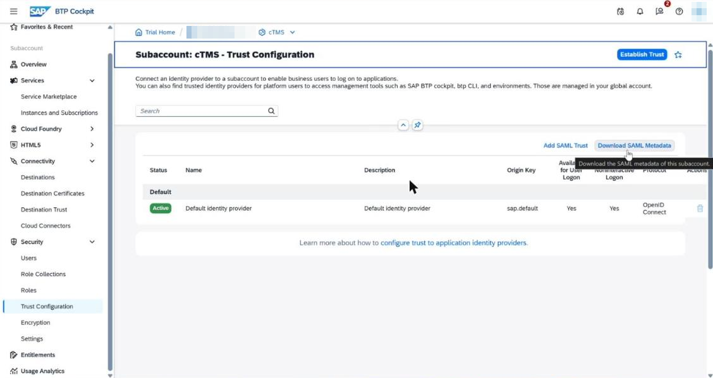

2. **Register the subaccount in the tenant.** *Applications & Resources → Applications → Create*: display name (for example `cTMS_Subaccount`), optional home URL, Type **SAP BTP solution**, protocol **SAML 2.0**.

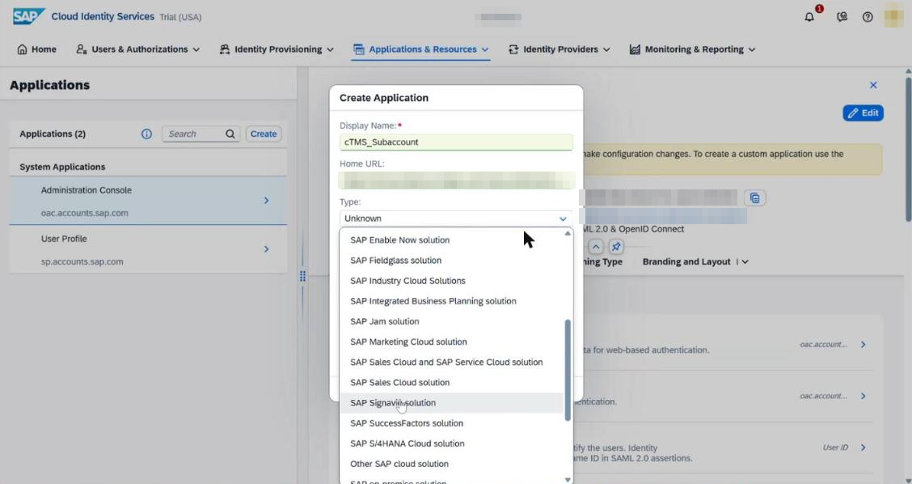

3. **Upload the subaccount metadata there.** In the new application: *Trust → SAML 2.0 Configuration → Load from file*, then **Save**. The tenant now knows the subaccount's login and logout URLs.
4. **Download the tenant's metadata.** *Applications & Resources → Tenant Settings → Single Sign-On → SAML 2.0 Configuration → Download Metadata File*.
5. **Upload it into the subaccount.** *Trust Configuration → Add SAML Trust*: choose the file, give a name and a **link text for user logon**, then **Add**.

- The metadata is a small XML file listing endpoints and certificates. A trimmed example of a service provider's:

```xml
<md:EntityDescriptor xmlns:md="urn:oasis:names:tc:SAML:2.0:metadata"
    entityID="ctms-demo.authentication.us10.hana.ondemand.com">
  <md:SPSSODescriptor protocolSupportEnumeration="urn:oasis:names:tc:SAML:2.0:protocol">
    <md:AssertionConsumerService index="0" isDefault="true"
        Binding="urn:oasis:names:tc:SAML:2.0:bindings:HTTP-POST"
        Location="https://ctms-demo.authentication.us10.hana.ondemand.com/saml/SSO/alias/ctms-demo.aws-live"/>
  </md:SPSSODescriptor>
</md:EntityDescriptor>
```

✅ *Verified: the XML parses (details at the end).*

**What users see**
- With both trusts active, the logon page offers a choice: your link text, or the default identity provider.

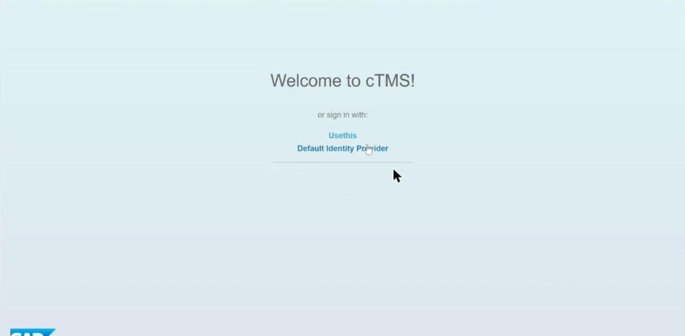

- To send everyone to your tenant: edit the **Default identity provider** trust and untick **Available for User Logon**.
- One trust serves every app subscribed in that subaccount. Each subaccount needs its own trust.

## 10.7 OIDC trust with "Establish Trust"

1. *Subaccount → Security → Trust Configuration → Establish Trust*.
2. **Choose Tenant:** BTP lists every Cloud Identity Services tenant registered to your company's customer ID. Pick the test or productive one to match the subaccount.

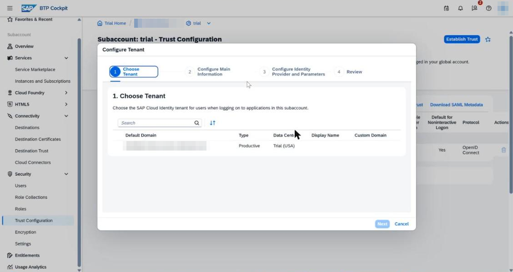

3. **Configure Main Information**, then **Identity Provider and Parameters:** domain, *Available for User Logon*, *Link Text for User Logon*, and *Create Shadow Users on Logon*.
4. **Review → Finish.** BTP creates the matching OIDC application in the tenant for you, named after the subaccount.

**The same as code**

```bash
# btp CLI: trust from the targeted subaccount to a Cloud Identity Services tenant
btp create security/trust --idp my-tenant --subaccount <subaccount-id> --name cis-trust
btp list security/trust --subaccount <subaccount-id>
```

```terraform
# Terraform, SAP/btp provider: application trust for one subaccount
resource "btp_subaccount_trust_configuration" "cis" {
  subaccount_id     = btp_subaccount.app2_dev.id
  identity_provider = "my-tenant.accounts.ondemand.com"
}
```

## 10.8 Platform trust and application trust

| | Application trust | Platform trust |
|---|---|---|
| Created in | Each **subaccount**, under Trust Configuration | The **global account**, under Trust Configuration (Establish Trust, OIDC only) |
| Used by | **Business users** of apps subscribed or deployed in that subaccount | **Platform users**: cockpit, btp CLI, Cloud Foundry CLI |
| Applies to | That one subaccount and its apps | The global account, directories, subaccounts and Cloud Foundry |
| Shows in a subaccount as | "Custom Identity Provider for Applications" | "Custom Identity Provider for Platform Users" (inherited) |

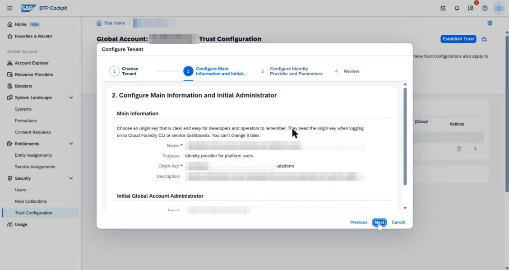

- The wizard asks for an **origin key**, the identifier users type in tools such as the Cloud Foundry CLI. It can't be changed later. It also names an **initial global account administrator** from the tenant.
- Up to three Cloud Identity Services tenants can serve platform users of one global account.
- **Logging on through your tenant:** the normal cockpit URL still uses the default identity provider. Each level's Trust Configuration shows an **Open** link with your tenant in it, for example `https://emea.cockpit.btp.cloud.sap/cockpit/?idp=mytenant.accounts.ondemand.com`. Share that link.
- Platform users then need their role collections at each level, the same as before. Group mapping works here too.

```terraform
# Terraform: platform trust for the whole global account
resource "btp_globalaccount_trust_configuration" "platform" {
  identity_provider = "my-tenant.accounts.ondemand.com"
}
```

## 10.9 Shadow users

- When someone logs on to a subaccount through a trusted IdP, BTP stores a copy of them: a **shadow user**, built from what the IdP sends (user ID, first and last name, email).
- That is the user you see under *Security → Users*, with the trust's name in the Identity Provider column.

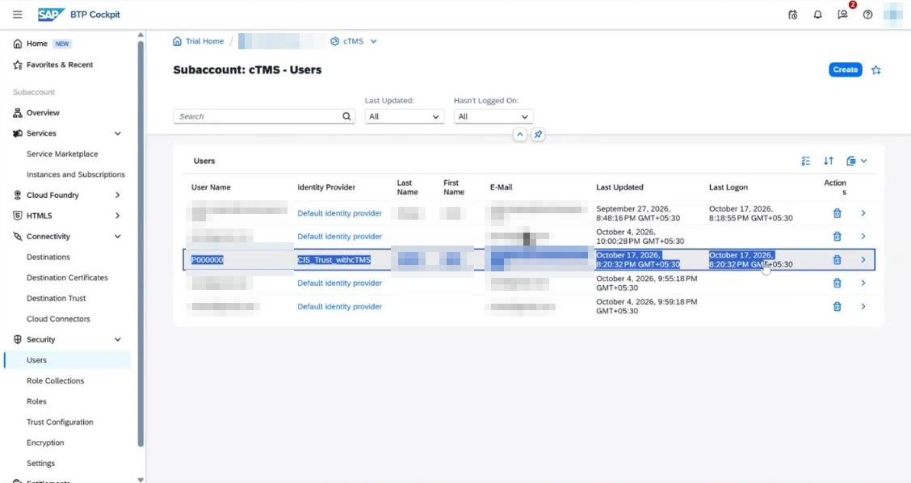

- A user from the default identity provider and the same person from your tenant are **two different users**. Role collections given to one don't apply to the other.
- The first column shows the **subject name identifier** the tenant sends: user ID in one app, email in another, depending on that app's setting in the tenant.

**Create Shadow Users on Logon**


| Setting | Effect |
|---|---|
| On | Any user the IdP authenticates gets a shadow user at first logon. Group mappings then give them their role collections |
| Off | Only users whose shadow user already exists can log on. Admins create them explicitly, for example when assigning the first role collection, or a tool such as SAP IAG provisions them |

- Users created while it was on keep working after you switch it off. New users are refused until someone creates them.
- For the default identity provider, automatic creation is **off by default** in subaccounts created since 24 September 2020.

> [!NOTE]
> **Are shadow users "mandatory"?**
> - **The course and notes:** shadow users are mandatory for federated authorization; switch creation off and new logins fail, so keep it on unless SAP IAG provisions users.
> - **SAP's docs:** with creation off, only users created beforehand may log on, which gives admins full control over who gets in.
> - Both agree on the effect. This book follows SAP's wording: it is a choice between automatic onboarding and explicit control.

## 10.10 Federated authorization: role collections from groups

- Authentication tells the subaccount **who** you are. **Federated authorization** also decides **what** you may do, from attributes the IdP sends at each login.
- Example of the idea: a web shop receives each user's `country` attribute and shows English to `US` users and Chinese to `CN` users, with nothing stored in the shop.

**Attributes**
- Each application in the tenant has an *Attributes* list: what is sent at login. Defaults include `first_name`, `last_name`, `mail` and `user_uuid`.
- Add an attribute and choose its source: **Identity Directory** (the tenant's own store), the corporate IdP, or an expression.

**Group to role collection, in four steps**
1. **Create groups in the tenant.** *Users & Authorizations → Groups → Create*, for example `cTMS_Operator` and `cTMS_Viewer`. Add users.

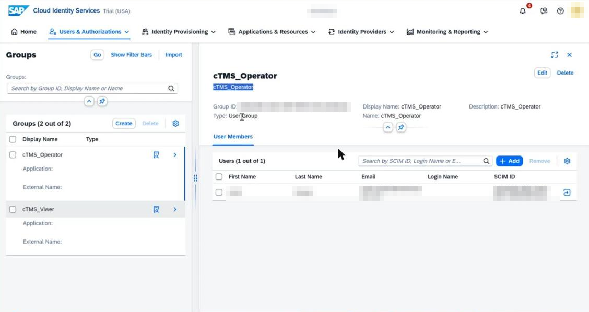

2. **Send the groups.** *Applications & Resources → Applications → (the subaccount's app) → Attributes → Add*: name `groups`, source **Identity Directory**, value **All Groups**.

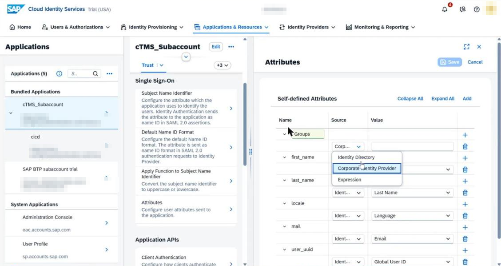

3. **Map them in the subaccount.** *Trust Configuration → (the tenant's trust) → Attribute Mappings → Edit*:
   - role collection `TMS_LandscapeOperator_RC` when **Groups** equals `cTMS_Operator`
   - role collection `TMS_Viewer_RC` when **Groups** equals `cTMS_Viewer`


4. **Log in.** The token carries the groups, the subaccount finds the mapping, and the user gets the role collections **for that session**. Nothing shows under the user's role collections, yet access works.

- Use the group's **Name**, not its display name. Names are case-sensitive: `groups` in the tenant must match what the mapping expects.
- The same mapping can be set from the other side: *Role Collections → (collection) → User Groups*. SAP's own apps read the `groups` attribute. A custom app may need other attributes, such as cost centre, mapped explicitly.

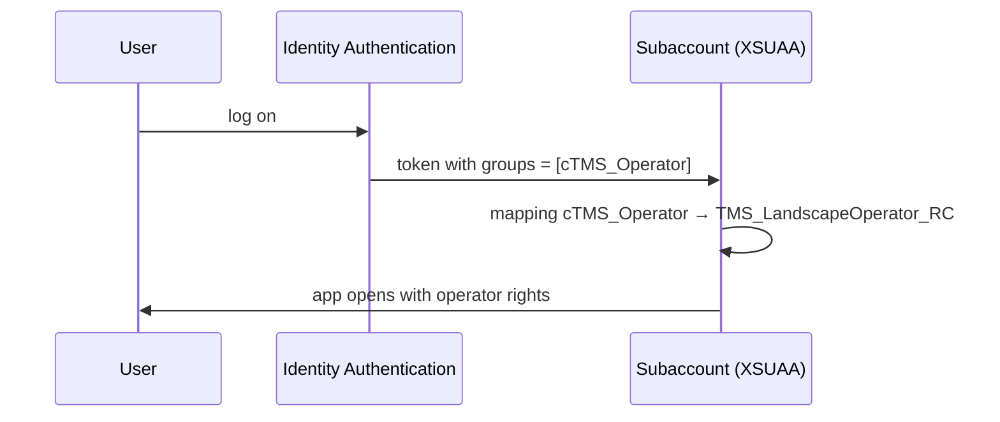

**The mapping logic in a few lines**

```python
# What the subaccount does at logon, reduced to its logic
token = {"sub": "P000123", "email": "ravi@example.com",
         "groups": ["cTMS_Operator", "Sales_Viewer"]}

mappings = {  # (attribute, value) -> role collection
    ("groups", "cTMS_Operator"): "TMS_LandscapeOperator_RC",
    ("groups", "cTMS_Viewer"): "TMS_Viewer_RC",
}

granted = {rc for (attr, value), rc in mappings.items()
           if value in token.get(attr, [])}
print(sorted(granted))   # ['TMS_LandscapeOperator_RC']
```

✅ *Verified: run with Python 3 (details at the end).*

```terraform
# Terraform: the same group mapping, kept with the rest of the landscape
resource "btp_subaccount_role_collection_assignment" "ctms_operator" {
  subaccount_id        = btp_subaccount.ctms.id
  role_collection_name = "TMS_LandscapeOperator_RC"
  group_name           = "cTMS_Operator"
  origin               = btp_subaccount_trust_configuration.cis.origin
}
```

> [!WARNING]
> **⚠️ Moving from SAML to OIDC: update, don't recreate**
> - SAP's migration updates the existing trust, so user IDs, shadow users and group mappings stay.
> - Deleting the SAML trust and creating a new OIDC one deletes the subaccount's shadow users and their role-collection assignments. Users lose access until everything is rebuilt.

> [!IMPORTANT]
> **🏭 In production**
> - Name groups `<app>_<business role>`, for example `EventMesh_Admin` or `IntegrationSuite_Viewer`. The tenant's group list then reads as an access register for the whole landscape.
> - Fill groups automatically: Identity Provisioning from the HR system or Entra ID, or SAP IAG with approval workflows. Manual group edits don't scale.
> - Keep the test tenant for Dev and Test subaccounts and the productive tenant for Prod, so a test change can't lock out production users.
>
> *Added by Claude*

## 10.11 Added by Claude, not from the sources

- Make at least two named people administrators of the tenant, with 2FA. Losing the only admin of your identity provider locks you out of everything that trusts it.
- Before unticking *Available for User Logon* on the default identity provider, check that every cockpit admin can log on through the custom one.
- Treat group names as part of the authorization model. Renaming a group silently breaks every mapping that uses it, so change names through the same review as role collections.

## 10.12 Interview corner

**What interviewers listen for:** a clear IdP/SP/trust explanation, OIDC vs SAML with SAP's position, platform vs application trust, and the group-to-role-collection flow including shadow users.

### 🟢 Basic

<details class="qa"><summary>1. What is an identity provider, and why not keep using the default one?</summary>

- A system that stores users and authenticates them for the apps that trust it
- The default (SAP ID service, accounts.sap.com) needs every user to have an sap.com account
- *Stronger answer:* companies use their own Cloud Identity Services tenant, often as a proxy to their corporate IdP, to keep control of users, password rules and MFA

</details>

<details class="qa"><summary>2. What is the difference between authentication and authorization?</summary>

- Authentication: who you are, checked by the identity provider
- Authorization: what you may do, decided by role collections in BTP
- *Stronger answer:* federated authorization links them: the IdP sends groups at login, and the subaccount maps them to role collections

</details>

<details class="qa"><summary>3. What does SAP Cloud Identity Services contain?</summary>

- Identity Authentication (login, SSO, trust), Identity Provisioning (user and group sync), Identity Directory (the user store)
- SAP lists Authorization Management as a fourth part
- *Stronger answer:* add that each customer gets a test and a productive tenant

</details>

### 🟡 Intermediate

<details class="qa"><summary>4. SAML or OIDC for a BTP subaccount trust?</summary>

- OIDC: SAP strongly recommends it, Establish Trust sets it up automatically, and some services require it
- SAML stays for apps that only support SAML, such as SuccessFactors or SAC
- *Stronger answer:* for existing SAML trusts, use SAP's migration, which updates the trust instead of recreating it

</details>

<details class="qa"><summary>5. A user logs in through your tenant but sees "not authorized". What do you check?</summary>

- Authentication worked; authorization didn't: the user has no role collection in that subaccount
- Check the group membership in the tenant, the `groups` attribute on the app, and the attribute mapping (exact names, case)
- *Stronger answer:* also check they used the custom trust, not the default one: those are different users

</details>

<details class="qa"><summary>6. What are shadow users, and what happens if you switch off their creation?</summary>

- The subaccount's copy of a user, created from the IdP's data at first logon
- Off: only users created beforehand can log on; existing ones keep working
- *Stronger answer:* switch it off when a governance tool such as SAP IAG provisions users explicitly

</details>

<details class="qa"><summary>7. Platform trust vs application trust?</summary>

- Platform trust: created once in the global account, used by admins and developers for cockpit, btp CLI and Cloud Foundry
- Application trust: created per subaccount, used by business users of the apps there
- *Stronger answer:* platform users log on through the trust's Open link, or with the origin key in the CLI

</details>

### 🔴 Senior

<details class="qa"><summary>8. Design identity for a company with Entra ID, three-tier BTP subaccounts and SuccessFactors.</summary>

- Test and productive Cloud Identity Services tenants as proxies to Entra ID; Dev and Test subaccounts trust the test tenant, Prod the productive one
- OIDC application trust per subaccount; platform trust in the global account; SuccessFactors on SAML to the same tenant
- Groups replicated from Entra ID with Identity Provisioning and mapped to role collections
- *Stronger answer:* add naming rules for groups, two tenant admins with 2FA, and the default IdP disabled for logon once admins are moved

</details>

<details class="qa"><summary>9. How do you move a productive subaccount from SAML to OIDC trust without disruption?</summary>

- Follow SAP's migration procedure, which converts the existing trust configuration
- User IDs, shadow users and group mappings are preserved
- *Stronger answer:* explain why delete-and-recreate is wrong: it deletes shadow users and their role-collection assignments

</details>

> [!TIP]
> **🧩 Design question**
> *"Joiners wait days for BTP access, leavers keep it for weeks, and nobody can say who has admin rights in which subaccount."* Talk about:
> - one tenant pair (test, productive) as the single login, fed from HR or Entra ID by Identity Provisioning
> - groups per app and business role, mapped to role collections in each subaccount
> - shadow-user settings, the audit trail, and removing access by removing group membership

## Cheat sheet

| Task | Where |
|---|---|
| Get a tenant | Subaccount → Service Marketplace → Cloud Identity Services → plan `default` → TEST or PRODUCTIVE |
| Tenant admins | Tenant → Users & Authorizations → Administrators |
| OIDC trust (subaccount) | Security → Trust Configuration → Establish Trust |
| SAML trust (subaccount) | Download SAML Metadata ↔ tenant app SAML 2.0 Configuration; tenant metadata → Add SAML Trust |
| Platform trust | Global account → Security → Trust Configuration → Establish Trust |
| Hide the default IdP | Trust Configuration → Default identity provider → untick Available for User Logon |
| Send groups | Tenant → Applications → app → Attributes → `groups` from Identity Directory |
| Map groups | Subaccount trust → Attribute Mappings, or Role Collections → User Groups |
| Shadow users | Trust → Create Shadow Users on Logon |

## Recap

- An identity provider stores users and authenticates them; apps trust it, and users get single sign-on
- BTP starts with the default identity provider (accounts.sap.com); SAP recommends your own Cloud Identity Services tenant, mandatory for platform users
- Cloud Identity Services: Identity Authentication, Identity Provisioning, Identity Directory, plus Authorization Management; one test and one productive tenant per customer
- Trust is SAML (metadata exchange) or OIDC (Establish Trust); SAP strongly recommends OIDC for BTP
- Application trust lives in each subaccount; platform trust is created once in the global account
- Shadow users are created at logon unless switched off; groups sent at logon map to role collections, so access follows group membership

## Practice

Assignment 3 from the course (on the course page titled "Assignment -4"), in your trial:

1. Subscribe to Cloud Identity Services in a subaccount, if you haven't yet.
2. Activate your tenant account from the email you receive.
3. Create an OIDC trust between a subaccount with an app and your tenant (Establish Trust).
4. Open the app in a private window and log in through your tenant.
5. Create a group in the tenant, send `groups` as an attribute, and map it to the app's role collection. Log in again and check you get access without assigning anything to the user.

Stretch: create the platform trust in your global account, and log on to the cockpit with the trust's Open link.

## How this chapter was checked

- **Lecture 5 recording:** captions 0:00 to 3:54:47 read in full. 1:34:06 to 1:43:06 is the break.
- **Screenshots:** frames at 37:08, 37:40, 1:08:20, 1:09:45, 1:15:16, 1:17:12, 1:59:14, 2:37:00, 2:37:12, 2:39:30, 2:55:20 and 3:03:12.
  - Tenant IDs, URLs, account names, user names, emails, SCIM and group IDs, and avatars are pixelated.
  - The logon page is cropped to hide the address bar.
- **SAP BTP Fundamentals Day 5 Notes:** all 16 pages read in full and merged.
- **Assignment 3** (course page "Assignment -4"): read in full; used as the Practice above.
- **Web-checked on 20 Nov 2026:**
  - SAP's docs: identity federation, the default identity provider and SAP's recommendation, platform-user trust, SAML trust, SAML-to-OIDC migration, shadow users, the cockpit logon link, and `btp create security/trust`
  - SAP's help ("Get your tenant", "What are Cloud Identity Services?", both read in full): tenant entitlements and the four components
  - SAP knowledge base: OIDC-only services and the charged item for non-SAP apps
  - Microsoft: the Entra ID rename; OASIS SAML Core and OpenID Connect Core: assertion and token expiry
- **Run:** the Python mapping snippet with Python 3 (prints `['TMS_LandscapeOperator_RC']`), and the SAML metadata XML parsed with Python's `xml.etree`.
- **Not run:** the btp CLI and Terraform snippets, which need a BTP login. Names follow SAP's docs and the SAP/btp provider docs.

## Sources and further reading

- BTPAI course, Lecture 5 recording, *Introduction to IdP (CIS) and IAS trust with app & platform* (BT015); *SAP BTP Fundamentals Day 5 Notes* (BT016); *Assignment -4* course page, titled Assignment 3 (BT013)
- SAP Help, *Trust and federation with identity providers*: https://github.com/SAP-docs/btp-cloud-platform/blob/main/docs/50-administration-and-ops/trust-and-federation-with-identity-providers-cb1bc8f.md
- SAP Help, *Establish trust and federation of custom identity providers for platform users*: https://github.com/SAP-docs/btp-cloud-platform/blob/main/docs/50-administration-and-ops/establish-trust-and-federation-of-custom-identity-providers-for-platform-users-c368984.md
- SAP Help, *Establish trust and federation with UAA using any SAML identity provider*: https://github.com/SAP-docs/btp-cloud-platform/blob/main/docs/50-administration-and-ops/establish-trust-and-federation-with-uaa-using-any-saml-identity-provider-2ce3938.md
- SAP Help, *Migration from SAML trust to OpenID Connect trust*: https://github.com/SAP-docs/btp-cloud-platform/blob/main/docs/50-administration-and-ops/migration-from-saml-trust-to-openid-connect-trust-with-sap-cloud-identity-services-d097ce2.md
- SAP Help, *Switch off automatic creation of shadow users*: https://github.com/SAP-docs/btp-cloud-platform/blob/main/docs/50-administration-and-ops/switch-off-automatic-creation-of-shadow-users-d852567.md
- SAP Help, *Log on with a custom identity provider to the cockpit*: https://github.com/SAP-docs/btp-cloud-platform/blob/main/docs/50-administration-and-ops/log-on-with-a-custom-identity-provider-to-the-cockpit-0bef982.md
- SAP Help, *Managing trust from SAP BTP to an SAP Cloud Identity Services tenant* (btp CLI): https://github.com/SAP-docs/btp-cloud-platform/blob/main/docs/50-administration-and-ops/managing-trust-from-sap-btp-to-an-sap-cloud-identity-services-tenant-6140107.md
- SAP Help, *SAP Cloud Identity Services: Get your tenant*: https://help.sap.com/docs/cloud-identity-services/cloud-identity-services/get-your-tenant
- SAP Help, *What are Cloud Identity Services?*: https://help.sap.com/docs/cloud-identity-services/cloud-identity-services/what-is-identity-authentication
- SAP Knowledge Base, KBA 3724919 (SAML trust not supported for a service): https://userapps.support.sap.com/sap/support/knowledge/en/3724919
- SAP Knowledge Base, KBA 3600432 (SAP Build Work Zone needs an OIDC trust): https://userapps.support.sap.com/sap/support/knowledge/en/3600432
- Microsoft Learn, *New name for Azure Active Directory*: https://learn.microsoft.com/en-us/entra/fundamentals/new-name
- OpenID Foundation, *OpenID Connect Core 1.0*: https://openid.net/specs/openid-connect-core-1_0-final.html
- OASIS, *SAML 2.0 Core*: https://docs.oasis-open.org/security/saml/v2.0/saml-core-2.0-os.pdf
- Terraform Registry, *SAP/btp provider*: https://registry.terraform.io/providers/SAP/btp/latest/docs

Previous: [Directories, landscape tiers and commercial models](btp-directories-tiers-commercial-models.md) · Next: [BTPAI book introduction](README.md)
