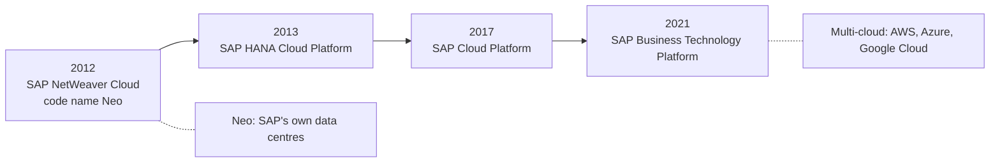
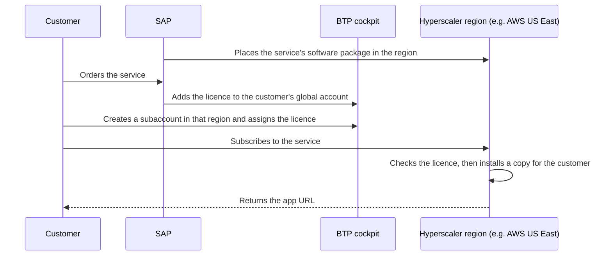
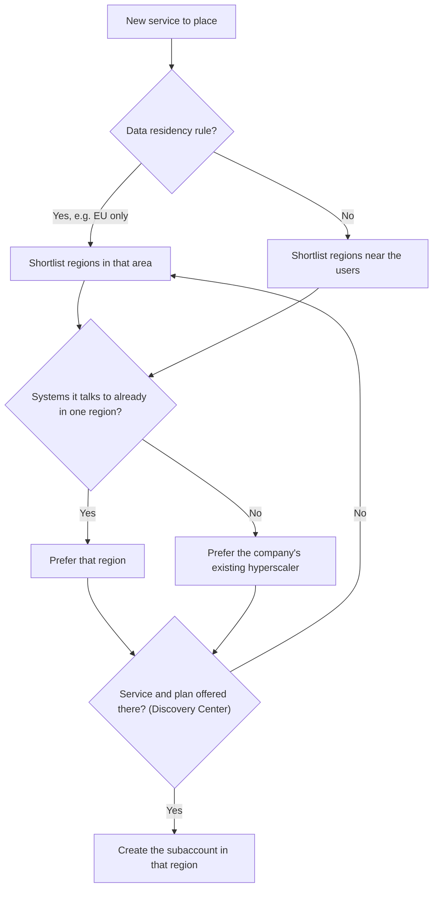

# Inside BTP: Neo, hyperscalers and regions

*Why BTP runs on AWS, Azure and Google Cloud instead of SAP's own data centres, and how to pick the region a service runs in.*

> [!NOTE]
> **📍 At a glance**
> - **You will learn:** the road from NetWeaver Cloud to BTP, what Neo was and when it ends, how hyperscalers host SAP's services, the multi-cloud environments, and how to choose a region
> - **You will build:** a region decision you can defend in a design review, plus the CLI calls that list regions and create a subaccount in one
> - **Level:** beginner · **Time:** about 20 minutes
> - **Builds on:** [SAP's cloud journey and the BTP landscape](sap-cloud-journey-btp-landscape.md). **Leads to:** [Global account, subaccount and your first service subscription](btp-account-model-first-subscription.md)

**After this chapter you can:**

- Tell the platform's name history from 2012 to 2021, and what "Neo" refers to
- Explain why SAP moved from its own data centres to hyperscalers, and what each side does
- Name the environments of the multi-cloud foundation (Cloud Foundry, Kyma, ABAP) and say how they differ from Neo
- Look up which regions and providers offer a service in Discovery Center
- Choose a region from four criteria: user location, co-location, data residency and existing cloud footprint

## 3.1 From NetWeaver Cloud to BTP

- **2012, SAP NetWeaver Cloud.** SAP's first platform ran in SAP's own data centres. Its code name was **Neo** (NetWeaver On-demand).
  - Neo was the runtime environment, a server-as-a-service built on virtualization.
  - It ran Java, HTML5 and JavaScript applications.
- **2013, SAP HANA Cloud Platform.** SAP added a HANA database running in its cloud, so apps and database could both run there.
- **2017, SAP Cloud Platform.** The platform could use non-HANA databases too, so "HANA" left the name.
- **2021, SAP Business Technology Platform (BTP).** The current name, by then running mainly on hyperscalers.



## 3.2 Why SAP moved to hyperscalers

- Running data centres was never SAP's strength. SAP's business is software.
- As SAP's cloud catalogue grew, so did the data-centre work: more capacity, hardware refreshes, maintenance.
- AWS, Azure and Google Cloud already had data centres around the globe, reachable from their own consoles.
- SAP's deal with them, in plain terms:
  - SAP places its software packages in their data centres
  - customers pick the location from the BTP cockpit
  - the hyperscaler runs the software, and SAP pays for the usage
- The hyperscaler only runs a service for a customer who holds an SAP licence for it. The next chapter shows how you prove that.
- The new setup is called the **multi-cloud foundation**. It brought two new environments, **Cloud Foundry** and **Kyma**.

| Environment | What it is | Runs where | Status |
|---|---|---|---|
| Neo | SAP's original runtime (Java, HTML5, JavaScript) | SAP's own data centres | Legacy; shuts down 31 Dec 2028 |
| Cloud Foundry | Open-source PaaS run by SAP; you `cf push` apps in many languages | Hyperscalers | Current |
| Kyma | Managed Kubernetes for containers and serverless functions | Hyperscalers | Current |
| ABAP environment | ABAP Cloud development and runtime (also called Steampunk) | Hyperscalers | Current |

> [!IMPORTANT]
> **🏭 In production**
> - SAP has announced the end of the Neo environment for **31 December 2028**, with no extension beyond that (web-checked 19 Nov 2026).
> - Migration to Cloud Foundry or Kyma is the customer's job, not automatic. SAP offers a free migration assessment.
> - If a customer still runs Neo apps, put the migration on the roadmap now: rewrites of Neo-specific APIs take months, not weeks.
>
> *Added by Claude*

## 3.3 How a service reaches you



- The licence is digital. Buying a service only records "you may use N units" in your global account.
- The service itself already sits in the region, waiting to be installed for whoever shows a licence.

## 3.4 Providers and regions

- **Discovery Center** shows, for each service, which providers and regions offer it.
- Real UI path: *discovery-center.cloud.sap → Platform Services → a service → Pricing → Prices "For the following regions"*.
- Example: SAP Cloud Transport Management, standard plan, under SAP BTPEA (opened 19 Nov 2026):

| Provider | Regions offering the service |
|---|---|
| AWS | Australia (Sydney), Brazil (São Paulo), Canada (Montreal), Europe (Frankfurt), Europe (Frankfurt) EU Access, Europe (Milan), Japan (Tokyo), Singapore, South Korea (Seoul), US East (VA), US West (Oregon) |
| Microsoft Azure | Australia (Sydney), Brazil South, Canada (Toronto), China (North 3), Europe (Frankfurt), Europe (Netherlands), Japan (Tokyo), Singapore, Switzerland (EU Access), US East (VA), US West (WA) |
| Google Cloud | Australia Southeast (Sydney), Europe (Frankfurt), India (Mumbai), Israel (Tel Aviv), Japan (Osaka), Japan (Tokyo), KSA (Dammam, regulated and non-regulated), US Central (IA) |
| Alibaba | China (Shanghai) |
| SAP | Australia (Sydney), Europe (Frankfurt) SAP EU Access, Europe (Rot) SAP Cloud Infrastructure EU Access, Japan (Tokyo), UAE (Dubai), US (Sterling), US West (Colorado) |

- The free plan of the same service is offered in a few fewer regions. Always check the plan you will actually buy.
- A service missing from a region cannot be subscribed there, whatever your licence says.

> [!WARNING]
> **⚠️ Sources disagree: does BTP still use SAP's own data centres?**
> - **The lecture:** SAP is phasing out its own data centres for BTP. It keeps them for products such as S/4HANA Cloud Public Edition and IBP, but BTP services run on AWS, Azure and Google Cloud.
> - **Discovery Center (19 Nov 2026):** "SAP" is still a provider for Cloud Transport Management in seven regions, several marked "EU Access" or "SAP Cloud Infrastructure".
> - Neo also keeps running in SAP data centres until 2028.
> - Both may be true for different services. This chapter shows both until you decide.

## 3.5 Choosing a region

- **Where are the users?** A service in India used by staff in the US adds network latency on every click.
- **What does it talk to?** Services that exchange data should sit in the same region, so data does not cross the globe on every call.
- **What do the rules say?** Data residency can fix the answer. EU personal data, for example, may have to stay in the EU, and "EU Access" regions add restrictions on who may support it.
- **What cloud does the company already use?** A company already on Azure for non-SAP work may put BTP services in the same Azure region.
- Then confirm in Discovery Center that the service and plan exist in that region.



```bash
# Not run (needs a BTP login). btp CLI: list the regions your global account can use, then create a subaccount in one
btp login --sso
btp list accounts/available-region
btp create accounts/subaccount --display-name "cTMS" --subdomain "ctms-demo-1234" --region us10
```

- `us10` is the technical ID of AWS US East (VA). The cockpit shows the readable name, the CLI and APIs use the ID.

> [!WARNING]
> **⚠️ Pitfall: the region is permanent**
> A subaccount's region and provider can't be changed after creation. Picking the wrong one means a new subaccount, new entitlements and moving everything. Settle the region before the first subaccount exists.

## 3.6 Added by Claude, not from the sources

- Region IDs are worth memorising for the CLI and for reading URLs: `us10` is AWS US East (VA), `eu10` is AWS Europe (Frankfurt) and `ap21` is Azure Singapore. The BTP trial offers `us10` and `ap21`.
- The region shows up in every endpoint. For example, the Cloud Foundry API for US East is `https://api.cf.us10.hana.ondemand.com`, and Cloud Foundry app URLs end in `cfapps.us10.hana.ondemand.com`.
- Large customers often run the same app in two regions (for example US and EU) with separate subaccounts. That is part of the "account model" a later lecture covers.

## 3.7 Interview corner

**What interviewers listen for:** you know Neo is legacy with a firm end date, you can explain what SAP and the hyperscaler each do, and you justify a region with more than "it's closest".

### 🟢 Basic

<details class="qa"><summary>1. What is Neo, and what replaced it?</summary>

- Neo is the original SAP BTP environment, running in SAP's own data centres
- It is replaced by the multi-cloud foundation: Cloud Foundry, Kyma and the ABAP environment on AWS, Azure and Google Cloud
- *Stronger answer:* give the end date (31 Dec 2028) and say migration is the customer's job

</details>

<details class="qa"><summary>2. Give the platform's name history.</summary>

- 2012 SAP NetWeaver Cloud, 2013 SAP HANA Cloud Platform, 2017 SAP Cloud Platform, 2021 SAP BTP
- *Stronger answer:* add why the names changed: HANA database added, then non-HANA databases supported, then the shift to a multi-cloud business platform

</details>

### 🟡 Intermediate

<details class="qa"><summary>3. What does SAP do and what does the hyperscaler do when you subscribe to a BTP service?</summary>

- SAP builds the service, places it in the hyperscaler's regions and records your licence in your global account
- The hyperscaler provides the hardware and runs the service in the region you chose, once your licence is assigned there
- *Stronger answer:* SAP pays the hyperscaler for usage; the customer has one contract, with SAP

</details>

<details class="qa"><summary>4. How do you check whether a service is available in a region?</summary>

- Open the service in Discovery Center and read the regions per provider on its Pricing tab
- Check the specific plan, because a free plan may exist in fewer regions than the standard plan
- *Stronger answer:* also check the commercial-model filter, since availability can differ by contract type

</details>

### 🔴 Senior

<details class="qa"><summary>5. Users are in Germany and the US; the app handles EU personal data. Where do you deploy it?</summary>

- Data residency decides first: the part that stores EU personal data goes in an EU region, possibly an EU Access region
- If US users need speed, consider a second deployment in a US region for non-EU data, in a separate subaccount
- *Stronger answer:* mention co-location with the systems it integrates with, and that each region adds operating cost

</details>

<details class="qa"><summary>6. A customer still has twenty Neo apps. What do you advise?</summary>

- Inventory the apps and their Neo-specific dependencies, then plan migration to Cloud Foundry or Kyma well before 31 Dec 2028
- Use SAP's migration guidance and free assessment; retire apps nobody uses instead of moving them
- *Stronger answer:* move shared services (destinations, identity setup) first, then apps in waves, and keep both running in parallel during cut-over

</details>

> [!TIP]
> **🧩 Design question**
> *"A retailer with stores in India and Europe wants a BTP extension that reads S/4HANA data (hosted in Frankfurt) and is used mostly by store staff in India."* Talk about:
> - user latency (India) against co-location with S/4HANA (Frankfurt)
> - whether the data is personal and must stay in the EU
> - what Discovery Center says about the services needed
> - that the region cannot be changed later

## Cheat sheet

| Fact | Value |
|---|---|
| Platform names | 2012 NetWeaver Cloud, 2013 HANA Cloud Platform, 2017 SAP Cloud Platform, 2021 SAP BTP |
| Neo | SAP-hosted legacy environment; ends 31 Dec 2028 |
| Multi-cloud environments | Cloud Foundry, Kyma, ABAP environment |
| Providers in Discovery Center | AWS, Microsoft Azure, Google Cloud, Alibaba (China), SAP |
| Region criteria | Users, co-location, data residency, existing hyperscaler |
| Region ID examples | `us10` AWS US East, `eu10` AWS Frankfurt, `ap21` Azure Singapore |
| Region change after creation | Not possible |

## Recap

- The platform started in 2012 as SAP NetWeaver Cloud (Neo) in SAP's own data centres and became SAP BTP in 2021
- SAP moved to AWS, Azure and Google Cloud so it could scale without running data centres itself
- SAP places services in hyperscaler regions; you activate them with your licence in the region you choose
- Cloud Foundry, Kyma and the ABAP environment form the multi-cloud foundation; Neo ends on 31 Dec 2028
- Discovery Center tells you which providers and regions offer each service and plan
- Choose a region by data residency, user location, co-location and existing cloud footprint, because it can't be changed later

## Practice

1. In Discovery Center, look up SAP Business Application Studio and note three regions on two different providers.
2. A team in Singapore needs a service that also exchanges data with an S/4HANA system in US East. Argue for one region in three bullets.
3. Write the `btp` CLI command that would create a subaccount named "dev-apps" in AWS Frankfurt (`eu10`).

## How this chapter was checked

- **Lecture 1 recording** (captions 1:24 to 1:38 and 2:25 to 2:29:33): read in full.
- **Day 1 slides** (slide 8) and the **BTP Basics notes** deck (history, Cloud Foundry, accounts and regions pages): read in full and merged.
- **Discovery Center:** the Cloud Transport Management pricing tab was opened on 19 Nov 2026, and the region table was copied from it.
- **Web-checked on 19 Nov 2026:** the name history and dates, and the Neo end date with its migration terms.
- **Not run:** the `btp` CLI commands, which need a BTP login. The region IDs and endpoint pattern are added by Claude from SAP's public naming, not from the course.

## Sources and further reading

- BTPAI course, Lecture 1 recording, 27 Sep 2026 (BT001); *Day 1 BTP Fundamentals* slides (BT005); *1. BTP Basics* notes (BT002)
- SAP Discovery Center, *SAP Cloud Transport Management*, Pricing: https://discovery-center.cloud.sap/serviceCatalog/cloud-transport-management?region=all&tab=service_plan (opened 19 Nov 2026)
- SAP Community, *Farewell Neo* (June 2023): https://blogs.sap.com/2023/06/14/farewell-neo-sap-btp-multi-cloud-environment-the-deployment-environment-of-choice/
- SAP, *Migrate from the SAP BTP Neo environment to the multi-cloud foundation*: https://www.sap.com/products/technology-platform/neo-migration.html
- Wikipedia, *SAP BTP* (name history): https://en.wikipedia.org/wiki/SAP_BTP
- SAP Learning, *Explaining SAP BTP account model* (region fixed after creation): https://learning.sap.com/courses/operating-sap-business-technology-platform/explaining-sap-btp-account-model

Previous: [SAP's cloud journey and the BTP landscape](sap-cloud-journey-btp-landscape.md) · Next: [Global account, subaccount and your first service subscription](btp-account-model-first-subscription.md)
