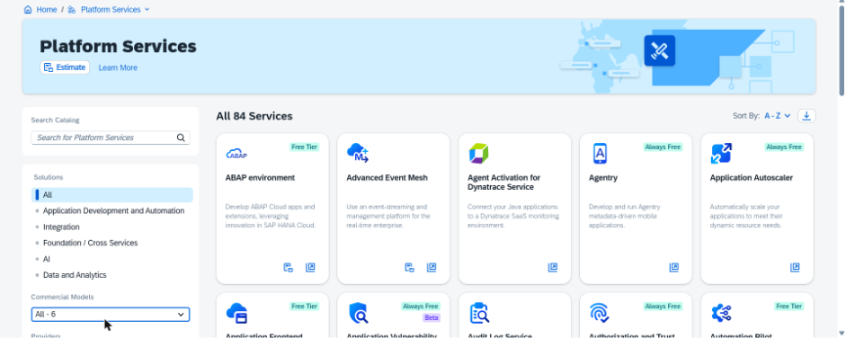
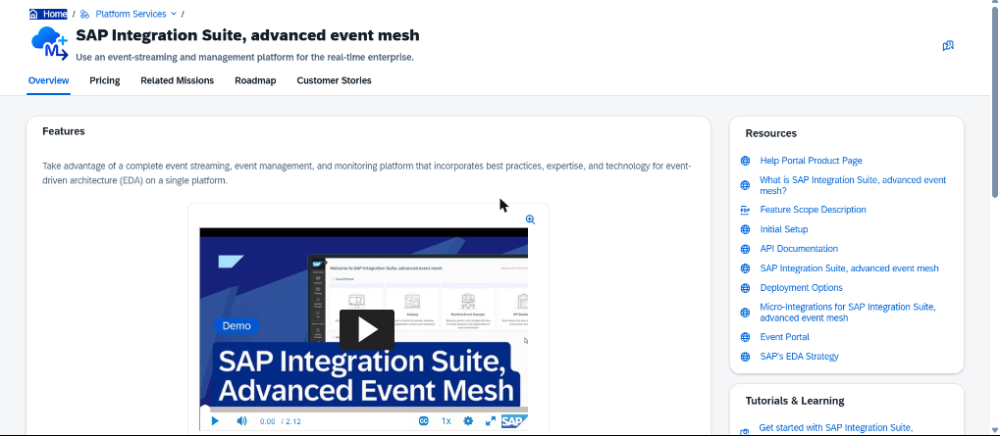
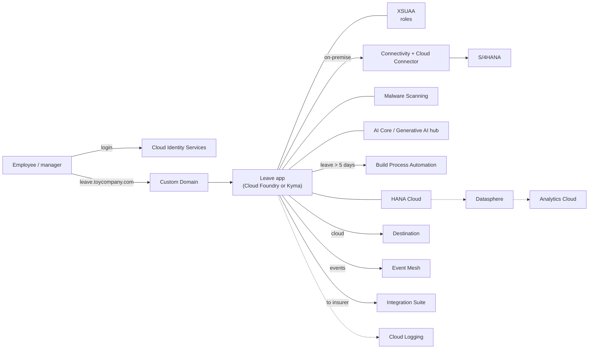

# Choosing BTP services for a requirement

*How to read SAP Discovery Center, and how one business requirement turns into a list of BTP services.*

> [!NOTE]
> **📍 At a glance**
> - **You will learn:** how Discovery Center organises every BTP service, what each service page tells you, and how to map a real requirement to the services that deliver it
> - **You will build:** a service map for a leave-management app, from IDE to dashboard
> - **Level:** beginner · **Time:** about 25 minutes
> - **Builds on:** [Global account, subaccount and your first service subscription](btp-account-model-first-subscription.md). **Leads to:** [Global account tools: Resource Providers, Boosters and System Landscape](btp-global-account-tools.md)
> - **Last checked:** 19 Nov 2026

**After this chapter you can:**

- Filter Discovery Center by business solution area or by technical capability
- Find a service's plans, regions, missions, roadmap, setup guide and support component on its page
- Turn a list of business requirements into the BTP services that cover them
- Explain why a Node.js app runs on Cloud Foundry or Kyma, and when the ABAP environment fits instead
- Spot the items in the catalogue that are not BTP services, such as Cloud Connector

## 5.1 Discovery Center: the catalogue of every BTP service

- **SAP Discovery Center** (`discovery-center.cloud.sap`) is a public website. Anyone can open it, with no login and no trial needed.
- It lists every service BTP offers. It is information only: you don't subscribe from here.
- It showed **84 platform services** on 19 Nov 2026 (the lecture counted 83 a few weeks earlier).
- What you own is different: your global account's **Service Assignments** show only the services your company bought.

**Two ways to filter the same catalogue**

| Filter | Who thinks this way | Options (19 Nov 2026) |
|---|---|---|
| **Solutions** | Business: "what do we want to achieve?" | Application Development and Automation, Integration, Foundation / Cross Services, AI, Data and Analytics |
| **Capabilities** | Technical: "what kind of building block is it?" | Mobile, Runtimes & Containers, Security, User Experience, Database and Data Management, Developer Productivity, DevOps, Process Automation |

- **Foundation / Cross Services** are helpers that serve any area. Examples are the destination service and the audit log service.
- Other filters: commercial model, provider, region, and a quick filter for **Always Free and Free Tier** services.
- Tile labels: **Free Tier** (a free plan exists inside a paid account), **Always Free** (never charged), **Beta** (not yet generally available).



## 5.2 Anatomy of a service page

- Open any service tile and you get the same tabs.



| Tab | What you find | Use it when |
|---|---|---|
| Overview | Features, demo videos, and a Resources panel | You need to know what the service does |
| Pricing | Plans, metrics, prices and the regions per provider | You size a solution or check a region |
| Related Missions | SAP's ready-made projects: business challenge, architecture, services used, step-by-step guide | You want a reference design or a practice project |
| Roadmap | Planned features from the product team | A customer asks "is X coming?" |
| Customer Stories | How named companies use it | You build a business case |

- Some services also show **Related AI Offerings**.
- The **Resources** panel links the Help Portal, feature scope, **Initial Setup**, API documentation, and tutorials.
- The **Support** section names the incident component. For example, `BC-CP-EM-AEM` is the one for Advanced Event Mesh. That is the component you quote when you raise an SAP ticket.
- For what changed recently, use **What's New for SAP BTP** on the Help Portal. You can filter it by component, environment and date.

> [!TIP]
> Missions are the fastest way to practise. Each one names the services it needs, so you can check your trial has them before you start.

## 5.3 From requirement to services: the leave-app scenario

**The company today**
- A toy maker runs S/4HANA (sourcing, production, sales, distribution, finance), Ariba (suppliers, purchase orders, invoices) and SAP Analytics Cloud (sales dashboards).
- It also has an Oracle system for inventory, and a third-party HR system with no leave management.
- SuccessFactors would cover it, but is over budget. So a partner proposes building a leave app on BTP.

**What the app must do**
- Employees apply for leave. A manager approves it, and a senior manager as well if it is over 5 days.
- Medical leave needs an uploaded prescription. That file is scanned for malware, and AI reads it.
- Single sign-on for employees; only managers may approve.
- It talks to S/4HANA on-premise and to cloud systems, and survives the festival-season rush.
- Leave data feeds HR dashboards and goes to a third-party insurance provider.
- The app has its own business-style URL, logs and monitoring, and runs in dev, test and production.

| Requirement | BTP service | Category in Discovery Center |
|---|---|---|
| Write Node.js and Fiori code | SAP Business Application Studio (BAS) | Application development |
| Test code and check its quality | Continuous Integration and Delivery (CI/CD) | DevOps |
| A server to run the app | Cloud Foundry or Kyma runtime | Runtimes |
| Move releases dev → test → prod | Cloud Transport Management | DevOps |
| Log in once (SSO) | SAP Cloud Identity Services (Identity Authentication) | Security |
| Only managers approve | Authorization and Trust Management service (XSUAA) | Security |
| Reach S/4HANA on-premise | Connectivity service (with Cloud Connector on-premise) | Integration |
| Reach cloud systems | Destination service | Integration |
| Scale up in peak season | Application Autoscaler | Operations |
| Second approval over 5 days | SAP Build Process Automation | Automation |
| Read prescriptions with AI | SAP AI Core and AI Launchpad, Generative AI hub | AI |
| Scan uploads for viruses | Malware Scanning service | Security |
| Store leave data | SAP HANA Cloud | Database |
| HR dashboards | SAP Datasphere and SAP Analytics Cloud (in Business Data Cloud) | Data and Analytics |
| Send data to the insurer | SAP Integration Suite (Cloud Integration) | Integration |
| Logs and app health | SAP Cloud Logging | Monitoring |
| `leave.toycompany.com` instead of a long BTP URL | Custom Domain service | Foundation |
| React to "leave applied" in other systems | SAP Event Mesh / Advanced Event Mesh | Integration |



**The same services as a deployment descriptor**

A real Cloud Foundry project declares the services it binds to in its `mta.yaml`. This sketch covers the core of the leave app:

```yaml
# Not deployed: an illustrative mta.yaml for the leave app (service names are the BTP technical names)
_schema-version: "3.1"
ID: leave-app
version: 1.0.0
modules:
  - name: leave-srv            # Node.js back end
    type: nodejs
    path: srv
    requires:
      - name: leave-auth       # XSUAA: who may approve
      - name: leave-db         # HANA Cloud container for leave data
      - name: leave-destination
      - name: leave-connectivity
resources:
  - name: leave-auth
    type: org.cloudfoundry.managed-service
    parameters: { service: xsuaa, service-plan: application }
  - name: leave-db
    type: com.sap.xs.hdi-container
    parameters: { service: hana, service-plan: hdi-shared }
  - name: leave-destination
    type: org.cloudfoundry.managed-service
    parameters: { service: destination, service-plan: lite }
  - name: leave-connectivity
    type: org.cloudfoundry.managed-service
    parameters: { service: connectivity, service-plan: lite }
```

✅ *Verified: the YAML parses (details at the end).*

## 5.4 What the mapping teaches

- **Runtime follows language.** Node.js runs on Cloud Foundry or Kyma, not in the ABAP environment. An ABAP-written app would run in the ABAP environment.
- **Cloud Foundry, Kyma and the ABAP environment are "server as a service".** CPU and memory come inside the runtime.
- **AI: build or consume.** You can train your own model and deploy it in AI Core. Or you can call ready models such as GPT or Claude through the Generative AI hub, which is usually faster.
- **Data tools sit in Business Data Cloud, not BTP.** Datasphere pulls the app's data, cleans and models it, and SAC reports on it.
- **Bundles vs single services.** Build Process Automation can be bought alone, or as part of SAP Build (with Build Apps and Build Work Zone).
- **Not everything in the catalogue is a BTP service.** Cloud Connector appears in Discovery Center, but it is software installed on-premise that tunnels to BTP.
- **Not every service has a URL.** XSUAA, destination and autoscaler work behind the app, with no screen of their own.
- Many more services exist for other needs, for example mobile services for a phone version of the app.

> [!WARNING]
> **⚠️ Pitfall: listing services is not the design**
> The mapping says *which* services. Each one still needs a subaccount, an entitlement with the right plan and quota, and a region where it is offered (see the account-model chapter). Check all three before quoting a solution.

> [!IMPORTANT]
> **🏭 In production**
> - Start from SAP's reference architectures and missions rather than a blank page. They show service combinations SAP supports.
> - Price the whole list in the Discovery Center estimator before committing: a service that looks small (database, AI tokens, bandwidth) often dominates the bill.
> - Write down which services are on which plan in each landscape. Missing entitlements in test or production are a classic go-live blocker.
>
> *Added by Claude*

## 5.5 Added by Claude, not from the sources

- SAP publishes reference architectures for common BTP patterns in the **SAP Architecture Center** (`architecture.learning.sap.com`). They are a good second source next to Discovery Center missions.
- Discovery Center's estimators (Platform Service Estimator, Business AI Estimator) build a cost estimate from a list of services, plans and quantities.
- In an `mta.yaml`, `service` is the technical name you see in Service Assignments, and `service-plan` is the plan. Getting either wrong is the most common deploy error.

## 5.6 Interview corner

**What interviewers listen for:** you go from requirement to service with a reason for each choice, you know which services are behind-the-scenes, and you remember the account-model steps each service still needs.

### 🟢 Basic

<details class="qa"><summary>1. What is SAP Discovery Center used for?</summary>

- A public catalogue of every BTP service, with features, plans, prices, regions, missions, roadmap and customer stories
- No login needed; it is for research, not for subscribing
- *Stronger answer:* mention the Solutions vs Capabilities filters and that the Pricing tab is where you confirm a service exists in a region

</details>

<details class="qa"><summary>2. Which services give a BTP app login and roles?</summary>

- Cloud Identity Services (Identity Authentication) for login and single sign-on
- Authorization and Trust Management (XSUAA) for roles inside the app
- *Stronger answer:* authentication says who you are, authorization says what you may do; managers-only approval is an XSUAA role

</details>

### 🟡 Intermediate

<details class="qa"><summary>3. A BTP app must read data from an on-premise S/4HANA. Which pieces do you need?</summary>

- Connectivity service in BTP and Cloud Connector installed on-premise, which opens a secure tunnel
- A destination that describes the S/4HANA endpoint
- *Stronger answer:* Cloud Connector is not a BTP service even though Discovery Center lists it; it is installed and run by the customer

</details>

<details class="qa"><summary>4. When would you use the Generative AI hub rather than training a model in AI Core?</summary>

- When a ready large language model (GPT, Claude and similar) can do the task, such as reading a prescription
- Training your own model makes sense for narrow, data-specific predictions
- *Stronger answer:* the hub gives one governed gateway to several model providers, so you can switch models without changing app code

</details>

### 🔴 Senior

<details class="qa"><summary>5. Walk through the services for a leave app with SSO, approvals over 5 days, AI document checks and HR reporting.</summary>

- Build and run: BAS, CI/CD, Cloud Foundry or Kyma, Cloud Transport Management, HANA Cloud
- Security: Cloud Identity Services, XSUAA, Malware Scanning; integration: Connectivity, Destination, Integration Suite, Event Mesh
- Process and AI: Build Process Automation for the 5-day rule, AI Core or Generative AI hub for documents; data: Datasphere and SAC in BDC
- *Stronger answer:* add operations (Autoscaler, Cloud Logging, Custom Domain) and say each runs in dev, test and prod subaccounts with matching entitlements

</details>

<details class="qa"><summary>6. A customer finds HANA Cloud too expensive for a small app. What are the options?</summary>

- Keep the app on BTP and use a hyperscaler database such as PostgreSQL on AWS or Azure through the hyperscaler option
- Reserve HANA Cloud for apps that need in-memory performance or HANA features
- *Stronger answer:* compare the full cost including operations, backups and the skills the team has, not just the database price

</details>

> [!TIP]
> **🧩 Design question**
> *"A retailer wants a supplier self-service portal: suppliers log in, upload invoices, track payments from S/4HANA on-premise, and the finance team gets a dashboard."* Talk about:
> - runtime and IDE, login and roles for an external user group
> - malware scanning for uploads, and the S/4HANA connection through Cloud Connector
> - an approval workflow, and reporting in BDC
> - which services need their own subaccount and entitlements per landscape

## Cheat sheet

| Need | Service |
|---|---|
| IDE in the browser | SAP Business Application Studio |
| Run custom code | Cloud Foundry, Kyma, ABAP environment |
| Test and deliver | CI/CD, Cloud Transport Management |
| Login and roles | Cloud Identity Services, XSUAA |
| On-premise and cloud connections | Connectivity (+ Cloud Connector), Destination |
| Workflow | SAP Build Process Automation |
| AI | AI Core and AI Launchpad, Generative AI hub |
| Database | SAP HANA Cloud (or hyperscaler PostgreSQL) |
| Integration and events | Integration Suite, Event Mesh |
| Operations | Application Autoscaler, Cloud Logging, Custom Domain |
| Reporting | Datasphere + SAP Analytics Cloud (in BDC) |

## Recap

- Discovery Center is the public catalogue of every BTP service; filter by Solutions (business) or Capabilities (technical)
- Every service page has the same tabs: Overview, Pricing, Related Missions, Roadmap, Customer Stories, plus setup, API and support links
- A requirement becomes a service list by asking "what does each feature need?": code, run, test, transport, login, roles, connect, scale, store, analyse, automate
- One leave app already needs about 17 BTP services; real projects are similar
- Cloud Connector is on-premise software, not a BTP service; data tools sit in BDC
- Each chosen service still needs a subaccount, an entitlement and a supported region

## Practice

1. In Discovery Center, filter Capabilities = Security and list the services with one line each.
2. Open any service, find its support component and its Initial Setup link.
3. Map this requirement to services: "A field-service app for technicians, on phones, offline-capable, that reads equipment data from S/4HANA and lets AI suggest a fix."

## How this chapter was checked

- **Lecture 2 recording:** captions 5:00 to 50:52 read in full (Discovery Center walkthrough, the leave-app scenario and its questions).
- **Day 2 Notes:** pages 3 to 7 read in full and merged, including the leave-app requirement tables.
- **Discovery Center, opened on 19 Nov 2026:** the service catalogue (filters and count), and the Advanced Event Mesh page (tabs, Resources, support component). Screenshot taken then.
- **What's New for SAP BTP:** the page structure and filters were checked; its 3,665 entries were not read.
- **Run on 19 Nov 2026:** the `mta.yaml` was parsed with PyYAML to check its syntax. It was not deployed.

## Sources and further reading

- BTPAI course, Lecture 2 recording, *BTP capabilities and global account walkthrough* (BT006); *SAP BTP Fundamentals Day 2 Notes* (BT008)
- SAP Discovery Center, service catalogue: https://discovery-center.cloud.sap/servicecatalog (opened 19 Nov 2026)
- SAP Discovery Center, *SAP Integration Suite, advanced event mesh*: https://discovery-center.cloud.sap/serviceCatalog/advanced-event-mesh (opened 19 Nov 2026)
- SAP Help Portal, *What's New for SAP Business Technology Platform*: https://help.sap.com/whats-new/cf0cb2cb149647329b5d02aa96303f56

Previous: [Global account, subaccount and your first service subscription](btp-account-model-first-subscription.md) · Next: [Global account tools: Resource Providers, Boosters and System Landscape](btp-global-account-tools.md)
