# Inside a subaccount: service types, environments and connectivity

*What a subaccount offers the apps that run in it: the overview page, environments, the three kinds of service, custom-app binding, and connections to other systems.*

> [!NOTE]
> **📍 At a glance**
> - **You will learn:** the subaccount menu, enabling environments, the Application / Service / Environment types, SaaS vs PaaS on BTP, binding services to a custom app, and destinations vs Cloud Connector
> - **You will build:** a Cloud Foundry space with a deployed app bound to an XSUAA instance (Assignment 2, Part 2)
> - **Level:** intermediate · **Time:** about 40 minutes
> - **Builds on:** [Users, role collections and access at every level](btp-users-role-collections.md)
> - **Last checked:** 20 Nov 2026

**After this chapter you can:**

- Read a subaccount's overview: entitlements, subdomain, subaccount (tenant) ID, production flag and environment
- Enable Cloud Foundry, and explain why Kyma or ABAP only appear once entitled
- Sort any marketplace item into Application, Service or Environment, and say where it shows up after you create it
- Tell SaaS from PaaS on BTP, including the AI Launchpad exception
- Pick the right runtime environment when creating an instance, and explain "Other"
- Deploy an app to a space and bind a service to it
- Explain destinations, Cloud Connector, and what multitenancy means on BTP

## 8.1 What a subaccount is for

- A subaccount gives the apps inside it a place to run, plus features they share: users and roles, connections to other systems, environments.
- Every subaccount has the same menu. What changes is what you have entitled and enabled.

| Menu item | What it is for |
|---|---|
| Overview | Key facts, environments, entitlements at a glance |
| Services → Service Marketplace | Everything entitled here, ready to create or subscribe |
| Services → Instances and Subscriptions | Everything you actually created or subscribed |
| Cloud Foundry → Spaces, Space Quotas, Org Members | Appears once Cloud Foundry is enabled |
| HTML5 Applications | Front-end apps deployed in this subaccount |
| Connectivity → Destinations, Destination Certificates, Destination Trust, Cloud Connectors | Connections from apps here to other systems |
| Security → Users, Role Collections, Roles, Trust Configuration | Who may do what ([previous chapter](btp-users-role-collections.md)) |
| Entitlements | What this subaccount may use, with quota |
| Usage Analytics | What this subaccount consumed |

## 8.2 The overview page


| Field | Meaning |
|---|---|
| Entitlements (for example 19) | Counted **per plan**. A service with four plans counts four times, so it is more than the number of services |
| Instances and Subscriptions | How many of those you actually created or subscribed |
| Subdomain | Your text, part of every app URL in this subaccount |
| Tenant ID and Subaccount ID | The **same** GUID, set by SAP and unique worldwide. Both names are used in support tickets and docs |
| Provider and Region | Where it runs, for example AWS, US East (VA) |
| Environment: Multi-Environment | Cloud Foundry, Kyma and ABAP can all be enabled here |
| Used for Production | A label telling your team and SAP's operators the subaccount is productive. It blocks *force* deletion (see the note below) |
| Beta Features | Enable in dev or test to see SAP's new features early; usually off in production |
| Created On / Modified On | Modified changes when you edit name, description, beta flag and so on |

- Edit these details from the global account's Account Explorer (the subaccount's "…" menu).

> [!NOTE]
> **What "Used for production" really protects**
> - **The course:** a subaccount marked for production can't be deleted until you unmark it.
> - **SAP's docs (read 20 Nov 2026):** the flag changes nothing in the subaccount's configuration. What it does block is **force deletion**.
>   - An empty subaccount can be deleted normally, flag or not.
>   - One with content must be emptied first (instances, subscriptions, spaces), or force-deleted, which wipes all its data.
>   - Force delete is offered only if the global account allows it and the subaccount isn't marked as used for production.
> - So set the flag on every Prod subaccount. It stops the one-click wipe, not a deliberate clean-up.

## 8.3 Environments: Cloud Foundry, Kyma, ABAP

- An **environment** is a server you run your own code on, which is why the course calls it "server as a service". You need one only for custom apps.
- Enable Cloud Foundry with **Enable Cloud Foundry** on the overview page. Or create it from Service Marketplace: it is listed with type Environment.
- Kyma and ABAP show an enable option only once their entitlement is assigned to the subaccount. Cloud Foundry is usually entitled already.
- The ABAP environment uses Cloud Foundry underneath.
- Best practice: enable **one environment per subaccount**. Mixing them is possible but makes the subaccount harder to manage.
- A subaccount can have **only one** Cloud Foundry org, so only one Cloud Foundry environment.

**The runtimes compared**

| | Neo | Cloud Foundry | Kyma | ABAP environment |
|---|---|---|---|---|
| Built on | SAP's own platform, in SAP data centres | Open-source Cloud Foundry, deployed with **BOSH** | Open-source Kubernetes (project Kyma) | SAP's ABAP application server |
| You run | Java, HTML5, SAP HANA XS apps | Apps in Java, Node.js, Python, Go, Ruby, PHP, .NET and more, through buildpacks | Anything that runs on Kubernetes: containers, microservices, even third-party databases | ABAP Cloud code only |
| Billed by | (legacy) | Runtime memory actually used (GB) | Its own Kyma runtime plan (see Discovery Center) | ABAP and HANA compute units (16 GB blocks) |
| Status | Ends 31 Dec 2028 | The common default for custom apps | For container and Kubernetes teams | For ABAP developers and extensions |

- **BOSH, not Bosch.** BOSH is the open-source tool that deploys and runs Cloud Foundry on the hyperscaler's VMs. It has nothing to do with the company Bosch.
- Cloud Foundry and Kyma can run the same languages. The real choice is the operating model: push code and let Cloud Foundry handle the rest, or manage containers on Kubernetes.
- **The ABAP environment and Cloud Foundry:**
  - The course explains that the ABAP system is a separate server, and Cloud Foundry only hosts the way in. You aren't charged Cloud Foundry memory for it.
  - SAP's docs describe it like this: you create the ABAP system as a service instance in a Cloud Foundry space. It is billed in ABAP compute units and HANA compute units, not Cloud Foundry memory.
- Creating an instance of a paid service, such as SAP AI Core, in a Cloud Foundry space adds no Cloud Foundry charge: you pay for the service. Cloud Foundry memory is charged for the apps you deploy yourself.

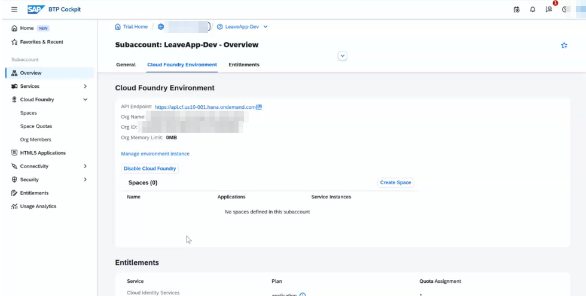

- The **org** is your Cloud Foundry account for this subaccount. **Spaces** are isolated areas inside it where apps and instances live.
- Cloud Foundry memory is bought in GB. Spaces share the org's memory, and space quotas can split it.
- An **Org Memory Limit of 0 MB** means no memory quota is assigned yet. Deploying then fails until you entitle the Cloud Foundry Runtime memory plan.

> [!NOTE]
> **How much Cloud Foundry memory comes by default?**
> - **The lecture:** every new productive subaccount gets 200 GB automatically, and you pay only for what apps use. A trial has 4 GB in total, all in the "trial" subaccount.
> - **SAP's docs (read 20 Nov 2026):** in consumption-based global accounts (BTPEA, CPEA, Pay-As-You-Go), every subaccount gets a default runtime-memory quota of **200 GB** for the standard plan.
>   - It is a ceiling on what apps may use at once, and you are billed for the memory actually consumed.
>   - A global account admin can change the default. Subscription contracts get the GB they ordered.
> - Check *Global account → Entity Assignments* for your contract before relying on any number.

## 8.4 Application, Service, Environment: the three marketplace types

- *Service Marketplace* has a **Type** filter with three values. Each type lands in its own tab of *Instances and Subscriptions*.

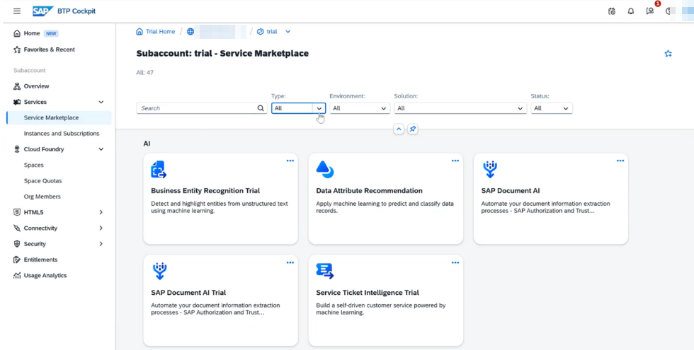

| Marketplace type | After creating it, appears under | What you get | Asks for a runtime environment? |
|---|---|---|---|
| **Application** | Subscriptions | A finished app with a URL and a UI | No |
| **Service** | Instances | A service instance (credentials, a microservice, or a backend) | Yes |
| **Environment** | Environments | A runtime for custom code (Cloud Foundry, Kyma) | Not applicable |

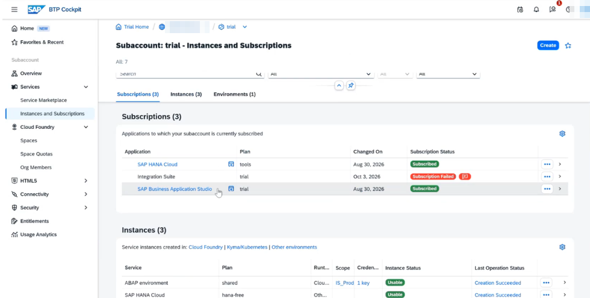

- One service can offer both types. Cloud Transport Management's `lite` plan is an application (no environment asked); its `standard` plan is an instance.

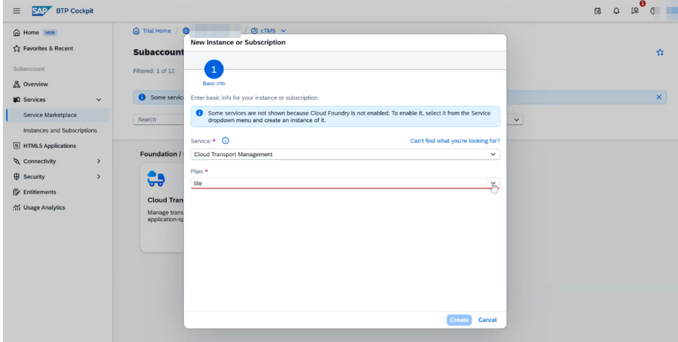

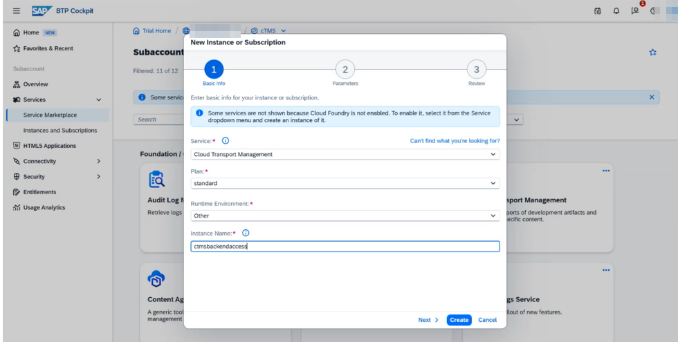

## 8.5 SaaS or PaaS? The course's rule of thumb

- **PaaS on BTP:** you build or deploy something on it. Examples: Integration Suite (integration flows), Build Process Automation (workflows), Cloud Foundry, Kyma, ABAP environment, HANA Cloud (tables), AI Core (models).
- **SaaS on BTP:** you only configure it.
  - Technical: Cloud Transport Management, CI/CD, Cloud Identity Services.
  - Functional: IAG, Digital Manufacturing, PAPM Cloud, Advanced Financial Closing.
- **Rule of thumb from the lecture:** a **Deploy** button means PaaS.
- **The one exception given:** AI Launchpad has a Deploy button but is SaaS. The model is actually deployed into **AI Core**, the PaaS behind it.
- A browser UI says nothing about the type: Integration Suite has a rich UI and is still PaaS.
- All PaaS is technical. SaaS can be technical or functional.

## 8.6 Three kinds of "Service": the course's model

The lecturer stresses that the following grouping is his own way of teaching it, not an SAP term.

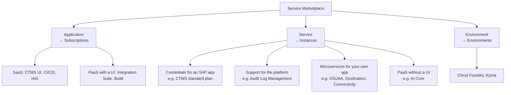

| Kind | Why it exists | Example |
|---|---|---|
| Credentials for an SAP app | The app's UI has no place to create API credentials, so a second plan gives a service key | CTMS `standard`: a key (URL, client ID and secret) so Cloud ALM can monitor transports |
| Support for the platform | Gives access to data the platform itself keeps | Audit Log Management: a key to fetch the global account's or a subaccount's audit logs (kept by SAP for about 90 days) |
| Microservices for your own app | Common features you shouldn't code yourself | XSUAA (roles), destination, connectivity: bound to your app in the same space |
| PaaS without a UI | Runs workloads but has no screen | AI Core, driven from AI Launchpad |

- Most items of type Service have **no UI** and no URL. A few exceptions do, for example the destination service, the alert notification service and the ABAP environment.

## 8.7 Which runtime environment for an instance?

> [!NOTE]
> **What "Other" means**
> - **SAP's sources (web-checked 19 Nov 2026):** an "Other" instance is created at **subaccount level**, outside any Cloud Foundry space or Kyma namespace, managed through SAP Service Manager.
> - Subaccount role collections govern access to it.
> - **The lecture's way of saying it:** "Other" is SAP's shared Cloud Foundry that already runs the apps you paid for, so it doesn't use your own Cloud Foundry or Kyma quota.

**The rule of thumb from the course**

| You are creating | Choose |
|---|---|
| The extra plan of an SAP app you already pay for (CTMS `standard`) | **Other** |
| A platform service such as Audit Log Management | **Other** if offered |
| A microservice for your own app (XSUAA, destination, connectivity) | **Cloud Foundry** or **Kyma**, the same place the app runs, in the same space |
| A PaaS service where "Other" isn't offered | Cloud Foundry |

## 8.8 A custom app: deploy to a space, then bind a service

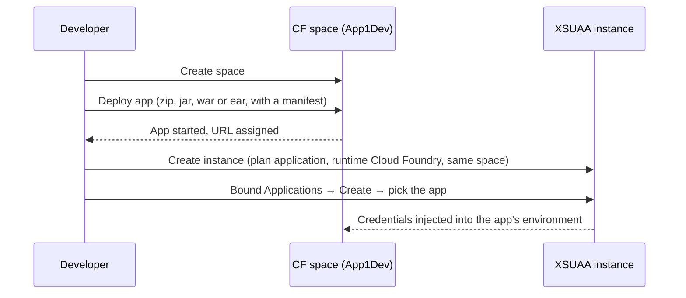

1. *Cloud Foundry → Spaces → Create Space*, for example `App1Dev`.
2. Open the space → **Deploy Application** → browse the archive and manifest (or custom settings) → **Deploy**.

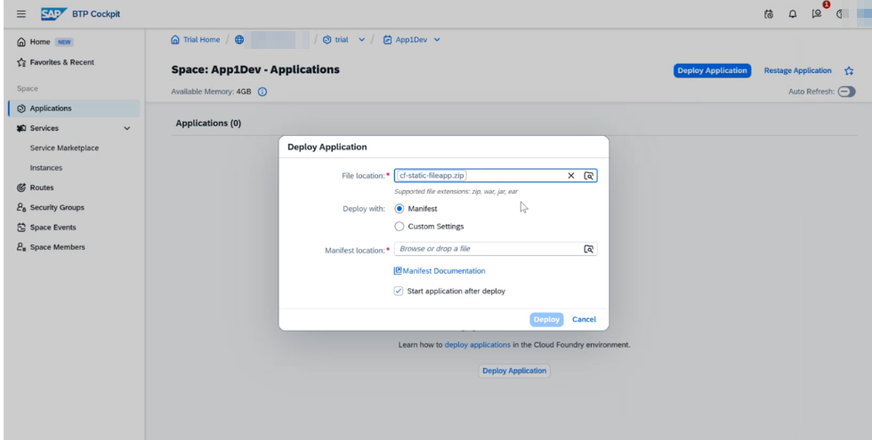

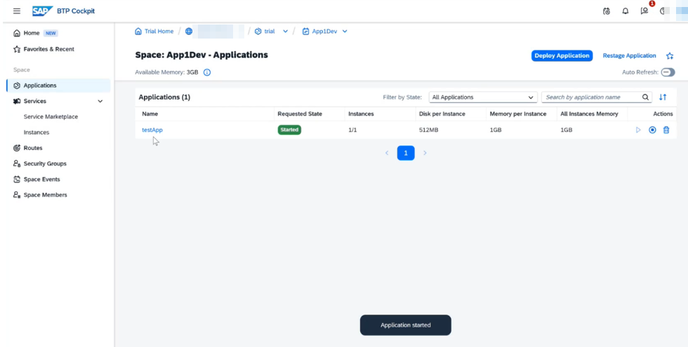

3. *Service Marketplace → Authorization and Trust Management Service → Create*. Choose plan `application`, runtime **Cloud Foundry**, and the **same space**.

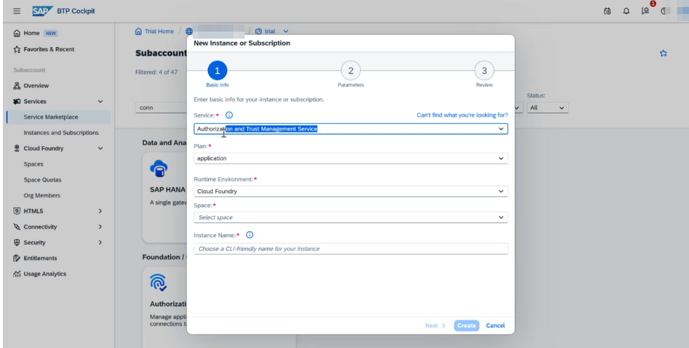

4. Open the instance → **Bound Applications → Create** → pick the app.

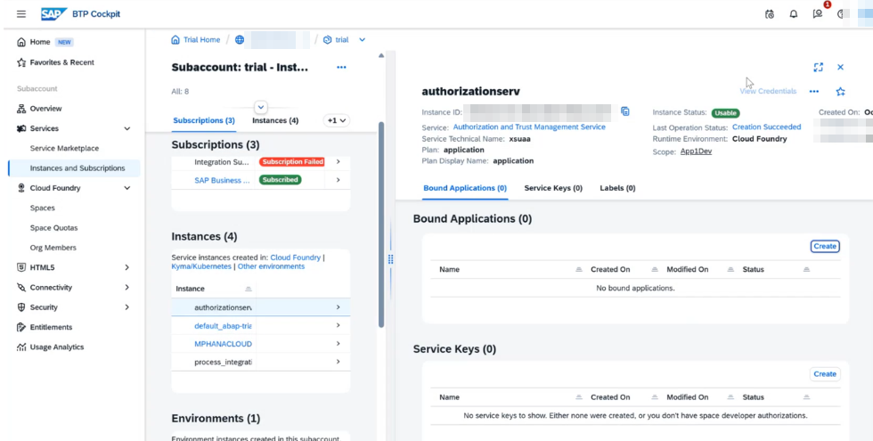

- **Binding** injects the instance's credentials into the app's environment, so the app can use the feature without hard-coded secrets.
- Developers still write the code that uses it, such as role checks for XSUAA.
- An app can only bind to instances **in its own space**.

```bash
# Not run (needs a Cloud Foundry login). The same steps with the cf CLI
cf login -a https://api.cf.us10-001.hana.ondemand.com     # API endpoint from the subaccount overview
cf create-space App1Dev && cf target -s App1Dev
cf push testApp -p cf-static-fileapp.zip                    # or a manifest.yml with cf push
cf create-service xsuaa application authorizationserv       # service technical name, plan, instance name
cf bind-service testApp authorizationserv
cf restage testApp                                          # the app picks up the new credentials
```

## 8.9 HTML5 Applications

- Front-end apps (UI5 or Fiori, React and so on) deployed in this subaccount are listed here. The back end might run in Cloud Foundry.
- It matters mostly to developers, and to SAP Build Work Zone scenarios that surface Fiori apps from S/4HANA in BTP.

## 8.10 Connectivity: destinations and Cloud Connector

- **Destinations** store how to reach another system: name, URL, authentication type, user and password or OAuth.
- Apps in this subaccount (an AI agent in Joule Studio, an integration flow, your own app) use the destination by name.
- Typical targets: SuccessFactors, AWS services, ServiceNow, another BTP subaccount.
- **Cloud Connector** is software installed **on-premise**. It opens a secure, encrypted tunnel (a reverse-invoke connection) between on-premise systems such as S/4HANA and this subaccount.
- *Connectivity → Cloud Connectors* only **lists** the connectors linked to this subaccount. Nothing runs in BTP itself.
- **Destination Certificates** and **Destination Trust** are for certificate-based authentication on destinations, covered in the integration topics.

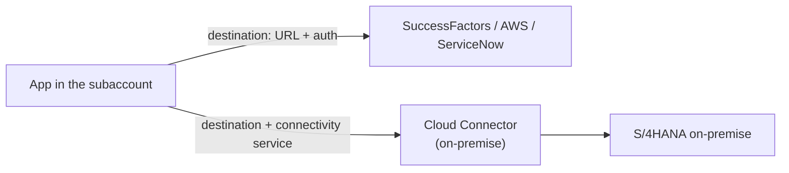

**Where your app's own data lives**
- A custom app on BTP (a leave app, a supplier portal) creates data of its own. That data needs a database next to the app, in the cloud:
  - SAP HANA Cloud on BTP, or
  - a hyperscaler database such as PostgreSQL or Redis through Resource Providers ([global account tools](btp-global-account-tools.md)).
- S/4HANA's own database is not the app's database. The app reads and writes S/4HANA data **through APIs** (OData, via destinations and Cloud Connector).
- That is the clean-core idea: no custom tables inside S/4HANA, so its upgrades stay simple. The extension and its data live on BTP.

> [!NOTE]
> **Can a BTP app use an on-premise database at all?**
> - **The lecture:** no. An app running in a US East data centre can't use an on-premise database as its back end.
> - **SAP's Connectivity docs (read 20 Nov 2026):** the Connectivity service offers a SOCKS5 proxy, so apps can reach on-premise systems over TCP-based protocols through Cloud Connector.
> - So it is technically possible, but the wrong design for the app's own data:
>   - every query crosses the tunnel, so latency and on-premise outages hit the app
>   - it works against clean core
> - Keep the app's data in a cloud database; reach on-premise data through APIs.

## 8.11 What multitenancy means on BTP

- **SAP's definition (web-checked):**
  - A multitenant app is deployed **once**, in a **provider subaccount**.
  - Each customer subaccount (**consumer**) subscribes, and gets its own **tenant**: isolated data, own users, own URL.
  - The SaaS Provisioning service (SaaS Registry) handles those subscriptions.
- That is why "tenant ID" equals "subaccount ID": a subscribing subaccount is the tenant. Cloud Transport Management is itself a multitenant app.
- **The lecture's example:** the same leave app running in US, EU and Australia subaccounts, for latency and EU data rules.
  - This book calls that **multi-region deployment**: several deployments of one app.
  - A real design can combine both: a multitenant app deployed in several regions.

## 8.12 Added by Claude, not from the sources

- Cloud Foundry injects bound credentials into the `VCAP_SERVICES` environment variable. Libraries such as `@sap/xsenv` (Node.js) read it, so code never contains secrets.
- Service keys are long-lived credentials. Treat them like passwords: create one per consumer, rotate them, and delete unused keys.
- "Used for production" only blocks force deletion. Anyone with the rights can still delete instances, spaces and subscriptions one by one, so they need their own care and backups.

## 8.13 Interview corner

**What interviewers listen for:** the three marketplace types and where each lands, a clear SaaS/PaaS rule with its exception, binding in the same space, and destination vs Cloud Connector.

### 🟢 Basic

<details class="qa"><summary>1. What are the three types in Service Marketplace, and where does each show up after creation?</summary>

- Application → Subscriptions; Service → Instances; Environment → Environments
- Applications give a URL and UI; services give an instance; environments give a runtime for custom code
- *Stronger answer:* one service can have both kinds of plan, such as CTMS lite (subscription) and CTMS standard (instance)

</details>

<details class="qa"><summary>2. Are the subaccount ID and tenant ID different?</summary>

- No, they are the same GUID, assigned by SAP and unique worldwide
- Both names are used because different tools and support teams ask for one or the other
- *Stronger answer:* the "tenant" wording comes from multitenancy, where each subscribing subaccount is a tenant

</details>

<details class="qa"><summary>3. What does "Used for production" do?</summary>

- It marks the subaccount as productive for your team and SAP's operators; it changes no configuration
- It blocks force deletion, the option that wipes a subaccount with all its data
- *Stronger answer:* pair it with beta features off in production and on in dev or test

</details>

### 🟡 Intermediate

<details class="qa"><summary>4. Integration Suite has a nice browser UI. Is it SaaS?</summary>

- No, it's PaaS: you build integration flows on it and deploy them
- A browser UI doesn't decide the type; building and deploying does
- *Stronger answer:* the course's exception is AI Launchpad, which has a Deploy button but is SaaS, because the model runs in AI Core

</details>

<details class="qa"><summary>5. When do you pick "Other" as the runtime environment?</summary>

- For instances that don't belong to a Cloud Foundry space: the API plan of an SAP app you already pay for, or platform services like Audit Log Management
- SAP creates such instances at subaccount level, managed through Service Manager
- *Stronger answer:* microservices for your own app go in the same Cloud Foundry space or Kyma namespace as the app, so they can be bound

</details>

<details class="qa"><summary>6. Destination vs Cloud Connector?</summary>

- A destination is configuration in the subaccount: where and how to call a system
- Cloud Connector is on-premise software that opens a secure tunnel to BTP; the subaccount only lists it
- *Stronger answer:* calls to on-premise systems use both: a destination of proxy type "on-premise" routed through the connectivity service and Cloud Connector

</details>

### 🔴 Senior

<details class="qa"><summary>7. A developer's app can't see the XSUAA instance when binding. What do you check?</summary>

- The instance must be in the same Cloud Foundry space as the app, created with runtime Cloud Foundry, not "Other"
- The developer needs space developer rights in that space
- *Stronger answer:* after binding, restage the app so the credentials reach its environment, and confirm the entitlement and quota for the XSUAA plan exist

</details>

<details class="qa"><summary>8. Explain multitenancy on BTP to an architect.</summary>

- One app deployed in a provider subaccount; consumers subscribe from their own subaccounts and each gets an isolated tenant
- The SaaS Registry manages subscriptions and calls the provider's callbacks; the provider is billed for consumption
- *Stronger answer:* separate this from multi-region deployment (copies in several regions), and note a product can be both

</details>

> [!TIP]
> **🧩 Design question**
> *"Build a leave app in Cloud Foundry that uses roles, reads S/4HANA on-premise, and calls SuccessFactors."* Talk about:
> - one environment per subaccount, and a space per stage
> - XSUAA, destination and connectivity instances in the app's space, and binding
> - a Cloud Connector on-premise plus a destination for S/4HANA, and a cloud destination for SuccessFactors
> - which users get space-developer vs app roles

## Cheat sheet

| Question | Answer |
|---|---|
| Application type lands in | Subscriptions (no runtime asked) |
| Service type lands in | Instances (runtime asked) |
| Environment type lands in | Environments |
| PaaS clue | A Deploy button (except AI Launchpad) |
| "Other" runtime | Instance at subaccount level, outside any space |
| Binding rule | Instance and app in the same space |
| Destination | Where and how to call another system |
| Cloud Connector | On-premise tunnel; listed, not run, in BTP |
| Tenant ID | Same as subaccount ID |
| Used for production | Blocks force deletion only |
| Cloud Foundry per subaccount | One org at most; 200 GB default memory quota in consumption accounts |
| App's own data | A cloud database (HANA Cloud or a hyperscaler database), not the S/4HANA database |

## Recap

- The overview shows entitlements (counted per plan), subdomain, subaccount = tenant ID, region, production flag and beta setting
- Environments run custom code; enable one per subaccount, and Kyma or ABAP appear only once entitled
- Application → Subscriptions, Service → Instances, Environment → Environments; only instances ask for a runtime
- A Deploy button usually means PaaS; AI Launchpad is the exception
- Services split into credentials for SAP apps, platform support, microservices for your app, and PaaS without UI (the course's model)
- Custom apps bind to instances in the same space; destinations and Cloud Connector connect them to other systems
- Multitenancy means one deployment serving many subscribing tenants; several regional copies is multi-region deployment

## 🧪 Lab 8: Push a small app and bind XSUAA with the cf CLI

> [!NOTE]
> **Lab card**
> - **Goal:** the 8.8 flow from the command line: a space, a running Node.js app, and a service instance bound to it
> - **Time:** about 30 minutes · **Cost:** free · **Needs:** lab 1; Node.js 20 or later to try the app locally

> *Commands: cf syntax checked against the Cloud Foundry CLI v8 reference on 21 Nov 2026. Not run here: they need your own trial login.*

**The app:** two files in a folder called `hello-btp`.

```json
{
  "name": "hello-btp",
  "version": "1.0.0",
  "scripts": { "start": "node server.js" },
  "engines": { "node": ">=20" }
}
```

```js
// server.js
const http = require("http");
const port = process.env.PORT || 8080;          // Cloud Foundry sets PORT

http.createServer((req, res) => {
  // VCAP_SERVICES holds the bound services' credentials; print only their names
  const services = JSON.parse(process.env.VCAP_SERVICES || "{}");
  res.writeHead(200, { "Content-Type": "text/plain" });
  res.end(`Hello from BTP. Bound services: ${Object.keys(services).join(", ") || "none"}\n`);
}).listen(port, () => console.log(`listening on ${port}`));
```

✅ *Verified: the app ran locally and listed bound services from `VCAP_SERVICES` (details at the end).*

**Steps**

1. Try it locally: `npm start`, then open `http://localhost:8080`. It says "Bound services: none".
2. Log in to Cloud Foundry in the `trial` subaccount, where SAP already enabled it (4.7). The API endpoint is on that subaccount's overview page.

    ```bash
    cf login -a <api-endpoint> --sso     # gives a one-time passcode URL; without --sso, cf asks for email and password
    cf create-space lab-dev
    cf target -s lab-dev
    ```

3. Push, from inside the `hello-btp` folder:

    ```bash
    cf push hello-btp -m 128M --random-route   # a random hostname avoids clashing with other trial users
    cf app hello-btp                           # state, memory and the route
    ```

4. Create an XSUAA instance and bind it (8.8):

    ```bash
    cf create-service xsuaa application lab-xsuaa
    cf bind-service hello-btp lab-xsuaa
    cf restage hello-btp                       # the app sees a new binding only after a restage
    ```

5. Open the route from step 3.

**Check it worked:** the page reads "Bound services: xsuaa", and `cf services` shows `lab-xsuaa` bound to `hello-btp`.

**Clean up:**

```bash
cf delete hello-btp -r -f        # -r also deletes the route; the trial allows 10
cf delete-service lab-xsuaa -f
cf delete-space lab-dev -f
```

> [!CAUTION]
> **🔒 Security**
> - `cf env hello-btp` prints `VCAP_SERVICES` with the XSUAA client secret. Never paste that output into notes, chats or tickets.
> - That is why the app prints only the service names.

> [!TIP]
> - Trial apps are stopped every night (SAP Help, *Trial Accounts and Free Tier*). `cf start hello-btp` brings yours back.
> - To use `lab-dev` instead of `trial`, enable Cloud Foundry there first, as in Practice step 2 below.

## Practice

Assignment 2, Part 2, in your trial:

1. Create a new subaccount.
2. Enable Cloud Foundry in it (move Cloud Foundry memory from "trial" if the org shows 0 MB, but leave "trial" its Cloud Foundry Runtime).
3. Create a space.

Stretch: deploy any small static app to the space, create an XSUAA instance there and bind it.

## How this chapter was checked

- **Lecture 3 recording:** captions 30:03 to 2:51:49 read in full (subaccount overview to connectivity), with the questions from 2:13 and 3:07.
- **Screenshots:** frames at 46:35, 55:05, 56:05, 57:00, 1:42:55, 1:54:15, 2:07:45, 2:08:45, 2:10:55 and 2:12:05. IDs and avatars are pixelated.
- **Day 3 Notes:** pages 5 to 12 and 15 to 18 read in full and merged.
- **Web-checked on 19 Nov 2026:**
  - the "Other" environment (subaccount-level instances, Service Manager)
  - multitenancy (provider and consumer subaccounts, SaaS Registry)
  - the default Cloud Foundry quota: no current official figure found (superseded on 20 Nov 2026, below)
- **Not run:** the `cf` commands, which need a Cloud Foundry login.
- **Enriched on 20 Nov 2026** (the production-flag note, the runtimes table, the 200 GB note, where an app's data lives):
  - Lecture 4 captions 1:56:37 to 2:00:47 (what Cloud Foundry costs), 2:43:22 to 2:56:51 (runtimes) and 3:01:44 to 3:21:23 (databases) read in full
  - SAP Fundamentals Notes pages 5, 15 and 19 to 20 read in full
  - checked against SAP's docs: deleting and force-deleting subaccounts, the 200 GB default, Cloud Foundry and Kyma environments
  - also against SAP's docs: ABAP environment plans and metering, and TCP access to on-premise systems through the Connectivity service
  - checked against bosh.io: what BOSH is
- **Lab 8 (added 21 Nov 2026):** `cf` syntax checked against the Cloud Foundry CLI v8 reference (`push`, `login`, `delete`, `delete-service`, `delete-space`). The `cf` commands were not run, because they need a trial login.
  - Run on 21 Nov 2026 with Node.js 24.19: the app answered "Hello from BTP. Bound services: none" on port 8080.
  - With `PORT=9090` and a sample `VCAP_SERVICES` holding an `xsuaa` entry, it answered "Bound services: xsuaa".

## Sources and further reading

- BTPAI course, Lecture 3 recording (BT009); *SAP BTP Fundamentals Day 3 Notes* (BT010); *Assignment 2* (BT007)
- SAP Developers, *Create service instances in the SAP BTP cockpit*: https://developers.sap.com/tutorials/btp-cockpit-instances.html
- SAP Community, *Fundamentals of multitenancy in SAP BTP*: https://community.sap.com/t5/technology-blog-posts-by-sap/fundamentals-of-multitenancy-in-sap-btp/ba-p/13527283
- SAP Learning, *Setting up SAP BTP, Cloud Foundry runtime*: https://learning.sap.com/courses/developing-applications-for-sap-btp-cloud-foundry-runtime/setting-up-sap-btp-cloud-foundry-runtime
- BTPAI course, Lecture 4 recording (BT011); *SAP BTP Fundamentals Notes* (BT014)
- SAP Help, *Delete a subaccount*: https://github.com/SAP-docs/btp-cloud-platform/blob/main/docs/50-administration-and-ops/delete-a-subaccount-419dc3d.md
- SAP Help, *Change subaccount details* (Used for production): https://github.com/SAP-docs/btp-cloud-platform/blob/main/docs/50-administration-and-ops/change-subaccount-details-567d4a8.md
- SAP Help, *What is the consumption-based commercial model?* (200 GB default): https://github.com/SAP-docs/btp-cloud-platform/blob/main/docs/10-concepts/what-is-the-consumption-based-commercial-model-7047eb4.md
- SAP Help, *Creating an ABAP system*: https://github.com/SAP-docs/btp-cloud-platform/blob/main/docs/20-getting-started/creating-an-abap-system-50b32f1.md
- SAP Help, *Using the TCP protocol for cloud applications*: https://github.com/SAP-docs/btp-connectivity/blob/main/docs/1-connectivity-documentation/using-the-tcp-protocol-for-cloud-applications-cd15837.md
- Cloud Foundry BOSH documentation: https://bosh.io/docs/
- Cloud Foundry CLI v8 reference (used by the lab): https://cli.cloudfoundry.org/en-US/v8/
- SAP Help, *Trial Accounts and Free Tier* (trial limits in the lab): https://help.sap.com/docs/btp/sap-business-technology-platform/trial-accounts-and-free-tier

Previous: [Users, role collections and access at every level](btp-users-role-collections.md) · Next: [Directories, landscape tiers and commercial models](btp-directories-tiers-commercial-models.md)
