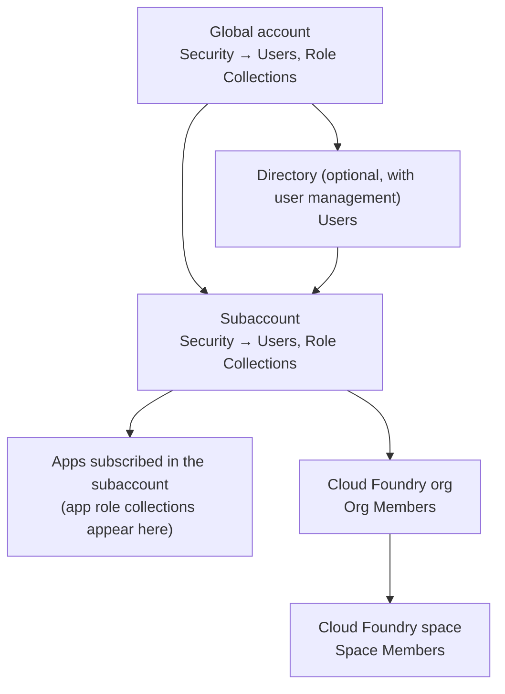
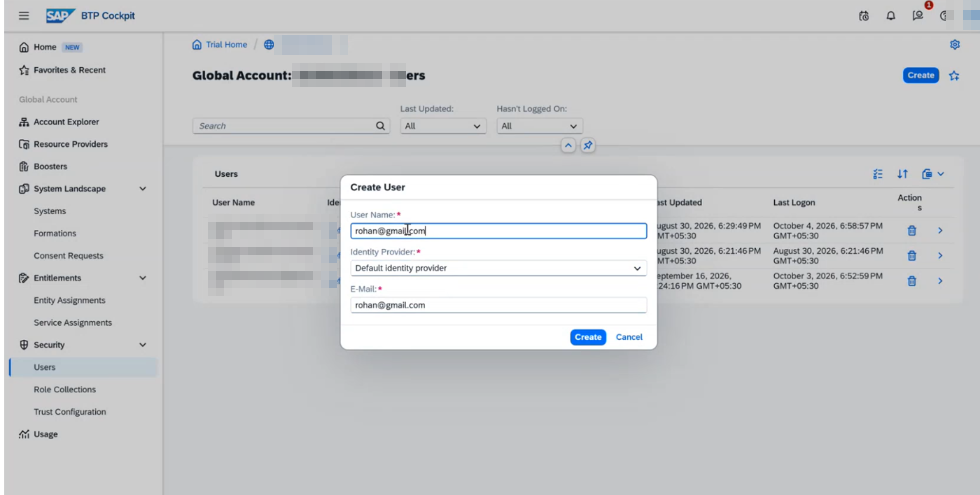
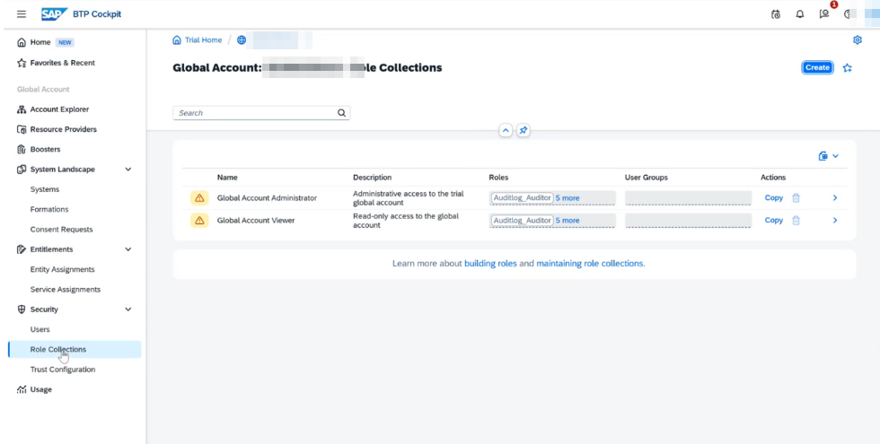
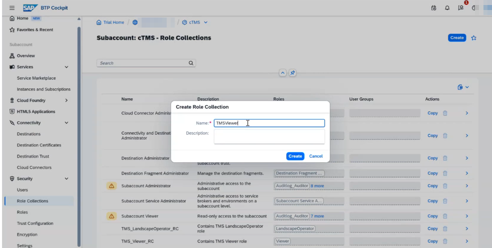
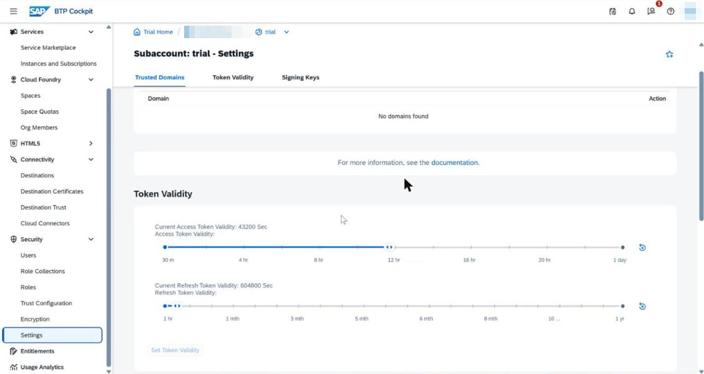

# Users, role collections and access at every level

*Who may do what in BTP: adding users, building role collections from SAP's roles, and why access is granted separately at every level.*

> [!NOTE]
> **📍 At a glance**
> - **You will learn:** how users are added, what the default identity provider is, how roles, role templates and role collections fit together, platform vs application users, and why nothing is inherited between levels
> - **You will build:** a custom "landscape admin" role collection and a viewer-only role collection for an app, assigned to the right users
> - **Level:** beginner to intermediate · **Time:** about 30 minutes
> - **Builds on:** [Global account tools](btp-global-account-tools.md) and [the account-model chapter](btp-account-model-first-subscription.md)
> - **Last checked:** 20 Nov 2026

**After this chapter you can:**

- Add a user to a global account or subaccount and say which identity provider checks their login
- Explain role, role template, role collection and application identifier, and how they nest
- Build a custom role collection from SAP's predefined roles and assign it
- Answer "can you assign a single role to a user?" correctly
- Tell platform users from application users and give each only what they need
- Explain why a user must be added separately at global account, subaccount, Cloud Foundry org and space level

## 7.1 Access is granted level by level

- BTP has several places a person can work in. Each one has its **own users and own role collections**.
- Adding someone at one level gives them **nothing** at the next one down.



| Person needs to… | Add them at | Give them |
|---|---|---|
| Manage entitlements, formations, global users | Global account | A global-account role collection |
| Hand out a directory's licences to its subaccounts | A directory with user management | Directory Administrator (Directory Viewer to only look) |
| Work in a subaccount (destinations, subscriptions, users) | Subaccount | Subaccount role collections |
| Use an app such as Cloud Transport Management | The subaccount where the app runs | That app's role collections |
| Deploy apps in Cloud Foundry | Cloud Foundry org and space | Org or space roles |

- Role collections in the global account don't exist in subaccounts, and the reverse is also true (SAP Learning, web-checked).
- Whoever creates a directory, subaccount, org or space gets access to it automatically; everyone else must be added. Global account admins can add themselves to a subaccount with Add Me as Admin.
  - The rule, with an example: [Directories, landscape tiers and commercial models](btp-directories-tiers-commercial-models.md).

## 7.2 Adding a user, and who checks their login

- Real UI path: *Global account (or subaccount) → Security → Users → Create*. Enter the email, pick the **Identity Provider**, then **Create**.



- **Default identity provider** means SAP's own user store behind sap.com. Every new global account and subaccount trusts it out of the box.
- So the person must have an sap.com account **with the same email** before they can log in.
- Creating the user only lets them in. Until you assign a role collection, they see empty or greyed-out pages.

**Why companies replace the default identity provider**
- A company with 50,000 employees will not ask everyone to create an sap.com account, or keep its staff list at SAP.
- Instead it runs its own user store in **SAP Cloud Identity Services**, which is a BTP service, and connects it under *Security → Trust Configuration*.
- Then employees log in with company accounts and single sign-on. How to set it up: [Identity: Cloud Identity Services, trust and federated authorization](btp-identity-trust-federation.md).

## 7.3 Roles, role templates and role collections

| Term | What it is | Who creates it |
|---|---|---|
| **Role template** | The permission definition an application ships with | The app's developer (SAP, for platform and SAP apps) |
| **Role** | A concrete role built from a template, for one application | SAP delivers most; developers can add some for their own apps |
| **Application identifier** | Which application the role belongs to (for example `xsuaa!t1`, `cmp!b70961`) | Set by the app |
| **Role collection** | A bundle of roles you assign to users or groups | You (or SAP's defaults) |


- **You never assign a role directly.** Users only ever get role collections.
- To give one single role, create a role collection that contains just that role, and assign it.
- **You can't create new platform roles.** The global account and subaccount are SAP's software, so you combine the roles SAP ships. You do decide how they are grouped.

> [!TIP]
> A favourite interview question is "Can you assign a role to a user?". The answer is **no**: only role collections. If someone needs one role, wrap it in a role collection of its own.

## 7.4 Global-account role collections

- Real UI path: *Global account → Security → Role Collections*.



| Default role collection | Gives | Contains, for example |
|---|---|---|
| Global Account Administrator | Full access to everything in the global account | Global Account Admin, Global Account Usage Reporting Viewer, System Landscape Administrator, User and Role Administrator, Audit Log Auditor |
| Global Account Viewer | Read-only access to the same areas | The matching viewer and auditor roles |

- SAP's default collections can be used, but not changed or deleted (web-checked).
- The **warning icon** marks collections with high-privilege roles, such as User and Role Administrator or Global Account Admin. Think twice before assigning them.
- Each menu area has its own roles, for example System Landscape Administrator or System Landscape Viewer. That is what lets you give narrow access.

**Building a custom role collection**
- Real UI path:
  - *Role Collections → Create*, then a name such as `Landscape Admin` → **Create**
  - open it → **Edit** → **Add Role** → pick roles → **Add** → **Save**
- Typical custom collections, built from job profiles:

| Collection | Roles | For whom |
|---|---|---|
| Landscape Admin | System Landscape Administrator | Someone who adds systems and creates formations |
| Landscape Viewer | System Landscape Viewer | Someone who only checks the landscape |
| Global Account Security Admin | User and Role Administrator | A security consultant who manages users and role collections |
| Usage Viewer | Global Account Usage Reporting Viewer | A finance or business person watching costs |

- Then *Security → Users → (user) → Assign Role Collection*. The user must **log out and in again** to get the new rights.

```hcl
# Not run (needs a BTP login). Terraform provider SAP/btp: a custom global-account role collection and its assignment
resource "btp_globalaccount_role_collection" "landscape_admin" {
  name        = "Landscape Admin"
  description = "Can manage System Landscape only"
  roles = [{
    name                 = "System Landscape Administrator"
    role_template_name   = "GlobalAccount_System_Landscape_Administrator"
    role_template_app_id = "cmp!b70961"      # copy the identifier from your own cockpit
  }]
}

resource "btp_globalaccount_role_collection_assignment" "ram" {
  role_collection_name = btp_globalaccount_role_collection.landscape_admin.name
  user_name            = "ram@example.com"
}
```

## 7.5 Subaccount role collections, and the ones apps bring

- Every subaccount starts with the same platform role collections:
  - Cloud Connector Administrator, Connectivity and Destination Administrator
  - Destination Administrator, Destination Fragment Administrator
  - Subaccount Administrator, Subaccount Service Administrator, Subaccount Viewer
- When you **subscribe to an app**, its role collections appear automatically. Cloud Transport Management, for example, adds `TMS_LandscapeOperator_RC` and `TMS_Viewer_RC`. Business Application Studio and HANA Cloud add their own.
- A subaccount with nothing subscribed shows only the seven platform collections.



- A custom app collection works the same way, for example `TMSViewer` holding only the TMS viewer role. The person can then look but not change anything.
- Real UI path: *Subaccount → Security → Role Collections → Create*, then **Edit → Add Role**. Filter by the app's identifier (`alm-ts` for Cloud Transport Management).

## 7.5a The rest of the subaccount Security menu

- *Subaccount → Security* has six entries: Users, Role Collections, **Roles**, **Trust Configuration**, **Encryption** and **Settings**.

**Roles**
- One list of every role in the subaccount: from platform services and from every subscribed app.
- Columns: application name, role template, role name and description.
- The global account has no Roles page. There you only see roles while editing a role collection (*Edit → Add Role*).


**Trust Configuration**
- Lists the identity providers this subaccount trusts. Out of the box, that is only the default identity provider (sap.com accounts).
- Companies add their own SAP Cloud Identity Services tenant here, and the global account gets its own trust as well ([identity chapter](btp-identity-trust-federation.md)).

**Encryption**
- A newer page, about key management. In the recording it is still disabled.
- SAP's docs describe customer-managed keys with SAP Data Custodian for some services, for example encrypting content in the HTML5 Application Repository.

**Settings**
- Three tabs: **Trusted Domains**, **Token Validity** and **Signing Keys**.
- *Token Validity* sets how long the tokens of SAP Authorization and Trust Management service (XSUAA) last, for every app in the subaccount.

| Token | What it does | Default | Allowed range |
|---|---|---|---|
| Access token | Proves who you are on each call to an app or API | 43,200 s (12 hours) | 60 s to 24 hours |
| Refresh token | Gets new access tokens without a new login; when it expires, you log in again | 604,800 s (7 days) | 60 s to 1 year |



- One app can override the subaccount values in its `xs-security.json`:

```json
{
  "xsappname": "leave-app",
  "tenant-mode": "dedicated",
  "oauth2-configuration": {
    "token-validity": 1800,
    "refresh-token-validity": 43200
  }
}
```

✅ *Verified: the JSON parses (details at the end).*

> [!NOTE]
> **Why you get logged out**
> - **The course:** you have to log in again after 15 to 30 minutes of doing nothing, because of the token validity set here.
> - **SAP's docs:** this page sets access-token and refresh-token lifetimes. SAP advises keeping them as short as possible, but **not below 30 minutes**.
> - So there is no single idle timeout to quote. How soon you must log in again depends on these values and on the app.

> [!CAUTION]
> **🔒 Security**
> - Longer tokens mean fewer logins, but a stolen token also works for longer. Shorten them for admin-heavy subaccounts.
> - Change these values in Dev first: very short refresh tokens break long-running browser sessions and background jobs.

## 7.6 Platform users and application users

| | Platform user | Application (business) user |
|---|---|---|
| Who | BTP admins, developers, integration or AI consultants | People who just use an app: a machine operator in Digital Manufacturing, a transport operator in CTMS |
| Needs | Subaccount (or global-account) role collections | Only the app's role collections |
| Gets | The cockpit URL | The app's own URL; they need not know BTP exists |

- Both kinds are added under the same subaccount *Security → Users*. The role collections decide what each can reach.
- Give someone the wrong URL and they log in fine, but see "not authorized": authentication worked, authorization didn't.

> [!CAUTION]
> **🔒 Security**
> - Keep Global Account Administrator to a handful of named people. SAP recommends at least two, so you are never locked out.
> - Prefer narrow custom collections over the administrator defaults. The warning icon is your cue.
> - Review assignments regularly: the audit log records who added which user and collection.

## 7.7 Added by Claude, not from the sources

- Role collections can also be assigned to **user groups** from your identity provider (the "User Groups" column in the screenshots). At scale, that replaces assigning user by user.
- After you connect your own identity provider, users added under "Default identity provider" and users from your IdP are different users, even with the same email. Pick the right IdP when you assign.
- The `btp` CLI equivalents are `btp create security/role-collection` and `btp assign security/role-collection`. Check `btp help` for the exact flags in your CLI version.

## 7.8 Interview corner

**What interviewers listen for:** the role → role collection rule, the default identity provider and why it gets replaced, and the fact that access is granted separately at every level.

### 🟢 Basic

<details class="qa"><summary>1. Can you assign a single role directly to a BTP user?</summary>

- No. Users only get role collections
- To give one role, create a role collection with just that role and assign it
- *Stronger answer:* add that platform roles can't be created either, only combined, because SAP owns the global account and subaccount software

</details>

<details class="qa"><summary>2. What is the "Default identity provider"?</summary>

- SAP's own user store behind sap.com, which every global account and subaccount trusts by default
- A new user needs an sap.com account with the same email
- *Stronger answer:* companies replace it with SAP Cloud Identity Services (their own user store, SSO) through Trust Configuration

</details>

<details class="qa"><summary>3. What do the Global Account Administrator and Global Account Viewer collections give?</summary>

- Administrator: full access to every global-account area. Viewer: read-only access to the same areas
- Both are SAP defaults: usable, but not editable or deletable
- *Stronger answer:* for narrower access, build custom collections from per-area roles such as System Landscape Viewer

</details>

### 🟡 Intermediate

<details class="qa"><summary>4. A user is Global Account Administrator but can't open anything in a subaccount. Why?</summary>

- Global-account users and role collections don't carry into subaccounts
- They must be added to the subaccount and given subaccount role collections, or use **Add Me as Admin** in Account Explorer
- *Stronger answer:* the same goes again for Cloud Foundry org and space membership

</details>

<details class="qa"><summary>5. What changes in a subaccount's role collections when you subscribe to an app?</summary>

- The app's own role collections appear next to the seven platform collections, for example TMS_LandscapeOperator_RC and TMS_Viewer_RC for Cloud Transport Management
- They grant rights inside the app, not in the subaccount
- *Stronger answer:* that is how you give business users app access without any cockpit access

</details>

<details class="qa"><summary>6. What does the warning icon on a role collection mean?</summary>

- It contains high-privilege roles, such as User and Role Administrator or Global Account Admin
- It is a reminder to check before assigning
- *Stronger answer:* use it in access reviews; collections with the icon should have short, named member lists

</details>

### 🔴 Senior

<details class="qa"><summary>7. Design access for a BTP landscape with a platform team, a security team, finance, developers and 2,000 app users.</summary>

- Platform team: Global Account Administrator (a few named people), plus subaccount admin where needed
- Security team: a custom collection with User and Role Administrator. Finance: usage viewer. Developers: subaccount roles plus space developer
- App users: only app role collections, ideally through identity-provider groups, not one by one
- *Stronger answer:* connect your own identity provider first, map groups to role collections, and audit high-privilege collections each quarter

</details>

> [!TIP]
> **🧩 Design question**
> *"A customer wants their security consultant to manage users in the global account but not touch entitlements or formations, and wants an auditor to see everything without changing it."* Talk about:
> - a custom collection with only User and Role Administrator for the consultant
> - Global Account Viewer (or narrower viewer roles) for the auditor
> - logging in again after assignment, and reviewing via the audit log

## Cheat sheet

| Task | Where |
|---|---|
| Add a user | Security → Users → Create (pick the identity provider) |
| Give rights | Users → user → Assign Role Collection, then log out and in |
| Build a custom collection | Role Collections → Create → Edit → Add Role → Save |
| See the roles an app brings | Subaccount → Security → Role Collections (after subscribing) |
| Use your own user store | Security → Trust Configuration (with SAP Cloud Identity Services) |
| Golden rule | Roles go into role collections; role collections go to users |

## Recap

- Access is granted separately at global account, subaccount, app, Cloud Foundry org and space level; nothing is inherited
- New users log in through the default identity provider (sap.com) until the company connects its own through Cloud Identity Services
- Users get role collections only; a role collection bundles roles, each role comes from an app's role template
- Default global-account collections (Administrator, Viewer) can't be edited; custom collections combine SAP's per-area roles
- Subscribing to an app adds that app's role collections to the subaccount
- Platform users work in the cockpit; application users only need the app's URL and its role collections

## Practice

Assignment 2, Part 1, in your trial:

1. Add a user (a colleague, or a second email of your own) to your global account.
2. Create a custom role collection with the **System Landscape Administrator** and **User and Role Administrator** roles.
3. Assign it to that user, have them log in, and check they see only System Landscape and Security.

## How this chapter was checked

- **Lecture 3 recording:**
  - captions 1:07 to 30:03 (global-account security and usage) and 2:51:49 to 3:04:11 (subaccount security) read in full
  - the questions from 2:13 and 3:07 read in full
- **Screenshots:** frames at 4:22, 7:30, 12:48 and 3:01:25. Other users' emails, account IDs and avatars are pixelated.
- **Day 3 Notes:** pages 2 to 4 and 13 to 15 read in full and merged.
- **BTP Basics notes deck (BT002):** the global-account and subaccount role-collection tables and the security-artifacts page are now used here. Those were the parts left over from Lecture 1.
- **Web-checked on 19 Nov 2026:**
  - the default global-account collections can't be changed or deleted
  - global-account role collections don't exist in subaccounts
- **Not run:** the Terraform snippet. Its resource and attribute names follow the SAP/btp provider; copy the role template and app ID from your own cockpit.
- **Enriched on 20 Nov 2026** (the directory level in 7.1, section 7.5a):
  - Lecture 4 captions 10:00 to 16:07 (Roles, Trust Configuration, Encryption, Settings) and 1:23:38 to 1:45:16 (access by level) read in full
  - screenshots at 12:52 and 15:20; account name and avatar pixelated
  - SAP Fundamentals Notes page 5 (security controls and settings) read in full
  - web-checked against SAP's docs: token validity defaults, ranges and the 30-minute advice; the `oauth2-configuration` keys; customer-managed keys
  - **Run:** the `xs-security.json` snippet was parsed with Python's `json` module. It was not deployed.

## Sources and further reading

- BTPAI course, Lecture 3 recording, *Sub account walkthrough* (BT009); *SAP BTP Fundamentals Day 3 Notes* (BT010); *Assignment 2* (BT007); *1. BTP Basics* notes (BT002)
- BTPAI course, Lecture 4 recording (BT011); *SAP BTP Fundamentals Notes* (BT014)
- SAP Help, *Configure token policy for SAP Authorization and Trust Management service*: https://github.com/SAP-docs/btp-cloud-platform/blob/main/docs/50-administration-and-ops/configure-token-policy-for-sap-authorization-and-trust-management-service-40290a9.md
- SAP Help, *Application security descriptor configuration syntax* (`oauth2-configuration`): https://github.com/SAP-docs/btp-cloud-platform/blob/main/docs/30-development/application-security-descriptor-configuration-syntax-517895a.md
- SAP Help, *Encryption using customer-managed keys*: https://github.com/SAP-docs/btp-cloud-platform/blob/main/docs/30-development/encryption-using-customer-managed-keys-3b9934d.md
- SAP Learning, *Assigning roles and managing authorizations*: https://learning.sap.com/courses/sap-btp-fundamentals-level-2-administration-security-extensibility-data-to-value/assigning-roles-and-managing-authorizations
- SAP Learning, *Managing users and authorizations on SAP BTP*: https://learning.sap.com/courses/operating-sap-business-technology-platform/managing-users-and-authorizations-on-sap-btp
- Terraform Registry, *SAP/btp provider*: https://registry.terraform.io/providers/SAP/btp/latest/docs

Previous: [Global account tools](btp-global-account-tools.md) · Next: [Inside a subaccount: service types, environments and connectivity](btp-subaccount-walkthrough.md)
