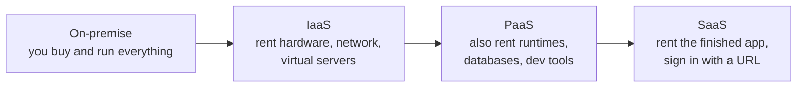
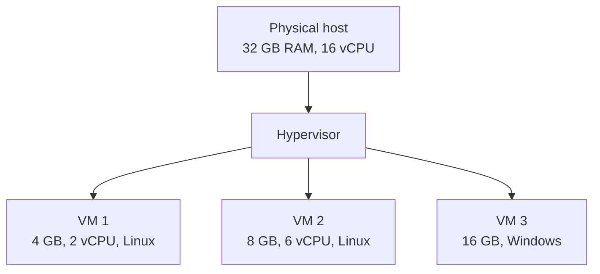

# Cloud computing and the service models

*What "the cloud" really is, and how IaaS, PaaS and SaaS split the work between you and the provider.*

> [!NOTE]
> **📍 At a glance**
> - **You will learn:** a one-line definition of cloud computing, the two different meanings of "deployment model", who manages which layer in on-premise, IaaS, PaaS and SaaS, what virtualization does, and where SAP BTP fits
> - **You will build:** a shared-responsibility table you can draw from memory, and two commands that prove a resource is remote
> - **Level:** beginner · **Time:** about 20 minutes
> - **Builds on:** nothing, this is the first chapter. **Leads to:** [SAP's cloud journey and the BTP landscape](sap-cloud-journey-btp-landscape.md)
> - **Last checked:** 19 Nov 2026

**After this chapter you can:**

- Define cloud computing in one sentence without using the words "cloud" or "computing"
- Tell a cloud deployment model (public, private) apart from a service model (IaaS, PaaS, SaaS)
- Say who manages each layer of the stack, from networking up to the application, in all four models
- Explain virtualization and why it lets a data centre rent out small slices of a big machine
- Place AWS EC2, SAP BTP, Google Sheets and SAP SuccessFactors on the right model, with a reason

## 1.1 What cloud computing means

- **Computing** is calculation done by electronic devices: CPU, memory, storage, network gear.
- **Cloud computing** is using those resources over the internet while the hardware sits somewhere else.
- You reach them in two ways: a **web browser** or a **command-line interface (CLI)**.
- Quick test: turn off your Wi-Fi. If the tool stops working, its computing lives remotely.
- One-line definition: *using someone else's IT resources over the internet, from a browser or a CLI.*

```bash
# The machine that answers is not yours: the round trip goes over the internet to Google's servers
ping -n 2 google.com          # Windows; use "ping -c 2 google.com" on macOS or Linux

# A browser does the same thing over HTTPS; here the first line of the reply from SAP's Discovery Center
curl -sI https://discovery-center.cloud.sap | head -n 1
```

✅ *Verified: both commands run on 19 Nov 2026 (details at the end).*

- The BTP cockpit is a browser example. The `btp` and `cf` command-line tools are CLI examples of the same platform.

> [!TIP]
> In an interview, avoid "cloud is when things are in the cloud". Say *what* is remote (CPU, memory, storage, network) and *how* you reach it (browser or CLI, over the internet).

## 1.2 Why companies move to the cloud

| Benefit | What it means | What it replaces |
|---|---|---|
| High availability | The provider keeps redundant copies so the app stays up | Your own spare servers |
| Scalability | Add CPU, memory or machines in minutes, up or out | Buying hardware weeks ahead |
| Reliability | Automatic failover between regions after a failure | A single server room |
| Predictability | Known performance and a known monthly bill | Surprise hardware costs |
| OPEX over CAPEX | Pay as an operating cost instead of buying assets up front | Large capital purchases |
| Security | Providers follow strict industry standards and offer security services | Building every control yourself |

## 1.3 Two "deployment model" ideas that people mix up

- **Cloud deployment model** answers *who shares the hardware*: public cloud or private cloud.
- **Cloud resource deployment model** (the usual name is **service model**) answers *how much the provider runs for you*: IaaS, PaaS or SaaS.
- They are independent. A SaaS product can run on public or private infrastructure.

| Question | Term | Options |
|---|---|---|
| Who shares the hardware? | Cloud deployment model | Public, private (and hybrid, a mix of both) |
| How much does the provider run? | Service model | IaaS, PaaS, SaaS |

- **Public cloud:** your workload lands on shared racks in the provider's data centre, wherever there is room.
- **Private cloud:** a customer pays for a dedicated, fixed part of the data centre under its own contract.
- Private cloud suits very sensitive workloads, for example a government agency.

> [!WARNING]
> **⚠️ Pitfall: on-premise is not private cloud**
> - On-premise: the hardware is in *your* building and you run it.
> - Private cloud: the hardware is in a *provider's* data centre, reserved for you.
> - For S/4HANA, "private" has a third meaning, covered in the next chapter.

## 1.4 From on-premise to IaaS, PaaS and SaaS

The easiest way to see the models is to follow one company. Picture a camera maker that wants to sell online.



**On-premise: you own every layer**
- Buy routers, switches and cables, and design the network in your office.
- Buy storage and assemble servers (a server is a laptop with far more RAM, CPU and storage).
- Add virtualization, install an operating system (Linux or Windows), then middleware.
- Install a runtime for your language (for example Java), then a database (bought from Oracle or SAP).
- Give developers laptops with an IDE, give testers their tools, add DevOps and security tools.
- Every upgrade, patch and broken disk is your job, even if a partner does the work.

**IaaS: rent the hardware layer**
- From 2006 AWS (S3 storage, then EC2 servers), and from 2010 Azure, rented out their data-centre hardware over the internet.
- A web console replaces your server room: a virtual network (AWS VPC), storage (S3), servers (EC2).
- You choose the OS when you launch a virtual machine, so the OS is still your decision.
- You still install the runtime, the database, the IDE and the test tools on those machines.
- Class example: a training company gives staff cheap 4 GB laptops and a Windows VM on EC2, reached by Remote Desktop.

**PaaS: also rent the platform**
- The provider turns the tools you used to install into services you subscribe to.
- Runtimes, databases, a web IDE, test and DevOps tools: click subscribe, get a URL, start working.
- You still choose the runtime (for example Cloud Foundry or Kyma on BTP), write the code and own the data.
- "Own the data" means you create the tables and views and clean up records. The database engine itself is the provider's.

**SaaS: rent the finished application**
- The vendor builds, hosts and upgrades the whole app. You buy user licences and sign in with a URL.
- You never see the database behind it. You read your data out through the APIs the vendor offers.
- Class example: Google Sheets. SAP examples: SuccessFactors (HR), Ariba (procurement), Concur (travel and expenses).

```bash
# Not run: what "deploying" looks like in each model (IaaS and PaaS commands use real syntax)
# IaaS: you ask for a machine, then install everything on it yourself
aws ec2 run-instances --image-id <ami-id> --instance-type t3.micro --count 1

# PaaS: you hand over code; the platform supplies runtime, routing and scaling
cf push my-shop -m 512M

# SaaS: nothing to deploy; an administrator creates your user and you open the app's URL
```

**Who manages which layer**

| Layer | On-premise | IaaS | PaaS | SaaS |
|---|---|---|---|---|
| Applications | You | You | You | Provider |
| Data | You | You | You | Provider |
| Runtime | You | You | You choose, provider runs | Provider |
| Middleware | You | You | Provider | Provider |
| Operating system | You | You choose | Provider | Provider |
| Virtualization | You | Provider | Provider | Provider |
| Servers | You | Provider | Provider | Provider |
| Storage | You | Provider | Provider | Provider |
| Networking | You | Provider | Provider | Provider |

- "You choose" marks a layer where the provider runs it but you pick the option, which is why class diagrams often draw it as yours.
- In SaaS your data is still *your* data. You just don't manage where or how it is stored.

> [!NOTE]
> **When IaaS started**
> - Public records (web-checked 19 Nov 2026): Amazon S3 launched in March 2006 and EC2 in August 2006 (general availability October 2008). Windows Azure became commercially available in February 2010.
> - The lecture and the Day 1 slides place the start around 2002 to 2004.

## 1.5 Virtualization: one big machine, many small ones

- A **hypervisor** is software installed on physical hardware. It carves that hardware into virtual machines (VMs).
- Each VM gets its own slice of CPU and memory, and its own operating system.
- Example: a host with 32 GB RAM and 16 vCPU can run a 4 GB / 2 vCPU VM, an 8 GB / 6 vCPU VM and a 16 GB Windows VM side by side.
- Oracle VirtualBox on a laptop is the same idea at small scale.
- This is what lets a provider sell you a tiny server or a giant one from the same racks.



## 1.6 Where SAP BTP sits

- **SAP BTP is a platform as a service.** Runtimes (Cloud Foundry, Kyma, ABAP environment), a database (SAP HANA Cloud) and tools (SAP Business Application Studio) are all subscribe-and-use.
- Example: in Business Application Studio, a browser-based IDE, you write code without installing VS Code or Eclipse.
- BTP does not sell infrastructure. It rents that from hyperscalers, as the third chapter explains.
- The **BTP cockpit** plays the role the AWS Management Console plays for AWS: one portal for everything you are licensed for.
- Real UI path: *BTP cockpit → your subaccount → Services → Service Marketplace → SAP Business Application Studio → Create*.

| Product | Model | Why |
|---|---|---|
| AWS EC2 | IaaS | You get a bare virtual machine and pick the OS |
| SAP BTP (overall) | PaaS | Runtimes, database and tools as services; you bring code and data |
| Google Sheets | SaaS | Google owns code, servers and storage; you only use it |
| SAP SuccessFactors | SaaS | SAP runs the whole HR app; you get a URL and licences |

> [!NOTE]
> - Some single BTP services feel like SaaS: Cloud Transport Management gives you a finished app with a URL.
> - The course treats BTP as a whole as PaaS. For single services its rule of thumb is: a Deploy button means PaaS, with AI Launchpad as the exception. See [Inside a subaccount](btp-subaccount-walkthrough.md), section 8.5.

> [!IMPORTANT]
> **🏭 In production**
> - The model is a trade-off between control and effort. IaaS gives the most control and the most patching work; SaaS the least of both.
> - Cost follows the same line: IaaS bills raw resources, PaaS bills services (often per use), SaaS bills users or transactions.
> - Lock-in grows as you move right: moving a VM is easier than moving an app built on one vendor's PaaS services.
> - Whatever the model, identity, access rights and data classification stay your responsibility.
>
> *Added by Claude*

## 1.7 Added by Claude, not from the sources

- The usual formal definition comes from NIST (SP 800-145, 2011). It names five essential traits: on-demand self-service, broad network access, resource pooling, rapid elasticity and measured service.
- There are models between IaaS and PaaS. Containers-as-a-service (managed Kubernetes) and functions-as-a-service (serverless) are common. Kyma on BTP is a managed Kubernetes runtime.
- "Shared responsibility" is mainly a security idea. The provider secures the layers it runs; you secure what you configure, starting with users and their rights.

## 1.8 Interview corner

**What interviewers listen for:** a definition that names the remote resources, the deployment-model versus service-model distinction, and a clear statement of what stays *yours* in each model.

### 🟢 Basic

<details class="qa"><summary>1. What is cloud computing, in one sentence?</summary>

- Using IT resources (compute, memory, storage, network) that sit in someone else's data centre, over the internet, from a browser or a CLI
- You pay for what you use instead of buying the hardware
- *Stronger answer:* add an example of each access path, such as opening the BTP cockpit in a browser and running `cf push` from a terminal

</details>

<details class="qa"><summary>2. Give one example each of IaaS, PaaS and SaaS.</summary>

- IaaS: AWS EC2 or Azure virtual machines
- PaaS: SAP BTP (Cloud Foundry runtime, HANA Cloud, Business Application Studio)
- SaaS: Google Sheets, SAP SuccessFactors, SAP Ariba
- *Stronger answer:* say what the customer still manages in each: the OS and up for IaaS, code and data for PaaS, only users and data for SaaS

</details>

<details class="qa"><summary>3. Is on-premise the same as private cloud?</summary>

- No. On-premise hardware is in your own building and run by you
- Private cloud hardware is in a provider's data centre, reserved for one customer under a specific contract
- *Stronger answer:* mention that the deployment model (public or private) is a separate question from the service model (IaaS, PaaS, SaaS)

</details>

### 🟡 Intermediate

<details class="qa"><summary>4. In PaaS, who patches the operating system and who owns the data?</summary>

- The provider patches the OS, middleware and runtime platform
- The customer owns and manages the data (tables, views, deletion) and the application code
- *Stronger answer:* the customer still picks the runtime, so a runtime version they choose can become their upgrade task

</details>

<details class="qa"><summary>5. What does virtualization give a cloud provider?</summary>

- It splits one physical host into many isolated virtual machines, each with its own OS
- The provider can sell small or large machines from the same hardware and pack customers densely
- *Stronger answer:* it is also what makes self-service possible: a VM is created by software in seconds, not assembled by hand

</details>

### 🔴 Senior

<details class="qa"><summary>6. A customer says "we're on SaaS now, so security is SAP's problem". How do you answer?</summary>

- SAP secures the infrastructure, platform and application code
- The customer still owns user provisioning, role assignments, authentication setup (SSO, MFA) and what data goes in
- *Stronger answer:* most real SaaS incidents come from misconfigured access, not the vendor's data centre, so access reviews stay a customer control

</details>

<details class="qa"><summary>7. When would you pick IaaS over PaaS for an SAP-related workload?</summary>

- When you need full control of the OS or install software that has no PaaS equivalent, such as a classic SAP system you run yourself
- When licensing or certification ties you to a specific OS or database version
- *Stronger answer:* weigh it against the extra patching, monitoring and backup work, and say PaaS is the default for new extensions

</details>

> [!TIP]
> **🧩 Design question**
> *"A 200-person training company needs desktops for staff, an online shop, and an HR system. Which model for each?"* Talk about:
> - IaaS VMs for desktops: cheap thin laptops plus remote desktop
> - PaaS for the custom shop: runtime and database as services, you own code and orders
> - SaaS for HR: buy SuccessFactors-type licences
> - who patches what in each

## Cheat sheet

| Term | One line |
|---|---|
| Cloud computing | IT resources used over the internet, from a browser or CLI |
| Public cloud | Shared racks, placed wherever there is room |
| Private cloud | A dedicated part of a provider's data centre, under contract |
| IaaS | Rent network, storage and VMs; you install the rest |
| PaaS | Rent runtimes, databases and tools too; you bring code and data |
| SaaS | Rent the finished app; you bring users and data |
| Hypervisor | Software that splits one host into many VMs |
| SAP BTP | PaaS: runtimes, HANA Cloud, BAS and more, run on hyperscalers |

## Recap

- Cloud computing means using remote IT resources over the internet, through a browser or a CLI
- Public versus private is about sharing hardware; IaaS, PaaS and SaaS are about how much the provider runs
- Moving from on-premise to SaaS, the provider takes over one layer after another, from networking up to the app
- In PaaS you keep the code, the data and the choice of runtime; in SaaS you keep users and data
- Virtualization is the technology that lets providers rent out slices of large machines
- SAP BTP is a PaaS that rents its infrastructure from hyperscalers

## 🧪 Lab 1: Get a BTP trial and the command-line tools

> [!NOTE]
> **Lab card**
> - **Goal:** a working SAP BTP trial, and the `btp` and `cf` command-line tools logged in to it
> - **Time:** about 30 minutes · **Cost:** free
> - **Track:** labs 1 to 10 build on each other in the same trial; do them in order

> *Commands: syntax checked against SAP's btp CLI command reference on 21 Nov 2026. Not run here: they need your own trial login.*

**Steps**

1. **Register for a trial** from SAP's trial page. Pick US East (VA) on AWS or Singapore on Azure, the two trial regions ([4.7](btp-account-model-first-subscription.md)).
   - A trial lasts **90 days**. Sign in at least every 30 days. Otherwise SAP Help (*Trial Accounts and Free Tier*) says the trial is suspended; SAP's trial FAQ (4.7) says it may be deleted.
2. **Install the `btp` CLI:** SAP Help, *Download and Start Using the btp CLI Client* (Windows, macOS and Linux).
3. **Install the `cf` CLI:** the Cloud Foundry command-line tool, version 8, from the Cloud Foundry project.
4. **Log in and look around:**

    ```bash
    btp                                            # prints the client version
    btp login --sso                                # signs you in through the browser
    btp list accounts/subaccount                   # your trial subaccount, called "trial"
    btp get accounts/global-account --show-hierarchy
    cf --version
    ```

5. **Name the service models** you just touched (1.4):
   - the CLI talks to a **platform** you did not install (PaaS)
   - SAP runs the servers underneath on a hyperscaler (IaaS, chapter 3)

**Check it worked:** `btp list accounts/subaccount` shows the `trial` subaccount, with its ID and region.

**Clean up:** nothing; keep the trial for the next labs. `btp logout` ends the session.

## Practice

1. Draw the nine-layer stack and colour who manages each layer in all four models, without looking.
2. Classify these and give a reason: Gmail, Azure VMs, SAP HANA Cloud, SAP Concur, Heroku, a server in your office.
3. Run the `ping` and `curl` commands from section 1.1 and explain what the round-trip time measures.

## How this chapter was checked

- **Lecture 1 recording** (Vimeo captions, 0:15 to 0:54 and the questions at 0:49 to 0:51): read in full. The captions end at 2:29:33; nothing after that is used here.
- **Day 1 slides** (slides 3 to 5) and the **BTP Basics notes** deck (pages 2 to 5: definition, benefits, types of cloud, shared responsibility): read in full and merged.
- **Run on 19 Nov 2026:** `ping -n 2 google.com` (2 sent, 2 received, about 5 ms) and `curl -sI https://discovery-center.cloud.sap` (`HTTP/1.1 200 OK`).
- **Not run:** the `aws` and `cf` commands, which need accounts. Their syntax follows each tool's public reference.
- **Web-checked:** the IaaS launch dates. They differ from the lecture's, and the public dates are used, by your choice on 19 Nov 2026 (see the note in section 1.4).
- **Lab 1 (added 21 Nov 2026):** `btp` syntax checked against SAP's btp CLI command reference, and the trial facts against SAP Help; the commands were not run, because they need a trial login.

## Sources and further reading

- BTPAI course, Lecture 1 recording, *Introduction to cloud computing and BTP*, 27 Sep 2026 (master row BT001)
- BTPAI course, *Day 1 BTP Fundamentals* slides (BT005) and *1. BTP Basics: Cloud Computing and Understanding BTP* notes (BT002)
- NIST SP 800-145, *The NIST Definition of Cloud Computing* (2011): https://csrc.nist.gov/pubs/sp/800/145/final
- AWS, *Amazon EC2 exits beta* (Oct 2008): https://aws.amazon.com/about-aws/whats-new/2008/10/23/amazon-ec2-exits-beta-and-now-offers-a-service-level-agreement
- DZone, *5 key events in the history of cloud computing* (S3 and EC2 in 2006, Azure GA in 2010): https://dzone.com/articles/5-key-events-history-cloud
- SAP Help, *btp CLI command reference* (used by the lab): https://help.sap.com/docs/btp/btp-cli-command-reference/btp-cli-command-reference
- SAP Help, *Download and Start Using the btp CLI Client*: https://help.sap.com/docs/btp/sap-business-technology-platform/download-and-start-using-btp-cli-client
- SAP Help, *Trial Accounts and Free Tier* (trial limits in the lab): https://help.sap.com/docs/btp/sap-business-technology-platform/trial-accounts-and-free-tier

Previous: [BTPAI book introduction](README.md) · Next: [SAP's cloud journey and the BTP landscape](sap-cloud-journey-btp-landscape.md)
