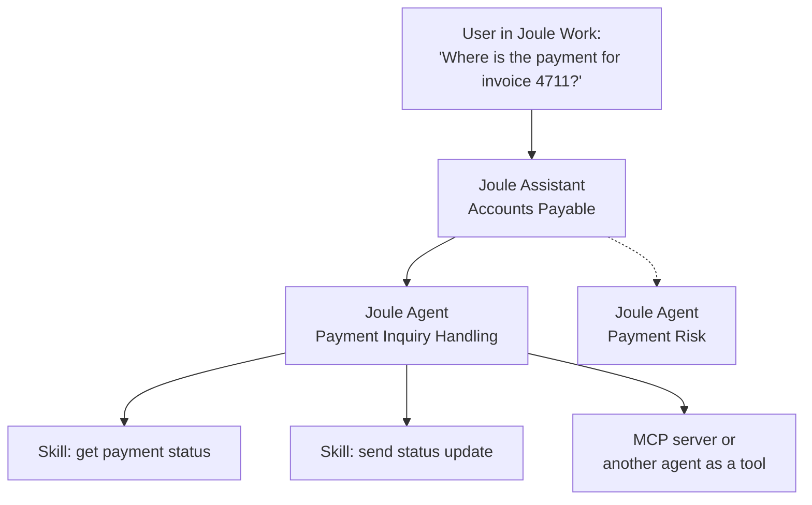
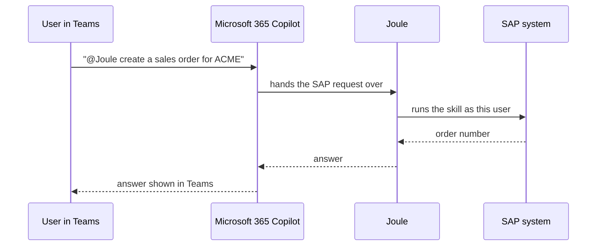

# The Joule family: Joule Work, embedded Joule, assistants, agents and skills

*"Joule" names a whole family of SAP AI products. This chapter sorts them out, shows how assistants, agents and skills work together, and what each part costs.*

> [!NOTE]
> **📍 At a glance**
> - **You will learn:**
>   - which product someone means when they say "Joule"
>   - the four types of things Joule can do, from answering questions to changing data
>   - how Joule assistants, agents and skills divide the work, and why SAP built it in levels
>   - where to look up what SAP ships, and what a Business Value 3-Pager tells you
>   - how one Joule runtime serves every entry point, including Microsoft Teams
>   - what is free, what costs AI units, and what is billed at runtime
> - **You will build:** a small router that picks an assistant, then an agent, then a skill, showing only what each step needs
> - **Level:** beginner · **Time:** about 35 minutes
> - **Builds on:** [The SAP AI landscape](sap-ai-landscape.md) and [Joule for Consultants](joule-for-consultants.md)
> - **Prices and dates:** re-check them on [Current facts to re-check](reference-current-facts.md)
> - **Last checked:** 21 Nov 2026

**After this chapter you can:**

- Name the members of the Joule family and say who uses each one
- Explain the assistant → agent → skill levels and the problem they solve
- Find an assistant's agents, pricing and value material in SAP Discovery Center
- Describe how Joule is provisioned once and reused by every SAP product and by Microsoft 365 Copilot
- Estimate what a Joule agent costs per month in AI units

## 18.1 "Joule" is a brand, not one product

- A joule is a unit of energy. SAP took the word as the name for **its AI user experience**.
- Microsoft does the same with Copilot: GitHub Copilot, Microsoft 365 Copilot and more share one umbrella name.
- So the first question in any Joule conversation is: **"Which Joule?"**

**How the name grew**

| When | What "Joule" meant |
|---|---|
| Sep 2023 | A chat copilot, first inside SAP SuccessFactors |
| 2024 | A copilot embedded across S/4HANA Cloud and many Fiori apps |
| Oct 2024 (TechEd) | Collaborative AI agents; Joule Studio announced inside SAP Build |
| May 2025 (Sapphire) | "Joule Agents" named as products |
| Nov 2025 (TechEd) | "Joule Assistants": orchestrators that coordinate agents |
| May 2026 (Sapphire) | **Joule Work** as a standalone app; a new Joule Studio; the old one renamed **Joule Studio Classic** |

- Old meanings were never retired, so all of these exist side by side today.
- **Under the hood it changed too.** Early Joule was a classic intent-and-keyword chatbot. In BTP, some of its services still carry the old "digital assistant" name.
- Today a large language model reads the request, works out the intent and routes it. You can type naturally instead of using fixed phrases.

## 18.2 The members of the family

| Member | What it is | Who uses it | Where it lives |
|---|---|---|---|
| **Joule Work** | The standalone Joule app: web, desktop and mobile, with voice | Business users | Browser, desktop app, phone |
| **Embedded Joule** | The Joule icon inside an SAP product | Users of that product | S/4HANA, SuccessFactors, BTP cockpit and more |
| **Joule Studio Classic** | Low-code builder for custom skills and agents | Developers, citizen developers | Inside SAP Build Process Automation (chapter 19) |
| **New Joule Studio** | Intent-based builder: describe a goal, it generates and tests | Developers, citizen developers | The *Develop* area of Joule Work |
| **Joule for Developers** | Design-time AI in SAP Build and ABAP tools, with SAP's ABAP LLM | ABAP, CAP and low-code developers | SAP Build, ABAP Development Tools |
| **Joule for Consultants** | Answers SAP project questions from curated SAP knowledge | Consultants, architects | Standalone web app (chapter 16) |

**Joule Work**
- This is the **experience layer** from the AI North Star (chapter 11). When SAP says "Joule" in its architecture, it means Joule Work.
- People say "Joule Work" for the web app, and "Joule Desktop" or "Joule Mobile" for the other two.
- SAP's pricing page names three ways of working in it: **Conversations** for answers, **Skills** for workflow automation and **Spaces** for visual dashboards.
- Will it replace SAP GUI and Fiori? SAP's stated plan, as reported in the course: both stay, and Joule Work becomes the first choice over time.

**Embedded Joule: same name, different depth**
- **Conversational and transactional:** answers and acts, for example in S/4HANA Cloud and SuccessFactors.
- **Conversational only:** finds, summarises and navigates; the real work stays in the product screens.
- **Grounding layer:** in SAP Datasphere, Joule is also the governed data door that agents elsewhere use.
- So when someone says "Joule is in product X", ask which of the three it is.

> [!NOTE]
> **Which model is behind Joule?**
> - The course and its handbook say Anthropic's Claude is SAP's main model for Joule and its agents.
> - SAP's own Joule for Developers page lists a mix: OpenAI, PaLM 2, Gemini, Anthropic, Llama and Mistral models, plus SAP's ABAP LLM.
> - SAP does not publish one model for Joule (chapter 16). In Joule Studio you choose the model per agent (chapter 19).

## 18.2a What Joule can do: four capability types

SAP groups everything Joule does into four types.

| Type | What Joule does | Example request |
|---|---|---|
| **Informational** | Answers from SAP documentation and your grounded documents, with links to the sources | "What is a global account?" |
| **Navigational** | Shows or opens the right app or screen | "Where can I create a purchase order?" |
| **Transactional** | Creates, reads or updates business data through the conversation | "Add this user to the subaccount as administrator" |
| **Analytical** | Answers with charts, key figures or summaries | "Show discount by sales manager as a chart" |

- **Informational:** in an SAP product, Joule answers from SAP Help and from documents you added through document grounding. Only answers with source links count as SAP content.
- **Navigational** often comes with information: in the course demo, Joule listed the subaccounts and offered *View in Cockpit*.
- **Transactional:** if details are missing, Joule asks for them one by one. Before it changes anything, it shows what it will do and waits for *Confirm*.
- **Analytical** needs **SAP Analytics Cloud**: Joule draws the charts from an SAC model, not straight from S/4HANA or SuccessFactors.

```text
You:   Create a user in subaccount demo-dev.
Joule: Which email address?          You: anna@example.com
Joule: Which role collection?        You: Subaccount Administrator
Joule: I will add anna@example.com with Subaccount Administrator. Confirm / Cancel
```

- **Joule uses your rights.** In a subaccount where you are not an administrator, the same request fails.
- **Read the confirmation.** It is the human check before a change. If one value is wrong, cancel and say exactly what to fix.
- **Give all details in one message when you can.** Each round trip makes the task slower, and an agent's AI units are billed per step (18.8).

> [!NOTE]
> **Does every Joule message cost AI units?**
> - **The course:** every question and answer in Joule is one request that consumes AI units.
> - **SAP's pricing page (20 Nov 2026):** Base AI, which includes everyday Joule in SAP apps, uses no AI units. AI units apply to Premium AI, such as agents, which are billed per action.
> - This book follows SAP's page (18.8).

## 18.3 Assistants, agents and skills

Inside Joule Work, three levels share the work.

| Level | What it does | Analogy | Example |
|---|---|---|---|
| **Joule Assistant** | Orchestrates work for one persona or domain | An executive's personal assistant | Accounts Payable Assistant |
| **Joule Agent** | Owns one area of that work and plans in a loop | A specialist on the team | Payment Inquiry Handling Agent |
| **Joule Skill** | Does one atomic action, often one API call | One app on a phone | Get the payment status of an invoice |



- **Assistants** come from SAP. Each belongs to one autonomous domain (Finance, Spend, Supply Chain, HCM, CX) or to the Business AI Platform.
- **Agents** are agentic AI: an LLM as the brain, a goal, tools, and a loop until done. Each assistant coordinates several agents.
- **Skills** are the smallest unit: get, create, update or delete one business object.
  - Agents call skills as **tools**. They can also call MCP servers or other agents.
- **What you can build yourself:** custom agents and custom skills, in Joule Studio. Assistants are SAP-delivered.
- **Skills are where control sits.** If no skill exists for an action, no agent can perform it. So approving a new skill is like approving a new API integration.

**One example end to end: the Accounts Payable Assistant**
- **Persona:** an AP manager who wants to stop matching invoices by hand and handle exceptions before they become problems.
- **Main agents**, per SAP's Business Value 3-Pager:
  - *Payment Inquiry Handling Agent:* handles payment requests from documents and emails, triggers payments and sends status updates
  - *Payment Risk Agent:* combines internal and external signals into payment risk insights
  - *Receivables and Payables Clearing Agent:* recommends clearing from AI-based matching and aging patterns
- **SAP's indicative value**, for a company with €1 billion revenue:
  - about €475k a year at full capability, or €356k at today's readiness
  - from 35% higher AP staff productivity and 20% fewer duplicate payments
  - SAP marks all of these numbers as indicative

## 18.4 Why levels? Progressive disclosure

- A model's context window is limited, and every tool description you put in it costs tokens and attention.
- Listing every assistant, agent and skill in one prompt would flood the context. This is **context bloat**.
- So Joule reveals the choices **one level at a time**:
  1. Joule Work sees only the assistants' names and descriptions, and picks one.
  2. That assistant sees only its own agents, and picks one.
  3. That agent sees only its own tools, and calls the right skill.
- This is **progressive disclosure**. It is the same idea as the agent skills in chapter 11: load details only when needed.
- **Consequence:** names and descriptions are the routing table. Write them for the model, in plain words, not as technical IDs.

**The routing step, in miniature**

```python
# Progressive disclosure: route a request level by level, showing only names + descriptions
CATALOG = {
    "Accounts Payable Assistant": ("Resolve payment exceptions and reconcile vendors", {
        "Payment Inquiry Handling Agent": ("Answer payment status questions from emails and documents",
            {"get_payment_status": "Get the payment status of a supplier invoice",
             "send_status_update": "Send a payment status update to a supplier"}),
        "Payment Risk Agent": ("Rate the risk of an outgoing payment",
            {"get_risk_signals": "Get internal and external risk signals for a payment"}),
    }),
    "HR Service Assistant": ("Answer HR questions and handle HR cases", {
        "Leave Agent": ("Check leave balances and book leave",
            {"get_leave_balance": "Get the leave balance of an employee",
             "book_leave": "Book leave for an employee"}),
    }),
}

STOP = {"a", "an", "the", "of", "is", "what", "for", "from", "and", "to"}

def words(text):
    return set(text.lower().replace("_", " ").split()) - STOP

def score(text, request):
    return len(words(text) & words(request))

def pick(options, request):
    """The model sees only names and descriptions of the options at this level."""
    shown = "\n".join(f"{name}: {desc}" for name, desc in options.items())
    best = max(options, key=lambda name: score(name + " " + options[name], request))
    return best, len(shown)

def route(request):
    a, c1 = pick({n: d for n, (d, _) in CATALOG.items()}, request)
    agents = CATALOG[a][1]
    g, c2 = pick({n: d for n, (d, _) in agents.items()}, request)
    s, c3 = pick(agents[g][1], request)
    return [a, g, s], c1 + c2 + c3

def flat_context():
    """Everything at once: every assistant, agent and skill description."""
    lines = []
    for a, (ad, agents) in CATALOG.items():
        lines.append(f"{a}: {ad}")
        for g, (gd, skills) in agents.items():
            lines.append(f"{g}: {gd}")
            lines += [f"{s}: {sd}" for s, sd in skills.items()]
    return len("\n".join(lines))

path, chars = route("what is the payment status of invoice 4711")
print(" -> ".join(path))
print(f"context used: {chars} chars, flat list: {flat_context()} chars")
```

Output:

```text
Accounts Payable Assistant -> Payment Inquiry Handling Agent -> get_payment_status
context used: 411 chars, flat list: 628 chars
```

✅ *Verified: run with Python 3.12 (details at the end).*

- With 3 assistants the saving is small. With 44 assistants and over 300 agents, the flat list no longer fits well; the levelled one still does.
- A real router asks an LLM instead of counting shared words, but the shape is the same.

> [!WARNING]
> **⚠️ Shared words are not meaning**
> - The first version of this snippet sent "payment status" to the *Payment Risk Agent*, because "the" and "of" also matched.
> - Real descriptions fail the same way when they are vague or overlap. Keep each description specific, and test routing with real user phrases.

## 18.5 Finding what SAP ships

- **SAP Discovery Center → Business AI** lists the released assistants and agents. On 21 Nov 2026 it showed 44 Joule Assistants; the agents tab showed 327 agents a day earlier.
- The lecture a few weeks earlier showed 40 and 323. The lists grow, and they show only what is released, not previews.
- **Skills are not listed**, because there are too many.

**What an assistant page shows**
- Purpose, autonomous domain and business value.
- **Agents in assistant:** the agents it coordinates. Each agent page shows its pricing tier.
- **Resources:** for example the *Initial Setup* page on SAP Help and a **Business Value 3-Pager** (the "portfolio" document).
- The 3-Pager is the quickest way to see personas, main agents and SAP's value estimate (18.3). It is not a full tree of every skill.

## 18.6 One Joule runtime, many entry points

- Every Joule front door uses one base service in your BTP subaccount: the **Joule** service, which the course calls the Joule core or runtime.
  - It provides the chat, the message box and the conversation history.
  - SAP-delivered and your own custom skills and agents run against it.
- You subscribe to it once; every SAP product's Joule icon and Joule Work then connect to the same instance.
- Two ways to connect a product, as the course showed in SAP Help's integration guide: directly with an SAP solution (S/4HANA, SuccessFactors, SAP Analytics Cloud and others), or through SAP Build Work Zone.

**Example: Joule for SAP SuccessFactors (SAP Help)**
- **SAP-managed provisioning:** SAP does the technical setup and integrations for you.
- **Customer-managed provisioning:** you do it in BTP, with full control:
  1. Register the SuccessFactors system in your global account.
  2. Run the **Joule booster**.
  3. Integrate SAP SuccessFactors Work Zone with SuccessFactors through Unified Customer Landscape.
  4. Configure the Identity Provisioning service, set up Joule in SuccessFactors Mobile, and grant permissions to users.
- Since 13 Oct 2026 the booster's destinations (`LPS_SFSF_rt`, `LPS_SFSF_dt`, `SFSF_SSO`) are managed in the backend. They no longer appear in the cockpit.
- **Who may do what** stays with the backend: Joule acts as the signed-in user's proxy (chapter 11, 11.6).

## 18.7 Joule and Microsoft 365 Copilot

SAP and Microsoft connect their two assistants in both directions.



- **From Microsoft 365:** Copilot hands SAP requests to Joule and shows the answer in Teams.
- **From Joule:** ask for a policy document in SharePoint or OneDrive, and Joule asks Copilot for it.
- **Cost, per SAP's product page:** the integration is included with Joule Base at no additional cost. You need Joule Base or AI units.
- Each side stays strong at home: Copilot on Microsoft apps, Joule on SAP processes and data.

## 18.8 What is free and what costs

SAP's pricing page sorts AI into three tiers.

| Tier | What is in it | How it is paid |
|---|---|---|
| **Base AI** | **Joule Work, base** (questions, navigation, everyday actions) and **embedded AI** in SAP apps | Included in every SAP cloud subscription; no AI units |
| **Premium AI** | **Joule Work, Agentic Thinking**; Joule Assistants and Agents; Joule for Consultants, Document AI, Document Grounding and more | **AI units** |
| **Custom-built AI** | Your own agents, apps and n8n workflows in **Joule Studio** | Authoring free; production runtime billed on consumption |

**AI units**
- SAP's single virtual currency for Premium AI. Bought yearly (SKU 8019164) into one shared pool.
- Used only while Premium AI works. Unused units expire after 12 months; overage is billed at the contract rate.
- The course quotes the list price as about €7 per AI unit; large customers negotiate it down.

**Agents**
- Every agent is **standard** (0.02 AI units per action) or **advanced** (0.05 AI units per action).
- An **action** is one step: calling a service, triggering a workflow or generating a response. A task can take several.
- Assistants are not priced separately: you pay at the agent level. Extending an SAP agent with text instructions costs nothing extra.

**The other members**
- **Joule Base:** USD 0, with an active SAP cloud subscription that integrates with Joule. SKU 8019544.
- **Joule Studio:** open to customers who deployed Joule (AI units or the zero-cost Joule Base SKU) and have BTPEA, CPEA or PAYG.
- **Joule for Developers:** a free offer at the time of writing. After it expires, access moves to AI units.
  - For ABAP, ask your account executive for the free licence: SKU 8019124 for customers, 8019541 for partners.
- **Joule for Consultants:** 35 AI units per user per month (chapter 16).

> [!NOTE]
> **Sources disagree on "free until end-2026"**
> - The course handbook (May 2026) says the agent runtime is free until 31 Dec 2026. It also gives Q3 2026 as the end of the Joule for Developers free offer.
> - At Sapphire 2026 SAP offered free Joule Studio *design time* to end-2026 (chapter 11).
> - SAP's pricing page, read on 20 Nov 2026, calls the authoring environment free with no end date. It says the production runtime is billed on consumption. The Joule for Developers page shows no end date.
> - This chapter follows SAP's current pages. Check them again before quoting a customer.

**Estimating an agent, in miniature**

```python
# Rough monthly cost of a Joule agent: tasks x actions per task x AI units per action
RATE = {"standard": 0.02, "advanced": 0.05}   # AI units per agent action (SAP pricing page)

def monthly_cost(tasks, actions_per_task, tier="standard", eur_per_unit=7.0):
    units = tasks * actions_per_task * RATE[tier]
    return units, units * eur_per_unit

for tier in ("standard", "advanced"):
    units, eur = monthly_cost(tasks=10_000, actions_per_task=3, tier=tier)
    print(f"{tier:8}: {units:,.0f} AI units = EUR {eur:,.0f} per month")
```

Output:

```text
standard: 600 AI units = EUR 4,200 per month
advanced: 1,500 AI units = EUR 10,500 per month
```

✅ *Verified: run with Python 3.12 (details at the end).*

- The unknown is **actions per task**. Measure it in a pilot before you size the AI-unit pool; SAP's **AI Unit Estimator** in Discovery Center helps with the rest.

> [!IMPORTANT]
> **🏭 In production**
> - Track AI-unit use in SAP for Me from day one; a looping agent spends units on every retry.
> - Budget per agent, not per assistant, because that is where SAP measures.
> - Re-read SAP's pricing page at each renewal: tiers, packages and promotions changed several times in 2026.
>
> *Added by Claude*

## 18.9 Added by Claude, not from the sources

- **Keep a dated glossary in every project.** Joule product names changed in 2024, 2025 and 2026. Writing "Joule Studio Classic (Nov 2026)" in specs saves arguments later.
- **Test with real user roles, not an admin.** Joule acts with the signed-in user's rights, so an agent that works for an administrator can fail for the clerk who will use it.
- **Route on purpose, not by luck.** Collect 30 to 50 real requests per assistant and check which agent each one reaches whenever descriptions or models change.

## 18.10 Interview corner

**What interviewers listen for:** that you can say which Joule you mean, explain the assistant-agent-skill levels with a reason, and talk about cost in AI units without guessing.

### 🟢 Basic

<details class="qa"><summary>1. What is Joule?</summary>

- SAP's brand for its AI user experience, not a single product
- It covers Joule Work, embedded Joule, Joule Studio, Joule for Developers and Joule for Consultants
- *Stronger answer:* ask "which Joule?" and place it: Joule Work is the experience layer in SAP's AI North Star

</details>

<details class="qa"><summary>2. What is the difference between a Joule assistant, agent and skill?</summary>

- Assistant: orchestrator for a persona or domain, delivered by SAP
- Agent: owns one area, plans in a loop and calls tools
- Skill: one atomic action, often one API call
- *Stronger answer:* add that agents can also use MCP servers and other agents as tools, and that you build custom agents and skills, not assistants

</details>

<details class="qa"><summary>3. Where do you find which agents belong to an assistant?</summary>

- SAP Discovery Center → Business AI → Joule Assistants → the assistant's page, section "Agents in assistant"
- Each agent page shows its pricing tier
- *Stronger answer:* mention the Business Value 3-Pager under Resources for personas and SAP's value estimate

</details>

### 🟡 Intermediate

<details class="qa"><summary>4. Why does Joule route through assistants and agents instead of picking from all skills at once?</summary>

- Context windows are limited; hundreds of tool descriptions would bloat the prompt
- Progressive disclosure shows one level at a time: assistants, then that assistant's agents, then that agent's tools
- *Stronger answer:* conclude that names and descriptions are the routing table, so they must be precise and tested

</details>

<details class="qa"><summary>5. How are Joule agents priced?</summary>

- Per agent action: 0.02 AI units for standard agents, 0.05 for advanced agents
- Assistants are not priced separately; Base AI uses no AI units
- *Stronger answer:* show an estimate (tasks × actions per task × rate) and say that actions per task must be measured in a pilot

</details>

<details class="qa"><summary>6. How do Joule for Developers, Joule for Consultants and Joule Studio differ?</summary>

- Joule for Developers: design-time help inside SAP Build and ABAP tools, with SAP's ABAP LLM
- Joule for Consultants: answers project questions from curated SAP knowledge
- Joule Studio: builds custom agents and skills that run in Joule
- *Stronger answer:* add that they are licensed separately; SAP Help warns that J4C and J4D licences are not connected to Joule Studio's

</details>

### 🔴 Senior

<details class="qa"><summary>7. A customer wants Joule in S/4HANA, SuccessFactors and Microsoft Teams. What do you set up?</summary>

- One Joule service in a BTP subaccount as the shared runtime; integrate each product (boosters, identity, Work Zone where used)
- Turn on the Microsoft 365 Copilot integration; it is included with Joule Base
- Keep authorisations in the backends; Joule acts as each user's proxy
- *Stronger answer:* weigh SAP-managed against customer-managed provisioning, and plan identity alignment across SAP and Microsoft early

</details>

<details class="qa"><summary>8. The CFO asks what an AP agent will cost per year. How do you answer?</summary>

- Count tasks per month, measure actions per task in a pilot, apply 0.02 or 0.05 AI units, and multiply by the contract price per unit
- Add AI units for other Premium AI it uses, such as document grounding
- *Stronger answer:* set the step limit and monitoring so retries do not inflate cost, and compare with SAP's value estimate for that assistant

</details>

> [!TIP]
> **🧩 Design question: a purchase-approval assistant for your company**
> - Which custom agents would you add next to SAP's? For example an approval-policy agent and a supplier-history agent.
> - Which skills does each agent need, and which of them change data and need a confirmation step?
> - Write the descriptions, then test routing with 30 real requests from buyers and approvers.

## Cheat sheet

| Topic | Key points |
|---|---|
| Family | Joule Work · embedded Joule · Joule Studio Classic · new Joule Studio · Joule for Developers · Joule for Consultants |
| Capabilities | Informational · navigational · transactional (asks, then confirms) · analytical (needs SAP Analytics Cloud) |
| Levels | Assistant (SAP, per persona) → agent (loop, billed per action) → skill (one action) |
| Why levels | Progressive disclosure against context bloat; descriptions are the routing table |
| Find them | Discovery Center → Business AI: 44 assistants, 327 agents (Nov 2026); Business Value 3-Pager |
| Runtime | One Joule service per landscape; every product and Joule Work use it |
| Copilot | Two-way with Microsoft 365 Copilot; included with Joule Base |
| Price | Base AI free · Premium AI in AI units · agents 0.02 / 0.05 AI units per action · Studio authoring free, runtime paid |

## Recap

- "Joule" is SAP's brand for its AI user experience; always ask which member is meant
- Joule Work is the new experience layer; embedded Joule differs in depth by product
- Assistants orchestrate, agents plan and act, skills do one thing; you build agents and skills
- Levels exist to keep the model's context small; precise descriptions make routing work
- One Joule runtime serves every product and Microsoft 365 Copilot; the backend still decides permissions
- Base AI is free; agents cost 0.02 or 0.05 AI units per action; custom agents cost at runtime

## Practice

1. Open SAP Discovery Center → Business AI, pick an assistant in your domain, and list its agents and their pricing tiers.
2. Add a third assistant with two agents to the router snippet, and find a request that it routes wrongly. Fix the descriptions.
3. Estimate the monthly AI units for an agent that handles 2,500 tasks with 4 actions each, as standard and as advanced.
4. Read SAP Help's integration steps for Joule in one product you know, and list what you would need from the customer's identity team.

## How this chapter was checked

- **Lecture 9 recording:** captions 0:00 to 1:20 (the Joule family, the levels, progressive disclosure, the Copilot integration, the Joule core service) read in full.
- **Lecture 10 Part A recording (Lecture 10 batch):** read in full (42 minutes; the hands-on exercise that followed was not recorded). Source of 18.2a.
- **Read in full on 21 Nov 2026:** SAP Learning, *Introducing SAP Joule Core Capabilities*.
- **Read in full (downloaded with your approval):**
  - *Decoding All Things Joule* (course Drive, 31 pages, May 2026). The handbook marks itself as AI-generated, so its dates and prices were checked against SAP's pages.
  - SAP's *Accounts Payable Assistant* Business Value 3-Pager (3 pages, from Discovery Center)
- **Read in full on 20 and 21 Nov 2026:**
  - SAP's AI pricing page, including its FAQ
  - SAP's product pages for Joule Base, Joule for Developers, and Joule and Microsoft 365 Copilot
  - SAP Help, *Integration with SAP SuccessFactors*
  - SAP Discovery Center's assistant list and the Accounts Payable Assistant page
- **Run with Python 3.12, standard library only:** both snippets print the output shown. The first router version misrouted the request; that run is the warning in 18.4.
- **Not checked:** the course's claim that on-premise customers can unlock assistants with a cloud commitment. No SAP page was found for it, so it is left out.

## Sources and further reading

- BTPAI course, Lecture 9 recording (BT020); course Drive: *Decoding_All_Things_Joule.pdf* (BT064)
- SAP, *SAP AI commercial model and pricing*: https://www.sap.com/products/artificial-intelligence/pricing.html
- SAP, *Joule Base*: https://www.sap.com/products/artificial-intelligence/joule-base.html
- SAP, *SAP Joule for Developers*: https://www.sap.com/products/artificial-intelligence/joule-for-developers.html
- SAP, *Joule and Microsoft 365 Copilot*: https://www.sap.com/products/technology-platform/joule-and-microsoft-365-copilot.html
- SAP Discovery Center, *Joule Assistants*: https://discovery-center.cloud.sap/ai-assistants/
- SAP, *Accounts Payable Assistant* Business Value 3-Pager: https://dam.sap.com/mac/embed/public/pdf/a/JK6wpDj
- SAP Help, *Integration with SAP SuccessFactors*: https://help.sap.com/docs/joule/integrating-joule-with-sap/integration-with-sap-successfactors
- BTPAI course, Lecture 10 Part A recording (BT021)
- SAP Learning, *Introducing SAP Joule Core Capabilities*: https://learning.sap.com/courses/implementing-sap-s-4hana-cloud-public-edition-sales-fundamental-business-processes/introducing-sap-joule-core-capabilities_b30625c8-5908-4220-b172-c45d0fa525d5

Previous: [Responsible AI: SAP's ethics policy, the EU AI Act and the AI Terms](responsible-ai-ethics-governance.md) · Next: [Joule Studio Classic: setup, skills, agents, testing and deployment](joule-studio-classic.md)
