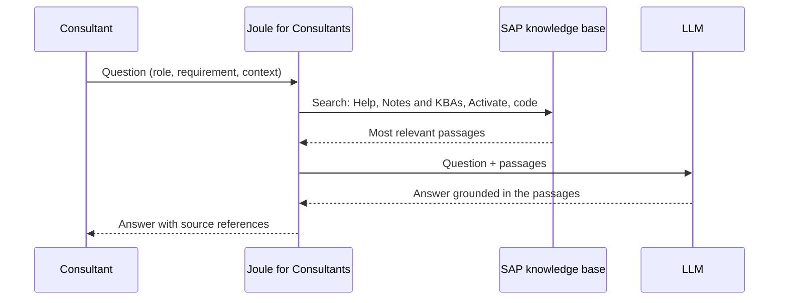
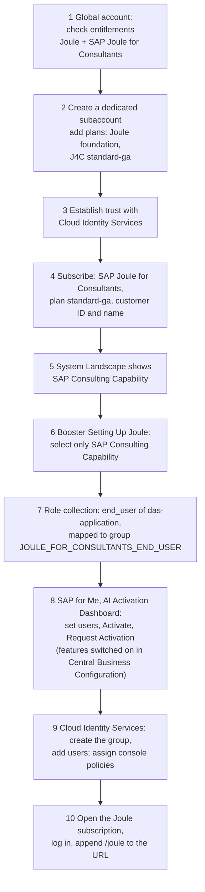

# Joule for Consultants: grounded answers, provisioning and AI units

*An SAP expert in a chat window: what it knows and how it answers, how a BTP administrator switches it on, and how its per-user price in AI units adds up.*

> [!NOTE]
> **📍 At a glance**
> - **You will learn:**
>   - what Joule for Consultants (J4C) is, and how a retrieval-based assistant differs from a general LLM
>   - how to prompt it by role and project phase
>   - its guardrails and limits
>   - how it is provisioned on BTP, step by step
>   - how AI units, request allowances and overage work
> - **You will build:** an AI-unit cost calculator that follows SAP's published rules
> - **Level:** beginner to intermediate · **Time:** about 45 minutes
> - **Builds on:** [Identity: Cloud Identity Services, trust and federated authorization](btp-identity-trust-federation.md) and [Prompt engineering](prompt-engineering.md)

**After this chapter you can:**

- Explain what J4C answers from, and why that beats a general chatbot on SAP questions
- Write who-what-how prompts for architects, process consultants, developers and project managers
- Provision J4C in a BTP subaccount, from entitlement to the first login
- Estimate its cost in AI units, including overage, and explain how billing counts users
- Tell J4C apart from Joule for Developers, Joule Studio and the free Joule on api.sap.com

## 16.1 What Joule for Consultants is

- SAP describes it as **a conversational AI solution that accelerates SAP projects** with expert guidance from SAP's exclusive, current knowledge base.
  - It is built for customers' internal IT teams and the consulting partners that support them.
- Think of it as an SAP expert available around the clock: for questions you would otherwise put to a senior consultant, or to SAP support in a ticket.
- **It answers; it does not act.** It is a generative AI chat grounded in SAP sources (retrieval-augmented generation, RAG). Calling it an agent would overstate it.
- **What it draws on:**
  - SAP Help Portal, SAP Activate and RISE with SAP methodology, SAP Learning and certifications
  - SAP Community, the Fiori apps library and SAP for Me
  - SAP Notes and Knowledge Base Articles (KBAs), which are gated
  - ABAP and CDS code from SAP solutions

| Knowledge base | SAP's 2025 slides | SAP's product page, 20 Nov 2026 |
|---|---|---|
| Curated content | 2+ TB of SAP Community content, 200,000+ pages of documentation and learning | 12+ TB of expert-curated SAP knowledge |
| Certifications | 50+ | 100+ |
| Non-public documents | SAP Notes and KBAs | 3 million+, including SAP Notes and KBAs |
| Code | 250 million lines of ABAP, 30 million lines of CDS | Same |

- **SAP's own benefit figures** (SAP Value Benchmarking, quoted by SAP):
  - up to 14% faster project delivery (1.5 to 2.5 months in a 12 to 18-month project)
  - up to 1.5 hours a day saved on knowledge searches
  - up to 40% less time interpreting ABAP code, and up to 50% less rework
- Treat them as the vendor's claims, not measured results for your project.

## 16.2 A retrieval system is not a plain LLM

- A general chat model answers from what it absorbed in training (chapter 14). J4C first **retrieves** SAP documents, then generates from them, and cites them.

| | Joule for Consultants | Typical general LLM |
|---|---|---|
| Approach | Retrieves documents first | Answers from what it learned in training |
| Content | Factual, reviewed, with named owners | Scraped internet data |
| Prompt style | Helps the retrieval | Assumes the model knows everything |
| Hallucination | Restricted; must align with SAP | More prone |
| Ambiguity | Retrieval filters narrow the scope | Produces plausible answers that are hard to check |
| Accuracy | Based on retrieved documents; verifiable | Based on the model's estimate |
| Best for | SAP knowledge for consultants | General conversation, brainstorming, creative writing |



- SAP's FAQ makes the same point. General tools such as Claude, ChatGPT or Perplexity "may rely on inaccurate, incomplete, or outdated sources". J4C answers from authoritative SAP content, with fewer hallucinations.

## 16.3 Using it by role and project phase

- SAP's hands-on material pairs **personas** with the questions they ask, across the SAP Activate phases: Discover, Prepare, Explore, Realize, Deploy and Run.

| Persona | Typical tasks | Sample prompt |
|---|---|---|
| **Architect** | Business process design, solution and data architecture, cloud architecture, transformation strategy | "What are the SAP tools available to analyze custom development, and ensure an effective clean-core upgrade from SAP ECC 6.0 to SAP S/4HANA Public edition?" |
| **Business process consultant** | Process mapping, solution design, configuration, change management, pre-sales | "A manufacturing business has this requirement: a goods receipt for a production order should not occur if no goods have been issued against it, or it has not been fully or partially confirmed. Please conduct a fit-gap analysis." |
| **Developer** | Feasibility analysis, custom development and extensions, integration specifications | "Write ABAP code to create a CDS view ZI_INSPECTIONLOT_STATUS combining the inspection lot header and status views…" |
| **Technology consultant** | Installation and integration, migration, performance, roles and authorisations, sizing | "We're moving more than 5 million meter readings and 8 years of billing history. How can we segment the data to comply with sizing and retention best practices?" |
| **Project manager** | Planning, governance, issues and change, risk, SAP Activate methodology | "In the run phase of SAP Activate for RISE with SAP S/4HANA Cloud Private Edition, what is the procedure for managing change requests?" |

- In the course demo, the architect prompt returned SAP Readiness Check, the ABAP Test Cockpit and related tools.
- The fit-gap prompt returned the standard behaviour, the gap, and options to close it (for example a BAdI or user exit), with a recommendation.

**The who-what-how structure** (SAP's guidance)
1. **Who:** the consultant role or expert you need, such as finance architect or security expert.
2. **What:** the business problem or requirement.
3. **How:** what you want back: steps, configuration, tools, or technical guidance.

```text
Who:  As an SAP technical consultant,
What: I found that users sometimes cancel a billing document even when the invoice
      has been fully cleared. We want custom logic that checks whether the billing
      journal has been cleared before cancellation.
How:  Is a validation BAPI available in SAP S/4HANA Public Cloud for this check?
```

- **Be specific, give context** (modules, scenario, industry), and **follow up** to drill down. J4C gives high-level insight first.
- Chapter 15 (§15.9) lists SAP's prompting strategies for retrieval systems, with better and worse examples.

> [!TIP]
> Use J4C before raising an SAP support ticket. Questions that would take days in a ticket, or come back as "this is consulting", often get a usable first answer in seconds. You still verify it in the system.

## 16.4 Guardrails and limits

- **SAP's responsible-AI principles:**
  - built-in safeguards against inappropriate use, bias and hate speech
  - alignment with UNESCO's AI ethics principles
  - human-first automation that supports employees rather than replacing them
- **Joule's risk-mitigation guardrails** (SAP): prescribed expertise, safety filtering, data-driven responses and interaction guidelines.
  - If it does not know, it should say so instead of inventing an answer.
- **Knowledge cut-off:** answers note the date the model's training data ends. Anything SAP released after that may be missing.
- **Web search is an admin setting.**
  - The console's *Enable Web Search* toggle lets J4C add public web results; it applies to all users of the tenant.
  - When it is off, J4C answers only from its curated sources. With it on, a notice reminds users that web results come from third-party sources SAP has not reviewed.
  - In the course's tenant J4C did not search the web, which fits the toggle being off.
- **Gated content needs an S-user.** Notes and KBAs are available only when:
  - your login email matches an SAP S-user's email
  - and that S-user belongs to a customer ID listed in the console (*Settings → Customer Information*)
- **No model choice.** SAP does not publish which LLM runs underneath, and admins cannot change it. (Joule Studio, for custom agents, does have a model selector.)

> [!WARNING]
> **The answer is advice, not configuration**
> - J4C does not see your system. A fit-gap answer about "standard SAP" may not match your release, industry solution or custom code.
> - Test every recommendation in a sandbox before you design around it.

## 16.5 Provisioning step by step

- **Prerequisites** (SAP Help, updated 12 Nov 2026):
  - **SAP AI Units**, SKU 8019164, assigned to the BTP global account where J4C will run
  - **SAP Cloud Identity Services**
  - a supported data centre: EU10, EU11, US10, AP10, JP10 or EU20
  - If you have no BTP global account, one is provisioned free of charge with the AI Units purchase.
- **People you need:** a BTP global account administrator, a Cloud Identity Services administrator, a Cloud or Super Administrator in SAP for Me, and access to the SAP Central Business Configuration tenant.
- **J4C needs its own subaccount.** Combining it with another Joule instance, such as Joule for SuccessFactors, in the same subaccount does not work.



**The steps in the cockpit**
1. **Entitlements:** *Global account → Entitlements → Service Assignments*. Check for **Joule** and **SAP Joule for Consultants**.
2. **Subaccount:** create one in a supported region and add the service plans: Joule with the **foundation** plan, and SAP Joule for Consultants with the **standard-ga** plan.
3. **Trust:** *Security → Trust Configuration*. Establish trust with your Cloud Identity Services tenant (chapter 10).
4. **Subscription:** *Instances and Subscriptions → Create*. Choose SAP Joule for Consultants with plan standard-ga, and enter the customer ID and customer name.
5. **Check:** *Global account → System Landscape → Systems* now lists **SAP Consulting Capability**.
6. **Booster:** run **Setting Up Joule** in the global account and select only the product **SAP Consulting Capability**. It cannot join a formation that already holds another Joule system.
7. **Role collection:** in the subaccount, create a role collection with the role **end_user** of the application das-application.
   - The application ID suffix differs per data centre.
   - Add a user-group mapping with a name you choose, for example `JOULE_FOR_CONSULTANTS_END_USER`.
8. **Activate in SAP for Me:** open the **AI Activation Dashboard** and find SAP Joule for Consultants.
   - Choose **Ready for Activation**, set the number of users, then choose **Activate**.
   - Once it shows as Activated, choose **Request Activation** for the features you want. You finish this in your SAP Central Business Configuration tenant.
9. **Users:** in Cloud Identity Services, create the group with the same name and add the users.
   - Assign the console policies: `SAP_JOULE_CONSULTANTS - Standard` for users, `SAP_JOULE_CONSULTANTS - Admin` for admins (settings, usage metrics).
10. **Launch:** open the Joule subscription, log in with Cloud Identity Services, and append `/joule` to the URL.
   - The J4C start page greets you. The console is reached from the J4C subscription link.

- **Corporate identity provider:** if logins come from your own IdP, align the two applications das-ias and scc-identity-service (each with the subaccount name) in Cloud Identity Services.
- **SAP's Discovery Center mission** *Enable SAP Joule for Consultants* walks the same path with screenshots, in up to 4 hours. Its step pages need an SAP sign-in.

> [!NOTE]
> **Older material describes a different activation flow**
> - **The course and SAP's 2025 slides:**
>   - In SAP for Me, "request activation" raises a ticket to SAP, and the request is completed within about 48 hours.
>   - A group is created in Cloud Identity Services; users go into the license group `SAP_JOULE_PREMIUM_CONSULTANT`.
>   - Data centres: EU10 or EU11.
> - **SAP Help (12 Nov 2026):**
>   - activation through the AI Activation Dashboard and SAP Central Business Configuration
>   - a role collection mapped to a group you name, such as `JOULE_FOR_CONSULTANTS_END_USER`
>   - six data centres
> - This book follows SAP Help. Check it again before a real activation; the flow has already changed once.

> [!CAUTION]
> **🔒 Who gets the admin policy:** `SAP_JOULE_CONSULTANTS - Admin` controls tenant settings such as web search and customer IDs, and shows usage. Give it to a few named administrators. Everyone else gets Standard.

## 16.6 Pricing: AI units

- SAP's AI comes in two tiers. **Base AI** is included in SAP cloud subscriptions at no extra cost. **Premium AI** needs **AI units**. J4C is premium AI.
- **AI units** are SAP's own currency for premium AI capabilities.
  - They sit in one central pool for all eligible AI services.
  - They are separate from the BTP consumption credits in chapter 9.
- Think of a household electricity meter: different appliances use different numbers of units, and you pay one price per unit.

**J4C's commercial model** (SAP, read 20 Nov 2026)

| Rule | Value |
|---|---|
| Model | Per user per month (PUPM) |
| Charge | **35 AI units** per assigned user per month |
| Included requests | **22,900 per user per month**, pooled across all assigned users |
| Overage | **2 AI units per 1,000 requests** above the pooled allowance |
| Users counted | The **highest** number of assigned users in the month (high-water mark); users can be added or removed at any time |
| Buying AI units | SKU 8019164, annually, in blocks of 100 (minimum 100) |
| Expiry | After 12 months |
| Price per AI unit | SAP's list example: **€7**, so €245 per user per month; contracts can differ |

- In the course, one message sent counted as one request; the SAP pages read for this chapter do not define a request further.
- Unused requests do not roll over to the next month (the course).
- The fee is charged once a user is assigned for the month, even if that user never asks anything.
- Nothing hard-stops an admin from assigning more users than were planned. Billing follows the peak count, so plan users with the budget.

```python
AI_UNITS_PER_USER = 35          # per assigned user per month (SAP)
REQUESTS_PER_USER = 22_900      # included per user per month, pooled (SAP)
OVERAGE_UNITS_PER_1000 = 2      # beyond the pooled allowance (SAP)
EUR_PER_UNIT = 7.0              # SAP's list example; contracts can differ


def month_units(peak_users, requests):
    """Billing uses the highest number of assigned users in the month."""
    allowance = peak_users * REQUESTS_PER_USER
    extra = max(0, requests - allowance)
    return peak_users * AI_UNITS_PER_USER + extra / 1000 * OVERAGE_UNITS_PER_1000


# SAP's own example: 5 users for 12 months, normal use
year = sum(month_units(5, 80_000) for _ in range(12))
print(f"5 users x 12 months: {year:,.0f} AI units = EUR {year * EUR_PER_UNIT:,.0f}")

# A busy month: 5 users send 130,000 requests (allowance 114,500)
busy = month_units(5, 130_000)
print(f"busy month: {busy:,.0f} AI units = EUR {busy * EUR_PER_UNIT:,.0f}")
```

- Output: 2,100 AI units = €14,700 for 5 users over 12 months, matching SAP's own worked example.
- The busy month costs 206 AI units: 175 for the users, plus 31 for the 15,500 extra requests.

✅ *Verified: run with Python 3 (details at the end).*

**Where to watch and plan**
- **SAP for Me:** AI unit balance, consumption by package, and the place to assign the number of J4C users.
  - Purchased AI units are shown in the *Finance & Legal* dashboard, on the *Business AI* tab.
- **Discovery Center:** the AI Feature Catalog, and the **AI Unit Estimator**, which works without a login.
- **J4C console:** a usage page for administrators with the Admin policy.

## 16.7 Where J4C fits among SAP's AI tools

| Tool | What it does | Cost |
|---|---|---|
| **Joule for Consultants** | Answers SAP project questions from curated SAP knowledge; standalone web app | 35 AI units per user per month |
| **Joule for Developers, ABAP AI capabilities** | Works inside ABAP development tools: generates, tests and remediates code, and adapts custom code for SAP S/4HANA | Licensed separately; see SAP's AI pricing page |
| **Joule Studio** | Builds custom agents and skills on top of SAP's standard Joule; lets you pick the model | Design time free to end-2026 (chapter 11); running agents is not covered by that offer |
| **Joule in SAP Business Accelerator Hub** (api.sap.com) | Answers questions about SAP's published APIs, with links; SAP labels it beta | Free with a sign-in |
| **Joule embedded in SAP applications** | Assistants and agents inside S/4HANA, SuccessFactors and other products | Base AI is included; premium features cost AI units |

- SAP's own split: **J4C** helps functional experts configure, interpret ABAP logic and troubleshoot. **Joule for Developers** helps ABAP professionals inside their tools.

**Roadmap as SAP drew it in 2025**
- Q4 2024: early adopter release, a standalone web app with SAP content and curation.
- Q2 2025: general availability, with multithreading, history, multiple languages and the AI Units SKU (PUPM).
- H2 2025: copy and file upload, suggested questions, custom instructions, admin-controlled web search, gated KBAs and Notes, a prompt library, an admin console, and a limited pilot for customers' own content.
- Future: expanded knowledge, awareness of the customer's landscape, toolchain integration, agents and custom skills.
- SAP Help now documents the console, the prompt library, expert workspaces and Custom Knowledge Grounding. For what is next, check SAP Roadmap Explorer.

> [!IMPORTANT]
> **🏭 In production**
> - Assign J4C users by role, not to everyone: billing counts the month's peak number of assigned users.
> - Review the usage page monthly; remove users who never start a conversation, and watch the pooled request allowance before overage starts.
> - Decide the web-search setting with the customer's security team, and record the decision.
> - Keep client confidential data out of prompts unless the client's contract with SAP covers it.
>
> *Added by Claude*

## 16.8 Added by Claude, not from the sources

- **Give every answer a second source.** Treat J4C's cited Note, KBA or Help page as the evidence, and link that in your design document, not the chat transcript.
- **Customer IDs matter for gated content.** Consultants who switch clients should update the customer IDs in their settings, or Notes and KBAs for the new client stay hidden.
- **Expect the provisioning steps to move.** SAP changed the activation flow between 2025 and 2026. Keep a dated runbook, and re-read the Help page before each new tenant.

## 16.9 Interview corner

**What interviewers listen for:** a clear view of retrieval versus plain generation, the provisioning path end to end, and a correct reading of the commercial model.

### 🟢 Basic

<details class="qa"><summary>1. What is SAP Joule for Consultants?</summary>

- A conversational AI tool that answers SAP project questions from a curated SAP knowledge base
- Grounded in Help, Activate, Learning, Community, Notes, KBAs and SAP code; it cites sources
- *Stronger answer:* say it answers but does not act, and that Notes and KBAs need a matching S-user

</details>

<details class="qa"><summary>2. How is J4C priced?</summary>

- 35 AI units per assigned user per month, with 22,900 requests per user pooled across users
- Overage of 2 AI units per 1,000 requests; SAP's list example is €7 per AI unit
- *Stronger answer:* add the high-water-mark rule and that AI units expire after 12 months

</details>

### 🟡 Intermediate

<details class="qa"><summary>3. Why might J4C answer an SAP question better than a general chatbot?</summary>

- It retrieves reviewed SAP content, including non-public Notes and KBAs, before answering
- Answers are tied to sources, so they can be checked; hallucinations are restricted
- *Stronger answer:* name its limits too: training cut-off, no view of your system, web search only if the admin allows it

</details>

<details class="qa"><summary>4. Walk me through provisioning J4C.</summary>

- Entitlements, then a dedicated subaccount with Joule foundation and J4C standard-ga, then trust with Cloud Identity Services
- Subscribe, run the Setting Up Joule booster with SAP Consulting Capability, then create a role collection mapped to a user group
- Activate in SAP for Me (AI Activation Dashboard), create the group and assign policies in Cloud Identity Services, then launch with /joule
- *Stronger answer:* mention the prerequisites (AI units SKU, supported data centre) and that J4C cannot share a subaccount with another Joule

</details>

<details class="qa"><summary>5. A user can log in but cannot see SAP Notes in answers. Why?</summary>

- Gated content needs the login email to match an S-user, linked to a customer ID in the console settings
- *Stronger answer:* check the console's Customer Information and the user's S-user email first

</details>

### 🔴 Senior

<details class="qa"><summary>6. A partner wants J4C for 40 consultants on a fixed budget. How do you size and control it?</summary>

- 40 × 35 = 1,400 AI units a month before overage; buy annually in blocks of 100
- Estimate requests per consultant from a pilot; the pooled allowance is 916,000 requests a month
- Assign users by need, review usage monthly, and remove inactive users before the month's peak count rises
- *Stronger answer:* agree the AI-unit price in the contract, and set an internal alert on the SAP for Me balance

</details>

<details class="qa"><summary>7. The customer's security team asks whether J4C searches the internet. What do you answer?</summary>

- It is an admin choice: the console's Enable Web Search toggle applies to the whole tenant
- Off, it answers only from curated SAP sources; on, it adds public web results that SAP does not review
- *Stronger answer:* recommend off by default, document the decision, and re-check after each J4C release

</details>

> [!TIP]
> **🧩 Design question:** a consulting firm wants J4C for 3 client projects, with each team seeing the right client's Notes. Design the setup.
> - One standalone J4C subaccount per agreed scope (SAP suggests naming groups per subaccount, such as `JOULE_FOR_CONSULTANTS_END_USER-<subaccount>`).
> - Customer IDs per client in the console settings; consultants' S-users linked to the right customer.
> - Admin policy for two named people; Standard for everyone else; monthly usage review.

## Cheat sheet

| Item | Value |
|---|---|
| What | RAG-grounded SAP expert chat; answers, does not act |
| Prerequisites | AI Units SKU 8019164 · Cloud Identity Services · EU10, EU11, US10, AP10, JP10 or EU20 |
| Plans | Joule: foundation · SAP Joule for Consultants: standard-ga |
| Booster | Setting Up Joule → SAP Consulting Capability only |
| Role and group | end_user (das-application) → group such as JOULE_FOR_CONSULTANTS_END_USER |
| Console policies | SAP_JOULE_CONSULTANTS - Admin / - Standard |
| Activation | SAP for Me → AI Activation Dashboard → Activate → Request Activation |
| Launch | Joule subscription URL + /joule |
| Price | 35 AI units/user/month · 22,900 requests/user pooled · overage 2 units/1,000 |
| Prompt shape | Who · What · How; specific SAP terms; follow up |

## Recap

- J4C answers SAP project questions from a curated SAP knowledge base, with sources; it does not act
- Retrieval first, generation second: that is why it hallucinates less than a general chatbot on SAP topics
- Prompt by role and phase with who, what and how; follow up to drill down
- Limits: training cut-off, web search only if the admin enables it, Notes and KBAs only with a matching S-user
- Provisioning: entitlements → dedicated subaccount → trust → subscribe → booster → roles → SAP for Me → groups → /joule
- Price: 35 AI units per user per month, 22,900 pooled requests per user, overage 2 units per 1,000, billed on the peak user count

## Practice

1. If you have J4C access, ask the architect and fit-gap prompts from §16.3. Note the sources it cites, then check one of them yourself.
2. Ask the same fit-gap question in a general chatbot and compare the answers: sources, precision and caveats.
3. Use the calculator to price 12 consultants for a year, with one month at 400,000 requests.
4. Draw the provisioning flow from memory, then check it against §16.5.

## How this chapter was checked

- **Lecture 7 recording:** captions 1:52 to 2:31 (J4C demo, provisioning, pricing questions) and 2:47 to 2:56 (free Joule, model choice, J4C vs Joule for Developers and Joule Studio) read in full.
- **Course Drive (read in full):**
  - *J4C Hands On* (Google Doc, and the PDF it was made from)
  - *Joule for Consultant.pptx* (10 slides, pictures included)
  - *LS_00011284_02.pdf*, SAP's webinar *From Activation to Application: Getting Started with SAP Joule for Consultants* (22 Oct 2025, 14 pages, marked Public)
- **Read in full on 20 Nov 2026:**
  - SAP's product page for SAP Joule for Consultants, including its FAQ
  - SAP Help: *Onboarding Guide for SAP Joule for Consultants* (updated 12 Nov 2026) and *Web Search Settings*
  - SAP Learning: *Evaluating the Commercial Model*
- **Read in part:** the Discovery Center mission *Enable SAP Joule for Consultants* (overview and project board; the step pages need a sign-in); the J4C tenant itself was seen only in the recording.
- **Not read:** SAP's *Activation guide* PDF (the download returned an error); SAP Help covers the same steps.
- **Run with Python 3.12:** the calculator prints 2,100 AI units = EUR 14,700 for 5 users over 12 months, and 206 AI units = EUR 1,442 for the busy month.

## Sources and further reading

- BTPAI course, Lecture 7 recording (BT018); course Drive: *j4c* folder (BT055) and *J4C Hands On* (BT069)
- SAP, *SAP Joule for Consultants* (product page and FAQ): https://www.sap.com/products/artificial-intelligence/sap-consulting-capability.html
- SAP Help, *Onboarding Guide for SAP Joule for Consultants*: https://help.sap.com/docs/joule/serviceguide/provisioning-sap-joule-for-consultants
- SAP Help, *Web Search Settings*: https://help.sap.com/docs/joule/serviceguide/web-search-settings
- SAP Learning, *Introducing SAP Joule for Consultants*: https://learning.sap.com/courses/introducing-sap-joule-for-consultants
- SAP Discovery Center, *Enable SAP Joule for Consultants* (mission 4633): https://discovery-center.cloud.sap/missiondetail/4633/
- SAP Business Accelerator Hub (Joule integration, beta): https://api.sap.com

Previous: [Prompt engineering: from zero-shot to grounded prompts](prompt-engineering.md) · Next: [BTPAI book introduction](README.md)
