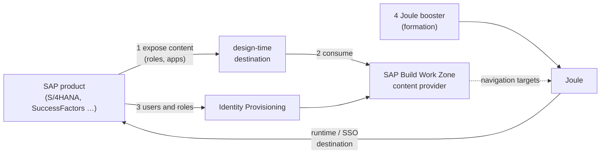

# Joule with other SAP solutions: S/4HANA, planning and documents

*The integration steps for SAP S/4HANA Cloud Private and Public Edition, the documentation-only products, and document grounding: what is the same everywhere, and what each product adds.*

> [!NOTE]
> **📍 At a glance**
> - **Sources:** SAP's guide *Integrating Joule with SAP Solutions* (PUBLIC, 15 Nov 2024, course Drive), checked against SAP Help (read 21 Nov 2026). Where they differ, SAP Help's current version is used.
> - **You will learn to set up:** Joule in S/4HANA Cloud Private Edition (PCE), in S/4HANA Cloud Public Edition, and document grounding from your own files
> - **You need:** BTP global account admin, the product's admin access, SAP Build Work Zone with an instance and service key, Cloud Identity Services (IAS and IPS)
> - **Level:** advanced (administrator)
> - **Builds on:** [Joule with SAP SuccessFactors](joule-integration-successfactors.md) (same Work Zone and IPS pattern), [The Joule family](joule-family.md) (AI units)

**After this chapter you can:**

- Name the pattern every Joule integration follows
- List the S/4HANA PCE and Public Edition steps and their key settings
- Set up document grounding and estimate its cost in AI units

## 32.1 The pattern behind every integration



- **Content exposure:** the product publishes its roles and apps.
- **Content consumption:** Work Zone fetches them through a design-time destination into a content provider.
- **IPS** copies users and their roles; the **booster** creates the Joule formation; **runtime and SSO destinations** let Joule act in the product as the user.
- The 2024 guide notes that for cloud solutions, all systems must run under the same domain.

## 32.2 SAP S/4HANA Cloud Private Edition

**Steps (current SAP Help order):**

| # | Step | Key point |
|---|---|---|
| 1 | Trust to the IAS tenant | Joule signs users in through the product's IAS |
| 2 | Trusted domain in SAP BTP | |
| 3 | User attributes for Joule from the Identity Directory | |
| 4 | Trusted domains in IAS | |
| 5 | Set up PCE as a content provider (Cloud Connector) | see the path table below |
| 6 | Expose Fiori launchpad content | transaction `/UI2/CDM3_EXP_SCOPE` |
| 7 | SAP Build Work Zone and SAP Start | instance and service key |
| 8 | Run the Joule booster | |
| 9 | Configure destinations | design-time, runtime, nominations, SSO |
| 10 | Configure IPS | RFC destination, ABAP source, Work Zone target |
| 11 | Joule plug-in in a target mapping | adds Joule to the Fiori launchpad |
| 12 | Map the custom system name in the Joule Admin Center | new; not in the 2024 guide |

**Cloud Connector paths to expose (HTTPS):**

| What Work Zone fetches | Path |
|---|---|
| Card manifests and i18n files | `/sap/bc/lrep/` |
| UI5 app index | `/sap/bc/ui2/app_index/` |
| CDM3 content | `/sap/bc/ui2/cdm3/` |
| OData V2 / V4 data | `/sap/opu/odata/`, `/sap/opu/odata4/` |

> [!CAUTION]
> **🔒 Everything you expose is reachable**
> - SAP warns that Work Zone uses the Cloud Connector as a proxy, so every configured path is reachable from the public internet.
> - Expose only the paths your use cases need, and secure the system.

**Content exposure and users:**

- Expose with version 2 in `/UI2/CDM3_EXP_SCOPE`: all roles with launchpad content, or selected roles in areas.
  - Save the selection, check the log, then *Expose Content* or schedule it.
  - Derived roles are exposed through their leading role.
- **Check it worked:** in `/IWFND/GW_CLIENT`, send `GET /sap/bc/http/ui2/flp_content_exposure`; expect status 200.
- **Technical service user:** SU01, user type *Service*, plus role `SAP_BC_JSF_COMMUNICATION_RO` for reading the content.
- In the Cloud Connector, allow IPS these function modules (naming policy *Exact Name*):
  - `BAPI_USER_GETLIST` and `BAPI_USER_GET_DETAIL`
  - `PRGN_ACTIVITY_GROUPS_LOAD_RFC` and `PRGN_ROLE_GETLIST`

**Destinations:**

| Destination | Settings |
|---|---|
| Design-time | lowercase name ending `dt`; URL `https://<virtual host>:<port>/sap/bc/ui2/cdm3/entities`; OnPremise; Basic Authentication with the technical user (no principal propagation); `sap-client` |
| Runtime | lowercase name ending `rt`, no underscore; virtual host URL; OnPremise; Principal Propagation for SSO; `HTML5.DynamicDestination` = `true`, `sap-platform` = `ABAP`, `sap-client`, `sap-sysid`, `sap-service` = `32` + instance number |
| Nominations (for example `privatecloud`) | OnPremise, PrincipalPropagation, `nameIdFormat` = email address, and `sap-card-nominations-path` set to the insights-cards OData path from SAP's guide |
| SSO `S4HANA_PCE_SSO` | virtual host URL; OnPremise; PrincipalPropagation or BasicAuthentication; `sap-client` |

**IPS for PCE:**

- Subscribe to **Cloud Identity Services, plan connectivity**. Then create an **RFC** destination (`CONFIGURED_USER`, OnPremise) with `jco.client.client`, `jco.client.mshost` and `jco.client.r3name`.
- Source system type **SAP Application Server ABAP**, with SAP's standard transformation (on SAP Help).
- Target **SAP Build Work Zone, standard edition**, with SAP's standard transformation.
  - Properties from the service key (see the snippet in [31.2](joule-integration-successfactors.md)).
  - `cflp.providerId` = your content provider ID; `cflp.patch.group.members.above.threshold` = `5000`.
- Run the **Read** job and check the provisioning logs.
  - Users who set cards as visible in *My Home → Insights* then see them in Work Zone.

**Joule in the Fiori launchpad (target mapping):**

| Field | Value |
|---|---|
| Semantic object / Action | `Shell` / `plugin` |
| Application type | SAPUI5 Fiori app |
| URL | your Joule application URL + `/resources/public/webclient/s4` |
| ID | `sap.das.webclientplugin.s4` |

- Put the target mapping in a business catalog, assign the catalog to a role, and assign the role to the users.
- **Joule Admin Center (current SAP Help):** in *Digital Assistant → Edit → Destination*, choose *Custom Destination* `S4HANA_PCE_SSO` for system type `sap.s4pce`. Only for the first PCE system or client.

> [!NOTE]
> **2024 guide and SAP Help differ**
> - **2024 guide:** a Joule instance connects to exactly **one** S/4HANA system. It also limits Joule to PCE 2023 FPS01 or later, only within RISE with SAP, and only in an SAP-managed data centre.
> - **SAP Help (Nov 2026):** has a *Multi-System Support* section and a procedure for additional S/4HANA systems or clients. Check SAP Help's current constraints before planning.

## 32.3 SAP S/4HANA Cloud Public Edition

**Steps (current SAP Help):**

1. **Expose launchpad content.** The booster creates scenario `SAP_COM_0647`. With *Exposure Role Selection* = ALL, nothing to do.
   - With SELECTION: open each business role in *Maintain Business Roles* and select **Exposed to SAP BTP**.
2. Trust to the IAS tenant, and user attributes for Joule.
3. **Register the system:** global account → *Systems → Add System*.
   - Choose *All Communication Scenarios*, then **Get Token**.
   - In S/4HANA, open *Maintain BTP Extension → New* and paste the token. The system shows *Enabled* there and **Registered** in the cockpit.
4. SAP Build Work Zone instance and service key, then **run the Joule booster**. It enables `SAP_COM_0882` (Joule Integration) in the background.
5. **IPS source** (S/4HANA Public):
   - URL = the API URL from the `SAP_COM_0193` arrangement
   - BasicAuthentication with that arrangement's user and password; SAP warns that a comma is not supported in either
   - `s4hana.cloud.api.version` = `1`
6. **IPS target** (Work Zone): properties from the service key as in chapter 31, plus:
   - `xsuaa.user.unique.attribute` = `userName,origin` and `xsuaa.origin` = `sap.custom`
   - `ips.failed.request.retry.attempts` = `2`
7. Run the **Read** job, then **Resync**. Schedule *Read* once every 24 hours.
8. Trusted domains in BTP and IAS.
9. **Content security policy:** *Manage Content Security Policy → Trusted Sites → Scripts → New*, and add your Joule tenant URL.
10. **Joule icon on the Fiori launchpad:** open communication arrangement `SAP_COM_0882` and check *Plug-In Activation State*:
    - **empty:** every user sees Joule
    - **ROLE:** only users whose business roles contain catalog `SAP_CORE_BC_UI_JOU_PC`
    - From release 2602 SP06, new arrangements default to ROLE, and template role `SAP_BR_EMPLOYEE` contains the catalog. Existing arrangements are not changed.
    - Never delete the generated arrangement or communication system: Joule stops working.
11. Optional: set up document grounding (32.5).

> [!WARNING]
> **Limits to know before go-live**
> - **Booster:** if Joule is already running, you cannot run the booster again; it fails because the IAS system can be in only one Joule formation.
> - **Regions:** some Joule capabilities may process data in another region; SAP points to note 3799748.
> - **From the 2024 guide:**
>   - English only; one S/4HANA Public instance; no single logout.
>   - The browser must allow iFrames and third-party cookies for `*.cloud.sap` and IAS.
>   - Rate limit of 3,000 requests per minute per tenant; do not use Joule on shared desktops.
>   - In a 2-system landscape that used SAP CoPilot's digital assistant, request its deactivation first.

## 32.4 Products where Joule answers from documentation

- **2024 guide:** two products get Joule as a guide to their documentation on the SAP Help Portal, from inside the product's apps:
  - **SAP Product Lifecycle Management**
  - **SAP Integrated Business Planning for Supply Chain**
- Setup and scope are in SAP Notes **3503056** (PLM) and **3497247** (IBP).
- SAP Help's guide now has pages for many more products, among them:
  - SAP Integrated Product Development, Asset Performance Management, Digital Manufacturing, Integrated Business Planning
  - SAP Signavio, Ariba, Datasphere, Field Service and Asset Management, Concur and Fieldglass
  - Microsoft 365 Copilot is covered in chapter 18.

## 32.5 Document grounding

Document grounding lets Joule answer from **your** documents.

| | 2024 guide | SAP Help (Nov 2026) |
|---|---|---|
| Repositories | Microsoft SharePoint only, up to 2,000 documents | Google Drive, Microsoft SharePoint, SAP Build Work Zone advanced edition, ServiceNow |
| File types | PDF and Word, plain text only | DOCX, PDF, TXT, static HTML, images; PPTX and JSON (and tables and images inside PPTX) only in some regions |
| Refresh | once a day | daily by default, plus manual trigger and your own schedule (cron) |
| AI Unit SKU | 8018592 | 8019164 |

**Setup steps:**

1. **User authentication**
   - Create a *document grounding* instance and service key; note the key's URL.
   - Create a **Cloud Identity Services** instance that consumes it, and a service key with `credential-type` = `X509_GENERATED` (valid 365 days; IAS emails before it expires).
   - Get a token with that certificate:
     - Change the key's `authorization_endpoint` from `…/oauth2/authorize` to `…/oauth2/token`.
     - Turn the `\n` sequences in the certificate and key into real line breaks.
2. **Repository integration (SharePoint):** in Microsoft Entra ID, create a technical user, register an application and add a scope.
3. **Access from SAP BTP:** a destination to `https://graph.microsoft.com`:
   - Authentication `OAuth2Password`, with the technical user and the app's client ID and secret
   - Token URL `https://login.microsoftonline.com/<tenant ID>/oauth2/v2.0/token`, and `scope` = `https://graph.microsoft.com/.default`
4. **Content ingestion:** `POST <url>/pipeline/api/v1/pipeline` with type `MSSharePoint`, the destination and the site, plus optional `includePaths` for folders.
   - The response returns a `pipelineId`. Force an update with `POST <url>/pipeline/api/v1/pipeline/trigger`.
5. **Metadata configurations:** SAP Help adds this step; see its *Manage Metadata Configurations* page.

> [!CAUTION]
> **🔒 Everything ingested is visible to every Joule user**
> - The service cannot detect personal data, and Joule's answers do not consider the asking user's permissions.
> - SAP recommends not exposing confidential or privileged documents.

**Cost:** one **record** is one started 50-MB block of a document, and one record costs **0.005 AI units**.
- Records stay in the bill and carry over to the next month. Deleting a document does not reduce the month it was deleted in.
- This snippet reproduces SAP's worked example and ran as shown:

```python
import math

AI_UNITS_PER_RECORD = 0.005          # SAP Help, document grounding metering
RECORD_MB = 50                       # one record = one 50-MB block

def records(size_mb):
    """Records for one document: every started 50-MB block counts."""
    return max(1, math.ceil(size_mb / RECORD_MB))

def month(carried, uploaded_mb, deleted_records):
    """Chargeable records this month and records carried into the next."""
    added = sum(records(mb) for mb in uploaded_mb)
    chargeable = carried + added               # deletions do not reduce this month's charge
    return chargeable, chargeable - deleted_records

print("52 MB ->", records(52), "records;  25 x 51 MB ->", sum(records(51) for _ in range(25)), "records")
carried = 0
for name, uploads, deleted in [("June", [5] * 10, 5), ("July", [5] * 10, 5)]:
    chargeable, carried = month(carried, uploads, deleted)
    print(f"{name}: {chargeable} records = {chargeable * AI_UNITS_PER_RECORD:.3f} AI units; carried forward {carried}")
```

```text
52 MB -> 2 records;  25 x 51 MB -> 50 records
June: 10 records = 0.050 AI units; carried forward 5
July: 15 records = 0.075 AI units; carried forward 10
```

- A ServiceNow knowledge base article under 50 MB counts as one record (SAP Help).

## 32.6 Things to watch

| What you see | Why | Fix |
|---|---|---|
| Work Zone shows no PCE content | Exposure not run, or the content has errors | Check the exposure log; GET `flp_content_exposure` must return 200 |
| Runtime destination rejected | Name has capitals or an underscore | Lowercase, ending `rt`, no `_` |
| Joule icon missing for some S/4HANA Public users | *Plug-In Activation State* = ROLE | Add catalog `SAP_CORE_BC_UI_JOU_PC` to their roles, or clear the value |
| IPS fails to log on to S/4HANA Public | Comma in the communication user's password | Choose a password without commas |
| Booster fails with *already part of another formation* | Joule is already set up | Include the system in the existing formation instead |
| Grounding token request fails | Endpoint still ends in `/authorize`, or `\n` not converted | Use `…/oauth2/token`; fix the certificate and key line breaks |

> [!IMPORTANT]
> **🏭 In production**
> - Treat the Cloud Connector path list as a firewall rule: start from SAP's list and remove what your use cases do not need.
> - Ingest a curated document library for grounding, not a whole SharePoint site: every user sees every ingested page.
> - Put the certificate renewal of the grounding service key in the operations calendar; an expired key stops ingestion silently.
>
> *Added by Claude*

## Check yourself

<details class="qa"><summary>Which four building blocks repeat in every Joule integration?</summary>

- Content exposure in the product, and consumption in Work Zone through a design-time destination
- IPS for users and roles, and the Joule booster with runtime or SSO destinations

</details>

<details class="qa"><summary>Ten 5-MB PDFs are uploaded in a month for grounding. How many records, and how many AI units?</summary>

- 10 records: each document counts at least one 50-MB block
- 10 × 0.005 = 0.05 AI units, plus any records carried over from last month

</details>

## How this chapter was checked

- **SAP's guide read in full on 21 Nov 2026:** *Integrating Joule with SAP Solutions*, 64 pages, 2024-11-15; chapters 2 and 4 to 8 used here.
- **SAP Help read on 21 Nov 2026:**
  - *Integration with SAP S/4HANA Cloud Private Edition* and *… Public Edition*
  - *Enable the Joule Icon on SAP Fiori Launchpad*
  - *Set Up Document Grounding* and *Metering and Pricing*
  - The table of contents of *Integrating Joule with SAP Solutions*, for the product list
  - Differences are shown in the tables and notes above.
- **Not copied:** SAP's long IPS transformation JSON and its screenshots; use SAP Help's current versions.
- **The cost snippet ran;** output as shown, matching SAP's example.
- Not run against a tenant: there is no S/4HANA, Cloud Connector or document grounding access in this workspace.

## Sources

- SAP, *Integrating Joule with SAP Solutions*, Integration Guide, PUBLIC, 2024-11-15 (course Drive, BT056)
- SAP Help, *Integration with SAP S/4HANA Cloud Private Edition*: https://help.sap.com/docs/joule/integrating-joule-with-sap/integration-with-sap-s-4hana-cloud-private-edition
- SAP Help, *Integration with SAP S/4HANA Cloud Public Edition*: https://help.sap.com/docs/joule/integrating-joule-with-sap/integration-with-sap-s-4hana-cloud-public-edition
- SAP Help, *Enable the Joule Icon on SAP Fiori Launchpad*: https://help.sap.com/docs/joule/integrating-joule-with-sap/enable-joule-icon-on-sap-fiori-launchpad
- SAP Help, *Set Up Document Grounding*: https://help.sap.com/docs/joule/integrating-joule-with-sap/set-up-document-grounding
- SAP Help, *Metering and Pricing* (document grounding): https://help.sap.com/docs/joule/integrating-joule-with-sap/metering-and-pricing

Previous: [Joule with SAP SuccessFactors: the integration steps](joule-integration-successfactors.md) · Next: [BTPAI book introduction](README.md)
