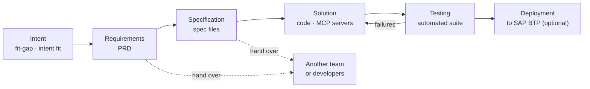

# The new Joule Studio: intent-based development, agents and extensions

*Describe a goal in plain words, and the new Joule Studio writes the intent, requirements, specification, code and tests for an agent. Here is each phase, and how to extend an agent SAP ships.*

> [!NOTE]
> **📍 At a glance**
> - **You will learn:**
>   - where the new Joule Studio lives in Joule Work, and what you can create there
>   - the six phases from intent to a deployed agent, and what each one produces
>   - how business users and developers share the work
>   - how to extend an SAP-delivered agent with instructions, MCP servers and hooks
>   - how MCP servers, n8n workflows and classic skills differ
> - **You will build:** a small fit-gap check that sorts needs into standard SAP content and gaps, and scores the fit
> - **Level:** beginner to intermediate · **Time:** about 40 minutes
> - **Builds on:** [The Joule family](joule-family.md) and [Joule Studio Classic](joule-studio-classic.md)
> - **Last checked:** 21 Nov 2026

**After this chapter you can:**

- Start an agent or an agent extension from Joule Work's Develop area, with or without Quick Create
- Explain intent, requirements (PRD), specification, solution, testing and deployment, and review each one
- Read a fit-gap analysis and an intent-fit score
- Choose the right extension point for a change to an SAP agent
- Tell an MCP server, an n8n workflow and a classic Joule skill apart

## 20.1 Where the new Joule Studio lives

- It is not a separate service. It is the **Develop** area of **Joule Work** (chapter 18).
- Joule Work on the web has three areas:

| Area | For whom | What it does |
|---|---|---|
| **Conversations** | Business users | Chat with Joule: one question, one answer |
| **Spaces** | Business users | Pages of cards with live data and a refresh button, like a small dashboard |
| **Develop** | Developers and builders | The new Joule Studio |

- **Your role decides what you see.** A user with only the end-user role sees Conversations and Spaces, not Develop.
- **Who runs it:** Joule Studio Classic is *customer-managed*: you provision Joule, subscribe services and run boosters in your own BTP subaccount (chapters 18 and 19).
  - The new Joule Work and Joule Studio follow an *SAP-managed* model: you provision through SAP for Me, and SAP runs the platform side.
  - That is the course's description; SAP was still moving customers over in Nov 2026.
- **It is still pre-release.** SAP's own tutorials say so: features, screens and terms may change. Date what you learn.
- The **C_JSD** certification (chapter 12) tests this new Studio, not the classic one.

## 20.2 What you can create

From **Develop**, choose **+** and then a tile:

| Tile | What it builds |
|---|---|
| **Agent** | A new agent, with its own tools, from your intent |
| **Agent Extension** | Changes to an agent that SAP delivers, without touching SAP's code (20.6) |
| **n8n workflow** | A workflow graph; shown as "coming soon" in the course's practice system |

**The create dialog**
- Keep **New Solution** selected, then enter an **agent name** and an **intent statement**: what you want, in plain words.
- **Quick Create** on: the tool skips most clarifying questions and runs through the phases on its own.
- **Quick Create** off: it first asks about goals and how success is measured, and it waits for you after each phase.
- Even with Quick Create it may still ask something. In the course demo it asked which measurable outcomes the agent should deliver.

## 20.3 From intent to a running agent: six phases



| Phase | What Joule Studio does | What you review |
|---|---|---|
| **1 Intent** | Maps your goal to SAP's Reference Business Architecture, using SAP Knowledge Graph, SAP LeanIX and SAP Domain Models; runs a **fit-gap** analysis | The intent document: goals, success criteria, which needs standard SAP content meets and which are gaps, and the **intent fit** |
| **2 Requirements** | Writes a **product requirements document (PRD)** | Elevator pitch, business need, expected value, objectives, metrics, and requirements in priority order |
| **3 Specification** | Turns the PRD into a technical specification: functions, architecture decisions, constraints, expected behaviour | The `specification.md` files in the Code tab: the low-level design |
| **4 Solution** | Generates the code and works through the tasks in the specification | The code, and the agent in the **Try** tab |
| **5 Testing** | Runs an automated test suite against the agent | Tests passed and failed, code coverage, an overall score |
| **6 Deployment** | Deploys the agent to SAP BTP (optional) | The Deployment tab; *Try now* talks to the deployed agent over the A2A protocol |

- **Intent fit** shows how closely the proposed solution matches what you asked for. In the course demo it was 92%, meaning most needs had standard SAP content.
- Between phases, explore the intent on the **Idea Board**, and edit any document by clicking its text or changing the file in the Code tab.
- When tests fail, the tool changes the code and tests again until the tests pass, then stops for you to try the agent.
- Building your intent as a requirements document, then a specification, then code is called **spec-driven development**.

**Fit-gap, in miniature**

```python
# Fit-gap in miniature: which needs are met by standard SAP content, and how good is the fit?
needs = {
    "Read a customer's open sales orders": "API_SALES_ORDER_SRV",
    "Read the customer's contact data": "API_BUSINESS_PARTNER",
    "Rate the risk of a late delivery": None,      # no standard API
    "Draft a status email to the customer": None,
}
weights = {need: (3 if api else 1) for need, api in needs.items()}  # assume standard parts carry more work

fit = sum(w for n, w in weights.items() if needs[n]) / sum(weights.values())
print(f"intent fit: {fit:.0%}")
for need, api in needs.items():
    print(f"{'standard' if api else 'GAP':8}  {need}" + (f"  ({api})" if api else ""))
```

Output:

```text
intent fit: 75%
standard  Read a customer's open sales orders  (API_SALES_ORDER_SRV)
standard  Read the customer's contact data  (API_BUSINESS_PARTNER)
GAP       Rate the risk of a late delivery
GAP       Draft a status email to the customer
```

✅ *Verified: run with Python 3.12 (details at the end).*

- SAP does not publish how Joule Studio computes intent fit. The weights here only show the idea: standard content covers part of the work, and the gaps are what gets built.

## 20.4 Business users and developers share the work

- SAP's tutorials: depending on your role, you may stop after the PRD or the specification, and hand it to another team.
- **The course's description of the split:**
  - Business users write the intent, then produce the PRD and the specification.
  - The project goes to a Git repository. A developer clones it into the editor of their choice and finishes it, with or without AI, then pushes it back.
- So the most valuable business skill here is describing a process precisely: who does what, with which data, and how success is measured.

> [!WARNING]
> **⚠️ Mistakes travel downstream**
> - Each phase builds on the one before. A wrong goal in the intent becomes a wrong requirement, a wrong specification and wrong code.
> - Read the intent and the PRD before you let the tool continue, especially in Quick Create mode.

## 20.5 Guideline files: why the code looks the way it does

- The generated project contains **guideline files**: a general `guidelines.md` and specific ones for agents, Python, skills and MCP.
- They hold SAP's rules for how to build, so every generated agent follows the same patterns. You do not write them.
- **Example from the course demo:** a guideline says not to call an API directly but through an MCP server.
  - So when the intent named two standard APIs, the solution generated two custom MCP servers around them, and the agent used those.
- **No classic skills.** The new Studio does not build classic Joule skills (chapter 19). Tools reach the agent as MCP servers.
- **Contrast with Classic:** there you build an MCP server outside Joule Studio, deploy it (for example to Cloud Foundry), and attach it to the agent (chapter 19, 19.6).

## 20.6 Extending an SAP agent

- **Why:** SAP's agents are standard. An extension adds your rules and tools without changing SAP's agent, so SAP can keep updating it.
- **How to start:** Develop → **Agent Extension** → *Create* → *Agent Extension* → pick the SAP agent from the catalog, then give an extension name and intent.

**Extension points (SAP's tutorial)**

| Extension point | Use it for | Where |
|---|---|---|
| **Instructions and context** | Company rules and domain knowledge added to the agent's prompt | Design tab → *Edit* under Instructions and Context |
| **MCP servers** | Extra tools the agent may call | Design tab → Extensions → MCP Servers → *Add Server* |
| **Hooks** | Logic that runs before (pre-hook) or after (post-hook) the agent, generated as an n8n workflow | Created from your intent; visible in the Solution tab |

**SAP's worked example: the AP Invoice Agent**
- **Post-hook:** when an invoice cannot be matched, create a task in SAP Task Center and notify the responsible AP clerk.
- **Instruction:** always check tax on pending invoices with a tax-validation tool before recommending approval. Errors block approval, warnings allow it with a note.
- **MCP server:** add a server from the list, after checking its tools under *View Details*.
- Which points exist depends on the agent; the extension dialog shows them for the selected agent.

## 20.7 Writing a good intent statement

- **One clear paragraph:** who the agent serves, what it does, which data it uses, and what it returns. SAP's HR example names the users, the tasks, the data and the expected insights.
- **In practice, the course added:**
  - the scope, the expected behaviour and one or two example requests, in the same statement
  - for clarifying questions, measurable outcomes, such as "reduce manual review time per customer"
- You can draft the statement with any AI assistant, then check it yourself before you paste it in.
- **Keep it in scope.** SAP's tutorial warns that a more complex scenario takes longer to generate and test.

## 20.8 MCP servers, n8n workflows and classic skills

| Building block | What it is | When to use it |
|---|---|---|
| **MCP server** | Exposes tools (APIs, calculations) that an agent can choose to call | The agent decides which tool to call and when |
| **n8n workflow** | A fixed graph: do this, then that, branch on a condition | The order must be predictable, as in hooks and approvals |
| **Classic Joule skill** | A low-code flow in Joule Studio Classic | Existing Classic projects (chapter 19) |

- n8n plays the same role as other workflow tools, such as SAP Build Process Automation or graph frameworks like LangGraph. MCP plays a different role: it supplies tools. The two work together.

## 20.9 Added by Claude, not from the sources

- **Keep intent, PRD and specification in Git and review changes like code.** They are now the real source of the agent; a pull request on the PRD is cheaper than a bug in production.
- **Add your own test cases.** Generated tests check what the tool understood. Add cases from real data, edge cases, and every action that changes data.
- **Review generated MCP servers like any integration.** Check which backend user they call with, what they can change, and how they log.

## 20.10 Interview corner

**What interviewers listen for:** the phase order and what each phase produces, a realistic view of who reviews what, and the right extension point for a change.

### 🟢 Basic

<details class="qa"><summary>1. Where do you build agents in the new Joule Studio?</summary>

- In Joule Work, in the Develop area; you need a developer role to see it
- You choose Agent, Agent Extension or an n8n workflow, and describe the goal in an intent statement
- *Stronger answer:* explain Quick Create, and that the C_JSD exam tests this Studio

</details>

<details class="qa"><summary>2. What are the phases of intent-based development?</summary>

- Intent, requirements (PRD), specification, solution, testing, deployment
- Each phase produces a document or artifact you can review and edit
- *Stronger answer:* mention the fit-gap and intent fit in the intent phase, and that tests loop back to the solution

</details>

<details class="qa"><summary>3. What does intent fit mean?</summary>

- How closely the proposed solution matches your requirement, based on standard SAP content found
- The fit-gap shows which needs standard APIs meet and which must be built
- *Stronger answer:* add that the tool uses SAP Knowledge Graph, SAP LeanIX and SAP Domain Models to find that content

</details>

### 🟡 Intermediate

<details class="qa"><summary>4. When would you extend an SAP agent instead of building a new one?</summary>

- When SAP's agent already covers most of the process and you need your rules, tools or follow-up steps
- Extensions keep SAP's agent intact, so SAP updates still arrive
- *Stronger answer:* name the extension points (instructions and context, MCP servers, pre- and post-hooks) and pick one for an example

</details>

<details class="qa"><summary>5. Why does the generated code use MCP servers instead of calling APIs directly?</summary>

- SAP's guideline files tell the tool to wrap APIs in MCP servers
- The agent then gets clear, described tools, and the same server can serve other agents
- *Stronger answer:* add that this replaces classic Joule skills, and that each server needs a security review

</details>

<details class="qa"><summary>6. How do business users and developers split the work?</summary>

- Business users own the intent, the PRD and often the specification
- Developers take the project from Git and finish, test and harden it
- *Stronger answer:* stress reviewing the intent and PRD early, because errors travel downstream

</details>

### 🔴 Senior

<details class="qa"><summary>7. A customer wants every unmatched invoice to create a task for a clerk. How do you build it?</summary>

- Extend SAP's AP Invoice Agent with a post-hook n8n workflow that creates the SAP Task Center task and notifies the clerk
- Add an instruction for the matching rules, and test with unmatched and borderline invoices
- *Stronger answer:* explain why a hook (fixed order) fits better than a new MCP tool (agent's choice) for a must-happen step

</details>

<details class="qa"><summary>8. How would you govern agents built with intent-based development across a company?</summary>

- Keep intent, PRD and specification in Git; review them like code; require your own test cases
- Review generated MCP servers for permissions and logging; deploy through controlled environments
- *Stronger answer:* register agents in SAP AI Agent Hub (chapter 11) and track AI-unit use per agent (chapter 18)

</details>

> [!TIP]
> **🧩 Design question: a delivery-status assistant for sales reps**
> - Write the intent statement: users, tasks, data, outputs and two example requests.
> - Predict the fit-gap: which needs have standard SAP APIs, and which must be built?
> - Which parts belong in an MCP server, and which in an n8n workflow?

## Cheat sheet

| Topic | Key points |
|---|---|
| Where | Joule Work → Develop (developer role); also Conversations and Spaces |
| Create | Agent · Agent Extension · n8n workflow; Quick Create skips most questions |
| Phases | Intent → requirements (PRD) → specification → solution → testing → deployment |
| Intent | Reference Business Architecture, Knowledge Graph, LeanIX, Domain Models; fit-gap; intent fit |
| Code | Follows SAP guideline files; APIs wrapped in MCP servers; no classic skills |
| Extension points | Instructions and context · MCP servers · pre- and post-hooks (n8n) |
| Deploy | To SAP BTP; *Try now* via A2A |

## Recap

- The new Joule Studio is Joule Work's Develop area; it is still pre-release
- You describe intent; it writes requirements, a specification, code and tests, and can deploy to BTP
- The intent phase finds standard SAP content and reports the gaps and the intent fit
- Business users can stop after the PRD or specification; developers continue from Git
- Extensions add instructions, MCP servers or hooks to SAP's agents without changing them
- MCP servers give an agent tools; n8n workflows fix the order of steps

## Practice

1. Write an intent statement for an agent that answers "where is my order?" for sales reps, with two example requests.
2. Add two needs to the fit-gap snippet, one standard and one gap, and see how the score changes.
3. Pick an SAP agent from Discovery Center (chapter 18). Name one change for each extension point.
4. If you have access to a Joule Studio system, follow SAP's *HR Onboarding Assistant* tutorial and note what each phase produced.

## How this chapter was checked

- **Lecture 10 recordings:**
  - Part B (BT022) read in full: the certification, the live build of an agent and an extension in the new Joule Studio, and questions
  - Part A (BT021) read in full; it ends when the hands-on exercise began, which was not recorded
- **Read in full on 21 Nov 2026:** SAP Developer Center tutorials *Use Joule Studio to Create an HR Onboarding Assistant* and *Use Joule Studio to Extend the AP Invoice Agent using Agent Extensions*.
- **Not used, by your decision:** the C_JSD practice-task file and the *Early access – Joule Studio 2* document from the course Drive.
- **Run with Python 3.12, standard library only:** the fit-gap snippet prints the output shown.
- **Not checked:**
  - how SAP computes intent fit
  - the Git hand-over for business users, which the course described as a coming update

## Sources and further reading

- BTPAI course, Lecture 10 Part A (BT021) and Part B (BT022) recordings
- SAP Developer Center, *Use Joule Studio to Create an HR Onboarding Assistant*: https://developers.sap.com/tutorials/joule-studio-hr-onboarding-assistant.html
- SAP Developer Center, *Use Joule Studio to Extend the AP Invoice Agent using Agent Extensions*: https://developers.sap.com/tutorials/joule-studio-agent-extension.html
- SAP Developer Center, tutorial navigator (search "Joule"): https://developers.sap.com/tutorial-navigator.html
- SAP Learning, *SAP Certified – Joule Studio Developer* (C_JSD): https://learning.sap.com/certifications/sap-certified-joule-studio-developer

Previous: [Joule Studio Classic: setup, skills, agents, testing and deployment](joule-studio-classic.md) · Next: [Tutorial: Set up environments and destinations for Joule skills](tutorial-joule-skill-setup.md)
