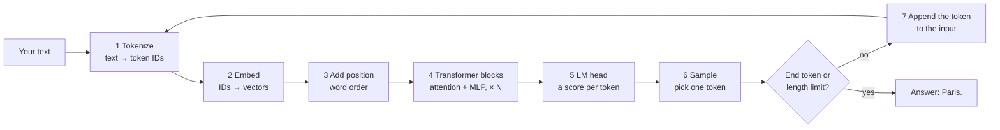
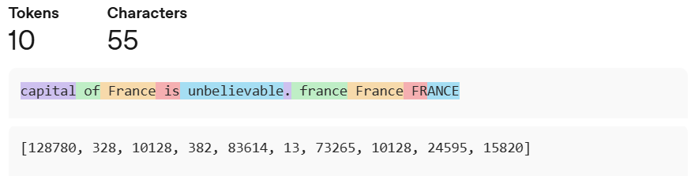

# Inside a large language model: from prompt to answer

*What happens between typing "What is the capital of France?" and seeing "Paris": tokens, vectors, attention, probabilities and a loop. It also explains why answers vary, why they can be wrong, and how the bill is calculated.*

> [!NOTE]
> **📍 At a glance**
> - **You will learn:**
>   - tokenization, embeddings and positions
>   - self-attention and the transformer block
>   - logits, sampling and the autoregressive loop
>   - why an LLM generates rather than looks up, and how token pricing works
>   - how to choose a model
> - **You will build:** a tokenizer check, a cosine-similarity test, a sampler with temperature, top-k and top-p, a toy generation loop and a cost calculator
> - **Level:** beginner to intermediate · **Time:** about 50 minutes
> - **Builds on:** [AI, machine learning, deep learning and generative AI](ai-ml-deep-learning-genai.md)
> - **Last checked:** 20 Nov 2026

**After this chapter you can:**

- Walk through the seven phases from prompt to answer
- Explain why "France", "france" and "FRANCE" are different inputs to a model
- Explain self-attention with an example, and what multi-head means
- Set temperature, top-k and top-p for a factual or a creative task
- Explain why the same prompt gives different answers, and why output tokens cost more
- Choose a model by context window, speed, cost and risk

## 14.1 The journey in one picture

- A large language model (LLM) never sees words. It turns text into numbers, transforms them, and predicts the next token, again and again.



## 14.2 Tokenization: text becomes numbers

- **Tokenization** splits text into **tokens**: whole words, parts of words, spaces and punctuation.
  - Common words are usually one token. Rare or long words split into subwords.
  - Each token has a fixed **token ID** in the model's vocabulary.
- **The vocabulary is fixed before training.** GPT-2 has 50,257 tokens. GPT-4's tokenizer has about 100,000.
- **Every model family has its own tokenizer.** The same text gives different tokens and counts in different models.
- OpenAI's rule of thumb: one token is about 4 characters of English, or ¾ of a word (100 tokens ≈ 75 words).



- **Case matters.** In the example above:
  - " France" is token 10128 both times it appears.
  - " france" is a different token, 73265.
  - "FRANCE" splits into two tokens, " FR" and "ANCE".
- To a person they are the same word; to the model they are three different inputs.

```python
import tiktoken  # pip install tiktoken

enc = tiktoken.get_encoding("o200k_base")   # encoding of OpenAI's current models
text = "capital of France is unbelievable. france France FRANCE"

ids = enc.encode(text)
print(len(ids), "tokens:", ids)
print([enc.decode([i]) for i in ids])
```

- Output: `10 tokens: [128780, 328, 10128, 382, 83614, 13, 73265, 10128, 24595, 15820]`, the same IDs as the web tool.

✅ *Verified: run with tiktoken, matched against the OpenAI tokenizer page (details at the end).*

> [!TIP]
> **Consistent wording helps**
> - Some practitioners write prompts in lowercase so the model always sees the same tokens.
> - Treat it as a habit, not a rule: current models read mixed case well. Consistent spelling of names and codes matters more than case.

## 14.3 Embeddings: meaning as vectors

- Each token ID is looked up in an **embedding** table and becomes a **vector**: a long list of numbers.
  - GPT-2 small uses 768 numbers per token, in a table of 50,257 × 768 (about 39 million parameters).
  - Bigger models use more dimensions. GPT-3's published size is 12,288.
- The vector places the token in the model's **embedding space**.
  - Words used in similar ways sit close together: "France" near "Germany", far from "banana".
  - Directions carry meaning: king − man + woman lands near queen.
- Why turn words into geometry? Because distances can be computed.
  - **Cosine similarity** (the angle between two vectors) and **Euclidean distance** measure how alike two texts are.
  - Retrieval-augmented generation (RAG) uses exactly this to find the passages closest to a question.

```python
import math

# Toy 3-D embeddings. Axes: [royalty, male, female]
vec = {
    "king":   [0.9, 0.8, 0.1],
    "queen":  [0.9, 0.1, 0.8],
    "man":    [0.1, 0.8, 0.1],
    "woman":  [0.1, 0.1, 0.8],
    "banana": [-0.7, 0.0, 0.1],
}


def cosine(a, b):
    dot = sum(x * y for x, y in zip(a, b))
    return dot / (math.sqrt(sum(x * x for x in a)) * math.sqrt(sum(y * y for y in b)))


print("king~queen ", round(cosine(vec["king"], vec["queen"]), 2))
print("king~banana", round(cosine(vec["king"], vec["banana"]), 2))

# king - man + woman lands next to queen
target = [k - m + w for k, m, w in zip(vec["king"], vec["man"], vec["woman"])]
candidates = [w for w in vec if w not in ("king", "man", "woman")]
print("king - man + woman =", max(candidates, key=lambda w: cosine(vec[w], target)))
```

- Output: `king~queen 0.66`, `king~banana -0.73`, `king - man + woman = queen`.
- Real models learn hundreds or thousands of dimensions, and no single axis has a neat name.

✅ *Verified: run with Python 3 (details at the end).*

## 14.4 Position: word order

- A transformer reads all tokens at the same time, not one by one. On its own it would not know that "dog bites man" differs from "man bites dog".
- So a **position** vector is added to each token's embedding.
  - The original transformer used fixed sine and cosine waves.
  - GPT-2 learns its position vectors during training.
- Token embedding + position = the final input vector for each token.

## 14.5 Self-attention: which words matter

- **The problem with older networks:** RNNs and LSTMs read one token after another.
  - They give most weight to the nearest words.
  - They cannot process a sentence in parallel, which makes training slow.
- **Self-attention** lets every token look at every other token in the context, near or far.
  - In "I have an Apple iPod, and I just bought another Apple", attention to "iPod" tells the model the second "Apple" is the company, not the fruit.
  - In "What is the capital of France?", the token "capital" attends most strongly to "France". Words like "what", "is" and "of" get little attention.

**Query, key and value**
- Each token's vector is multiplied by learned weights into three vectors. Transformer Explainer compares this to a web search:
  - **Query (Q):** what you type into the search box
  - **Key (K):** the title of each result
  - **Value (V):** the content of each result
- Matching each query against all keys gives the attention scores. These weight a blend of the values:
  - Attention(Q, K, V) = softmax(Q·Kᵀ / √d_k) · V
  - Dividing by √d_k keeps the scores small enough for softmax to learn well.
- In a text generator, attention is **masked**: a token may look only at earlier tokens, never at future ones.

**Multi-head and many layers**
- **Multi-head attention** runs several attention calculations in parallel, each with its own weights.
  - Each head can pick up a different kind of relationship, such as grammar or meaning; their outputs are combined.
- A **transformer block** = multi-head attention + an MLP (feed-forward) layer, with residual connections and layer normalisation.
- Models stack many blocks. A common simplification: early blocks capture syntax, later blocks meaning and facts.


- Transformer Explainer (above) runs a real GPT-2 small in the browser: 12 blocks, 12 heads, 768-dimensional embeddings and 124 million parameters. Type your own text and watch each step.

**The paper behind it all**

| Fact | "Attention Is All You Need" (Vaswani et al., 2017) |
|---|---|
| Claim | A model built only on attention, with no recurrence or convolution, is better and trains faster |
| Base model | 6 encoder and 6 decoder layers, 512 dimensions, 8 heads |
| Training | One machine with 8 NVIDIA P100 GPUs: 12 hours (base), 3.5 days (big) |
| Result | New best translation scores: 28.4 BLEU English→German, 41.8 English→French |

## 14.6 The MLP layer: refining each token

- After attention, each token passes through a small **feed-forward network** (MLP), on its own.
  - Attention moves information between tokens; the MLP refines each token's representation.
  - In GPT-2 small it expands 768 numbers to 3,072, applies an activation function, and projects back to 768.
- Most of a model's parameters sit in these layers, and they are believed to hold much of its factual knowledge.

## 14.7 From scores to a word: logits and sampling

- After the last block, a final layer (the **LM head**) gives every token in the vocabulary a score, a **logit**.
- **Softmax** turns the logits into probabilities that add up to 1.
- **Sampling** then picks one token. Three settings control it:

| Setting | Effect | Use for |
|---|---|---|
| **Temperature** < 1 | Sharpens: the top token dominates | Facts, code, enterprise answers |
| **Temperature** > 1 | Flattens: unlikely tokens get a chance | Creative writing, brainstorming |
| **Top-k** | Choose only among the k most likely tokens | Cutting off nonsense |
| **Top-p** (nucleus) | Choose among the fewest tokens whose probabilities add up to p | Balanced variety |
| **Greedy** | Always the single most likely token | Repeatable answers |

- For "capital of France", Paris is so dominant that every setting picks it. Settings matter for open-ended prompts.
- Enterprise use usually wants repeatable answers: run a query 100 times and get much the same result. Creative tasks want variety, or every "poem about the moon" comes out the same.

```python
import math
import random

# Raw scores (logits) for the word after "Data visualization empowers users to"
logits = {"visualize": 4.0, "create": 3.0, "see": 2.5,
          "make": 1.8, "easily": 1.8, "banana": -2.0}


def softmax(scores, temperature=1.0):
    exps = {t: math.exp(s / temperature) for t, s in scores.items()}
    total = sum(exps.values())
    return {t: e / total for t, e in exps.items()}


def top_k(probs, k):
    keep = dict(sorted(probs.items(), key=lambda kv: -kv[1])[:k])
    total = sum(keep.values())
    return {t: p / total for t, p in keep.items()}


def top_p(probs, p):
    keep, running = {}, 0.0
    for t, q in sorted(probs.items(), key=lambda kv: -kv[1]):
        keep[t] = q
        running += q
        if running >= p:
            break
    total = sum(keep.values())
    return {t: q / total for t, q in keep.items()}


for temp in (0.2, 1.0, 2.0):
    probs = softmax(logits, temp)
    print(f"T={temp}:", {t: round(v, 2) for t, v in probs.items()})

probs = softmax(logits)
print("top-k=3:  ", sorted(top_k(probs, 3)))
print("top-p=0.9:", sorted(top_p(probs, 0.9)))

random.seed(1)
pool = top_k(probs, 3)
print("sampled:  ", random.choices(list(pool), weights=pool.values(), k=5))
```

- Output, in short:
  - at T=0.2, "visualize" gets 0.99
  - at T=1.0 it gets 0.55, close to GPT-2's 54.67% in the screenshot
  - at T=2.0 it drops to 0.36, and even "banana" gets 0.02
  - top-p=0.9 keeps four candidates, while top-k=3 keeps three

✅ *Verified: run with Python 3 (details at the end).*

## 14.8 The autoregressive loop

- The model produces **one token per pass**. The new token is appended to the input, and the whole pass runs again.
  - Pass 1: "What is the capital of France?" → "Paris"
  - Pass 2: "… France? Paris" → "."
  - Pass 3: "… France? Paris." → end token, so generation stops
- This is why text appears word by word: each token is streamed to the screen as soon as it is generated.
- **Length is a habit of the model.** One model answers "What is Python?" in a paragraph, another in five.
  - Neither is wrong; ask for "one sentence" or "ten words" and both comply.
- **The context window is the only memory.** Nothing carries over between calls except what is in the input.

```python
# A stand-in "model": for each context it returns the most likely next token.
def next_token(context):
    table = {
        "what is the capital of france ?": "paris",
        "what is the capital of france ? paris": ".",
        "what is the capital of france ? paris .": "<END>",
    }
    return table.get(" ".join(context), "<END>")


tokens = "what is the capital of france ?".split()
max_new_tokens = 20                      # a hard stop, like max_tokens in an API
for _ in range(max_new_tokens):
    new = next_token(tokens)             # one full forward pass per new token
    if new == "<END>":
        break
    tokens.append(new)                   # the output becomes part of the input
    print(" ".join(tokens))
```

- Output: two lines, ending with "paris" and then ".". The loop stops at the end token.

✅ *Verified: run with Python 3 (details at the end).*

## 14.9 Generated, not retrieved

- **There is no database inside the model.** Ask for a summary of a famous book and it does not look the book up.
  - What it learned in training is stored in its weights; the answer is generated one token at a time.
  - It feels like retrieval because it is fast and often word-perfect, but it is generation.
- **Probabilistic, not deterministic.** The same database query returns the same rows for 100 people.
  - The same prompt to a chat model gives 100 slightly different answers.
- Consequences:
  - Knowledge stops at the training **cut-off** date, unless the app adds a web search tool.
  - The model knows nothing about your company's private documents, unless you put them in the prompt (grounding, RAG).
  - A confident answer can still be wrong (a hallucination).

> [!WARNING]
> **Do not use an LLM where you need a guaranteed exact answer** such as an account balance, a stock level or a legal clause. Fetch the fact from the system of record, then let the model explain or format it.

## 14.10 Tokens cost money

- Every token passes through the vendor's GPUs, which costs compute, energy and data-centre capacity. So vendors bill by token.
- Prices are quoted **per million tokens**, separately for input and output. For example, $4 input and $20 output.
- **Output tokens cost several times more than input tokens.**
  - The input is processed in one pass.
  - Each output token needs its own full pass through the model, in the loop above.
- Free tiers in chat apps have tight limits. They exist to win users, who then move to paid plans.
- SAP bills its AI features in **AI units** instead of tokens; see [Joule for Consultants](joule-for-consultants.md).

```python
def call_cost(input_tokens, output_tokens, in_price, out_price):
    """Prices are in USD per 1 million tokens, the way vendors publish them."""
    return input_tokens / 1_000_000 * in_price + output_tokens / 1_000_000 * out_price


# Example prices: $4 per 1M input tokens, $20 per 1M output tokens
per_call = call_cost(input_tokens=1_500, output_tokens=500, in_price=4, out_price=20)
print(f"one call:         ${per_call:.4f}")
print(f"10,000 calls/day: ${per_call * 10_000:,.2f} per day")
```

- Output: `$0.0160` per call, `$160.00` per day at 10,000 calls. The 500 output tokens cost more than the 1,500 input tokens.

✅ *Verified: run with Python 3 (details at the end).*

## 14.11 Choosing a model

- Vendors ship **size tiers**: a small, fast, cheap model; a balanced everyday model; and a large, most capable, most expensive one.
  - Anthropic's names follow poetry: Haiku (short), Sonnet (medium), Opus (large).
  - OpenAI's GPT-5.6 family (July 2026) has Luna (moon: fastest, cheapest), Terra (earth: balanced) and Sol (sun: flagship). OpenAI says the number is the generation and the names are lasting tiers.
- **Three selection criteria:**
  - **Context window:** how much text the model can take in at once.
  - **Speed:** critical for voice agents, where a pause after you speak feels unnatural. Fast "Flash"-type models suit voice.
  - **Cost:** per token, multiplied by how often the task runs.
- **Then weigh accuracy against risk.**
  - Say a small model is 98% accurate for $150 a year, and a mid-size one 99.9% for $500.
  - For automatic invoice approval, pay for the better model: one wrong approval can cost far more.
  - For an internal FAQ bot, the cheaper model may be fine.

**Snapshot: the top of the llm-stats.com leaderboard on 20 Nov 2026**

| Vendor | Models near the top |
|---|---|
| Anthropic | Claude Fable 5.2, Claude Mythos 5.2, Claude Opus 5.5, Claude Sonnet 5.5 |
| OpenAI | GPT-6.2 Astra, GPT-6 Astra, GPT-6.2 Sol |
| Google | Gemini 4 Neon, Gemini 4 Carbon, Gemini 4 Argon |
| Open weights | Kimi K3.1 Pro (Moonshot AI) |

- Names change every few months, so treat this table as dated and check a leaderboard when you choose.
- **Some frontier models go to security partners first:**
  - **Anthropic, Claude Mythos Preview:** a gated research preview for Project Glasswing partners, announced 7 Apr 2026. It was widened to about 150 more organisations on 2 Jun 2026.
  - **OpenAI, Astra:** in Sep 2026 OpenAI said its most advanced cyber capabilities go only to a handful of partners at first.
  - **Google, Gemini 4 Argon:** went globally available on 13 Oct 2026. Cyber defenders can apply to its Fairwind Program for a version without cyber guardrails.

> [!IMPORTANT]
> **🏭 In production**
> - Route by task: send simple, high-volume requests to the small model and escalate only hard cases to the large one. This often cuts cost several-fold.
> - Pin the exact model version in configuration and re-test before upgrading; vendors retire old versions on a schedule.
> - Measure your own accuracy on your own test set. Public leaderboards rank general skill, not your invoice or ticket data.
>
> *Added by Claude*

## 14.12 Added by Claude, not from the sources

- **Context windows are not free memory.** Long prompts cost input tokens on every call, and models can miss details buried in the middle. Send only what the task needs.
- **Prompt caching:** most vendors discount input tokens that repeat across calls, such as a long fixed system prompt. Put the fixed part first and the changing part last to benefit.
- **Temperature 0 is not a guarantee of identical output.** Floating-point and serving details can still vary results slightly. Design checks for "close enough", not byte-for-byte equality.

## 14.13 Interview corner

**What interviewers listen for:** the pipeline in the right order, a correct intuition for attention, and practical judgement on sampling, cost and model choice.

### 🟢 Basic

<details class="qa"><summary>1. What is a token, and why does it matter?</summary>

- A unit of text the model processes: a word, part of a word, a space or punctuation, each with an ID
- Models are priced and limited (context window) in tokens, and each model has its own tokenizer
- *Stronger answer:* mention the ¾-word rule of thumb and that case and spelling change the tokens

</details>

<details class="qa"><summary>2. What are temperature, top-k and top-p?</summary>

- Temperature divides the logits: below 1 sharpens the distribution, above 1 flattens it
- Top-k keeps the k most likely tokens; top-p keeps the smallest set whose probabilities reach p
- *Stronger answer:* say which you would use for a contract summary (low temperature) and for slogan ideas (higher)

</details>

### 🟡 Intermediate

<details class="qa"><summary>3. Explain self-attention with an example.</summary>

- Every token compares its query with every other token's key; the scores weight a mix of their values
- In "bought another Apple" after "Apple iPod", attention to "iPod" makes "Apple" mean the company
- Multi-head attention runs several of these in parallel, each learning a different relationship
- *Stronger answer:* contrast with RNNs, which favour nearby words and cannot be parallelised

</details>

<details class="qa"><summary>4. Why do two people get different answers to the same prompt?</summary>

- The model samples from a probability distribution at every token; one different token changes the rest
- It generates, it does not retrieve, so there is no stored answer to return
- *Stronger answer:* explain how to make it more repeatable: low temperature, fixed model version, structured output

</details>

<details class="qa"><summary>5. Why do output tokens cost more than input tokens?</summary>

- The input is processed in one pass; every output token needs its own full pass in the autoregressive loop
- *Stronger answer:* conclude that asking for concise answers is the cheapest optimisation

</details>

### 🔴 Senior

<details class="qa"><summary>6. A model gives a wrong figure for a customer's credit limit. What is the root cause and the fix?</summary>

- The model generated a plausible number; it has no access to the customer master unless you give it
- Fix: fetch the value from the system of record with a tool or API, and have the model only explain it
- *Stronger answer:* add a check that every number in the answer appears in the retrieved data

</details>

<details class="qa"><summary>7. How would you choose a model for a voice agent that books service appointments?</summary>

- Latency first: a fast model so replies start immediately
- Enough context for the conversation and the booking rules; cost per minute at expected volume
- Test accuracy on real booking dialogues, and escalate to a person when confidence is low
- *Stronger answer:* route the rare complex cases to a larger model instead of using it for every turn

</details>

> [!TIP]
> **🧩 Design question:** your team's support bot costs too much each month. Find and fix the cost.
> - Measure input and output tokens per call, and calls per day; find the biggest multiplier.
> - Trim the prompt to what the task needs, cache the fixed part, and ask for shorter answers.
> - Send routine questions to a smaller model, and only hard ones to a large model.
> - Re-run your accuracy test set after each change.

## Cheat sheet

```text
text → tokens (IDs) → embeddings (+ position) → N × [attention + MLP] → logits → softmax → sample → append → repeat until END

token        ~4 characters of English; casing and spelling change tokens
embedding    vector per token; similar meaning = nearby (cosine similarity)
attention    softmax(Q·Kᵀ/√d_k)·V; multi-head = several in parallel
temperature  <1 focused, >1 creative;  top-k: best k;  top-p: smallest set reaching p
loop         one forward pass per output token; context window = the only memory
cost         price per 1M tokens, input and output separately; output costs more
choose       context window · speed · cost · risk; pin the version; test on your data
```

## Recap

- Text becomes token IDs, then vectors with positions, then passes through stacked transformer blocks
- Self-attention lets each token weigh every earlier token; multi-head runs several attentions at once
- The LM head scores every token; temperature, top-k and top-p decide which one is picked
- Output is generated one token per pass and fed back in; the context window is the only memory
- LLMs generate rather than retrieve, so answers vary and can be wrong; ground them in real data
- Tokens are billed per million, output more than input; choose models by context, speed, cost and risk

## Practice

1. In the OpenAI tokenizer, compare "SAP S/4HANA", "sap s/4hana" and "SAPS4HANA". Count the tokens and explain the difference.
2. In Transformer Explainer, type "The capital of France is" and generate. Raise the temperature to 2 and generate again; compare.
3. Change `top_p(probs, 0.9)` to 0.5 in the sampling snippet. Which candidates remain?
4. Use the cost snippet to price a bot that receives 2,000 input and returns 800 output tokens per call, 50,000 times a month.

## How this chapter was checked

- **Lecture 7 recording:** captions 0:38 to 1:07 (transformers, tokens, embeddings, attention, sampling, the loop, pricing) and 2:31 to 2:38 (choosing a model) read in full.
- **Course Drive (read in full):** the deck *From Prompt to Answer* (14 slides).
  - Its "GPT-4 scale" figures (96 layers, 12,288 dimensions, 175B parameters) are GPT-3's published sizes; GPT-4's size is not public.
  - Its token IDs are GPT-2's. This chapter uses GPT-2 small, as shown in Transformer Explainer, as the checked example.
- **Read in full on 20 Nov 2026:**
  - Transformer Explainer, the OpenAI tokenizer page and llm-stats.com
  - OpenAI's GPT-5.6 announcement (9 Jul 2026): the Sol, Terra and Luna tiers
- **Read in full by a reading helper on 20 Nov 2026:**
  - "Attention Is All You Need" (arXiv HTML v7)
  - Anthropic's Project Glasswing page and its 2 Jun 2026 update, Google's Gemini 4 Argon post, and Fortune's report on OpenAI's Astra (1 Sep 2026)
- **Read in part by a reading helper:** the GPT-3 paper (abstract, Section 2 and Table 2.1: 175B parameters, 96 layers, 12,288 dimensions, 96 heads).
- **Screenshots, 20 Nov 2026:** Transformer Explainer (default example), and the OpenAI tokenizer on the example sentence.
- **Run with Python 3.12:**
  - tokenizer snippet (tiktoken, encoding o200k_base): the 10 token IDs match the tokenizer page exactly
  - cosine snippet: 0.66, −0.73 and "queen"
  - sampling snippet: the probabilities at T=0.2, 1.0 and 2.0, the top-k and top-p sets and the five samples shown above
  - loop snippet: the two lines shown above
  - cost snippet: $0.0160 per call and $160.00 per day

## Sources and further reading

- BTPAI course, Lecture 7 recording (BT018); course Drive: *From Prompt to Answer* deck (BT051) and *Live Demo Websites AI* (BT060)
- Vaswani et al., *Attention Is All You Need* (2017): https://arxiv.org/abs/1706.03762
- Georgia Tech Polo Club, *Transformer Explainer*: https://poloclub.github.io/transformer-explainer/
- OpenAI, *Tokenizer*: https://platform.openai.com/tokenizer
- OpenAI, *GPT-5.6: Frontier intelligence that scales with your ambition* (9 Jul 2026): https://openai.com/index/gpt-5-6/
- Brown et al., *Language Models are Few-Shot Learners* (GPT-3, 2020): https://arxiv.org/abs/2005.14165
- LLM Stats, *AI leaderboard*: https://llm-stats.com
- Anthropic, *Project Glasswing*: https://www.anthropic.com/project/glasswing
- Anthropic, *Expanding Project Glasswing*: https://anthropic.com/news/expanding-project-glasswing
- Google, *Introducing Gemini 4 Argon*: https://blog.google/innovation-and-ai/models-and-research/gemini-models/introducing-gemini-4-argon/
- Fortune, *OpenAI to limit release of its Astra model* (1 Sep 2026): https://fortune.com/2026/09/01/openai-to-limit-release-of-its-asttra-model-astra-due-to-hacking-concerns/
- Brendan Bycroft, *LLM Visualization* (3-D walk through a transformer): https://bbycroft.net/llm
- Jay Alammar, *The Illustrated Transformer*: https://jalammar.github.io/illustrated-transformer/

Previous: [AI, machine learning, deep learning and generative AI](ai-ml-deep-learning-genai.md) · Next: [Prompt engineering: from zero-shot to grounded prompts](prompt-engineering.md)
