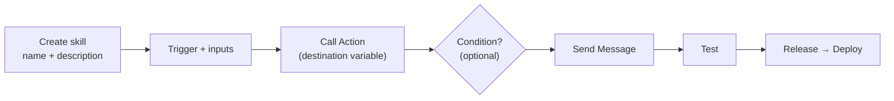

# Practice: 10 Joule skill assignments

*Ten graded build tasks for Joule Studio skills, from a one-call lookup to a composed skill and a grounded policy answer. Try each from its brief first, and open the build guide only when you're stuck.*

> [!NOTE]
> **📍 At a glance**
> - **Source:** the course's *Joule Skill Creation Workbook* (12 pages; course-made, summarising SAP's tutorials), rewritten and condensed
> - **You will build:** skills S1 to S10. The agent assignments in [chapter 38](practice-joule-agents.md) reuse them
> - **You need:**
>   - Joule Studio with the right role collections ([19.2, 19.2a](joule-studio-classic.md))
>   - A landscape: S/4HANA on-premise through Cloud Connector, SuccessFactors, SAP Build Process Automation, and document grounding
>   - The course trainer supplied the destinations. Without them, see 37.1
> - **Level:** beginner to advanced · **Builds on:** [Create action projects](tutorial-joule-action-projects.md), [Create and deploy a Joule skill](tutorial-joule-skill-create.md), [Filter an action](tutorial-joule-action-filter.md), [Run a process](tutorial-joule-skill-process.md)
> - **Last checked:** 21 Nov 2026

**After these assignments you can:**

- Turn an SAP API into a skill that answers a question in one call
- Branch a reply with a condition, and create data, not only read it
- Call a non-SAP-S/4HANA system (SuccessFactors) and an automation
- Compose skills, and answer from a grounded document

## 37.1 How to use these assignments

- **Attempt first, then consult.** Each assignment has a brief and a "done when" test. The build guide is folded away under it.
- **Keep your skills.** Chapter 38's agents use S1 to S10 as tools, so release each one when it passes.

| Level | Assignments | You practise |
|---|---|---|
| Foundational | S1, S2, S3 | Inputs, one *Call Action* (an OData read), a condition, a formatted reply |
| Intermediate | S4 to S7 | A create (write) action, a second system (SuccessFactors), a formula in a condition |
| Advanced | S8, S9, S10 | An automation, a skill that launches another skill, document grounding |

> [!TIP]
> **No S/4HANA of your own?**
> - Chapters 21 to 25 build the same skeleton against **SAP's mock services**: business partners and a badge service, no backend needed.
> - Do those first, then come back for the assignments that need a real system.

## 37.2 The loop you repeat

- **The description decides when Joule picks your skill.** Write it the way a user would ask, for example "Shows a business partner's name, role and address when someone asks about a customer or supplier by ID".
- **Every backend call is an action** from an action project ([chapter 22](tutorial-joule-action-projects.md)). Point it at a destination through a destination variable, so the same skill works in each landscape ([19.3](joule-studio-classic.md)).
- **Instead of *Call Action*** you can add *Run Process*, *Run Automation*, *Launch Joule Skill* or *Check Condition*.

## 37.3 The ten assignments

| # | Skill | System / API | Done when |
|---|---|---|---|
| S1 | Business partner lookup | S/4HANA · `API_BUSINESS_PARTNER` | A valid ID shows name, role and address; an unknown ID gets a friendly "not found" |
| S2 | Sales order status | S/4HANA · `API_SALES_ORDER_SRV` | Status, net value, delivery date, delivery and billing status shown; a missing order handled |
| S3 | Material stock availability | S/4HANA · `API_MATERIAL_STOCK_SRV` | In-stock and zero-stock replies both read naturally |
| S4 | Create a purchase requisition | S/4HANA · `API_PURCHASEREQ_PROCESS_SRV` | A PR is really created and its number returned |
| S5 | Production order status | S/4HANA · `API_PRODUCTION_ORDER_2_SRV` | Status, key dates and quantities returned |
| S6 | Time-off balance | SuccessFactors Time Off | The signed-in user's balance comes back |
| S7 | Overdue payables with alert | S/4HANA · an AP open-items service | A warning when the overdue total passes a threshold, a normal summary otherwise |
| S8 | Badge request | SAP Build Process Automation | The automation runs and the user gets a confirmation |
| S9 | Maintenance order stock check | S/4HANA · `API_MAINTENANCEORDER` + S3 | "Ready" or "blocked by X", from real stock for every component |
| S10 | Policy Q&A | Document grounding (SAP AI Core) | Answers come from the policy document, not the model's guess |

### S1 · Business partner lookup *(foundational)*

- **Brief:** "Show me business partner 10100001." Read the business partner and return its name, role and address.

Build guide

- **Action:** import `API_BUSINESS_PARTNER`, operation *GET A_BusinessPartner* by key (optionally expanding the address).
- **Input:** `BusinessPartnerID` (text). Map it to the key.
- **Read:** `BusinessPartnerFullName`, `BusinessPartnerCategory` and the address fields.
- **Reply:** "BP {ID} — {name} ({category}). Address: {street}, {city}."
- **Not found:** add a *Check Condition* on the action result before the message.

### S2 · Sales order status *(foundational)*

- **Brief:** "What's the status of sales order 12345?" Return status, net value, requested delivery date, delivery and billing status.

Build guide

- **Action:** `API_SALES_ORDER_SRV`, *GET A_SalesOrder* by key.
- **Read:** `OverallSDProcessStatus`, `TotalNetAmount` with `TransactionCurrency`, `RequestedDeliveryDate`, `OverallDeliveryStatus`, `OverallBillingStatus`.
- **Condition:** no record → a "not found" branch.
- **Stretch:** expand `to_Item` and list the first few lines.

### S3 · Material stock availability *(foundational)*

- **Brief:** "How much of M-1001 is in plant 1010?" Two inputs, and a different reply when stock is zero.

Build guide

- **Action:** `API_MATERIAL_STOCK_SRV`, filtered by `Material` and `Plant`.
- **Condition:** `MatlWrhsStkQtyInMatlBaseUnit > 0` → "{qty} {unit} available"; otherwise "currently out of stock in plant {Plant}".
- **Stretch:** a second condition that adds "reorder suggested" below a threshold.

### S4 · Create a purchase requisition *(intermediate)*

- **Brief:** "Create a PR for 50 units of M-2002 for plant 1010, needed next Friday." Create it and return the PR number.

Build guide

- **Action:** `API_PURCHASEREQ_PROCESS_SRV` with the **POST** (create) operation. The destination's communication user needs create rights.
- **Inputs (all mandatory):** `Material`, `Quantity` (number), `Plant`, `DeliveryDate` (date).
- **Payload:** material, quantity, plant, date, plus any field the API marks mandatory (check it on SAP Business Accelerator Hub).
- **Reply:** "Created purchase requisition {PurchaseRequisition} for {Quantity} × {Material}…"
- **Stretch:** check the material exists first, reusing the S1/S3 pattern.

### S5 · Production order status *(intermediate)*

- **Brief:** "What's the progress on production order 60001234?"

Build guide

- **Action:** `API_PRODUCTION_ORDER_2_SRV`, GET by key.
- **Read:** status, planned start and end dates, total vs confirmed quantity.
- **Stretch:** with RFC connectivity, call `BAPI_PRODORD_GET_DETAIL` as an RFC action for operation-level status.

### S6 · Time-off balance from SuccessFactors *(intermediate)*

- **Brief:** "How many vacation days do I have left?" Answer for the signed-in user from SuccessFactors.

Build guide

- **Action:** SuccessFactors Time Off OData (time-account balance entities), through the SuccessFactors destination.
- **Inputs:** none for "my balance": the user's identity is passed through. Optionally a time type (vacation, sick).
- **Reply:** "You have {balance} {unit} of {type} remaining."
- **Why it matters:** your first skill on a system other than S/4HANA.

### S7 · Overdue payables with an alert *(intermediate)*

- **Brief:** "Any overdue invoices for supplier 17300001?" Warn when the overdue total passes a threshold.

Build guide

- **Action:** an AP open-items OData service (for example `API_OPLACCTGDOCITEMCUBE_SRV`), filtered by supplier and past due.
- **Inputs:** `Supplier`; optional `Threshold` (default, say, 10,000).
- **Condition with a formula:** sum of overdue amounts > threshold → warning branch; else a normal summary.
- **Stretch:** add the days overdue of the oldest item.

### S8 · Badge request through an automation *(advanced)*

- **Brief:** "Request a building badge for employee 00204588." Trigger an SAP Build Process Automation process and confirm.

Build guide

- **Step:** *Run Process* or *Run Automation* instead of *Call Action*; map `EmployeeID` to its input ([chapter 25](tutorial-joule-skill-process.md)).
- **The automation runs asynchronously,** so the reply confirms submission, not completion.
- **Stretch:** accept a list of employees and let the automation loop.

### S9 · Maintenance order stock check (composed) *(advanced)*

- **Brief:** "Can we execute maintenance order 4000123?" Check every component's stock and say ready or blocked.

Build guide

- **Step 1:** *Call Action* on `API_MAINTENANCEORDER` for the component list (material, required quantity, plant).
- **Step 2:** for each component, *Launch Joule Skill* → **S3**, passing material and plant.
- **Step 3:** *Check Condition*: all available ≥ required → "ready"; otherwise collect the short ones.
- **Reply:** "Order {id} is blocked: short on {material} ({need} needed, {have} available)."
- **Done right when** the skill truly reuses S3 rather than copying its action.

### S10 · Policy Q&A with document grounding *(advanced)*

- **Brief:** "What's our mileage reimbursement rate?" Answer only from the company's policy document.

Build guide

- **Prerequisite:** document grounding enabled (it uses SAP AI Core) and the policy document grounded.
- **No action:** attach the grounded document to the skill; it answers from the content.
- **Behaviour:** answer briefly, quote the relevant policy line, and say "not covered in the policy" for anything outside it.
- **Background:** the *Documents* tool in Joule Studio ([19.5](joule-studio-classic.md)) and document grounding in Joule ([32.5](joule-integration-other-sap-solutions.md)).

## 37.4 Show your work

For each skill, keep three things:

- a screenshot of the canvas
- the description you wrote
- a test transcript (prompt and reply) that meets the "done when" test

## How this page was checked

- **Course workbook read in full on 21 Nov 2026:** *Joule Skill Creation Workbook* (12 pages).
  - It is course-made and states that it summarises SAP's tutorials. This page condenses it in new wording.
  - A second Drive file, *Copy of Joule-Skill-Creation-Workbook*, is the same text.
- **API names** are as the workbook gives them. It advises checking exact entity and field names for your S/4HANA release on SAP Business Accelerator Hub; so do I.
- **Not built here:** no Joule Studio tenant in this workspace.

## Sources

- BTPAI course Drive: *Joule-Skill-Creation-Workbook.pdf* (BT073) and its copy (BT063)
- SAP Business Accelerator Hub (API names and fields): https://api.sap.com

Previous: [Hands-on: RAG and document grounding with the generative AI hub](tutorial-rag-grounding-genai-hub.md) · Next: [Practice: 10 Joule agent assignments](practice-joule-agents.md)
