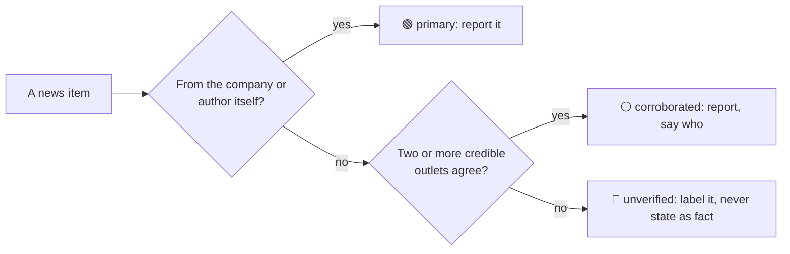

# SAP AI certifications, roles and staying current

*What the market now wants from SAP people who work with AI, which certifications prove it, which Python skills matter for pro-code agents, and a routine for keeping up with a field that changes every month.*

> [!NOTE]
> **📍 At a glance**
> - **You will learn:** the T-shaped profile and forward-deployed roles, the SAP AI certifications and their formats, the Python libraries behind pro-code Joule agents, and a source-checked routine for staying current
> - **You will build:** a typed tool schema with Pydantic, the pattern every pro-code agent uses for its inputs
> - **Level:** beginner · **Time:** about 30 minutes
> - **Builds on:** [The SAP AI landscape](sap-ai-landscape.md)

**After this chapter you can:**

- Explain why domain depth plus AI breadth (T-shaped) beats pure coding skill in AI projects
- Pick the SAP certification that fits your role, and know each exam's format
- Name the must-have Python libraries for pro-code agent work, and what each does
- Set up a weekly routine that separates verified news from rumour
- Judge an MCP server or AI tool for an SAP landscape: who maintains it, how it authenticates, and whether SAP's API policy allows it

## 12.1 What the market is looking for

- Today's frontier models write working code from a single prompt. Writing Python is no longer what sets people apart.
- What does: **knowing what to build**. That needs domain depth: finance, procurement, security, analytics, basis.

| Profile | Shape | Meaning |
|---|---|---|
| **T-shaped** | One deep bar, one broad bar | Deep in your own domain, broad in AI and the SAP AI platform |
| **Pi-shaped** | Two deep bars | Your domain plus deep AI engineering (Python, agent frameworks) |

- Skills that grow in value: product ownership, a sense of design and user experience, and **testing**, because AI output must be checked.
- **Forward-deployed engineers** work inside the customer's team, or with the customer at the table. Requirement, build and feedback happen in days, not months. The role was made popular by Palantir.
- An exercise worth doing: search current job postings for SAP AI roles in your country, and list the skills they ask for. Then feed your CV to an AI search tool and ask which roles fit you after this training.

## 12.2 SAP AI certifications

| Exam | Code | Format | Pass score | Fits |
|---|---|---|---|---|
| SAP Certified – SAP Generative AI Developer | C_AIG | System-based assessment, 3 hours | 76% | Developers and consultants using the generative AI hub |
| SAP Certified – Solution Architect – SAP Business AI Platform | C_BAIPA | Scenario-based assessment, 2 hours | 60% | Architects designing end-to-end solutions |
| SAP Certified – Positioning SAP Business AI Platform | C_BCAIP | Scenario-based assessment, 2 hours | 60% | Entry level; pre-sales, leads, consultants who pitch the platform |

(learning.sap.com, read 20 Nov 2026)

- **C_AIG** covers solving business problems with the generative AI hub: prompt engineering techniques, prompt development, template management and orchestration workflows in SAP AI Launchpad.
- **Scenario-based** exams put you in a realistic case, sometimes with an AI avatar asking questions. **System-based** exams have you work in a live system.
- **Joule for Consultants** is available inside selected system-based exams, as a reference aid. SAP says it gives no exam answers, and its output must be checked.

> [!NOTE]
> **Is the AI Developer exam "open book, only about prompts"?**
> - **The course:** it tests only prompt engineering; the exam is open book, any AI may be used, and Joule for Consultants is built in.
> - **SAP (read 20 Nov 2026):** a 3-hour system-based assessment on prompt engineering, prompt templates and orchestration workflows in AI Launchpad.
>   - Joule for Consultants is offered in "selected" system-based exams; C_AIG is not named.
> - Check the exam's own page before you book.

**Outside SAP**
- **Claude Certified Architect – Foundations** (Anthropic, offered through its Partner Academy): 60 questions in 120 minutes, scaled pass score 720 of 1,000, USD 125, valid 12 months.
  - Domains: agentic architecture and orchestration (27%), Claude Code configuration (20%), prompt engineering and structured output (20%), tool design and MCP integration (18%), context management and reliability (15%).
  - Exams taken from 7 December 2026 use updated content.

## 12.3 Python skills for pro-code Joule agents

- Intent-based development generates agent code. To change, fix or speed it up, you need to read that code.
- The instructor's library list (based on SAP sample repositories) sorts the libraries by depth:

| Depth | Libraries | What they do |
|---|---|---|
| **Must-have** | `pydantic` | Typed schemas for agent inputs, outputs, tools and config |
| | `langchain-core`, `langgraph` | Message types and tools; the stateful agent graph that runs SAP pro-code agents |
| | `sap-ai-sdk-gen` | SAP Cloud SDK for AI: access to the generative AI hub, LangChain wrappers, embeddings |
| | `httpx` / `requests` | HTTP calls to S/4HANA OData, BTP services and other APIs |
| | `python-dotenv` | Local credentials and environment variables |
| **Good-to-have** | `a2a-sdk`, `uvicorn`, `starlette`, `fastapi` | Exposing a Python agent to Joule over the A2A protocol |
| | `litellm`, `langchain-litellm` | One gateway to many models, routed to the generative AI hub |
| | `langgraph-supervisor`, `sap-ai-sdk-base` | Multi-agent supervisors; AI Core deployment client |
| **Awareness** | `crewai`, `deepagents`, `tavily-python`, `sse-starlette`, `markdownify`, `PyYAML` | Agent crews, research agents, web search, streaming, text cleaning, config files |

> [!NOTE]
> **Whose library is `deepagents`?**
> - **The instructor's list:** SAP's deep research SDK wrapping LangGraph.
> - **PyPI (checked 20 Nov 2026):** it is LangChain's **Deep Agents**, a general agent harness built on LangGraph, with sub-agents, planning and a file system for context.

**Typed tool input, the pattern under every pro-code agent**

```python
from pydantic import BaseModel, Field, ValidationError

class CreateGLAccount(BaseModel):
    """Input an agent must supply before calling the S/4HANA API."""
    company_code: str = Field(pattern=r"^\d{4}$")
    gl_account: str = Field(min_length=6, max_length=10)
    description: str = Field(max_length=50)

ok = CreateGLAccount(company_code="1010", gl_account="400100", description="Travel expenses")
print(ok.model_dump())

try:
    CreateGLAccount(company_code="10", gl_account="4", description="x")
except ValidationError as e:
    print(len(e.errors()), "errors")   # the agent must ask the user for the missing details
```

✅ *Verified: run with Python 3 and Pydantic 2 (details at the end).*

- A schema like this is how an agent "knows" it is missing a company code, and asks a follow-up question instead of guessing.

## 12.4 Staying current without drowning

**A source-checked digest routine (the instructor's scheduled AI-search tasks)**

| Digest | When | Sources first |
|---|---|---|
| AI voices | Weekly | The researchers' own blogs and papers, aggregators only as backstop |
| Product changelogs | Weekly | Official changelogs of the AI tools you use |
| AI companies | Weekly | Official newsrooms, then credible press |
| SAP AI and data | Monthly | news.sap.com, help.sap.com release notes, SAP-authored community posts |

- Every item is tagged: 🟢 primary source · 🟡 reported by two or more credible outlets · 🔴 single or SEO source, never reported as fact.


- Quiet weeks stay short; nothing is padded or invented.
- For SAP AI Core, the generative AI hub and AI Launchpad, check the help.sap.com release notes directly: model changes often arrive quietly.

**Model leaderboards**
- Sites such as llm-stats.com rank hundreds of models on reasoning, coding, agent tasks, context size, speed and price, from public benchmarks.
- Use them to shortlist, then try the shortlist on your own task. Rankings change every few weeks.

**Tools churn: MCP as the example**
- The **Model Context Protocol (MCP)** lets an AI client call tools on a server. Many APIs gained an MCP wrapper in 2025 and 2026.
- Then the field debated MCP against plain command-line tools: MCP tool descriptions use tokens and can bloat the context.
- In March 2026 AWS deprecated more than a dozen of its own MCP servers, pointing users to consolidated servers, official third-party servers or agent skills instead.
- SAP's new architecture still relies on MCP. Learn the concept; expect the tools to change.

**Judging a community MCP server for SAP**
- Example: an open-source **SAP Datasphere MCP server** (community project, MIT licence, not SAP's). It lets Claude Desktop or Cursor list spaces, read schemas and query data.
- Ask four questions before using one:
  - Who maintains it, and is it official?
  - How does it authenticate? (This one uses an OAuth client for a technical user.)
  - Which write operations does it allow, and does it ask for consent first?
  - Does the pattern fit SAP's API Policy? An outside AI agent executing API calls is only allowed through SAP-endorsed pathways ([API policy](sap-ai-landscape.md)).

> [!CAUTION]
> **🔒 Security**
> - Never paste client secrets or service keys into an AI tool's config that syncs to the cloud or a repository. Keep them in a local `.env` that is git-ignored.
> - Give MCP servers a technical user with read-only rights unless writes are truly needed.
>
> *Added by Claude*

## 12.5 Added by Claude, not from the sources

- SAP also offers **SAP Certified – Joule Studio Developer** (C_JSD): a 2-hour scenario-based assessment, pass score 60%, currently listed with a free voucher. It fits anyone who will build Joule agents.
- Plan for renewal: SAP certifications must be kept current as products change. Booking an exam early, before a big curriculum change, can save preparation time.
- Keep a personal "evidence log" of AI work: the problem, the agent or prompt, the result. In interviews it beats any certificate.

## 12.6 Interview corner

**What interviewers listen for:** a clear story of how your domain experience combines with AI, realistic knowledge of SAP's exams, and a disciplined way of separating facts from hype.

### 🟢 Basic

<details class="qa"><summary>1. What does "T-shaped" mean for an SAP AI consultant?</summary>

- Deep in one domain (for example finance), broad across AI and the SAP AI platform
- *Stronger answer:* explain that AI makes code cheap, so knowing what to build is the scarce skill

</details>

<details class="qa"><summary>2. Which SAP certification fits a developer working with the generative AI hub?</summary>

- SAP Certified – SAP Generative AI Developer (C_AIG): a 3-hour system-based assessment
- *Stronger answer:* name what it covers: prompt engineering, templates and orchestration in AI Launchpad

</details>

### 🟡 Intermediate

<details class="qa"><summary>3. Why does every pro-code agent define typed input schemas?</summary>

- The model's tool calls are validated before any API is touched
- Missing or wrong fields trigger a follow-up question instead of a bad posting
- *Stronger answer:* mention Pydantic, and that the same schema documents the tool for the model

</details>

<details class="qa"><summary>4. How do you keep current in AI without spreading rumours?</summary>

- Primary sources first, credible press second, everything else marked unverified
- A fixed weekly and monthly digest, with SAP release notes checked directly
- *Stronger answer:* describe the 🟢🟡🔴 tagging and keeping quiet weeks short

</details>

### 🔴 Senior

<details class="qa"><summary>5. A team wants to use a community MCP server against production SAP data. What do you check?</summary>

- Maintainer and licence, authentication method, write operations and consent, and fit with SAP's API Policy
- A technical user with least privilege; secrets kept out of synced configs
- *Stronger answer:* propose an SAP-endorsed alternative path (Joule Studio, Business Data Cloud) where the policy rules it out

</details>

> [!TIP]
> **🧩 Design question**
> *"Plan your next 90 days to move from SAP functional consultant to SAP AI consultant."* Talk about:
> - one certification that fits your role, booked early
> - two or three agents or RAG prototypes in your own domain, with an evidence log
> - a weekly source-checked digest, and the Python basics needed to read generated agent code

## Cheat sheet

| Need | Answer |
|---|---|
| Generative AI hub skills | C_AIG, system-based, 3 h, 76% |
| Architect role | C_BAIPA, scenario-based, 2 h, 60% |
| Entry level / pre-sales | C_BCAIP, scenario-based, 2 h, 60% |
| Agent builder | C_JSD Joule Studio Developer (free voucher at the time of writing) |
| Must-have Python | pydantic, langchain-core, langgraph, sap-ai-sdk-gen, httpx/requests, python-dotenv |
| News hygiene | 🟢 primary · 🟡 corroborated · 🔴 unverified |
| Community MCP server | Maintainer · auth · writes and consent · API Policy fit |

## Recap

- AI made code cheap; domain depth and knowing what to build are now the differentiators (T-shaped)
- SAP's AI exams: C_AIG for the generative AI hub, C_BAIPA for architects, C_BCAIP as an entry level, C_JSD for Joule Studio builders
- Pro-code agents rest on Pydantic, LangChain/LangGraph and SAP's Cloud SDK for AI
- Stay current with primary sources first and a clear tag for anything unverified
- Tools churn fast (MCP deprecations); judge each tool by maintainer, auth, writes and SAP's API policy

## Practice

1. Open the page of the SAP exam that fits you on learning.sap.com and note its format, duration and pass score.
2. Add a field `currency` to the Pydantic schema, restricted to three capital letters, and test a valid and an invalid value.
3. Set up one monthly SAP AI digest (with any AI search tool or a calendar reminder) using the source order above.

## How this chapter was checked

- **Lecture 6 recording:** captions 0:00 to 2:59:39 read in full (career, certification and staying-current questions).
- **Read in full on 20 Nov 2026:**
  - the learning.sap.com pages for C_AIG, C_BAIPA, C_BCAIP and C_JSD, and SAP's FAQ on Joule for Consultants in system-based assessments
  - Anthropic's Claude Certified Architect – Foundations page, and llm-stats.com
- **Read in full by a reading helper:** the AWS MCP deprecation notice (GitHub discussion #2615) and the SAP Datasphere MCP server README.
- **Course Drive (read in full):** the Python library reference for Joule Studio pro-code work, and the instructor's digest prompts (summarised, not copied).
- **Web-checked:** `deepagents` on PyPI (LangChain's Deep Agents).
- **Run:** the Pydantic snippet with Python 3 and Pydantic 2.13; it prints the valid record and "2 errors" (company code and GL account).

## Sources and further reading

- BTPAI course, Lecture 6 recording (BT017); course Drive: *joule_python_libraries* and *Perplexity Tasks*
- SAP Learning, *SAP Certified – SAP Generative AI Developer* (C_AIG): https://learning.sap.com/certifications/sap-certified-associate-sap-generative-ai-developer
- SAP Learning, *SAP Certified – Solution Architect – SAP Business AI Platform* (C_BAIPA): https://learning.sap.com/certifications/sap-certified-solution-architect-sap-business-ai-platform
- SAP Learning, *SAP Certified – Positioning SAP Business AI Platform* (C_BCAIP): https://learning.sap.com/certifications/sap-certified-positioning-sap-business-ai-platform-1
- SAP Learning, *SAP Certified – Joule Studio Developer* (C_JSD): https://learning.sap.com/certifications/sap-certified-joule-studio-developer
- SAP Learning help center, *Joule for Consultants in system-based assessments*: https://learning.sap.com/helpcenter/certification-support/joule-for-consultants-system-based-assessments
- Anthropic Academy, *Claude Certified Architect – Foundations*: https://anthropic-partners.skilljar.com/claude-certified-architect-foundations-certification
- LLM Stats, *AI leaderboard*: https://llm-stats.com
- GitHub, awslabs/mcp, *Deprecated MCP servers* (discussion 2615): https://github.com/awslabs/mcp/discussions/2615
- GitHub, *SAP Datasphere MCP server* (community project): https://github.com/MarioDeFelipe/sap-datasphere-mcp
- PyPI, *deepagents*: https://pypi.org/project/deepagents/

Previous: [The SAP AI landscape](sap-ai-landscape.md) · Next: [BTPAI book introduction](README.md)
