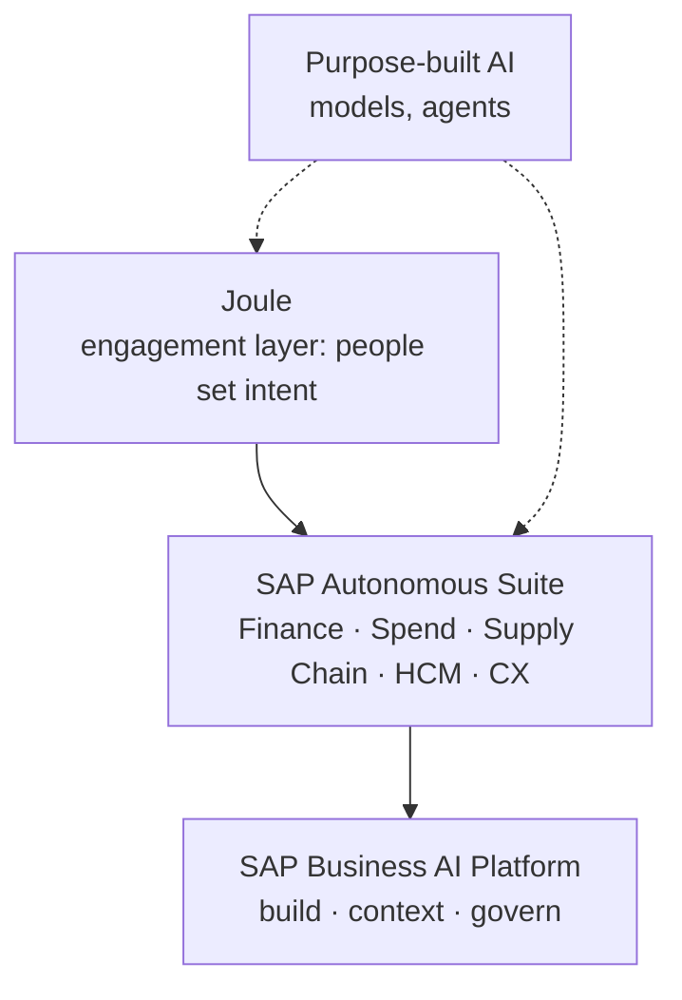
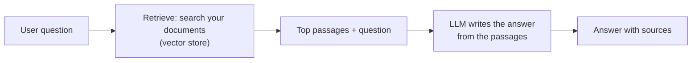

# The SAP AI landscape: Autonomous Enterprise, AI North Star and the Business AI Platform

*A map of SAP's AI story before the deep dives: the vision, the four-layer architecture, the platform underneath, the models it runs on, and what agents can and cannot do in an SAP landscape.*

> [!NOTE]
> **📍 At a glance**
> - **You will learn:** the Autonomous Enterprise, the four North Star layers, the Business AI Platform, SAP's own models, agents vs AI apps, grounding with RAG, and where SAP AI may run
> - **You will build:** a toy retrieval step in Python that grounds an answer in your own documents
> - **Level:** beginner · **Time:** about 40 minutes
> - **Builds on:** [SAP's cloud journey and the BTP landscape](sap-cloud-journey-btp-landscape.md) (section 2.4a) and [Identity](btp-identity-trust-federation.md)

**After this chapter you can:**

- Explain the Autonomous Enterprise in one minute: Joule, the Autonomous Suite, AI and the platform
- Name the four layers of the AI North Star architecture and what sits in each
- List what the SAP Business AI Platform offers to build, to give AI context, and to govern it
- Say which models SAP builds itself (SAP-ABAP-1, SAP-RPT-1) and where partner models come from
- Tell an AI application from an autonomous agent, and explain why grounding (RAG) reduces hallucinations
- Explain how a custom Joule agent is released, whose permissions it uses, and what SAP's API policy means for outside AI tools

## 11.1 The vision: the Autonomous Enterprise

- At SAP Sapphire in May 2026, SAP framed its AI strategy as the **Autonomous Enterprise**: people set the direction, AI carries out the work.
- SAP's own slides (SAP user-group deck, public slides) build it from four blocks:

| Block | Role |
|---|---|
| **Joule** | The engagement layer. People state their intent; Joule Assistants and Agents gather the data, workflow and actions across SAP systems and beyond |
| **SAP Autonomous Suite** | The operational core: applications, data and AI agents that automate Finance, Spend, Supply Chain, HCM and Customer Experience |
| **AI** | Purpose-built intelligence for your industry, processes and regulations |
| **SAP Business AI Platform** | The foundation: process context, unified business data, purpose-built models and governance |



**How the suite is organised**
- Five **autonomous domains**: Finance, Spend, Supply Chain, Human Capital Management and Customer Experience.
- Each domain holds **assistants**, for example an Accounts Payable or Billing assistant. Each assistant holds several **agents**, and each agent several **skills**.
- SAP's press release speaks of more than 50 domain-specific Joule Assistants.
- The Autonomous Suite is largely a repackaging of existing SAP cloud products with AI on top. The AI parts are add-ons, charged in **AI units**.

**Why SAP says this is needed (public slides)**
- Most AI projects stay stuck in pilots. SAP names three gaps: business and process context, connection to live data, and governance.
- Its argument: an ERP vendor already holds the process knowledge and the business data, so its AI can reason over how the business really runs.

## 11.2 The AI North Star architecture: four layers

- The **AI North Star architecture** is SAP's reference architecture for building the Autonomous Enterprise. It has four layers:

| Layer | What sits there |
|---|---|
| Experience | **Joule**: the new front end for users, in chat, in apps and on desktop and mobile |
| Process | The **autonomous domains** of the Autonomous Suite, with their assistants and agents |
| Foundation | **SAP Business Data Cloud** and the **SAP Knowledge Graph**: business data and its meaning |
| Platform | The **SAP Business AI Platform**, on which everything is built and governed |

- Read it top-down: a user asks Joule, a domain agent does the work, the data and its meaning come from the foundation, and the platform runs and governs it all.

## 11.3 The SAP Business AI Platform

- SAP describes it as the foundation to build, give context to, and govern AI across SAP and non-SAP systems (sap.com, read 20 Nov 2026).
- **It does not replace BTP.** SAP's own FAQ says BTP capabilities are a core part of it ([chapter 2, section 2.4a](sap-cloud-journey-btp-landscape.md)).

| Pillar | Components (SAP's product page) |
|---|---|
| **Build** | **Joule Studio** (agents, apps, workflows grounded in business context) and **SAP Integration Suite** (connects agents, apps, data and systems) |
| **Contextualize and reason** | **SAP Business Data Cloud** (AI-ready data from SAP and third parties), **SAP Knowledge Graph** (a semantic layer of business meaning), **SAP AI Services and Models** (including tabular foundation models) |
| **Govern** | **SAP AI Agent Hub** (one view of every agent, LLM and MCP server), **Joule Studio runtime** (managed runtime for agents), value realization with SAP LeanIX and SAP Signavio, and identity and access for agents |

**The new Joule Studio (SAP News, May 2026)**
- **Intent-based development:** you describe a goal in natural language. Joule Studio produces requirements, technical specs, code scaffolding, tests and a live preview.
- In practice the business user writes the intent and specification, and a developer takes over from there to build, test and deploy.
- Pro-code work happens in VS Code, Cursor and similar IDEs, with Python frameworks such as LangChain, Pydantic AI and LlamaIndex. **n8n** is embedded for visual workflows.
- Agents run on a managed **Joule Studio runtime**.
- Through the end of 2026, SAP customers and partners get **free design-time access**, under fair-use limits. Running agents is not covered by that offer.
- The earlier tool, now called **Joule Studio Classic**, lives in SAP Build and works closely with SAP Build Process Automation.

## 11.4 The models underneath

- Joule and its agents run on **large language models**. Most come from SAP's partners, through the **generative AI hub** in SAP AI Core: models from OpenAI, Anthropic, Google, Mistral and others.
- SAP Note 3437766 lists the models and regions currently available. Check it rather than trusting a remembered count.

**SAP's own models**

| Model | What it is |
|---|---|
| **SAP-ABAP-1** | SAP's first model specialised in ABAP; its first release explains ABAP and CDS code. SAP says it uses the same specialised AI that powers Joule for Developers and Joule for Consultants |
| **SAP-RPT-1** family | **Tabular foundation models**: they predict from a handful of example rows in a table, with no model training per use case. The current version discussed by SAP is RPT-1.6 |

- General LLMs know ABAP only roughly, because little ABAP is public. That is why SAP trained its own.
- Classic forecasting trains a model per use case on historical data. A tabular foundation model is given examples at the time of the request instead.
- In July 2026 SAP closed its acquisition of Prior Labs, the team behind the TabPFN models, and committed more than EUR 1 billion to tabular AI over four years (SAP Community blog, read 20 Nov 2026).

**Decision models: a new category**
- On 15 September 2026, TypeSafe AI released **Jev**, a "System One" decision model. It returns typed decisions (yes/no, a choice, a score) with a calibrated confidence, in milliseconds, not text.
- SAP's researchers compared it with their tabular model on an independent benchmark and on ticket routing:

| Test | Jev 1.13.0 | SAP RPT-1.6 | RPT-1.6 with SAP's CASE embeddings |
|---|---|---|---|
| Typed-decisions benchmark (accuracy) | 72.7% | 76.75% | 78.75% |
| Ticket routing, 164 tickets (accuracy) | 49.4% | 68.9% | 72.0% |

- The lesson SAP draws: fast specialised models take the millions of well-defined decisions, and LLMs take the open-ended reasoning and writing.

## 11.5 AI applications, autonomous agents and grounding

| | AI application | Autonomous agent |
|---|---|---|
| Interaction | One request, one answer, then it stops | Given a **goal**, it plans and acts in a loop until done |
| Tools | None, or a fixed one | Calls tools, APIs and other agents as needed |
| Example | "Write a palindrome program" | "Hire someone for this role": post the job, screen applicants, schedule interviews |

**Why models hallucinate, and how grounding helps**
- A model answers from patterns in its training data. Public SAP notes and community posts are in there; your company's own incidents and fixes are not.
- Asked about something it never saw, it makes a confident best guess. A wrong but plausible guess is a **hallucination**.
- **Retrieval-augmented generation (RAG)** fixes this the way you onboard a new hire: hand over the relevant documents first.
  - Store your documents as embeddings in a vector store, for example SAP HANA Cloud's vector engine.
  - At question time, retrieve the most relevant passages and give them to the model with the question.
- Typical SAP uses: a leave agent that must follow the company leave policy, or an assistant that suggests fixes for recurring interface failures from past tickets.



**The retrieval step, in miniature**

```python
# Toy retrieval: rank knowledge-base entries by word overlap with the question
kb = {
    "KB-101": "Posting period not open: open the period in OB52 and repost the IDoc",
    "KB-102": "Leave requests above 10 days need second-level manager approval",
    "KB-103": "Interface timeout: retry after checking the destination in BTP",
}

def retrieve(question: str, k: int = 1) -> list[str]:
    q = set(question.lower().split())
    ranked = sorted(kb, key=lambda doc: len(q & set(kb[doc].lower().split())), reverse=True)
    return ranked[:k]

question = "IDoc failed because posting period not open"
top = retrieve(question)
prompt = f"Answer using only this context:\n{kb[top[0]]}\n\nQuestion: {question}"
print(top)       # ['KB-101']
print(prompt.splitlines()[1])
```

✅ *Verified: run with Python 3 (details at the end).*

- Real systems replace word overlap with embeddings and cosine similarity, but the flow is the same: retrieve first, then let the model answer from what was retrieved.

## 11.6 SAP's assistants and your own agents

- **SAP-delivered assistants, agents and skills** come preconfigured with the SAP cloud products. Users see the ones their roles allow; you mainly need enough **AI units**.
- They are designed for a **clean core**: the closer your system is to standard, the better they work. Heavily customised processes need **custom agents and skills**, built in Joule Studio.

**Releasing a custom agent or skill**

| Target | Who can use it |
|---|---|
| **Sandbox** | A few testers, while you develop |
| **Joule base** | Everyone in the company, wherever Joule appears: BTP cockpit, S/4HANA, SAP Build Work Zone, SAP Analytics Cloud |

- **An agent is your proxy.** It can do what the signed-in user is allowed to do, and nothing more. The backend roles still decide, for example S/4HANA authorizations for posting a GL account.
- Access to the agent itself is managed in SAP Build (Joule Studio's lobby); access to the data is managed in the backend.
- To remove or monitor agents company-wide, SAP points to the governance layer: **SAP AI Agent Hub**.

## 11.7 Where SAP AI may run, and SAP's API policy

**Cloud first**
- Joule assistants and agents are built for SAP's cloud ERP. S/4HANA Cloud Private Edition usually gets features first, as it has more customers; Public Edition follows.

> [!NOTE]
> **Joule for on-premise ECC and S/4HANA: what are the conditions?**
> - **The course:** available if the customer commits 50% of its budget to moving to the cloud, and joins SAP's Max Success Plan or RISE.
> - **SAP's press release (May 2026):** customers that commit to moving the majority of their landscape to SAP Cloud ERP get access to "select AI scenarios".
> - The 50% figure and the Max Success Plan appear in press reports, not in SAP's release. This book follows SAP's wording; check the current contract terms with SAP.

**SAP's API policy and outside AI tools**
- SAP's **API Policy v.4.2026a** (section 2.2.2) prohibits two uses of SAP APIs, except through SAP-endorsed architectures and pathways:
  - connecting autonomous or generative AI systems that plan, select or execute sequences of API calls
  - scraping or large-scale extraction and replication of data
- SAP may monitor API use and respond with **throttling, suspension or termination** of access.
- So: building your own agent in Joule Studio, or reading data through Business Data Cloud and documented destinations, is fine.
- An outside agent that crawls OData services, or a bulk copy into a generic data lake for an outside AI, is not.

> [!NOTE]
> **When did this change?**
> - **The course:** SAP changed the policy "about three weeks" before the October 2026 session.
> - **SAP's document:** the policy in force is version 4.2026a; its file is dated April 2026, and press coverage of the AI clause dates from late April 2026.

> [!IMPORTANT]
> **🏭 In production**
> - Before promising an AI use case, check three things: the customer's ERP deployment (cloud, private, on-premise), their AI-unit budget, and whether the data path is SAP-endorsed.
> - Keep custom agents in the sandbox until the business owner has tested them with real roles. Promote to the Joule base only with a named owner and a monitoring plan.
> - Ground every agent that answers policy or procedure questions in the company's own documents, and show the sources in the answer.
>
> *Added by Claude*

## 11.8 Added by Claude, not from the sources

- Treat Joule's free offers as time-boxed. Size the AI-unit cost of a use case before the free period ends, or adoption can stall when billing starts.
- For RAG, the quality of the documents matters more than the model: outdated or contradicting policies produce confident wrong answers. Assign an owner to the knowledge base.
- Agents acting as the user's proxy inherit over-broad roles. An authorization review before an agent rollout pays off more than any prompt tuning.

## 11.9 Interview corner

**What interviewers listen for:** a clear one-minute version of the Autonomous Enterprise, the four layers, what the Business AI Platform adds to BTP, SAP's own models, and sound judgement on agents, grounding and the API policy.

### 🟢 Basic

<details class="qa"><summary>1. What is the Autonomous Enterprise?</summary>

- SAP's 2026 vision: people set direction, AI executes
- Built from Joule (engagement), the Autonomous Suite (five domains), purpose-built AI, and the Business AI Platform
- *Stronger answer:* mention the hierarchy domain → assistant → agent → skill, and AI units for billing

</details>

<details class="qa"><summary>2. Name the four layers of the AI North Star architecture.</summary>

- Experience (Joule), Process (autonomous domains), Foundation (Business Data Cloud and Knowledge Graph), Platform (Business AI Platform)
- *Stronger answer:* walk a request top-down: Joule → domain agent → data and meaning → platform runtime and governance

</details>

<details class="qa"><summary>3. Does the Business AI Platform replace BTP?</summary>

- No. SAP says BTP capabilities are a core part of it
- It adds AI-specific pieces: Joule Studio, Knowledge Graph, AI Agent Hub, Joule Studio runtime
- *Stronger answer:* frame it as Build, Contextualize and reason, and Govern

</details>

### 🟡 Intermediate

<details class="qa"><summary>4. Which models does SAP build itself, and why?</summary>

- SAP-ABAP-1 for ABAP code, because little ABAP is public for general LLMs to learn from
- SAP-RPT-1 tabular foundation models, for predictions from a few example rows
- *Stronger answer:* add that partner LLMs come through the generative AI hub, and that SAP Note 3437766 lists them

</details>

<details class="qa"><summary>5. What is the difference between an AI application and an autonomous agent?</summary>

- An AI application answers one request; an agent pursues a goal in a loop, calling tools
- *Stronger answer:* give an SAP example such as a recruiting agent using SuccessFactors skills

</details>

<details class="qa"><summary>6. Why does an agent give confident wrong answers about your company's processes, and how do you fix it?</summary>

- Your internal knowledge was never in its training data, so it guesses: a hallucination
- Ground it with RAG: retrieve your documents and answer from them
- *Stronger answer:* mention a vector store such as HANA Cloud, and keeping the knowledge base owned and current

</details>

<details class="qa"><summary>7. A custom Joule agent creates GL accounts. Who can use it, and what can it do?</summary>

- In a sandbox, only testers; in the Joule base, everyone the agent's access allows
- It acts with the signed-in user's backend authorizations, no more
- *Stronger answer:* stress role reviews before rollout and monitoring in AI Agent Hub

</details>

### 🔴 Senior

<details class="qa"><summary>8. An ECC customer wants AI agents now. What do you advise?</summary>

- SAP's assistants target cloud ERP; on-premise access is tied to a commitment to move the majority of the landscape to SAP Cloud ERP
- Custom agents in Joule Studio reading ECC data through documented OData services and BTP destinations are an SAP-endorsed path
- *Stronger answer:* warn against outside agents or bulk extraction, which SAP's API Policy section 2.2.2 prohibits outside endorsed pathways

</details>

<details class="qa"><summary>9. When would you use a tabular or decision model instead of an LLM?</summary>

- For many small, well-defined decisions where speed, cost and a calibrated confidence matter: routing, matching, classifying
- LLMs stay for open-ended reasoning and text
- *Stronger answer:* quote SAP's ticket-routing result (RPT-1.6 at 68.9% vs a zero-shot decision model at 49.4%) and explain why examples help

</details>

> [!TIP]
> **🧩 Design question**
> *"Our support team resolves the same 50 interface errors every week. Design an AI solution in the SAP landscape."* Talk about:
> - a knowledge base of past errors and fixes, grounded with RAG in HANA Cloud
> - a custom agent in Joule Studio, released to a sandbox first, acting with the user's roles
> - data access through endorsed SAP pathways, and governance in AI Agent Hub

## Cheat sheet

| Term | One line |
|---|---|
| Autonomous Enterprise | SAP's vision: people set direction, AI executes |
| Autonomous Suite | Five domains: Finance, Spend, Supply Chain, HCM, CX → assistants → agents → skills |
| AI North Star | Experience (Joule) · Process (domains) · Foundation (BDC, Knowledge Graph) · Platform (BAIP) |
| Business AI Platform | Build (Joule Studio, Integration Suite) · Context (BDC, Knowledge Graph, models) · Govern (AI Agent Hub, runtime) |
| SAP's own models | SAP-ABAP-1 (ABAP), SAP-RPT-1 (tabular predictions) |
| Partner models | Generative AI hub in SAP AI Core; list in SAP Note 3437766 |
| RAG | Retrieve your documents, then answer from them |
| Agent release | Sandbox (testers) or Joule base (whole company) |
| API Policy 2.2.2 | Outside AI agents and bulk extraction only through SAP-endorsed pathways |

## Recap

- The Autonomous Enterprise combines Joule, the five-domain Autonomous Suite, purpose-built AI and the Business AI Platform
- The AI North Star has four layers: Experience, Process, Foundation, Platform
- The Business AI Platform builds on BTP and adds Joule Studio, the Knowledge Graph, AI Agent Hub and a managed agent runtime
- LLMs come mostly from partners via the generative AI hub; SAP builds SAP-ABAP-1 and the SAP-RPT-1 tabular models
- Agents pursue goals with tools; RAG grounds them in your own documents to reduce hallucinations
- Custom agents go from sandbox to the Joule base, act with the user's permissions, and must use SAP-endorsed data paths

## Practice

1. Draw the four North Star layers from memory and place Joule, Business Data Cloud, Joule Studio and an Accounts Payable assistant in them.
2. Extend the toy retrieval to return the top two entries, and print both in the prompt.
3. Pick one process from your own domain. Write one sentence each for: the goal an agent would get, the tools it needs, the documents it must be grounded in, and the roles that limit it.

## How this chapter was checked

- **Lecture 6 recording:** captions 0:00 to 2:59:39 read in full (no break).
- **Read in full on 20 Nov 2026:**
  - SAP's Business AI Platform product page (including the FAQ answer on BTP), and the SAP-ABAP-1 page
  - the SAP Community blog on Jev and RPT, and SAP's API Policy v.4.2026a
  - SAP News on the new Joule Studio, and SAP's Sapphire press release on the Autonomous Enterprise (both May 2026)
- **SAP user-group deck "Welcome to the Autonomous Enterprise"** (28 pages): only slides marked PUBLIC used; slides marked internal were not used.
- **Web-checked:** SAP-ABAP-1 and Joule for Developers (sap.com), the generative AI hub and SAP Note 3437766, press coverage of on-premise Joule (The Register).
- **Run:** the retrieval snippet with Python 3; it prints `['KB-101']` and the context line.
- **Not run:** nothing else in this chapter is code.

## Sources and further reading

- BTPAI course, Lecture 6 recording, *SAP AI training: course content and Q&A* (BT017)
- SAP, *SAP Business AI Platform* product page: https://www.sap.com/products/ai-platform.html
- SAP user groups, *Welcome to the Autonomous Enterprise* (public slides): https://assets.dm.ux.sap.com/sap-user-groups/pdfs/260605_01_pellegrini_antonomous_enterprise.pdf
- SAP News, *SAP Unveils the Autonomous Enterprise* (May 2026): https://news.sap.com/?p=242256
- SAP News, *New Joule Studio for enterprise-scale agentic development* (May 2026): https://news.sap.com/2026/05/new-joule-studio-enterprise-scale-agentic-development/
- SAP Community, *Jev vs. RPT: The decision layer is here*: https://community.sap.com/t5/technology-blog-posts-by-sap/jev-vs-rpt-the-decision-layer-is-here-and-rpt-already-speaks-its-language/ba-p/14497557
- SAP, *What is SAP-ABAP-1?*: https://www.sap.com/products/artificial-intelligence/sap-abap.html
- SAP, *SAP API Policy* (v.4.2026a): https://help.sap.com/doc/sap-api-policy/latest/en-US/API_Policy_latest.pdf
- The Register, *SAP U-turn brings AI features to ECC and on-prem S/4HANA* (May 2026): https://www.theregister.com/ai-ml/2026/05/13/sap-u-turn-brings-ai-features-to-ecc-and-on-prem-s/4hana/5239040
- SAVIC, *SAP Joule Work for on-premise ECC and S/4HANA* (partner article, used only for the press-report view): https://www.savictech.com/insights/sap-joule-work-on-premise-ai-ecc-s4hana-2026/

Previous: [Identity: Cloud Identity Services, trust and federated authorization](btp-identity-trust-federation.md) · Next: [SAP AI certifications, roles and staying current](sap-ai-careers-certifications.md)
