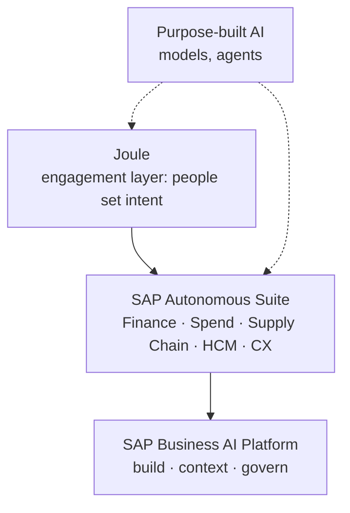
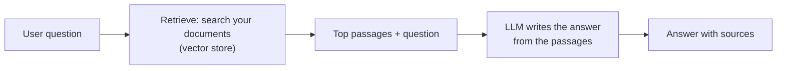

# The SAP AI landscape: Autonomous Enterprise, AI North Star and the Business AI Platform

*A map of SAP's AI story before the deep dives: the vision, the four-layer architecture, the platform underneath, the models it runs on, and what agents can and cannot do in an SAP landscape.*

> [!NOTE]
> **📍 At a glance**
> - **You will learn:** the Autonomous Enterprise, the four North Star layers, the Business AI Platform, SAP's own models, agents vs AI apps, grounding with RAG, and where SAP AI may run
> - **You will build:** a toy retrieval step in Python that grounds an answer in your own documents
> - **Level:** beginner · **Time:** about 40 minutes
> - **Builds on:** [SAP's cloud journey and the BTP landscape](sap-cloud-journey-btp-landscape.md) (section 2.4a) and [Identity](btp-identity-trust-federation.md)
>   - New to terms such as LLM, tokens or RAG? Read [AI, ML, deep learning and GenAI](ai-ml-deep-learning-genai.md) and [Inside a large language model](llm-prompt-to-answer.md) first
> - **Last checked:** 20 Nov 2026

**After this chapter you can:**

- Explain the Autonomous Enterprise in one minute: Joule, the Autonomous Suite, AI and the platform
- Name the four layers of the AI North Star architecture and what sits in each
- List what the SAP Business AI Platform offers to build, to give AI context, and to govern it
- Say which models SAP builds itself (SAP-ABAP-1, SAP-RPT-1) and where partner models come from
- Tell an AI application from an autonomous agent, and explain why grounding (RAG) reduces hallucinations
- Explain how a custom Joule agent is released, whose permissions it uses, and what SAP's API policy means for outside AI tools

## 11.1 The vision: the Autonomous Enterprise

- At SAP Sapphire in May 2026, SAP framed its AI strategy as the **Autonomous Enterprise**: people set the direction, AI carries out the work.
- SAP's own slides (SAP user-group deck, public slides) build it from four blocks:

| Block | Role |
|---|---|
| **Joule** | The engagement layer. People state their intent; Joule Assistants and Agents gather the data, workflow and actions across SAP systems and beyond |
| **SAP Autonomous Suite** | The operational core: applications, data and AI agents that automate Finance, Spend, Supply Chain, HCM and Customer Experience |
| **AI** | Purpose-built intelligence for your industry, processes and regulations |
| **SAP Business AI Platform** | The foundation: process context, unified business data, purpose-built models and governance |



**How the suite is organised**
- Five **autonomous domains**: Finance, Spend, Supply Chain, Human Capital Management and Customer Experience.
- Each domain holds **assistants**, for example an Accounts Payable or Billing assistant. Each assistant holds several **agents**, and each agent several **skills**.
- SAP's press release speaks of more than 50 domain-specific Joule Assistants.
- The Autonomous Suite is largely a repackaging of existing SAP cloud products with AI on top. The AI parts are add-ons, charged in **AI units**.

**Why domains instead of products**
- One area like HR spans several SAP products: the HCM module in S/4HANA, SuccessFactors, and Fieldglass for contract workers.
- People who know all three are rare, and once trained they are hard to keep.
- A domain assistant hides which product does the work. An HR person states the goal, say "hire 30 contract staff for the peak season". Joule finds the right agents in whatever products the company runs.
- Grouping by domain also gives SAP a unit to package, price and track.

- **Keynote detail:** SAP's case for the vision, the five core elements and the accuracy argument are in *Appendix A1* at the end of this chapter.

## 11.1a What is available today, and what is coming

- **Keynotes announce visions.** In May 2026 SAP spoke of more than 50 Joule Assistants orchestrating over 200 agents, "available in the coming months".
- **Three places, in order of trust:**

| Source | Tells you | Note |
|---|---|---|
| **SAP Discovery Center**, *Business AI → Joule Assistants / Joule Agents* | What is released, per autonomous domain, with the agents inside each assistant and the products it needs | On 20 Nov 2026 it listed **44 Joule Assistants and 327 Joule Agents** |
| **SAP Road Map Explorer** | What is planned, by product and quarter | Needs an SAP sign-in |
| Social media, keynotes and demos | Direction and ideas | Often early, sometimes dropped; never a commitment |

- Each catalogue card shows the assistant's purpose and its agents. For example, the Accounts Payable Assistant "resolves payment exceptions and reconciles vendors".
- Cards also show **which product a feature needs**. Many work only with SAP Cloud ERP, some only with the Private edition. Check this before promising a feature.
- The Discovery Center also hosts the **Business AI Estimator**, to size the AI units a set of assistants needs.

## 11.1b Industry AI and accelerated adoption

**Industry AI**
- SAP builds **autonomous industry solutions** on top of the five domains, with lighthouse customers in each industry. Its May 2026 release names seven: the list and an example are in *Appendix A2*.

**Accelerated adoption**
- **RISE with SAP** moves existing customers from ECC or on-premise S/4HANA to SAP Cloud ERP, Private edition by default. SAP commits to activating **three Joule Assistants in the first year**.
- **SAP GROW** is for net-new customers: start lean in one domain, then grow. GROW customers get the **full Joule Assistants portfolio** at onboarding.
- Both run on SAP's **agent-led migration toolchain**: SAP LeanIX, SAP Signavio, SAP Cloud ALM and more. The full table and SAP's effort figures are in *Appendix A2*.

## 11.2 The AI North Star architecture: four layers

- The **AI North Star architecture** is SAP's reference architecture for building the Autonomous Enterprise. It has four layers:

| Layer | What sits there |
|---|---|
| Experience | **Joule**: the new front end for users, in chat, in apps and on desktop and mobile |
| Process | The **autonomous domains** of the Autonomous Suite, with their assistants and agents |
| Foundation | **SAP Business Data Cloud** and the **SAP Knowledge Graph**: business data and its meaning |
| Platform | The **SAP Business AI Platform**, on which everything is built and governed |

- Read it top-down: a user asks Joule, a domain agent does the work, the data and its meaning come from the foundation, and the platform runs and governs it all.

> [!NOTE]
> **SAP revised the document**
> - The North Star text in the SAP Architecture Center was updated on 23 Oct 2026.
> - The course walked through an earlier version, which drew separate boxes for design-time tools, gateways and processes. This book follows the current text.
> - SAP calls it "a direction of travel", not a specification, roadmap or delivery promise.

**System of record, system of context**
- Classic ERP is a **system of record**: it stores business facts and enforces rules.
- SAP's North Star adds a **system of context**: data, process knowledge, decision history, interactions and their meaning, connected so agents can reason with them.
- SAP's tagline: data was the moat of the last decade; **context** is the moat of the next.
- **AI-first** means AI added inside one application. **AI-native** means AI designed into every layer, working across application boundaries.

- **Layer by layer** (Joule Work's modes, how agents are built, data and memory, the managed agent runtime, agent identity and defence, SAP's key terms): *Appendix A3*.

## 11.3 The SAP Business AI Platform

- SAP describes it as the foundation to build, give context to, and govern AI across SAP and non-SAP systems (sap.com, read 20 Nov 2026).
- **It does not replace BTP.** SAP's own FAQ says BTP capabilities are a core part of it ([chapter 2, section 2.4a](sap-cloud-journey-btp-landscape.md)).

| Pillar | Components (SAP's product page) |
|---|---|
| **Build** | **Joule Studio** (agents, apps, workflows grounded in business context) and **SAP Integration Suite** (connects agents, apps, data and systems) |
| **Contextualize and reason** | **SAP Business Data Cloud** (AI-ready data from SAP and third parties), **SAP Knowledge Graph** (a semantic layer of business meaning), **SAP AI Services and Models** (including tabular foundation models) |
| **Govern** | **SAP AI Agent Hub** (one view of every agent, LLM and MCP server), **Joule Studio runtime** (managed runtime for agents), value realization with SAP LeanIX and SAP Signavio, and identity and access for agents |

> [!NOTE]
> **Was BTP renamed to BAIP?**
> - **The course:** yes; SAP announced in mid-2026 that BTP is renamed, and certifications will follow.
> - **SAP:** the Business AI Platform *unifies* SAP BTP, SAP Business Data Cloud and SAP Business AI (Sapphire release, May 2026). The North Star text says it *includes* BTP.
> - **What was renamed** on 30 Jun 2026 is the **partner competency**: "SAP BTP Competency" became "SAP Business AI Platform Competency" (SAP Partner Portal, as reported on SAP Community).
>   - Existing partners moved over automatically.
>   - New specialisations come in October 2026 and new proficiency requirements in January 2027.
> - So BTP is still the platform you provision in (this book's chapters 1 to 10). BAIP is the larger AI-centred package and brand around it.

- **SAP AI Agent Hub** is built on SAP LeanIX. SAP announced it for general availability in Q3 2026, included in the Business AI Platform at no additional charge.
  - It shows every agent, standard and custom, and lets you monitor or disable one.
  - LeanIX customers see it as part of LeanIX; others get it as a separate app (the course).
- **More detail** (the slide's breakdown, SAP's own claims, the Knowledge Graph, the new Joule Studio's launch): *Appendix A4*. The new Joule Studio itself is [chapter 20](joule-studio-intent-based.md).

> [!NOTE]
> **"Joule and AI units are free until the end of 2026"?**
> - **The course:** SAP made Joule and AI units free for customers until December 2026, investing 100 million.
> - **SAP (May 2026):**
>   - a **€100 million fund for SAP partners**, to help customers put SAP-built assistants and agents into production and to build partner agents on Joule Studio
>   - free **Joule Studio design time** through the end of 2026
>   - no free AI units announced
> - This book follows SAP. Check your contract for what is free in your account.

## 11.4 The models underneath

- Joule and its agents run on **large language models**. Most come from SAP's partners, through the **generative AI hub** in SAP AI Core: models from OpenAI, Anthropic, Google, Mistral and others.
- SAP Note 3437766 lists the models and regions currently available. Check it rather than trusting a remembered count.

**SAP's own models**

| Model | What it is |
|---|---|
| **SAP-ABAP-1** | SAP's first model specialised in ABAP; its first release explains ABAP and CDS code. SAP says it uses the same specialised AI that powers Joule for Developers and Joule for Consultants |
| **SAP-RPT-1** family | **Tabular foundation models**: they predict from a handful of example rows in a table, with no model training per use case. The current version discussed by SAP is RPT-1.6 |

- General LLMs know ABAP only roughly, because little ABAP is public. That is why SAP trained its own.
- Classic forecasting trains a model per use case on historical data. A tabular foundation model is given examples at the time of the request instead.

**SAP-RPT-1 in practice** (SAP Help, read 20 Nov 2026)
- RPT-1 is a "relational pretrained transformer", developed by SAP, for classification and regression on table data.
- **The prompt is a table.** It holds context rows with known values, and the cells to predict marked `[PREDICT]`:

| PRODUCT | PRICE | ORDERDATE | ID | COSTCENTER |
|---|---|---|---|---|
| Couch | 999.99 | 28-11-2025 | 35 | **[PREDICT]** |
| Office Chair | 150.8 | 02-11-2025 | 44 | Office Furniture |
| Server Rack | 2200.00 | 01-11-2025 | 104 | Data Infrastructure |

- One API call returns the prediction, learned from the context rows. No training or fine-tuning step is needed (in-context learning).

| | sap-rpt-1-small | sap-rpt-1-large |
|---|---|---|
| Pick when | Medium complexity; low latency and high throughput matter | Complex scenarios; best accuracy matters |
| Max context | 2,048 rows, 100 columns | 65,536 rows, 256 columns |
| Recommended context | 500 to 2,000 rows | 4,000 to 8,000 rows |
| Per request | Up to 128 rows and 10 columns to predict | Same |

- **Deploy it in SAP AI Core** through the foundation-models scenario: executable `aicore-sap`, model `sap-rpt-1-small` or `sap-rpt-1-large`. Later versions (RPT-1.5, RPT-1.6) are listed alongside.
- An open-source variant, `sap-rpt-1-oss`, is on Hugging Face. SAP also runs an **RPT playground** at rpt.cloud.sap, which needs a sign-in.
- **The model stores nothing.** Keep the table in your database (HANA or any other), send the rows with each request, and write the predictions back. Otherwise you predict, and pay, again next time.
- **Background** (the Prior Labs acquisition, the RPT-1 evaluation paper, and a decision-model benchmark against RPT-1.6): *Appendix A5*.

## 11.5 AI applications, autonomous agents and grounding

| | AI application | Autonomous agent |
|---|---|---|
| Interaction | One request, one answer, then it stops | Given a **goal**, it plans and acts in a loop until done |
| Tools | None, or a fixed one | Calls tools, APIs and other agents as needed |
| Example | "Write a palindrome program" | "Hire someone for this role": post the job, screen applicants, schedule interviews |

**Why models hallucinate, and how grounding helps**
- A model answers from patterns in its training data. Public SAP notes and community posts are in there; your company's own incidents and fixes are not.
- Asked about something it never saw, it makes a confident best guess. A wrong but plausible guess is a **hallucination**.
- **Retrieval-augmented generation (RAG)** fixes this the way you onboard a new hire: hand over the relevant documents first.
  - Store your documents as embeddings in a vector store, for example SAP HANA Cloud's vector engine.
  - At question time, retrieve the most relevant passages and give them to the model with the question.
- Typical SAP uses: a leave agent that must follow the company leave policy, or an assistant that suggests fixes for recurring interface failures from past tickets.



**The retrieval step, in miniature**

```python
# Toy retrieval: rank knowledge-base entries by word overlap with the question
kb = {
    "KB-101": "Posting period not open: open the period in OB52 and repost the IDoc",
    "KB-102": "Leave requests above 10 days need second-level manager approval",
    "KB-103": "Interface timeout: retry after checking the destination in BTP",
}

def retrieve(question: str, k: int = 1) -> list[str]:
    q = set(question.lower().split())
    ranked = sorted(kb, key=lambda doc: len(q & set(kb[doc].lower().split())), reverse=True)
    return ranked[:k]

question = "IDoc failed because posting period not open"
top = retrieve(question)
prompt = f"Answer using only this context:\n{kb[top[0]]}\n\nQuestion: {question}"
print(top)       # ['KB-101']
print(prompt.splitlines()[1])
```

✅ *Verified: run with Python 3 (details at the end).*

- Real systems replace word overlap with embeddings and cosine similarity, but the flow is the same: retrieve first, then let the model answer from what was retrieved.

## 11.6 SAP's assistants and your own agents

- **SAP-delivered assistants, agents and skills** come preconfigured with the SAP cloud products. Users see the ones their roles allow; you mainly need enough **AI units**.
- They are designed for a **clean core**: the closer your system is to standard, the better they work. Heavily customised processes need **custom agents and skills**, built in Joule Studio.

**Releasing a custom agent or skill**

| Target | Who can use it |
|---|---|
| **Private environment** (sandbox) | You, and anyone you add, while you develop and test |
| **Shared environment** | The users given access to it, wherever Joule appears: BTP cockpit, S/4HANA, SAP Build Work Zone, SAP Analytics Cloud |

- Environments, and the older public environment, are explained in chapter 19 (19.3 and 19.8).

- **An agent is your proxy.** It can do what the signed-in user is allowed to do, and nothing more. The backend roles still decide, for example S/4HANA authorizations for posting a GL account.
- Access to the agent itself is managed in SAP Build (Joule Studio's lobby); access to the data is managed in the backend.
- To remove or monitor agents company-wide, SAP points to the governance layer: **SAP AI Agent Hub**.

## 11.7 Where SAP AI may run, and SAP's API policy

**Cloud first**
- Joule assistants and agents are built for SAP's cloud ERP. S/4HANA Cloud Private Edition usually gets features first, as it has more customers; Public Edition follows.

> [!NOTE]
> **Joule for on-premise ECC and S/4HANA: what are the conditions?**
> - **The course:** available if the customer commits 50% of its budget to moving to the cloud, and joins SAP's Max Success Plan or RISE.
> - **SAP's press release (May 2026):** customers that commit to moving the majority of their landscape to SAP Cloud ERP get access to "select AI scenarios".
> - The 50% figure and the Max Success Plan appear in press reports, not in SAP's release. This book follows SAP's wording; check the current contract terms with SAP.

**Where your data goes when SAP AI calls a partner model**
- Partner LLMs usually run on a hyperscaler, not in SAP's own data centres. The data does leave SAP's landscape.
- SAP's enterprise contracts with model providers keep it in the region you chose, for example EU10. That includes the provider's disaster-recovery copy (the course).
- **SAP's commitments** (Responsible AI page, AI Ethics Handbook, AI Terms v.8-2026):
  - customer data is not given to third-party model providers to train their models
  - with a third-party hosted model, data is sent only for processing and is not stored by the provider
  - customers can opt out of SAP using their data to train SAP's own models
- **Regional options:** SAP's EU AI Cloud (hosted in European data centres, aligned with the GDPR and the EU AI Act), SAP Sovereign Cloud, and SAP Sovereign Cloud On-Site.
- The contract side (who answers for AI output) is in [chapter 17](responsible-ai-ethics-governance.md).

**SAP's API policy and outside AI tools**
- SAP's **API Policy v.4.2026a** (section 2.2.2) prohibits two uses of SAP APIs, except through SAP-endorsed architectures and pathways:
  - connecting autonomous or generative AI systems that plan, select or execute sequences of API calls
  - scraping or large-scale extraction and replication of data
- SAP may monitor API use and respond with **throttling, suspension or termination** of access.
- So: building your own agent in Joule Studio, or reading data through Business Data Cloud and documented destinations, is fine.
- An outside agent that crawls OData services, or a bulk copy into a generic data lake for an outside AI, is not.
- When the AI clause appeared: *Appendix A6*.

> [!IMPORTANT]
> **🏭 In production**
> - Before promising an AI use case, check three things: the customer's ERP deployment (cloud, private, on-premise), their AI-unit budget, and whether the data path is SAP-endorsed.
> - Keep custom agents in the sandbox until the business owner has tested them with real roles. Promote to the Joule base only with a named owner and a monitoring plan.
> - Ground every agent that answers policy or procedure questions in the company's own documents, and show the sources in the answer.
>
> *Added by Claude*

## 11.8 Added by Claude, not from the sources

- Treat Joule's free offers as time-boxed. Size the AI-unit cost of a use case before the free period ends, or adoption can stall when billing starts.
- For RAG, the quality of the documents matters more than the model: outdated or contradicting policies produce confident wrong answers. Assign an owner to the knowledge base.
- Agents acting as the user's proxy inherit over-broad roles. An authorization review before an agent rollout pays off more than any prompt tuning.

## 11.9 Interview corner

**What interviewers listen for:** a clear one-minute version of the Autonomous Enterprise, the four layers, what the Business AI Platform adds to BTP, SAP's own models, and sound judgement on agents, grounding and the API policy.

### 🟢 Basic

<details class="qa"><summary>1. What is the Autonomous Enterprise?</summary>

- SAP's 2026 vision: people set direction, AI executes
- Built from Joule (engagement), the Autonomous Suite (five domains), purpose-built AI, and the Business AI Platform
- *Stronger answer:* mention the hierarchy domain → assistant → agent → skill, and AI units for billing

</details>

<details class="qa"><summary>2. Name the four layers of the AI North Star architecture.</summary>

- Experience (Joule), Process (autonomous domains), Foundation (Business Data Cloud and Knowledge Graph), Platform (Business AI Platform)
- *Stronger answer:* walk a request top-down: Joule → domain agent → data and meaning → platform runtime and governance

</details>

<details class="qa"><summary>3. Does the Business AI Platform replace BTP?</summary>

- No. SAP says BTP capabilities are a core part of it
- It adds AI-specific pieces: Joule Studio, Knowledge Graph, AI Agent Hub, Joule Studio runtime
- *Stronger answer:* frame it as Build, Contextualize and reason, and Govern

</details>

### 🟡 Intermediate

<details class="qa"><summary>4. Which models does SAP build itself, and why?</summary>

- SAP-ABAP-1 for ABAP code, because little ABAP is public for general LLMs to learn from
- SAP-RPT-1 tabular foundation models, for predictions from a few example rows
- *Stronger answer:* add that partner LLMs come through the generative AI hub, and that SAP Note 3437766 lists them

</details>

<details class="qa"><summary>5. What is the difference between an AI application and an autonomous agent?</summary>

- An AI application answers one request; an agent pursues a goal in a loop, calling tools
- *Stronger answer:* give an SAP example such as a recruiting agent using SuccessFactors skills

</details>

<details class="qa"><summary>6. Why does an agent give confident wrong answers about your company's processes, and how do you fix it?</summary>

- Your internal knowledge was never in its training data, so it guesses: a hallucination
- Ground it with RAG: retrieve your documents and answer from them
- *Stronger answer:* mention a vector store such as HANA Cloud, and keeping the knowledge base owned and current

</details>

<details class="qa"><summary>7. A custom Joule agent creates GL accounts. Who can use it, and what can it do?</summary>

- In a sandbox, only testers; in the Joule base, everyone the agent's access allows
- It acts with the signed-in user's backend authorizations, no more
- *Stronger answer:* stress role reviews before rollout and monitoring in AI Agent Hub

</details>

### 🔴 Senior

<details class="qa"><summary>8. An ECC customer wants AI agents now. What do you advise?</summary>

- SAP's assistants target cloud ERP; on-premise access is tied to a commitment to move the majority of the landscape to SAP Cloud ERP
- Custom agents in Joule Studio reading ECC data through documented OData services and BTP destinations are an SAP-endorsed path
- *Stronger answer:* warn against outside agents or bulk extraction, which SAP's API Policy section 2.2.2 prohibits outside endorsed pathways

</details>

<details class="qa"><summary>9. When would you use a tabular or decision model instead of an LLM?</summary>

- For many small, well-defined decisions where speed, cost and a calibrated confidence matter: routing, matching, classifying
- LLMs stay for open-ended reasoning and text
- *Stronger answer:* quote SAP's ticket-routing result (RPT-1.6 at 68.9% vs a zero-shot decision model at 49.4%) and explain why examples help

</details>

<details class="qa"><summary>10. A customer saw a demo of an SAP assistant at a keynote. How do you check whether they can use it?</summary>

- Look it up in the SAP Discovery Center's Business AI catalogue: is it released, which agents does it contain, which product and edition does it need?
- If it is not there, check SAP Road Map Explorer for the planned quarter
- Size the AI units with the Business AI Estimator before promising anything
- *Stronger answer:* treat keynotes and social posts as direction only, and confirm edition fit (for example Private edition only) before the proposal

</details>

<details class="qa"><summary>11. What is the difference between a system of record and a system of context?</summary>

- System of record: the ERP's transactions and rules, the single source of truth
- System of context: data plus meaning, process knowledge and decision history (Business Data Cloud, Knowledge Graph, memory) so agents can reason
- Numbers still come from governed data and business services; the LLM does not invent them
- *Stronger answer:* add that authorizations stay enforced by the systems of record, not by the LLM or the Knowledge Graph

</details>

> [!TIP]
> **🧩 Design question**
> *"Our support team resolves the same 50 interface errors every week. Design an AI solution in the SAP landscape."* Talk about:
> - a knowledge base of past errors and fixes, grounded with RAG in HANA Cloud
> - a custom agent in Joule Studio, released to a sandbox first, acting with the user's roles
> - data access through endorsed SAP pathways, and governance in AI Agent Hub

## Cheat sheet

| Term | One line |
|---|---|
| Autonomous Enterprise | SAP's vision: people set direction, AI executes |
| Autonomous Suite | Five domains: Finance, Spend, Supply Chain, HCM, CX → assistants → agents → skills |
| AI North Star | Experience (Joule) · Process (domains) · Foundation (BDC, Knowledge Graph) · Platform (BAIP) |
| Business AI Platform | Build (Joule Studio, Integration Suite) · Context (BDC, Knowledge Graph, models) · Govern (AI Agent Hub, runtime) |
| SAP's own models | SAP-ABAP-1 (ABAP), SAP-RPT-1 (tabular predictions) |
| Partner models | Generative AI hub in SAP AI Core; list in SAP Note 3437766 |
| RAG | Retrieve your documents, then answer from them |
| Agent release | Sandbox (testers) or Joule base (whole company) |
| API Policy 2.2.2 | Outside AI agents and bulk extraction only through SAP-endorsed pathways |
| Five core elements | Joule · Autonomous Suite · Industry AI · Business AI Platform · Accelerated adoption |
| What is real today | Discovery Center catalogue (released) · Road Map Explorer (planned, sign-in) · keynotes (vision) |
| BTP vs BAIP | BAIP unifies BTP, BDC and AI; the partner competency was renamed on 30 Jun 2026 |
| North Star extras | Joule Work modes · bounded agents · skills · MCP and A2A · agent gateway · agent identity |
| Data commitments | No customer data for third-party model training · opt-out from SAP training · regional and sovereign options |

## Recap

- The Autonomous Enterprise combines Joule, the five-domain Autonomous Suite, purpose-built AI and the Business AI Platform
- The AI North Star has four layers: Experience, Process, Foundation, Platform
- The Business AI Platform builds on BTP and adds Joule Studio, the Knowledge Graph, AI Agent Hub and a managed agent runtime
- LLMs come mostly from partners via the generative AI hub; SAP builds SAP-ABAP-1 and the SAP-RPT-1 tabular models
- Agents pursue goals with tools; RAG grounds them in your own documents to reduce hallucinations
- Custom agents go from sandbox to the Joule base, act with the user's permissions, and must use SAP-endorsed data paths
- SAP's five core elements add Industry AI and accelerated adoption (RISE, GROW and the agent-led toolchain)
- Check availability in the Discovery Center catalogue, not in keynotes; plans are in Road Map Explorer
- The North Star turns ERP from a system of record into a system of context, with Joule Work, skills, MCP and A2A, and agents as identities

## Practice

1. Draw the four North Star layers from memory and place Joule, Business Data Cloud, Joule Studio and an Accounts Payable assistant in them.
2. Extend the toy retrieval to return the top two entries, and print both in the prompt.
3. Sketch an RPT-1 table prompt for your domain: five context rows with known values and two rows marked `[PREDICT]`. Which column is the target, and which columns would help the model most?
4. Pick one process from your own domain. Write one sentence each for: the goal an agent would get, the tools it needs, the documents it must be grounded in, and the roles that limit it.
5. In the SAP Discovery Center, open *Business AI → Joule Assistants*, pick one assistant from your domain, and note its agents and the products and editions it needs.
6. Read the *Key Terms* page of SAP's AI-native North Star architecture and explain harness engineering in one sentence of your own.

## Appendix: keynote and announcement detail (dated)

*Moved here word for word from sections 11.1 to 11.7 on 21 Nov 2026, so the main sections stay practical. Vendor figures and dates change: re-check before you quote them.*

### A1 · From 11.1: SAP's case, the five core elements, accuracy

**Why SAP says this is needed (public slides)**
- Most AI projects stay stuck in pilots. SAP names three gaps: business and process context, connection to live data, and governance.
- Its argument: an ERP vendor already holds the process knowledge and the business data, so its AI can reason over how the business really runs.

**Five core elements** (SAP's executive summary of the North Star architecture, and its Sapphire release)

| Element | What it is |
|---|---|
| **Joule** | The new engagement layer. **Joule Work** is where people state their intent and act |
| **SAP Autonomous Suite** | The five autonomous domains, each with assistants that coordinate agents |
| **Industry AI** | Sector-specific solutions with industry processes, data models and regulatory rules built in |
| **SAP Business AI Platform** | SAP BTP, SAP Business Data Cloud, the business transformation management solutions and the AI foundation |
| **Accelerated adoption** | RISE with SAP and SAP GROW, with an agent-led migration toolchain (11.1b) |

**Why accuracy decides adoption**
- At Sapphire 2026, SAP's CEO Christian Klein said 80% accuracy may do for consumer AI but "is just not good enough" for business-critical work.
- A slide in the course deck, credited to BCG:
  - generic LLM accuracy is about 80%
  - 42% of organisations name data access and quality as the leading barrier
  - 74% are stuck in pilot mode with no path to scale

> [!NOTE]
> **Whose survey?** The course attributed the pilot figures to Gartner; the slide itself credits BCG. This book quotes the slide. Treat the numbers as the vendor's framing, not as figures checked here.

### A2 · From 11.1b: industry solutions and the migration toolchain

**Industry AI**
- SAP builds **autonomous industry solutions** on top of the five domains. Its May 2026 release names seven. A course slide shows them with lighthouse customers:

| Industry solution | Industry | Example customer on the slide |
|---|---|---|
| Autonomous Asset Management | Oil, gas and energy | RWE |
| Autonomous Commodity Management | Agribusiness | CHS |
| Autonomous Adaptive Production | Industrial manufacturing | Kaeser |
| Autonomous Regulated Manufacturing | Life sciences | Takeda |
| Autonomous Revenue Growth Management | Consumer products | Coca-Cola HBC, CONA |
| Autonomous Unified Commerce | Retail | Salling Group |
| Autonomous Project Delivery | Professional services | Deloitte |

- One industry domain holds several assistants, one per persona.
  - For asset management in oil and gas, there are separate assistants for the executive, the asset master data team, reliability engineers, maintenance planners, logistics and technicians.
  - Each works across SAP products (asset management, master data governance, Cloud ERP, field logistics) and outside data such as weather.
- **How SAP builds it (the course):** co-innovation with a few customers per industry, often through **forward-deployed teams** that sit with the customer ([chapter 12](sap-ai-careers-certifications.md)).
  - Proven solutions later become standard.

- Both run on SAP's **agent-led toolchain**:

| Tool | Role in the move |
|---|---|
| SAP LeanIX | Maps the enterprise architecture and its dependencies |
| SAP Signavio | Analyses and redesigns the business processes |
| SAP Cloud ALM | Plans, runs and governs the project; the operational hub |
| SAP Build and SAP Integration Suite | Clean-core extensions and integration |
| WalkMe | In-app guidance for user adoption |
| Tricentis | Automated testing |
| Syniti; OpenText | Data migration; archiving of historical data |

- Its **migration and modernization assistants** follow the SAP Activate phases: system analysis, data management, custom code, configuration, test management, change management and rollout.
  - They build on SAP Joule for Developers and SAP Joule for Consultants.
- **SAP's figures differ by page:** "more than 35%" less migration effort (Sapphire release); "35% faster project execution" and "30% cut in business transformation costs" (toolchain product page). Quote the page you rely on.

### A3 · From 11.2: the North Star, layer by layer

**Inside each layer** (SAP Architecture Center, Oct 2026)

| Layer | Shift | What sits there |
|---|---|---|
| **User experience** | Static → adaptive | **Joule Work** as the single entry point, on desktop, web and mobile (with in-car and more named); voice; interfaces generated for each intent |
| **Process** | Predefined → agentic | Agents organised by business domain, and **Joule Studio** as the one design-time environment for agents and agentic solutions |
| **Foundation** | System of record → system of context | **SAP Business Data Cloud** (governed data products), **SAP Knowledge Graph** (business meaning), decision traces, the generative AI hub with SAP and third-party models |
| **Platform** | Hosting apps → running SAP-managed agents | A **managed agent runtime**: sandbox, identity, memory, observability, tenant isolation; it includes SAP BTP |

**Experience layer: Joule Work**
- Five modes:
  - **Discover:** prioritised tasks and alerts
  - **Conversations:** dialogue with Joule
  - **Spaces:** workspaces assembled for a goal
  - **Jobs:** agentic work running within guardrails, traceable
  - **Develop:** building agents in Joule Studio
- It complements SAP's application UIs, it does not replace them. SAP Fiori stays for stable, high-frequency processes.
- Example from the course: "which documents are waiting for my approval?" → details of the first one → "approve it" or "reject it with this comment", without opening the app.

**Process layer: how agents are built**
- **A spectrum from deterministic to autonomous:** plain apps and workflows; **bounded agents** with fixed tools and guardrails; open-ended agents. Deterministic steps need no LLM call, so they cost no tokens.
- Agents follow a reason, act, observe loop. Work starts from a conversation, a business event or a schedule.
- **Human in the loop:** when an agent needs approval, the request goes to the responsible person's conversation or inbox, and the agent pauses.
- **Two build paths, one runtime:** code-based agents with SAP's agent SDK, or **intent-based development** in Joule Studio. Both produce version-controlled code.
- **Agent skills:** packages of instructions and tools that Joule or an agent loads when needed. Joule Studio agents are moving to this skill-based model.
- **The process map behind it:** SAP's **Reference Business Architecture** describes an enterprise's whole business scope in standard terms.
  - It links business capability, process, data and organisation models.
  - Its process model has eight business process groups, the end-to-end processes such as source to pay or lead to cash.
  - SAP's standard agents are built for these processes (SAP Help; the course).

**Foundation layer: data and meaning**
- **SAP Knowledge Graph** is the semantic backbone. It links natural language to SAP's APIs, data models and business entities, so "show me overdue orders" maps to the right objects.
  - It does not enforce authorizations; the Authorization Management Service and the systems of record do.
  - SAP lists the **SAP BDC Ontology Manager** for Q4 2026, turning data products into a business ontology.
- **Memory:** semantic memory (what Joule knows about you) and episodic memory (summaries of past conversations), shared by Joule and its agents.
- **SAP HANA Cloud** brings a **vector engine** (similarity search over embeddings) and a **knowledge graph engine** (relationships, queried with SPARQL).
  - One query can combine both, with relational and spatial data (SAP News, July 2025).
- Third-party models come **SAP-managed** through the generative AI hub in SAP AI Core. SAP holds the contracts; you pay consumption through AI Core.

**Platform layer: the managed agent runtime**
- SAP supplies the "harness": security, observability (OpenTelemetry), tenant isolation, sandboxing and persistent memory. Planned: an agent sandbox, a skills registry and continuous agent evaluations.
- Agents extend in four ways: tools through **MCP**, skills, pre- and post-execution hooks, and developer-defined extension points.
- **Deployment options:** public cloud, private cloud, **SAP Sovereign Cloud** and **SAP Sovereign Cloud On-Site** (in the customer's chosen data centres).

**Across the layers: integration, identity and defence**
- Two open protocols: **Model Context Protocol** (tools) and **Agent2Agent** (agents talking to agents).
- The **agent gateway** is the governed bridge between agents, tools and backends. It handles identity, access, observability and approvals. SAP's FAQ planned it for general availability around TechEd 2026.
  - It does not replace SAP Cloud Connector or the Destination service.
  - MCP access to backends comes through **SAP Integration Suite** and its MCP gateway.
- **Agents are first-class identities**: registered applications with policies and scoped authorizations.
  - A user-acting agent carries the user's rights, or fewer.
  - An autonomous agent uses its own identity, with explicitly defined permissions.
  - Third-party agents authenticate through SAP's identity services.
- A **three-tier defence:**
  - foundation tier: zero-trust authentication, prompt-injection detection
  - supervision tier: input validation, output filtering, human oversight for high-risk decisions
  - automation tier: security-operations agents

**Key terms worth knowing** (SAP's glossary)

| Term | Meaning |
|---|---|
| Context engineering | Assembling the right, authorized, current context for each AI interaction |
| Harness engineering | Wrapping models and agents with enterprise controls: identity, policy, sandbox, memory, observability, evaluation |
| Specification engineering | Defining agent behaviour, limits and success criteria precisely enough to test |
| Semantic grounding | Anchoring AI output in metadata, domain models and authorization rules |
| Sovereign AI | AI designed around data residency, regulation, infrastructure and model sovereignty |
| Human-in-the-loop | People review, approve, override or guide AI actions for high-risk decisions |

> [!TIP]
> When a term in SAP's AI material is new to you, ask an AI assistant with the page open to explain it "in simple terms, for an SAP consultant". Then check it against SAP's glossary.

### A4 · From 11.3: the platform slide, SAP's claims, the Knowledge Graph, the new Joule Studio

**What the pillars contain** (SAP slide in the course deck)
- **Build:** Joule Studio and SAP Integration Suite.
- **Contextualize and reason:** SAP Knowledge Graph (linking business data, processes and industry knowledge), SAP and non-SAP models, and SAP Business Data Cloud.
  - Data can come from SAP and non-SAP sources such as Databricks, Microsoft, Google Cloud, Snowflake and AWS.
- **Govern:** SAP AI Agent Hub, value realization, Joule Studio runtime, and identity, access and security.
- Above the platform sit the Autonomous Suite domains, partner agents and third-party AI agents, all reached through Joule.

**SAP's own claims for the platform** (same slide; vendor figures, not checked here)

| Pillar | Claim |
|---|---|
| Build | 95% successful intent-to-prototype translations, at the first attempt and without manual code changes |
| Contextualize and reason | About 2× better predictions across SAP business tasks (SAP-RPT-1-large vs narrow AI); 98% SQL reasoning accuracy (vs 76% for a GPT-4.1 benchmark) |
| Govern | 55,000+ live agents managed through SAP AI Agent Hub |

- **SAP Knowledge Graph** is what Joule's agents read for business meaning. SAP's FAQ says direct access for custom agents is "under discussion".
  - The course called it unavailable for purchase on its own; this book did not confirm that.
  - Don't confuse it with the HANA Cloud knowledge graph engine, where you build your own graphs.

**The new Joule Studio (SAP News, May 2026)**
- **Intent-based development:** you describe a goal in natural language. Joule Studio produces requirements, technical specs, code scaffolding, tests and a live preview.
- In practice the business user writes the intent and specification, and a developer takes over from there to build, test and deploy.
- Pro-code work happens in VS Code, Cursor and similar IDEs, with Python frameworks such as LangChain, Pydantic AI and LlamaIndex. **n8n** is embedded for visual workflows.
- Agents run on a managed **Joule Studio runtime**.
- Through the end of 2026, SAP customers and partners get **free design-time access**, under fair-use limits. Running agents is not covered by that offer.
- The earlier tool, now called **Joule Studio Classic**, lives in SAP Build and works closely with SAP Build Process Automation.
  - It builds agents and skills low-code only; the new Joule Studio adds intent-based development and pro-code.
- SAP named **NVIDIA OpenShell** as the secure runtime for Joule Studio, and **n8n** for workflow orchestration in it (Sapphire release, May 2026).

### A5 · From 11.4: Prior Labs, the RPT-1 paper, decision models

- In July 2026 SAP closed its acquisition of Prior Labs, the team behind the TabPFN models, and committed more than EUR 1 billion to tabular AI over four years (SAP Community blog, read 20 Nov 2026).
- **TabPFN stays a Prior Labs model.** SAP Help lists Prior Labs as its own vendor in the generative AI hub. SAP says Prior Labs keeps its brand, leadership and open research after the acquisition.

> [!NOTE]
> **Who wrote the RPT-1 evaluation paper?**
> - **The course:** an SAP paper on arXiv compares RPT-1 with traditional forecasting.
> - **arXiv 2602.19237 (22 Feb 2026):** the evaluation paper has one author, from Microsoft. It tests the open-source `sap-rpt-1-oss` on three synthetic SAP scenarios.
>   - With no training, it reached 91 to 96% of the accuracy of tuned gradient-boosted trees such as XGBoost.
>   - With little data (about 75 to 100 context rows) it beat XGBoost; on regression and larger datasets the trees kept a clear lead.
> - **The architecture paper:** RPT-1 is built on ConTextTab (Spinaci et al.), presented at NeurIPS 2025.

**Decision models: a new category**
- On 15 September 2026, TypeSafe AI released **Jev**, a "System One" decision model. It returns typed decisions (yes/no, a choice, a score) with a calibrated confidence, in milliseconds, not text.
- SAP's researchers compared it with their tabular model on an independent benchmark and on ticket routing:

| Test | Jev 1.13.0 | SAP RPT-1.6 | RPT-1.6 with SAP's CASE embeddings |
|---|---|---|---|
| Typed-decisions benchmark (accuracy) | 72.7% | 76.75% | 78.75% |
| Ticket routing, 164 tickets (accuracy) | 49.4% | 68.9% | 72.0% |

- The lesson SAP draws: fast specialised models take the millions of well-defined decisions, and LLMs take the open-ended reasoning and writing.

### A6 · From 11.7: when the API policy changed

> [!NOTE]
> **When did this change?**
> - **The course:** SAP changed the policy "about three weeks" before the October 2026 session.
> - **SAP's document:** the policy in force is version 4.2026a; its file is dated April 2026, and press coverage of the AI clause dates from late April 2026.

## How this chapter was checked

- **Lecture 6 recording:** captions 0:00 to 2:59:39 read in full (no break).
- **Read in full on 20 Nov 2026:**
  - SAP's Business AI Platform product page (including the FAQ answer on BTP), and the SAP-ABAP-1 page
  - the SAP Community blog on Jev and RPT, and SAP's API Policy v.4.2026a
  - SAP News on the new Joule Studio, and SAP's Sapphire press release on the Autonomous Enterprise (both May 2026)
- **SAP user-group deck "Welcome to the Autonomous Enterprise"** (28 pages): only slides marked PUBLIC used; slides marked internal were not used.
- **Web-checked:** SAP-ABAP-1 and Joule for Developers (sap.com), the generative AI hub and SAP Note 3437766, press coverage of on-premise Joule (The Register).
- **Lecture 7 recording (added in the Lecture 7 batch):** the Q&A on SAP-RPT-1, TabPFN and SAP's own models (2:38 to 2:47) read in full.
- **Read in full on 20 Nov 2026 (Lecture 7 batch):** SAP Help, *SAP-RPT-1* (models, limits, deployment).
- **Read in part (Lecture 7 batch):** arXiv 2602.19237, the RPT-1 evaluation paper. Read: the abstract, sections 1 and 2, the limitations and the references, from the PDF text.
- **Lecture 8 recording (Lecture 8 batch):** captions 0:02 to 3:00:19 read in full; the break, 1:17 to 1:27, has no teaching content.
- **Read in full on 20 Nov 2026 (Lecture 8 batch):**
  - SAP's AI-native North Star architecture (updated 23 Oct 2026), read by reading helpers:
    - the executive summary; the vision, user experience, process, foundation and platform layers
    - integration, security, ethics and governance; sovereign cloud; the FAQ; key terms
  - SAP's Autonomous Enterprise page; SAP Help on the SAP Reference Business Architecture; SAP's agent-led toolchain page
  - the Discovery Center Business AI catalogue, read in part: the counts and the first 25 of 44 assistants, on 20 Nov 2026
  - SAP News: the Sapphire 2026 keynote article and the Autonomous Enterprise release (read by a reading helper); HANA Cloud's vector and knowledge graph engines (July 2025, by a reading helper)
  - the SAP Community member blog on the BTP to BAIP competency rename (30 Jun 2026)
  - SAP's Responsible AI page, and the SAP AI Terms v.8-2026 (downloaded with your approval)
- **Course Drive (read in full):** *SAP BAIP* slides (27 slides; slide 27 is a course advertisement and was left out).
- **Not read:** SAP Road Map Explorer (needs a sign-in) and SAP's guide *The Beginning of Better* (behind an e-mail form).
- **Run:** the retrieval snippet with Python 3; it prints `['KB-101']` and the context line.
- **Not run:** nothing else in this chapter is code.
- **Trimmed on 21 Nov 2026:** keynote and vendor detail moved word for word from 11.1 to 11.7 into the appendix; section numbers unchanged; no new sources.

## Sources and further reading

- BTPAI course, Lecture 6 recording, *SAP AI training: course content and Q&A* (BT017)
- SAP, *SAP Business AI Platform* product page: https://www.sap.com/products/ai-platform.html
- SAP user groups, *Welcome to the Autonomous Enterprise* (public slides): https://assets.dm.ux.sap.com/sap-user-groups/pdfs/260605_01_pellegrini_antonomous_enterprise.pdf
- SAP News, *SAP Unveils the Autonomous Enterprise* (May 2026): https://news.sap.com/?p=242256
- SAP News, *New Joule Studio for enterprise-scale agentic development* (May 2026): https://news.sap.com/2026/05/new-joule-studio-enterprise-scale-agentic-development/
- SAP Community, *Jev vs. RPT: The decision layer is here*: https://community.sap.com/t5/technology-blog-posts-by-sap/jev-vs-rpt-the-decision-layer-is-here-and-rpt-already-speaks-its-language/ba-p/14497557
- SAP, *What is SAP-ABAP-1?*: https://www.sap.com/products/artificial-intelligence/sap-abap.html
- BTPAI course, Lecture 7 recording (BT018): the Q&A on SAP's own models
- SAP Help, *SAP-RPT-1* (generative AI hub models): https://help.sap.com/docs/sap-ai-core/generative-ai/sap-rpt-1
- Amit Lal, *Evaluating SAP RPT-1 for Enterprise Business Process Prediction* (arXiv, Feb 2026): https://arxiv.org/abs/2602.19237
- BTPAI course, Lecture 8 recording (BT019), and the course Drive *SAP BAIP* slides (BT083)
- SAP Architecture Center, *SAP AI-native North Star Reference Architecture* (updated Oct 2026): https://architecture.learning.sap.com/docs/ai-native-north-star-architecture
- SAP Architecture Center, *Key Terms*: https://architecture.learning.sap.com/docs/north-star-arch/ai-native-northstar-arch/key-terms
- SAP, *Autonomous Enterprise*: https://www.sap.com/products/autonomous-enterprise.html
- SAP News, *SAP Unveils Business AI Platform to Power the Autonomous Enterprise* (Sapphire keynote, 13 May 2026): https://news.sap.com/2026/05/sap-sapphire-keynote-business-ai-platform-power-autonomous-enterprise/
- SAP News, *SAP Sapphire: SAP Unveils the Autonomous Enterprise* (12 May 2026): https://news.sap.com/2026/05/sap-sapphire-sap-unveils-autonomous-enterprise/
- SAP Discovery Center, *Business AI: Joule Assistants and Agents*: https://discovery-center.cloud.sap/ai-assistants/
- SAP Help, *SAP Reference Business Architecture*: https://help.sap.com/docs/SAP_ENTERPRISE_ARCHITECTURE_FRAMEWORK/60bc20e6e0a24426a817705bcb415220/1dff8a3560e0424298b83b2faf1b73c8.html
- SAP, *What is SAP's agent-led toolchain?*: https://www.sap.com/products/erp/rise/what-is-sap-integrated-toolchain.html
- SAP Community (member blog), *From BTP to BAIP: SAP's Platform Rename Is a Much Bigger Architectural Signal*: https://community.sap.com/t5/technology-blog-posts-by-members/from-btp-to-baip-sap-s-platform-rename-is-a-much-bigger-architectural/ba-p/14440430
- SAP News, *Unifying AI workloads: SAP HANA Cloud, one database* (July 2025): https://news.sap.com/2025/07/unifying-ai-workloads-sap-hana-cloud-one-database/
- SAP, *Responsible AI*: https://www.sap.com/products/artificial-intelligence/ai-ethics.html
- SAP, *SAP API Policy* (v.4.2026a): https://help.sap.com/doc/sap-api-policy/latest/en-US/API_Policy_latest.pdf
- The Register, *SAP U-turn brings AI features to ECC and on-prem S/4HANA* (May 2026): https://www.theregister.com/ai-ml/2026/05/13/sap-u-turn-brings-ai-features-to-ecc-and-on-prem-s/4hana/5239040
- SAVIC, *SAP Joule Work for on-premise ECC and S/4HANA* (partner article, used only for the press-report view): https://www.savictech.com/insights/sap-joule-work-on-premise-ai-ecc-s4hana-2026/

Previous: [Identity: Cloud Identity Services, trust and federated authorization](btp-identity-trust-federation.md) · Next: [SAP AI certifications, roles and staying current](sap-ai-careers-certifications.md)
