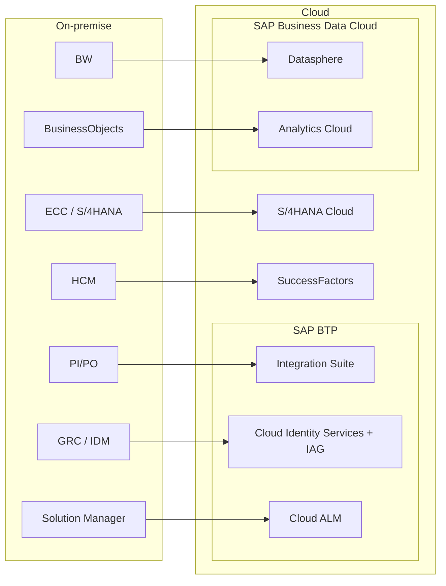
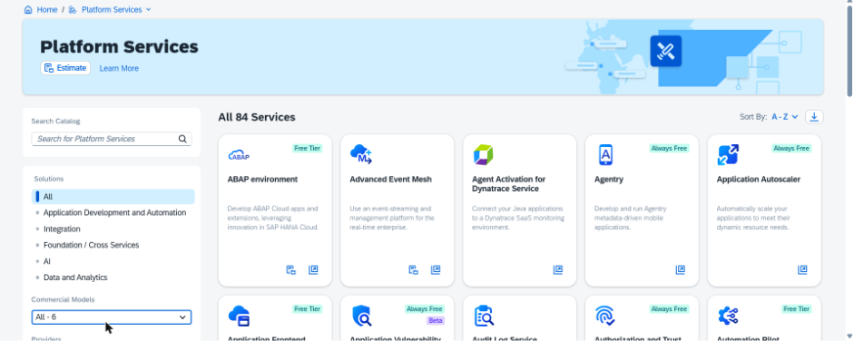
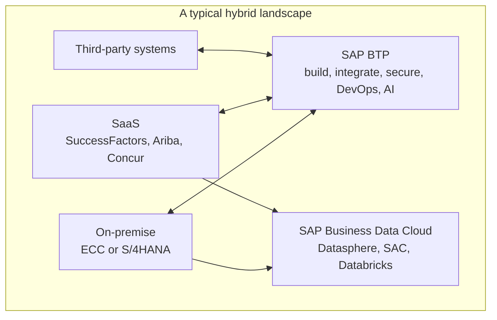

# SAP's cloud journey and the BTP landscape

*How SAP's on-premise products became cloud products, what BTP is for, and how customers buy their way into the cloud.*

> [!NOTE]
> **📍 At a glance**
> - **You will learn:** the on-premise SAP landscape and each product's cloud successor, BTP's capability areas, what moved into Business Data Cloud, and RISE, GROW and the BTP enterprise agreements
> - **You will build:** a one-page map from every legacy SAP tool to its cloud successor
> - **Level:** beginner · **Time:** about 25 minutes
> - **Builds on:** [Cloud computing and the service models](cloud-computing-service-models.md). **Leads to:** [Inside BTP: Neo, hyperscalers and regions](btp-neo-hyperscalers-regions.md)

**After this chapter you can:**

- Separate SAP's functional products (ERP, HR, procurement, CRM) from its technical tools (integration, security, monitoring, data)
- Name the cloud successor of ECC, HCM, PI/PO, GRC/IDM, Solution Manager, BW and BusinessObjects
- Say which BTP service you would use for development, integration, security, DevOps, AI and data work
- Explain why the data tools now live in SAP Business Data Cloud, managed from SAP for Me
- Explain the difference between S/4HANA Cloud Public Edition and Private Edition, and between RISE and GROW

## 2.1 The classic on-premise SAP landscape

- A typical company bought SAP software, installed it on its own servers and ran it for years.
- **Functional products** run the business:
  - **ERP** (ECC, later S/4HANA): finance, sales, production planning, purchasing
  - **HCM**: employees, payroll, HR processes
  - **SCM / spend management**: suppliers, contracts, invoices
  - **CRM**: customers, support tickets, products sold
- **Technical tools** keep those products working together:
  - **PI/PO** to integrate systems, **GRC/IDM** to secure users and access
  - **Solution Manager** to monitor system health, **BW** to collect data, **BusinessObjects (BO)** to report on it

## 2.2 How SAP got to the cloud: build and buy

- SAP moved to the cloud later than its rivals, so building everything from scratch was too slow.
- It built some products (S/4HANA Cloud) and **acquired** cloud companies for the rest.
- The technical tools were rebuilt as services on one platform, first called SAP NetWeaver Cloud and today SAP BTP.

| Legacy on-premise | Cloud successor | How SAP got it |
|---|---|---|
| ECC / S/4HANA | SAP S/4HANA Cloud, Public or Private Edition | Built |
| HCM | SAP SuccessFactors | Acquired (2012) |
| SCM / spend management | SAP Ariba | Acquired (2012) |
| Contingent workforce | SAP Fieldglass | Acquired (2014) |
| Travel and expenses | SAP Concur | Acquired (2014) |
| CRM | SAP Commerce / Customer Experience (from hybris) | Acquired (2013) |
| PI/PO | SAP Integration Suite (Cloud Integration, API Management, Event Mesh) | Built, on BTP |
| GRC / IDM | SAP Cloud Identity Services and SAP Cloud Identity Access Governance (IAG) | Built, on BTP |
| Solution Manager | SAP Cloud ALM | Built, on BTP |
| BW | SAP Datasphere (now part of Business Data Cloud) | Built |
| BusinessObjects | SAP Analytics Cloud (SAC) | Built |
| Custom ABAP / Java extensions | Business Application Studio, Cloud Foundry, Kyma, SAP Build, Joule | Built, on BTP |

> [!NOTE]
> Acquisition years come from SAP's own history pages (web-checked 19 Nov 2026). SuccessFactors was announced in December 2011 and closed in 2012; Concur closed at the end of 2014.

> [!WARNING]
> **⚠️ Pitfall: "retired" is not the same as "out of support"**
> - The lecture calls IDM, PI/PO, Solution Manager, BW and BO tools that are going away. They are not all switched off yet.
> - Example: SAP Identity Management ends mainstream maintenance on 31 Dec 2027, with paid extended maintenance to 2030 (web-checked).
> - Check SAP's Maintenance Finder before you quote a date for any product.

## 2.3 What BTP is for

- **SAP BTP** is a platform with hundreds of technical services. A customer uses them to:
  - **build** new apps or extensions
  - **integrate** SAP and non-SAP systems
  - **automate** processes and **secure** the whole landscape
  - **run DevOps** and **add AI**
- An **extension** adds what a standard product lacks, for example a custom step in SuccessFactors or S/4HANA.
- You can also build a **standalone app** on BTP, such as a customer portal or a leave-management app.

| Area | Services named in class | Use it when |
|---|---|---|
| Build (pro-code) | SAP Business Application Studio, Cloud Foundry and Kyma runtimes, SAP HANA Cloud, Connectivity service | You write code, need a server to run it and a database for its data |
| Build (low-code) | SAP Build Process Automation, SAP Build Work Zone, SAP Build Apps, SAP Build Code | You automate a process, need one portal for all apps, drag and drop an app, or want AI to generate code |
| Integration | SAP Integration Suite: Cloud Integration (CPI), API Management, Event Mesh | Systems must exchange data, for example a supplier created in S/4HANA must reach Ariba |
| Security | SAP Cloud Identity Services | Users should log in once (single sign-on) across systems |
| DevOps | CI/CD service, Cloud Transport Management, SAP Cloud ALM | You test and move changes from dev to test to production, and monitor everything centrally |
| AI | Joule, Joule for Consultants, Joule for Developers, Joule Studio, SAP AI Core and AI Launchpad, Generative AI hub | You want an assistant, AI agents, a custom model, or models such as GPT and Claude through one gateway |
| Data (now in BDC) | SAP Datasphere, SAP Analytics Cloud, SAP Databricks | You clean and model data from many systems, report and plan on it, or train ML models on it |

- SAP's **Discovery Center** lists every BTP service, filtered by solution area, commercial model, provider and region.
- Real UI path: *discovery-center.cloud.sap → Platform Services → filter by Solutions*.
- On 19 Nov 2026 it showed **84 platform services** in five solution areas. The areas were Application Development and Automation, Integration, Foundation / Cross Services, AI, and Data and Analytics.

> [!TIP]
> "Free Tier" and "Always Free" badges on a tile tell you a service can be tried at no cost in a productive account. The badges are a quick way to find services to practise on.

## 2.4 SAP Business Data Cloud: the data tools moved out

- Datasphere and SAC used to run as BTP services. SAP then grouped its data and analytics tools into a separate product, **SAP Business Data Cloud (BDC)**.
- SAP announced BDC with Databricks in **February 2025** (web-checked). It brings together Datasphere, Analytics Cloud, BW and **SAP Databricks**.
- BDC is **provisioned from SAP for Me** (`me.sap.com`), not from the BTP cockpit.
- In the lecture's words, HANA Cloud still runs on BTP, while its data is consumed in BDC.
- Typical flow: get data from many systems into Datasphere, clean and model it, then report and plan on it in SAC.

> [!NOTE]
> The lecture dates the split to "about a year ago". SAP's announcement was February 2025, about 19 months before this course started.

## 2.5 What a customer landscape looks like today

- Few customers are fully on one side. Most are **hybrid**:
  - some products on-premise, often the ERP (ECC or S/4HANA)
  - some SaaS products, such as SuccessFactors or Ariba
  - BTP for extensions, integration and security, and sometimes BDC for data
- Some customers have no BTP at all. They connect systems with another vendor's integration tool.
- The lecture's view is that most customers will move almost everything to the cloud within five to ten years.

## 2.6 Public and private cloud for S/4HANA, and the buying programs

**What "public" and "private" mean for BTP**
- Everything on BTP is public cloud: your services land on shared hyperscaler racks, and you don't know which rack.
- A private-cloud deal would reserve a fixed part of a data centre for one customer, under its own contract.

**What they mean for S/4HANA**
- **S/4HANA Cloud Public Edition** is SaaS. You order it, SAP sends a URL and users, and everything runs in the browser.
- **S/4HANA Cloud Private Edition** is your own S/4HANA system on a hyperscaler, set up by SAP. It behaves much like on-premise, with newer features.
- Before 2021 a customer rented AWS or Azure servers, bought S/4HANA separately and installed it themselves, paying each vendor apart.

**The programs that bundle all this**

| Program | For whom | What it bundles |
|---|---|---|
| **RISE with SAP** (since Jan 2021) | Existing ECC or S/4HANA on-premise customers moving to the cloud | S/4HANA Cloud (usually Private Edition) set up on a hyperscaler by SAP, BTP credits, process tools such as SAP Signavio, higher tiers add SAP LeanIX |
| **GROW with SAP** (since 2023) | Net-new, often mid-size, customers starting in the cloud | S/4HANA Cloud Public Edition, BTP, adoption services and best practices |
| **CPEA (now BTPEA) or Pay-As-You-Go** | Customers who only need BTP (and maybe BDC), no ERP move | Prepaid credits with a yearly commitment, or monthly billing at list price |

- RISE is a **program**, not a technology. SAP builds the landscape, installs NetWeaver and S/4HANA, and handles the basic Basis work.
- After go-live, SAP can also run the system for a fee, or the customer's IT team or a partner does it.
- A training company that only needs BTP, for example, sits on an enterprise agreement without RISE or GROW.

> [!NOTE]
> **CPEA, now BTPEA**
> - CPEA is the Cloud Platform Enterprise Agreement: prepaid credits with a yearly commitment, spent on any BTP service.
> - SAP introduced SAP BTPEA (SAP BTP Enterprise Agreement) in April 2024 as its successor. Discovery Center still lists both (web-checked 19 Nov 2026).
> - The Day 1 slides write "CEPEA". That is a typo for CPEA.

> [!WARNING]
> **⚠️ A number to handle with care**
> - The lecture says a RISE customer might get "a straight 20% discount" on BTP services. That was an illustration, not an SAP figure.
> - Real RISE discounts and credit amounts are negotiated per contract, and the package tiers have changed over time.

> [!IMPORTANT]
> **🏭 In production**
> - In architecture workshops, first ask which contract the customer is on (RISE, GROW, BTPEA, CPEA, PAYG). It decides which BTP services are already paid for.
> - Under consumption models (BTPEA, CPEA, PAYG), every service instance costs credits. Agree a quota owner and a monthly usage review before go-live.
> - For a hybrid landscape, integration and identity are usually the first BTP services set up, because every later project depends on them.
>
> *Added by Claude*

## 2.7 Added by Claude, not from the sources

- **Clean core** is SAP's current guidance for ERP: keep the S/4HANA core close to standard, and build extensions side by side on BTP or with released APIs. It is the main reason BTP shows up in almost every S/4HANA project.
- The **SAP Business Accelerator Hub** (`api.sap.com`) lists the APIs and events each SAP product offers. It is where an extension or integration design starts.
- Discovery Center's commercial-model filter (CPEA, Pay-As-You-Go, SAP BTPEA, Subscription, Trial) is a quick way to check whether a service can be bought under the customer's contract.

## 2.8 Interview corner

**What interviewers listen for:** you can map legacy tools to their successors without hesitating, you know BDC is separate from BTP, and you can explain RISE versus GROW in business terms, not just product names.

### 🟢 Basic

1. What are the cloud successors of PI/PO, Solution Manager, BW and BusinessObjects?

- PI/PO: SAP Integration Suite (Cloud Integration, API Management, Event Mesh)
- Solution Manager: SAP Cloud ALM
- BW: SAP Datasphere. BusinessObjects: SAP Analytics Cloud
- *Stronger answer:* note that Datasphere and SAC are now part of SAP Business Data Cloud, not core BTP services

2. Name three things a customer does with BTP.

- Build extensions or standalone apps (Business Application Studio, Cloud Foundry, HANA Cloud)
- Integrate SAP and non-SAP systems (Integration Suite)
- Secure logins across systems (Cloud Identity Services), plus DevOps and AI services
- *Stronger answer:* tie each to a business example, such as a supplier record flowing from S/4HANA to Ariba through Cloud Integration

### 🟡 Intermediate

3. What is the difference between RISE with SAP and GROW with SAP?

- RISE: a transformation program for existing ECC or S/4HANA customers, usually landing on S/4HANA Cloud Private Edition, with BTP credits and process tools bundled
- GROW: for net-new customers starting on S/4HANA Cloud Public Edition with BTP and adoption services
- *Stronger answer:* both are commercial programs, not technologies; the technical difference is Private Edition (own system, more flexibility) versus Public Edition (SaaS, standard processes)

4. Is S/4HANA Cloud Private Edition "on-premise in the cloud"?

- Close: it is a customer-specific S/4HANA system on hyperscaler infrastructure, much like on-premise in flexibility
- Under RISE, SAP sets up the infrastructure and the system, and can also operate it
- *Stronger answer:* contrast it with Public Edition, which is SaaS on SAP's upgrade schedule, with standard processes and no option to skip a release

5. Where is SAP Business Data Cloud managed, and what does it contain?

- It is provisioned from SAP for Me (`me.sap.com`), not the BTP cockpit
- It brings together Datasphere, Analytics Cloud, BW and SAP Databricks
- *Stronger answer:* explain why it matters: data teams get one governed data layer, while BTP stays the place for apps, integration and AI services

### 🔴 Senior

6. A customer runs ECC on-premise with PI/PO, BW and BusinessObjects. Sketch a cloud roadmap.

- ERP: RISE with SAP to S/4HANA Cloud Private Edition (or Public Edition if processes fit the standard)
- Integration first: Integration Suite to replace PI/PO interfaces, because every later step depends on it
- Data: Datasphere and SAC (in BDC) to replace BW and BO, run in parallel until reports are reconciled
- *Stronger answer:* sequence it by maintenance deadlines and risk, and set up identity (Cloud Identity Services) and a BTP account model before any project starts

7. Why did SAP acquire SuccessFactors, Ariba and Concur instead of building cloud versions?

- Speed: SAP entered the cloud market late, and rivals already had mature SaaS products
- Building complex products such as HR or procurement suites would have taken years
- *Stronger answer:* the cost was integration work; a large part of BTP's integration and identity services exists to join those acquired products to SAP's own

> [!TIP]
> **🧩 Design question**
> *"A customer has S/4HANA on-premise, SuccessFactors, Ariba and a non-SAP CRM. They want one login, a supplier sync between S/4HANA and Ariba, and a management dashboard."* Talk about:
> - Cloud Identity Services for single sign-on
> - Integration Suite for the supplier flow, with Cloud Connector for the on-premise side
> - Datasphere plus SAC in BDC for the dashboard
> - which contract (RISE or BTPEA) pays for it

## Cheat sheet

| Legacy | Cloud | Where it lives |
|---|---|---|
| ECC / S/4HANA | S/4HANA Cloud (Public or Private Edition) | SAP-run, on hyperscalers |
| HCM | SuccessFactors | SaaS |
| SCM / spend | Ariba, Concur, Fieldglass | SaaS |
| PI/PO | Integration Suite | BTP |
| GRC / IDM | Cloud Identity Services, IAG | BTP |
| Solution Manager | Cloud ALM | BTP |
| BW | Datasphere | BDC |
| BusinessObjects | Analytics Cloud | BDC |

## Recap

- SAP's on-premise landscape mixes functional products (ERP, HR, procurement, CRM) with technical tools (integration, security, monitoring, data)
- SAP reached the cloud by building (S/4HANA Cloud, BTP services) and buying (SuccessFactors, Ariba, hybris, Fieldglass, Concur)
- BTP is where customers build, integrate, secure, run DevOps and add AI, across SAP and non-SAP systems
- Data and analytics tools now sit in SAP Business Data Cloud, provisioned from SAP for Me
- Most customers are hybrid: some on-premise, some SaaS, plus BTP
- RISE (existing customers, usually Private Edition) and GROW (new customers, Public Edition) bundle ERP, BTP and tools; BTP-only customers use an enterprise agreement or Pay-As-You-Go

## Practice

1. Without looking, fill in the cloud successor for seven legacy SAP tools.
2. Open Discovery Center, filter Solutions = Integration, and list the services you see with one line on each.
3. Write three sentences explaining RISE with SAP to a business manager, without using product codes.

## How this chapter was checked

- **Lecture 1 recording** (captions 0:54 to 1:20 and 2:13 to 2:25, with the questions in between): read in full.
- **Day 1 slides** (slides 6, 7 and 13) and the **BTP Basics notes** deck (commercial models and solutioning scenarios pages): read in full and merged.
- **Discovery Center** service catalogue: opened on 19 Nov 2026, with the solution and commercial-model filters read. Screenshot taken then.
- **Web-checked on 19 Nov 2026:**
  - acquisition years; the BDC announcement and its provisioning through SAP for Me
  - BTPEA versus CPEA; RISE and GROW contents and dates; the IdM maintenance dates
- **Not checked:** maintenance end dates for PI/PO, Solution Manager and BW, which is why none are given.
- Nothing in this chapter is code.

## Sources and further reading

- BTPAI course, Lecture 1 recording, 27 Sep 2026 (BT001); *Day 1 BTP Fundamentals* slides (BT005); *1. BTP Basics* notes (BT002)
- SAP Discovery Center, platform service catalogue: https://discovery-center.cloud.sap/servicecatalog (opened 19 Nov 2026)
- SAP, company history 2011 to 2020 (acquisitions): https://www.sap.com/about/company/history/2011-2020.html
- SAP News, *SAP and Databricks open a bold new era of data and AI* (Feb 2025): https://news.sap.com/2025/02/sap-databricks-open-bold-new-era-data-ai/
- SAP Learning, *Provisioning your SAP BDC cockpit and its components*: https://learning.sap.com/courses/cloud-onboarding-for-sap-business-data-cloud/provisioning-your-sap-bdc-cockpit-and-its-components
- SAP Developers, *Get started with SAP BTP enterprise accounts* (BTPEA, April 2024): https://developers.sap.com/tutorials/btp-ea-onboard-01-intro.html
- SAPinsider, *SAP announces GROW with SAP*: https://sapinsider.org/blogs/sap-announces-grow-with-sap/
- SAP Community, *Preparing for SAP Identity Management's end of maintenance in 2027*: https://blogs.sap.com/t5/technology-blogs-by-sap/preparing-for-sap-identity-management-s-end-of-maintenance-in-2027/ba-p/13596101

Previous: [Cloud computing and the service models](cloud-computing-service-models.md) · Next: [Inside BTP: Neo, hyperscalers and regions](btp-neo-hyperscalers-regions.md)
