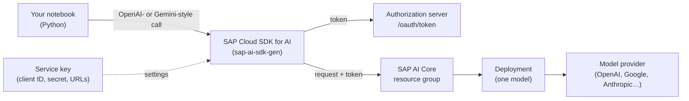
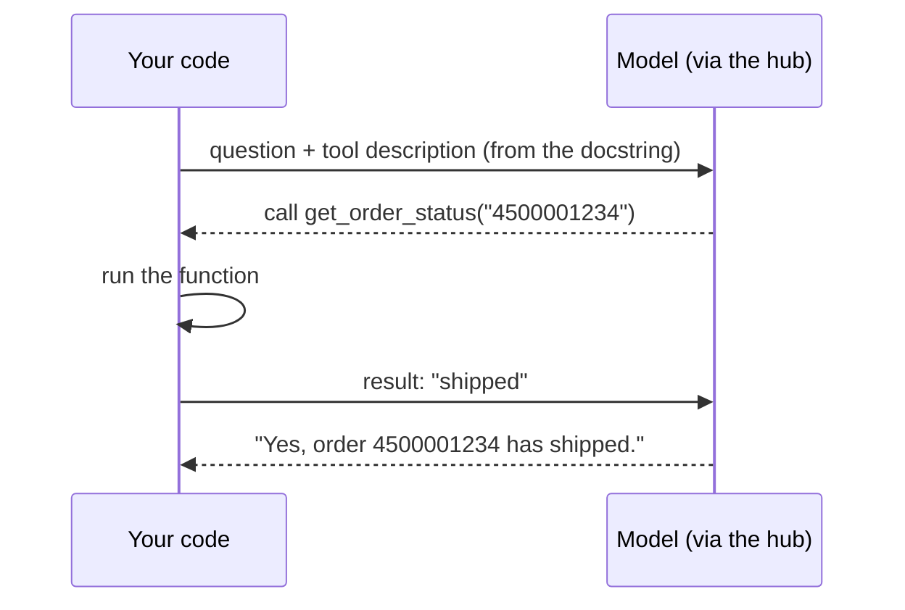

# Hands-on: Call LLMs through the generative AI hub from Python

*Use one SAP service key to call OpenAI, Gemini and embedding models from Python, through SAP AI Core's generative AI hub, with structured output, streaming and tool calls.*

> [!NOTE]
> **📍 At a glance**
> - **Sources:**
>   - the course's `aicore-handson` folder: README and `native-client.ipynb`
>   - SAP's *SAP Cloud SDK for AI (Python)* docs and release notes (v7.2.0 docs, read 21 Nov 2026)
>   - SAP's tutorial *Set up Generative AI Hub in SAP AI Core*
> - **You will build:** a notebook that signs in with a service key, lists your model deployments, then calls chat, the Responses API, structured output, Gemini, streaming, a tool and embeddings
> - **You need:**
>   - SAP AI Core on the **extended** plan (the generative AI hub needs it), and a service key
>   - Python 3.12, VS Code with the Python and Jupyter extensions
> - **Level:** beginner to intermediate · **Time:** about 15 minutes to set up
> - **Concepts:** [Inside a large language model](llm-prompt-to-answer.md), [Prompt engineering](prompt-engineering.md)
> - **Last checked:** 21 Nov 2026

**After this tutorial you can:**

- Turn an SAP AI Core service key into the SDK's settings, without putting secrets in code
- Find your model deployments and call a model by name or by deployment ID
- Get typed answers with Pydantic, stream long answers, and let a model call your function
- Create embeddings for search and RAG

## 33.1 How a call travels



- **SAP AI Core** runs AI workloads on BTP. Its **generative AI hub** gives you hosted LLMs through **deployments**: one running instance per model, each with an ID.
- **A resource group** separates deployments within one AI Core tenant. The course uses `default`.
- **The SDK wraps the providers' own Python SDKs.** You write familiar code (`chat.completions.create`, `client.models.generate_content`), and the SDK handles the token and routes the call through AI Core.
- **Plan:** the generative AI hub is available only on AI Core's **extended** plan. Upgrading from the free tier keeps your data but costs money (SAP tutorial, checked 21 Nov 2026).

## 33.2 Set up

**Step 1: Get a service key**

1. BTP cockpit → your subaccount → *Instances and Subscriptions*.
2. Open the SAP AI Core instance → *Service Keys* → create one or copy an existing one.
3. Save it as `key.json` next to the notebook. It has this shape (placeholders shown):

```json
{
  "clientid": "sb-xxxxxxxx-xxxx-xxxx-xxxx-xxxxxxxxxxxx!b12345|aicore!b540",
  "clientsecret": "xxxxxxxx-xxxx-xxxx-xxxx-xxxxxxxxxxxx",
  "url": "https://your-subdomain.authentication.eu10.hana.ondemand.com",
  "serviceurls": { "AI_API_URL": "https://api.ai.prod.eu-central-1.aws.ml.hana.ondemand.com" }
}
```

> [!CAUTION]
> **🔒 The key is a password**
> - `clientsecret` lets anyone call models on your company's bill. Never commit `key.json`; add it to `.gitignore`.
> - Don't print the key in a notebook: saved outputs travel with the file.
> - Better homes than the project folder: `~/.aicore/config.json`, which the SDK reads by default, or an X.509 certificate instead of a secret (both in SAP's SDK docs).
> - Leaked? Delete the service key in the cockpit and create a new one.

**Step 2: Install the SDK**

```bash
pip install "sap-ai-sdk-gen[all]"      # OpenAI, Google and Amazon models, plus LangChain
pip install "sap-ai-sdk-gen[google]"   # or just OpenAI + Gemini
```

- The plain `pip install sap-ai-sdk-gen` brings **OpenAI models only**. Without the `[google]` extra, the Gemini import fails with *No module named 'google'* (seen when I tested 7.4.1).
- It was called the *generative AI hub SDK* until it was renamed. The import names (`gen_ai_hub`) did not change, so older code still runs.
- The course's own route: install **uv**, put the notebook, its `pyproject.toml` and `key.json` in one folder, run `uv sync`, and pick the `.venv` kernel in VS Code.

**Step 3: Load the key into the SDK's settings**

```python
import json, os

def load_aicore_key(path="key.json", resource_group="default"):
    """Read an SAP AI Core service key and set the SDK's environment variables."""
    with open(path, encoding="utf-8") as f:
        key = json.load(f)
    os.environ["AICORE_CLIENT_ID"] = key["clientid"]
    os.environ["AICORE_CLIENT_SECRET"] = key["clientsecret"]
    os.environ["AICORE_AUTH_URL"] = key["url"]                        # SDK adds /oauth/token
    os.environ["AICORE_BASE_URL"] = key["serviceurls"]["AI_API_URL"]   # SDK adds /v2
    os.environ["AICORE_RESOURCE_GROUP"] = resource_group

load_aicore_key()          # run this before importing gen_ai_hub clients
```

✅ *Verified: with a placeholder key, the SDK resolved both URLs with their suffixes (details at the end).*

- The SDK looks for settings in this order: **environment variables**, then a **config file** (`~/.aicore/config.json`, or a profile), then **`VCAP_SERVICES`** when the code runs on Cloud Foundry.
- SAP's docs show the full URLs (`…/oauth/token`, `…/v2`). The course notebook passes the key's URLs as they are. Both work: SDK 7.4.1 adds the missing endings itself.

> [!WARNING]
> **⚠️ Pitfall: import order**
> - `from gen_ai_hub.proxy.native.openai import chat` builds a client straight away.
> - With no settings yet, it fails: *No credentials found in any source*.
> - Load the key first, then import.

## 33.3 First calls: deployments and chat

**See which models you can use**

```python
from gen_ai_hub.proxy.core.proxy_clients import get_proxy_client

proxy_client = get_proxy_client("gen-ai-hub")
for d in proxy_client.get_deployments():
    print(f"{d.model_name:40s} {d.deployment_id}")
```

- The course tenant listed GPT, Gemini, Claude and embedding models. Yours will differ: run this cell first.
- SAP keeps the list of models available in the generative AI hub in an SAP Note, linked from the SDK docs.

**Chat: a conversation as a list of messages**

```python
from gen_ai_hub.proxy.native.openai import chat

messages = [
    {"role": "system", "content": "You are an SAP AI expert who helps functional consultants."},
    {"role": "user", "content": "What is the difference between SAP AI Core and SAP AI Launchpad?"},
]
response = chat.completions.create(model_name="gpt-4o-mini", messages=messages)
print(response.choices[0].message.content)
print(response.usage.total_tokens, "tokens")
```

| Pick a model by | Write | Use it when |
|---|---|---|
| Model name | `model_name="gpt-4o-mini"` | Learning, and code that should follow whatever deployment of that model exists |
| Deployment ID | `deployment_id="d123…"` | Production: pin one deployment so results are reproducible |

- `role` values: **system** sets the rules, **user** asks, **assistant** holds earlier answers for multi-turn context ([prompt engineering](prompt-engineering.md)).
- The response also carries `content_filter_results`: the hub's safety filter verdicts for each answer.

## 33.4 The Responses API and typed answers

**Responses: instructions plus input, no message list**

```python
from gen_ai_hub.proxy.native.openai import responses

r = responses.create(
    model="gpt-5",
    instructions="You are an SAP AI expert. Keep answers short and practical.",
    input="Why call LLMs through the generative AI hub instead of the provider directly?",
)
print(r.output_text)
```

- Added to the SDK in **6.10.0** (SAP release notes). Older SDKs don't have `responses`.

**Structured output: let Pydantic define the answer**

```python
from pydantic import BaseModel
from gen_ai_hub.proxy.native.openai import chat, responses

class SAPService(BaseModel):
    name: str
    description: str

# Chat Completions
c = chat.completions.parse(
    model="gpt-4o-mini",
    messages=[{"role": "user", "content": "Describe SAP AI Core: name and a one-line description."}],
    response_format=SAPService,
)
print(c.choices[0].message.parsed)          # SAPService(name=..., description=...)

# Responses API
r = responses.parse(model="gpt-5", input="Describe SAP AI Launchpad.", text_format=SAPService)
print(r.output_parsed.name)
```

- You get a validated Python object instead of text to parse. Use it to turn a ticket or an email into fields you can post to S/4HANA.
- More on schemas: [Pydantic: validating LLM output](../pydantic/05-validating-llm-output.md).

## 33.5 Gemini and streaming through the same key

```python
from gen_ai_hub.proxy import get_proxy_client
from gen_ai_hub.proxy.native.google_genai import Client

client = Client(proxy_client=get_proxy_client("gen-ai-hub"))

r = client.models.generate_content(
    model="gemini-2.5-flash",
    contents="List three SAP AI services on BTP and what each does.",
)
print(r.text)

# Streaming: print the answer as it arrives
for chunk in client.models.generate_content_stream(
        model="gemini-2.5-flash", contents="Explain SAP AI Launchpad to a CEO."):
    print(chunk.text, end="")
```

- Same key, same governance, a different provider. Comparing models on your own SAP tasks needs no new setup.
- Stream when a person is waiting, as in a chat UI; the first words show in a fraction of the total time.
- The response also reports `thoughts_token_count` for thinking models. Those tokens are billed too.

## 33.6 Tool calling: let the model call your function

```python
from google.genai import types
from gen_ai_hub.proxy import get_proxy_client
from gen_ai_hub.proxy.native.google_genai import Client

def get_order_status(order_id: str) -> str:
    """Return the delivery status of a sales order.

    Args:
        order_id: The S/4HANA sales order number, e.g. 4500001234
    """
    return {"4500001234": "shipped"}.get(order_id, "unknown")   # call your OData API here

client = Client(proxy_client=get_proxy_client("gen-ai-hub"))
r = client.models.generate_content(
    model="gemini-2.5-flash",
    contents="Has order 4500001234 shipped?",
    config=types.GenerateContentConfig(tools=[get_order_status]),
)
print(r.text)
```



- The Gemini SDK reads the function's **name, type hints and docstring** to describe the tool, and runs the loop above for you.
- The course does it twice: a dummy weather function, then a real one calling the free Open-Meteo API. In a project, the function calls S/4HANA or SuccessFactors instead.
- Write good docstrings: they are the only thing the model knows about your tool.

## 33.7 Embeddings: text to vectors

```python
from gen_ai_hub.proxy.native.openai import embeddings

e = embeddings.create(
    input="SAP AI Core runs AI workflows and serves models on SAP BTP.",
    model_name="text-embedding-ada-002",
)
vector = e.data[0].embedding
print(len(vector))          # 1536 in the course run
```

- Similar meanings give vectors that are close together. That powers semantic search, duplicate-ticket detection, classification and RAG ([Prompt engineering](prompt-engineering.md), grounded prompts).
- Store the vectors in a vector store, for example the SAP HANA Cloud vector engine, and search them before you prompt.

## 33.8 When it fails

| Symptom | Likely cause | Fix |
|---|---|---|
| *No credentials found in any source* | Clients imported before the settings were loaded | Run `load_aicore_key()` first, then import |
| *No module named 'google'* | Plain install has no Gemini support | `pip install "sap-ai-sdk-gen[google]"` |
| *No module named 'gen_ai_hub'* | Wrong notebook kernel | Select the `.venv` kernel, or run `uv sync` again |
| *401 Unauthorized* | Expired or wrong service key | Create a new key in the cockpit |
| *Deployment not found* | An example ID from someone else's tenant | List your deployments (33.3) and use one of yours |
| `responses` missing | SDK older than 6.10.0 | Upgrade `sap-ai-sdk-gen` |

## 33.9 Things to watch

- **Model names change.** Providers retire versions; list your deployments before hard-coding a name.
- **Every call costs.** The usage block in each response shows prompt, completion and thinking tokens. Log it.
- **The SDK can also call the orchestration service** (templating, filtering, masking in one pipeline). This tutorial calls models directly, as the course does.

> [!IMPORTANT]
> **🏭 In production**
> - Keep keys out of code: bind AI Core to your app on BTP (`VCAP_SERVICES`) or use a secret store, and rotate keys.
> - Pin a deployment ID per environment, and test a new model version before switching.
> - Put a timeout and a retry with back-off around every call; rate limits apply per deployment.
> - Store prompts and responses only after masking personal data. The hub filters content, but your logs are your responsibility.
>
> *Added by Claude*

## Check yourself

<details class="qa"><summary>Why does importing the chat client fail before you load the key?</summary>

- Importing `chat` creates a client at once, and the client looks for settings straight away.
- With none in the environment, config file or `VCAP_SERVICES`, it stops with *No credentials found in any source*.
- **Stronger answer:** load settings first, or pass your own `proxy_client` built from explicit credentials.

</details>

<details class="qa"><summary>Model name or deployment ID: which would you use in production, and why?</summary>

- A **deployment ID** pins one running model version, so answers stay reproducible.
- A **model name** follows whatever deployment of that model exists: fine for learning.
- **Stronger answer:** store the ID per environment (dev, test, prod) in configuration, not in code.

</details>

<details class="qa"><summary>What does the generative AI hub add over calling OpenAI or Google directly?</summary>

- One key and one contract for many providers, with SAP's content filtering and access control on BTP.
- Switching providers needs no new security setup.
- **Stronger answer:** it needs the AI Core extended plan, so the trade-off is cost and setup against governance.

</details>

## How this page was checked

- **Course files read in full on 21 Nov 2026:** `aicore-handson/README.md` and `native-client.ipynb` (27 cells, with the course run's outputs).
- **Not read:** `pyproject.toml` (Drive shows no preview). **Never opened:** `key.json`, which is a service key.
- **Installed and checked on 21 Nov 2026:** `sap-ai-sdk-gen` 7.4.1 with the `[google]` extra (google-genai 2.23.0), in a throwaway folder, with a placeholder key. Nothing called SAP. The check confirmed:
  - `chat.completions.create` and `parse`, `responses.create` and `parse`, `embeddings.create`, `get_deployments`, and the Gemini `generate_content` and `generate_content_stream` calls exist
  - `deployment_id` and `model_name` are accepted by `create`
  - importing before the settings exist fails; the SDK adds `/oauth/token` and `/v2` when they are missing
  - the `load_aicore_key` and tool function snippets ran
- **Not run:** any call to a model; they need a real AI Core extended-plan tenant.
- **SAP's docs read on 21 Nov 2026:** the SDK README and release notes (6.10.0 added the Responses API); the provisioning tutorial (pre-read and step 1: extended plan required).
- **Left out:** the course tenant's deployment IDs, which appear in the notebook's saved outputs.

## Sources

- BTPAI course Drive: `aicore` › `aicore-handson` (README, `native-client.ipynb`) (BT052)
- SAP, *SAP Cloud SDK for AI (Python) - generative*: https://help.sap.com/doc/generative-ai-hub-sdk/CLOUD/en-US/_reference/README_sphynx.html
- SAP, SDK release notes: https://help.sap.com/doc/generative-ai-hub-sdk/CLOUD/en-US/_reference/RELEASE_NOTES.html
- SAP Developer Center, *Set up Generative AI Hub in SAP AI Core*: https://developers.sap.com/tutorials/ai-core-genaihub-provisioning.html

Previous: [Joule with other SAP solutions: S/4HANA, planning and documents](joule-integration-other-sap-solutions.md) · Next: [Hands-on: Extract invoice data with SAP Document AI from Python](tutorial-document-ai-python.md)
