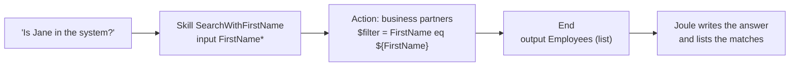

# Tutorial: Filter an action and let Joule write the reply

*Add a filter to an action so a skill can search employees by first name, and let Joule compose the answer instead of a fixed message.*

> [!NOTE]
> **📍 At a glance**
> - **SAP tutorial:** [Create a Filter in an Action Project](https://developers.sap.com/tutorials/joulestudio-skill-action-filter.html) (part 4 of 5)
> - **You will build:** a copy of the business partner action project with a `FirstName` filter, and the skill *SearchWithFirstName*
> - **You need:** tutorials [21](tutorial-joule-skill-setup.md) and [22](tutorial-joule-action-projects.md)
> - **Level:** beginner
> - **Concepts:** [Joule Studio Classic](joule-studio-classic.md), 19.4 and 19.4a

**After this tutorial you can:**

- Copy a published action project into a new one
- Add an input field to an action and use it in an OData `$filter`
- Build a skill whose reply Joule writes itself from the outputs

## 24.1 What you build

## 24.2 Steps

**Change the action project**
1. Lobby → *Connectors* → *Actions* → your business partner project → *Versions* → **…** on the *Published to Library* version → *Save As New Project*, named `FilterBusinessPartners`.
2. In the new project, open the action that returns the general business partner data.
3. *Input* tab → *Add* → *New Field*, with key and label `FirstName`.
4. Click the value of `$filter` and open the *Condition Editor*: column `FirstName`, condition *equal to*, criteria `${FirstName}`.
5. *Test* with `Jane`, then *Save*, *Release* and *Publish*.

**Build the skill**
1. New Joule Skill project (`SearchWithName`), then a skill `SearchWithFirstName`, described as retrieving employees with a given first name.
2. On the *Trigger*, switch **on** *Allow Joule to generate a response*.
3. Input `FirstName` (required). Output `Employees`, type *Any*, marked as a list.
4. Add the filtered action from `FilterBusinessPartners`, with the destination variable `S4HANA_MOCK`, and map its `FirstName` input to the skill input.
5. In *End*, map `Employees` to the action's results list.
6. *Release* and *Deploy* to your environment with the `S4HANA_MOCK` destination.
7. **Test:** describe a visitor at reception who claims to be employee Jane, and ask whether Jane is in the system. Then say you meant John.

## 24.3 Why it works

- The new input becomes part of the OData query: `$filter=FirstName eq 'Jane'`. The service returns only matches, instead of every record (19.4a).
- **Generated response on:** Joule reads the output and writes the reply itself, so no message card is needed. Data mapping now happens in the End step, not in a message.
- The skill's **description** lets Joule match an indirect request ("a visitor says she is Jane") to it.

## 24.4 Common mistakes and notes

- **Copy, do not edit, the original project** if other skills already use it. A changed action changes every skill that uses it.
- **Filtering in the action vs in the agent:** an agent can filter results itself, but a filter in the API returns less data, costs fewer steps and avoids timeouts (19.6).

## 24.5 The same idea with Northwind (Lecture 11)

- An optional skill input "number of orders to return" mapped to `$top`, with a string-to-number formula, so "show me the top five orders" sent `$top=5`.
- The timeline showed the value 5 filled in during *resolving input slots*.

> [!IMPORTANT]
> **🏭 In production**
> - Filter on fields that the backend indexes, and set a sensible `$top` default, so a vague question cannot pull thousands of records.
> - Log which filters users actually ask for; they show which skills to add next.
>
> *Added by Claude*

## Check yourself

Where do you map data when Joule writes the reply?

- In the End step, into the skill outputs
- Joule composes the message from those outputs

Why put the filter in the action instead of asking the agent to filter?

- The backend returns only matching records: less data, fewer agent steps, fewer timeouts
- The behaviour is the same every time

## How this page was checked

- **SAP tutorial read in full on 21 Nov 2026** (last updated by SAP on 21 Aug 2026).
- **Lecture 12 recording:** captions 1:45 to 1:50 (the lecturer walks through it and sets it as practice). **Lecture 11:** 1:31 to 1:43 (`$top` from an input).
- Not run by me: there is no SAP Build tenant in this workspace.

## Sources

- SAP Developer Center, *Create a Filter in an Action Project*: https://developers.sap.com/tutorials/joulestudio-skill-action-filter.html
- BTPAI course, Lecture 11 Part A (BT023) and Lecture 12 (BT025) recordings

Previous: [Tutorial: Create and deploy a Joule skill](tutorial-joule-skill-create.md) · Next: [Tutorial: Run an automated process from a Joule skill](tutorial-joule-skill-process.md)
