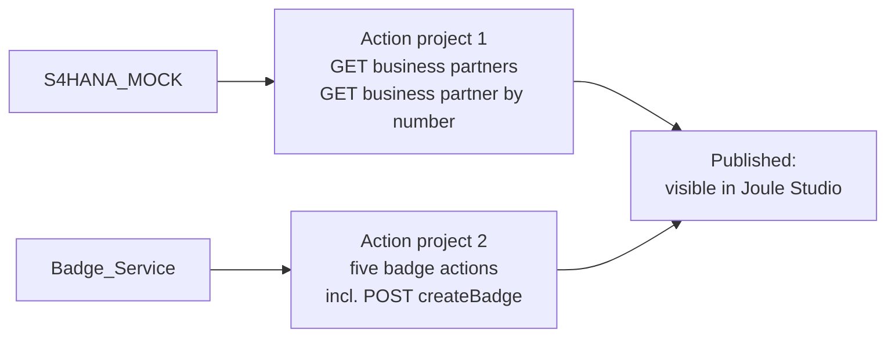

# Tutorial: Create action projects

*Turn two destinations into tested, published API calls that a Joule skill can use: one that reads business partners and one that creates badge requests.*

> [!NOTE]
> **📍 At a glance**
> - **SAP tutorial:** [Create Action Projects](https://developers.sap.com/tutorials/joulestudio-skill-action-create.html) (part 2 of 5)
> - **You will build:** an action project for business partners (read) and one for badge requests (read and create)
> - **You need:** the destinations from [tutorial 21](tutorial-joule-skill-setup.md); developer rights in SAP Build are enough
> - **Level:** beginner
> - **Concepts:** [Joule Studio Classic](joule-studio-classic.md), 19.4a

**After this tutorial you can:**

- Generate actions from an OData destination and keep only the ones you need
- Trim an action's inputs and outputs, and test it against a destination
- Release and publish an action project so Joule Studio can find it

## 22.1 What you build

## 22.2 Steps

**Project 1: business partners**
1. Lobby → *Connectors* → *Actions* → *Create* → under *Live API*, choose *OData Destinations* → `S4HANA_MOCK` → *Next*.
2. Give the project a name and description, then *Create*. A new tab opens with the generated operations.
3. Select `GET /A_BusinessPartner` and `GET /A_BusinessPartner('{BusinessPartner}')`, then *Add*.
4. Open the action that reads one business partner by number. On *Output*, remove every field except `BusinessPartner`, `FirstName` and `LastName`.
5. On *Test*, enter business partner `1003764`, check the destination, and *Test*. *Save*.
6. Trim the output of the list action the same way, test it, and *Save*.
7. *Release*, then *Publish*.

**Project 2: badge requests**
1. Create a second action project from the `Badge_Service` destination, and add the five actions SAP's tutorial lists.
2. On `POST Invoke action createBadge`:
   - *Output* tab: change the type of `badgeId` to *number*
   - *Input* tab: remove `processInstanceId`
3. *Save*, *Release*, *Publish*.
4. Test `createBadge` with the sample values on SAP's page (status `NEW`, a name, a community ID, business partner `1003764`).

## 22.3 Why it works

- The destination gives the base URL; each action adds its endpoint (19.4a). Testing proves the combination works before any skill depends on it.
- **Trimming outputs** keeps what the skill and the model see small and clear.
- **Changing `badgeId` to number** matters later: Joule Studio maps a value only into a field of the same type.
- **Only published projects** appear in Joule Studio's *Browse All Actions*.

## 22.4 Common mistakes (seen in class)

| What you see | Why | Fix |
|---|---|---|
| *Create* does nothing, or the action list never opens | The browser blocks the new tab as a pop-up | Allow pop-ups for SAP Build, refresh, and start again |
| Too many operations to find the two you need | The generator lists every operation of every entity | Filter by method *GET*; the two business partner actions sit near the end of its list |
| Others' projects mixed with yours | Everyone uses the same tenant and names | Prefix your project name with your own name |
| POST, PATCH or DELETE fail | The mock service supports only GET for business partners | Keep only the operations the service supports |

## 22.5 The same steps with Northwind (Lecture 11)

- Action project from the `NORTHWIND_D` destination, with *get all customers*, *get customer by key*, *get all orders* and *get the customer of an order*.
- Each was tested on its own, for example the customer by key with `ANTON`, before release and publish.

> [!IMPORTANT]
> **🏭 In production**
> - Start from SAP Business Accelerator Hub for standard APIs; it lists each API's operations and status before you build on it.
> - Keep write operations (POST, PATCH, DELETE) in their own action project when you can, so read-only skills cannot reach them by mistake.
>
> *Added by Claude*

## Check yourself

Why must an action project be published, not only released?

- Only published action projects appear in Joule Studio's *Browse All Actions*
- Release creates a version; publishing makes it available to consumers

Can one action project use two destinations?

- No; an action project belongs to one destination
- It can hold many actions for that one system

## How this page was checked

- **SAP tutorial read in full on 21 Nov 2026** (last updated by SAP on 21 Aug 2026).
- **Lecture 12 recording:** captions 0:22 to 0:55 (the lecturer builds both projects; learners follow). **Lecture 11:** 0:24 to 0:34 (Northwind actions).
- Not run by me: there is no SAP Build tenant in this workspace.

## Sources

- SAP Developer Center, *Create Action Projects*: https://developers.sap.com/tutorials/joulestudio-skill-action-create.html
- BTPAI course, Lecture 11 Part A (BT023) and Lecture 12 (BT025) recordings

Previous: [Tutorial: Set up environments and destinations for Joule skills](tutorial-joule-skill-setup.md) · Next: [Tutorial: Create and deploy a Joule skill](tutorial-joule-skill-create.md)
