# Tutorial: Create action projects

*Turn two destinations into tested, published API calls that a Joule skill can use: one that reads business partners and one that creates badge requests.*

> [!NOTE]
> **📍 At a glance**
> - **SAP tutorial:** [Create Action Projects](https://developers.sap.com/tutorials/joulestudio-skill-action-create.html) (part 2 of 5)
> - **You will build:** an action project for business partners (read) and one for badge requests (read and create)
> - **You need:** the destinations from [tutorial 21](tutorial-joule-skill-setup.md); developer rights in SAP Build are enough
> - **Level:** beginner · **Time:** about 20 minutes (SAP's estimate)
> - **Concepts:** [Joule Studio Classic](joule-studio-classic.md), 19.4a

**After this tutorial you can:**

- Generate actions from an OData destination and keep only the ones you need
- Trim an action's inputs and outputs, and test it against a destination
- Release and publish an action project so Joule Studio can find it

## 22.1 What you build

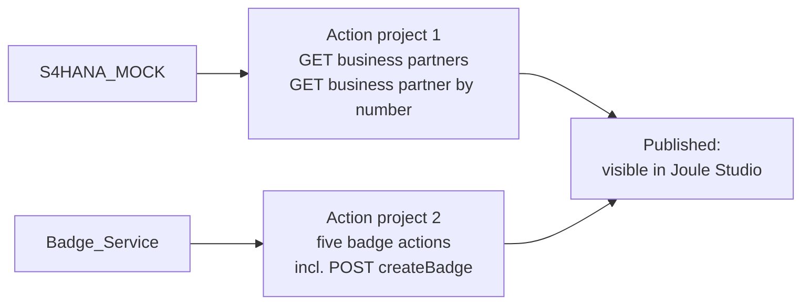

## 22.2 Steps

*Steps and screenshots adapted from SAP's tutorial (© SAP SE, [CC BY 4.0](https://creativecommons.org/licenses/by/4.0/)). Steps reworded; screenshots resized.*

- **Actions** are SAP Build's reusable API calls. SAP Build Process Automation uses them to reach SAP and non-SAP systems with GET, POST, PATCH and other calls.
- A Joule skill in Joule Studio Classic can call the same published actions directly.

### Step 1: Create the action project for business partners

1. Open the **SAP Build lobby**. In the left menu choose **Connectors → Actions**, then **Create**.

    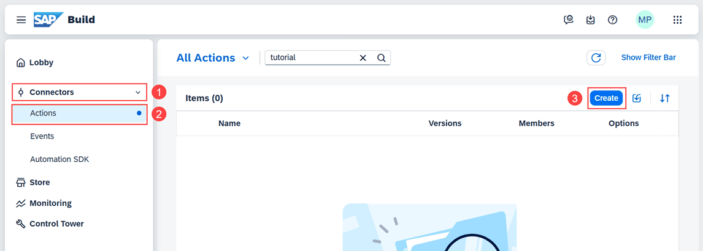

2. In *Choose an API Source*, open **Live API** and choose **OData Destinations**.

    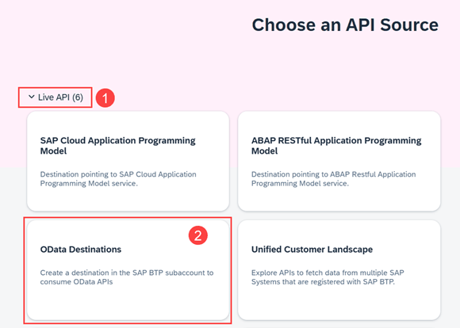

3. In *Browse OData Destinations*, choose the **S4HANA_MOCK** tile.
   - The next page lists every operation the service offers, grouped by entity. Choose **Next**.

    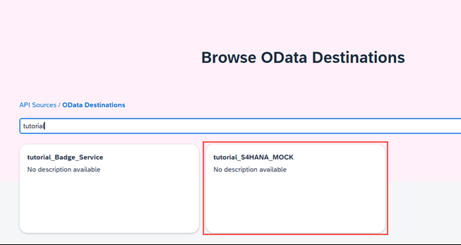

    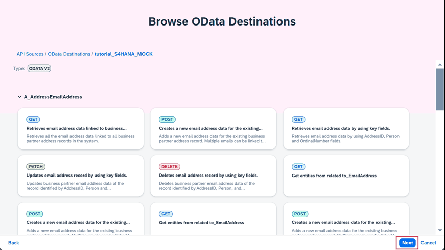

4. Give the project a **name** and a **description**, then choose **Create**.
   - SAP uses the description "This is to give a Joule skill access to information about business partners."

    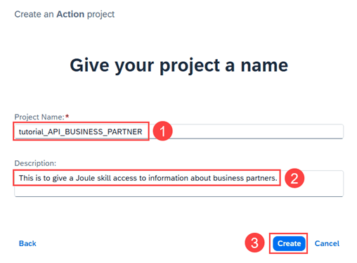

5. Select these two operations, then choose **Add**:
   - `GET /A_BusinessPartner('{BusinessPartner}')`: reads one business partner by number
   - `GET /A_BusinessPartner`: reads the list of business partners

    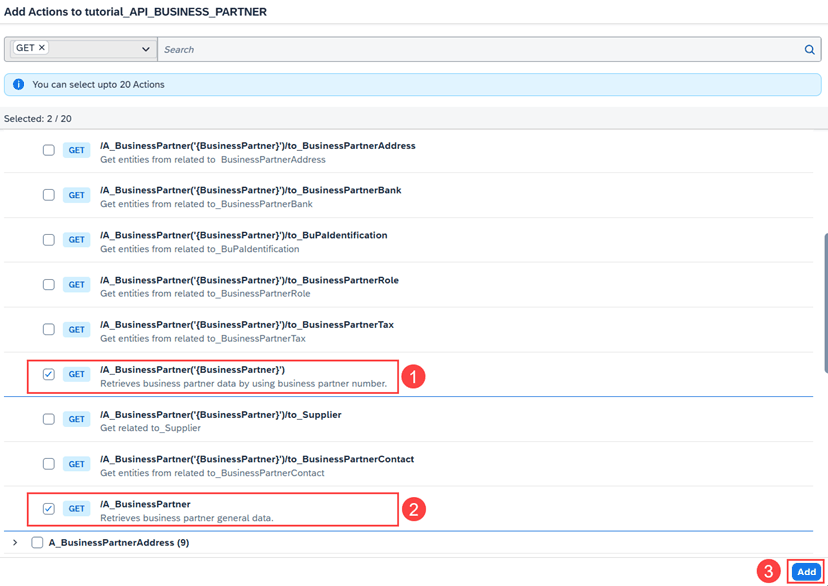

6. Select the action **Retrieves business partner data by using business partner number**.
   - Its **Input** tab shows one parameter, `BusinessPartner`, passed in the URL path.

    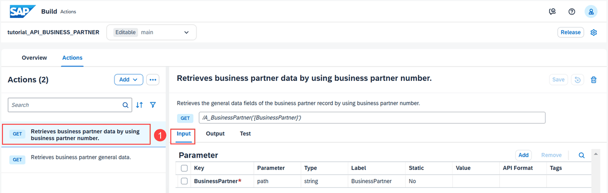

7. Open the **Output** tab. Under *Body*, remove every field except `BusinessPartner`, `FirstName` and `LastName`.

    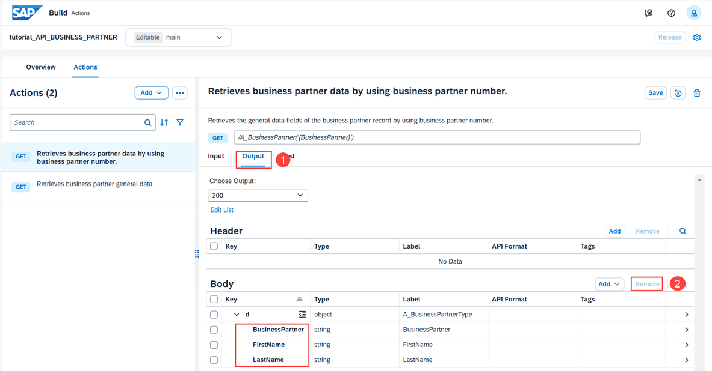

8. Open the **Test** tab:
   - Check that the destination is `S4HANA_MOCK`.
   - Enter `1003764` for **BusinessPartner** and choose **Test**.

    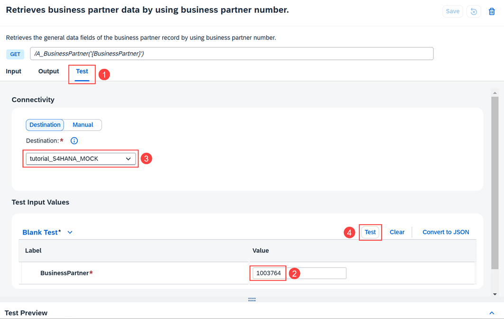

9. The response shows John Doe with status 200. Choose **Save**.

    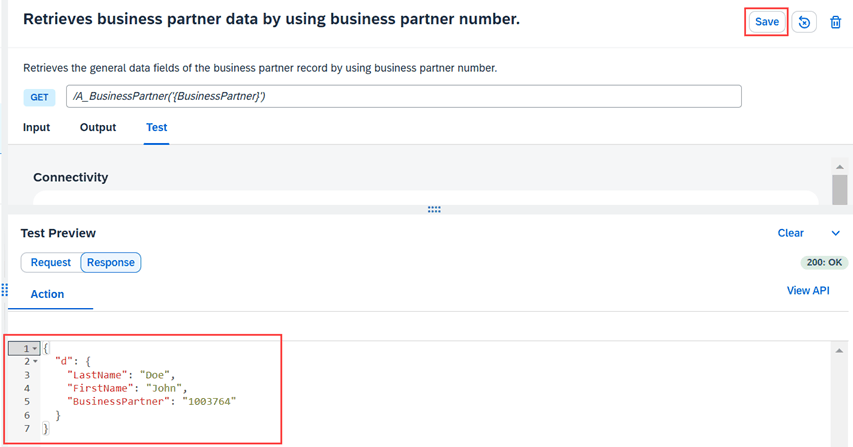

10. Select the second action, **Retrieves business partner general data**, and trim its output the same way.
    - Here the three fields sit under `d → results`, because this action returns a list.

    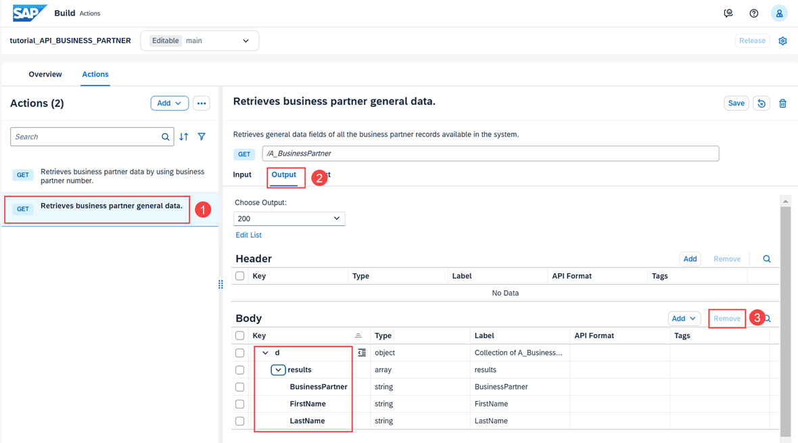

11. On its **Test** tab, choose **Test** without any input. Check the list of partners in the response, then choose **Save**.

    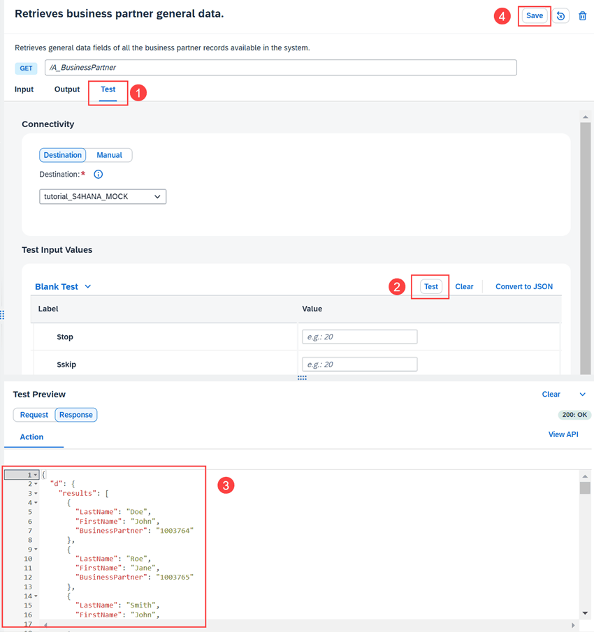

12. Choose **Release** and confirm with **Release** in the dialog. The first version is 1.0.0.

    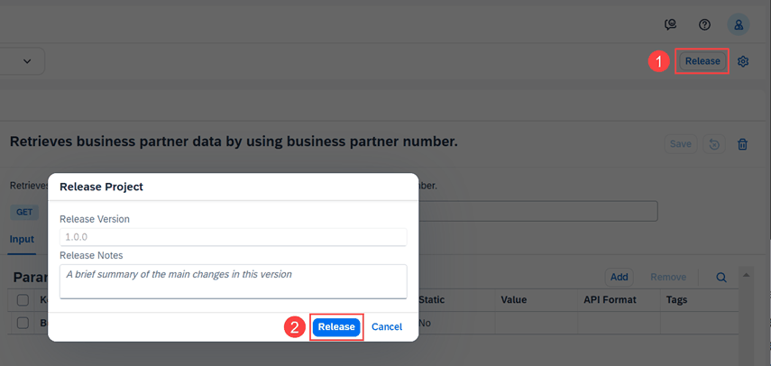

13. Choose **Publish** and confirm with **Publish**. Only published projects can be found from Joule Studio.

    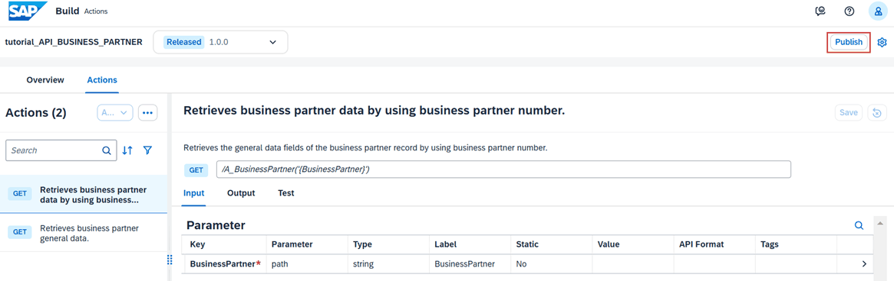

### Step 2: Create the action project for badge requests

1. In the lobby choose **Connectors → Actions → Create → Live API → OData Destinations** again, and this time choose **Badge_Service**.
   - It is an OData V4 service with one entity, `Badges`. Choose **Next**.

    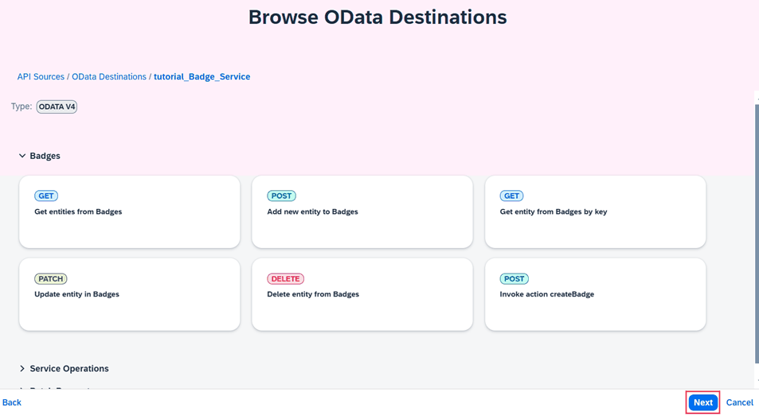

2. Give the project a name and description, then choose **Create**.
   - SAP uses "This is to give a Joule skill access to a third-party badge service."

    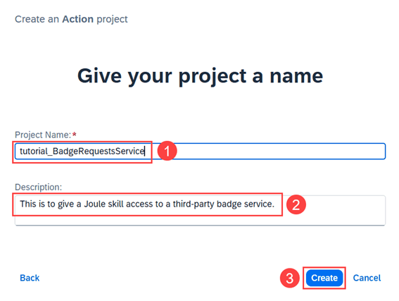

3. Select these five operations, then choose **Add**:
   - `GET /Badges({ID})`: get one badge by key
   - `POST /createBadge`: the action that creates a badge
   - `GET /Badges`: list badges
   - `PATCH /Badges({ID})`: update a badge
   - `DELETE /Badges({ID})`: delete a badge
   - SAP's tutorial leaves `POST /Badges` unticked; the skill creates badges through `createBadge`.

    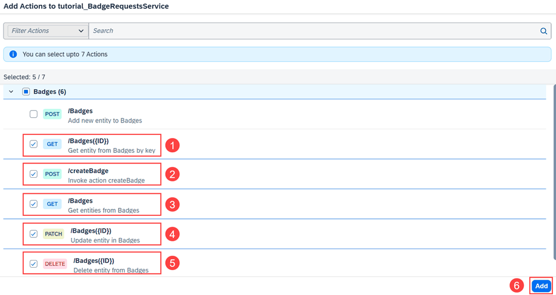

4. Select **Invoke action createBadge** and open its **Output** tab.
   - Click `badgeId` and change its **Type** from string to **number**.
   - SAP Build warns that changing types can cause problems. Here it is intended: the skill in tutorial 23 expects a number.

    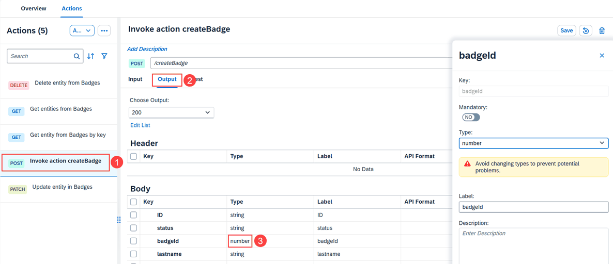

5. Open the **Input** tab. Under *Body*, tick `processInstanceId` and choose **Remove**.
   - The skill in tutorial 23 does not fill this field.

    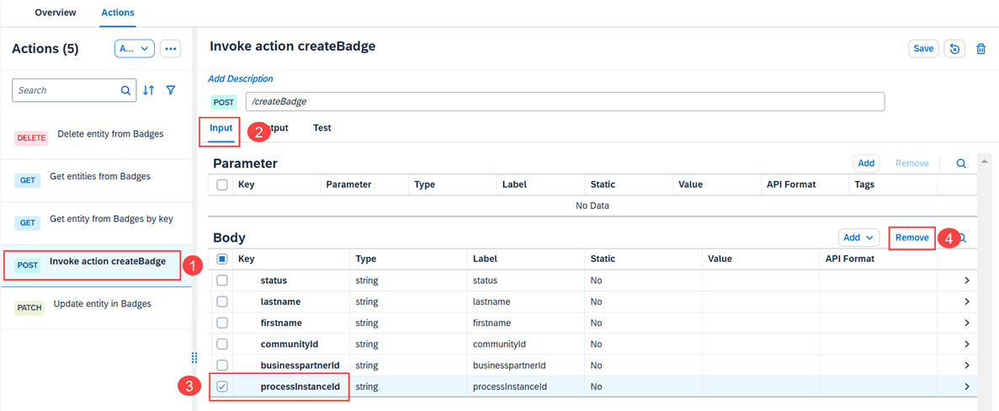

6. Choose **Save**, then **Release**, then **Publish** (confirm each dialog).
7. Select **Invoke action createBadge** again and open the **Test** tab.
   - Check that the destination is `Badge_Service`.
   - Enter these test values, then choose **Test**:

    | Field | Value |
    |---|---|
    | `status` | `NEW` |
    | `lastname` | `Doe` |
    | `firstname` | `John` |
    | `communityId` | `john.doe@bestrunsap.com` (SAP's sample address) |
    | `businesspartnerId` | `1003764` |

    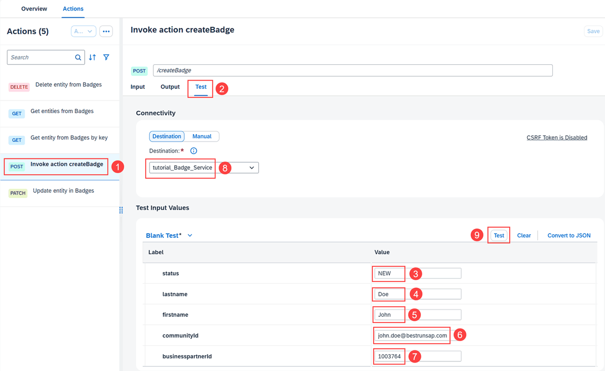

8. Read the response: status 200, with a new `ID`, a numeric `badgeId`, timestamps and the values you sent.

    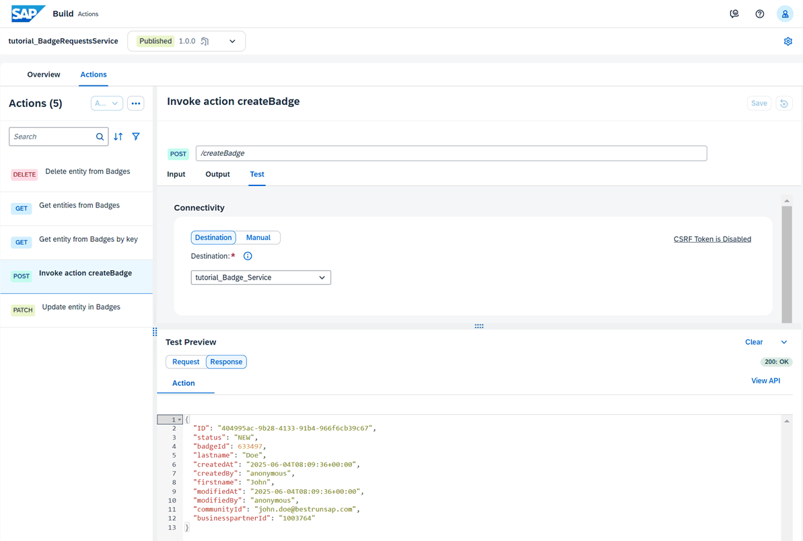

## 22.3 Why it works

- The destination gives the base URL; each action adds its endpoint (19.4a). Testing proves the combination works before any skill depends on it.
- **Trimming outputs** keeps what the skill and the model see small and clear.
- **Changing `badgeId` to number** matters later: Joule Studio maps a value only into a field of the same type.
- **Only published projects** appear in Joule Studio's *Browse All Actions*.

## 22.4 Common mistakes (seen in class)

| What you see | Why | Fix |
|---|---|---|
| *Create* does nothing, or the action list never opens | The browser blocks the new tab as a pop-up | Allow pop-ups for SAP Build, refresh, and start again |
| Too many operations to find the two you need | The generator lists every operation of every entity | Filter by method *GET*; the two business partner actions sit near the end of its list |
| Others' projects mixed with yours | Everyone uses the same tenant and names | Prefix your project name with your own name |
| POST, PATCH or DELETE fail | The mock service supports only GET for business partners | Keep only the operations the service supports |

## 22.5 The same steps with Northwind (Lecture 11)

- Action project from the `NORTHWIND_D` destination, with *get all customers*, *get customer by key*, *get all orders* and *get the customer of an order*.
- Each was tested on its own, for example the customer by key with `ANTON`, before release and publish.

> [!IMPORTANT]
> **🏭 In production**
> - Start from SAP Business Accelerator Hub for standard APIs; it lists each API's operations and status before you build on it.
> - Keep write operations (POST, PATCH, DELETE) in their own action project when you can, so read-only skills cannot reach them by mistake.
>
> *Added by Claude*

## Check yourself

Why must an action project be published, not only released?

- Only published action projects appear in Joule Studio's *Browse All Actions*
- Release creates a version; publishing makes it available to consumers

Can one action project use two destinations?

- No; an action project belongs to one destination
- It can hold many actions for that one system

## How this page was checked

- **SAP tutorial read in full on 21 Nov 2026** (last updated by SAP on 21 Aug 2026).
- **Steps rebuilt on 21 Nov 2026** from the tutorial's source file, with all 21 of its screenshots.
  - Every screenshot was checked for personal data; none needed blurring. The names and addresses shown are SAP's sample data.
  - SAP's page has a *Test yourself* heading, but its public source contains no questions, so none were taken over.
- **Lecture 12 recording:** captions 0:22 to 0:55 (the lecturer builds both projects; learners follow). **Lecture 11:** 0:24 to 0:34 (Northwind actions).
- Not run by me: there is no SAP Build tenant in this workspace.

## Sources

- SAP Developer Center, *Create Action Projects*: https://developers.sap.com/tutorials/joulestudio-skill-action-create.html
- Tutorial source and screenshots: https://github.com/sap-tutorials/sap-build-process-automation (© SAP SE, licensed CC BY 4.0)
- BTPAI course, Lecture 11 Part A (BT023) and Lecture 12 (BT025) recordings

Previous: [Tutorial: Set up environments and destinations for Joule skills](tutorial-joule-skill-setup.md) · Next: [Tutorial: Create and deploy a Joule skill](tutorial-joule-skill-create.md)
