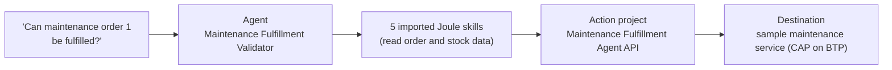

# Tutorial: Create a Joule agent in Joule Studio Classic

*Import a project with five ready-made skills, and build an agent that checks whether a maintenance order can go ahead based on material stock.*

> [!NOTE]
> **📍 At a glance**
> - **SAP tutorial:** [Use Joule Studio, Classic Edition to Create an Agent](https://developers.sap.com/tutorials/joulestudio-agent-create.html)
> - **You will build:** the agent *Maintenance Fulfillment Validator*, using five imported skills, tested in your private environment
> - **You need:** Joule Studio Classic; tutorials [21](tutorial-joule-skill-setup.md) to [23](tutorial-joule-skill-create.md) for the basics
> - **Level:** beginner to intermediate
> - **Concepts:** [Joule Studio Classic](joule-studio-classic.md), 19.5 to 19.8

**After this tutorial you can:**

- Create a destination from a file and import a project from an `.mtar` file
- Configure an agent's expertise, instructions, additional context, models and tools
- Test an agent in your private environment and follow its work in the timeline

## 26.1 What you build

- The backend is a sample CAP service that SAP runs on BTP. Document grounding is left out, because it needs SAP AI Core.

## 26.2 Steps

1. **Destination from a file:** download SAP's `sample-maintenance-service.json`. Cockpit → *Destinations* → *Create* → *From File* → upload → *Check Connection*.
2. **Private environment:** Control Tower → *Environments* → *Activate Private Environment*. Then *Destinations* → *Add* → your destination → *All Environments*.
3. **Import the skills:** download `MaintenanceOrder_SKILLS.mtar`. Lobby → *Import* → upload → *Import*.
   - The project opens with five skills. A published action project, *Maintenance Fulfillment Agent API*, comes with it.
4. **Create the agent:** in the project, *Create* → *Joule Agent*. Name *Maintenance Fulfillment Validator*; describe it as checking whether maintenance orders can proceed based on material stock.
5. **Configure the behaviour.** SAP supplies the texts on its page; their structure:
   - *Expertise:* one line: validates maintenance orders, checks material stock, recommends actions.
   - *Instructions*, in order:
     1. Get the order ID first, and do not continue without it.
     2. Read the order and all its operations and components.
     3. Check stock for every component, including reservations, open purchase orders and blocked stock.
     4. Decide whether the order is ready or blocked.
     5. If blocked, name each short material (required versus available, and why) and recommend actions: buy, expedite, transfer or substitute.
     6. Always end with a short summary.
   - *Additional context:* the tone (clear, professional, supportive) and the audience (maintenance planners).
6. **Models and tools:** keep the default models. Under *Tools* → *Add Tool* → *Joule Skill*, add all five skills. *Save*.
7. **Test:** *Test* → your private environment and the destination → ask whether maintenance order 1 can be fulfilled based on current stock.
   - Open the *Timeline* and click each skill to see its inputs and outputs. *Stop Testing* when done.

## 26.3 Why it works

- **The description** decides when Joule picks this agent, exactly as for skills.
- **The instructions** are the agent's program: a fixed order, a clear decision rule and a fixed ending (19.5).
- **Skills as tools:** the agent plans, calls skills one by one, checks the results and repeats until it can answer, within the step limit (19.6).
- **The imported destination** has no action properties, because the action project arrives ready-made; nothing is generated from it (19.3).

## 26.4 Common mistakes and tips (seen in class)

| What you see | Why | Fix |
|---|---|---|
| "Project already imported" | Someone in the same tenant imported it first | Rename your copy after import (prefix your name). If the name still clashes, the name inside the `.mtar` file must be changed |
| The test panel shows little detail | The current UI shows the steps in the thinking panel | Expand the thinking and the timeline nodes |
| The agent stops halfway | Too few execution steps | Keep the default 25; raise it for many components |

- **Instructions are hard to write?** Describe the task to an AI assistant and ask it for a concise prompt (*meta-prompting*), then edit the result.
- **Try more than one model:** run the same two or three requests with each provider before you pick.

## 26.5 The same idea with Northwind (Lecture 11)

- Agent *Get Orders Info* with two skills, *Get Orders* and *Get Customer by Key*.
- Instructions told it to fetch the orders, look up each customer, and answer with order ID and company name instead of the customer ID.
- Vague instructions mixed orders and customers in the answer. Step-by-step instructions with the output format fixed it.

> [!IMPORTANT]
> **🏭 In production**
> - This agent only reads. Before you add skills that create purchase requisitions or stock transfers, switch on *Require user confirmation* for them (19.5).
> - Keep the instruction text under version control; small wording changes alter the agent's decisions.
>
> *Added by Claude*

## Check yourself

Is SAP AI Core required for Joule Studio skills and agents?

- No; only for document grounding, which this tutorial leaves out
- Models for agents come from SAP's central service

Why does the agent ask for the order ID before doing anything?

- Its instructions say to get and validate the ID first
- Without it, every later skill call would fail or guess

## How this page was checked

- **SAP tutorial read in full on 21 Nov 2026** (created Dec 2025, last updated by SAP on 21 Aug 2026).
- **Lecture 12 recording:** captions 2:12 to 2:31 (import, agent set-up, meta-prompting, test). **Lecture 11:** 2:11 to 2:45 (the Northwind agent).
- Not run by me: there is no SAP Build tenant in this workspace.

## Sources

- SAP Developer Center, *Use Joule Studio, Classic Edition to Create an Agent*: https://developers.sap.com/tutorials/joulestudio-agent-create.html
- SAP Help, *Create a Joule Agent*: https://help.sap.com/docs/joule-studio-classic/joule-studio-classic-edition/create-joule-agent
- BTPAI course, Lecture 11 Part A (BT023) and Lecture 12 (BT025) recordings

Previous: [Tutorial: Run an automated process from a Joule skill](tutorial-joule-skill-process.md) · Next: [Tutorial: Build an HR assistant with intent-based development](tutorial-joule-studio-hr-assistant.md)
