# Tutorial: Bring SAP Analytics Cloud insights into Joule

*Let users ask Joule business questions such as "sales by state this year" and get a chart back from SAP Analytics Cloud. You wire it through SAP Build Work Zone and the Identity Provisioning service.*

> [!NOTE]
> **📍 At a glance**
> - **Sources:** the course's step-by-step guide *Joule Integration with SAC* (Mentors Pool, course Drive), checked against SAP Help's *Integration with SAP Analytics Cloud* (read 21 Nov 2026)
> - **You will build:** Joule's *analytical insights*: a Joule formation with the SAP Analytics Cloud (SAC) capability, two destinations, a Work Zone content provider and user provisioning with IPS
> - **You need:** SAP BTP global account admin rights, Joule entitlements, an SAC tenant with Just Ask switched on and at least three free OAuth client slots, and SAP Cloud Identity Services
> - **Level:** advanced (administrator)
> - **Concepts:** [The Joule family](joule-family.md) (the Joule booster), [Identity and trust](btp-identity-trust-federation.md)

**After this tutorial you can:**

- Explain why Work Zone and IPS sit between SAC and Joule
- Create the SAC OAuth clients, the design-time and runtime destinations, and the content provider
- Provision SAC users and roles to Work Zone with IPS, and test a question in Joule

## 29.1 What you build

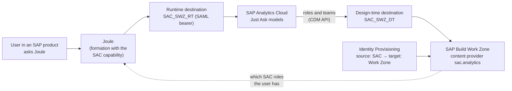

- **Joule does not open inside SAC.** Users ask from another SAP product where Joule is enabled, and the answer comes from SAC (SAP Help).
- **Work Zone is required** since the Joule 2506 release: it holds the SAC roles and the users synced by IPS. Setups made before 2506 must be redone (SAP Help).
- **Only models indexed by Just Ask** in SAC can be asked about, so the SAC admin decides which data Joule can see.

## 29.2 Steps

*Steps from the course's guide, checked against SAP Help (21 Nov 2026); where they differ, SAP's version is used and a note shows the course's.*
*Screenshots come from the course guide, cropped, with names, IDs and addresses blurred.*

### Step 1: Prepare the subaccounts and trust

1. **Joule subaccount:** create a subaccount (the guide's example: `JouleBATTesting`), enable Cloud Foundry, and create a space (`JouleSpace`). Leave the space settings at their defaults.
2. **Identity subaccount (the guide's recommendation):** a separate subaccount for identity provisioning, for example `JouleIDP`, with Cloud Foundry and a space `JouleIDPSpace`.
   - Under **Entitlements → Configure Entitlements**, add **Cloud Identity Services**, plan **additional-tenant (Application)**, and save.
   - Create it from the **Service Marketplace** or **Instances and Subscriptions → Create**, with type **TEST** (or what your landscape needs).
3. **Trust:** in the Joule subaccount, choose **Security → Trust Configuration → Establish Trust**, select the Identity Authentication tenant you created, then **Next → Finish**.

    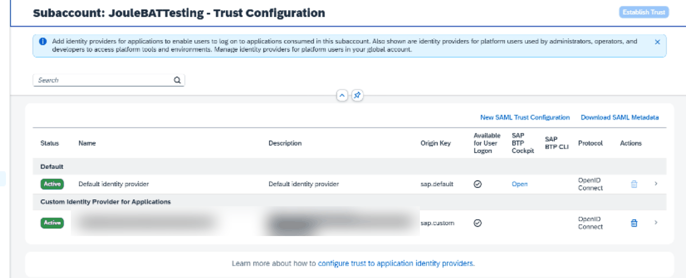

4. **Destination trust:** choose **Connectivity → Destination Trust → Generate Trust**, so destinations and subscribed services can talk securely.

### Step 2: Add SAP Build Work Zone and its service key

1. **Entitlements → Configure Entitlements:** add **SAP Build Work Zone, standard edition** with the plans **standard** and **standard (Application)**, then **Add Service Plans** and **Save**.

    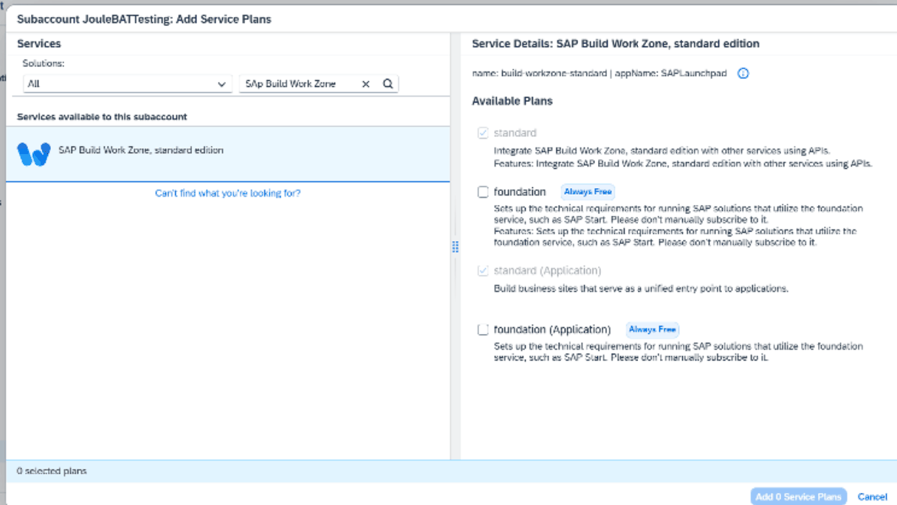

2. **Subscribe:** **Instances and Subscriptions → Create**: service *SAP Build Work Zone, standard edition*, plan *standard*.
3. **Create an instance:** runtime *Cloud Foundry*, space `JouleSpace`, instance name `SWZJoule` (your choice).
4. **Service key:** on the instance, **⋮ → Create Service Key**, name `SWZInstanceKey`, and download the JSON. IPS needs it in step 7.

> [!CAUTION]
> **🔒 Keys and secrets**
> - The service key and every OAuth client secret in this tutorial are credentials. Store them in a password manager, never in notes, tickets or Git.
> - SAC shows each client secret only once. If you lose one, delete the OAuth client and create a new one.

### Step 3: Enable Joule with the SAC capability

1. In the **global account → Systems**, register your **SAP Cloud Identity Services** system if it is not there yet, and refresh the entitlements (the guide's step).
2. **No Joule formation yet:** in **Boosters**, start **Setting Up Joule** for the Joule subaccount (plan *standard*). In the booster:
   - **Select Integrations:** the SAP products where users will open Joule. Do **not** pick SAP Analytics Cloud here.
   - **Select Capabilities:** the **SAP Analytics Cloud** capability package.
   - **Set Up Integrations:** a formation name, your SAC system, and the Cloud Identity Services system that trusts this subaccount.
3. **A Joule formation already exists:** do not run the booster again. Add the SAC system to the existing formation, with *Enable Capability Deployment* selected.
4. **Result:** the booster adds an OAuth client and a trusted identity provider in SAC (**System → Administration → App Integration**). It also creates the runtime destination `DYN_SAC_SSO` in the subaccount.

> [!NOTE]
> **Course guide and SAP Help differ**
> - **Products in the booster:** the guide picks *SAP Build Work Zone* and *SAP Analytics Cloud* as products. SAP Help says the integration product is where users open Joule, and should not be SAC.
> - **NavigationService destination:** the guide imports it by hand when the booster has not created it. SAP Help says setups after 13 Oct 2025 no longer need it configured manually.
> - The steps above follow SAP Help in both cases.

### Step 4: Create two OAuth clients in SAC

1. In SAC, choose **System → Administration → App Integration**. Under **Configured Clients**, choose **Add an OAuth Client**.
   - Check that you have three free slots: the booster's client plus your two.

    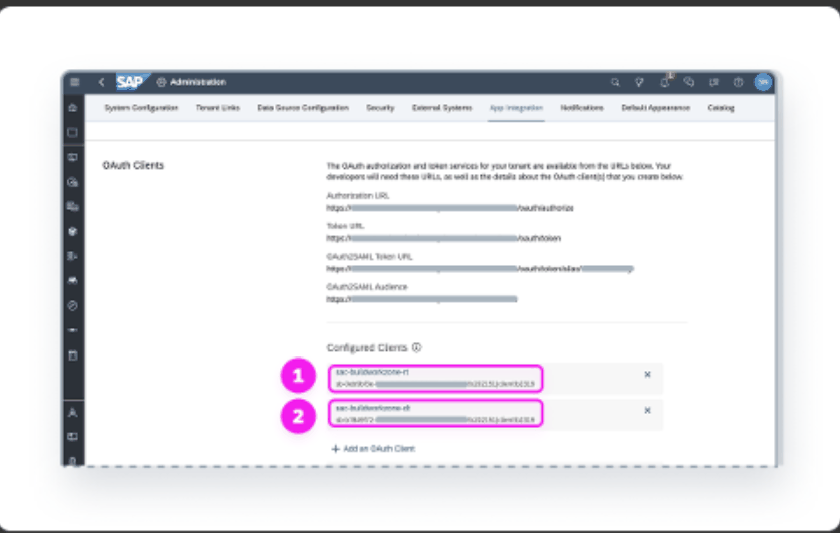

2. **Design-time client** (reads role and team definitions):

    | Field | Value |
    |---|---|
    | Name | `sac-buildworkzone-dt` (example) |
    | Purpose | API Access |
    | Access | User Provisioning |
    | Authorization Grant | Client Credentials |
    | Token Lifetime | a positive number of minutes, hours or days; empty means infinite |

   - Choose **Add**, then **Copy Secret**. Note the **Client ID** and the **Token URL** shown on the App Integration tab.
3. **Runtime client** (lets Joule call SAC as the signed-in user):

    | Field | Value |
    |---|---|
    | Name | `sac-buildworkzone-rt` (example) |
    | Purpose | API Access |
    | Access | Data Export Service |
    | Authorization Grant | SAML 2.0 Bearer |

    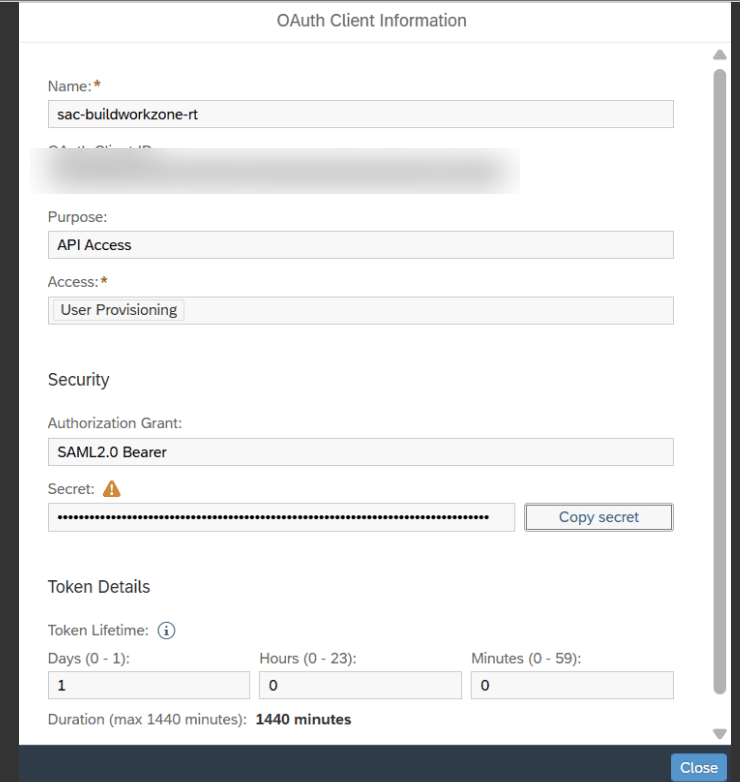

> [!NOTE]
> **Course guide and SAP Help differ**
> - **Who creates the runtime client:** the guide says the booster creates it and you add only the design-time client. SAP Help says to create both clients yourself, which is why three free slots are needed.
> - **Access of the runtime client:** the guide's screenshot shows *User Provisioning*; SAP Help says *Data Export Service*.
> - The steps above follow SAP Help.

### Step 5: Create the two destinations

1. In the Joule subaccount, choose **Connectivity → Destinations → Create → From Scratch** for the **design-time destination**:

    | Property | Value |
    |---|---|
    | Name | `SAC_SWZ_DT` |
    | Type / Proxy Type | HTTP / Internet |
    | URL | `https://<your SAC domain>/api/v1/cdm` (the part of the SAC address before `/sap/fpa/ui/…`) |
    | Authentication | OAuth2ClientCredentials |
    | Client ID / Client Secret | the design-time client's ID and secret |
    | Token Service URL | SAC's Token URL from App Integration |
    | Token Service URL Type | Dedicated |
    | Use Basic credentials for Token Service | selected |
    | Token Service User / Password | the design-time client's ID and secret |
    | Additional properties | `HTML5.SetXForwardedHeaders` = `false`, `URL.headers.x-sap-sac-custom-auth` = `true` |

2. For the **runtime destination**, find `DYN_SAC_SSO` (from the booster), choose **Duplicate**, and name the copy `SAC_SWZ_RT`. Then change:
   - **Token Service User:** the runtime client's ID
   - **Token Service Password:** the client secret. SAP's page names the design-time secret here, while the user and key belong to the runtime client; check which your tenant accepts.
   - **SAML Properties → Client Key:** the runtime client's ID
   - **Additional properties:** `sap-card-nominations-path` = `/api/v1/interest-cards` and `sap-start` = `true`
3. The course's exported destinations show the result. Names and authentication types are as exported; the tenant and client IDs are replaced here:

    ```json
    {"Name": "SAC_SWZ_DT", "Type": "HTTP", "ProxyType": "Internet",
     "URL": "https://<sac-tenant>.<region>.analytics.cloud.sap/api/v1/cdm",
     "Authentication": "OAuth2ClientCredentials", "tokenServiceURLType": "Dedicated",
     "HTML5.SetXForwardedHeaders": "false", "URL.headers.x-sap-sac-custom-auth": "true"}

    {"Name": "SAC_SWZ_RT", "Type": "HTTP", "ProxyType": "Internet",
     "URL": "https://<sac-tenant>.<region>.analytics.cloud.sap",
     "Authentication": "OAuth2SAMLBearerAssertion", "SAMLAssertionProvider": "DestinationServiceGenerated",
     "nameIdFormat": "urn:oasis:names:tc:SAML:1.1:nameid-format:emailAddress", "userIdSource": "email",
     "HTML5.DynamicDestination": "true",
     "sap-card-nominations-path": "/api/v1/interest-cards", "sap-start": "true"}
    ```

   - The course's design-time export has no basic-credential properties; SAP Help now lists them (table above).

### Step 6: Create the content provider in Work Zone

1. In the subaccount, choose **Services → Service Marketplace → SAP Build Work Zone → Go to Application**. In Site Manager, open **Channel Manager → + New → Content Provider**:

    | Field | Value |
    |---|---|
    | Title / ID | `sac.analytics` / `sac.analytics` |
    | Design-Time Destination | `SAC_SWZ_DT` |
    | Runtime Destination | `SAC_SWZ_RT` |
    | Runtime Destination for Dynamic Data | Use default runtime destination |
    | Automatically add all content items to subaccount | on |
    | Use the Identity Provisioning service to provision user authorizations | on |
    | Include group and catalog assignments to roles | off |

    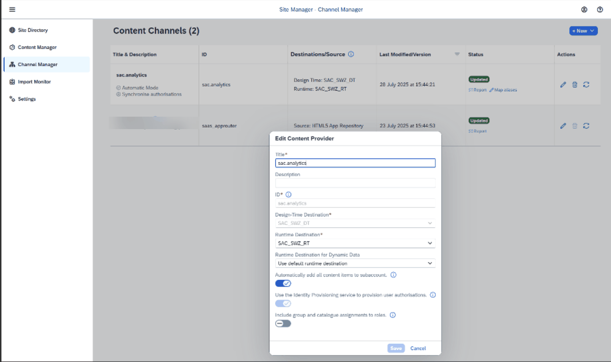

2. **Save.** Open **Content Manager**: the SAC roles now appear as items of the `sac.analytics` channel.
   - The SAC *System Owner* role is never imported.

    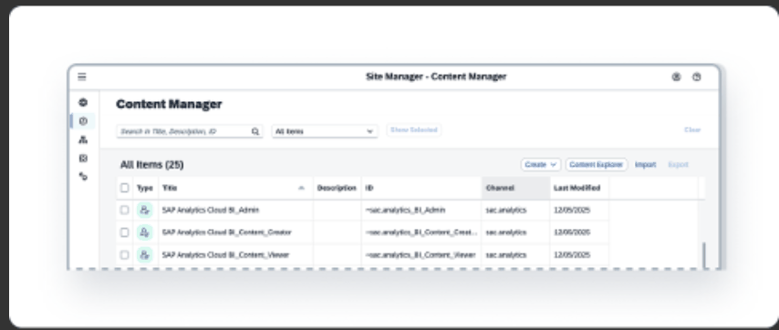

> [!NOTE]
> **Role changes later**
> - **Course guide:** role changes in SAC need a manual refresh in Channel Manager.
> - **SAP Help:** since the SAC 2026.4 and Q2 2026 releases, changes to roles and teams with the Joule privilege are re-imported automatically.
> - To switch this on, refresh the `sac.analytics` provider once by hand after that release.

### Step 7: Provision users with IPS

1. In SAC, create an OAuth client for IPS (the course named it `sac-joule-ips-integration`) with grant **Client Credentials** and access including **User Provisioning**.

    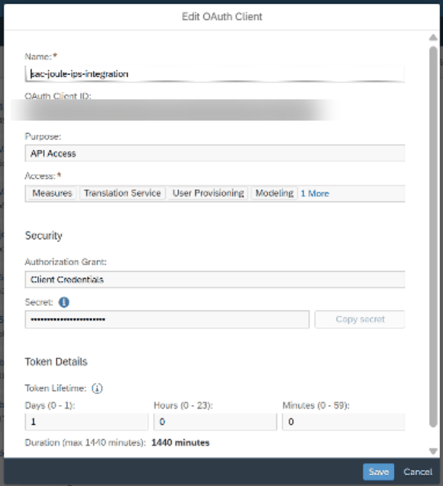

2. In the **Cloud Identity Services admin console**, choose **Identity Provisioning → Source Systems → Add**: type *SAP Analytics Cloud*. SAP wants a source system just for this integration. Properties:

    | Property | Value |
    |---|---|
    | Type / ProxyType | HTTP / Internet |
    | URL | SAC base URL (no path) |
    | Authentication | BasicAuthentication |
    | User / Password | the IPS client's ID and secret |
    | OAuth2TokenServiceURL | SAC's token URL |
    | `sac.api.version` | `2`, set **before the first save** |
    | `ips.http.header.x-sap-scim-groups-v3` | `true` |

    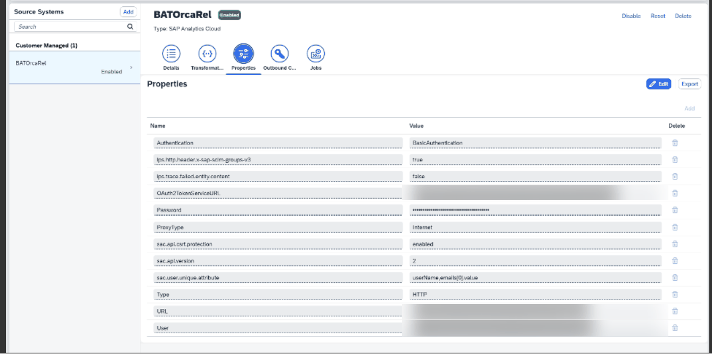

3. **Transformations:** paste SAP's default transformation for the SAC SCIM API v2.
4. **Target system:** add **SAP Build Work Zone, standard edition**.
   - Use the URL, client ID and secret from the `SWZInstanceKey` service key, and SAP's default transformation.
   - Choose your SAC source system, and set `cflp.providerId` = `sac.analytics`, the content provider's ID.
5. **Simulate:** on the SAC source system's **Jobs** tab, choose **Run Now** on *Simulate Job*. **Identity Provisioning → Provisioning Logs** should show no errors.

    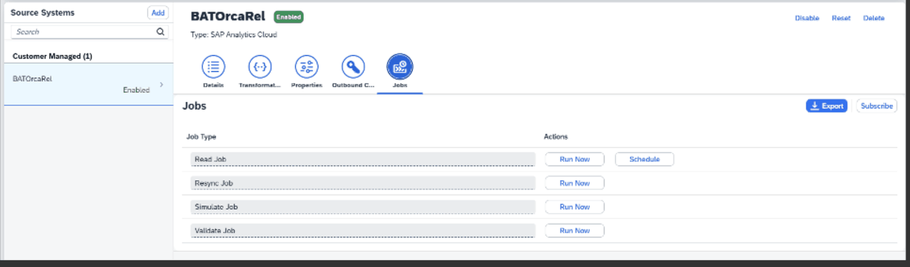

6. **Run:** choose **Run Now** on *Read Job*, and check the logs again.

    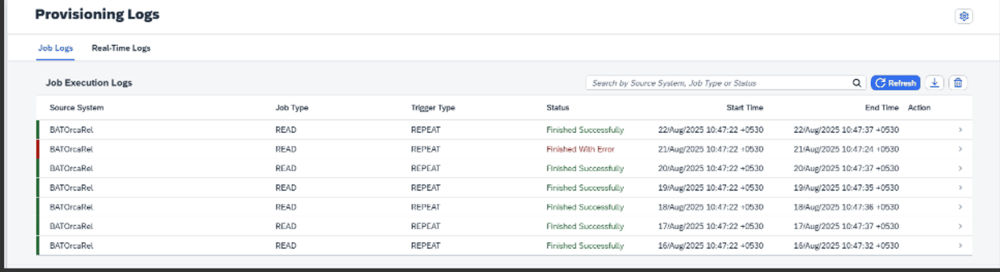

7. **Validate:** sign in to Work Zone as a user with *Launchpad_Admin*. Under **Settings → Identity Provisioning**, enter an SAC user's email and check their role IDs.
   - No roles? Run *Resync Job* on the source system.

    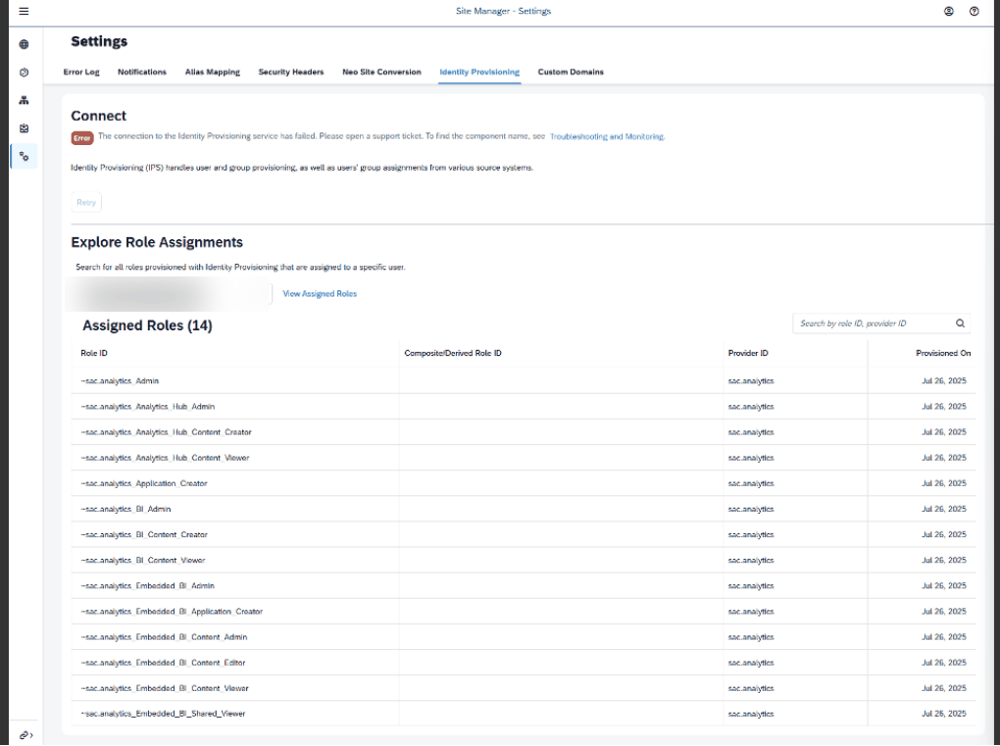

   - The screenshot also shows a *connection failed* banner at the top, while the roles below did arrive: check both.
8. **Schedule:** on the *Read Job* row choose **Schedule**, so new SAC users and role changes keep flowing.

### Step 8: Give users access and test

1. **In the Joule subaccount:** create the role collection `Joule_User` with the Joule roles (plus *Launchpad_Admin* where site admin access is needed). Assign it to the users from your identity provider.
   - The guide also gives the users *Launchpad_Admin* and *Launchpad_External_User*. Sign out and in again.
2. **In SAC:**
   - Users need **Read** on the **Joule** privilege, and **Maintain** on the **Just Ask** privilege to index models.
   - Just Ask must be on: **System → Administration → Default Appearance → Conversational Analytics**.
   - The sample model `My Files/Samples/Sales_SampleModel` is indexed by default. Add your own acquired models, or SAP Datasphere analytic models in a Business Data Cloud formation, under Just Ask's *Manage models*.
3. **Test:** open Joule in your SAP product and ask *"Show me sales by state year to date"*. A chart from the sample model should come back.

## 29.3 Why it works

- **Two destinations, two jobs:**
  - The design-time destination reads SAC's role and team definitions through the CDM API (`/api/v1/cdm`).
  - The runtime destination calls SAC as the signed-in user through a SAML bearer assertion, so SAC's own permissions apply.
- **The content provider** turns SAC roles into Work Zone content. **IPS** then copies users and their role assignments, so Joule knows what each user may ask.
- **Just Ask indexing** is the data gate: an unindexed model stays invisible to Joule.

## 29.4 Things to watch

| What you see | Why | Fix |
|---|---|---|
| The booster or formation reports an error | More than one SAC tenant in the Joule formation | Exclude extra tenants; only one is supported |
| *Add an OAuth Client* is missing in SAC | No free client slots | Free up slots; the setup needs three |
| IPS transformations look wrong | `sac.api.version` was not `2` at the first save | Set it, then reset the transformations |
| Roles missing for a user in Work Zone | The read job did not pick up the change | Run *Resync Job* |
| Joule answers but has no data | No Joule *Read* permission, or the model is not indexed in Just Ask | Fix the SAC role; index the model |
| A team's privileges never arrive | Team named `SAP_BuildWorkZone_Users`, or a role and a team share one name | Rename; for duplicate names only the role syncs |

> [!IMPORTANT]
> **🏭 In production**
> - Give OAuth tokens a finite lifetime and rotate client secrets on a schedule; an empty lifetime means the token never expires.
> - Test with a normal business user, not an admin: admins hide missing role assignments.
> - Watch the IPS provisioning logs after each scheduled run; a failed read job silently freezes role changes.
>
> *Added by Claude*

## Check yourself

<details class="qa"><summary>Why is SAP Build Work Zone part of an SAC-to-Joule setup at all?</summary>

- Since Joule 2506, Work Zone holds the SAC roles (content provider) and the synced users (IPS)
- Joule reads from there which SAC content a user may reach

</details>

<details class="qa"><summary>A user can open Joule but gets no SAC answers. Name two checks.</summary>

- Their SAC role has *Read* on the Joule privilege, and IPS has synced them (Work Zone → Settings → Identity Provisioning)
- The model they ask about is indexed in Just Ask

</details>

## How this page was checked

- **Course guide read in full on 21 Nov 2026:** *Joule Integration with SAC Step by Step guide* (28 pages, 26 screenshots; 11 used, cropped and blurred).
- **The course's two destination exports read:** their secrets were already removed. The tenant name and client IDs are not copied here.
- **SAP Help read on 21 Nov 2026:** *Integration with SAP Analytics Cloud* and its four step pages, and *Configure Destination to Use Navigation Service*. Five differences are shown in the notes above.
- Not run by me: there is no SAC, Work Zone or IPS tenant in this workspace.

## Sources

- BTPAI course Drive: *Joule Integration with SAC Step by Step guide* (BT056) and the destination exports *SAC_SWZ_DT.json* and *SAC_SWZ_RT.json* (BT079, BT080)
- SAP Help, *Integration with SAP Analytics Cloud*: https://help.sap.com/docs/joule/integrating-joule-with-sap/integration-with-sap-analytics-cloud
- SAP Help, *Enable the Analytical Insights Capability in Joule*: https://help.sap.com/docs/joule/integrating-joule-with-sap/enable-analytical-insights-capability-in-joule
- SAP Help, *Consume Role and Team Definitions Content from SAP Analytics Cloud*: https://help.sap.com/docs/joule/integrating-joule-with-sap/consume-role-definition-content-from-sap-analytics-cloud
- SAP Help, *Provision Users from SAP Analytics Cloud to SAP Build Work Zone Using IPS*: https://help.sap.com/docs/joule/integrating-joule-with-sap/provision-users-from-sap-analytics-cloud-to-sap-build-work-zone-using-ips
- SAP Help, *Index Your Data Using Just Ask and Test Your Integration*: https://help.sap.com/docs/joule/integrating-joule-with-sap/index-your-data-using-just-ask-and-test-your-integration
- SAP Help, *Configure Destination to Use Navigation Service*: https://help.sap.com/docs/joule/integrating-joule-with-sap/configure-destination-to-use-navigation-service

Previous: [Tutorial: Extend SAP's AP Invoice Agent](tutorial-joule-studio-agent-extension.md) · Next: [Tutorial: Build a full-stack CAP app with AI Chat (Joule) in Business Application Studio](tutorial-joule-bas-full-stack-cap.md)
