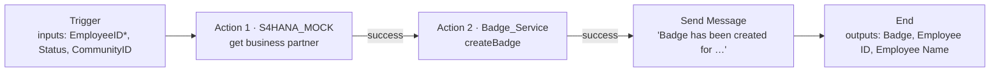

# Tutorial: Create and deploy a Joule skill

*Build a skill that chains two API calls: it looks up an employee in the SAP system, creates a badge for them in a second system, and confirms with a custom message.*

> [!NOTE]
> **📍 At a glance**
> - **SAP tutorial:** [Use Joule Studio, Classic Edition to Create and Deploy a Joule Skill](https://developers.sap.com/tutorials/joulestudio-skill-create.html) (part 3 of 5)
> - **You will build:** the skill *CreateBadge* with inputs, two actions, a message card and outputs, deployed to your environment
> - **You need:** the destinations from [tutorial 21](tutorial-joule-skill-setup.md) and the published action projects from [tutorial 22](tutorial-joule-action-projects.md)
> - **Level:** beginner
> - **Concepts:** [Joule Studio Classic](joule-studio-classic.md), 19.4 and 19.8

**After this tutorial you can:**

- Define a skill's inputs and outputs, and switch off Joule's own reply
- Chain two actions, each with its own destination variable, and map data between them
- Release, deploy and test a skill in the standalone Joule assistant

## 23.1 What you build

## 23.2 Steps

1. **Create the project and skill.** Lobby → *Create* → *Joule Skill* → name, description → *Review* → *Create*. In Joule Studio, *Create* → *Joule Skill*:
   - name `CreateBadge`
   - description along the lines of "create a badge for an employee, given the employee's ID"
2. **Parameters** (open the *Trigger* side panel):
   - Switch off *Allow Joule to generate a response*, because this skill sends its own message.
   - *Skill Inputs:* `EmployeeID` (required), `Status`, `CommunityID`.
   - *Skill Outputs:* `Badge` (number), `Employee ID` (string), `Employee Name` (string), all required.
   - *Save*. The design console now shows errors; they disappear once the End step is mapped.
3. **First action:** **+** between Trigger and End → *Call Action* → *Browse All Actions* → the action that reads one business partner by number.
   - Create the destination variable `S4HANA_MOCK` and select it.
   - Map the action input `BusinessPartner` to the skill input `EmployeeID`.
4. **Second action:** **+** after the first action, on its success path → `createBadge`.
   - Create and select the destination variable `Badge_Service`.
   - Map the business partner ID and names from action 1's result, and status and community ID from the skill inputs.
5. **Send Message:** **+** before End → *Send Message* → *Open Message Editor*.
   - Title "Badge Request", and a text with the badge ID and first name inserted through data mapping (`<>`).
   - Optionally add a button that links to the badge system.
6. **End:** map `Badge` to the new badge ID, `Employee ID` to the business partner, `Employee Name` to the first name. *Save*.
7. **Release and deploy:** *Release* → *Show project version* → *Deploy* → choose your environment and the real destination for each variable → *Deploy*.
8. **Test:** Control Tower → *Environments* → your environment → *Joule* → *Launch*, and ask for a badge for employee `1003764` with status `NEW` and a community ID.
   - SAP's page gives a shared demo login for viewing the badge system. It is not repeated here.

## 23.3 Why it works

- **Inputs** come from the chat as text; Joule fills them in the *resolving input slots* step, and asks for `EmployeeID` because it is required (19.4).
- **Two destination variables** keep the skill independent of real systems; you choose them at test and deploy time.
- **Outputs** make the skill usable by agents and other skills. The message card is only for users who call the skill directly; inside an agent it does not run (19.5).

> [!NOTE]
> **Your own message, or Joule's?**
> - This tutorial switches off *Allow Joule to generate a response* and writes a fixed message card.
> - The lecturer called that a process-automation habit. For skills that agents will use, leave it on, since agents read only the outputs anyway.
> - Tutorial 24 shows the other way, with Joule writing the reply.

## 23.4 Common mistakes (seen in class)

| What you see | Why | Fix |
|---|---|---|
| Action 2 cannot find the business partner fields | Action 2 was added on the error (4XX) branch of action 1 | Delete it and add it on the success branch, or just above End |
| 404 from the badge service | The two destinations were swapped when testing | `S4HANA_MOCK` for the business partner action, `Badge_Service` for createBadge |
| *result* cannot be bound in End | The output type does not match the action's success schema | Pick the schema of the same action, ending in `200` |
| *Test* is missing | You are looking at the released version | Switch the version back to *editable* |
| A field cannot be mapped (greyed out) | Text input into a number field | *Apply formula* and convert, for example string to number |

- **In class**, learners skipped release and deploy and used *Test* from the editable version, picking the destinations there. Deployment came later.

## 23.5 The same steps with Northwind (Lecture 11)

- *Get Orders:* one action, no inputs, the output bound to the orders schema.
- *Get customer by key:* a required `CustomerID` input mapped to the action's key, so Joule asked for the ID when it was missing.
- *Top N:* an optional "number of orders to return" input, converted to a number and mapped to `$top`.

> [!IMPORTANT]
> **🏭 In production**
> - Skills that create data should run inside an agent with *Require user confirmation* switched on (19.5), so a person sees the badge request before it is sent.
> - Keep one action per skill where you can; chained calls are harder to test and to reuse.
>
> *Added by Claude*

## Check yourself

Why does the skill ask for the employee ID when you leave it out?

- `EmployeeID` is a required input, so Joule must fill it before running
- It asks the user in a follow-up question

Why add the second action on the success path?

- Only the success path carries the business partner data that action 2 needs
- The error path carries the error payload

## How this page was checked

- **SAP tutorial read in full on 21 Nov 2026** (last updated by SAP on 21 Aug 2026).
- **Lecture 12 recording:** captions 0:56 to 1:45 (building, testing and fixing the skill). **Lecture 11:** 0:34 to 1:00 and 1:31 to 1:53 (Northwind skills, inputs, `$top`).
- Not run by me: there is no SAP Build tenant in this workspace.

## Sources

- SAP Developer Center, *Use Joule Studio, Classic Edition to Create and Deploy a Joule Skill*: https://developers.sap.com/tutorials/joulestudio-skill-create.html
- SAP Help, *Create a Joule Skill*: https://help.sap.com/docs/joule-studio-classic/joule-studio-classic-edition/create-joule-skill
- BTPAI course, Lecture 11 Part A (BT023) and Lecture 12 (BT025) recordings

Previous: [Tutorial: Create action projects](tutorial-joule-action-projects.md) · Next: [Tutorial: Filter an action and let Joule write the reply](tutorial-joule-action-filter.md)
